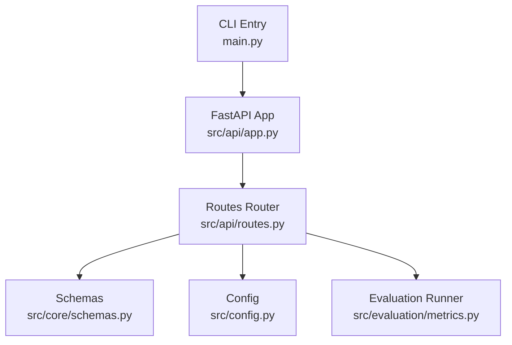
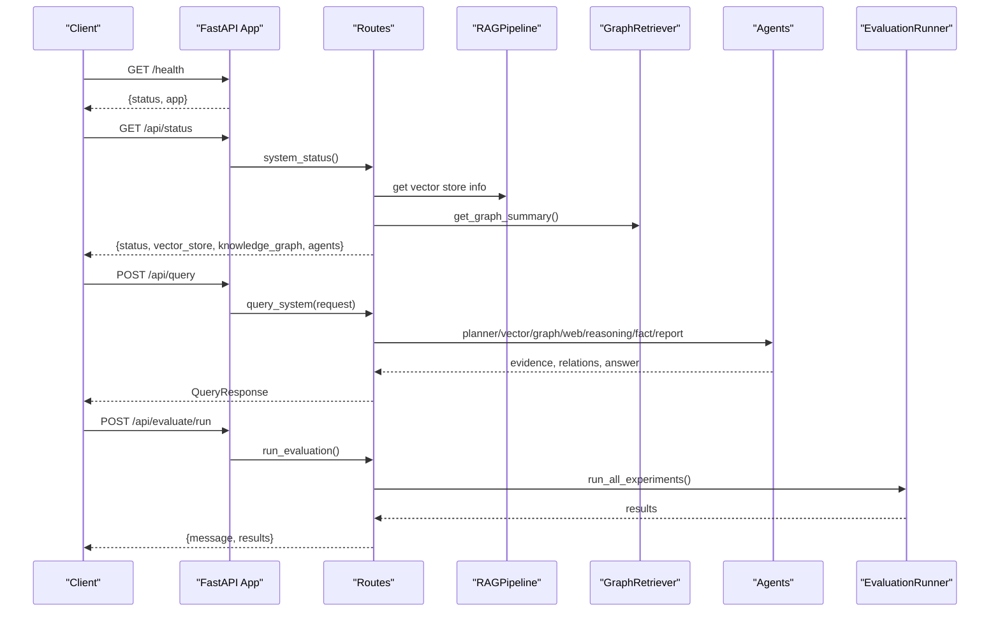
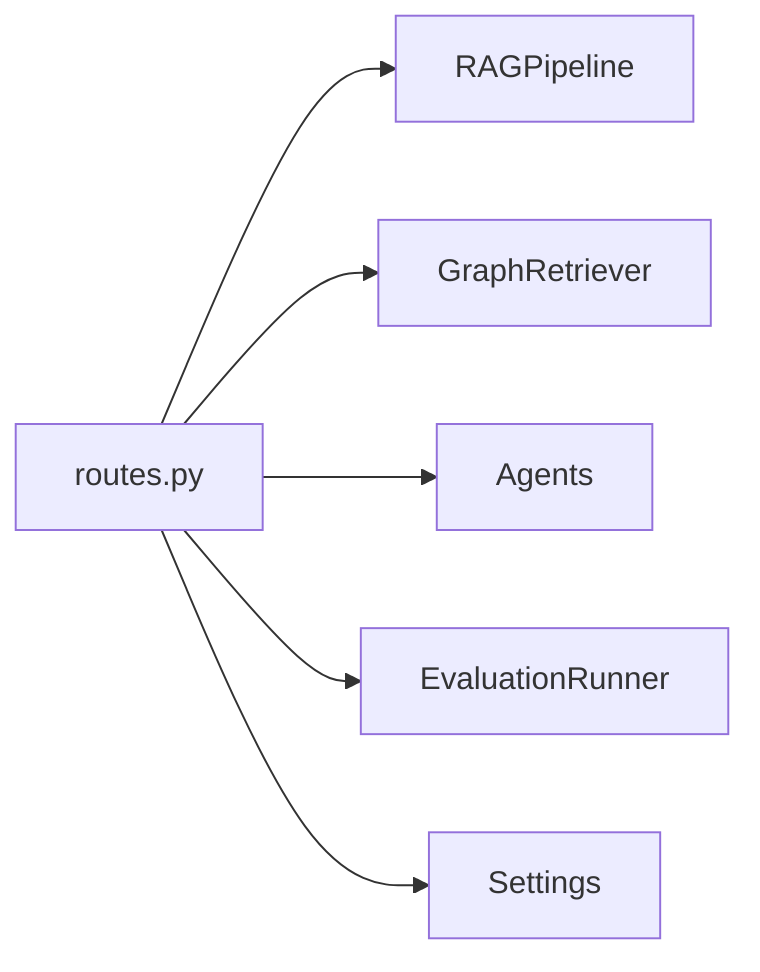

# API Reference

<cite>
**Referenced Files in This Document**
- [main.py](file://main.py)
- [src/api/app.py](file://src/api/app.py)
- [src/api/routes.py](file://src/api/routes.py)
- [src/core/schemas.py](file://src/core/schemas.py)
- [src/config.py](file://src/config.py)
- [src/evaluation/metrics.py](file://src/evaluation/metrics.py)
- [README.md](file://README.md)
</cite>

## Table of Contents
1. Introduction
2. Project Structure
3. Core Components
4. Architecture Overview
5. Detailed Component Analysis
6. Dependency Analysis
7. Performance Considerations
8. Troubleshooting Guide
9. Conclusion
10. Appendices

## Introduction
This document provides comprehensive API reference documentation for the FastAPI REST endpoints that expose programmatic access to the Graph RAG + Multi-Agent Research System. It covers all HTTP methods, URL patterns, request/response schemas, authentication, error handling, and practical integration examples. The system supports health checks, system status reporting, document ingestion (single file and directory), knowledge graph operations, research queries across multiple experiment modes, and evaluation benchmarks.

## Project Structure
The API is implemented with FastAPI and organized into:
- Application entry point and lifecycle management
- Route definitions for all endpoints
- Pydantic schemas for typed requests/responses
- Configuration via environment variables
- Evaluation runner for benchmarking

**Diagram sources**
- [src/api/app.py:26-53](file://src/api/app.py#L26-L53)
- [src/api/routes.py:116-353](file://src/api/routes.py#L116-L353)
- [src/core/schemas.py:17-168](file://src/core/schemas.py#L17-L168)
- [src/config.py:21-82](file://src/config.py#L21-L82)
- [src/evaluation/metrics.py:139-224](file://src/evaluation/metrics.py#L139-L224)
- [main.py:24-28](file://main.py#L24-L28)

**Section sources**
- [src/api/app.py:26-53](file://src/api/app.py#L26-L53)
- [src/api/routes.py:116-353](file://src/api/routes.py#L116-L353)
- [src/core/schemas.py:17-168](file://src/core/schemas.py#L17-L168)
- [src/config.py:21-82](file://src/config.py#L21-L82)
- [src/evaluation/metrics.py:139-224](file://src/evaluation/metrics.py#L139-L224)
- [main.py:24-28](file://main.py#L24-L28)

## Core Components
- FastAPI application with CORS enabled and versioned metadata
- Health endpoint at root path
- API router mounted under /api prefix
- Typed request/response models using Pydantic
- Lazy initialization of RAG pipeline, graph retriever, and agents
- Evaluation runner for benchmarking experiments

Key responsibilities:
- Health check returns service status
- Status endpoint reports vector store, knowledge graph summary, and available agents
- Document ingestion stores files and indexes them into vector store
- Knowledge graph build extracts entities and relationships from documents
- Query endpoint orchestrates multi-agent research pipeline
- Evaluate endpoint runs benchmark suite and returns results

**Section sources**
- [src/api/app.py:26-53](file://src/api/app.py#L26-L53)
- [src/api/routes.py:28-75](file://src/api/routes.py#L28-L75)
- [src/core/schemas.py:17-168](file://src/core/schemas.py#L17-L168)

## Architecture Overview
The API exposes a set of REST endpoints that coordinate retrieval from vector stores, knowledge graphs, and web search, then synthesize answers through reasoning and fact-checking agents.

**Diagram sources**
- [src/api/app.py:49-52](file://src/api/app.py#L49-L52)
- [src/api/routes.py:116-131](file://src/api/routes.py#L116-L131)
- [src/api/routes.py:188-338](file://src/api/routes.py#L188-L338)
- [src/evaluation/metrics.py:165-177](file://src/evaluation/metrics.py#L165-L177)

## Detailed Component Analysis

### Health Check
- Method: GET
- Path: /health
- Description: Returns basic service health information
- Request: None
- Response: JSON object with status and app name
- Error codes: None expected

Example curl:
curl http://localhost:8080/health

Python client snippet:
requests.get("http://localhost:8080/health")

**Section sources**
- [src/api/app.py:49-52](file://src/api/app.py#L49-L52)

### System Status
- Method: GET
- Path: /api/status
- Description: Returns operational status including vector store details, knowledge graph summary, and available agent roles
- Request: None
- Response fields:
  - status: string indicating operational state
  - vector_store: object with type and document_count
  - knowledge_graph: object summarizing graph metrics
  - agents: list of agent role identifiers
- Error codes: None expected

Example curl:
curl http://localhost:8080/api/status

Python client snippet:
requests.get("http://localhost:8080/api/status")

**Section sources**
- [src/api/routes.py:116-131](file://src/api/routes.py#L116-L131)

### Document Ingestion (Single File)
- Method: POST
- Path: /api/documents/ingest
- Description: Uploads a single document file, saves it to the configured documents directory, and ingests it into the vector store
- Request:
  - Content-Type: multipart/form-data
  - Form field: file (required) — uploaded document
- Response model: IngestResponse
  - message: string confirmation
  - documents: integer count of documents processed
  - chunks: integer count of text chunks created
  - indexed: integer count of items indexed
- Error codes:
  - 422 Validation error if no file provided or invalid form data
- Notes:
  - Documents are saved to DOCS_DIR defined in settings
  - Ingestion uses RAGPipeline.ingest_file

Example curl:
curl -X POST http://localhost:8080/api/documents/ingest -F "file=@./data/documents/sample.pdf"

Python client snippet:
import requests
with open("./data/documents/sample.pdf", "rb") as f:
    r = requests.post("http://localhost:8080/api/documents/ingest", files={"file": f})

**Section sources**
- [src/api/routes.py:134-155](file://src/api/routes.py#L134-L155)
- [src/config.py:69-70](file://src/config.py#L69-L70)

### Document Ingestion (Directory)
- Method: POST
- Path: /api/documents/ingest-directory
- Description: Ingests all documents found in a specified directory into the vector store
- Request:
  - Content-Type: application/x-www-form-urlencoded
  - Form field: dir_path (required) — absolute or relative path to directory
- Response: JSON object with message and result fields (documents, chunks, indexed)
- Error codes:
  - 422 Validation error if dir_path missing or invalid
- Notes:
  - Uses RAGPipeline.ingest_directory
  - Ensure the directory exists and contains supported document types

Example curl:
curl -X POST http://localhost:8080/api/documents/ingest-directory -F "dir_path=./data/documents"

Python client snippet:
import requests
r = requests.post("http://localhost:8080/api/documents/ingest-directory", data={"dir_path": "./data/documents"})

**Section sources**
- [src/api/routes.py:158-166](file://src/api/routes.py#L158-L166)

### Build Knowledge Graph
- Method: POST
- Path: /api/graph/build
- Description: Builds or updates the knowledge graph from documents in a given directory
- Request:
  - Content-Type: application/x-www-form-urlencoded
  - Form field: dir_path (required) — path to directory containing documents
- Response model: GraphBuildResponse
  - message: string confirmation
  - entities: integer count of extracted entities
  - relationships: integer count of extracted relationships
- Error codes:
  - 422 Validation error if dir_path missing or invalid
- Notes:
  - Uses GraphRetriever.build_from_directory

Example curl:
curl -X POST http://localhost:8080/api/graph/build -F "dir_path=./data/documents"

Python client snippet:
import requests
r = requests.post("http://localhost:8080/api/graph/build", data={"dir_path": "./data/documents"})

**Section sources**
- [src/api/routes.py:169-178](file://src/api/routes.py#L169-L178)

### Knowledge Graph Summary
- Method: GET
- Path: /api/graph/summary
- Description: Returns a summary of the current knowledge graph including entity and relationship counts
- Request: None
- Response: Object returned by GraphRetriever.get_graph_summary
- Error codes: None expected

Example curl:
curl http://localhost:8080/api/graph/summary

Python client snippet:
requests.get("http://localhost:8080/api/graph/summary")

**Section sources**
- [src/api/routes.py:181-185](file://src/api/routes.py#L181-L185)

### Research Query
- Method: POST
- Path: /api/query
- Description: Executes a research query through the selected experiment pipeline and returns a structured report
- Request body schema: QueryRequest
  - question: string — the research question
  - experiment_type: string — one of baseline_llm, vector_rag, graph_rag, hybrid_rag, multi_agent; default multi_agent
  - include_web_search: boolean — whether to include web search; default True
  - max_results: integer — number of results to retrieve; default 10
- Response model: QueryResponse
  - report_id: string — unique identifier for the generated report
  - research_question: string — the original question
  - executive_summary: string — concise summary of findings
  - findings: array of objects — detailed findings
  - evidence_count: integer — total number of evidence chunks collected
  - graph_relations_count: integer — number of graph relations retrieved
  - verified_claims: array of objects — claims verified by fact checker
  - limitations: array of strings — known limitations
  - references: array of objects — references used
  - experiment_type: string — which experiment mode was executed
  - latency_sec: float — end-to-end latency in seconds
- Error codes:
  - 422 Validation error if request body is invalid or experiment_type not recognized
- Notes:
  - For baseline_llm, only LLM generation is performed
  - For vector_rag, vector retrieval is used
  - For graph_rag, knowledge graph retrieval is used
  - For hybrid_rag and multi_agent, both vector and graph retrieval are combined; multi_agent adds planning, reasoning, fact-checking, and report generation
  - Web search can be toggled via include_web_search

Example curl:
curl -X POST http://localhost:8080/api/query -H "Content-Type: application/json" -d '{"question":"How does climate change affect crop yield through water stress?","experiment_type":"multi_agent","include_web_search":true,"max_results":10}'

Python client snippet:
import requests
payload = {
    "question": "How does climate change affect crop yield through water stress?",
    "experiment_type": "multi_agent",
    "include_web_search": True,
    "max_results": 10
}
r = requests.post("http://localhost:8080/api/query", json=payload)

**Section sources**
- [src/api/routes.py:80-99](file://src/api/routes.py#L80-L99)
- [src/api/routes.py:188-338](file://src/api/routes.py#L188-L338)
- [src/core/schemas.py:35-51](file://src/core/schemas.py#L35-L51)

### Run Evaluation Benchmarks
- Method: POST
- Path: /api/evaluate/run
- Description: Runs the full evaluation benchmark suite across all experiment types and returns aggregated results
- Request: None
- Response: JSON object
  - message: string confirmation
  - results: array of evaluation results per experiment type
- Error codes: None expected
- Notes:
  - Uses EvaluationRunner.run_all_experiments
  - Results are also saved to disk under EVAL_RESULTS_PATH

Example curl:
curl -X POST http://localhost:8080/api/evaluate/run

Python client snippet:
requests.post("http://localhost:8080/api/evaluate/run")

**Section sources**
- [src/api/routes.py:341-347](file://src/api/routes.py#L341-L347)
- [src/evaluation/metrics.py:165-177](file://src/evaluation/metrics.py#L165-L177)

### Retrieve Report (Placeholder)
- Method: GET
- Path: /api/reports/{report_id}
- Description: Placeholder endpoint intended to retrieve a saved report by ID
- Request: None
- Response: Not implemented
- Error codes:
  - 404 Not Found — always raised as storage is not yet implemented

Example curl:
curl http://localhost:8080/api/reports/abc123

Python client snippet:
requests.get("http://localhost:8080/api/reports/abc123")

**Section sources**
- [src/api/routes.py:350-353](file://src/api/routes.py#L350-L353)

## Dependency Analysis
The API depends on several internal components:
- RAGPipeline for vector-based retrieval and document ingestion
- GraphRetriever for knowledge graph operations
- Agent registry for multi-agent orchestration
- EvaluationRunner for benchmark execution
- Settings for configuration and paths

**Diagram sources**
- [src/api/routes.py:28-75](file://src/api/routes.py#L28-L75)
- [src/api/routes.py:116-347](file://src/api/routes.py#L116-L347)
- [src/config.py:21-82](file://src/config.py#L21-L82)

**Section sources**
- [src/api/routes.py:28-75](file://src/api/routes.py#L28-L75)
- [src/config.py:21-82](file://src/config.py#L21-L82)

## Performance Considerations
- Latency tracking: The query endpoint measures and returns end-to-end latency in seconds
- Retrieval limits: max_results controls the number of evidence chunks retrieved
- Web search toggle: include_web_search allows disabling external calls to reduce latency
- Batch ingestion: Directory ingestion processes multiple files; consider chunk size and overlap settings
- Evaluation metrics: Precision@K, Recall@K, MRR, factual correctness, faithfulness, hallucination rate, latency, token usage

[No sources needed since this section provides general guidance]

## Troubleshooting Guide
Common issues and debugging approaches:
- Validation errors (422): Ensure request bodies match schemas; verify required fields and types
- Missing files or directories: Confirm DOCS_DIR exists and contains supported documents; ensure dir_path is correct
- Graph build failures: Verify Neo4j connectivity and credentials; check document formats
- Query timeouts: Reduce max_results or disable web search; monitor latency_sec in responses
- Evaluation results: Check EVAL_RESULTS_PATH for saved JSON files; review logs for errors

Error handling strategies:
- HTTPException raised for unimplemented features (e.g., report retrieval)
- Pydantic validation enforces request schema constraints
- Logging via loguru provides runtime diagnostics

Retry mechanisms:
- Implement client-side retries for transient network errors
- Exponential backoff recommended for long-running queries and evaluations

Debugging tips:
- Use /api/status to verify component health before running queries
- Inspect response fields like evidence_count and graph_relations_count to validate retrieval
- Review server logs for detailed traces during ingestion and graph building

**Section sources**
- [src/api/routes.py:350-353](file://src/api/routes.py#L350-L353)
- [src/config.py:64-70](file://src/config.py#L64-L70)

## Conclusion
The API provides a robust interface to the Graph RAG + Multi-Agent Research System, supporting document ingestion, knowledge graph operations, research queries across multiple experiment modes, and evaluation benchmarks. Consumers should use the health and status endpoints to monitor service readiness, adhere to request schemas, and handle errors appropriately. For production deployments, consider adding authentication, rate limiting, and persistent report storage.

[No sources needed since this section summarizes without analyzing specific files]

## Appendices

### Authentication and Security
- No authentication middleware is currently configured
- CORS is enabled for all origins, methods, and headers
- Security considerations:
  - Restrict CORS origins in production
  - Add authentication (e.g., JWT, API keys) to protect sensitive endpoints
  - Validate and sanitize file uploads to prevent malicious content
  - Secure environment variables for API keys and database credentials

[No sources needed since this section provides general guidance]

### Rate Limiting Policies
- No built-in rate limiting is implemented
- Recommendations:
  - Use reverse proxy (e.g., Nginx) or API gateway for rate limiting
  - Implement per-user quotas based on authentication
  - Monitor latency and resource usage to adjust limits

[No sources needed since this section provides general guidance]

### Versioning Strategy
- API version is declared in FastAPI metadata as "1.0.0"
- Recommended practices:
  - Prefix routes with version (e.g., /v1/) when evolving the API
  - Maintain backward compatibility where possible
  - Deprecate old versions with clear migration guides

**Section sources**
- [src/api/app.py:30-35](file://src/api/app.py#L30-L35)

### Practical Integration Patterns
- Health monitoring: Poll /health periodically to detect outages
- Status checks: Use /api/status to verify component readiness before heavy operations
- Ingestion workflow:
  - Upload files via /api/documents/ingest
  - Optionally ingest entire directories via /api/documents/ingest-directory
  - Build knowledge graph via /api/graph/build
  - Verify graph via /api/graph/summary
- Query workflow:
  - Choose experiment_type based on needs
  - Adjust max_results and include_web_search for performance tuning
  - Parse QueryResponse for structured outputs
- Evaluation workflow:
  - Trigger /api/evaluate/run to compare architectures
  - Save and analyze results for benchmarking

[No sources needed since this section provides general guidance]