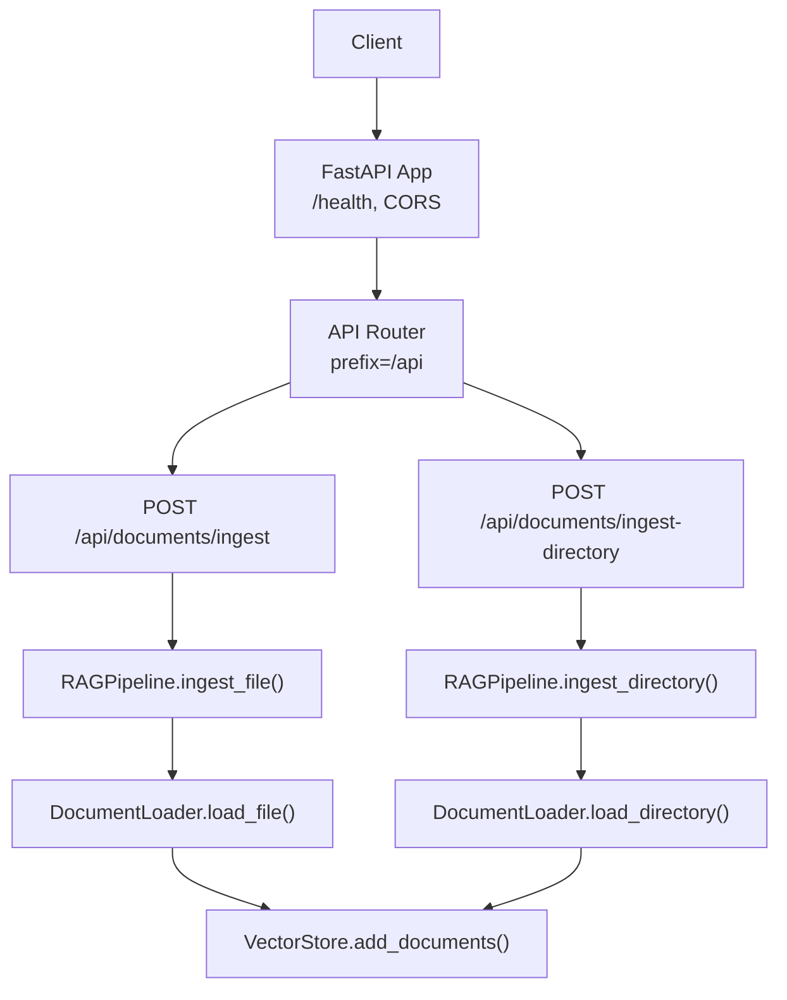
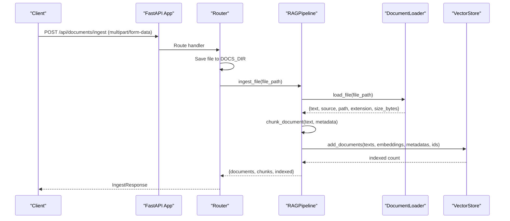
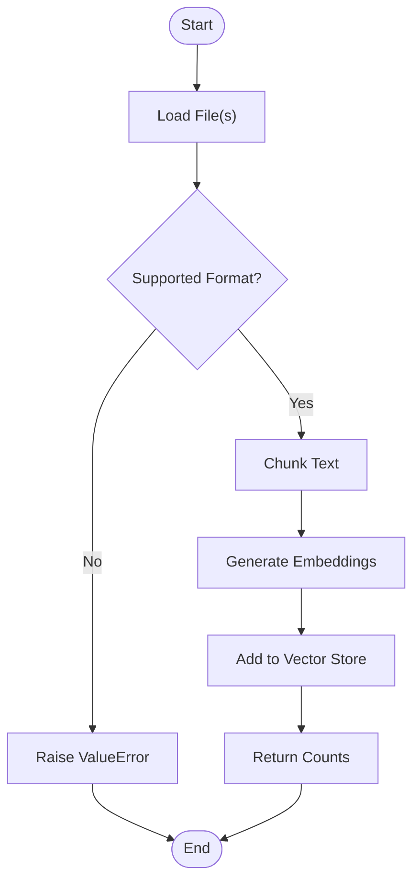
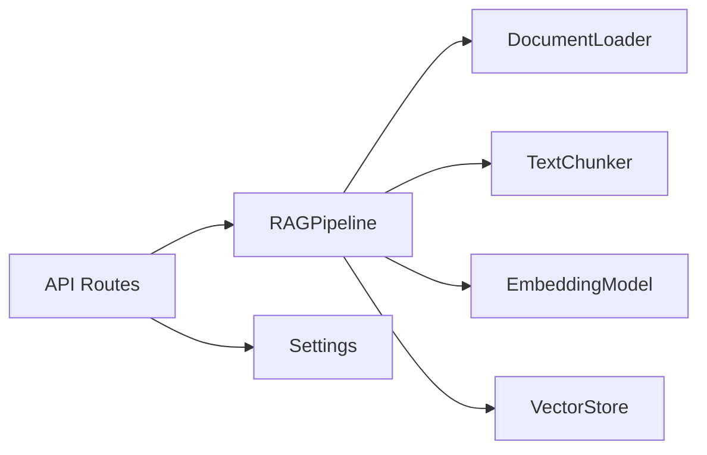

# Document Management APIs

<cite>
**Referenced Files in This Document**
- [routes.py](file://src/api/routes.py)
- [app.py](file://src/api/app.py)
- [documents.py](file://src/rag/documents.py)
- [pipeline.py](file://src/rag/pipeline.py)
- [config.py](file://src/config.py)
- [schemas.py](file://src/core/schemas.py)
- [README.md](file://README.md)
</cite>

## Table of Contents
1. [Introduction](#introduction)
2. [Project Structure](#project-structure)
3. [Core Components](#core-components)
4. [Architecture Overview](#architecture-overview)
5. [Detailed Component Analysis](#detailed-component-analysis)
6. [Dependency Analysis](#dependency-analysis)
7. [Performance Considerations](#performance-considerations)
8. [Troubleshooting Guide](#troubleshooting-guide)
9. [Conclusion](#conclusion)
10. [Appendices](#appendices)

## Introduction
This document provides comprehensive API documentation for document ingestion and management endpoints, focusing on:
- POST /api/documents/ingest: single file upload with multipart/form-data support
- POST /api/documents/ingest-directory: batch processing of directory contents with recursive scanning

It covers request schemas, validation rules, supported formats, error handling, response formats (including counts and indexing results), storage location mapping, and practical usage examples using curl and Python requests. It also clarifies chunking parameters and concurrent upload behavior based on the implementation.

## Project Structure
The API server is built with FastAPI. The application registers routers under a common prefix and exposes health and status endpoints alongside document ingestion and querying endpoints.

**Diagram sources**
- [app.py:26-53](file://src/api/app.py#L26-L53)
- [routes.py:134-166](file://src/api/routes.py#L134-L166)
- [pipeline.py:33-41](file://src/rag/pipeline.py#L33-L41)
- [documents.py:20-61](file://src/rag/documents.py#L20-L61)

**Section sources**
- [app.py:26-53](file://src/api/app.py#L26-L53)
- [README.md:153-164](file://README.md#L153-L164)

## Core Components
- API routes define ingestion endpoints and return structured responses.
- RAGPipeline orchestrates loading, chunking, embedding, and indexing.
- DocumentLoader supports multiple file formats and recursive directory scanning.
- Configuration defines chunk sizes, overlap, and maximum upload size.

Key responsibilities:
- Ingestion endpoints accept files or directories and delegate to pipeline methods.
- Pipeline coordinates chunking and vector store indexing.
- DocumentLoader validates extensions and extracts text from supported formats.

**Section sources**
- [routes.py:134-166](file://src/api/routes.py#L134-L166)
- [pipeline.py:19-88](file://src/rag/pipeline.py#L19-L88)
- [documents.py:15-61](file://src/rag/documents.py#L15-L61)
- [config.py:59-62](file://src/config.py#L59-L62)

## Architecture Overview
The ingestion flow transforms uploaded documents into indexed chunks stored in a vector database. For single-file uploads, the file is saved to a configured documents directory and ingested via the pipeline. For directory ingestion, all supported files are discovered recursively and processed.

**Diagram sources**
- [routes.py:134-155](file://src/api/routes.py#L134-L155)
- [pipeline.py:38-88](file://src/rag/pipeline.py#L38-L88)
- [documents.py:20-42](file://src/rag/documents.py#L20-L42)

## Detailed Component Analysis

### Endpoint: POST /api/documents/ingest
Purpose: Upload a single document and ingest it into the vector store and knowledge graph pipeline.

- Method: POST
- Path: /api/documents/ingest
- Content-Type: multipart/form-data
- Request body:
  - file (required): Uploaded document file
- Supported formats: PDF (.pdf), DOCX (.docx), TXT (.txt), Markdown (.md), CSV (.csv)
- Maximum file size: Configurable via MAX_UPLOAD_SIZE_MB (default 50 MB)
- Storage location: Saved to DOCS_DIR (default ./data/documents)
- Chunking parameters:
  - CHUNK_SIZE: default 512 tokens
  - CHUNK_OVERLAP: default 64 tokens
- Response model: IngestResponse
  - message: string
  - documents: integer (number of documents processed)
  - chunks: integer (number of chunks generated)
  - indexed: integer (number of chunks added to vector store)

Validation and error handling:
- Unsupported file type raises an error during document loading.
- Missing or unreadable files raise appropriate errors.
- Directory creation is handled automatically if needed.

Practical examples:
- curl:
  - curl -F "file=@path/to/document.pdf" http://localhost:8080/api/documents/ingest
- Python requests:
  - Use requests.post with files={"file": open("document.pdf", "rb")}

Notes:
- No explicit job ID is returned; the response includes counts for documents, chunks, and indexed entries.
- Concurrent uploads: Each request is processed independently by the server; no internal queue is visible in the route code.

**Section sources**
- [routes.py:134-155](file://src/api/routes.py#L134-L155)
- [documents.py:18-42](file://src/rag/documents.py#L18-L42)
- [config.py:59-70](file://src/config.py#L59-L70)

### Endpoint: POST /api/documents/ingest-directory
Purpose: Ingest all supported documents from a specified directory with recursive scanning.

- Method: POST
- Path: /api/documents/ingest-directory
- Content-Type: multipart/form-data
- Request body:
  - dir_path (required): Absolute or relative path to the directory containing documents
- Behavior:
  - Recursively scans the directory for supported file types
  - Loads each file, generates chunks, embeds, and indexes them
- Response:
  - message: string confirming ingestion
  - documents: number of documents loaded
  - chunks: number of chunks generated
  - indexed: number of chunks added to vector store

Validation and error handling:
- If the path is not a directory, an error is raised during loading.
- Individual file load failures are logged and skipped; other files continue processing.

Practical examples:
- curl:
  - curl -F "dir_path=./data/documents" http://localhost:8080/api/documents/ingest-directory
- Python requests:
  - Use requests.post with data={"dir_path": "./data/documents"}

Notes:
- Recursive scanning is implemented via glob patterns that traverse subdirectories.
- No explicit job ID is returned; the response includes counts for documents, chunks, and indexed entries.

**Section sources**
- [routes.py:158-166](file://src/api/routes.py#L158-L166)
- [documents.py:44-61](file://src/rag/documents.py#L44-L61)
- [pipeline.py:33-36](file://src/rag/pipeline.py#L33-L36)

### Data Models and Schemas
- IngestResponse:
  - message: string
  - documents: integer
  - chunks: integer
  - indexed: integer
- QueryRequest and QueryResponse are defined but not used by ingestion endpoints.

**Section sources**
- [routes.py:101-112](file://src/api/routes.py#L101-L112)
- [schemas.py:45-51](file://src/core/schemas.py#L45-L51)

### Processing Logic Flow
Chunking and indexing occur within the pipeline after document loading. The loader yields text and metadata; the chunker splits text into overlapping segments; embeddings are generated in batches; and chunks are added to the vector store with unique IDs and metadata.

**Diagram sources**
- [documents.py:20-42](file://src/rag/documents.py#L20-L42)
- [pipeline.py:43-88](file://src/rag/pipeline.py#L43-L88)

**Section sources**
- [pipeline.py:43-88](file://src/rag/pipeline.py#L43-L88)
- [documents.py:20-61](file://src/rag/documents.py#L20-L61)

## Dependency Analysis
The ingestion endpoints depend on:
- FastAPI router for request handling
- RAGPipeline for orchestration
- DocumentLoader for format-specific parsing
- VectorStore for persistence
- Settings for configuration (chunking, paths, limits)

**Diagram sources**
- [routes.py:134-166](file://src/api/routes.py#L134-L166)
- [pipeline.py:19-31](file://src/rag/pipeline.py#L19-L31)
- [config.py:59-70](file://src/config.py#L59-L70)

**Section sources**
- [routes.py:134-166](file://src/api/routes.py#L134-L166)
- [pipeline.py:19-31](file://src/rag/pipeline.py#L19-L31)
- [config.py:59-70](file://src/config.py#L59-L70)

## Performance Considerations
- Chunking parameters:
  - CHUNK_SIZE defaults to 512 tokens
  - CHUNK_OVERLAP defaults to 64 tokens
  - These affect retrieval granularity and context continuity
- Batch embedding:
  - Embeddings are generated in batches to improve throughput
- Vector store indexing:
  - Indexed count indicates successful additions; large batches may impact memory usage
- File size limits:
  - MAX_UPLOAD_SIZE_MB controls maximum upload size; ensure client respects this limit
- Concurrency:
  - Requests are handled independently; consider rate limiting or queuing at the gateway level for high concurrency

[No sources needed since this section provides general guidance]

## Troubleshooting Guide
Common issues and resolutions:
- Unsupported file type:
  - Ensure file extension is one of .pdf, .docx, .txt, .md, .csv
  - Errors are raised when unsupported extensions are encountered
- Corrupted or unreadable files:
  - Loading failures are logged; verify file integrity and permissions
- Directory not found:
  - For directory ingestion, ensure dir_path points to a valid directory
- Large files:
  - Respect MAX_UPLOAD_SIZE_MB; adjust settings if necessary
- Missing dependencies:
  - PDF loaders require PyMuPDF or pdfplumber; DOCX requires python-docx; install missing packages

Error handling specifics:
- Unsupported file type raises ValueError during load_file
- Not a directory raises NotADirectoryError during load_directory
- Import errors for optional libraries raise ImportError with guidance

**Section sources**
- [documents.py:20-42](file://src/rag/documents.py#L20-L42)
- [documents.py:63-102](file://src/rag/documents.py#L63-L102)

## Conclusion
The document ingestion APIs provide straightforward endpoints for single-file and directory-based ingestion with robust support for multiple formats and configurable chunking. Responses include actionable counts for documents, chunks, and indexed entries. For production deployments, consider adding job IDs, progress tracking, and completion notifications via background tasks and websockets or polling endpoints.

[No sources needed since this section summarizes without analyzing specific files]

## Appendices

### Request and Response Examples

- Single file upload (curl):
  - curl -F "file=@example.pdf" http://localhost:8080/api/documents/ingest
- Single file upload (Python requests):
  - Use requests.post(url, files={"file": open("example.pdf", "rb")})
- Directory ingestion (curl):
  - curl -F "dir_path=./data/documents" http://localhost:8080/api/documents/ingest-directory
- Directory ingestion (Python requests):
  - Use requests.post(url, data={"dir_path": "./data/documents"})

Expected responses:
- IngestResponse fields: message, documents, chunks, indexed
- Directory ingestion returns similar counts embedded in a JSON object with a message field

**Section sources**
- [routes.py:134-166](file://src/api/routes.py#L134-L166)
- [README.md:153-164](file://README.md#L153-L164)

### Storage Location Mapping
- Uploaded files are saved to DOCS_DIR (default ./data/documents)
- Directory ingestion reads from the provided dir_path
- Vector store stores indexed chunks with metadata including source, chunk_id, and chunk_index

**Section sources**
- [routes.py:137-144](file://src/api/routes.py#L137-L144)
- [pipeline.py:70-81](file://src/rag/pipeline.py#L70-L81)
- [config.py:68-70](file://src/config.py#L68-L70)