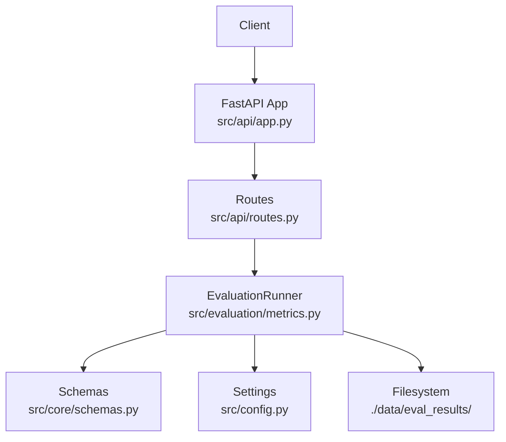
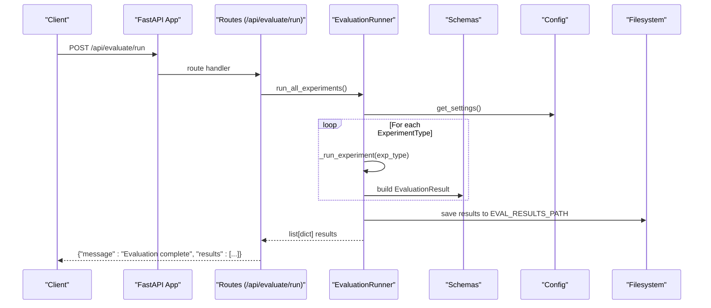
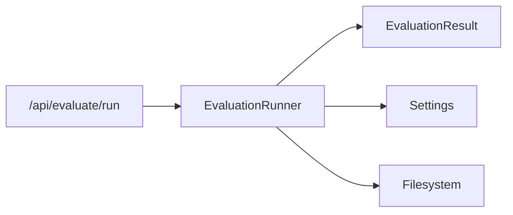

# Evaluation APIs

<cite>
**Referenced Files in This Document**
- [routes.py](file://src/api/routes.py)
- [metrics.py](file://src/evaluation/metrics.py)
- [schemas.py](file://src/core/schemas.py)
- [config.py](file://src/config.py)
- [app.py](file://src/api/app.py)
- [main.py](file://main.py)
- [README.md](file://README.md)
</cite>

## Table of Contents
1. [Introduction](#introduction)
2. [Project Structure](#project-structure)
3. [Core Components](#core-components)
4. [Architecture Overview](#architecture-overview)
5. [Detailed Component Analysis](#detailed-component-analysis)
6. [Dependency Analysis](#dependency-analysis)
7. [Performance Considerations](#performance-considerations)
8. [Troubleshooting Guide](#troubleshooting-guide)
9. [Conclusion](#conclusion)
10. [Appendices](#appendices)

## Introduction
This document provides detailed API documentation for evaluation and benchmarking endpoints, focusing on POST /api/evaluate/run. It explains how to execute benchmark suites, the current request/response contract, dataset sources, output formatting, resource requirements, parallel execution capabilities, result persistence, and error handling behaviors. Where applicable, it references the exact source files that implement these features.

## Project Structure
The evaluation endpoint is part of the FastAPI application under src/api. The evaluation runner lives under src/evaluation and uses shared schemas from src/core. Configuration for paths and environment variables is centralized in src/config.

**Diagram sources**
- [app.py:26-53](file://src/api/app.py#L26-L53)
- [routes.py:341-347](file://src/api/routes.py#L341-L347)
- [metrics.py:139-224](file://src/evaluation/metrics.py#L139-L224)
- [schemas.py:152-167](file://src/core/schemas.py#L152-L167)
- [config.py:64-66](file://src/config.py#L64-L66)

**Section sources**
- [app.py:26-53](file://src/api/app.py#L26-L53)
- [routes.py:341-347](file://src/api/routes.py#L341-L347)
- [metrics.py:139-224](file://src/evaluation/metrics.py#L139-L224)
- [schemas.py:152-167](file://src/core/schemas.py#L152-L167)
- [config.py:64-66](file://src/config.py#L64-L66)

## Core Components
- Evaluation Runner: Orchestrates running all experiment types and computing metrics; persists results to disk.
- Metrics: Retrieval and answer quality metrics used by the runner (precision@k, recall@k, MRR, context relevance, factual correctness, faithfulness, hallucination rate).
- Schemas: Pydantic models defining evaluation results and experiment types.
- Configuration: Paths for benchmark datasets and evaluation results.

Key responsibilities:
- Execute benchmarks across predefined experiment configurations.
- Compute and aggregate metrics per experiment type.
- Save JSON results to a configured directory with timestamps.

**Section sources**
- [metrics.py:139-224](file://src/evaluation/metrics.py#L139-L224)
- [schemas.py:152-167](file://src/core/schemas.py#L152-L167)
- [config.py:64-66](file://src/config.py#L64-L66)

## Architecture Overview
The evaluation endpoint triggers the EvaluationRunner which iterates over all ExperimentType values, runs each experiment against benchmark questions, aggregates metrics, and saves results.

**Diagram sources**
- [routes.py:341-347](file://src/api/routes.py#L341-L347)
- [metrics.py:165-224](file://src/evaluation/metrics.py#L165-L224)
- [schemas.py:152-167](file://src/core/schemas.py#L152-L167)
- [config.py:64-66](file://src/config.py#L64-L66)

## Detailed Component Analysis

### Endpoint: POST /api/evaluate/run
- Purpose: Run the full evaluation benchmark suite across all experiment types and return aggregated results.
- Request body: None required. The endpoint currently does not accept parameters to customize datasets, metric selections, or comparison modes.
- Response: JSON object containing:
  - message: status string
  - results: array of evaluation result objects (one per experiment type), each including metrics such as precision_at_k, recall_at_k, mrr, factual_correctness, faithfulness, hallucination_rate, response_latency_sec, token_usage, and claim counts.

Notes:
- The endpoint invokes EvaluationRunner.run_all_experiments(), which loops over all ExperimentType values and returns a list of EvaluationResult model dumps.
- Results are persisted to disk under the configured EVAL_RESULTS_PATH with a timestamped filename.

Request schema
- No request body is defined for this endpoint.

Response schema
- Top-level fields:
  - message: string
  - results: array of EvaluationResult objects
- EvaluationResult fields:
  - experiment_type: one of baseline_llm, vector_rag, graph_rag, hybrid_rag, multi_agent
  - precision_at_k: float
  - recall_at_k: float
  - mrr: float
  - factual_correctness: float
  - faithfulness: float
  - relevance: float
  - completeness: float
  - hallucination_rate: float
  - response_latency_sec: float
  - token_usage: int
  - total_claims: int
  - supported_claims: int
  - unsupported_claims: int

Example usage
- cURL example:
  - curl -X POST http://localhost:8080/api/evaluate/run
- Expected response shape:
  - { "message": "Evaluation complete", "results": [ {...}, ... ] }

**Section sources**
- [routes.py:341-347](file://src/api/routes.py#L341-L347)
- [metrics.py:165-224](file://src/evaluation/metrics.py#L165-L224)
- [schemas.py:152-167](file://src/core/schemas.py#L152-L167)

### Benchmark Datasets and Sources
- Current behavior: The runner uses an internal list of benchmark questions (BENCHMARK_QUESTIONS) embedded in the code. These are used for each experiment iteration.
- Dataset path configuration: BENCHMARK_DATASET_PATH is available in settings but is not consumed by the current runner implementation.
- Implication: To use custom datasets, extend the runner to read from BENCHMARK_DATASET_PATH and integrate with the pipeline.

Dataset schema (conceptual)
- question: string
- reference: string
- type: string (e.g., multi_hop, comparison, analysis)

Where implemented
- Embedded benchmark questions are defined in the runner class.

**Section sources**
- [metrics.py:142-158](file://src/evaluation/metrics.py#L142-L158)
- [config.py:64-66](file://src/config.py#L64-L66)

### Metric Selections and Comparison Modes
- Metric selection: The runner computes a fixed set of retrieval and answer quality metrics for each experiment type. There is no request parameter to select or exclude specific metrics at runtime.
- Comparison mode: The runner iterates over all ExperimentType values and aggregates metrics per experiment type, enabling direct comparison across architectures.

Extensibility
- To support dynamic metric selection or comparison modes, add request parameters to the endpoint and branch logic in the runner accordingly.

**Section sources**
- [metrics.py:179-215](file://src/evaluation/metrics.py#L179-L215)
- [schemas.py:35-41](file://src/core/schemas.py#L35-L41)

### Output Formatting Options
- Default format: JSON array of EvaluationResult objects.
- Persistence: Results are saved to a JSON file under EVAL_RESULTS_PATH with a timestamped name.
- Visualization: The frontend can render results as tables and metrics; the runner also provides a text-based comparison table generator.

**Section sources**
- [metrics.py:217-224](file://src/evaluation/metrics.py#L217-L224)
- [metrics.py:226-254](file://src/evaluation/metrics.py#L226-L254)
- [config.py:64-66](file://src/config.py#L64-L66)

### Examples
- Standard benchmarks:
  - Invoke POST /api/evaluate/run to run all five experiment types against the embedded benchmark questions.
- Custom evaluation scripts:
  - Use the CLI command evaluate to run the same logic programmatically via main.py.
- Result interpretation:
  - Compare metrics across experiment types to assess retrieval quality, answer correctness, faithfulness, hallucination rates, latency, and token usage.

CLI alternative
- python main.py evaluate

**Section sources**
- [routes.py:341-347](file://src/api/routes.py#L341-L347)
- [main.py:59-68](file://main.py#L59-L68)
- [metrics.py:165-224](file://src/evaluation/metrics.py#L165-L224)

### Resource Requirements
- LLM calls: Some metrics may call an LLM client for context relevance, factual correctness, and faithfulness scoring when provided. Ensure appropriate API keys and quotas are configured.
- Vector store and knowledge graph: Depending on integration, retrieval steps may query vector databases and graphs.
- Disk space: Results are written to EVAL_RESULTS_PATH; ensure sufficient disk space.

Configuration keys
- LLM provider and model settings
- Vector DB settings
- Graph database settings
- EVAL_RESULTS_PATH

**Section sources**
- [config.py:31-66](file://src/config.py#L31-L66)
- [metrics.py:47-102](file://src/evaluation/metrics.py#L47-L102)
- [metrics.py:217-224](file://src/evaluation/metrics.py#L217-L224)

### Parallel Execution Capabilities
- Current implementation: Sequential execution across experiment types and benchmark questions.
- Potential improvements: Parallelize independent experiments or questions using async tasks or thread/process pools if needed.

**Section sources**
- [metrics.py:165-215](file://src/evaluation/metrics.py#L165-L215)

### Result Persistence
- Behavior: After completing all experiments, results are serialized to JSON and saved under EVAL_RESULTS_PATH with a timestamped filename.
- Access: Retrieve files from the filesystem or extend the API to serve them.

**Section sources**
- [metrics.py:217-224](file://src/evaluation/metrics.py#L217-L224)
- [config.py:64-66](file://src/config.py#L64-L66)

### Error Handling
- Missing datasets: Not directly handled since the runner uses embedded questions. If extended to read from BENCHMARK_DATASET_PATH, add validation and clear error messages for missing files.
- Metric calculation failures:
  - LLM-based metrics catch exceptions and fall back to defaults or simpler heuristics.
  - ROUGE fallback is used if the scorer is unavailable.
- Resource constraints:
  - Ensure adequate memory and disk space; handle IO errors when saving results.
  - Add retries or timeouts for LLM calls if necessary.

Current fallbacks
- Context relevance and faithfulness return default scores when LLM client is missing or errors occur.
- Factual correctness falls back to ROUGE-based approximation if LLM is not provided or fails.

**Section sources**
- [metrics.py:47-102](file://src/evaluation/metrics.py#L47-L102)
- [metrics.py:105-124](file://src/evaluation/metrics.py#L105-L124)
- [metrics.py:217-224](file://src/evaluation/metrics.py#L217-L224)

## Dependency Analysis
The evaluation flow depends on:
- FastAPI router exposing the endpoint
- EvaluationRunner orchestrating experiments
- Schemas defining result structures
- Settings providing paths and environment configuration

**Diagram sources**
- [routes.py:341-347](file://src/api/routes.py#L341-L347)
- [metrics.py:139-224](file://src/evaluation/metrics.py#L139-L224)
- [schemas.py:152-167](file://src/core/schemas.py#L152-L167)
- [config.py:64-66](file://src/config.py#L64-L66)

**Section sources**
- [routes.py:341-347](file://src/api/routes.py#L341-L347)
- [metrics.py:139-224](file://src/evaluation/metrics.py#L139-L224)
- [schemas.py:152-167](file://src/core/schemas.py#L152-L167)
- [config.py:64-66](file://src/config.py#L64-L66)

## Performance Considerations
- Latency: Each experiment iterates over benchmark questions; overall time scales with number of experiments and questions.
- Token usage: LLM-based metrics consume tokens; consider batching or caching where possible.
- I/O: Writing results to disk is lightweight but should be considered for high-frequency evaluations.
- Scalability: Consider asynchronous execution or job queues for long-running evaluations.

[No sources needed since this section provides general guidance]

## Troubleshooting Guide
Common issues and resolutions:
- Endpoint returns empty or placeholder metrics:
  - The runner currently records placeholder metrics; integrate actual pipeline calls to compute real values.
- LLM-related errors:
  - Ensure LLM provider keys and models are configured correctly.
  - Check network connectivity and quotas.
- Filesystem errors:
  - Verify EVAL_RESULTS_PATH exists and is writable.
  - Ensure sufficient disk space.
- Missing dataset path:
  - If extending to use BENCHMARK_DATASET_PATH, validate existence and permissions before reading.

Operational checks
- Health check: GET /health
- System status: GET /api/status

**Section sources**
- [metrics.py:47-102](file://src/evaluation/metrics.py#L47-L102)
- [metrics.py:217-224](file://src/evaluation/metrics.py#L217-L224)
- [config.py:64-66](file://src/config.py#L64-L66)
- [app.py:49-52](file://src/api/app.py#L49-L52)

## Conclusion
POST /api/evaluate/run provides a straightforward way to execute the full benchmark suite across all experiment types and obtain aggregated metrics. While the current implementation uses embedded benchmark questions and placeholder metrics, it establishes a solid foundation for extensibility. You can persist results to disk, visualize them via the frontend, and extend the endpoint to support custom datasets, dynamic metric selection, and parallel execution.

[No sources needed since this section summarizes without analyzing specific files]

## Appendices

### Appendix A: Endpoint Summary
- Method: POST
- Path: /api/evaluate/run
- Request body: None
- Response:
  - message: string
  - results: array of EvaluationResult objects

**Section sources**
- [routes.py:341-347](file://src/api/routes.py#L341-L347)
- [schemas.py:152-167](file://src/core/schemas.py#L152-L167)

### Appendix B: Experiment Types
- baseline_llm
- vector_rag
- graph_rag
- hybrid_rag
- multi_agent

**Section sources**
- [schemas.py:35-41](file://src/core/schemas.py#L35-L41)

### Appendix C: Metrics Overview
- Retrieval: precision@k, recall@k, MRR, context relevance
- Answer quality: factual correctness, faithfulness, relevance, completeness
- Hallucination: hallucination rate
- System: latency, token usage

**Section sources**
- [metrics.py:19-134](file://src/evaluation/metrics.py#L19-L134)
- [schemas.py:152-167](file://src/core/schemas.py#L152-L167)