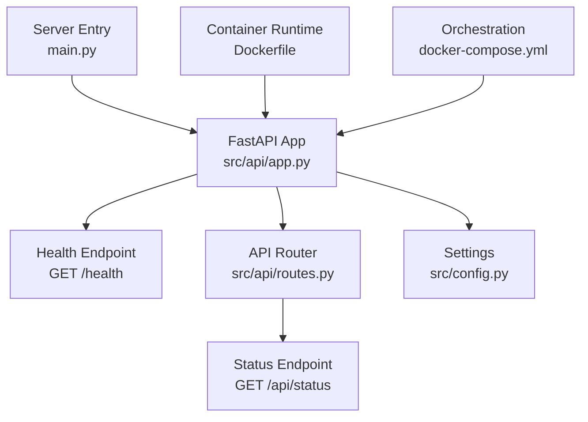
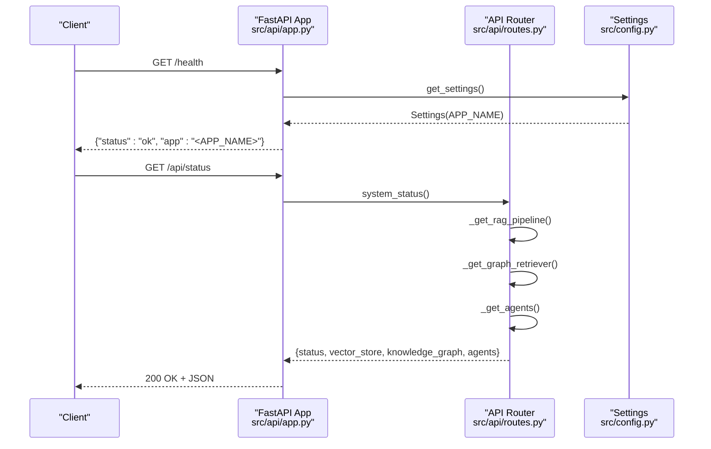
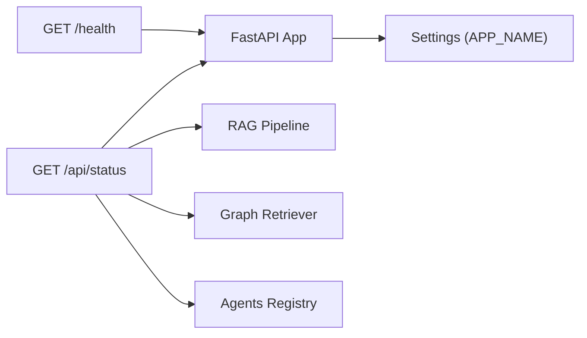

# Health and Status Endpoints

<cite>
**Referenced Files in This Document**
- [src/api/app.py](file://src/api/app.py)
- [src/api/routes.py](file://src/api/routes.py)
- [src/config.py](file://src/config.py)
- [main.py](file://main.py)
- [Dockerfile](file://Dockerfile)
- [docker-compose.yml](file://docker-compose.yml)
</cite>

## Table of Contents
1. [Introduction](#introduction)
2. [Project Structure](#project-structure)
3. [Core Components](#core-components)
4. [Architecture Overview](#architecture-overview)
5. [Detailed Component Analysis](#detailed-component-analysis)
6. [Dependency Analysis](#dependency-analysis)
7. [Performance Considerations](#performance-considerations)
8. [Troubleshooting Guide](#troubleshooting-guide)
9. [Conclusion](#conclusion)
10. [Appendices](#appendices)

## Introduction
This document explains the health check and system status endpoints for the Graph RAG + Multi-Agent Research System. It focuses on:
- GET /health: application-level health endpoint returning a simple status and app name.
- GET /api/status: detailed system status including vector store, knowledge graph summary, and available agents.

It also provides integration guidance for container health checks, load balancers, service discovery, authentication considerations, rate limiting policies, and error responses when services are unavailable.

## Project Structure
The API server is built with FastAPI. The health endpoint is defined at the application root, while the more detailed status endpoint is under the /api prefix. Configuration (including the application name) is centralized and loaded from environment variables.

**Diagram sources**
- [src/api/app.py:26-53](file://src/api/app.py#L26-L53)
- [src/api/routes.py:116-131](file://src/api/routes.py#L116-L131)
- [src/config.py:21-28](file://src/config.py#L21-L28)
- [main.py:24-28](file://main.py#L24-L28)
- [Dockerfile:22-24](file://Dockerfile#L22-L24)
- [docker-compose.yml:22-41](file://docker-compose.yml#L22-L41)

**Section sources**
- [src/api/app.py:26-53](file://src/api/app.py#L26-L53)
- [src/api/routes.py:116-131](file://src/api/routes.py#L116-L131)
- [src/config.py:21-28](file://src/config.py#L21-L28)
- [main.py:24-28](file://main.py#L24-L28)
- [Dockerfile:22-24](file://Dockerfile#L22-L24)
- [docker-compose.yml:22-41](file://docker-compose.yml#L22-L41)

## Core Components
- Application entrypoint: Creates the FastAPI app, registers CORS middleware, includes the API router, and defines the /health endpoint.
- Settings: Centralized configuration that provides APP_NAME used by the health response.
- API routes: Provide /api/status for richer system diagnostics.

Key behaviors:
- GET /health returns a minimal JSON object with status and app fields.
- GET /api/status returns operational status plus details about vector store, knowledge graph, and agent roles.

**Section sources**
- [src/api/app.py:26-53](file://src/api/app.py#L26-L53)
- [src/config.py:21-28](file://src/config.py#L21-L28)
- [src/api/routes.py:116-131](file://src/api/routes.py#L116-L131)

## Architecture Overview
The health and status endpoints are part of the FastAPI application lifecycle. The /health endpoint is lightweight and suitable for liveness probes. The /api/status endpoint performs lazy initialization of components to report their availability and basic metrics.

**Diagram sources**
- [src/api/app.py:26-53](file://src/api/app.py#L26-L53)
- [src/api/routes.py:28-75](file://src/api/routes.py#L28-L75)
- [src/api/routes.py:116-131](file://src/api/routes.py#L116-L131)
- [src/config.py:78-81](file://src/config.py#L78-L81)

## Detailed Component Analysis

### GET /health
- Purpose: Liveness probe for containers and orchestrators.
- Path: /health
- Method: GET
- Authentication: None required.
- Rate Limiting: Not enforced by the application; rely on infrastructure or gateway if needed.
- Response Codes:
  - 200 OK: Healthy.
  - 5xx: If the process crashes or cannot respond (e.g., startup failure).
- Response Body:
  - status: string indicating health (e.g., "ok").
  - app: string containing the configured application name.

Example curl requests:
- Basic request:
  - curl http://localhost:8080/health
- With verbose output:
  - curl -v http://localhost:8080/health
- In a containerized environment (host reachable via port mapping):
  - curl http://host.docker.internal:8080/health

Expected response example:
- { "status": "ok", "app": "GraphRAG-MARS" }

Integration patterns:
- Container orchestration:
  - Kubernetes livenessProbe: HTTP GET /health with initialDelaySeconds and periodSeconds tuned to your startup time.
  - Docker healthcheck: Use curl or wget to poll /health and set retries appropriately.
- Load balancer:
  - Configure health checks to target /health with expected 200 OK.
  - For blue/green or canary deployments, ensure new instances pass /health before receiving traffic.
- Service discovery:
  - Combine /health with service registry (e.g., Consul, etcd) to mark instances healthy only after passing repeated checks.

Notes:
- The endpoint reads APP_NAME from settings and does not perform heavy work, making it ideal for frequent polling.

**Section sources**
- [src/api/app.py:49-52](file://src/api/app.py#L49-L52)
- [src/config.py:21-28](file://src/config.py#L21-L28)

### GET /api/status
- Purpose: Readiness and component health diagnostics.
- Path: /api/status
- Method: GET
- Authentication: None required.
- Rate Limiting: Not enforced by the application; apply at gateway or ingress layer if needed.
- Response Codes:
  - 200 OK: Operational with component details.
  - 5xx: If underlying components fail to initialize or respond.
- Response Body:
  - status: string (e.g., "operational").
  - vector_store: object with type and document_count.
  - knowledge_graph: object summarizing graph state.
  - agents: list of available agent roles.

Example curl requests:
- curl http://localhost:8080/api/status
- curl -sS http://localhost:8080/api/status | jq .

Usage scenarios:
- Readiness checks: Ensure all subsystems (vector store, graph, agents) are initialized before accepting traffic.
- Monitoring dashboards: Track document counts, graph summaries, and agent availability over time.
- Alerting: Trigger alerts if status deviates from expected values or if latency increases significantly.

Error handling:
- If any dependency fails during initialization, the endpoint may raise an exception resulting in a 5xx response. Implement retries and backoff in clients.

**Section sources**
- [src/api/routes.py:28-75](file://src/api/routes.py#L28-L75)
- [src/api/routes.py:116-131](file://src/api/routes.py#L116-L131)

### Server Startup and Port Exposure
- The server binds to 0.0.0.0 and exposes port 8080 by default.
- Uvicorn runs the FastAPI app created in src/api/app.py.

Operational notes:
- Ensure firewall rules allow inbound traffic to port 8080.
- In production, consider running behind a reverse proxy (e.g., Nginx, Traefik) for TLS termination and additional security controls.

**Section sources**
- [main.py:24-28](file://main.py#L24-L28)
- [Dockerfile:22-24](file://Dockerfile#L22-L24)

## Dependency Analysis
- The /health endpoint depends on:
  - FastAPI app creation and lifespan.
  - Settings provider for APP_NAME.
- The /api/status endpoint depends on:
  - Lazy initialization of RAG pipeline, graph retriever, and agents.
  - Vector store and knowledge graph components for reporting.

**Diagram sources**
- [src/api/app.py:26-53](file://src/api/app.py#L26-L53)
- [src/api/routes.py:28-75](file://src/api/routes.py#L28-L75)
- [src/config.py:78-81](file://src/config.py#L78-L81)

**Section sources**
- [src/api/app.py:26-53](file://src/api/app.py#L26-L53)
- [src/api/routes.py:28-75](file://src/api/routes.py#L28-L75)
- [src/config.py:78-81](file://src/config.py#L78-L81)

## Performance Considerations
- /health is lightweight and suitable for high-frequency polling.
- /api/status performs lazy initialization; first calls may be slower due to component startup. Subsequent calls benefit from cached singletons.
- Avoid aggressive polling intervals for /api/status; prefer longer periods or event-driven updates.
- Consider adding request rate limiting at the gateway level to protect endpoints from excessive load.

[No sources needed since this section provides general guidance]

## Troubleshooting Guide
Common issues and resolutions:
- 404 on /health:
  - Verify the server is running and bound to the correct host/port.
  - Confirm the route is registered at the application root.
- 5xx errors on /api/status:
  - Check logs for failures during initialization of RAG pipeline, graph retriever, or agents.
  - Validate external dependencies (vector store, Neo4j) connectivity and credentials.
- Timeouts:
  - Increase client timeouts for readiness checks.
  - Tune initialDelaySeconds and periodSeconds for orchestrator health checks.

Authentication and authorization:
- Neither /health nor /api/status require authentication by default.
- To secure these endpoints, add middleware or use gateway-level auth (e.g., OAuth, mTLS) without modifying application code.

Rate limiting:
- Not implemented in the application. Apply rate limiting at the reverse proxy or API gateway layer.

Error responses:
- Unexpected failures will return standard HTTP error codes (e.g., 500 Internal Server Error) with framework-generated error bodies. Inspect server logs for stack traces.

**Section sources**
- [src/api/app.py:26-53](file://src/api/app.py#L26-L53)
- [src/api/routes.py:116-131](file://src/api/routes.py#L116-L131)

## Conclusion
Use GET /health for fast liveness checks and GET /api/status for deeper readiness and diagnostics. Both endpoints are unauthenticated and do not enforce rate limits within the application; integrate with infrastructure for security and throttling. Configure orchestrators and load balancers to poll /health regularly and gate traffic based on successful responses.

[No sources needed since this section summarizes without analyzing specific files]

## Appendices

### Container Health Checks
- Docker:
  - Add a healthcheck command that curls /health and sets appropriate interval, timeout, and retries.
- Kubernetes:
  - Define livenessProbe using HTTP GET /health.
  - Optionally define readinessProbe using GET /api/status to ensure components are ready.

**Section sources**
- [Dockerfile:22-24](file://Dockerfile#L22-L24)
- [docker-compose.yml:22-41](file://docker-compose.yml#L22-L41)

### Load Balancer and Service Discovery
- Load balancer:
  - Target /health for backend health checks; expect 200 OK.
- Service discovery:
  - Mark instances healthy after consecutive successful /health checks.
  - Remove unhealthy instances from rotation promptly.

[No sources needed since this section provides general guidance]