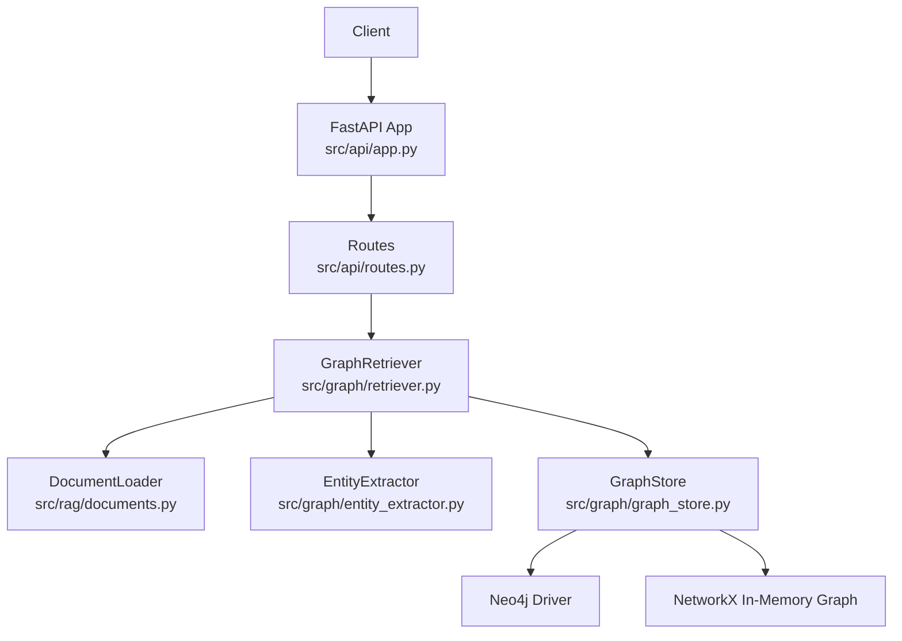
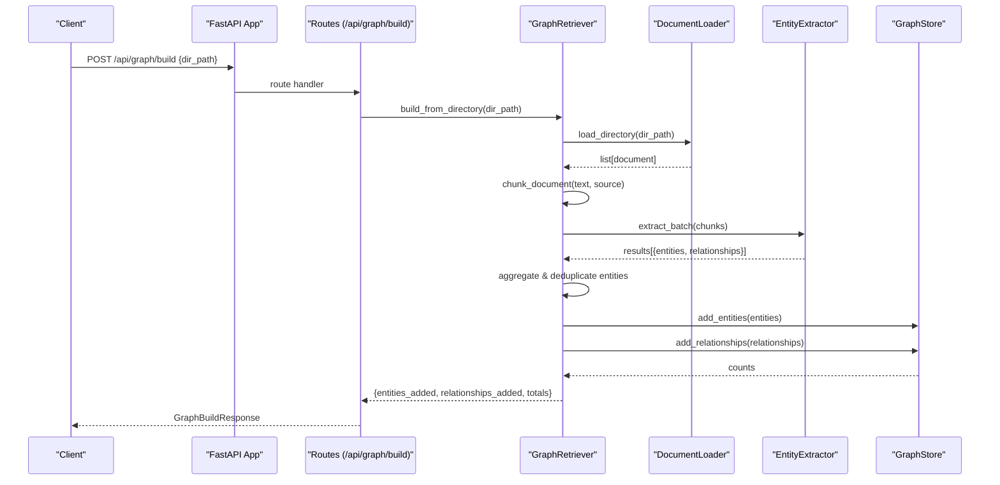
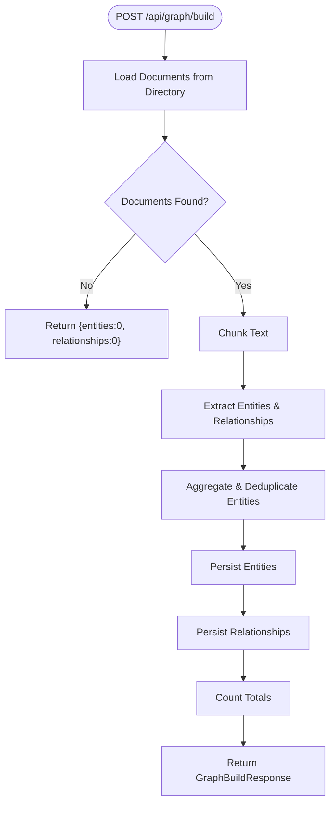
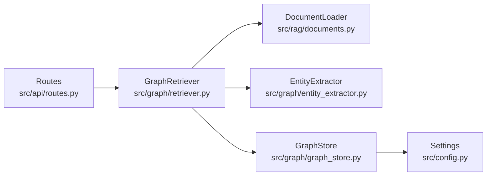

# Knowledge Graph APIs

<cite>
**Referenced Files in This Document**
- [routes.py](file://src/api/routes.py)
- [app.py](file://src/api/app.py)
- [retriever.py](file://src/graph/retriever.py)
- [graph_store.py](file://src/graph/graph_store.py)
- [entity_extractor.py](file://src/graph/entity_extractor.py)
- [schemas.py](file://src/core/schemas.py)
- [documents.py](file://src/rag/documents.py)
- [config.py](file://src/config.py)
- [README.md](file://README.md)
</cite>

## Table of Contents
1. [Introduction](#introduction)
2. [Project Structure](#project-structure)
3. [Core Components](#core-components)
4. [Architecture Overview](#architecture-overview)
5. [Detailed Component Analysis](#detailed-component-analysis)
6. [Dependency Analysis](#dependency-analysis)
7. [Performance Considerations](#performance-considerations)
8. [Troubleshooting Guide](#troubleshooting-guide)
9. [Conclusion](#conclusion)
10. [Appendices](#appendices)

## Introduction
This document provides detailed API documentation for knowledge graph operations exposed by the system’s FastAPI server. It focuses on:
- POST /api/graph/build: Constructing a knowledge graph from ingested documents with entity extraction and relationship detection.
- GET /api/graph/summary: Retrieving graph statistics including node counts, relationship types, and connectivity metrics.

It includes request/response schemas, validation rules, data type specifications, example workflows, error handling strategies, and performance considerations for large-scale graph operations.

## Project Structure
The API endpoints are defined under src/api/routes.py and mounted on the FastAPI application created in src/api/app.py. The knowledge graph build pipeline is implemented in src/graph/retriever.py, which orchestrates document loading, chunking, entity extraction, and persistence to a graph store (Neo4j or in-memory NetworkX). Configuration is centralized in src/config.py.

**Diagram sources**
- [app.py:26-53](file://src/api/app.py#L26-L53)
- [routes.py:169-185](file://src/api/routes.py#L169-L185)
- [retriever.py:19-35](file://src/graph/retriever.py#L19-L35)
- [documents.py:15-61](file://src/rag/documents.py#L15-L61)
- [entity_extractor.py:42-86](file://src/graph/entity_extractor.py#L42-L86)
- [graph_store.py:15-47](file://src/graph/graph_store.py#L15-L47)

**Section sources**
- [app.py:26-53](file://src/api/app.py#L26-L53)
- [routes.py:169-185](file://src/api/routes.py#L169-L185)

## Core Components
- GraphRetriever: Orchestrates building and querying the knowledge graph. It loads documents, chunks text, extracts entities and relationships via an LLM-based extractor, deduplicates entities, and persists them to a GraphStore.
- GraphStore: Persists nodes and edges using either Neo4j or an in-memory NetworkX MultiDiGraph. Provides counting, listing, and query capabilities.
- EntityExtractor: Uses an LLM client to extract structured entities and relationships from text chunks, returning JSON-like structures with source attribution.
- DocumentLoader: Loads supported file formats (PDF, DOCX, TXT, Markdown, CSV) into text content with metadata.

Key responsibilities:
- Build pipeline: load → chunk → extract → deduplicate → persist → count.
- Summary: aggregate counts and sample entities/relationships.

**Section sources**
- [retriever.py:19-131](file://src/graph/retriever.py#L19-L131)
- [graph_store.py:15-138](file://src/graph/graph_store.py#L15-L138)
- [entity_extractor.py:42-101](file://src/graph/entity_extractor.py#L42-L101)
- [documents.py:15-61](file://src/rag/documents.py#L15-L61)

## Architecture Overview
The knowledge graph build workflow is triggered via POST /api/graph/build. The endpoint delegates to GraphRetriever.build_from_directory, which:
1. Loads all supported documents from the specified directory.
2. Chunks each document into manageable text segments.
3. Extracts entities and relationships per chunk using an LLM prompt.
4. Aggregates and deduplicates entities by name.
5. Persists entities and relationships to the configured GraphStore.
6. Returns counts of added entities and relationships plus totals.

**Diagram sources**
- [routes.py:169-178](file://src/api/routes.py#L169-L178)
- [retriever.py:32-97](file://src/graph/retriever.py#L32-L97)
- [documents.py:44-61](file://src/rag/documents.py#L44-L61)
- [entity_extractor.py:74-86](file://src/graph/entity_extractor.py#L74-L86)
- [graph_store.py:49-65](file://src/graph/graph_store.py#L49-L65)

## Detailed Component Analysis

### Endpoint: POST /api/graph/build
Purpose:
- Build or update the knowledge graph from documents located in a given directory.

Request:
- Method: POST
- Path: /api/graph/build
- Content-Type: multipart/form-data
- Form Field:
  - dir_path: string (required) — absolute or relative path to a directory containing supported documents (.pdf, .docx, .txt, .md, .csv).

Behavior:
- Loads all supported documents from the directory.
- Chunks text for entity extraction.
- Extracts entities and relationships using an LLM-based extractor.
- Deduplicates entities by normalized name.
- Persists entities and relationships to the graph store.
- Returns counts of newly added entities and relationships and total graph size.

Response Schema:
- GraphBuildResponse:
  - message: string — human-readable status message.
  - entities: integer — number of entities added in this run.
  - relationships: integer — number of relationships added in this run.

Validation Rules:
- dir_path must be a valid directory; otherwise, document loading will raise errors that propagate to the client.
- Supported extensions enforced by DocumentLoader; unsupported files are skipped with logging.

Data Types:
- All fields are strongly typed via Pydantic models in routes.py.

Example Workflow:
- Place PDF/TXT/DOCX files in data/documents/.
- Call POST /api/graph/build with dir_path set to data/documents.
- Inspect response for entities and relationships counts.

Progress Monitoring:
- The endpoint performs synchronous processing; there is no built-in progress stream. For long-running builds, consider batching directories or implementing asynchronous tasks outside the current scope.

Error Handling:
- Invalid directory path raises NotADirectoryError during document loading.
- Unsupported file types raise ValueError during file loading.
- LLM extraction failures return empty lists for entities/relationships for affected chunks.
- GraphStore fallback to NetworkX if Neo4j is unavailable.

Performance Notes:
- Chunk size and overlap are fixed in GraphRetriever initialization; adjust retriever configuration if customization is needed.
- Large directories may cause high memory usage due to in-memory aggregation before persistence.

**Section sources**
- [routes.py:169-178](file://src/api/routes.py#L169-L178)
- [retriever.py:32-97](file://src/graph/retriever.py#L32-L97)
- [documents.py:44-61](file://src/rag/documents.py#L44-L61)
- [entity_extractor.py:74-86](file://src/graph/entity_extractor.py#L74-L86)
- [graph_store.py:15-47](file://src/graph/graph_store.py#L15-L47)

### Endpoint: GET /api/graph/summary
Purpose:
- Retrieve a summary of the knowledge graph including total entities, total relationships, and sample entities/relationships.

Request:
- Method: GET
- Path: /api/graph/summary

Response Schema:
- Dictionary with:
  - total_entities: integer — total number of unique entities in the graph.
  - total_relationships: integer — total number of relationships in the graph.
  - sample_entities: array — up to 20 representative entities with name/type/description.
  - sample_relationships: array — up to 20 representative relationships with source/relationship/target/source_doc.

Connectivity Metrics:
- The current implementation returns counts and samples; it does not compute advanced connectivity metrics such as degree distribution or connected components.

Example Use:
- Call GET /api/graph/summary after building the graph to verify ingestion results and inspect sampled structure.

Error Handling:
- If Neo4j is unavailable, GraphStore falls back to NetworkX; summary still returns counts and samples based on the active backend.

**Section sources**
- [routes.py:181-185](file://src/api/routes.py#L181-L185)
- [retriever.py:120-131](file://src/graph/retriever.py#L120-L131)
- [graph_store.py:112-125](file://src/graph/graph_store.py#L112-L125)

### Data Models and Schemas
- GraphBuildResponse:
  - message: string
  - entities: integer
  - relationships: integer
- Query-related models (for context):
  - ResearchQuery, EvidenceChunk, GraphRelation, WebResult, Claim, AgentMessage, TaskPlan, ResearchReport, EvaluationResult.

These models ensure type-safe request/response handling and consistent payloads across the API.

**Section sources**
- [routes.py:101-112](file://src/api/routes.py#L101-L112)
- [schemas.py:45-168](file://src/core/schemas.py#L45-L168)

### Processing Logic Flowchart

**Diagram sources**
- [retriever.py:32-97](file://src/graph/retriever.py#L32-L97)
- [documents.py:44-61](file://src/rag/documents.py#L44-L61)
- [entity_extractor.py:74-86](file://src/graph/entity_extractor.py#L74-L86)
- [graph_store.py:49-65](file://src/graph/graph_store.py#L49-L65)

## Dependency Analysis
The API layer depends on the graph retrieval pipeline, which in turn depends on document loading, text chunking, LLM-based extraction, and graph storage. Configuration drives database connections and behavior.

**Diagram sources**
- [routes.py:169-185](file://src/api/routes.py#L169-L185)
- [retriever.py:19-35](file://src/graph/retriever.py#L19-L35)
- [documents.py:15-61](file://src/rag/documents.py#L15-L61)
- [entity_extractor.py:42-86](file://src/graph/entity_extractor.py#L42-L86)
- [graph_store.py:15-47](file://src/graph/graph_store.py#L15-L47)
- [config.py:21-82](file://src/config.py#L21-L82)

**Section sources**
- [routes.py:169-185](file://src/api/routes.py#L169-L185)
- [retriever.py:19-35](file://src/graph/retriever.py#L19-L35)
- [config.py:21-82](file://src/config.py#L21-L82)

## Performance Considerations
- Document Loading:
  - Supports multiple formats; large PDFs can be memory-intensive. Ensure sufficient heap space and consider streaming or smaller chunk sizes if needed.
- Chunking Strategy:
  - Fixed chunk size and overlap in GraphRetriever; tuning these parameters can improve extraction quality and reduce token usage.
- LLM Extraction:
  - Each chunk triggers an LLM call; batch processing logs progress every 10 chunks. Rate limits and token quotas should be considered for large corpora.
- Graph Persistence:
  - Neo4j connection is verified at startup; if unavailable, the system falls back to NetworkX. For production, prefer Neo4j for scalability and durability.
- Memory Constraints:
  - Aggregation of entities and relationships occurs in memory before persistence. For very large datasets, consider incremental builds or external task queues.
- Query Limits:
  - Graph queries use hop_depth and limit parameters to control traversal breadth and result volume.

Optimization Strategies:
- Pre-chunk documents offline to reduce runtime overhead.
- Use relationship_types filters when querying to reduce result sets.
- Monitor LLM token usage and implement caching for repeated texts where feasible.
- Scale Neo4j resources and tune connection pools for high-throughput scenarios.

[No sources needed since this section provides general guidance]

## Troubleshooting Guide
Common Issues and Resolutions:
- Database Connection Issues:
  - Neo4j Unavailable: GraphStore automatically falls back to NetworkX and logs a warning. Verify NEO4J_URI, NEO4J_USER, and NEO4J_PASSWORD in settings.
  - Session Errors: Queries catch exceptions and log debug messages; check logs for specific query failures.
- Memory Constraints:
  - Large directories may exhaust memory during aggregation. Reduce chunk sizes or process directories incrementally.
  - LLM responses truncated to avoid token limits; ensure prompts fit within model constraints.
- Graph Integrity Validation:
  - Duplicate entities are deduplicated by normalized name; ensure entity names are consistent across documents.
  - Relationship creation requires both source and target; missing fields are skipped.
- File Loading Errors:
  - Unsupported file types raise ValueError; ensure only supported extensions are present.
  - Missing dependencies (e.g., PyMuPDF, pdfplumber, python-docx) raise ImportError; install required packages.

Operational Checks:
- Health Check: GET /health returns application status.
- System Status: GET /api/status returns component health including vector store and knowledge graph summary.

**Section sources**
- [graph_store.py:29-47](file://src/graph/graph_store.py#L29-L47)
- [graph_store.py:178-203](file://src/graph/graph_store.py#L178-L203)
- [documents.py:20-35](file://src/rag/documents.py#L20-L35)
- [entity_extractor.py:57-72](file://src/graph/entity_extractor.py#L57-L72)
- [app.py:49-52](file://src/api/app.py#L49-L52)
- [routes.py:116-131](file://src/api/routes.py#L116-L131)

## Conclusion
The knowledge graph APIs provide robust endpoints for constructing and inspecting graphs from ingested documents. The build pipeline leverages LLM-based extraction and supports both persistent (Neo4j) and in-memory (NetworkX) storage. The summary endpoint offers quick insights into graph composition. For large-scale operations, consider tuning chunking, monitoring LLM usage, and scaling database resources. Error handling ensures resilience through fallback mechanisms and informative logging.

[No sources needed since this section summarizes without analyzing specific files]

## Appendices

### Request/Response Examples
- POST /api/graph/build
  - Request:
    - Content-Type: multipart/form-data
    - Form Fields:
      - dir_path: "data/documents"
  - Response:
    - {
        "message": "Knowledge graph built successfully",
        "entities": 42,
        "relationships": 57
      }

- GET /api/graph/summary
  - Response:
    - {
        "total_entities": 120,
        "total_relationships": 210,
        "sample_entities": [{"name": "...", "type": "...", "description": "..."}],
        "sample_relationships": [{"source": "...", "relationship": "...", "target": "...", "source_doc": "..."}]
      }

### Configuration Keys Relevant to Graph Operations
- NEO4J_URI, NEO4J_USER, NEO4J_PASSWORD: Control Neo4j connection.
- CHUNK_SIZE, CHUNK_OVERLAP: Influence text chunking behavior.
- MAX_UPLOAD_SIZE_MB: Limits upload size for document ingestion.

**Section sources**
- [config.py:50-63](file://src/config.py#L50-L63)