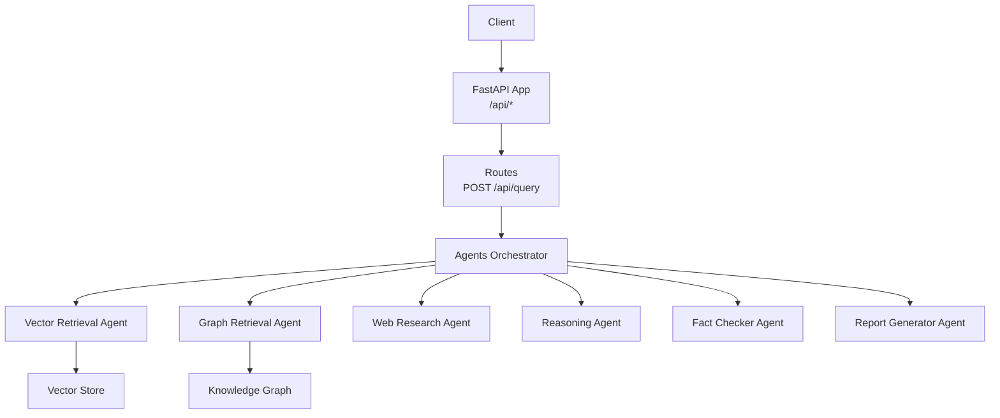
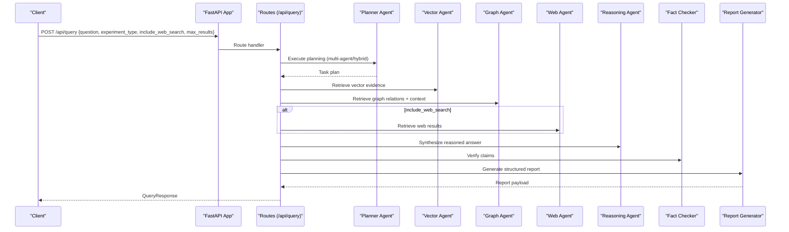
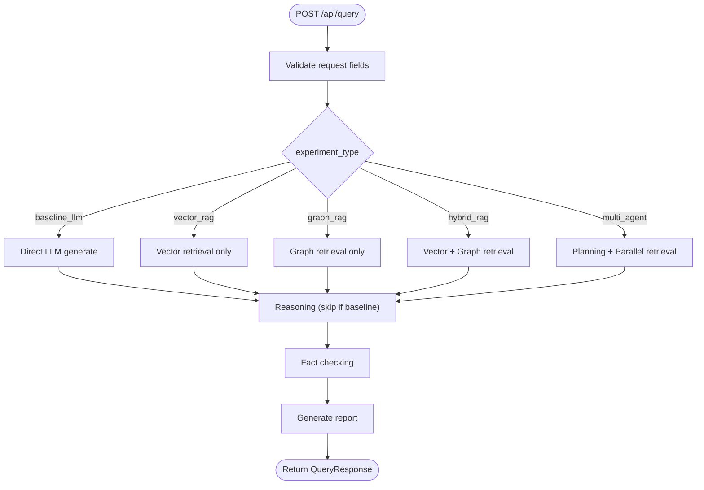
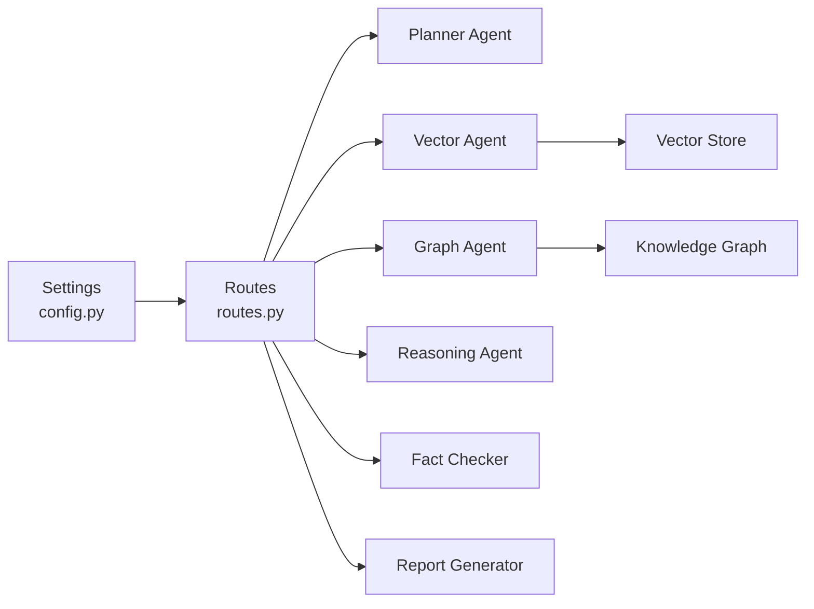

# Research Query API

<cite>
**Referenced Files in This Document**
- [routes.py](file://src/api/routes.py)
- [app.py](file://src/api/app.py)
- [schemas.py](file://src/core/schemas.py)
- [planner_agent.py](file://src/agents/planner_agent.py)
- [vector_agent.py](file://src/agents/vector_agent.py)
- [graph_agent.py](file://src/agents/graph_agent.py)
- [config.py](file://src/config.py)
- [main.py](file://main.py)
- [README.md](file://README.md)
</cite>

## Table of Contents
1. [Introduction](#introduction)
2. [Project Structure](#project-structure)
3. [Core Components](#core-components)
4. [Architecture Overview](#architecture-overview)
5. [Detailed Component Analysis](#detailed-component-analysis)
6. [Dependency Analysis](#dependency-analysis)
7. [Performance Considerations](#performance-considerations)
8. [Troubleshooting Guide](#troubleshooting-guide)
9. [Conclusion](#conclusion)
10. [Appendices](#appendices)

## Introduction
This document provides comprehensive API documentation for the research query processing endpoint POST /api/query. It explains how to submit research questions, select retrieval strategies (vector, graph, hybrid), and customize agent behavior via request parameters. It also documents response formats including structured reports with findings, evidence citations, confidence scores, and source references. Practical examples cover common research scenarios, multi-step queries, and result filtering. Finally, it addresses rate limiting, timeout handling, and asynchronous processing considerations based on the current implementation.

## Project Structure
The API is implemented using FastAPI. The application entry point mounts routers under a prefix and exposes health and status endpoints. The core query logic resides in the routes module, which orchestrates multiple agents and retrieval backends.

**Diagram sources**
- [app.py:26-53](file://src/api/app.py#L26-L53)
- [routes.py:188-338](file://src/api/routes.py#L188-L338)
- [vector_agent.py:44-81](file://src/agents/vector_agent.py#L44-L81)
- [graph_agent.py:46-109](file://src/agents/graph_agent.py#L46-L109)

**Section sources**
- [app.py:26-53](file://src/api/app.py#L26-L53)
- [routes.py:188-338](file://src/api/routes.py#L188-L338)
- [README.md:153-165](file://README.md#L153-L165)

## Core Components
- Request model: QueryRequest defines the fields accepted by POST /api/query.
- Response model: QueryResponse defines the structure returned by the endpoint.
- Experiment types: Enumerated strategies that control pipeline execution.
- Agents: Modular components for planning, retrieval, reasoning, verification, and report generation.

Key models and enums are defined centrally for consistency across agents and API layers.

**Section sources**
- [routes.py:80-99](file://src/api/routes.py#L80-L99)
- [schemas.py:35-51](file://src/core/schemas.py#L35-L51)
- [schemas.py:107-148](file://src/core/schemas.py#L107-L148)

## Architecture Overview
The POST /api/query endpoint supports multiple experiment configurations that determine the processing pipeline:

- Baseline LLM: Direct LLM answer without retrieval.
- Vector RAG: Retrieve semantically similar chunks from vector store.
- Graph RAG: Retrieve entity relationships and context from knowledge graph.
- Hybrid RAG: Combine vector and graph retrieval before reasoning.
- Multi-Agent: Full pipeline with planning, parallel retrieval, reasoning, fact-checking, and report generation.

**Diagram sources**
- [routes.py:188-338](file://src/api/routes.py#L188-L338)
- [planner_agent.py:65-82](file://src/agents/planner_agent.py#L65-L82)
- [vector_agent.py:44-81](file://src/agents/vector_agent.py#L44-L81)
- [graph_agent.py:46-109](file://src/agents/graph_agent.py#L46-L109)

## Detailed Component Analysis

### Endpoint: POST /api/query
- Purpose: Run a research query through the selected experiment pipeline and return a structured report.
- Path: /api/query
- Method: POST
- Content-Type: application/json

#### Request Schema
- question: string (required). The research question to investigate.
- experiment_type: string (optional, default "multi_agent"). Allowed values:
  - baseline_llm
  - vector_rag
  - graph_rag
  - hybrid_rag
  - multi_agent
- include_web_search: boolean (optional, default true). Whether to perform web search during retrieval.
- max_results: integer (optional, default 10). Maximum number of retrieval results per strategy.

Notes:
- The request schema is validated by Pydantic; invalid values will produce validation errors.
- For hybrid or multi-agent modes, both vector and graph retrieval are executed in parallel where applicable.
- Web search is optional and controlled by include_web_search.

**Section sources**
- [routes.py:80-99](file://src/api/routes.py#L80-L99)
- [schemas.py:35-51](file://src/core/schemas.py#L35-L51)

#### Response Schema
- report_id: string. Unique identifier for the generated report.
- research_question: string. The original question submitted.
- executive_summary: string. High-level summary of findings.
- findings: array of objects. Each object represents a finding with title and content.
- evidence_count: integer. Total number of evidence chunks collected across all retrieval methods.
- graph_relations_count: integer. Number of graph relations retrieved.
- verified_claims: array of objects. Claims with verdicts and confidence scores.
- limitations: array of strings. Known limitations or caveats.
- references: array of objects. Source references for evidence and claims.
- experiment_type: string. The experiment configuration used.
- latency_sec: number. End-to-end processing time in seconds.

Evidence and references may include metadata such as source identifiers, relevance scores, and retrieval method tags. Verified claims include verdicts like supported, partially_supported, unsupported, contradicted, or no_evidence, along with confidence scores.

**Section sources**
- [routes.py:87-99](file://src/api/routes.py#L87-L99)
- [schemas.py:65-148](file://src/core/schemas.py#L65-L148)

#### Processing Logic
- Planning: In hybrid/multi-agent modes, the Planner Agent decomposes the question into sub-questions and determines required agents.
- Retrieval:
  - Vector: Uses vector store to retrieve relevant chunks based on reformulated queries.
  - Graph: Extracts entities and relationship types, then queries the knowledge graph for relations and contextual text.
  - Web: Optional search for up-to-date information when enabled.
- Reasoning: Synthesizes evidence into a coherent answer.
- Fact Checking: Verifies claims against evidence and assigns verdicts and confidence.
- Report Generation: Produces a structured report with summaries, findings, references, and limitations.

**Diagram sources**
- [routes.py:188-338](file://src/api/routes.py#L188-L338)
- [planner_agent.py:65-82](file://src/agents/planner_agent.py#L65-L82)
- [vector_agent.py:44-81](file://src/agents/vector_agent.py#L44-L81)
- [graph_agent.py:46-109](file://src/agents/graph_agent.py#L46-L109)

**Section sources**
- [routes.py:188-338](file://src/api/routes.py#L188-L338)

### Retrieval Strategies
- Vector RAG: Retrieves semantically similar document chunks from the vector store. Supports query reformulation to improve retrieval quality.
- Graph RAG: Extracts entities and relationship types from the query, then queries the knowledge graph for relations and contextual text.
- Hybrid RAG: Combines vector and graph retrieval to enrich evidence before reasoning.
- Multi-Agent: Full pipeline with planning, parallel retrieval, reasoning, fact-checking, and report generation.

Configuration options:
- include_web_search: Enables additional web-based evidence collection.
- max_results: Controls the number of results returned per retrieval method.

**Section sources**
- [vector_agent.py:44-81](file://src/agents/vector_agent.py#L44-L81)
- [graph_agent.py:46-109](file://src/agents/graph_agent.py#L46-L109)
- [routes.py:188-338](file://src/api/routes.py#L188-L338)

### Output Formatting Options
- Findings: Structured list of key insights derived from evidence synthesis.
- Evidence Citations: Each piece of evidence includes chunk_id, content, source, relevance_score, and retrieval_method.
- Confidence Scores: Verified claims include confidence values indicating certainty levels.
- References: Aggregated source references for traceability.

These fields are populated by the reasoning, fact-checking, and report generation stages.

**Section sources**
- [schemas.py:65-148](file://src/core/schemas.py#L65-L148)
- [routes.py:306-338](file://src/api/routes.py#L306-L338)

### Practical Examples
- Common research scenario: Submit a question with experiment_type set to multi_agent and include_web_search true to leverage full pipeline capabilities.
- Multi-step queries: Use hybrid_rag to combine vector and graph retrieval for complex, multi-hop questions.
- Result filtering: Adjust max_results to limit the number of evidence chunks and relations returned.

Example payloads:
- Minimal request: Provide question and rely on defaults for other fields.
- Customized request: Set experiment_type to vector_rag or graph_rag and tune include_web_search and max_results.

Note: These examples describe request/response shapes; actual JSON payloads should conform to the documented schemas.

[No sources needed since this section describes usage patterns without quoting code]

### Rate Limiting, Timeouts, and Async Processing
- Rate Limiting: Not implemented in the current codebase. Clients should implement client-side retry/backoff policies.
- Timeout Handling: No explicit timeouts are configured at the API layer. Long-running queries may block until completion.
- Asynchronous Processing: The endpoint is synchronous; complex queries execute within the request lifecycle. For long-running tasks, consider external job queues or polling mechanisms.

Recommendations:
- Monitor latency_sec in responses to assess performance.
- Implement client-side retries with exponential backoff for transient failures.
- If scaling beyond single-instance limits, deploy behind an API gateway that enforces rate limits and timeouts.

**Section sources**
- [routes.py:188-338](file://src/api/routes.py#L188-L338)
- [app.py:26-53](file://src/api/app.py#L26-L53)

### Error Responses
- Validation Errors: Invalid or missing fields in the request body will trigger HTTP 422 Unprocessable Entity with details about field constraints.
- Service Unavailability: If downstream services (vector store, knowledge graph, LLM providers) are unavailable, internal errors may occur. The current implementation does not define custom error handlers; standard FastAPI exceptions apply.
- Processing Failures: Exceptions raised during agent execution or I/O operations will propagate as HTTP errors. Inspect server logs for detailed stack traces.

Common statuses:
- 200 OK: Successful query execution with a complete report.
- 422 Unprocessable Entity: Request validation failure.
- 5xx Server Error: Internal processing or service unavailability.

**Section sources**
- [routes.py:188-338](file://src/api/routes.py#L188-L338)

## Dependency Analysis
The query endpoint depends on several subsystems:
- Configuration: Centralized settings loaded from environment variables.
- Agents: Modular components for planning, retrieval, reasoning, verification, and reporting.
- Storage: Vector store and knowledge graph backends.

**Diagram sources**
- [config.py:21-82](file://src/config.py#L21-L82)
- [routes.py:188-338](file://src/api/routes.py#L188-L338)
- [vector_agent.py:44-81](file://src/agents/vector_agent.py#L44-L81)
- [graph_agent.py:46-109](file://src/agents/graph_agent.py#L46-L109)

**Section sources**
- [config.py:21-82](file://src/config.py#L21-L82)
- [routes.py:188-338](file://src/api/routes.py#L188-L338)

## Performance Considerations
- Latency: Measured and returned in latency_sec; monitor for optimization opportunities.
- Retrieval Efficiency: Tune max_results to balance completeness vs. performance.
- Parallelism: Hybrid and multi-agent modes execute vector and graph retrieval concurrently where possible.
- Resource Usage: Ensure vector store and knowledge graph backends are appropriately sized and indexed.

[No sources needed since this section provides general guidance]

## Troubleshooting Guide
- Validation Errors: Ensure all required fields are present and valid. Check experiment_type values and data types.
- Empty Results: Verify that vector store and knowledge graph are populated and accessible.
- Slow Queries: Reduce max_results or disable web search to shorten processing time.
- Service Errors: Check connectivity to LLM providers, vector stores, and graph databases. Review server logs for stack traces.

**Section sources**
- [routes.py:188-338](file://src/api/routes.py#L188-L338)
- [vector_agent.py:73-75](file://src/agents/vector_agent.py#L73-L75)
- [graph_agent.py:95-97](file://src/agents/graph_agent.py#L95-L97)

## Conclusion
The POST /api/query endpoint provides a flexible and powerful interface for conducting research queries across multiple retrieval strategies and agent pipelines. By selecting appropriate experiment types and tuning parameters, users can tailor the system to their needs while receiving structured, evidence-backed reports. Current limitations include lack of built-in rate limiting and timeouts; clients should implement robust retry and monitoring strategies.

[No sources needed since this section summarizes without analyzing specific files]

## Appendices

### Environment and Configuration
- Application settings are loaded from environment variables with sensible defaults.
- Key configuration areas include LLM provider settings, embedding models, vector database options, knowledge graph credentials, and document processing parameters.

**Section sources**
- [config.py:21-82](file://src/config.py#L21-L82)

### Running the Server
- The main entry point supports starting the API server, ingesting documents, building graphs, and running evaluations via CLI commands.

**Section sources**
- [main.py:24-28](file://main.py#L24-L28)
- [main.py:71-104](file://main.py#L71-L104)