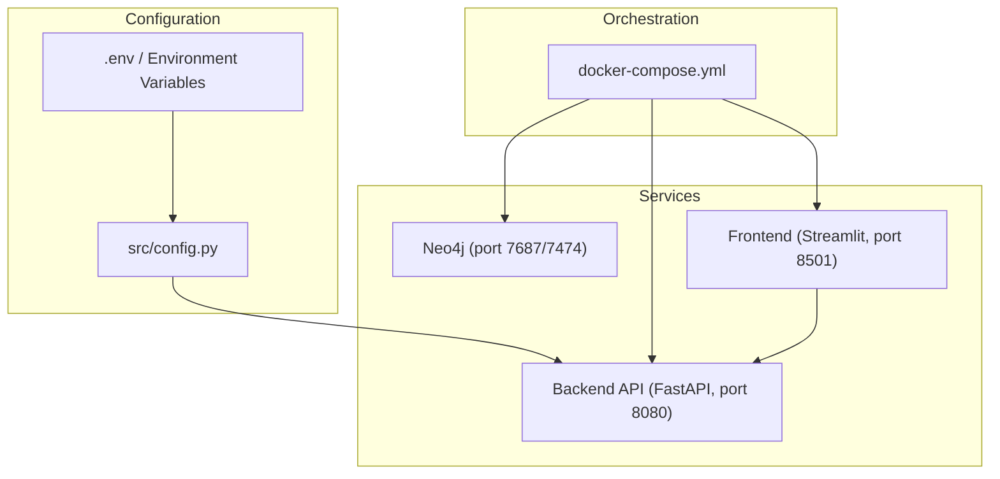
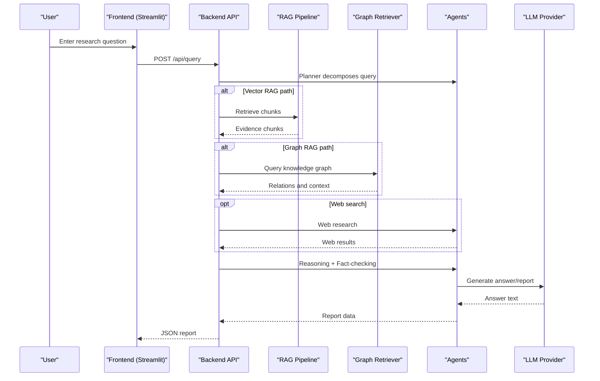
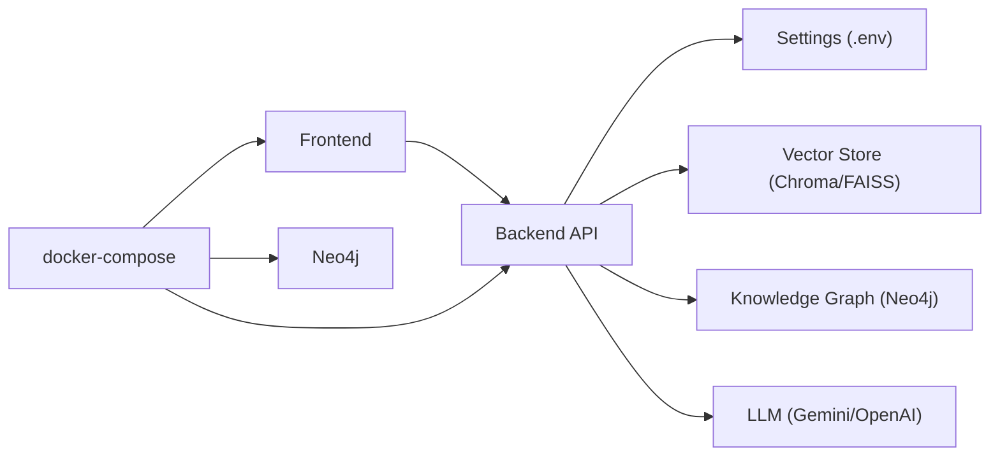

# Configuration and Deployment

<cite>
**Referenced Files in This Document**
- [src/config.py](file://src/config.py)
- [.env.example](file://.env.example)
- [docker-compose.yml](file://docker-compose.yml)
- [Dockerfile](file://Dockerfile)
- [Dockerfile.frontend](file://Dockerfile.frontend)
- [main.py](file://main.py)
- [requirements.txt](file://requirements.txt)
- [README.md](file://README.md)
- [src/api/app.py](file://src/api/app.py)
- [src/api/routes.py](file://src/api/routes.py)
- [frontend/app.py](file://frontend/app.py)
- [src/core/schemas.py](file://src/core/schemas.py)
</cite>

## Table of Contents
1. [Introduction](#introduction)
2. [Project Structure](#project-structure)
3. [Core Components](#core-components)
4. [Architecture Overview](#architecture-overview)
5. [Detailed Component Analysis](#detailed-component-analysis)
6. [Dependency Analysis](#dependency-analysis)
7. [Performance Considerations](#performance-considerations)
8. [Troubleshooting Guide](#troubleshooting-guide)
9. [Conclusion](#conclusion)
10. [Appendices](#appendices)

## Introduction
This document provides comprehensive guidance for configuring and deploying the Graph RAG + Multi-Agent Research System across development, staging, and production environments. It covers centralized configuration management with environment variables, Docker-based containerization, docker-compose orchestration, and operational considerations such as monitoring, logging, security hardening, backup and recovery, migrations, performance tuning, and troubleshooting.

## Project Structure
The system is organized into a FastAPI backend, a Streamlit frontend, and supporting services (Neo4j). Configuration is centralized via Pydantic Settings loaded from environment variables and an .env file. The docker-compose file orchestrates Neo4j, the backend API, and the frontend.

**Diagram sources**
- [docker-compose.yml:1-56](file://docker-compose.yml#L1-L56)
- [src/config.py:21-81](file://src/config.py#L21-L81)
- [Dockerfile:1-25](file://Dockerfile#L1-L25)
- [Dockerfile.frontend:1-15](file://Dockerfile.frontend#L1-L15)

**Section sources**
- [docker-compose.yml:1-56](file://docker-compose.yml#L1-L56)
- [Dockerfile:1-25](file://Dockerfile#L1-L25)
- [Dockerfile.frontend:1-15](file://Dockerfile.frontend#L1-L15)
- [README.md:35-79](file://README.md#L35-L79)

## Core Components
- Centralized configuration: A single settings class loads defaults and environment overrides, with caching to avoid repeated reads.
- Backend API: FastAPI application with CORS, health endpoint, and REST routes for ingestion, graph operations, querying, and evaluation.
- Frontend: Streamlit UI that calls the backend API for queries, ingestion, and status checks.
- Data stores: Neo4j for knowledge graphs; ChromaDB or FAISS for vector storage.
- LLM providers: Google Gemini or OpenAI, selected via configuration.

Key responsibilities:
- Configuration validation and defaults ensure robust startup even when some optional services are missing.
- Lazy initialization of heavy components (RAG pipeline, graph retriever, agents) reduces startup time.
- Health and status endpoints support readiness probes and dashboards.

**Section sources**
- [src/config.py:21-81](file://src/config.py#L21-L81)
- [src/api/app.py:17-56](file://src/api/app.py#L17-L56)
- [src/api/routes.py:28-75](file://src/api/routes.py#L28-L75)
- [frontend/app.py:11-47](file://frontend/app.py#L11-L47)

## Architecture Overview
The system composes multiple retrieval strategies and agent-driven reasoning to produce evidence-grounded reports.

**Diagram sources**
- [src/api/routes.py:188-338](file://src/api/routes.py#L188-L338)
- [src/core/schemas.py:17-41](file://src/core/schemas.py#L17-L41)

## Detailed Component Analysis

### Configuration Management
- Centralized settings class defines all configurable options with defaults and descriptions.
- Environment variables override defaults; values are validated by Pydantic types.
- Caching via lru_cache ensures efficient access throughout the process lifetime.
- Paths for data directories are resolved relative to the project root.

Operational notes:
- Ensure .env is present and contains required keys for your chosen LLM provider and databases.
- For multi-environment deployments, maintain separate .env files per environment and inject them at runtime.

**Section sources**
- [src/config.py:21-81](file://src/config.py#L21-L81)
- [.env.example:1-48](file://.env.example#L1-L48)

### Backend API
- Application lifecycle logs startup/shutdown using configured app name.
- CORS middleware allows cross-origin requests (adjust for production).
- Health endpoint returns a simple status object.
- Routes implement document ingestion, graph building, querying, and evaluation.

Operational notes:
- Use /health for container health checks.
- Expose only necessary ports in production and restrict CORS origins.

**Section sources**
- [src/api/app.py:17-56](file://src/api/app.py#L17-L56)
- [src/api/routes.py:116-186](file://src/api/routes.py#L116-L186)

### Frontend
- Streamlit UI connects to the backend API base URL.
- Displays system status, metrics, and supports ingestion, graph building, and evaluation flows.
- Handles errors gracefully and shows user-friendly messages.

Operational notes:
- Update API_BASE if running behind a reverse proxy or different host/port.
- Configure timeouts appropriate for long-running tasks.

**Section sources**
- [frontend/app.py:11-47](file://frontend/app.py#L11-L47)
- [frontend/app.py:57-154](file://frontend/app.py#L57-L154)
- [frontend/app.py:156-203](file://frontend/app.py#L156-L203)
- [frontend/app.py:204-257](file://frontend/app.py#L204-L257)
- [frontend/app.py:259-300](file://frontend/app.py#L259-L300)

### CLI Entry Point
- Provides commands to serve the API, ingest documents, build graphs, and run evaluations.
- Configures logging level via command-line argument.

Operational notes:
- Useful for batch ingestion and evaluation outside of the web UI.

**Section sources**
- [main.py:14-28](file://main.py#L14-L28)
- [main.py:31-69](file://main.py#L31-L69)
- [main.py:71-110](file://main.py#L71-L110)

### Containerization
- Backend image installs dependencies, copies source, exposes port 8080, and runs uvicorn.
- Frontend image installs Streamlit dependencies and runs the UI on port 8501.
- docker-compose defines Neo4j, backend, and frontend services with networking and volumes.

Operational notes:
- Persist Neo4j data via named volume.
- Mount local data directory for ingestion during development.

**Section sources**
- [Dockerfile:1-25](file://Dockerfile#L1-L25)
- [Dockerfile.frontend:1-15](file://Dockerfile.frontend#L1-L15)
- [docker-compose.yml:1-56](file://docker-compose.yml#L1-L56)

## Dependency Analysis
High-level service dependencies and runtime coupling:
- Backend depends on configuration, vector store, knowledge graph, and LLM providers.
- Frontend depends on backend API availability.
- docker-compose enforces startup order and health checks.

**Diagram sources**
- [docker-compose.yml:1-56](file://docker-compose.yml#L1-L56)
- [src/config.py:21-81](file://src/config.py#L21-L81)
- [src/api/routes.py:28-75](file://src/api/routes.py#L28-L75)

**Section sources**
- [docker-compose.yml:1-56](file://docker-compose.yml#L1-L56)
- [requirements.txt:1-60](file://requirements.txt#L1-L60)

## Performance Considerations
- Embedding model and dimension: Choose models balancing accuracy and latency; adjust EMBEDDING_DIMENSION accordingly.
- Chunk size and overlap: Tune CHUNK_SIZE and CHUNK_OVERLAP to optimize retrieval quality vs. index size.
- Vector DB type: ChromaDB offers simplicity; FAISS may provide faster nearest-neighbor searches depending on workload.
- LLM provider selection: Gemini vs. OpenAI can affect latency and cost; set LLM_PROVIDER and corresponding model names.
- Concurrency: Uvicorn workers and threads can be tuned based on CPU/memory resources.
- Resource allocation: Ensure sufficient memory for embedding models and graph operations; monitor container resource limits.

[No sources needed since this section provides general guidance]

## Troubleshooting Guide
Common issues and resolutions:
- Missing API keys: Ensure LLM_PROVIDER and corresponding keys are set in .env; verify secrets are injected in containers.
- Neo4j connectivity: Confirm NEO4J_URI, NEO4J_USER, and NEO4J_PASSWORD match the compose configuration; check service health.
- Vector DB misconfiguration: Verify VECTOR_DB_TYPE and related connection parameters; ensure data directories are writable.
- CORS errors: Adjust allow_origins in production to trusted domains.
- Long-running queries: Increase client timeouts in the frontend and consider scaling backend resources.
- Ingestion failures: Check file formats and sizes; validate MAX_UPLOAD_SIZE_MB and chunking settings.

Health and diagnostics:
- Use GET /health to confirm API readiness.
- Use GET /api/status to inspect component states and counts.

**Section sources**
- [src/api/app.py:49-52](file://src/api/app.py#L49-L52)
- [src/api/routes.py:116-131](file://src/api/routes.py#L116-L131)
- [.env.example:1-48](file://.env.example#L1-L48)

## Conclusion
This guide outlines how to configure, containerize, and operate the Graph RAG + Multi-Agent Research System effectively. By centralizing configuration, leveraging docker-compose for orchestration, and following the operational recommendations, you can deploy reliably across environments and scale for production workloads.

[No sources needed since this section summarizes without analyzing specific files]

## Appendices

### Environment Variables Reference
- Application
  - APP_NAME, APP_HOST, APP_PORT, DEBUG, LOG_LEVEL
- LLM
  - LLM_PROVIDER, GEMINI_API_KEY, GEMINI_MODEL, OPENAI_API_KEY, OPENAI_MODEL, TEMPERATURE
- Embeddings
  - EMBEDDING_MODEL, EMBEDDING_DIMENSION
- Vector Database
  - VECTOR_DB_TYPE, CHROMA_HOST, CHROMA_PORT, CHROMA_COLLECTION, FAISS_INDEX_PATH
- Knowledge Graph
  - NEO4J_URI, NEO4J_USER, NEO4J_PASSWORD
- Web Search
  - SERPER_API_KEY, DUCKDUCKGO_ENABLED
- Document Processing
  - CHUNK_SIZE, CHUNK_OVERLAP, MAX_UPLOAD_SIZE_MB
- Evaluation
  - BENCHMARK_DATASET_PATH, EVAL_RESULTS_PATH
- Paths
  - DATA_DIR, DOCS_DIR

**Section sources**
- [src/config.py:21-81](file://src/config.py#L21-L81)
- [.env.example:1-48](file://.env.example#L1-L48)

### Docker and Compose Quick Start
- Build and start full stack: docker-compose up
- Access points:
  - Backend API: http://localhost:8080
  - Frontend: http://localhost:8501
  - Neo4j Browser: http://localhost:7474

**Section sources**
- [docker-compose.yml:1-56](file://docker-compose.yml#L1-L56)
- [README.md:48-57](file://README.md#L48-L57)

### Production Deployment Strategies
- Cloud platforms (AWS, GCP, Azure)
  - Container registry: Push images to platform registries.
  - Orchestration: Deploy services via managed Kubernetes or platform-specific services.
  - Secrets management: Inject API keys and database credentials via secret managers.
  - Networking: Use internal load balancers and restrict ingress to trusted IPs/domains.
- Kubernetes
  - Define Deployments, Services, ConfigMaps, and Secrets.
  - Use Readiness/Liveness probes against /health and /api/status.
  - Configure resource requests/limits for CPU and memory.
  - Enable horizontal pod autoscaling based on CPU or custom metrics.
- Monitoring and Logging
  - Export structured logs to a centralized logging system.
  - Instrument metrics (latency, error rates, token usage) and expose via Prometheus-compatible endpoints.
  - Set alerts for high error rates, slow responses, and resource saturation.
- Security Hardening
  - Restrict CORS origins and enable HTTPS termination at the edge.
  - Rotate API keys regularly and use least-privilege credentials.
  - Scan images for vulnerabilities and enforce policy enforcement.

[No sources needed since this section provides general guidance]

### Backup and Recovery
- Neo4j
  - Back up the Neo4j data volume regularly.
  - Test restore procedures to ensure data integrity.
- Vector Store
  - If using file-backed indexes (e.g., FAISS), back up index paths.
  - For hosted vector stores, follow provider backup guidelines.
- Documents and Results
  - Periodically snapshot data/documents and eval_results directories.

[No sources needed since this section provides general guidance]

### Database Migration Strategies
- Schema changes in Neo4j should be versioned and applied via migration scripts.
- Validate compatibility before rolling out new versions.
- Use feature flags to gradually roll out schema updates.

[No sources needed since this section provides general guidance]

### Maintenance Tasks
- Regularly update dependencies and base images.
- Monitor disk usage for vector indexes and Neo4j data.
- Review and tune chunking and embedding parameters based on observed performance.

[No sources needed since this section provides general guidance]

### API Endpoints Summary
- GET /health
- GET /api/status
- POST /api/documents/ingest
- POST /api/documents/ingest-directory
- POST /api/graph/build
- GET /api/graph/summary
- POST /api/query
- POST /api/evaluate/run

**Section sources**
- [README.md:153-164](file://README.md#L153-L164)
- [src/api/app.py:49-52](file://src/api/app.py#L49-L52)
- [src/api/routes.py:116-354](file://src/api/routes.py#L116-L354)