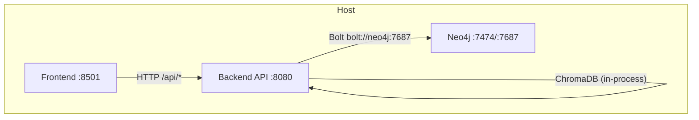
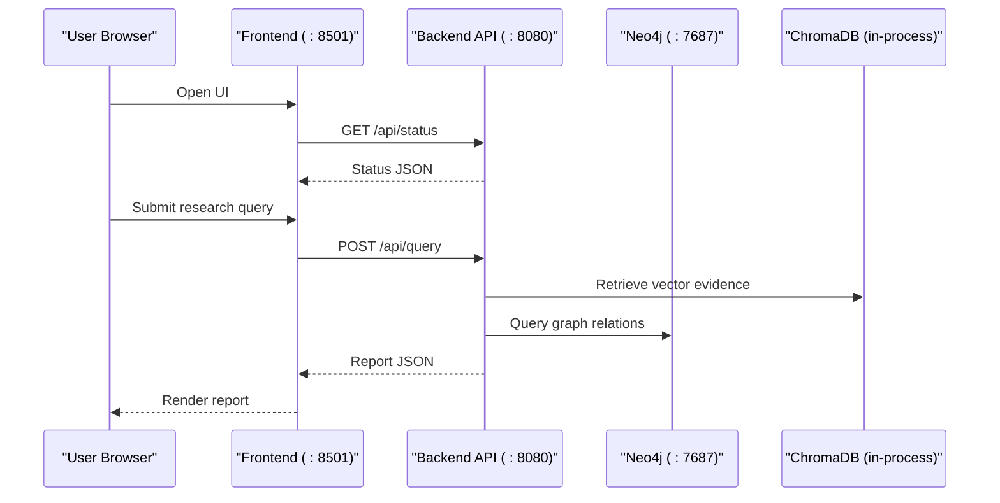
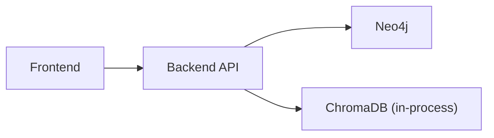

# Docker Deployment

<cite>
**Referenced Files in This Document**
- [docker-compose.yml](file://docker-compose.yml)
- [Dockerfile](file://Dockerfile)
- [Dockerfile.frontend](file://Dockerfile.frontend)
- [requirements.txt](file://requirements.txt)
- [README.md](file://README.md)
- [main.py](file://main.py)
- [src/config.py](file://src/config.py)
- [src/api/app.py](file://src/api/app.py)
- [src/api/routes.py](file://src/api/routes.py)
- [frontend/app.py](file://frontend/app.py)
</cite>

## Table of Contents
1. [Introduction](#introduction)
2. [Project Structure](#project-structure)
3. [Core Components](#core-components)
4. [Architecture Overview](#architecture-overview)
5. [Detailed Component Analysis](#detailed-component-analysis)
6. [Dependency Analysis](#dependency-analysis)
7. [Performance Considerations](#performance-considerations)
8. [Troubleshooting Guide](#troubleshooting-guide)
9. [Conclusion](#conclusion)
10. [Appendices](#appendices)

## Introduction
This document provides comprehensive Docker deployment guidance for the Graph RAG + Multi-Agent Research System. It explains how to run a multi-container stack using docker-compose that orchestrates:
- A FastAPI backend API server
- A Streamlit frontend interface
- Neo4j knowledge graph database
- ChromaDB vector store (in-process within the backend)
- Supporting dependencies and data persistence

It covers container images, environment configuration, networking, volumes, health checks, scaling, logging, and common issues with practical examples for local development and production-like setups.

## Project Structure
The repository includes:
- docker-compose.yml: Defines services, ports, environment variables, volumes, and health checks
- Dockerfile: Builds the backend API image
- Dockerfile.frontend: Builds the frontend UI image
- requirements.txt: Python dependencies for backend and frontend
- Application code under src/ and frontend/
- Data directories for documents, benchmarks, and evaluation results

**Diagram sources**
- [docker-compose.yml:4-55](file://docker-compose.yml#L4-L55)
- [src/api/app.py:26-56](file://src/api/app.py#L26-L56)
- [frontend/app.py:11-14](file://frontend/app.py#L11-L14)

**Section sources**
- [docker-compose.yml:1-56](file://docker-compose.yml#L1-L56)
- [README.md:48-58](file://README.md#L48-L58)

## Core Components
- Backend API (FastAPI): Serves REST endpoints for ingestion, querying, graph operations, and evaluation. Exposed on port 8080 inside the container.
- Frontend (Streamlit): Interactive web UI that calls the backend API. Exposed on port 8501 inside the container.
- Neo4j: Knowledge graph database with authentication and APOC plugin enabled. Exposed on ports 7474 (browser) and 7687 (Bolt).
- ChromaDB: Vector store used by the backend; runs in-process when configured via environment variables.
- Configuration: Centralized settings loaded from environment variables with defaults.

Key runtime behaviors:
- The backend exposes a health endpoint at /health.
- The frontend connects to the backend via HTTP at http://localhost:8080/api by default.
- The backend connects to Neo4j using Bolt protocol.

**Section sources**
- [src/api/app.py:26-56](file://src/api/app.py#L26-L56)
- [src/config.py:21-82](file://src/config.py#L21-L82)
- [frontend/app.py:11-14](file://frontend/app.py#L11-L14)
- [docker-compose.yml:22-41](file://docker-compose.yml#L22-L41)

## Architecture Overview
The system is orchestrated as a multi-service stack:
- Frontend communicates with the backend over HTTP.
- Backend uses ChromaDB in-memory or persistent storage based on configuration and connects to Neo4j for graph queries.
- docker-compose manages service lifecycle, networking, and volume mounts.

**Diagram sources**
- [docker-compose.yml:22-55](file://docker-compose.yml#L22-L55)
- [src/api/routes.py:116-131](file://src/api/routes.py#L116-L131)
- [src/api/routes.py:188-338](file://src/api/routes.py#L188-L338)
- [frontend/app.py:70-154](file://frontend/app.py#L70-L154)

## Detailed Component Analysis

### docker-compose.yml
Defines three services:
- neo4j: Image neo4j:5-community, sets authentication, enables APOC plugin, persists data to a named volume, and defines a healthcheck.
- backend: Built from Dockerfile, exposes port 8080, injects environment variables for Neo4j connection, LLM provider, and vector store type, mounts host data directory into the container, and depends on neo4j being healthy.
- frontend: Built from Dockerfile.frontend, exposes port 8501, and depends on backend.

Volumes:
- neo4j_data: Named volume for Neo4j data persistence.

Networking:
- Services communicate via Docker’s internal network using service names (e.g., bolt://neo4j:7687).

Port mapping:
- Host 7474 -> Neo4j browser
- Host 7687 -> Neo4j Bolt
- Host 8080 -> Backend API
- Host 8501 -> Frontend UI

Health checks:
- Neo4j healthcheck runs a command to check status.

**Section sources**
- [docker-compose.yml:4-55](file://docker-compose.yml#L4-L55)

### Backend Dockerfile
Base image: python:3.11-slim
Steps:
- Install build-essential
- Copy requirements.txt and install Python dependencies
- Copy application source code and example env file
- Create data directories
- Expose port 8080
- Start uvicorn serving src.api.app:app on 0.0.0.0:8080

Environment variables consumed by the app:
- Neo4j URI, user, password
- LLM provider and keys
- Vector DB type (chroma)

**Section sources**
- [Dockerfile:1-25](file://Dockerfile#L1-L25)
- [src/config.py:21-82](file://src/config.py#L21-L82)

### Frontend Dockerfile
Base image: python:3.11-slim
Steps:
- Install streamlit and supporting packages
- Copy frontend code and shared config
- Expose port 8501
- Run Streamlit on 0.0.0.0:8501

Note: The frontend hard-codes the backend URL to http://localhost:8080/api. When running via docker-compose, this works because the frontend container can reach the backend via the service name “backend” if updated, but currently it uses localhost which may require host network mode or adjustment for container-to-container communication.

**Section sources**
- [Dockerfile.frontend:1-15](file://Dockerfile.frontend#L1-L15)
- [frontend/app.py:11-14](file://frontend/app.py#L11-L14)

### API Server and Routes
- App creation: Configures CORS, registers routes, and exposes /health.
- Routes: Provide endpoints for system status, document ingestion (single file and directory), knowledge graph building and summary, research queries across multiple experiment types, and evaluation execution.

Key endpoints:
- GET /health
- GET /api/status
- POST /api/documents/ingest
- POST /api/documents/ingest-directory
- POST /api/graph/build
- GET /api/graph/summary
- POST /api/query
- POST /api/evaluate/run

**Section sources**
- [src/api/app.py:26-56](file://src/api/app.py#L26-L56)
- [src/api/routes.py:116-354](file://src/api/routes.py#L116-L354)

### Configuration Management
Settings are centralized and loaded from environment variables with sensible defaults. Important settings include:
- LLM provider and model keys
- Embedding model and dimension
- Vector DB type and paths
- Neo4j connection details
- Chunking parameters and upload limits
- Paths for data, documents, and evaluation outputs

**Section sources**
- [src/config.py:21-82](file://src/config.py#L21-L82)

## Dependency Analysis
Service dependencies and coupling:
- Frontend depends on Backend API availability.
- Backend depends on Neo4j for graph operations and uses an in-process vector store (ChromaDB).
- docker-compose enforces startup order and health conditions.

**Diagram sources**
- [docker-compose.yml:39-52](file://docker-compose.yml#L39-L52)
- [src/config.py:43-53](file://src/config.py#L43-L53)

**Section sources**
- [docker-compose.yml:39-52](file://docker-compose.yml#L39-L52)
- [src/config.py:43-53](file://src/config.py#L43-L53)

## Performance Considerations
- Resource allocation: Assign CPU and memory limits in docker-compose for each service to prevent resource contention, especially for Neo4j and the backend during heavy ingestion or graph builds.
- Concurrency: Tune uvicorn workers and threads based on workload and available resources.
- Vector store: For large datasets, consider persisting ChromaDB data to a volume and tuning chunk sizes and overlap.
- Neo4j: Use appropriate JVM heap settings via environment variables if needed and ensure sufficient disk space for indexes.
- Caching: Leverage in-process caches where applicable and avoid redundant computations in agent pipelines.

[No sources needed since this section provides general guidance]

## Troubleshooting Guide
Common issues and resolutions:
- Network connectivity:
  - Ensure the frontend can reach the backend. If using docker-compose, update the frontend to use the backend service hostname instead of localhost.
  - Verify ports are not conflicting on the host machine.
- Permission problems:
  - Ensure the mounted data directory has correct permissions for writing by the backend container.
  - Neo4j data volume must be writable by the Neo4j process.
- Health checks failing:
  - Confirm Neo4j credentials and plugins are correctly set.
  - Check logs for startup errors in each service.
- Resource constraints:
  - Increase memory/CPU limits for containers if processes are killed due to OOM.
  - Reduce batch sizes for ingestion or graph building.
- Environment variables:
  - Validate required keys for LLM providers and Neo4j credentials are present.
  - Ensure .env files are properly loaded if used.

Operational tips:
- Use docker-compose logs to inspect service output.
- Test connectivity between containers using curl or ping commands inside containers.
- Validate Neo4j connectivity using the browser at http://localhost:7474.

**Section sources**
- [docker-compose.yml:11-20](file://docker-compose.yml#L11-L20)
- [docker-compose.yml:30-41](file://docker-compose.yml#L30-L41)
- [frontend/app.py:11-14](file://frontend/app.py#L11-L14)

## Conclusion
The Graph RAG + Multi-Agent Research System is packaged as a multi-container stack with clear separation of concerns: a FastAPI backend, a Streamlit frontend, and a Neo4j database. docker-compose simplifies orchestration with health checks, volumes, and environment configuration. By following the steps and recommendations in this document, you can deploy locally for development and adapt configurations for production environments with scaling, resource limits, and robust logging.

[No sources needed since this section summarizes without analyzing specific files]

## Appendices

### Step-by-Step Deployment Instructions

Local development:
- Build and start all services:
  - docker-compose up --build
- Access:
  - Backend API: http://localhost:8080
  - Frontend UI: http://localhost:8501
  - Neo4j Browser: http://localhost:7474

Testing:
- Health check:
  - curl http://localhost:8080/health
- System status:
  - curl http://localhost:8080/api/status

Production-like setup:
- Set environment variables for secrets (LLM keys, Neo4j password) via docker-compose environment or external secret management.
- Persist data:
  - Neo4j data is persisted via the named volume neo4j_data.
  - Mount host directories for documents and evaluation results if needed.
- Configure resource limits and restart policies in docker-compose.

Container networking:
- Services communicate via Docker’s internal network using service names.
- Update frontend to call backend via http://backend:8080/api when running in compose networks.

Volume mounting:
- Backend mounts ./data:/app/data for documents and outputs.
- Neo4j uses a named volume for persistence.

Environment variable injection:
- Backend receives Neo4j credentials, LLM provider settings, and vector store configuration.
- Frontend should receive backend URL via environment if changed from localhost.

Port mapping:
- 7474, 7687 for Neo4j
- 8080 for Backend API
- 8501 for Frontend UI

Scaling strategies:
- Horizontal scaling:
  - Run multiple backend replicas behind a reverse proxy/load balancer.
  - Keep Neo4j as a single instance or cluster depending on scale needs.
- Vertical scaling:
  - Increase CPU/memory limits per service.

Health checks:
- Neo4j healthcheck defined in docker-compose.
- Add custom healthchecks for backend and frontend if needed.

Logging configuration:
- Backend uses structured logging; capture logs via docker-compose logs.
- Centralize logs with an external logging service for production.

Custom Docker configurations:
- Multi-stage builds:
  - Optimize image size by separating build and runtime stages.
- Custom base images:
  - Use minimal images with only necessary system libraries.
- Cloud platform deployments:
  - Map docker-compose services to managed services (e.g., managed Neo4j, managed vector stores).
  - Use environment variables and secrets managers for sensitive configuration.

Example adjustments:
- Frontend backend URL:
  - Change frontend/app.py to read the backend URL from an environment variable for flexibility across environments.
- ChromaDB persistence:
  - Configure ChromaDB to persist data to a mounted volume for durability.

**Section sources**
- [docker-compose.yml:4-55](file://docker-compose.yml#L4-L55)
- [Dockerfile:1-25](file://Dockerfile#L1-L25)
- [Dockerfile.frontend:1-15](file://Dockerfile.frontend#L1-L15)
- [frontend/app.py:11-14](file://frontend/app.py#L11-L14)
- [src/config.py:21-82](file://src/config.py#L21-L82)
- [README.md:48-58](file://README.md#L48-L58)