# Environment Configuration

<cite>
**Referenced Files in This Document**
- [src/config.py](file://src/config.py)
- [src/api/app.py](file://src/api/app.py)
- [main.py](file://main.py)
- [src/core/llm.py](file://src/core/llm.py)
- [src/rag/embeddings.py](file://src/rag/embeddings.py)
- [src/rag/vector_store.py](file://src/rag/vector_store.py)
- [src/graph/graph_store.py](file://src/graph/graph_store.py)
- [src/agents/web_agent.py](file://src/agents/web_agent.py)
- [src/rag/chunking.py](file://src/rag/chunking.py)
- [src/evaluation/metrics.py](file://src/evaluation/metrics.py)
- [README.md](file://README.md)
</cite>

## Table of Contents
1. [Introduction](#introduction)
2. [Project Structure](#project-structure)
3. [Core Components](#core-components)
4. [Architecture Overview](#architecture-overview)
5. [Detailed Component Analysis](#detailed-component-analysis)
6. [Dependency Analysis](#dependency-analysis)
7. [Performance Considerations](#performance-considerations)
8. [Troubleshooting Guide](#troubleshooting-guide)
9. [Conclusion](#conclusion)
10. [Appendices](#appendices)

## Introduction
This document explains how environment configuration is managed across the Graph RAG + Multi-Agent Research System. It covers all supported environment variables, their purpose, defaults, and where they are consumed by the system. It also documents the centralized Settings class built with Pydantic BaseSettings, including validation, default values, and .env loading behavior. You will find examples for setting up a .env file, configuration precedence rules, and best practices for managing secrets across environments.

## Project Structure
Configuration is centralized in a single module that other components import to obtain runtime settings. The FastAPI application and CLI entry points use these settings to initialize services such as LLM clients, vector stores, knowledge graphs, and evaluation runners.

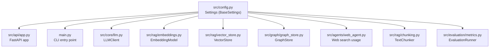

**Diagram sources**
- [src/config.py:21-81](file://src/config.py#L21-L81)
- [src/api/app.py:17-53](file://src/api/app.py#L17-L53)
- [main.py:71-110](file://main.py#L71-L110)
- [src/core/llm.py:15-102](file://src/core/llm.py#L15-L102)
- [src/rag/embeddings.py:16-57](file://src/rag/embeddings.py#L16-L57)
- [src/rag/vector_store.py:16-191](file://src/rag/vector_store.py#L16-L191)
- [src/graph/graph_store.py:15-225](file://src/graph/graph_store.py#L15-L225)
- [src/agents/web_agent.py:96-116](file://src/agents/web_agent.py#L96-L116)
- [src/rag/chunking.py:29-110](file://src/rag/chunking.py#L29-L110)
- [src/evaluation/metrics.py:158-223](file://src/evaluation/metrics.py#L158-L223)

**Section sources**
- [src/config.py:1-82](file://src/config.py#L1-L82)
- [src/api/app.py:1-57](file://src/api/app.py#L1-L57)
- [main.py:1-111](file://main.py#L1-L111)

## Core Components
The central configuration component is a Pydantic BaseSettings class that defines typed fields with defaults and descriptions. It loads values from environment variables and an optional .env file at project root. A cached getter provides a singleton-like access pattern.

Key behaviors:
- Loads .env from the project root before instantiation.
- Uses Field with defaults and descriptions for documentation and validation hints.
- Ignores extra environment variables not declared in the model.
- Provides a cached get_settings() function to avoid repeated initialization.

Environment variable categories and variables:
- Application settings: APP_NAME, APP_HOST, APP_PORT, DEBUG, LOG_LEVEL
- LLM provider configurations: LLM_PROVIDER, GEMINI_API_KEY, GEMINI_MODEL, OPENAI_API_KEY, OPENAI_MODEL, TEMPERATURE
- Embedding model settings: EMBEDDING_MODEL, EMBEDDING_DIMENSION
- Vector database connections: VECTOR_DB_TYPE, CHROMA_HOST, CHROMA_PORT, CHROMA_COLLECTION, FAISS_INDEX_PATH
- Knowledge graph setup: NEO4J_URI, NEO4J_USER, NEO4J_PASSWORD
- Web search integration: SERPER_API_KEY, DUCKDUCKGO_ENABLED
- Document processing parameters: CHUNK_SIZE, CHUNK_OVERLAP, MAX_UPLOAD_SIZE_MB
- Evaluation settings: BENCHMARK_DATASET_PATH, EVAL_RESULTS_PATH
- Paths: DATA_DIR, DOCS_DIR

Where used:
- FastAPI app title and health endpoint use APP_NAME.
- LLM client initializes Gemini or OpenAI based on LLM_PROVIDER and keys/models; uses TEMPERATURE.
- Embedding model loads sentence-transformers using EMBEDDING_MODEL and exposes dimension via EMBEDDING_DIMENSION.
- Vector store selects ChromaDB or FAISS based on VECTOR_DB_TYPE and uses CHROMA_* or FAISS_INDEX_PATH.
- Graph store connects to Neo4j using NEO4J_* or falls back to NetworkX if unavailable.
- Web agent supports DuckDuckGo when enabled; SERPER_API_KEY is available for future Serper usage.
- Chunker uses CHUNK_SIZE and CHUNK_OVERLAP for text splitting.
- Evaluation runner saves results to EVAL_RESULTS_PATH and can reference BENCHMARK_DATASET_PATH.

**Section sources**
- [src/config.py:21-81](file://src/config.py#L21-L81)
- [src/api/app.py:26-53](file://src/api/app.py#L26-L53)
- [src/core/llm.py:15-102](file://src/core/llm.py#L15-L102)
- [src/rag/embeddings.py:16-57](file://src/rag/embeddings.py#L16-L57)
- [src/rag/vector_store.py:16-191](file://src/rag/vector_store.py#L16-L191)
- [src/graph/graph_store.py:15-225](file://src/graph/graph_store.py#L15-L225)
- [src/agents/web_agent.py:96-116](file://src/agents/web_agent.py#L96-L116)
- [src/rag/chunking.py:29-110](file://src/rag/chunking.py#L29-L110)
- [src/evaluation/metrics.py:158-223](file://src/evaluation/metrics.py#L158-L223)

## Architecture Overview
The configuration flows from a single source into multiple subsystems. Each subsystem reads only what it needs via the shared settings accessor.

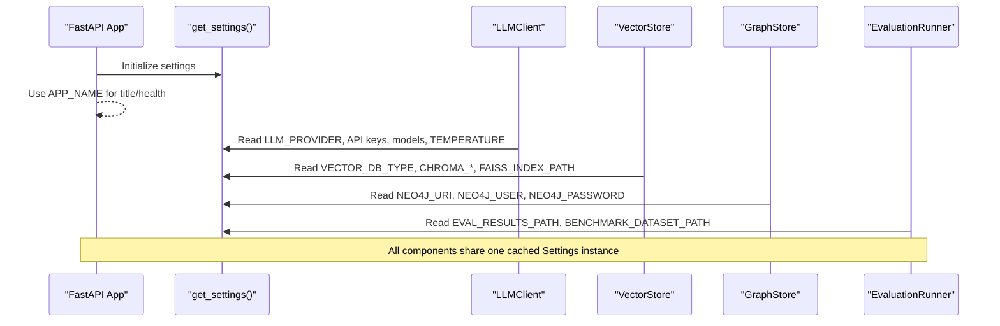

**Diagram sources**
- [src/config.py:78-81](file://src/config.py#L78-L81)
- [src/api/app.py:26-53](file://src/api/app.py#L26-L53)
- [src/core/llm.py:15-102](file://src/core/llm.py#L15-L102)
- [src/rag/vector_store.py:16-191](file://src/rag/vector_store.py#L16-L191)
- [src/graph/graph_store.py:15-225](file://src/graph/graph_store.py#L15-L225)
- [src/evaluation/metrics.py:158-223](file://src/evaluation/metrics.py#L158-L223)

## Detailed Component Analysis

### Centralized Settings Class
- Purpose: Provide a single, validated, typed configuration object loaded from environment variables and .env files.
- Implementation highlights:
  - Uses BaseSettings with explicit field types and defaults.
  - Loads .env from project root during module import.
  - Configures env_file path and encoding explicitly.
  - Ignores extra environment variables not defined in the model.
  - Exposes a cached getter to reuse the same instance across the process.

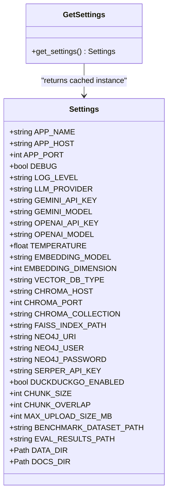

**Diagram sources**
- [src/config.py:21-81](file://src/config.py#L21-L81)

**Section sources**
- [src/config.py:1-82](file://src/config.py#L1-L82)

### LLM Provider Configuration
- Variables:
  - LLM_PROVIDER: Selects between gemini and openai.
  - GEMINI_API_KEY, GEMINI_MODEL: For Google Gemini.
  - OPENAI_API_KEY, OPENAI_MODEL: For OpenAI.
  - TEMPERATURE: Controls randomness in generation.
- Behavior:
  - Initializes the appropriate SDK based on provider.
  - Raises errors for unsupported providers.
  - Applies temperature per call unless overridden.

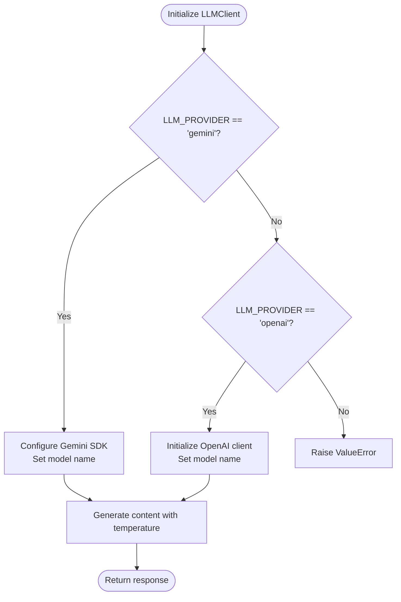

**Diagram sources**
- [src/core/llm.py:15-102](file://src/core/llm.py#L15-L102)
- [src/config.py:31-37](file://src/config.py#L31-L37)

**Section sources**
- [src/core/llm.py:15-102](file://src/core/llm.py#L15-L102)
- [src/config.py:31-37](file://src/config.py#L31-L37)

### Embedding Model Settings
- Variables:
  - EMBEDDING_MODEL: Sentence-transformers model identifier.
  - EMBEDDING_DIMENSION: Expected embedding dimensionality.
- Behavior:
  - Lazily loads the model on first use.
  - Normalizes embeddings and computes cosine similarity.
  - Exposes dimension via settings for downstream consumers.

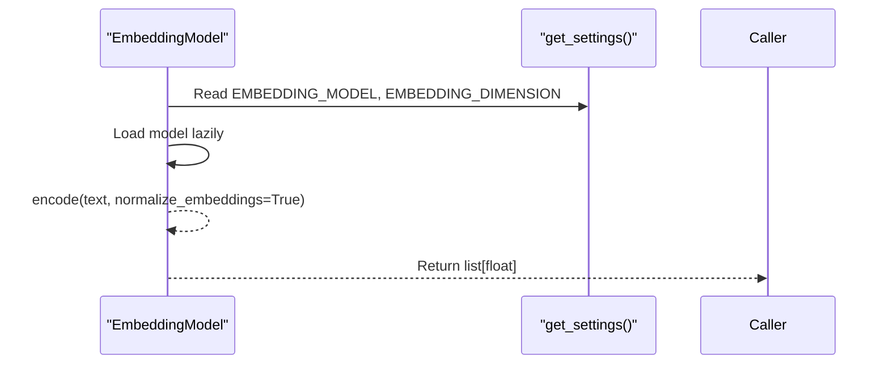

**Diagram sources**
- [src/rag/embeddings.py:16-57](file://src/rag/embeddings.py#L16-L57)
- [src/config.py:39-41](file://src/config.py#L39-L41)

**Section sources**
- [src/rag/embeddings.py:16-57](file://src/rag/embeddings.py#L16-L57)
- [src/config.py:39-41](file://src/config.py#L39-L41)

### Vector Database Connections
- Variables:
  - VECTOR_DB_TYPE: chroma or faiss.
  - CHROMA_HOST, CHROMA_PORT, CHROMA_COLLECTION: ChromaDB connection and collection name.
  - FAISS_INDEX_PATH: Path for FAISS index persistence.
- Behavior:
  - Chooses implementation based on VECTOR_DB_TYPE.
  - Initializes ChromaDB client and collection or sets up in-memory FAISS.
  - Supports adding documents and searching with metadata.

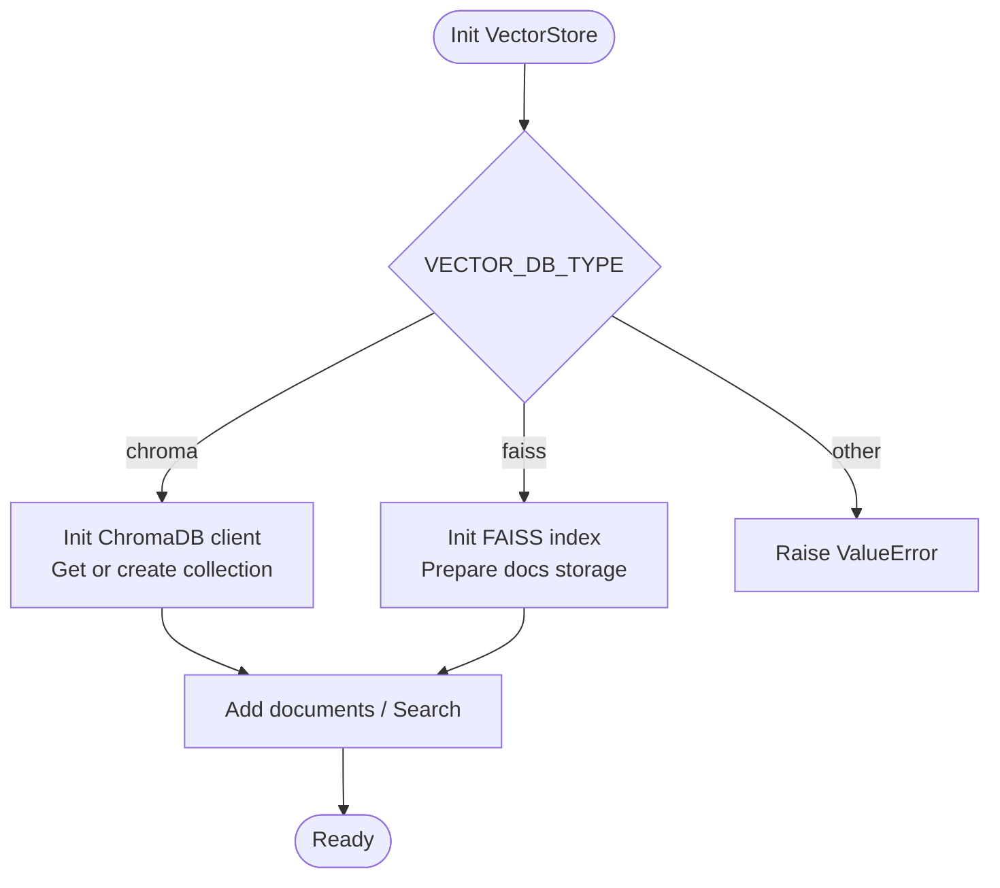

**Diagram sources**
- [src/rag/vector_store.py:16-191](file://src/rag/vector_store.py#L16-L191)
- [src/config.py:43-48](file://src/config.py#L43-L48)

**Section sources**
- [src/rag/vector_store.py:16-191](file://src/rag/vector_store.py#L16-L191)
- [src/config.py:43-48](file://src/config.py#L43-L48)

### Knowledge Graph Setup
- Variables:
  - NEO4J_URI, NEO4J_USER, NEO4J_PASSWORD: Connection details for Neo4j.
- Behavior:
  - Attempts to connect to Neo4j; if unavailable, falls back to an in-memory NetworkX graph.
  - Provides entity and relationship operations and query capabilities.

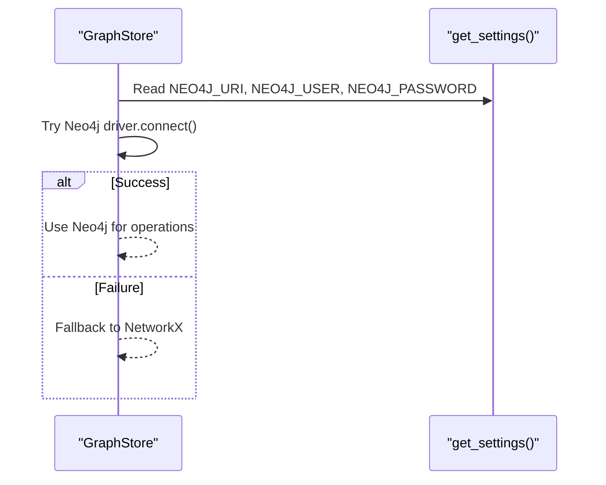

**Diagram sources**
- [src/graph/graph_store.py:15-225](file://src/graph/graph_store.py#L15-L225)
- [src/config.py:50-53](file://src/config.py#L50-L53)

**Section sources**
- [src/graph/graph_store.py:15-225](file://src/graph/graph_store.py#L15-L225)
- [src/config.py:50-53](file://src/config.py#L50-L53)

### Web Search Integration
- Variables:
  - SERPER_API_KEY: Reserved for Serper-based web search.
  - DUCKDUCKGO_ENABLED: Enables DuckDuckGo search when True.
- Behavior:
  - When enabled, performs web searches via DuckDuckGo and returns structured results.
  - Logs warnings/errors if dependencies are missing or requests fail.

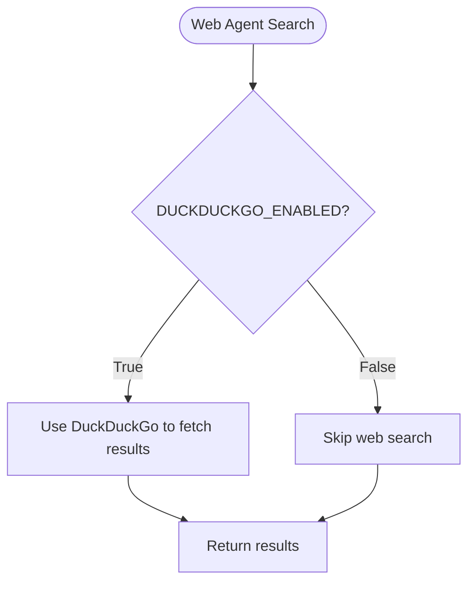

**Diagram sources**
- [src/agents/web_agent.py:96-116](file://src/agents/web_agent.py#L96-L116)
- [src/config.py:55-57](file://src/config.py#L55-L57)

**Section sources**
- [src/agents/web_agent.py:96-116](file://src/agents/web_agent.py#L96-L116)
- [src/config.py:55-57](file://src/config.py#L55-L57)

### Document Processing Parameters
- Variables:
  - CHUNK_SIZE: Maximum chunk length in characters.
  - CHUNK_OVERLAP: Overlap size between chunks.
  - MAX_UPLOAD_SIZE_MB: Maximum allowed upload size in megabytes.
- Behavior:
  - TextChunker splits documents into overlapping chunks respecting sentence boundaries.
  - Upload size limits should be enforced at the API layer; the setting is available for policy checks.

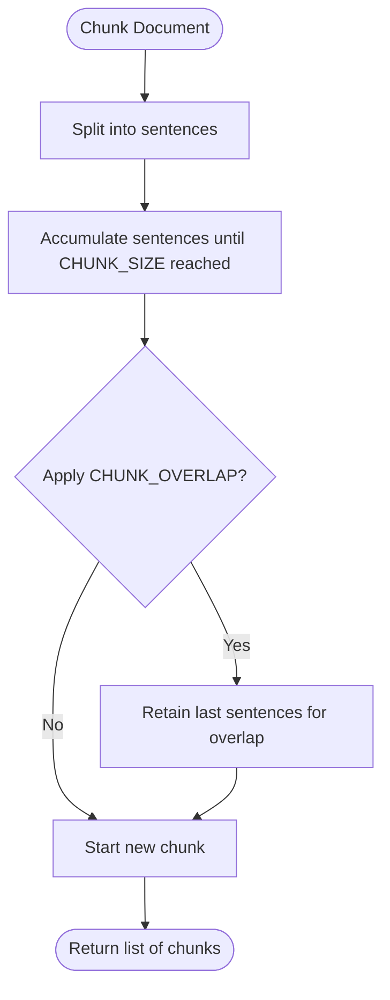

**Diagram sources**
- [src/rag/chunking.py:29-110](file://src/rag/chunking.py#L29-L110)
- [src/config.py:59-62](file://src/config.py#L59-L62)

**Section sources**
- [src/rag/chunking.py:29-110](file://src/rag/chunking.py#L29-L110)
- [src/config.py:59-62](file://src/config.py#L59-L62)

### Evaluation Settings
- Variables:
  - BENCHMARK_DATASET_PATH: Directory containing benchmark datasets.
  - EVAL_RESULTS_PATH: Directory to save evaluation results.
- Behavior:
  - EvaluationRunner runs experiments and persists results to EVAL_RESULTS_PATH.
  - Benchmark dataset path is available for loading test data.

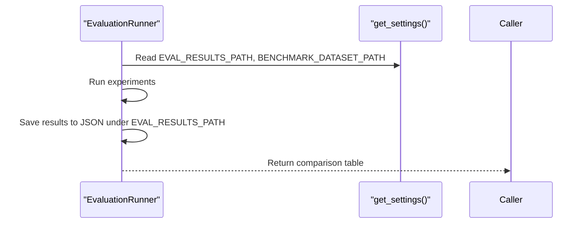

**Diagram sources**
- [src/evaluation/metrics.py:158-223](file://src/evaluation/metrics.py#L158-L223)
- [src/config.py:64-66](file://src/config.py#L64-L66)

**Section sources**
- [src/evaluation/metrics.py:158-223](file://src/evaluation/metrics.py#L158-L223)
- [src/config.py:64-66](file://src/config.py#L64-L66)

## Dependency Analysis
Components depend on the centralized Settings accessor rather than reading environment variables directly. This reduces coupling and ensures consistent configuration across the system.

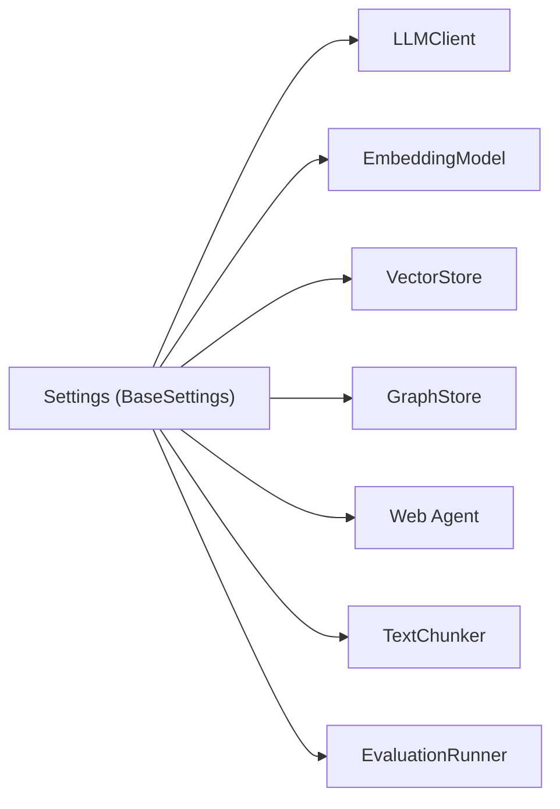

**Diagram sources**
- [src/config.py:78-81](file://src/config.py#L78-L81)
- [src/core/llm.py:15-102](file://src/core/llm.py#L15-L102)
- [src/rag/embeddings.py:16-57](file://src/rag/embeddings.py#L16-L57)
- [src/rag/vector_store.py:16-191](file://src/rag/vector_store.py#L16-L191)
- [src/graph/graph_store.py:15-225](file://src/graph/graph_store.py#L15-L225)
- [src/agents/web_agent.py:96-116](file://src/agents/web_agent.py#L96-L116)
- [src/rag/chunking.py:29-110](file://src/rag/chunking.py#L29-L110)
- [src/evaluation/metrics.py:158-223](file://src/evaluation/metrics.py#L158-L223)

**Section sources**
- [src/config.py:1-82](file://src/config.py#L1-L82)

## Performance Considerations
- Embedding model loading is lazy to avoid startup overhead; ensure GPU availability if needed for faster inference.
- Vector store choice impacts performance:
  - ChromaDB is suitable for persistent collections and rich metadata queries.
  - FAISS provides fast in-memory similarity search but requires careful index management for large datasets.
- Chunk size and overlap affect retrieval quality and memory usage; tune based on document characteristics.
- LLM temperature influences creativity vs. determinism; lower values reduce variability.

[No sources needed since this section provides general guidance]

## Troubleshooting Guide
Common issues and resolutions:
- Unsupported LLM provider: Ensure LLM_PROVIDER is set to a supported value; otherwise initialization raises an error.
- Missing API keys: Verify GEMINI_API_KEY or OPENAI_API_KEY are present in your environment or .env file.
- Neo4j connectivity: If Neo4j is unavailable, the system falls back to NetworkX; check NEO4J_URI and credentials.
- Vector store initialization failures: Confirm VECTOR_DB_TYPE matches installed dependencies; for ChromaDB, ensure service is reachable; for FAISS, ensure required packages are installed.
- Web search disabled: If DUCKDUCKGO_ENABLED is False, web search will be skipped; enable it to use DuckDuckGo.
- Evaluation results not saved: Ensure EVAL_RESULTS_PATH exists or is writable; the runner creates directories as needed.

**Section sources**
- [src/core/llm.py:25-38](file://src/core/llm.py#L25-L38)
- [src/graph/graph_store.py:29-42](file://src/graph/graph_store.py#L29-L42)
- [src/rag/vector_store.py:25-57](file://src/rag/vector_store.py#L25-L57)
- [src/agents/web_agent.py:96-116](file://src/agents/web_agent.py#L96-L116)
- [src/evaluation/metrics.py:217-223](file://src/evaluation/metrics.py#L217-L223)

## Conclusion
The system uses a centralized, typed configuration approach that simplifies environment management and improves reliability. By defining all settings in one place with defaults and validation, components remain decoupled and easy to configure across development, testing, and production environments. Follow the provided guidelines for .env setup, precedence rules, and secret management to maintain secure and consistent deployments.

[No sources needed since this section summarizes without analyzing specific files]

## Appendices

### Environment Variables Reference
- Application settings:
  - APP_NAME: Application name used in logs and API metadata.
  - APP_HOST: Host address for the API server.
  - APP_PORT: Port number for the API server.
  - DEBUG: Enable debug mode.
  - LOG_LEVEL: Logging verbosity level.
- LLM provider configurations:
  - LLM_PROVIDER: Choose gemini or openai.
  - GEMINI_API_KEY: API key for Google Gemini.
  - GEMINI_MODEL: Model identifier for Gemini.
  - OPENAI_API_KEY: API key for OpenAI.
  - OPENAI_MODEL: Model identifier for OpenAI.
  - TEMPERATURE: Generation temperature.
- Embedding model settings:
  - EMBEDDING_MODEL: Sentence-transformers model name.
  - EMBEDDING_DIMENSION: Dimensionality of embeddings.
- Vector database connections:
  - VECTOR_DB_TYPE: chroma or faiss.
  - CHROMA_HOST: ChromaDB host.
  - CHROMA_PORT: ChromaDB port.
  - CHROMA_COLLECTION: Collection name for ChromaDB.
  - FAISS_INDEX_PATH: Path to persist FAISS index.
- Knowledge graph setup:
  - NEO4J_URI: Neo4j connection URI.
  - NEO4J_USER: Neo4j username.
  - NEO4J_PASSWORD: Neo4j password.
- Web search integration:
  - SERPER_API_KEY: API key for Serper (reserved).
  - DUCKDUCKGO_ENABLED: Enable DuckDuckGo search.
- Document processing parameters:
  - CHUNK_SIZE: Chunk size in characters.
  - CHUNK_OVERLAP: Overlap size between chunks.
  - MAX_UPLOAD_SIZE_MB: Maximum upload size in MB.
- Evaluation settings:
  - BENCHMARK_DATASET_PATH: Path to benchmark datasets.
  - EVAL_RESULTS_PATH: Path to save evaluation results.
- Paths:
  - DATA_DIR: Root data directory.
  - DOCS_DIR: Documents directory.

**Section sources**
- [src/config.py:21-71](file://src/config.py#L21-L71)

### Example .env File Setup
Create a .env file at the project root with your secrets and preferences. Below is a template you can adapt:

- APP_NAME=GraphRAG-MARS
- APP_HOST=0.0.0.0
- APP_PORT=8080
- DEBUG=False
- LOG_LEVEL=INFO
- LLM_PROVIDER=gemini
- GEMINI_API_KEY=your_gemini_key_here
- GEMINI_MODEL=gemini-1.5-pro
- OPENAI_API_KEY=your_openai_key_here
- OPENAI_MODEL=gpt-4o
- TEMPERATURE=0.2
- EMBEDDING_MODEL=all-MiniLM-L6-v2
- EMBEDDING_DIMENSION=384
- VECTOR_DB_TYPE=chroma
- CHROMA_HOST=localhost
- CHROMA_PORT=8000
- CHROMA_COLLECTION=graphrag_docs
- FAISS_INDEX_PATH=./data/faiss_index
- NEO4J_URI=bolt://localhost:7687
- NEO4J_USER=neo4j
- NEO4J_PASSWORD=your_neo4j_password
- SERPER_API_KEY=your_serper_key_here
- DUCKDUCKGO_ENABLED=True
- CHUNK_SIZE=512
- CHUNK_OVERLAP=64
- MAX_UPLOAD_SIZE_MB=50
- BENCHMARK_DATASET_PATH=./data/benchmarks/
- EVAL_RESULTS_PATH=./data/eval_results/

Notes:
- The application automatically loads .env from the project root.
- Ensure sensitive keys are not committed to version control; use environment-specific files or secret managers in production.

**Section sources**
- [src/config.py:16-18](file://src/config.py#L16-L18)
- [README.md:39-46](file://README.md#L39-L46)

### Configuration Precedence Rules
- Environment variables take precedence over .env file values.
- .env file values override defaults defined in the Settings class.
- Command-line arguments do not override environment variables for these settings; use environment or .env for configuration.
- Extra environment variables not declared in Settings are ignored.

Best practices:
- Use .env for local development and environment variables in CI/CD and production.
- Store secrets in your platform’s secret manager and inject them as environment variables at runtime.
- Validate critical keys (e.g., API keys) at startup and fail fast if missing.

**Section sources**
- [src/config.py:72-75](file://src/config.py#L72-L75)

### Best Practices for Managing Secrets
- Never hardcode secrets in code or commit .env to repositories.
- Use separate .env files per environment (e.g., .env.development, .env.production) and load the appropriate one via environment configuration.
- Rotate API keys regularly and monitor usage for anomalies.
- Restrict access to secret stores and limit who can view or modify them.
- Log sanitized messages; never log secrets or tokens.

[No sources needed since this section provides general guidance]