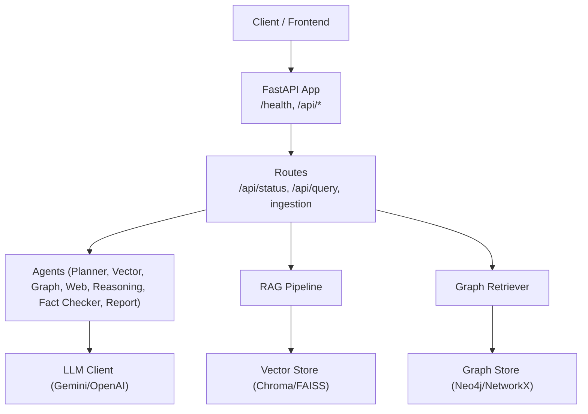
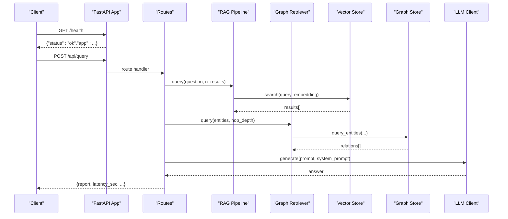
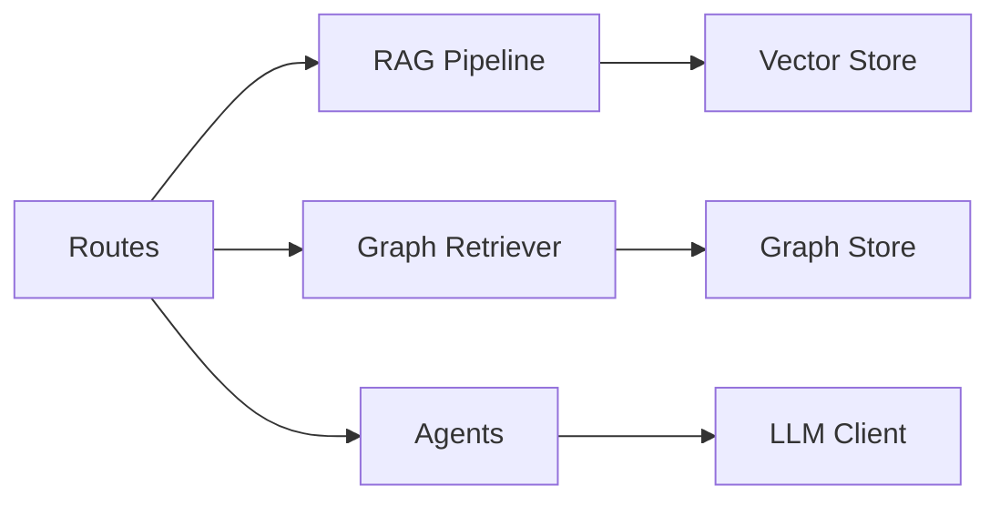

# Monitoring and Maintenance

<cite>
**Referenced Files in This Document**
- [main.py](file://main.py)
- [src/config.py](file://src/config.py)
- [src/api/app.py](file://src/api/app.py)
- [src/api/routes.py](file://src/api/routes.py)
- [src/core/base_agent.py](file://src/core/base_agent.py)
- [src/core/llm.py](file://src/core/llm.py)
- [src/rag/pipeline.py](file://src/rag/pipeline.py)
- [src/rag/vector_store.py](file://src/rag/vector_store.py)
- [src/graph/retriever.py](file://src/graph/retriever.py)
- [src/graph/graph_store.py](file://src/graph/graph_store.py)
- [docker-compose.yml](file://docker-compose.yml)
- [README.md](file://README.md)
</cite>

## Table of Contents
1. Introduction
2. Project Structure
3. Core Components
4. Architecture Overview
5. Detailed Component Analysis
6. Dependency Analysis
7. Performance Considerations
8. Troubleshooting Guide
9. Conclusion
10. Appendices

## Introduction
This document provides comprehensive monitoring and maintenance guidance for the Graph RAG + Multi-Agent Research System. It covers logging strategies, performance monitoring, health checks, alerting, routine maintenance tasks, troubleshooting, backup and recovery, updates, disaster recovery, security monitoring, audit logging, and compliance reporting. The content is grounded in the repository’s codebase and configuration to ensure accuracy and operational relevance.

## Project Structure
The system exposes a FastAPI API with modular components for RAG, knowledge graph, agents, and evaluation. Logging is centralized via Loguru, and configuration is environment-driven. Health and status endpoints are provided for operational visibility.

**Diagram sources**
- [src/api/app.py:17-53](file://src/api/app.py#L17-L53)
- [src/api/routes.py:116-353](file://src/api/routes.py#L116-L353)
- [src/rag/pipeline.py:19-102](file://src/rag/pipeline.py#L19-L102)
- [src/graph/retriever.py:19-131](file://src/graph/retriever.py#L19-L131)
- [src/rag/vector_store.py:16-192](file://src/rag/vector_store.py#L16-L192)
- [src/graph/graph_store.py:15-303](file://src/graph/graph_store.py#L15-L303)
- [src/core/llm.py:15-103](file://src/core/llm.py#L15-L103)

**Section sources**
- [README.md:81-126](file://README.md#L81-L126)
- [src/api/app.py:17-53](file://src/api/app.py#L17-L53)
- [src/api/routes.py:116-353](file://src/api/routes.py#L116-L353)

## Core Components
- Application lifecycle and CORS middleware setup
- Centralized configuration via environment variables
- Structured logging using Loguru across the application
- Health check endpoint at root path
- Status endpoint exposing vector store and graph metrics
- Query pipeline orchestrating multi-agent execution with latency tracking
- Vector store abstraction supporting ChromaDB and FAISS
- Knowledge graph store supporting Neo4j and NetworkX fallback
- LLM client abstraction for Gemini and OpenAI

Key responsibilities:
- Logging: All major modules log initialization, errors, and key events using Loguru.
- Metrics: Agent execution logs include latency and token usage; query responses include latency_sec; status endpoint reports vector and graph counts.
- Health: Root-level health endpoint returns app status; Docker Compose includes Neo4j healthcheck.

**Section sources**
- [main.py:14-28](file://main.py#L14-L28)
- [src/config.py:21-82](file://src/config.py#L21-L82)
- [src/api/app.py:17-53](file://src/api/app.py#L17-L53)
- [src/api/routes.py:116-131](file://src/api/routes.py#L116-L131)
- [src/api/routes.py:188-338](file://src/api/routes.py#L188-L338)
- [src/core/base_agent.py:19-99](file://src/core/base_agent.py#L19-L99)
- [src/rag/vector_store.py:16-192](file://src/rag/vector_store.py#L16-L192)
- [src/graph/graph_store.py:15-303](file://src/graph/graph_store.py#L15-L303)
- [src/core/llm.py:15-103](file://src/core/llm.py#L15-L103)
- [docker-compose.yml:4-21](file://docker-compose.yml#L4-L21)

## Architecture Overview
The system follows a layered architecture:
- API layer: FastAPI routes expose ingestion, querying, and status endpoints.
- Orchestration layer: Multi-agent pipeline coordinates retrieval from vector and graph stores, optional web search, reasoning, fact-checking, and report generation.
- Storage layer: Vector store (Chroma/FAISS) and knowledge graph (Neo4j/NetworkX).
- LLM layer: Unified client abstracts Gemini and OpenAI providers.

Operational hooks:
- Health endpoint for liveness probes.
- Status endpoint for readiness and component metrics.
- Structured logs emitted by all layers for observability.

**Diagram sources**
- [src/api/app.py:49-52](file://src/api/app.py#L49-L52)
- [src/api/routes.py:188-338](file://src/api/routes.py#L188-L338)
- [src/rag/pipeline.py:90-102](file://src/rag/pipeline.py#L90-L102)
- [src/graph/retriever.py:99-112](file://src/graph/retriever.py#L99-L112)
- [src/rag/vector_store.py:100-112](file://src/rag/vector_store.py#L100-L112)
- [src/graph/graph_store.py:67-77](file://src/graph/graph_store.py#L67-L77)
- [src/core/llm.py:40-54](file://src/core/llm.py#L40-L54)

## Detailed Component Analysis

### Logging Strategy
- Logger: Loguru is used throughout the application for structured console logging.
- Initialization: The main entry configures Loguru with a simple format and configurable level.
- Levels: Configurable via CLI argument and settings (DEBUG, INFO, WARNING, ERROR).
- Aggregation: Logs are written to stderr by default; integrate with container orchestration or sidecar log collectors to aggregate into a central system.
- Analysis techniques:
  - Filter by level and timestamp for incident triage.
  - Correlate request IDs (from query responses) with agent execution logs to trace end-to-end flows.
  - Track latency and token usage from agent execution logs to identify slow or expensive calls.

Implementation highlights:
- Main sets up Loguru and supports dynamic log levels.
- All core modules emit logs on initialization, errors, and key processing steps.

**Section sources**
- [main.py:14-28](file://main.py#L14-L28)
- [src/api/app.py:17-23](file://src/api/app.py#L17-L23)
- [src/rag/pipeline.py:43-88](file://src/rag/pipeline.py#L43-L88)
- [src/graph/retriever.py:42-97](file://src/graph/retriever.py#L42-L97)
- [src/rag/vector_store.py:25-57](file://src/rag/vector_store.py#L25-L57)
- [src/graph/graph_store.py:29-47](file://src/graph/graph_store.py#L29-L47)
- [src/core/llm.py:25-38](file://src/core/llm.py#L25-L38)

### Performance Monitoring
- Application metrics:
  - Query latency is captured per request and returned in responses.
  - Status endpoint exposes vector store type and document count, and graph entity/relationship summaries.
- Database performance:
  - Neo4j connection and queries are logged; failures fall back to NetworkX with warnings.
  - Vector store operations log added documents and search outcomes.
- Vector store statistics:
  - Count method provides current document counts for Chroma or FAISS.
- Agent execution times:
  - BaseAgent tracks per-call latency and token usage; aggregates available via get_execution_stats.

Recommendations:
- Expose Prometheus-compatible metrics by wrapping key functions with timers and counters.
- Add structured metrics for:
  - Request rate, error rate, p95/p99 latency.
  - Vector store add/search latency and result counts.
  - Graph store query latency and result sizes.
  - LLM provider latency and token usage.

**Section sources**
- [src/api/routes.py:116-131](file://src/api/routes.py#L116-L131)
- [src/api/routes.py:188-338](file://src/api/routes.py#L188-L338)
- [src/core/base_agent.py:42-99](file://src/core/base_agent.py#L42-L99)
- [src/rag/vector_store.py:178-183](file://src/rag/vector_store.py#L178-L183)
- [src/graph/graph_store.py:112-125](file://src/graph/graph_store.py#L112-L125)

### Health Checks and Readiness
- Liveness: Root-level health endpoint returns a simple status object.
- Readiness: Status endpoint returns component details including vector store and graph summary.
- Container health: Docker Compose defines a healthcheck for Neo4j to ensure dependency availability before backend starts.

Operational use:
- Use /health for Kubernetes liveness probes.
- Use /api/status for readiness and basic capacity checks.

**Section sources**
- [src/api/app.py:49-52](file://src/api/app.py#L49-L52)
- [src/api/routes.py:116-131](file://src/api/routes.py#L116-L131)
- [docker-compose.yml:16-21](file://docker-compose.yml#L16-L21)

### Alerting Configuration
Current state:
- No built-in alerting logic in the codebase.

Recommended approach:
- Integrate with external monitoring/alerting systems (e.g., Prometheus + Alertmanager, CloudWatch, Datadog).
- Define alerts for:
  - High error rates on /api/query.
  - Elevated latency thresholds on query and LLM calls.
  - Vector store or graph store unavailability.
  - Neo4j connection failures or high query latency.
- Use structured logs to feed SIEM or log aggregation platforms for anomaly detection.

[No sources needed since this section provides general guidance]

### Routine Maintenance Procedures
- Database cleanup:
  - Vector store: Provide clear/reset routines to remove stale data when needed.
  - Graph store: Clear entities and relationships to reset or prune outdated data.
- Index rebuilding:
  - Rebuild vector index after bulk ingest or schema changes.
  - Rebuild graph indices if using managed indexes in Neo4j.
- Cache management:
  - For in-memory caches (e.g., FAISS docs), consider periodic persistence or restart policies.
- Log rotation:
  - Configure container runtime or log collector to rotate stdout/stderr logs.
  - Optionally extend Loguru to write to files with rotation policies.

Operational notes:
- Use /api/status to verify component states before and after maintenance.
- Schedule maintenance during low-traffic windows.

**Section sources**
- [src/rag/vector_store.py:185-192](file://src/rag/vector_store.py#L185-L192)
- [src/graph/graph_store.py:127-137](file://src/graph/graph_store.py#L127-L137)
- [docker-compose.yml:22-42](file://docker-compose.yml#L22-L42)

### Backup and Recovery
- Vector store:
  - ChromaDB: Back up collection data directory or snapshots depending on deployment.
  - FAISS: Persist index and metadata to disk periodically.
- Knowledge graph:
  - Neo4j: Use native backups or export mechanisms; ensure volumes are backed up.
  - NetworkX: Serialize graph to disk for recovery.
- Configuration and secrets:
  - Back up .env and any configuration files securely.
- Recovery procedures:
  - Restore vector and graph stores to known good states.
  - Re-run ingestion and graph build jobs to rebuild derived artifacts.

**Section sources**
- [src/rag/vector_store.py:185-192](file://src/rag/vector_store.py#L185-L192)
- [src/graph/graph_store.py:127-137](file://src/graph/graph_store.py#L127-L137)
- [docker-compose.yml:14-16](file://docker-compose.yml#L14-L16)

### System Updates and Upgrades
- Upgrade dependencies:
  - Update requirements and lock versions; test in staging.
- Container images:
  - Rebuild and redeploy backend/frontend images.
- Data migrations:
  - Validate vector and graph schemas before upgrade; run compatibility checks.
- Rollback plan:
  - Keep previous image tags and data snapshots for quick rollback.

[No sources needed since this section provides general guidance]

### Disaster Recovery Planning
- Identify critical components: API server, vector store, graph store, LLM providers.
- Define RTO/RPO targets and automate backups.
- Test failover scenarios:
  - Simulate Neo4j outage and validate NetworkX fallback behavior.
  - Simulate vector store failure and handle degraded mode gracefully.
- Post-incident review:
  - Analyze logs and metrics to improve resilience.

**Section sources**
- [src/graph/graph_store.py:29-47](file://src/graph/graph_store.py#L29-L47)

### Security Monitoring, Audit Logging, and Compliance
- Security monitoring:
  - Monitor failed authentication attempts to LLM providers and database connections.
  - Track unusual spikes in token usage or query volume.
- Audit logging:
  - Capture who ingested documents, built graphs, and ran evaluations.
  - Include timestamps, user context (if available), and outcome statuses.
- Compliance reporting:
  - Export logs and metrics to compliance dashboards.
  - Ensure retention policies align with regulatory requirements.

[No sources needed since this section provides general guidance]

## Dependency Analysis
The system has clear separation between API, orchestration, storage, and LLM layers. Dependencies are mostly one-directional, reducing coupling. Key integration points:
- Routes depend on RAG pipeline, graph retriever, and agents.
- Agents depend on LLM client and may depend on vector/graph stores indirectly via pipelines.
- Stores abstract underlying implementations (Chroma/FAISS, Neo4j/NetworkX).

**Diagram sources**
- [src/api/routes.py:28-75](file://src/api/routes.py#L28-L75)
- [src/rag/pipeline.py:19-32](file://src/rag/pipeline.py#L19-L32)
- [src/graph/retriever.py:19-31](file://src/graph/retriever.py#L19-L31)
- [src/core/base_agent.py:19-27](file://src/core/base_agent.py#L19-L27)

**Section sources**
- [src/api/routes.py:28-75](file://src/api/routes.py#L28-L75)
- [src/rag/pipeline.py:19-32](file://src/rag/pipeline.py#L19-L32)
- [src/graph/retriever.py:19-31](file://src/graph/retriever.py#L19-L31)
- [src/core/base_agent.py:19-27](file://src/core/base_agent.py#L19-L27)

## Performance Considerations
- Latency:
  - Query endpoint measures end-to-end latency; track p95/p99 over time.
  - Agent execution logs provide per-call latency and token usage.
- Throughput:
  - Batch ingestion improves vector indexing efficiency.
  - Limit concurrent heavy operations (graph builds, large ingestions).
- Resource usage:
  - Monitor memory for in-memory FAISS and NetworkX graphs.
  - Tune chunk sizes and overlap to balance retrieval quality and cost.
- External dependencies:
  - LLM provider rate limits and timeouts can bottleneck queries; implement retries and circuit breakers.
  - Neo4j connection pooling and query optimization reduce latency.

[No sources needed since this section provides general guidance]

## Troubleshooting Guide
Common issues and diagnostics:
- Memory leaks:
  - Inspect agent execution logs for growing execution_log lists; consider periodic resets or bounded buffers.
  - Monitor in-memory structures in FAISS and NetworkX; persist or clear as needed.
- Performance bottlenecks:
  - Identify slow agents via latency in execution logs.
  - Check vector store search latency and result sizes; adjust n_results and chunking parameters.
  - Evaluate LLM provider response times and token usage; consider caching or smaller prompts.
- Connection timeouts:
  - Neo4j connection failures trigger fallback to NetworkX; verify credentials and network connectivity.
  - Vector store init errors are logged; ensure services are reachable and collections exist.
- Error diagnosis:
  - Use structured logs to correlate requests with agent calls and storage operations.
  - Leverage status endpoint to confirm component health before deep dives.

Remediation steps:
- Restart services to clear transient issues.
- Rebuild indexes after schema or data changes.
- Adjust configuration (chunk size, overlap, max tokens) based on observed performance.

**Section sources**
- [src/core/base_agent.py:61-99](file://src/core/base_agent.py#L61-L99)
- [src/rag/vector_store.py:25-57](file://src/rag/vector_store.py#L25-L57)
- [src/graph/graph_store.py:29-47](file://src/graph/graph_store.py#L29-L47)
- [src/api/routes.py:188-338](file://src/api/routes.py#L188-L338)

## Conclusion
The system provides foundational observability through structured logging, health and status endpoints, and per-request latency tracking. To achieve production-grade monitoring and maintenance, augment the codebase with metrics exporters, centralized log aggregation, alerting rules, and robust backup/restore procedures. Regular maintenance, proactive tuning, and thorough troubleshooting play critical roles in ensuring reliability and performance.

[No sources needed since this section summarizes without analyzing specific files]

## Appendices

### API Endpoints for Monitoring
- Liveness: GET /health
- Readiness/Capacity: GET /api/status
- Query with latency: POST /api/query
- Ingestion: POST /api/documents/ingest, POST /api/documents/ingest-directory
- Graph build: POST /api/graph/build
- Graph summary: GET /api/graph/summary
- Evaluation: POST /api/evaluate/run

**Section sources**
- [src/api/app.py:49-52](file://src/api/app.py#L49-L52)
- [src/api/routes.py:116-353](file://src/api/routes.py#L116-L353)
- [README.md:153-165](file://README.md#L153-L165)

### Configuration Keys Relevant to Operations
- Application: APP_NAME, APP_HOST, APP_PORT, DEBUG, LOG_LEVEL
- LLM: LLM_PROVIDER, GEMINI_API_KEY, GEMINI_MODEL, OPENAI_API_KEY, OPENAI_MODEL, TEMPERATURE
- Embeddings: EMBEDDING_MODEL, EMBEDDING_DIMENSION
- Vector DB: VECTOR_DB_TYPE, CHROMA_HOST, CHROMA_PORT, CHROMA_COLLECTION, FAISS_INDEX_PATH
- Knowledge Graph: NEO4J_URI, NEO4J_USER, NEO4J_PASSWORD
- Document Processing: CHUNK_SIZE, CHUNK_OVERLAP, MAX_UPLOAD_SIZE_MB
- Paths: DATA_DIR, DOCS_DIR

**Section sources**
- [src/config.py:21-82](file://src/config.py#L21-L82)