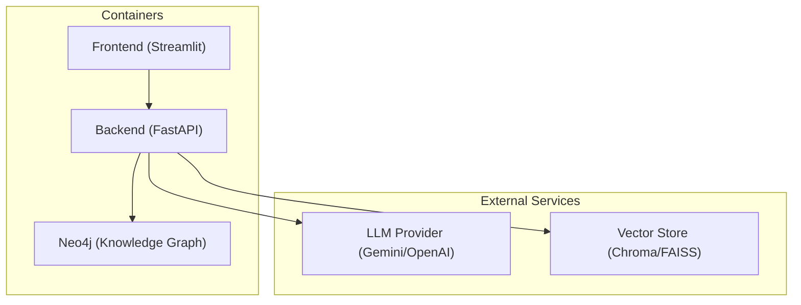
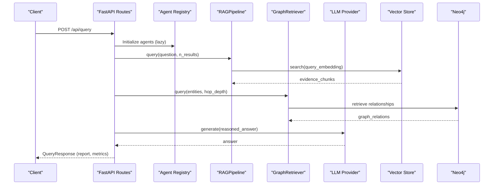
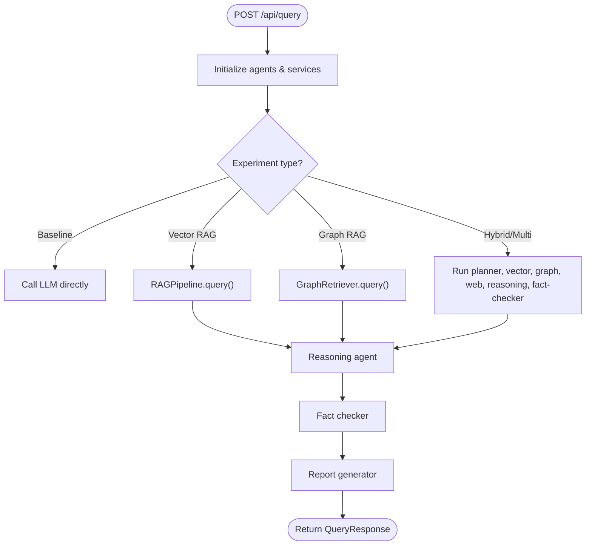
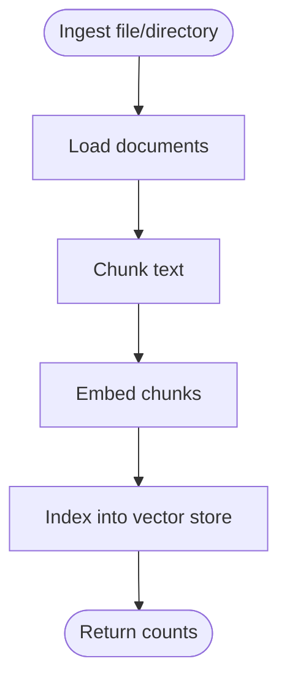
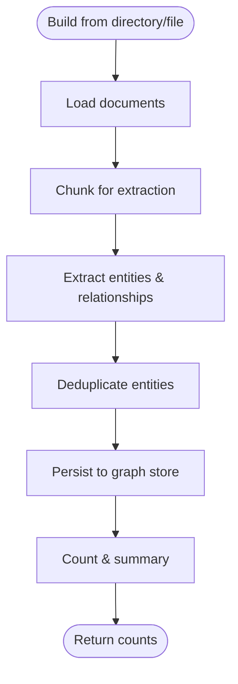
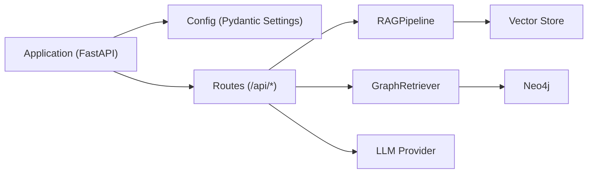

# Production Deployment

<cite>
**Referenced Files in This Document**
- [README.md](file://README.md)
- [main.py](file://main.py)
- [docker-compose.yml](file://docker-compose.yml)
- [Dockerfile](file://Dockerfile)
- [Dockerfile.frontend](file://Dockerfile.frontend)
- [requirements.txt](file://requirements.txt)
- [src/config.py](file://src/config.py)
- [src/api/app.py](file://src/api/app.py)
- [src/api/routes.py](file://src/api/routes.py)
- [src/core/schemas.py](file://src/core/schemas.py)
- [src/rag/pipeline.py](file://src/rag/pipeline.py)
- [src/graph/retriever.py](file://src/graph/retriever.py)
</cite>

## Table of Contents
1. Introduction
2. Project Structure
3. Core Components
4. Architecture Overview
5. Detailed Component Analysis
6. Dependency Analysis
7. Performance Considerations
8. Troubleshooting Guide
9. Conclusion
10. Appendices

## Introduction
This document provides production deployment guidance for the Graph RAG + Multi-Agent Research System across enterprise environments and major cloud platforms (AWS, Google Cloud Platform, Microsoft Azure). It covers container orchestration with Kubernetes, managed database services, security hardening, performance optimization, monitoring and alerting, capacity planning, cost optimization, backup and disaster recovery, database migration strategies, and operational procedures.

The system comprises:
- A FastAPI backend exposing REST endpoints for ingestion, graph building, querying, and evaluation
- A Streamlit frontend for interactive use
- A vector store for semantic search
- A knowledge graph backed by Neo4j
- LLM integration via Gemini or OpenAI
- A multi-agent pipeline orchestrating retrieval, reasoning, fact-checking, and report generation

**Section sources**
- [README.md:5-23](file://README.md#L5-L23)
- [README.md:142-164](file://README.md#L142-L164)

## Project Structure
At a high level, the application is packaged as containers:
- Backend API container built from Dockerfile
- Frontend container built from Dockerfile.frontend
- Neo4j service for the knowledge graph
- docker-compose orchestrates local development and can be adapted to cloud-native deployments

**Diagram sources**
- [docker-compose.yml:3-55](file://docker-compose.yml#L3-L55)
- [Dockerfile:1-25](file://Dockerfile#L1-L25)
- [Dockerfile.frontend:1-15](file://Dockerfile.frontend#L1-L15)

Key runtime characteristics:
- The backend exposes health and API routes under /api
- Ports exposed: 8080 (backend), 8501 (frontend), 7474/7687 (Neo4j)
- Environment variables drive configuration for LLM providers, vector store type, and Neo4j connectivity

**Section sources**
- [docker-compose.yml:3-55](file://docker-compose.yml#L3-L55)
- [src/api/app.py:26-56](file://src/api/app.py#L26-L56)
- [src/config.py:21-81](file://src/config.py#L21-L81)

## Core Components
- Application entrypoint and CLI commands are provided by main.py, which starts the server, ingests documents, builds graphs, and runs evaluations.
- Configuration is centralized in src/config.py using Pydantic settings loaded from environment variables and .env files.
- The FastAPI app is created in src/api/app.py with CORS middleware and includes routers under /api.
- API routes implement ingestion, graph building, querying, status, and evaluation endpoints in src/api/routes.py.
- Data models used across agents and routes are defined in src/core/schemas.py.
- RAG pipeline coordinates document loading, chunking, embedding, and indexing into the vector store in src/rag/pipeline.py.
- Knowledge graph construction and retrieval are orchestrated in src/graph/retriever.py.

Operational implications:
- Use environment-driven configuration for secrets and runtime options
- Expose only necessary ports behind an ingress or reverse proxy
- Ensure dependencies (Neo4j, vector store, LLM provider) are available and healthy before serving requests

**Section sources**
- [main.py:24-104](file://main.py#L24-L104)
- [src/config.py:21-81](file://src/config.py#L21-L81)
- [src/api/app.py:26-56](file://src/api/app.py#L26-L56)
- [src/api/routes.py:116-354](file://src/api/routes.py#L116-L354)
- [src/core/schemas.py:15-168](file://src/core/schemas.py#L15-L168)
- [src/rag/pipeline.py:19-102](file://src/rag/pipeline.py#L19-L102)
- [src/graph/retriever.py:19-131](file://src/graph/retriever.py#L19-L131)

## Architecture Overview
The request flow for research queries involves multiple agents and data stores. The following sequence diagram maps to actual code paths in the API routes and supporting components.

**Diagram sources**
- [src/api/routes.py:188-338](file://src/api/routes.py#L188-L338)
- [src/rag/pipeline.py:90-102](file://src/rag/pipeline.py#L90-L102)
- [src/graph/retriever.py:99-112](file://src/graph/retriever.py#L99-L112)

Cloud platform deployment patterns:
- AWS: Deploy containers on Amazon ECS or EKS; use RDS for Neo4j-compatible managed graph databases where applicable or run Neo4j on EC2/EKS with persistent volumes; use Secrets Manager for credentials; expose via ALB/NLB with TLS termination; monitor with CloudWatch and Prometheus/Grafana via sidecars or exporters.
- GCP: Deploy on GKE; use managed databases where possible; manage secrets via Secret Manager; expose via Load Balancer with SSL certificates; monitor with Cloud Monitoring and Grafana.
- Azure: Deploy on AKS; use managed services where applicable; manage secrets via Key Vault; expose via Application Gateway or Ingress Controller with TLS; monitor with Azure Monitor and Grafana.

Security hardening practices:
- Enforce TLS termination at the ingress/load balancer
- Restrict CORS origins and enable credentials only when needed
- Use secret management solutions to inject environment variables securely
- Apply network policies to restrict inter-service communication
- Rotate keys regularly and enforce least privilege access

Compliance considerations:
- Audit logging and retention policies
- Data encryption at rest and in transit
- Access controls and role-based permissions
- Compliance frameworks alignment (e.g., SOC 2, ISO 27001) depending on jurisdiction and industry

**Section sources**
- [src/api/app.py:37-44](file://src/api/app.py#L37-L44)
- [docker-compose.yml:3-55](file://docker-compose.yml#L3-L55)

## Detailed Component Analysis

### API Server and Routes
- The FastAPI application initializes lifespan hooks, adds CORS middleware, and mounts routers under /api.
- Health check endpoint returns application status.
- Routes provide:
  - System status including vector store and knowledge graph summaries
  - Document ingestion (single file and directory)
  - Knowledge graph building from directories
  - Query execution through the multi-agent pipeline
  - Evaluation runner invocation
  - Report retrieval placeholder

**Diagram sources**
- [src/api/routes.py:188-338](file://src/api/routes.py#L188-L338)

**Section sources**
- [src/api/app.py:26-56](file://src/api/app.py#L26-L56)
- [src/api/routes.py:116-354](file://src/api/routes.py#L116-L354)

### RAG Pipeline
- Orchestrates document loading, chunking, embedding, and indexing into the vector store.
- Supports batch embedding and metadata tracking per chunk.
- Provides query interface that embeds the question and searches the vector store.

**Diagram sources**
- [src/rag/pipeline.py:33-88](file://src/rag/pipeline.py#L33-L88)

**Section sources**
- [src/rag/pipeline.py:19-102](file://src/rag/pipeline.py#L19-L102)

### Knowledge Graph Retriever
- Builds the knowledge graph from documents by extracting entities and relationships.
- Deduplicates entities and persists them to the graph store.
- Provides query interfaces for entity context and graph summaries.

**Diagram sources**
- [src/graph/retriever.py:32-97](file://src/graph/retriever.py#L32-L97)

**Section sources**
- [src/graph/retriever.py:19-131](file://src/graph/retriever.py#L19-L131)

### Configuration and Settings
- Centralized settings via Pydantic BaseSettings with environment variable overrides.
- Keys include LLM provider selection, model names, embedding model, vector store type, Neo4j connection details, and document processing parameters.
- Cached settings instance ensures efficient reuse across requests.

**Section sources**
- [src/config.py:21-81](file://src/config.py#L21-L81)

### Data Models
- Strongly typed schemas define agent roles, experiment types, evidence, claims, reports, and evaluation results.
- Used consistently across routes and agents to ensure consistent payloads and validation.

**Section sources**
- [src/core/schemas.py:15-168](file://src/core/schemas.py#L15-L168)

## Dependency Analysis
Runtime dependencies include:
- Python packages for FastAPI, Uvicorn, Pydantic, LLM integrations, embeddings, vector stores, graph stores, document processing, and evaluation tools
- Container images for backend and frontend
- External services: Neo4j, vector store (Chroma/FAISS), LLM providers

**Diagram sources**
- [requirements.txt:1-60](file://requirements.txt#L1-L60)
- [src/api/routes.py:188-338](file://src/api/routes.py#L188-L338)
- [src/rag/pipeline.py:19-102](file://src/rag/pipeline.py#L19-L102)
- [src/graph/retriever.py:19-131](file://src/graph/retriever.py#L19-L131)

**Section sources**
- [requirements.txt:1-60](file://requirements.txt#L1-L60)

## Performance Considerations
Resource allocation:
- Allocate sufficient CPU and memory for LLM calls and embedding generation
- Scale horizontally by running multiple backend replicas behind a load balancer
- Use persistent storage for vector indexes and graph data to avoid cold starts

Database tuning:
- Tune Neo4j JVM heap and page cache based on dataset size
- Configure vector store index parameters (e.g., dimensionality, similarity metric)
- Use connection pooling for database clients

Caching strategies:
- Cache frequent query embeddings and results where appropriate
- Implement response caching for read-heavy endpoints with short TTLs
- Use CDN for static assets served by the frontend

Load balancing:
- Place an ingress controller or load balancer in front of backend replicas
- Enable session affinity if stateful operations are required
- Configure health checks and readiness probes

Horizontal scaling patterns:
- Auto-scale based on CPU, memory, and custom metrics (e.g., queue length, latency)
- Separate ingestion and query workloads into distinct deployments to isolate resource contention

[No sources needed since this section provides general guidance]

## Troubleshooting Guide
Common issues and resolutions:
- Service startup failures: Verify environment variables for LLM keys, Neo4j URI, user, password, and vector store settings
- Connectivity errors: Ensure network policies allow backend to reach Neo4j, vector store, and LLM endpoints
- High latency: Check LLM provider rate limits, vector store performance, and graph query complexity
- Ingestion failures: Validate document formats and sizes; adjust chunk sizes and overlap
- CORS errors: Restrict allowed origins and methods appropriately

Monitoring and observability:
- Add structured logging and metrics collection
- Instrument endpoints with latency histograms and error rates
- Integrate with APM tools to trace requests across agents and services

**Section sources**
- [src/config.py:21-81](file://src/config.py#L21-L81)
- [src/api/app.py:37-44](file://src/api/app.py#L37-L44)
- [src/api/routes.py:116-131](file://src/api/routes.py#L116-L131)

## Conclusion
Deploying the Graph RAG + Multi-Agent Research System in production requires careful attention to configuration, security, performance, and observability. By leveraging container orchestration, managed services, and robust monitoring, organizations can scale reliably while maintaining compliance and cost efficiency. Adopting the practices outlined here will help ensure stable operation and optimal performance in enterprise environments.

[No sources needed since this section summarizes without analyzing specific files]

## Appendices

### Cloud Platform Deployment Guides

#### AWS
- Orchestration: Amazon EKS or ECS with Fargate
- Database: Managed Neo4j-compatible services or Neo4j on EC2/EKS with persistent volumes
- Secrets: AWS Secrets Manager or Parameter Store
- Networking: ALB/NLB with TLS termination; VPC security groups and NACLs
- Monitoring: CloudWatch, Prometheus/Grafana via sidecars or exporters
- Scaling: Horizontal Pod Autoscaler or ECS service auto-scaling

#### Google Cloud Platform
- Orchestration: GKE
- Database: Managed Neo4j-compatible services or Neo4j on Compute Engine/GKE with persistent disks
- Secrets: Secret Manager
- Networking: Cloud Load Balancer with SSL certificates; VPC firewall rules
- Monitoring: Cloud Monitoring, Grafana
- Scaling: HPA based on CPU/memory/custom metrics

#### Microsoft Azure
- Orchestration: AKS
- Database: Managed Neo4j-compatible services or Neo4j on VMs/AKS with managed disks
- Secrets: Key Vault
- Networking: Application Gateway or Ingress Controller with TLS
- Monitoring: Azure Monitor, Grafana
- Scaling: HPA based on resource usage and custom metrics

[No sources needed since this section provides general guidance]

### Security Hardening Checklist
- TLS termination at ingress/load balancer
- Restrict CORS to trusted origins
- Inject secrets via environment variables from secret managers
- Apply network policies to limit inter-service traffic
- Enforce least privilege IAM roles for service accounts
- Regularly rotate API keys and database credentials
- Enable audit logging and retention policies

[No sources needed since this section provides general guidance]

### Backup and Disaster Recovery
- Backups:
  - Neo4j: Scheduled snapshots and offsite replication
  - Vector store: Periodic exports and replication
  - Application artifacts: Versioned container images and configuration manifests
- Recovery:
  - Define RTO/RPO targets
  - Test restore procedures regularly
  - Maintain runbooks for failover scenarios

[No sources needed since this section provides general guidance]

### Database Migration Strategies
- Schema changes:
  - Use versioned migrations and rollback plans
  - Validate compatibility across versions
- Data migration:
  - Offline or online migration scripts
  - Dual-write during transition periods
  - Validation and reconciliation steps

[No sources needed since this section provides general guidance]

### Operational Procedures
- Deployment:
  - CI/CD pipelines for automated builds and deployments
  - Blue/green or canary releases for zero-downtime updates
- Maintenance:
  - Regular dependency updates and security patches
  - Capacity reviews and scaling adjustments
  - Log rotation and cleanup policies

[No sources needed since this section provides general guidance]

### Monitoring and Alerting Setup
- Metrics:
  - Collect application metrics (latency, error rates, throughput)
  - Infrastructure metrics (CPU, memory, disk, network)
  - Business metrics (queries per minute, ingestion volume)
- Tools:
  - Prometheus for scraping and alerting
  - Grafana for dashboards and visualization
  - APM solutions for distributed tracing and profiling
- Alerts:
  - Define thresholds for critical services
  - Route alerts to on-call channels
  - Implement escalation policies

[No sources needed since this section provides general guidance]

### Capacity Planning and Cost Optimization
- Capacity planning:
  - Model expected workload and peak loads
  - Size clusters and instances accordingly
  - Plan for growth and seasonal spikes
- Cost optimization:
  - Right-size resources and use autoscaling
  - Leverage spot/preemptible instances for non-critical workloads
  - Optimize LLM token usage and caching strategies

[No sources needed since this section provides general guidance]