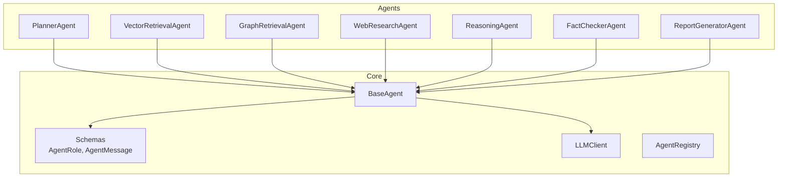
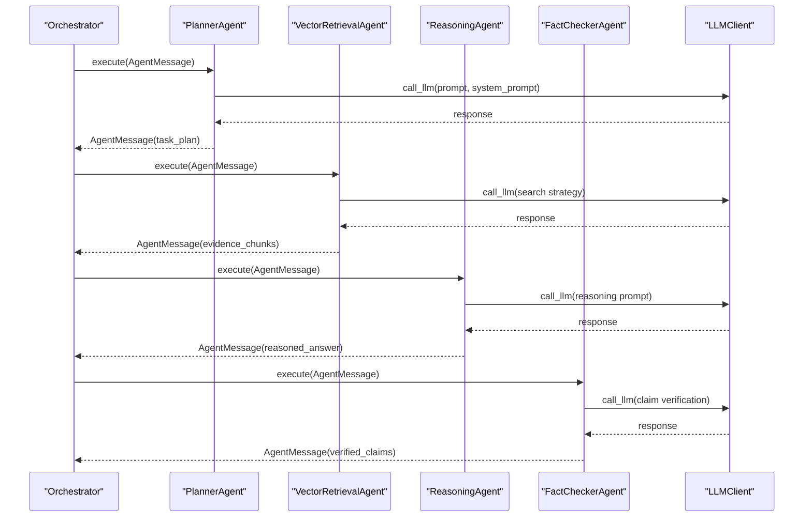
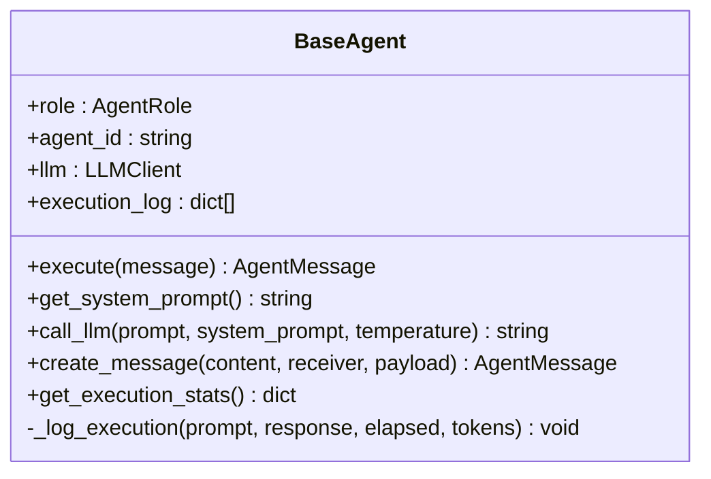
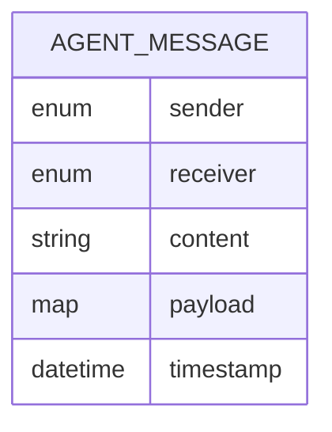
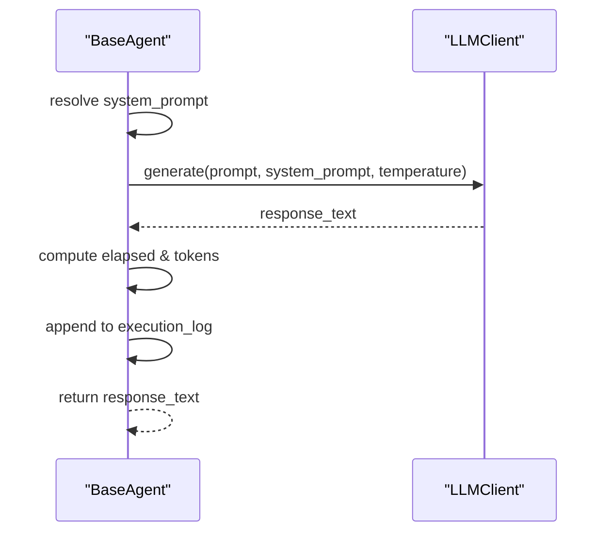
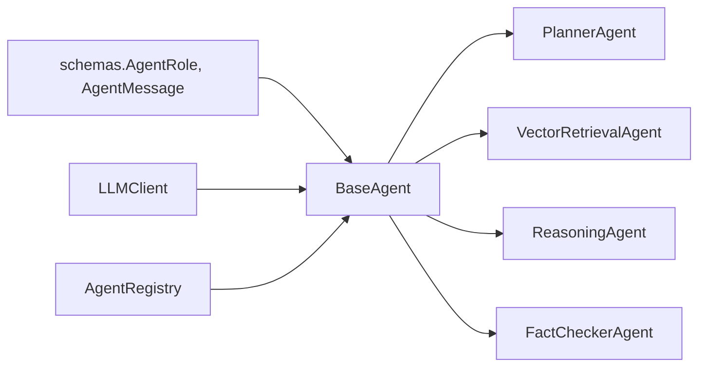

# Agent Framework Design

<cite>
**Referenced Files in This Document**
- [base_agent.py](file://src/core/base_agent.py)
- [schemas.py](file://src/core/schemas.py)
- [llm.py](file://src/core/llm.py)
- [registry.py](file://src/core/registry.py)
- [planner_agent.py](file://src/agents/planner_agent.py)
- [reasoning_agent.py](file://src/agents/reasoning_agent.py)
- [vector_agent.py](file://src/agents/vector_agent.py)
- [fact_checker_agent.py](file://src/agents/fact_checker_agent.py)
- [query_example.py](file://examples/query_example.py)
</cite>

## Table of Contents
1. [Introduction](#introduction)
2. [Project Structure](#project-structure)
3. [Core Components](#core-components)
4. [Architecture Overview](#architecture-overview)
5. [Detailed Component Analysis](#detailed-component-analysis)
6. [Dependency Analysis](#dependency-analysis)
7. [Performance Considerations](#performance-considerations)
8. [Troubleshooting Guide](#troubleshooting-guide)
9. [Conclusion](#conclusion)
10. [Appendices](#appendices)

## Introduction
This document explains the agent framework design, focusing on the BaseAgent abstract class and how specialized agents extend it to implement consistent behavior. It covers the standardized execution interface (execute() and get_system_prompt()), lifecycle management, message passing via AgentMessage, LLM integration through call_llm(), and execution statistics collection. It also documents the role-based architecture using AgentRole, agent identification with UUIDs, extensibility points for custom agents, common implementation patterns, error handling strategies, and performance considerations.

## Project Structure
The agent framework is implemented under src/core and src/agents:
- Core abstractions and shared types are in src/core (BaseAgent, schemas, LLM client, registry).
- Concrete agents live in src/agents (Planner, Vector Retrieval, Graph Retrieval, Web Research, Reasoning, Fact Checker, Report Generator).
- Example usage orchestrating the multi-agent pipeline is provided in examples/query_example.py.

**Diagram sources**
- [base_agent.py:19-100](file://src/core/base_agent.py#L19-L100)
- [schemas.py:17-114](file://src/core/schemas.py#L17-L114)
- [llm.py:15-103](file://src/core/llm.py#L15-L103)
- [registry.py:16-51](file://src/core/registry.py#L16-L51)
- [planner_agent.py:56-128](file://src/agents/planner_agent.py#L56-L128)
- [vector_agent.py:34-92](file://src/agents/vector_agent.py#L34-L92)
- [reasoning_agent.py:38-124](file://src/agents/reasoning_agent.py#L38-L124)
- [fact_checker_agent.py:54-163](file://src/agents/fact_checker_agent.py#L54-L163)

**Section sources**
- [base_agent.py:19-100](file://src/core/base_agent.py#L19-L100)
- [schemas.py:17-114](file://src/core/schemas.py#L17-L114)
- [llm.py:15-103](file://src/core/llm.py#L15-L103)
- [registry.py:16-51](file://src/core/registry.py#L16-L51)
- [planner_agent.py:56-128](file://src/agents/planner_agent.py#L56-L128)
- [vector_agent.py:34-92](file://src/agents/vector_agent.py#L34-L92)
- [reasoning_agent.py:38-124](file://src/agents/reasoning_agent.py#L38-L124)
- [fact_checker_agent.py:54-163](file://src/agents/fact_checker_agent.py#L54-L163)

## Core Components
- BaseAgent: Abstract base defining execute() and get_system_prompt(), plus shared utilities for LLM calls, message creation, logging, and stats.
- Schemas: Role enumeration (AgentRole), message model (AgentMessage), and supporting data models for evidence, claims, reports, etc.
- LLMClient: Unified interface to Gemini or OpenAI with generate() and token counting.
- AgentRegistry: Central catalog mapping roles to agent instances for lookup and orchestration.

Key responsibilities:
- Standardized interface ensures all agents behave consistently.
- Message passing uses typed AgentMessage objects with sender, receiver, content, payload, and timestamp.
- Execution logging captures latency, tokens, and per-call metadata.
- Statistics aggregation provides total calls, tokens, latency, and averages.

**Section sources**
- [base_agent.py:19-100](file://src/core/base_agent.py#L19-L100)
- [schemas.py:17-114](file://src/core/schemas.py#L17-L114)
- [llm.py:15-103](file://src/core/llm.py#L15-L103)
- [registry.py:16-51](file://src/core/registry.py#L16-L51)

## Architecture Overview
The framework follows a role-based architecture where each agent implements a specific role from AgentRole. Agents communicate via AgentMessage, enabling decoupled pipelines orchestrated by higher-level code (e.g., example scripts). The BaseAgent centralizes cross-cutting concerns such as LLM invocation, logging, and statistics.

**Diagram sources**
- [planner_agent.py:65-82](file://src/agents/planner_agent.py#L65-L82)
- [vector_agent.py:44-81](file://src/agents/vector_agent.py#L44-L81)
- [reasoning_agent.py:47-77](file://src/agents/reasoning_agent.py#L47-L77)
- [fact_checker_agent.py:63-109](file://src/agents/fact_checker_agent.py#L63-L109)
- [base_agent.py:42-59](file://src/core/base_agent.py#L42-L59)

## Detailed Component Analysis

### BaseAgent: Standardized Execution Interface and Lifecycle
- Initialization: Sets role, generates a short unique agent_id, initializes LLMClient (or uses provided instance), and starts an empty execution_log. Logs initialization.
- execute(message): Abstract method that subclasses must implement to process an incoming AgentMessage and return an AgentMessage with results.
- get_system_prompt(): Abstract method returning the agent’s persona/instructions used as system prompts for LLM calls.
- call_llm(prompt, system_prompt=None, temperature=None):
  - Resolves system prompt from get_system_prompt() if not provided.
  - Measures elapsed time and counts tokens for prompt and response.
  - Records execution log entry via _log_execution().
  - Returns the LLM response string.
- _log_execution(prompt, response, elapsed, tokens): Appends structured metadata including agent role, timestamp, prompt/response tokens, total tokens, and latency.
- create_message(content, receiver=None, payload=None): Builds an AgentMessage with sender set to this agent’s role, optional receiver, content, and payload.
- get_execution_stats(): Aggregates execution_log into total_calls, total_tokens, total_latency, and avg_latency.

Implementation notes:
- Uses uuid for agent identification and time for latency measurement.
- Leverages loguru for logging during initialization and internal steps.
- Provides a clean extension point: subclasses only need to implement execute() and get_system_prompt().

**Section sources**
- [base_agent.py:19-100](file://src/core/base_agent.py#L19-L100)

#### BaseAgent Class Diagram

**Diagram sources**
- [base_agent.py:19-100](file://src/core/base_agent.py#L19-L100)

### AgentMessage Schema and Role-Based Communication
- AgentMessage: Typed Pydantic model carrying sender, optional receiver, content, payload (arbitrary dict), and timestamp. Ensures consistent inter-agent communication.
- AgentRole: Enum defining available roles (planner, vector_retrieval, graph_retrieval, web_research, reasoning, fact_checker, report_generator). Enforces valid roles across the system.

Usage patterns:
- Agents construct messages via BaseAgent.create_message(), setting appropriate sender and optional receiver.
- Payloads carry structured data (e.g., task plans, evidence chunks, relations, web results).
- Receivers can be omitted when messages are broadcast or processed centrally.

**Section sources**
- [schemas.py:17-114](file://src/core/schemas.py#L17-L114)

#### AgentMessage Data Model

**Diagram sources**
- [schemas.py:107-114](file://src/core/schemas.py#L107-L114)

### LLM Integration Through call_llm()
- BaseAgent.call_llm() wraps LLMClient.generate(), injecting the agent’s system prompt unless overridden.
- LLMClient supports multiple providers (Gemini, OpenAI) configured at runtime; it handles provider-specific generation and returns text responses.
- Token counting uses tiktoken when available, with a fallback heuristic.

Execution flow:
- Measure start time.
- Call provider-specific generator with system prompt, user prompt, temperature, and max tokens.
- Compute elapsed time and token counts.
- Record execution log entry.
- Return response.

**Section sources**
- [base_agent.py:42-59](file://src/core/base_agent.py#L42-L59)
- [llm.py:15-103](file://src/core/llm.py#L15-L103)

#### LLM Call Sequence

**Diagram sources**
- [base_agent.py:42-59](file://src/core/base_agent.py#L42-L59)
- [llm.py:40-87](file://src/core/llm.py#L40-L87)

### Concrete Agent Implementations

#### PlannerAgent
- Purpose: Decomposes research questions into sub-questions and determines required agents and execution order.
- System prompt: Defines planner persona and expected JSON structure for output.
- execute(): Extracts question and flags from payload, builds prompt, calls LLM, parses JSON response into TaskPlan, and returns an AgentMessage with task plan.
- Error handling: Falls back to a single-task plan if LLM response is not valid JSON.

**Section sources**
- [planner_agent.py:23-53](file://src/agents/planner_agent.py#L23-L53)
- [planner_agent.py:56-128](file://src/agents/planner_agent.py#L56-L128)

#### VectorRetrievalAgent
- Purpose: Retrieves semantically relevant document chunks from a vector store.
- System prompt: Instructs LLM to produce search phrases and reformulated queries.
- execute(): Uses LLM to refine search strategy, queries vector_store.search(), constructs EvidenceChunk objects, and returns an AgentMessage with evidence_chunks.
- Error handling: Warns and returns empty results if no vector store is configured.

**Section sources**
- [vector_agent.py:17-31](file://src/agents/vector_agent.py#L17-L31)
- [vector_agent.py:34-92](file://src/agents/vector_agent.py#L34-L92)

#### ReasoningAgent
- Purpose: Synthesizes evidence from vector, graph, and web retrieval to produce a reasoned answer.
- System prompt: Emphasizes evidence-grounded reasoning and citation practices.
- execute(): Builds a comprehensive prompt combining question and evidence, calls LLM, and returns an AgentMessage with reasoned_answer and metadata.

**Section sources**
- [reasoning_agent.py:16-35](file://src/agents/reasoning_agent.py#L16-L35)
- [reasoning_agent.py:38-124](file://src/agents/reasoning_agent.py#L38-L124)

#### FactCheckerAgent
- Purpose: Verifies factual claims in the reasoned answer against evidence and flags hallucinations.
- System prompt: Defines strict verification criteria and expected JSON output.
- execute(): Extracts claims, verifies them via LLM, computes supported/unsupported counts, and returns an AgentMessage with verified_claims and summary.
- Error handling: Gracefully handles invalid JSON by creating a minimal Claim indicating parsing failure.

**Section sources**
- [fact_checker_agent.py:24-51](file://src/agents/fact_checker_agent.py#L24-L51)
- [fact_checker_agent.py:54-163](file://src/agents/fact_checker_agent.py#L54-L163)

### Extensibility Points for Custom Agents
To add a new agent:
- Define a subclass of BaseAgent.
- Implement get_system_prompt() to define the agent’s persona and instructions.
- Implement execute(message) to process input and return an AgentMessage with results.
- Use call_llm() for LLM interactions; leverage create_message() to build outputs.
- Optionally inject dependencies (e.g., vector_store, graph_store) via __init__ parameters.
- Register the agent in AgentRegistry if dynamic lookup by role is desired.

Best practices:
- Keep payloads small and well-structured; prefer typed models from schemas where possible.
- Handle LLM parsing errors with robust fallbacks.
- Log meaningful context for debugging and evaluation.

**Section sources**
- [base_agent.py:19-100](file://src/core/base_agent.py#L19-L100)
- [registry.py:16-51](file://src/core/registry.py#L16-L51)

### Agent Identification and Lifecycle Management
- Each agent gets a short unique identifier derived from uuid.uuid4() during initialization.
- Lifecycle:
  - Initialization logs role and id.
  - Execution invokes execute(), which may call LLM multiple times.
  - After execution, stats can be retrieved via get_execution_stats().
- Registry enables centralized management and lookup by role.

**Section sources**
- [base_agent.py:22-27](file://src/core/base_agent.py#L22-L27)
- [registry.py:16-51](file://src/core/registry.py#L16-L51)

### Execution Statistics Collection
- BaseAgent maintains execution_log entries per LLM call with timestamps, token counts, and latency.
- get_execution_stats() aggregates these into totals and averages for evaluation and monitoring.

Use cases:
- Performance profiling across agents.
- Cost estimation via token usage.
- Latency analysis for pipeline optimization.

**Section sources**
- [base_agent.py:61-99](file://src/core/base_agent.py#L61-L99)

### End-to-End Pipeline Example
The example script demonstrates initializing agents, constructing AgentMessage instances, executing agents in sequence, and assembling a final report. It shows:
- Planning phase to decompose the question.
- Parallel or sequential retrieval from vector, graph, and web sources.
- Reasoning synthesis and fact-checking.
- Report generation and display.

**Section sources**
- [query_example.py:25-176](file://examples/query_example.py#L25-L176)

## Dependency Analysis
- BaseAgent depends on:
  - AgentRole and AgentMessage from schemas.
  - LLMClient from llm.
- Concrete agents depend on BaseAgent and may depend on external components (vector_store, graph_store) injected at runtime.
- AgentRegistry depends on BaseAgent type hints and maps roles to instances.

**Diagram sources**
- [base_agent.py:15-16](file://src/core/base_agent.py#L15-L16)
- [schemas.py:17-114](file://src/core/schemas.py#L17-L114)
- [llm.py:15-103](file://src/core/llm.py#L15-L103)
- [registry.py:16-51](file://src/core/registry.py#L16-L51)
- [planner_agent.py:14-20](file://src/agents/planner_agent.py#L14-L20)
- [vector_agent.py:13-14](file://src/agents/vector_agent.py#L13-L14)
- [reasoning_agent.py:12-13](file://src/agents/reasoning_agent.py#L12-L13)
- [fact_checker_agent.py:14-21](file://src/agents/fact_checker_agent.py#L14-L21)

**Section sources**
- [base_agent.py:15-16](file://src/core/base_agent.py#L15-L16)
- [schemas.py:17-114](file://src/core/schemas.py#L17-L114)
- [llm.py:15-103](file://src/core/llm.py#L15-L103)
- [registry.py:16-51](file://src/core/registry.py#L16-L51)

## Performance Considerations
- Token efficiency:
  - Use call_llm() to automatically count tokens and log usage; monitor total_tokens and avg_latency via get_execution_stats().
  - Prefer concise prompts and structured outputs to reduce token consumption.
- Latency optimization:
  - Batch retrievals where possible; avoid redundant LLM calls.
  - Tune temperature and max_tokens based on task requirements.
- Resource constraints:
  - Ensure vector/graph stores are configured to avoid unnecessary LLM retries or empty results.
  - Use fallback logic in parsers to prevent blocking on malformed LLM responses.

[No sources needed since this section provides general guidance]

## Troubleshooting Guide
Common issues and strategies:
- Invalid LLM JSON responses:
  - Planner and Fact Checker include fallbacks to construct minimal valid structures when parsing fails.
  - Check logs for warnings about non-JSON responses and adjust prompts or post-processing.
- Missing dependencies:
  - VectorRetrievalAgent warns and returns empty results if vector_store is not configured; ensure injection at runtime.
- Provider configuration:
  - LLMClient raises errors for unsupported providers; verify settings and environment variables.
- Execution stats anomalies:
  - If execution_log is empty, get_execution_stats() returns zeroed metrics; ensure call_llm() is invoked within execute().

**Section sources**
- [planner_agent.py:97-128](file://src/agents/planner_agent.py#L97-L128)
- [fact_checker_agent.py:130-163](file://src/agents/fact_checker_agent.py#L130-L163)
- [vector_agent.py:73-76](file://src/agents/vector_agent.py#L73-L76)
- [llm.py:25-38](file://src/core/llm.py#L25-L38)
- [base_agent.py:88-99](file://src/core/base_agent.py#L88-L99)

## Conclusion
The agent framework provides a robust, extensible foundation for building multi-agent research systems. BaseAgent standardizes execution, messaging, LLM integration, logging, and statistics, while concrete agents specialize in distinct roles defined by AgentRole. The schema-driven message passing ensures type safety and clarity. By following the documented patterns—implementing execute() and get_system_prompt(), leveraging call_llm(), and using create_message()—developers can rapidly add custom agents and compose complex pipelines with consistent behavior and measurable performance.

[No sources needed since this section summarizes without analyzing specific files]

## Appendices

### Implementation Checklist for New Agents
- Subclass BaseAgent.
- Implement get_system_prompt() with clear instructions and expected output format.
- Implement execute(message) to:
  - Parse input from message.payload or message.content.
  - Build prompts and call call_llm() as needed.
  - Parse LLM responses with robust fallbacks.
  - Return an AgentMessage via create_message() with structured payload.
- Inject any required dependencies (e.g., vector_store, graph_store) in __init__.
- Optionally register the agent in AgentRegistry for role-based lookup.

**Section sources**
- [base_agent.py:19-100](file://src/core/base_agent.py#L19-L100)
- [registry.py:16-51](file://src/core/registry.py#L16-L51)