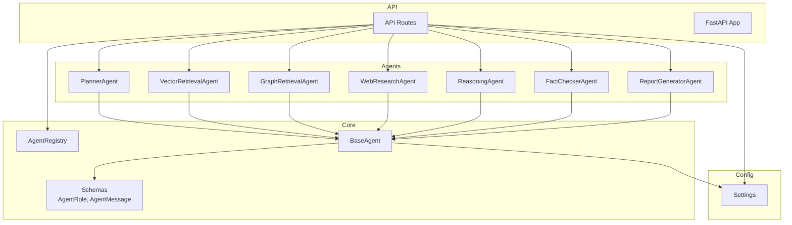
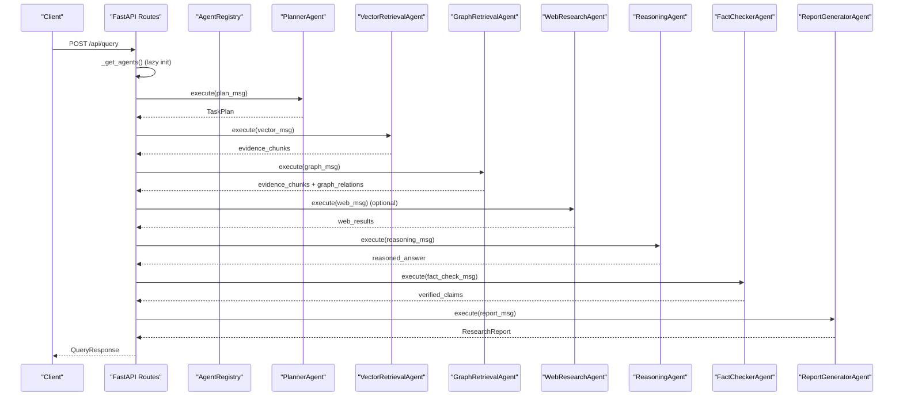
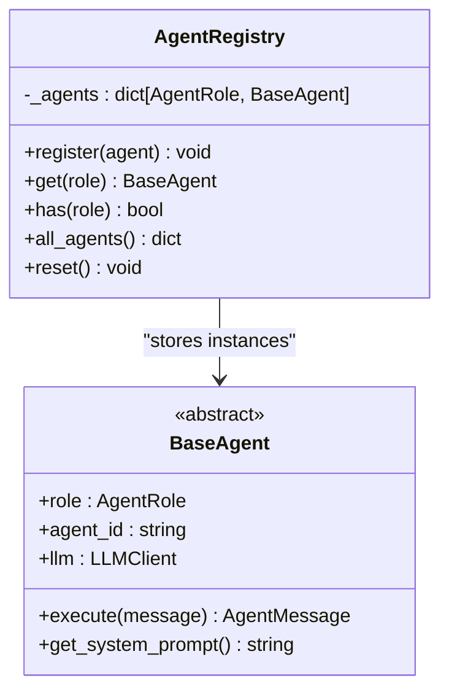
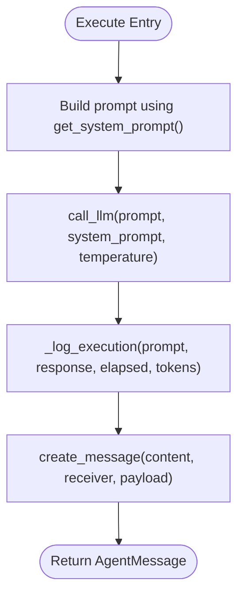
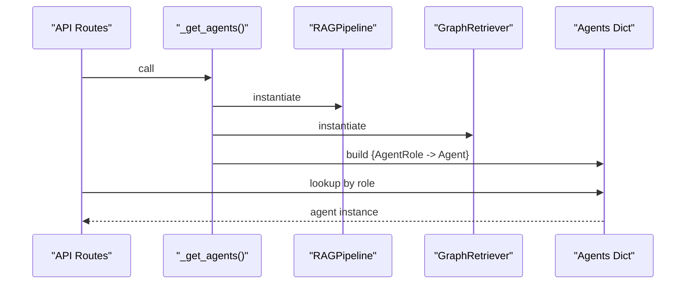
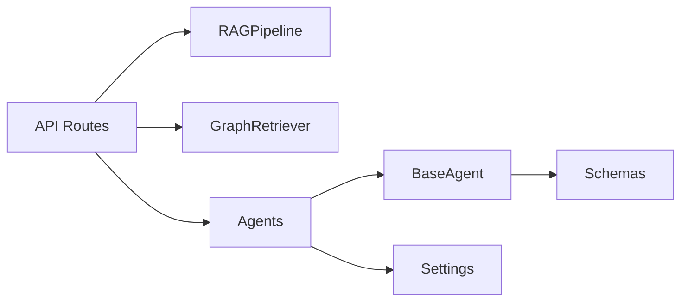

# Agent Registry System

<cite>
**Referenced Files in This Document**
- [registry.py](file://src/core/registry.py)
- [base_agent.py](file://src/core/base_agent.py)
- [schemas.py](file://src/core/schemas.py)
- [routes.py](file://src/api/routes.py)
- [app.py](file://src/api/app.py)
- [planner_agent.py](file://src/agents/planner_agent.py)
- [vector_agent.py](file://src/agents/vector_agent.py)
- [graph_agent.py](file://src/agents/graph_agent.py)
- [web_agent.py](file://src/agents/web_agent.py)
- [reasoning_agent.py](file://src/agents/reasoning_agent.py)
- [fact_checker_agent.py](file://src/agents/fact_checker_agent.py)
- [report_agent.py](file://src/agents/report_agent.py)
- [config.py](file://src/config.py)
- [main.py](file://main.py)
- [test_core.py](file://tests/test_core.py)
</cite>

## Table of Contents
1. [Introduction](#introduction)
2. [Project Structure](#project-structure)
3. [Core Components](#core-components)
4. [Architecture Overview](#architecture-overview)
5. [Detailed Component Analysis](#detailed-component-analysis)
6. [Dependency Analysis](#dependency-analysis)
7. [Performance Considerations](#performance-considerations)
8. [Troubleshooting Guide](#troubleshooting-guide)
9. [Conclusion](#conclusion)
10. [Appendices](#appendices)

## Introduction
This document explains the agent registry system that enables dynamic registration and discovery of agents within the multi-agent framework. It covers how agents are registered at runtime, how they are discovered and instantiated, how dependencies are injected, and how metadata is maintained. It also addresses lifecycle management, testing strategies, thread safety considerations, memory management, and performance implications of dynamic loading.

The current implementation provides a central registry for mapping roles to agent instances and a lazy initialization pattern for assembling agents with their dependencies. While decorators are not used in this codebase, the design supports extension points for adding new agent types and capabilities.

## Project Structure
At a high level:
- Core abstractions and schemas define agent roles, messages, and data models.
- The registry maintains a mapping from roles to agent instances.
- Agents implement a common interface and encapsulate LLM calls, execution logs, and message creation.
- API routes assemble agents on first use, inject dependencies (e.g., vector store, graph store), and orchestrate the research pipeline.
- Configuration centralizes environment-driven settings.

**Diagram sources**
- [registry.py:16-50](file://src/core/registry.py#L16-L50)
- [base_agent.py:19-100](file://src/core/base_agent.py#L19-L100)
- [schemas.py:17-25](file://src/core/schemas.py#L17-L25)
- [routes.py:51-75](file://src/api/routes.py#L51-L75)
- [app.py:26-56](file://src/api/app.py#L26-L56)
- [config.py:21-82](file://src/config.py#L21-L82)

**Section sources**
- [registry.py:16-50](file://src/core/registry.py#L16-L50)
- [base_agent.py:19-100](file://src/core/base_agent.py#L19-L100)
- [schemas.py:17-25](file://src/core/schemas.py#L17-L25)
- [routes.py:51-75](file://src/api/routes.py#L51-L75)
- [app.py:26-56](file://src/api/app.py#L26-L56)
- [config.py:21-82](file://src/config.py#L21-L82)

## Core Components
- AgentRegistry: A simple in-memory map from AgentRole to BaseAgent instance. Provides register, get, has, all_agents, and reset operations. A global singleton accessor ensures consistent access across the process.
- BaseAgent: Abstract base class defining role, unique id, LLM client, execution logging, message creation, and an execute contract.
- Schemas: Enumerations for roles and Pydantic models for messages, evidence, claims, reports, and experiment metadata.

Key responsibilities:
- Role-based lookup and registration.
- Uniform agent interface for execution and messaging.
- Centralized configuration and typed data contracts.

**Section sources**
- [registry.py:16-50](file://src/core/registry.py#L16-L50)
- [base_agent.py:19-100](file://src/core/base_agent.py#L19-L100)
- [schemas.py:17-25](file://src/core/schemas.py#L17-L25)

## Architecture Overview
The system uses a hybrid approach:
- Lazy initialization of agents with dependency injection via a module-level helper that builds a dictionary of agents keyed by role.
- Direct invocation of agent.execute() within the query endpoint to orchestrate the pipeline.
- Optional use of the registry singleton for centralized access if desired.

**Diagram sources**
- [routes.py:188-338](file://src/api/routes.py#L188-L338)
- [routes.py:51-75](file://src/api/routes.py#L51-L75)
- [planner_agent.py:56-82](file://src/agents/planner_agent.py#L56-L82)
- [vector_agent.py:34-81](file://src/agents/vector_agent.py#L34-L81)
- [graph_agent.py:36-109](file://src/agents/graph_agent.py#L36-L109)
- [web_agent.py:34-85](file://src/agents/web_agent.py#L34-L85)
- [reasoning_agent.py:38-77](file://src/agents/reasoning_agent.py#L38-L77)
- [fact_checker_agent.py:54-109](file://src/agents/fact_checker_agent.py#L54-L109)
- [report_agent.py:48-142](file://src/agents/report_agent.py#L48-L142)

## Detailed Component Analysis

### AgentRegistry
- Purpose: Maintain a mapping from AgentRole to agent instances; provide lookup and enumeration.
- Operations:
  - register(agent): Add or replace an agent by its role.
  - get(role): Retrieve an agent or raise KeyError if missing.
  - has(role): Check presence.
  - all_agents(): Return a snapshot of the registry.
  - reset(): Clear all registrations.
- Singleton: A module-level accessor returns a single instance per process.

**Diagram sources**
- [registry.py:16-50](file://src/core/registry.py#L16-L50)
- [base_agent.py:19-35](file://src/core/base_agent.py#L19-L35)

**Section sources**
- [registry.py:16-50](file://src/core/registry.py#L16-L50)

### BaseAgent and Message Flow
- BaseAgent defines:
  - Initialization with role, unique id, and LLM client.
  - Abstract execute and get_system_prompt methods.
  - call_llm helper that records execution metrics and token usage.
  - create_message helper to build typed AgentMessage payloads.
  - get_execution_stats to aggregate latency and token counts.

**Diagram sources**
- [base_agent.py:29-59](file://src/core/base_agent.py#L29-L59)
- [base_agent.py:61-99](file://src/core/base_agent.py#L61-L99)

**Section sources**
- [base_agent.py:19-100](file://src/core/base_agent.py#L19-L100)

### Agent Implementations and Capabilities
- PlannerAgent: Decomposes questions into sub-questions and required agents; outputs a TaskPlan.
- VectorRetrievalAgent: Uses LLM to refine search phrases and queries a vector store to produce EvidenceChunk items.
- GraphRetrievalAgent: Extracts entities and relationship types via LLM, queries a knowledge graph, and produces GraphRelation and EvidenceChunk items.
- WebResearchAgent: Generates search queries via LLM and performs web searches to produce WebResult and EvidenceChunk items.
- ReasoningAgent: Synthesizes evidence from multiple sources into a reasoned answer.
- FactCheckerAgent: Verifies claims against evidence and assigns verdicts.
- ReportGeneratorAgent: Produces a structured ResearchReport combining narrative, evidence, relationships, and references.

Each agent:
- Inherits from BaseAgent and implements execute and get_system_prompt.
- Accepts optional dependencies (e.g., vector_store, graph_store) via constructor injection.
- Emits typed messages and payloads consumed by downstream agents.

**Section sources**
- [planner_agent.py:56-128](file://src/agents/planner_agent.py#L56-L128)
- [vector_agent.py:34-92](file://src/agents/vector_agent.py#L34-L92)
- [graph_agent.py:36-121](file://src/agents/graph_agent.py#L36-L121)
- [web_agent.py:34-117](file://src/agents/web_agent.py#L34-L117)
- [reasoning_agent.py:38-124](file://src/agents/reasoning_agent.py#L38-L124)
- [fact_checker_agent.py:54-163](file://src/agents/fact_checker_agent.py#L54-L163)
- [report_agent.py:48-228](file://src/agents/report_agent.py#L48-L228)

### Registration and Discovery Patterns
Current patterns:
- Lazy initialization: A module-level function constructs a dictionary of agents with dependencies injected at first use.
- Direct access: The query route accesses agents via this dictionary.
- Optional registry usage: The registry can be used to centralize access and support dynamic registration/reset scenarios.

**Diagram sources**
- [routes.py:51-75](file://src/api/routes.py#L51-L75)

**Section sources**
- [routes.py:51-75](file://src/api/routes.py#L51-L75)

### Dependency Injection Support
- Constructor injection: Agents accept external services (e.g., vector_store, graph_store) through __init__ parameters.
- Lazy wiring: Dependencies are created once and reused across requests via module-level caches.
- Extensibility: New agents can be added by implementing BaseAgent and registering them in the lazy initializer or the registry.

**Section sources**
- [vector_agent.py:34-40](file://src/agents/vector_agent.py#L34-L40)
- [graph_agent.py:36-42](file://src/agents/graph_agent.py#L36-L42)
- [routes.py:51-75](file://src/api/routes.py#L51-L75)

### Metadata, Versioning, and Lifecycle Management
- Metadata:
  - Each agent instance carries a role and a unique id.
  - Execution logs record timestamps, token usage, and latency per call.
- Versioning:
  - No explicit version field exists in the current code. Roles serve as identifiers.
  - To add versioning, extend BaseAgent with a version attribute and update registry keys accordingly.
- Lifecycle:
  - Agents are created lazily and persist for the process lifetime.
  - The registry supports reset to clear state when needed.

**Section sources**
- [base_agent.py:22-27](file://src/core/base_agent.py#L22-L27)
- [base_agent.py:61-99](file://src/core/base_agent.py#L61-L99)
- [registry.py:38-39](file://src/core/registry.py#L38-L39)

### Decorator-Based Registration Approach
- Current code does not use decorators for registration.
- Recommended approach:
  - Define a decorator that registers an agent class or instance into the registry under its role.
  - Ensure the decorator runs during import or startup to auto-discover agents.
  - Combine with capability tags to enable selective activation.

[No sources needed since this section proposes an extension not present in the code]

### Plugin Architecture for New Agent Types
- Implement BaseAgent and set a distinct AgentRole.
- Inject any required dependencies (e.g., retrievers, stores).
- Register the agent either:
  - In the lazy initializer dictionary, or
  - Via the registry’s register method at startup.
- Expose capabilities through the agent’s execute contract and message payloads.

**Section sources**
- [base_agent.py:19-35](file://src/core/base_agent.py#L19-L35)
- [schemas.py:17-25](file://src/core/schemas.py#L17-L25)
- [routes.py:51-75](file://src/api/routes.py#L51-L75)
- [registry.py:22-30](file://src/core/registry.py#L22-L30)

### Practical Examples
- Implementing a custom agent:
  - Subclass BaseAgent, implement execute and get_system_prompt, and set a unique role.
  - Optionally accept dependencies in __init__.
- Registering with the registry:
  - Instantiate the agent and call registry.register(agent).
  - Or include it in the lazy initializer dictionary for automatic wiring.
- Resolving dependencies:
  - Pass vector_store or graph_store to the agent constructor.
  - Use the shared settings to configure LLM providers and other services.

**Section sources**
- [base_agent.py:19-35](file://src/core/base_agent.py#L19-L35)
- [registry.py:22-30](file://src/core/registry.py#L22-L30)
- [routes.py:51-75](file://src/api/routes.py#L51-L75)
- [config.py:21-82](file://src/config.py#L21-L82)

## Dependency Analysis
- API routes depend on:
  - RAG pipeline and graph retriever for data access.
  - Agents for orchestration.
- Agents depend on:
  - BaseAgent for common behavior.
  - Schemas for typed messages and models.
  - External services (vector store, graph store, web search) via injected dependencies.
- Configuration drives LLM provider, embedding model, and storage backends.

**Diagram sources**
- [routes.py:51-75](file://src/api/routes.py#L51-L75)
- [base_agent.py:19-35](file://src/core/base_agent.py#L19-L35)
- [schemas.py:17-25](file://src/core/schemas.py#L17-L25)
- [config.py:21-82](file://src/config.py#L21-L82)

**Section sources**
- [routes.py:51-75](file://src/api/routes.py#L51-L75)
- [base_agent.py:19-35](file://src/core/base_agent.py#L19-L35)
- [schemas.py:17-25](file://src/core/schemas.py#L17-L25)
- [config.py:21-82](file://src/config.py#L21-L82)

## Performance Considerations
- Lazy initialization reduces startup time and memory footprint by creating heavy dependencies only when needed.
- Caching:
  - Module-level caches for RAG pipeline and graph retriever avoid repeated instantiation.
  - Settings are cached via lru_cache to prevent redundant config loads.
- Token usage and latency tracking:
  - BaseAgent logs per-call metrics enabling profiling and cost estimation.
- Concurrency:
  - FastAPI handles concurrent requests; ensure external dependencies (vector store, graph store, LLM clients) are thread-safe or connection-pooled.
- Memory management:
  - Avoid retaining large payloads in agent state; prefer passing data via message payloads.
  - Reset the registry in tests to free resources between test cases.

[No sources needed since this section provides general guidance]

## Troubleshooting Guide
Common issues and remedies:
- Missing agent for role:
  - Ensure the agent is registered before lookup.
  - Verify the role enum value matches the agent’s role.
- Empty results from retrieval agents:
  - Confirm vector store or graph store is configured and reachable.
  - Check logs for warnings about missing dependencies.
- JSON parsing failures in LLM responses:
  - Agents include fallback logic; inspect logs for warnings and adjust prompts or temperature.
- Testing:
  - Use pytest to validate schemas and chunking behavior.
  - Mock external dependencies (vector store, graph store, web search) to isolate agent logic.

**Section sources**
- [registry.py:26-30](file://src/core/registry.py#L26-L30)
- [vector_agent.py:59-75](file://src/agents/vector_agent.py#L59-L75)
- [graph_agent.py:67-97](file://src/agents/graph_agent.py#L67-L97)
- [web_agent.py:96-117](file://src/agents/web_agent.py#L96-L117)
- [test_core.py:12-123](file://tests/test_core.py#L12-L123)

## Conclusion
The agent registry system provides a foundation for dynamic registration and discovery of agents within the multi-agent framework. While the current implementation favors lazy initialization and direct dependency injection, the registry offers a centralized mechanism for managing agent lifecycles and metadata. Extending the system with decorators and plugin-style discovery is straightforward and aligns with the existing BaseAgent contract and schema-driven messaging.

[No sources needed since this section summarizes without analyzing specific files]

## Appendices

### Thread Safety and Concurrency Notes
- The registry uses a plain dictionary; concurrent writes require synchronization if accessed from multiple threads.
- Prefer process-level singleton usage within a single worker process managed by the ASGI server.

[No sources needed since this section provides general guidance]

### Memory Management Tips
- Keep agent state minimal; rely on message payloads for transient data.
- Reuse shared services (RAG pipeline, graph retriever) via module-level caches.
- Periodically reset the registry in long-running processes if dynamic reloading is required.

[No sources needed since this section provides general guidance]

### Testing Registered Agents
- Validate schemas and data flows using pytest.
- Mock external dependencies to test agent logic in isolation.
- Assert execution stats and message structures to ensure correctness.

**Section sources**
- [test_core.py:12-123](file://tests/test_core.py#L12-L123)
- [base_agent.py:88-99](file://src/core/base_agent.py#L88-L99)