# Core Architecture

<cite>
**Referenced Files in This Document**
- [main.py](file://main.py)
- [README.md](file://README.md)
- [src/config.py](file://src/config.py)
- [src/core/base_agent.py](file://src/core/base_agent.py)
- [src/core/llm.py](file://src/core/llm.py)
- [src/core/registry.py](file://src/core/registry.py)
- [src/core/schemas.py](file://src/core/schemas.py)
- [src/agents/planner_agent.py](file://src/agents/planner_agent.py)
- [src/agents/vector_agent.py](file://src/agents/vector_agent.py)
- [src/agents/graph_agent.py](file://src/agents/graph_agent.py)
- [src/agents/web_agent.py](file://src/agents/web_agent.py)
- [src/agents/reasoning_agent.py](file://src/agents/reasoning_agent.py)
- [src/agents/fact_checker_agent.py](file://src/agents/fact_checker_agent.py)
- [src/agents/report_agent.py](file://src/agents/report_agent.py)
</cite>

## Table of Contents
1. Introduction
2. Project Structure
3. Core Components
4. Architecture Overview
5. Detailed Component Analysis
6. Dependency Analysis
7. Performance Considerations
8. Troubleshooting Guide
9. Conclusion

## Introduction
This document describes the core architecture of the Graph RAG + Multi-Agent Research System with a focus on:
- Modular microservices-style design and layered architecture
- Event-driven communication between agents via typed messages
- Base agent framework providing standardized execution, message passing, and logging
- LLM abstraction layer enabling provider-agnostic integration (Google Gemini and OpenAI GPT)
- Pydantic schema system for consistent data structures across components
- Agent registry mechanism for dynamic registration and discovery
- Cross-cutting concerns: configuration management, error handling, extensibility points

The system orchestrates a research pipeline that decomposes complex questions into sub-questions, retrieves evidence from vector stores, knowledge graphs, and web search, synthesizes reasoning, verifies claims, and produces structured reports.

**Section sources**
- [README.md:5-23](file://README.md#L5-L23)
- [main.py:71-106](file://main.py#L71-L106)

## Project Structure
At a high level, the codebase is organized by capability:
- Core abstractions: base agent, LLM client, schemas, registry
- Agents: planner, retrieval (vector, graph, web), reasoning, fact-checker, report generator
- RAG and Graph subsystems: chunking, embeddings, vector store, entity extraction, graph store, retriever
- API and CLI entry points: FastAPI app and main CLI commands
- Configuration: centralized settings loaded from environment variables

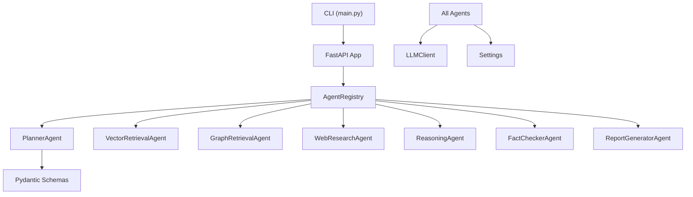

**Diagram sources**
- [main.py:71-106](file://main.py#L71-L106)
- [src/core/registry.py:16-50](file://src/core/registry.py#L16-L50)
- [src/core/base_agent.py:19-35](file://src/core/base_agent.py#L19-L35)
- [src/core/llm.py:15-103](file://src/core/llm.py#L15-L103)
- [src/core/schemas.py:17-168](file://src/core/schemas.py#L17-L168)

**Section sources**
- [README.md:81-126](file://README.md#L81-L126)
- [main.py:1-111](file://main.py#L1-L111)

## Core Components
- BaseAgent: Abstract base defining execute(), get_system_prompt(), call_llm(), create_message(), and execution logging/stats.
- LLMClient: Unified interface to Gemini and OpenAI with generate() and token counting; provider selection via Settings.
- AgentRegistry: Singleton registry mapping AgentRole to agent instances; supports register(), get(), has(), all_agents(), reset().
- Schemas: Pydantic models for queries, evidence, claims, agent messages, task plans, reports, and evaluation results.
- Settings: Centralized configuration with environment variable loading and sensible defaults.

These components form the foundation for all agents and services, ensuring consistency, type safety, and provider flexibility.

**Section sources**
- [src/core/base_agent.py:19-100](file://src/core/base_agent.py#L19-L100)
- [src/core/llm.py:15-103](file://src/core/llm.py#L15-L103)
- [src/core/registry.py:16-50](file://src/core/registry.py#L16-L50)
- [src/core/schemas.py:17-168](file://src/core/schemas.py#L17-L168)
- [src/config.py:21-82](file://src/config.py#L21-L82)

## Architecture Overview
The system follows a layered, modular design:
- Presentation/Entry Layer: CLI and FastAPI endpoints orchestrate workflows.
- Orchestration Layer: Planner decomposes questions; agents coordinate via typed messages.
- Retrieval Layer: Vector store, knowledge graph, and web search provide evidence.
- Synthesis Layer: Reasoning synthesizes evidence; fact-checker validates claims.
- Output Layer: Report generator produces structured research reports.
- Infrastructure Layer: LLM abstraction, configuration, schemas, and registry support cross-cutting needs.

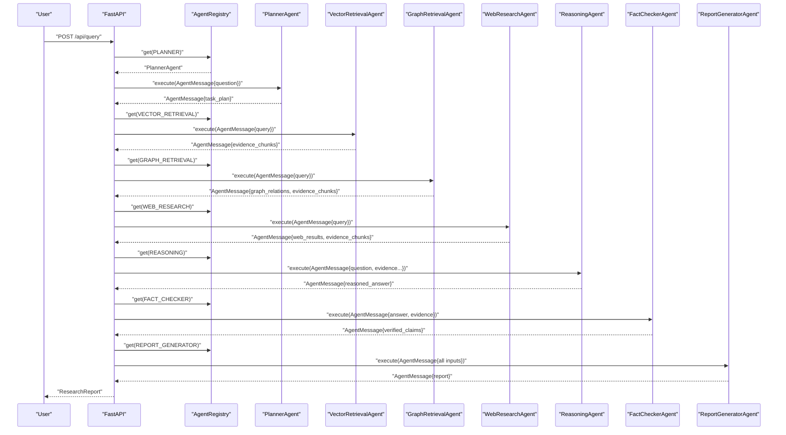

**Diagram sources**
- [src/agents/planner_agent.py:56-128](file://src/agents/planner_agent.py#L56-L128)
- [src/agents/vector_agent.py:34-92](file://src/agents/vector_agent.py#L34-L92)
- [src/agents/graph_agent.py:36-121](file://src/agents/graph_agent.py#L36-L121)
- [src/agents/web_agent.py:34-117](file://src/agents/web_agent.py#L34-L117)
- [src/agents/reasoning_agent.py:38-124](file://src/agents/reasoning_agent.py#L38-L124)
- [src/agents/fact_checker_agent.py:54-163](file://src/agents/fact_checker_agent.py#L54-L163)
- [src/agents/report_agent.py:48-228](file://src/agents/report_agent.py#L48-L228)

## Detailed Component Analysis

### BaseAgent Framework
BaseAgent provides:
- Standardized execution interface via abstract execute(message) returning AgentMessage
- Message creation helper create_message(sender, receiver, content, payload)
- LLM invocation helper call_llm(prompt, system_prompt, temperature) with timing and token accounting
- Execution logging and statistics aggregation

Design principles:
- Decouples agent logic from LLM specifics
- Enforces consistent messaging protocol
- Captures performance metrics per agent

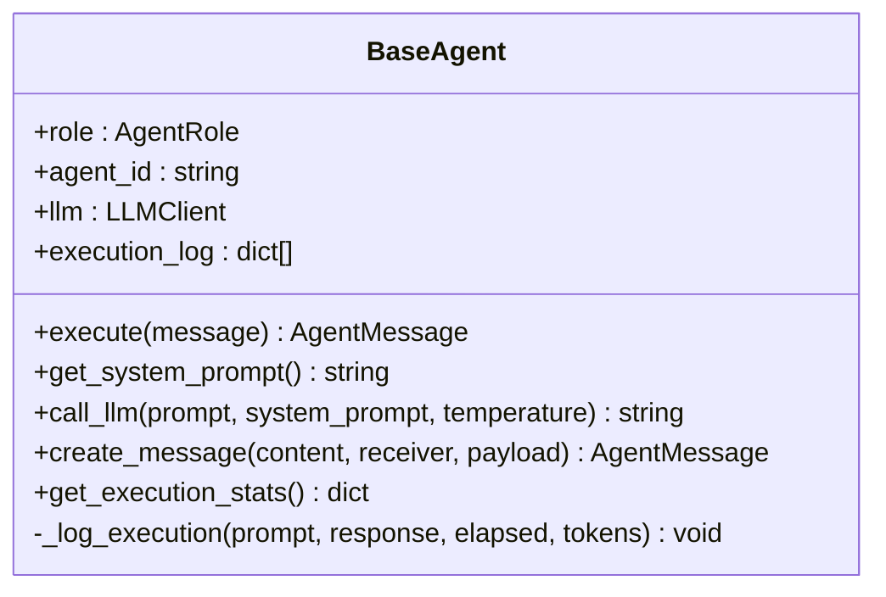

**Diagram sources**
- [src/core/base_agent.py:19-100](file://src/core/base_agent.py#L19-L100)

**Section sources**
- [src/core/base_agent.py:19-100](file://src/core/base_agent.py#L19-L100)

### LLM Abstraction Layer
LLMClient abstracts provider-specific clients:
- Provider initialization based on Settings.LLM_PROVIDER
- Unified generate(prompt, system_prompt, temperature, max_tokens) method
- Token counting via tiktoken or fallback heuristic
- Logging of provider and model used

Extensibility:
- Adding new providers requires extending _init_client and generate routing
- Settings centralize keys and model names

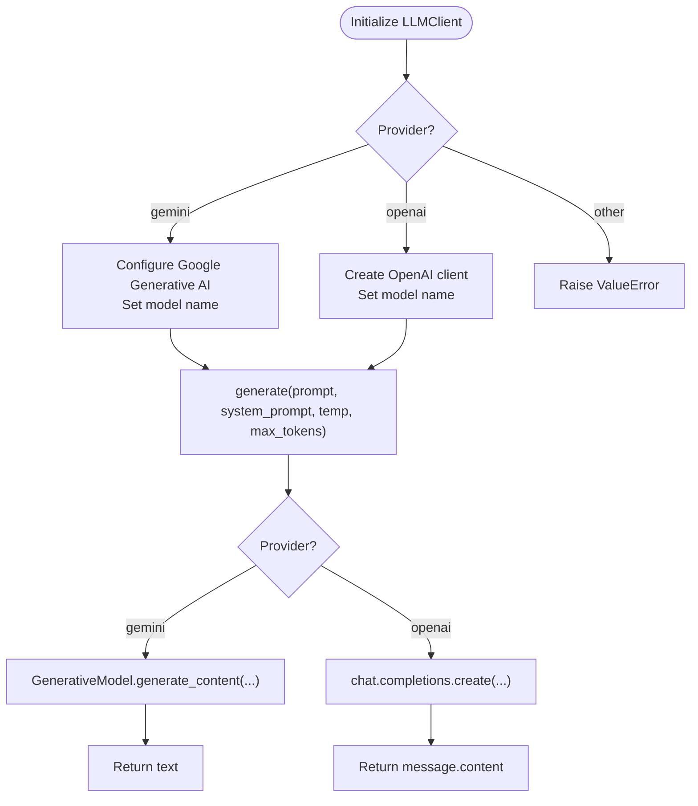

**Diagram sources**
- [src/core/llm.py:15-103](file://src/core/llm.py#L15-L103)
- [src/config.py:21-82](file://src/config.py#L21-L82)

**Section sources**
- [src/core/llm.py:15-103](file://src/core/llm.py#L15-L103)
- [src/config.py:21-82](file://src/config.py#L21-L82)

### Pydantic Schema System
Schemas define strict contracts for inter-agent communication and data exchange:
- AgentRole enum standardizes roles across the system
- AgentMessage carries sender, receiver, content, payload, timestamp
- EvidenceChunk, GraphRelation, WebResult unify retrieval outputs
- Claim, ClaimVerdict structure verification outcomes
- TaskPlan encodes planning output
- ResearchReport aggregates final deliverables

Benefits:
- Type safety and validation across boundaries
- Consistent serialization/deserialization
- Clear documentation of expected payloads

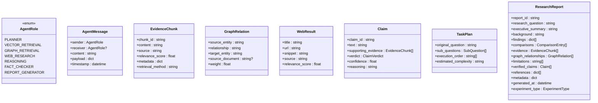

**Diagram sources**
- [src/core/schemas.py:17-168](file://src/core/schemas.py#L17-L168)

**Section sources**
- [src/core/schemas.py:17-168](file://src/core/schemas.py#L17-L168)

### Agent Registry Mechanism
AgentRegistry provides:
- Registration of agent instances keyed by AgentRole
- Lookup by role with KeyError if missing
- Enumeration of all registered agents
- Reset capability for testing or dynamic reloading

Singleton pattern ensures global access without tight coupling.

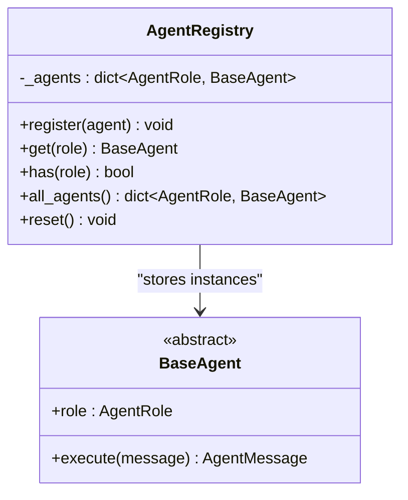

**Diagram sources**
- [src/core/registry.py:16-50](file://src/core/registry.py#L16-L50)
- [src/core/base_agent.py:19-35](file://src/core/base_agent.py#L19-L35)

**Section sources**
- [src/core/registry.py:16-50](file://src/core/registry.py#L16-L50)

### Agent Implementations and Data Flows

#### Planner Agent
- Decomposes user question into sub-questions and required agents
- Produces TaskPlan with execution order and complexity estimate
- Uses LLM to generate JSON plan with fallback parsing

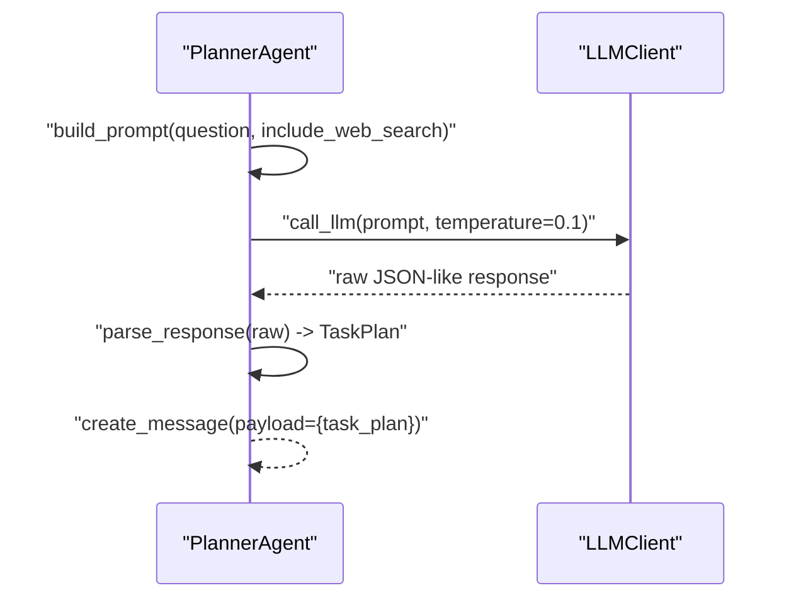

**Diagram sources**
- [src/agents/planner_agent.py:56-128](file://src/agents/planner_agent.py#L56-L128)
- [src/core/base_agent.py:42-59](file://src/core/base_agent.py#L42-L59)

**Section sources**
- [src/agents/planner_agent.py:56-128](file://src/agents/planner_agent.py#L56-L128)

#### Vector Retrieval Agent
- Uses LLM to derive optimized search phrases and reformulated query
- Queries vector store (if configured) and converts results to EvidenceChunk
- Returns evidence chunks with metadata and relevance scores

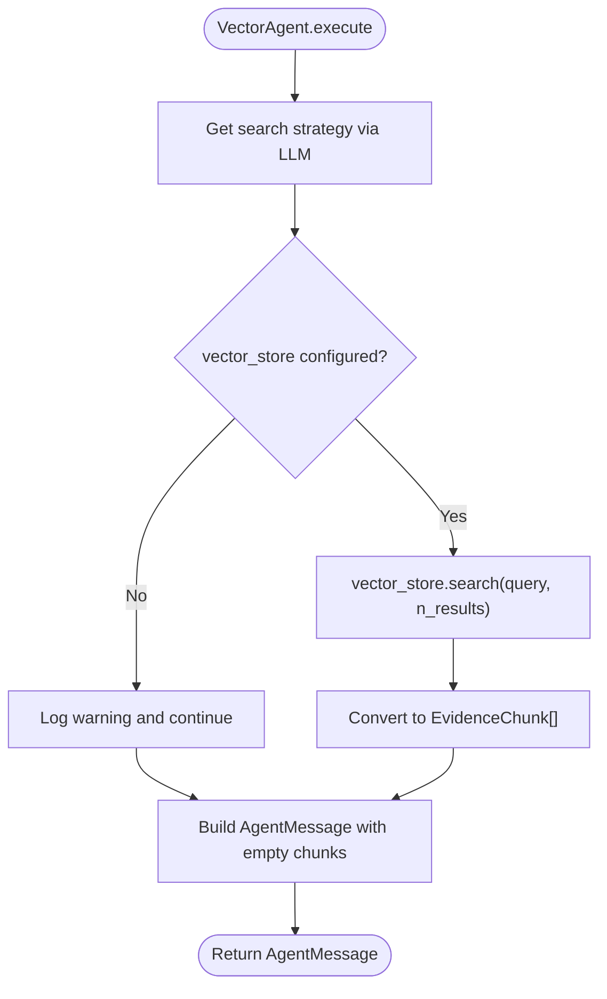

**Diagram sources**
- [src/agents/vector_agent.py:34-92](file://src/agents/vector_agent.py#L34-L92)

**Section sources**
- [src/agents/vector_agent.py:34-92](file://src/agents/vector_agent.py#L34-L92)

#### Graph Retrieval Agent
- Extracts entities and relationship types using LLM
- Queries knowledge graph for relations and context chunks
- Converts results to GraphRelation and EvidenceChunk

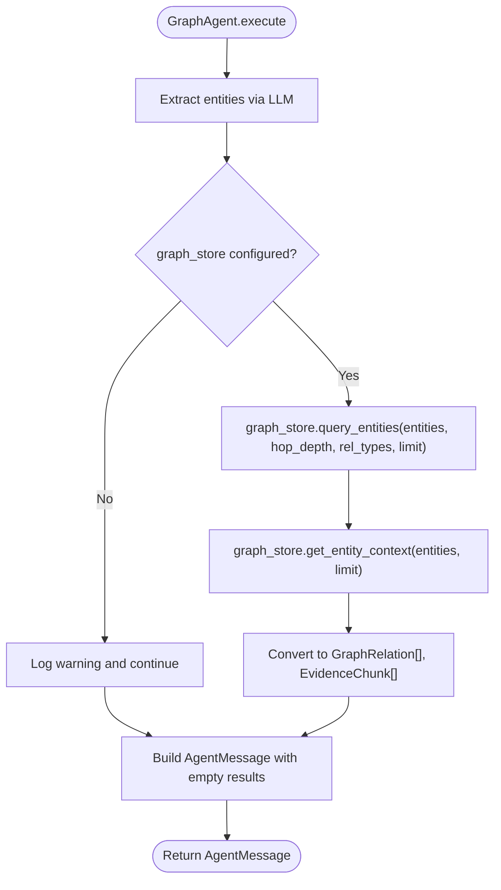

**Diagram sources**
- [src/agents/graph_agent.py:36-121](file://src/agents/graph_agent.py#L36-L121)

**Section sources**
- [src/agents/graph_agent.py:36-121](file://src/agents/graph_agent.py#L36-L121)

#### Web Research Agent
- Generates multiple search queries via LLM
- Executes DuckDuckGo searches (optional dependency)
- Converts results to WebResult and EvidenceChunk

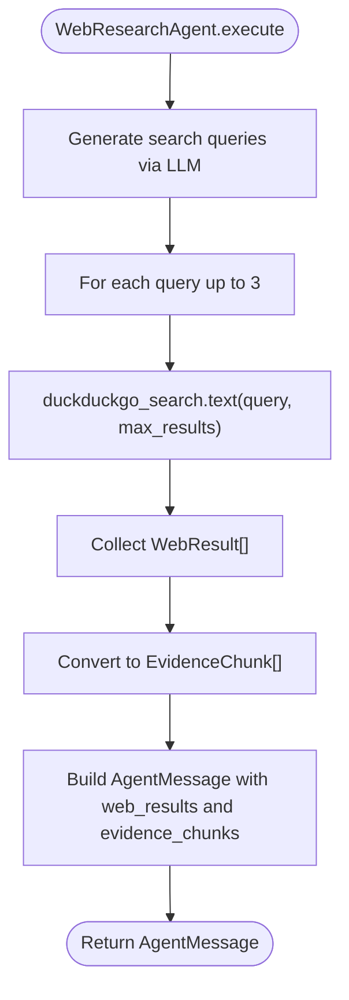

**Diagram sources**
- [src/agents/web_agent.py:34-117](file://src/agents/web_agent.py#L34-L117)

**Section sources**
- [src/agents/web_agent.py:34-117](file://src/agents/web_agent.py#L34-L117)

#### Reasoning Agent
- Builds a structured prompt combining question, vector evidence, graph relationships, and web results
- Calls LLM to synthesize an evidence-grounded answer
- Forwards result to Fact Checker

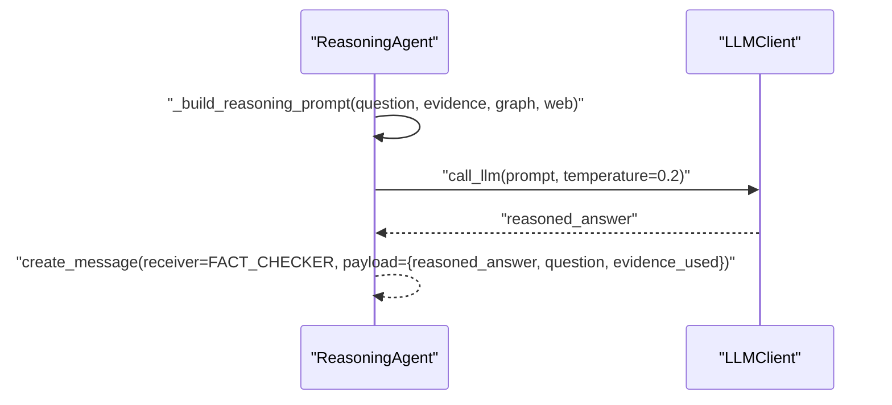

**Diagram sources**
- [src/agents/reasoning_agent.py:38-124](file://src/agents/reasoning_agent.py#L38-L124)
- [src/core/base_agent.py:42-59](file://src/core/base_agent.py#L42-L59)

**Section sources**
- [src/agents/reasoning_agent.py:38-124](file://src/agents/reasoning_agent.py#L38-L124)

#### Fact Checker Agent
- Verifies claims extracted from the reasoned answer against evidence
- Assigns verdicts (supported, partially supported, unsupported, contradicted, no evidence)
- Detects hallucinations and forwards verified claims to Report Generator

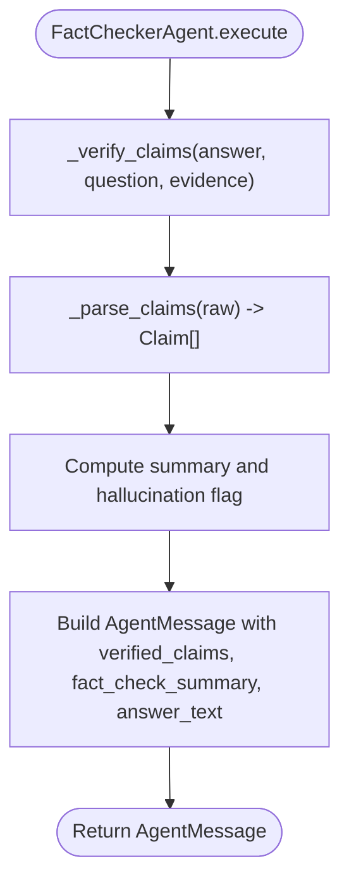

**Diagram sources**
- [src/agents/fact_checker_agent.py:54-163](file://src/agents/fact_checker_agent.py#L54-L163)

**Section sources**
- [src/agents/fact_checker_agent.py:54-163](file://src/agents/fact_checker_agent.py#L54-L163)

#### Report Generator Agent
- Assembles narrative sections using LLM and parses structured outputs
- Builds references from web results and evidence sources
- Constructs ResearchReport with findings, comparisons, limitations, verified claims, and metadata

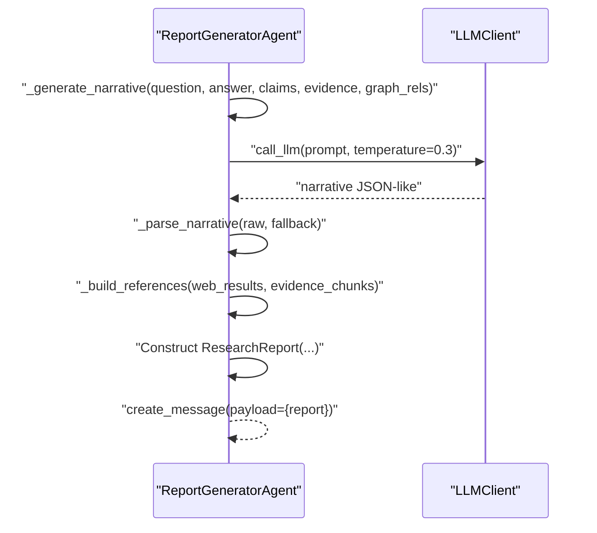

**Diagram sources**
- [src/agents/report_agent.py:48-228](file://src/agents/report_agent.py#L48-L228)
- [src/core/base_agent.py:42-59](file://src/core/base_agent.py#L42-L59)

**Section sources**
- [src/agents/report_agent.py:48-228](file://src/agents/report_agent.py#L48-L228)

## Dependency Analysis
Core dependencies and interactions:
- Agents depend on BaseAgent for execution and messaging
- Agents use LLMClient for generation and token counting
- Schemas enforce consistent payloads across agents
- Registry decouples orchestration from concrete agent implementations
- Settings centralize configuration for LLM providers, storage backends, and paths

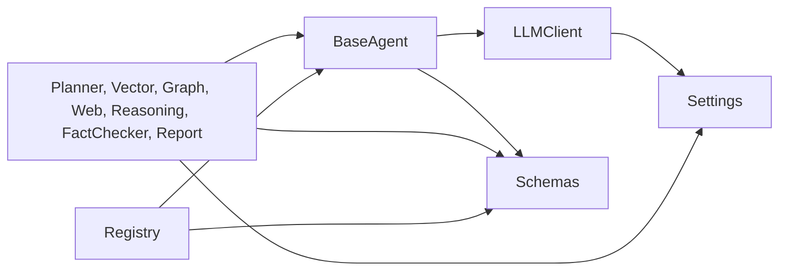

**Diagram sources**
- [src/core/base_agent.py:19-100](file://src/core/base_agent.py#L19-L100)
- [src/core/llm.py:15-103](file://src/core/llm.py#L15-L103)
- [src/core/registry.py:16-50](file://src/core/registry.py#L16-L50)
- [src/core/schemas.py:17-168](file://src/core/schemas.py#L17-L168)
- [src/config.py:21-82](file://src/config.py#L21-L82)

**Section sources**
- [src/core/base_agent.py:19-100](file://src/core/base_agent.py#L19-L100)
- [src/core/llm.py:15-103](file://src/core/llm.py#L15-L103)
- [src/core/registry.py:16-50](file://src/core/registry.py#L16-L50)
- [src/core/schemas.py:17-168](file://src/core/schemas.py#L17-L168)
- [src/config.py:21-82](file://src/config.py#L21-L82)

## Performance Considerations
- Token usage and latency are tracked per agent call via BaseAgent._log_execution and get_execution_stats
- LLMClient uses approximate token counting with tiktoken and fallback heuristics
- Retrieval agents cap results (e.g., max_results) to control cost and latency
- Optional integrations (vector store, knowledge graph, web search) can be disabled gracefully when not configured
- Temperature parameters tuned per agent to balance creativity vs determinism

[No sources needed since this section provides general guidance]

## Troubleshooting Guide
Common issues and resolutions:
- Unsupported LLM provider: Ensure LLM_PROVIDER is set to "gemini" or "openai" in Settings; otherwise LLMClient raises ValueError during initialization.
- Missing API keys: Configure GEMINI_API_KEY or OPENAI_API_KEY in environment; LLMClient reads from Settings.
- No vector store configured: VectorRetrievalAgent logs a warning and returns empty results; configure vector_store before running.
- No knowledge graph configured: GraphRetrievalAgent logs a warning and returns empty results; configure graph_store before running.
- Web search dependency missing: duckduckgo-search optional; if not installed, WebResearchAgent skips web search and logs a warning.
- JSON parsing failures: Agents parse LLM responses with regex fallbacks; ensure prompts encourage valid JSON; inspect logs for warnings about invalid JSON.

**Section sources**
- [src/core/llm.py:25-38](file://src/core/llm.py#L25-L38)
- [src/agents/vector_agent.py:59-75](file://src/agents/vector_agent.py#L59-L75)
- [src/agents/graph_agent.py:67-97](file://src/agents/graph_agent.py#L67-L97)
- [src/agents/web_agent.py:96-116](file://src/agents/web_agent.py#L96-L116)
- [src/agents/planner_agent.py:97-128](file://src/agents/planner_agent.py#L97-L128)
- [src/agents/fact_checker_agent.py:130-163](file://src/agents/fact_checker_agent.py#L130-L163)
- [src/agents/report_agent.py:182-195](file://src/agents/report_agent.py#L182-L195)

## Conclusion
The core architecture of Graph RAG + Multi-Agent Research System emphasizes modularity, type safety, and provider flexibility. BaseAgent standardizes execution and messaging, LLMClient abstracts provider differences, Schemas enforce consistent data contracts, and AgentRegistry enables dynamic orchestration. The layered design separates concerns across planning, retrieval, synthesis, verification, and reporting, while configuration and logging provide robust cross-cutting capabilities. Extensibility points allow adding new agents, providers, and retrieval backends with minimal disruption.

[No sources needed since this section summarizes without analyzing specific files]