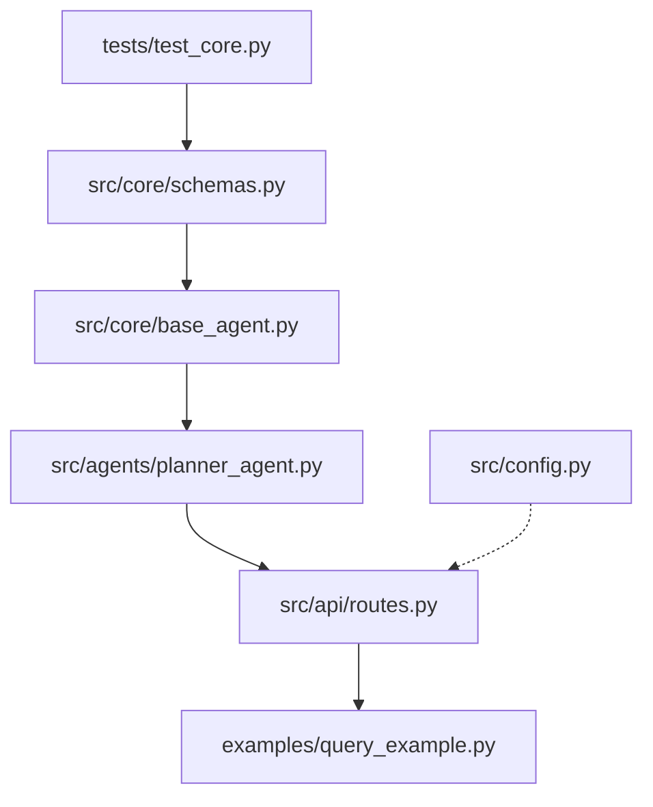
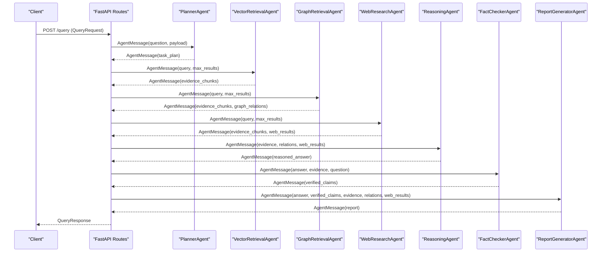
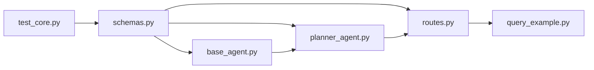

# Data Models and Schemas

<cite>
**Referenced Files in This Document**
- [schemas.py](file://src/core/schemas.py)
- [base_agent.py](file://src/core/base_agent.py)
- [routes.py](file://src/api/routes.py)
- [planner_agent.py](file://src/agents/planner_agent.py)
- [query_example.py](file://examples/query_example.py)
- [test_core.py](file://tests/test_core.py)
- [config.py](file://src/config.py)
</cite>

## Table of Contents
1. Introduction
2. Project Structure
3. Core Components
4. Architecture Overview
5. Detailed Component Analysis
6. Dependency Analysis
7. Performance Considerations
8. Troubleshooting Guide
9. Conclusion
10. Appendices

## Introduction
This document explains the Pydantic-based data model system that ensures consistent, type-safe structures across the application. It focuses on:
- AgentRole enumeration for agent type definitions
- AgentMessage schema for inter-agent communication (sender/receiver/content/payload/timestamp)
- Additional core schemas used throughout the system
- Validation rules, field constraints, and type safety guarantees provided by Pydantic
- Serialization/deserialization capabilities, default value handling, and error reporting
- Examples of creating, validating, and transforming data objects
- Best practices for extending the schema system
- How schemas are used in agent communication, API endpoints, and downstream processing

## Project Structure
The data models live under src/core/schemas.py and are consumed by agents, API routes, and examples. The base agent class provides helpers to create and use messages consistently.

**Diagram sources**
- [schemas.py:1-168](file://src/core/schemas.py#L1-L168)
- [base_agent.py:1-100](file://src/core/base_agent.py#L1-L100)
- [planner_agent.py:1-128](file://src/agents/planner_agent.py#L1-L128)
- [routes.py:1-354](file://src/api/routes.py#L1-L354)
- [query_example.py:1-184](file://examples/query_example.py#L1-L184)
- [test_core.py:1-123](file://tests/test_core.py#L1-L123)
- [config.py:1-82](file://src/config.py#L1-L82)

**Section sources**
- [schemas.py:1-168](file://src/core/schemas.py#L1-L168)
- [base_agent.py:1-100](file://src/core/base_agent.py#L1-L100)
- [routes.py:1-354](file://src/api/routes.py#L1-L354)

## Core Components
This section documents the primary Pydantic models and enums that define the system’s data contracts.

- AgentRole: Enumerates all supported agent roles used across the system.
- AgentMessage: Defines the canonical message exchanged between agents with sender, receiver, content, payload, and timestamp fields.
- ResearchQuery, SubQuestion, TaskPlan: Define research query inputs and planning outputs.
- EvidenceChunk, GraphRelation, WebResult: Represent retrieved evidence from vector, graph, and web sources.
- Claim, ClaimVerdict: Model factual claims and their verification verdicts.
- ResearchReport, ComparisonEntry, EvaluationResult: Model final reports and evaluation metrics.

Key validation and type-safety features:
- Strong typing for all fields (strings, floats, lists, dicts, enums, datetime).
- Default values and default factories ensure safe initialization when fields are omitted.
- Enum-typed fields constrain allowed values at runtime.
- Optional fields allow flexible messaging patterns.
- Pydantic performs automatic validation and serialization/deserialization.

Usage highlights:
- Agents create and consume AgentMessage instances via BaseAgent.create_message and execute(message) contracts.
- API routes accept request bodies validated against FastAPI/Pydantic models and return responses typed as response_model schemas.
- Examples demonstrate constructing AgentMessage payloads and orchestrating multi-agent flows.

**Section sources**
- [schemas.py:15-168](file://src/core/schemas.py#L15-L168)
- [base_agent.py:19-86](file://src/core/base_agent.py#L19-L86)
- [routes.py:78-99](file://src/api/routes.py#L78-L99)
- [planner_agent.py:56-128](file://src/agents/planner_agent.py#L56-L128)
- [query_example.py:25-176](file://examples/query_example.py#L25-L176)
- [test_core.py:12-51](file://tests/test_core.py#L12-L51)

## Architecture Overview
The data model system underpins the multi-agent pipeline:
- API endpoints receive requests, validate them, and convert to internal schemas where appropriate.
- Agents communicate using AgentMessage, carrying structured payloads.
- Planner produces TaskPlan; retrieval agents produce EvidenceChunk and GraphRelation; reasoning and fact-checking operate on these structures; report generator emits ResearchReport.
- Settings are loaded via a Pydantic BaseSettings model for configuration.

**Diagram sources**
- [routes.py:188-338](file://src/api/routes.py#L188-L338)
- [planner_agent.py:65-82](file://src/agents/planner_agent.py#L65-L82)
- [base_agent.py:74-86](file://src/core/base_agent.py#L74-L86)

## Detailed Component Analysis

### AgentRole Enumeration
Purpose:
- Centralizes agent role identifiers used throughout the system to ensure consistency and prevent typos.

Constraints:
- String-backed enum values mapped to known roles (e.g., planner, vector_retrieval, graph_retrieval, web_research, reasoning, fact_checker, report_generator).

Usage:
- Passed into AgentMessage.sender and AgentMessage.receiver.
- Used to index agent registries and route messages.

**Section sources**
- [schemas.py:17-25](file://src/core/schemas.py#L17-L25)
- [routes.py:66-74](file://src/api/routes.py#L66-L74)
- [base_agent.py:22-27](file://src/core/base_agent.py#L22-L27)

### AgentMessage Schema
Fields:
- sender: AgentRole (required)
- receiver: Optional[AgentRole] (optional)
- content: str (required)
- payload: dict[str, Any] (default empty dict)
- timestamp: datetime (default current time)

Validation and behavior:
- Type enforcement ensures sender is a valid AgentRole and content is a string.
- payload defaults to an empty dict if not provided, enabling safe access without None checks.
- timestamp defaults to the current time when not specified.

Creation helper:
- BaseAgent.create_message constructs AgentMessage with the agent’s role as sender and optional receiver/payload.

**Section sources**
- [schemas.py:107-114](file://src/core/schemas.py#L107-L114)
- [base_agent.py:74-86](file://src/core/base_agent.py#L74-L86)

### Planning and Query Models
- ResearchQuery: Captures user input for research queries with defaults for experiment_type, include_web_search, max_results, and metadata.
- SubQuestion: Represents decomposed sub-questions with required_agents, priority, and dependencies.
- TaskPlan: Aggregates original_question, sub_questions, execution_order, and estimated_complexity.

Validation notes:
- Lists and nested models are validated recursively.
- Defaults simplify construction while preserving flexibility.

**Section sources**
- [schemas.py:45-61](file://src/core/schemas.py#L45-L61)
- [schemas.py:116-122](file://src/core/schemas.py#L116-L122)
- [planner_agent.py:97-128](file://src/agents/planner_agent.py#L97-L128)

### Evidence and Retrieval Models
- EvidenceChunk: Represents a single piece of retrieved evidence with chunk_id, content, source, relevance_score, metadata, and retrieval_method.
- GraphRelation: Encodes relationships between entities with source_entity, relationship, target_entity, optional source_document, and weight.
- WebResult: Captures web search results with title, url, snippet, source, and relevance_score.

Validation notes:
- Numeric fields like relevance_score and weight have sensible defaults.
- retrieval_method constrains how evidence was obtained.

**Section sources**
- [schemas.py:65-91](file://src/core/schemas.py#L65-L91)

### Claims and Verification
- Claim: Stores claim_id, text, supporting_evidence list, verdict (ClaimVerdict), confidence, and reasoning.
- ClaimVerdict: Enumerates possible outcomes such as supported, partially_supported, unsupported, contradicted, no_evidence.

Validation notes:
- Verdict constrained to predefined enum values.
- Confidence is a float with default zero.

**Section sources**
- [schemas.py:27-33](file://src/core/schemas.py#L27-L33)
- [schemas.py:95-103](file://src/core/schemas.py#L95-L103)

### Report and Evaluation Models
- ComparisonEntry: Dimension and entries mapping method to value.
- ResearchReport: Final structured report including executive_summary, findings, comparisons, evidence, graph_relationships, limitations, verified_claims, references, metadata, generated_at, and experiment_type.
- EvaluationResult: Metrics for evaluating experiments including precision_at_k, recall_at_k, mrr, factual_correctness, faithfulness, relevance, completeness, hallucination_rate, latency, token usage, and claim counts.

Validation notes:
- Many fields default to empty collections or zero values, making partial construction safe.
- Timestamps default to generation time.

**Section sources**
- [schemas.py:126-168](file://src/core/schemas.py#L126-L168)

### API Request/Response Models
- QueryRequest: Accepts question, experiment_type, include_web_search, max_results.
- QueryResponse: Returns structured report summary and counts.
- IngestResponse and GraphBuildResponse: Return ingestion and graph build summaries.

Validation notes:
- FastAPI uses these Pydantic models to validate incoming requests and serialize responses automatically.

**Section sources**
- [routes.py:78-112](file://src/api/routes.py#L78-L112)

### Configuration Settings
- Settings: Centralized configuration using Pydantic BaseSettings with environment variable support and sensible defaults.

Validation notes:
- Field-level descriptions and defaults aid documentation and usability.
- Cached via lru_cache to avoid repeated instantiation.

**Section sources**
- [config.py:21-82](file://src/config.py#L21-L82)

## Dependency Analysis
Schemas are imported and used by:
- BaseAgent: imports AgentRole and AgentMessage to enforce message contracts and provide creation helpers.
- PlannerAgent: imports AgentRole, AgentMessage, SubQuestion, TaskPlan to parse LLM output into structured plans.
- API routes: import AgentRole, AgentMessage, ExperimentType, ResearchQuery, ResearchReport to orchestrate pipelines and return typed responses.
- Examples: demonstrate end-to-end usage of schemas in multi-agent workflows.
- Tests: assert correct behavior of key schemas and defaults.

**Diagram sources**
- [schemas.py:1-168](file://src/core/schemas.py#L1-L168)
- [base_agent.py:1-100](file://src/core/base_agent.py#L1-L100)
- [planner_agent.py:1-128](file://src/agents/planner_agent.py#L1-L128)
- [routes.py:1-354](file://src/api/routes.py#L1-L354)
- [query_example.py:1-184](file://examples/query_example.py#L1-L184)
- [test_core.py:1-123](file://tests/test_core.py#L1-L123)

**Section sources**
- [base_agent.py:15-16](file://src/core/base_agent.py#L15-L16)
- [planner_agent.py:15-20](file://src/agents/planner_agent.py#L15-L20)
- [routes.py:18-24](file://src/api/routes.py#L18-L24)

## Performance Considerations
- Using Pydantic models incurs minimal overhead compared to the cost of LLM calls and I/O operations.
- Default factories reduce unnecessary allocations for empty collections.
- Avoid passing excessively large payloads in AgentMessage.payload; prefer referencing IDs or summarizing data when possible.
- Reuse settings instance via cached getter to avoid repeated environment parsing.

## Troubleshooting Guide
Common issues and remedies:
- Invalid enum values: Ensure sender/receiver use defined AgentRole values.
- Missing required fields: Provide required fields like question or content; rely on defaults for optional fields.
- JSON parsing failures in planner: If LLM returns malformed JSON, the planner falls back to a single-task plan; inspect logs and adjust prompts.
- API validation errors: FastAPI will reject invalid request bodies; check field types and constraints.

Error reporting:
- Pydantic raises validation errors with detailed field information when models fail to validate.
- API routes can raise HTTPException for explicit error signaling (e.g., placeholder endpoints).

**Section sources**
- [planner_agent.py:97-128](file://src/agents/planner_agent.py#L97-L128)
- [routes.py:350-354](file://src/api/routes.py#L350-L354)

## Conclusion
The Pydantic-based schema system provides a robust foundation for type safety, validation, and serialization across the multi-agent research system. By standardizing data contracts through enums and models, the system ensures consistent communication between agents, reliable API interactions, and clear extension points for new data types. Following best practices outlined here will help maintain clarity and correctness as the system evolves.

## Appendices

### Creating, Validating, and Transforming Data Objects
- Create messages: Use BaseAgent.create_message to construct AgentMessage with sender set to the agent’s role and optional receiver/payload.
- Validate inputs: Construct Pydantic models directly; Pydantic enforces types and constraints.
- Serialize: Convert models to dictionaries for storage or transmission using model_dump() where applicable.
- Deserialize: Instantiate models from dictionaries to benefit from validation and defaults.

Examples of usage patterns:
- Multi-agent flow: See the example script demonstrating step-by-step message passing and payload transformation.
- API integration: See routes where request/response models validate and shape data.

**Section sources**
- [base_agent.py:74-86](file://src/core/base_agent.py#L74-L86)
- [query_example.py:44-143](file://examples/query_example.py#L44-L143)
- [routes.py:188-338](file://src/api/routes.py#L188-L338)

### Extending the Schema System
Best practices:
- Add new enums for domain-specific categories (e.g., new agent roles or verdicts).
- Define new Pydantic models with clear field types, defaults, and constraints.
- Integrate new models into existing workflows by updating relevant agents and API routes.
- Update tests to cover new validation rules and defaults.
- Document new fields and their intended usage to maintain consistency.

**Section sources**
- [schemas.py:15-168](file://src/core/schemas.py#L15-L168)
- [test_core.py:12-51](file://tests/test_core.py#L12-L51)