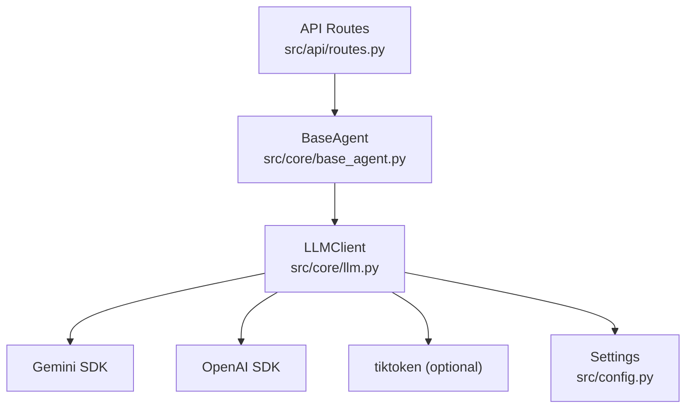
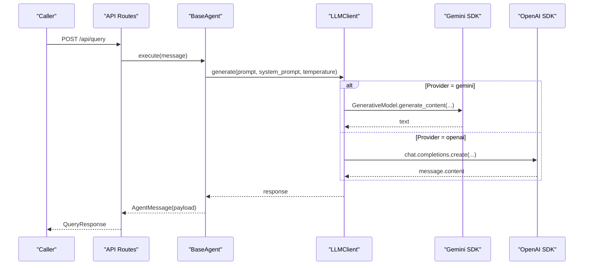
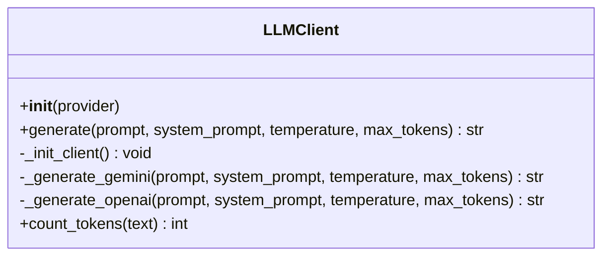
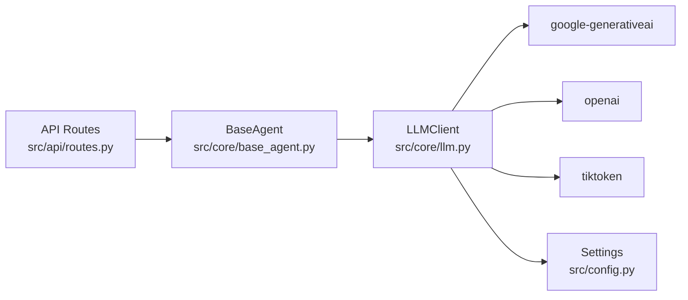

# LLM Integration Layer

<cite>
**Referenced Files in This Document**
- [llm.py](file://src/core/llm.py)
- [config.py](file://src/config.py)
- [base_agent.py](file://src/core/base_agent.py)
- [routes.py](file://src/api/routes.py)
- [schemas.py](file://src/core/schemas.py)
- [planner_agent.py](file://src/agents/planner_agent.py)
- [reasoning_agent.py](file://src/agents/reasoning_agent.py)
- [requirements.txt](file://requirements.txt)
- [README.md](file://README.md)
</cite>

## Table of Contents
1. Introduction
2. Project Structure
3. Core Components
4. Architecture Overview
5. Detailed Component Analysis
6. Dependency Analysis
7. Performance Considerations
8. Troubleshooting Guide
9. Conclusion
10. Appendices

## Introduction
This document explains the LLM abstraction layer that enables provider-agnostic integration with multiple language model services. It focuses on how a unified interface standardizes interactions with Google Gemini and OpenAI GPT models, how dynamic client instantiation is performed via a factory function, and how token counting, temperature control, system prompts, and response processing are handled consistently across providers. It also covers configuration management, environment variables, fallback strategies, error handling patterns, rate limiting considerations, cost optimization techniques, and practical guidance for integrating new providers and troubleshooting connectivity issues.

## Project Structure
The LLM abstraction layer resides under src/core and integrates with agents and API routes:
- src/core/llm.py: Unified LLMClient and get_llm() factory
- src/config.py: Centralized settings loaded from environment variables
- src/core/base_agent.py: BaseAgent that uses LLMClient via call_llm()
- src/api/routes.py: API endpoints that instantiate LLM clients through get_llm()
- src/core/schemas.py: Shared data models used by agents and pipelines
- src/agents/*: Agents that call LLMs via BaseAgent.call_llm()
- requirements.txt: Dependencies including LLM SDKs and tiktoken
- README.md: High-level project overview and technology stack

**Diagram sources**
- [routes.py:188-338](file://src/api/routes.py#L188-L338)
- [base_agent.py:19-59](file://src/core/base_agent.py#L19-L59)
- [llm.py:15-102](file://src/core/llm.py#L15-L102)
- [config.py:21-37](file://src/config.py#L21-L37)

**Section sources**
- [llm.py:1-102](file://src/core/llm.py#L1-L102)
- [config.py:1-82](file://src/config.py#L1-L82)
- [base_agent.py:1-100](file://src/core/base_agent.py#L1-L100)
- [routes.py:1-354](file://src/api/routes.py#L1-L354)
- [schemas.py:1-168](file://src/core/schemas.py#L1-L168)
- [requirements.txt:1-60](file://requirements.txt#L1-L60)
- [README.md:1-169](file://README.md#L1-L169)

## Core Components
- LLMClient: Provides a unified generate() method that dispatches to provider-specific implementations for Gemini and OpenAI. It handles initialization, temperature, max tokens, and system prompt mapping per provider.
- get_llm(): Factory function that returns an LLMClient instance configured by settings or an explicit provider override.
- BaseAgent.call_llm(): Encapsulates LLM calls with system prompts, optional temperature overrides, timing, and token accounting.
- Settings: Centralized configuration loaded from environment variables, including LLM provider selection, model names, API keys, and default temperature.

Key responsibilities:
- Provider abstraction: Single interface hides provider differences
- Configuration-driven behavior: Provider, model, and parameters come from Settings
- Token accounting: Approximate token counting for usage tracking and cost estimation
- Consistent prompt handling: System prompts mapped appropriately per provider

**Section sources**
- [llm.py:15-102](file://src/core/llm.py#L15-L102)
- [base_agent.py:19-59](file://src/core/base_agent.py#L19-L59)
- [config.py:21-37](file://src/config.py#L21-L37)

## Architecture Overview
The LLM integration layer sits between application components (agents, API routes) and external LLM providers. The flow ensures consistent parameterization, logging, and token accounting while isolating provider-specific details.

**Diagram sources**
- [routes.py:188-338](file://src/api/routes.py#L188-L338)
- [base_agent.py:42-59](file://src/core/base_agent.py#L42-L59)
- [llm.py:40-87](file://src/core/llm.py#L40-L87)

## Detailed Component Analysis

### LLMClient Design and Provider Abstraction
- Initialization:
  - Reads provider and model names from Settings
  - Configures provider SDKs lazily to avoid unnecessary imports
  - Logs provider and model name at startup
- Generation:
  - Normalizes temperature using Settings if not provided
  - Dispatches to provider-specific methods
- Provider-specific generation:
  - Gemini: Uses GenerativeModel with system_instruction and generation_config
  - OpenAI: Builds messages list with optional system role and calls chat completions
- Token counting:
  - Attempts to use tiktoken for approximate counts; falls back to a rough estimate

**Diagram sources**
- [llm.py:15-102](file://src/core/llm.py#L15-L102)

**Section sources**
- [llm.py:15-102](file://src/core/llm.py#L15-L102)

### Factory Pattern: get_llm()
- Purpose: Provide a single entry point to obtain an LLMClient configured by Settings or overridden by caller
- Behavior: Instantiates LLMClient with optional provider argument; all provider selection logic remains centralized

Usage examples in codebase:
- API routes import and call get_llm() when running baseline experiments
- Agents receive LLMClient via BaseAgent constructor or default to get_llm()

**Section sources**
- [llm.py:100-102](file://src/core/llm.py#L100-L102)
- [routes.py:204-208](file://src/api/routes.py#L204-L208)
- [base_agent.py:22-25](file://src/core/base_agent.py#L22-L25)

### BaseAgent Integration and Prompt Handling
- BaseAgent encapsulates LLM calls:
  - Merges agent-specific system prompt with optional overrides
  - Measures latency and logs execution metadata
  - Counts tokens for both input and output to support cost analysis
- Agents define their own system prompts and build prompts tailored to tasks

Examples:
- PlannerAgent defines a structured JSON output prompt and parses responses with fallback
- ReasoningAgent composes evidence-rich prompts and requests grounded answers

**Section sources**
- [base_agent.py:19-59](file://src/core/base_agent.py#L19-L59)
- [planner_agent.py:23-53](file://src/agents/planner_agent.py#L23-L53)
- [reasoning_agent.py:16-35](file://src/agents/reasoning_agent.py#L16-L35)

### Configuration and Environment Variables
- Settings centralizes all configuration:
  - LLM_PROVIDER selects the active provider
  - GEMINI_API_KEY, OPENAI_API_KEY hold secrets
  - GEMINI_MODEL, OPENAI_MODEL select models
  - TEMPERATURE sets default creativity
- .env loading:
  - Loads environment variables from project root .env file
  - Uses pydantic-settings for type-safe configuration

Environment variable management best practices:
- Store secrets in .env and ensure it is ignored by version control
- Use separate environments for development and production
- Validate required keys at startup to fail fast

**Section sources**
- [config.py:21-37](file://src/config.py#L21-L37)
- [config.py:16-18](file://src/config.py#L16-L18)
- [config.py:72-75](file://src/config.py#L72-L75)

### Token Counting Mechanisms
- Primary approach:
  - Uses tiktoken encoding for approximate token counts
- Fallback strategy:
  - If tiktoken fails, estimates tokens using a heuristic based on word count
- Usage:
  - BaseAgent records prompt and response token counts for each LLM call
  - Enables cost estimation and performance monitoring

Considerations:
- Token counts are approximations; actual provider billing may differ
- For precise accounting, integrate provider-specific token metrics where available

**Section sources**
- [llm.py:89-97](file://src/core/llm.py#L89-L97)
- [base_agent.py:50-58](file://src/core/base_agent.py#L50-L58)
- [base_agent.py:61-72](file://src/core/base_agent.py#L61-L72)

### Temperature Control and System Prompts
- Temperature:
  - Defaults to Settings.TEMPERATURE unless explicitly overridden
  - Passed to provider-specific generation calls
- System prompts:
  - Gemini: Provided via system_instruction parameter
  - OpenAI: Added as a message with role "system"
- Agent-specific prompts:
  - Each agent defines its own system prompt to guide behavior

**Section sources**
- [llm.py:40-54](file://src/core/llm.py#L40-L54)
- [llm.py:56-71](file://src/core/llm.py#L56-L71)
- [llm.py:73-87](file://src/core/llm.py#L73-L87)
- [planner_agent.py:23-53](file://src/agents/planner_agent.py#L23-L53)
- [reasoning_agent.py:16-35](file://src/agents/reasoning_agent.py#L16-L35)

### Response Processing Across Providers
- Gemini:
  - Returns response.text directly
- OpenAI:
  - Extracts content from choices[0].message.content
- Error propagation:
  - Provider SDK errors bubble up; callers should handle exceptions as needed

**Section sources**
- [llm.py:56-71](file://src/core/llm.py#L56-L71)
- [llm.py:73-87](file://src/core/llm.py#L73-L87)

### Unified API Surface and Usage Patterns
- Direct usage:
  - Call get_llm() to obtain LLMClient and invoke generate()
- Agent usage:
  - Agents call BaseAgent.call_llm(), which internally uses LLMClient
- API routes:
  - Example baseline experiment uses get_llm() to answer questions directly

**Section sources**
- [llm.py:100-102](file://src/core/llm.py#L100-L102)
- [base_agent.py:42-59](file://src/core/base_agent.py#L42-L59)
- [routes.py:204-208](file://src/api/routes.py#L204-L208)

## Dependency Analysis
The LLM integration layer depends on:
- External SDKs: google-generativeai, openai
- Tokenization: tiktoken (optional)
- Configuration: pydantic-settings and python-dotenv
- Logging: loguru

**Diagram sources**
- [llm.py:15-102](file://src/core/llm.py#L15-L102)
- [base_agent.py:19-59](file://src/core/base_agent.py#L19-L59)
- [routes.py:188-338](file://src/api/routes.py#L188-L338)
- [requirements.txt:8-16](file://requirements.txt#L8-L16)

**Section sources**
- [requirements.txt:8-16](file://requirements.txt#L8-L16)
- [llm.py:15-102](file://src/core/llm.py#L15-L102)
- [base_agent.py:19-59](file://src/core/base_agent.py#L19-L59)
- [routes.py:188-338](file://src/api/routes.py#L188-L338)

## Performance Considerations
- Latency measurement:
  - BaseAgent measures time per LLM call and logs elapsed seconds
- Token accounting:
  - Tracks prompt and response tokens to estimate costs and optimize prompts
- Model selection:
  - Choose smaller or faster models for high-throughput scenarios
- Prompt engineering:
  - Keep prompts concise; leverage system prompts to reduce repetition
- Retrieval efficiency:
  - Limit evidence chunks to reduce context size and token usage
- Concurrency:
  - Consider async calls to providers where supported to improve throughput

[No sources needed since this section provides general guidance]

## Troubleshooting Guide
Common issues and resolutions:
- Missing or invalid API keys:
  - Ensure GEMINI_API_KEY or OPENAI_API_KEY are set in environment
  - Verify Settings loads .env correctly
- Unsupported provider:
  - Check LLM_PROVIDER value; only "gemini" and "openai" are supported
- Provider SDK initialization failures:
  - Confirm required dependencies are installed (google-generativeai, openai)
  - Validate network access and quotas
- Token counting failures:
  - tiktoken import or encoding errors fall back to heuristic; verify internet access if needed
- Rate limiting:
  - Implement retries with exponential backoff around LLM calls
  - Monitor provider dashboards for quota usage
- Connectivity timeouts:
  - Increase timeouts and add retry logic in higher layers if necessary

Operational tips:
- Log provider and model at initialization to confirm correct configuration
- Capture and log exceptions from provider SDKs for diagnostics
- Use evaluation benchmarks to compare provider performance and cost

**Section sources**
- [llm.py:25-38](file://src/core/llm.py#L25-L38)
- [config.py:16-18](file://src/config.py#L16-L18)
- [requirements.txt:8-16](file://requirements.txt#L8-L16)

## Conclusion
The LLM abstraction layer provides a clean, provider-agnostic interface that standardizes interactions with Gemini and OpenAI. Through centralized configuration, consistent prompt handling, and token accounting, it simplifies integration and supports cost optimization. Agents and API routes benefit from a unified surface, enabling easy experimentation and future expansion to additional providers.

[No sources needed since this section summarizes without analyzing specific files]

## Appendices

### Configuration Examples
- Environment variables:
  - LLM_PROVIDER: "gemini" or "openai"
  - GEMINI_API_KEY, OPENAI_API_KEY: Provider API keys
  - GEMINI_MODEL, OPENAI_MODEL: Model identifiers
  - TEMPERATURE: Default creativity level
- Settings defaults:
  - Provider defaults to "gemini"
  - Models default to gemini-1.5-pro and gpt-4o
  - Temperature defaults to 0.2

**Section sources**
- [config.py:21-37](file://src/config.py#L21-L37)

### Integrating a New Provider
Steps:
- Add provider branch in _init_client() and generate()
- Map system prompts and generation parameters to provider APIs
- Update Settings with new provider fields if needed
- Test with get_llm() and agent calls
- Add dependency to requirements.txt

**Section sources**
- [llm.py:25-54](file://src/core/llm.py#L25-L54)
- [requirements.txt:8-16](file://requirements.txt#L8-L16)

### Practical Usage Examples
- Baseline query via API:
  - Endpoint POST /api/query triggers baseline mode that calls LLM directly
- Agent-based queries:
  - Agents call BaseAgent.call_llm() with system prompts and optional temperature overrides

**Section sources**
- [routes.py:204-208](file://src/api/routes.py#L204-L208)
- [base_agent.py:42-59](file://src/core/base_agent.py#L42-L59)

### Error Handling Patterns
- Provider selection:
  - Raises ValueError for unsupported provider
  - Raises RuntimeError if no valid provider configured during generation
- Token counting:
  - Falls back to heuristic if tiktoken fails
- Agent parsing:
  - PlannerAgent includes JSON parsing fallback to ensure robustness

**Section sources**
- [llm.py:25-38](file://src/core/llm.py#L25-L38)
- [llm.py:40-54](file://src/core/llm.py#L40-L54)
- [llm.py:89-97](file://src/core/llm.py#L89-L97)
- [planner_agent.py:97-127](file://src/agents/planner_agent.py#L97-L127)

### Cost Optimization Techniques
- Reduce context size:
  - Limit evidence chunks and web results included in prompts
- Lower temperature for deterministic outputs when appropriate
- Choose cost-effective models for non-critical tasks
- Monitor token usage via BaseAgent execution logs

[No sources needed since this section provides general guidance]