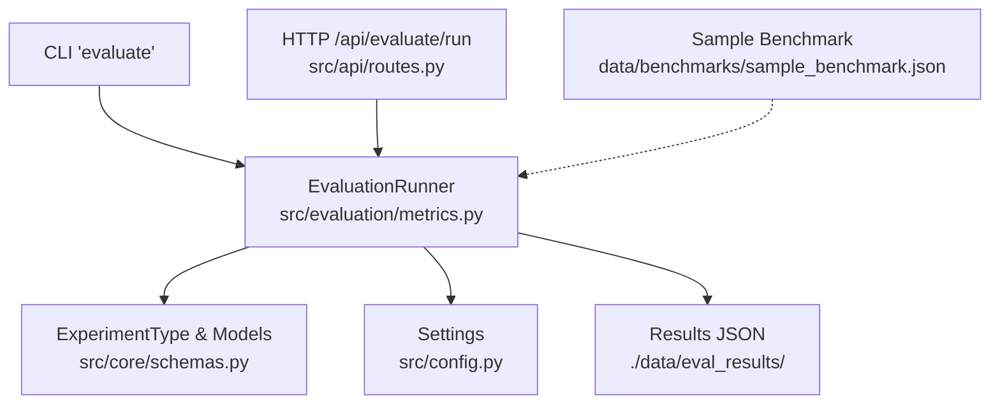
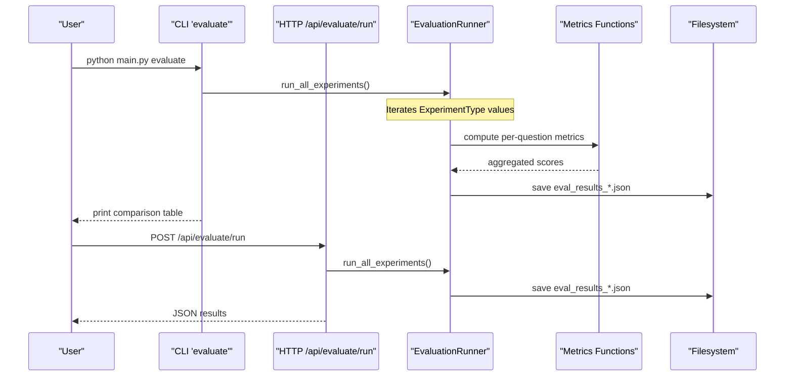
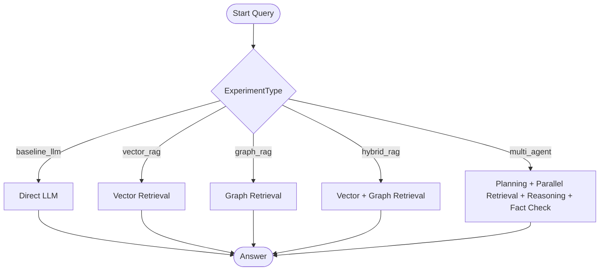
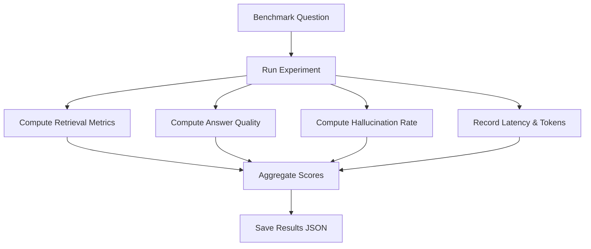
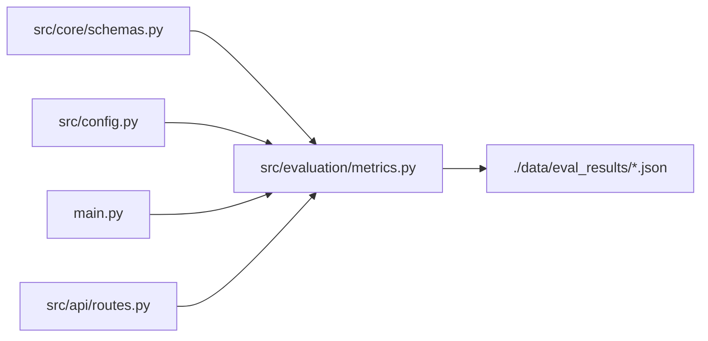

# Benchmark Suite and Datasets

<cite>
**Referenced Files in This Document**
- [main.py](file://main.py)
- [README.md](file://README.md)
- [src/config.py](file://src/config.py)
- [src/core/schemas.py](file://src/core/schemas.py)
- [src/evaluation/metrics.py](file://src/evaluation/metrics.py)
- [src/api/routes.py](file://src/api/routes.py)
- [data/benchmarks/sample_benchmark.json](file://data/benchmarks/sample_benchmark.json)
</cite>

## Table of Contents
1. Introduction
2. Project Structure
3. Core Components
4. Architecture Overview
5. Detailed Component Analysis
6. Dependency Analysis
7. Performance Considerations
8. Troubleshooting Guide
9. Conclusion
10. Appendices

## Introduction
This document explains the benchmark suite and datasets used to evaluate the Graph RAG + Multi-Agent Research System. It covers:
- Built-in benchmark questions spanning multi-hop reasoning, comparison tasks, and analysis queries, including their reference answers and expected behaviors.
- The experiment types defined by the ExperimentType enum and how they represent different architectural configurations.
- Dataset structure, question categorization, and evaluation methodology for each experiment type.
- Guidance on creating custom benchmark questions, adding new test cases, and extending the benchmark suite for domain-specific evaluations.
- Dataset versioning, reproducibility requirements, and sharing benchmarks with the research community.

## Project Structure
The benchmark system is centered around a small set of files that define experiments, metrics, and dataset schemas, plus a sample dataset file:
- Evaluation runner and metrics live in src/evaluation/metrics.py.
- Data models and enums (including ExperimentType) are in src/core/schemas.py.
- CLI entry point exposes an evaluate command in main.py.
- Configuration defines where benchmarks and results are stored in src/config.py.
- A sample benchmark dataset is provided at data/benchmarks/sample_benchmark.json.
- API routes expose an endpoint to run evaluations via HTTP in src/api/routes.py.

**Diagram sources**
- [main.py:59-68](file://main.py#L59-L68)
- [src/evaluation/metrics.py:139-177](file://src/evaluation/metrics.py#L139-L177)
- [src/core/schemas.py:35-41](file://src/core/schemas.py#L35-L41)
- [src/config.py:64-66](file://src/config.py#L64-L66)
- [src/api/routes.py:341-347](file://src/api/routes.py#L341-L347)
- [data/benchmarks/sample_benchmark.json:1-43](file://data/benchmarks/sample_benchmark.json#L1-L43)

**Section sources**
- [main.py:59-68](file://main.py#L59-L68)
- [src/config.py:64-66](file://src/config.py#L64-L66)
- [src/api/routes.py:341-347](file://src/api/routes.py#L341-L347)
- [data/benchmarks/sample_benchmark.json:1-43](file://data/benchmarks/sample_benchmark.json#L1-L43)

## Core Components
- ExperimentType enum defines five experimental configurations: baseline LLM, vector RAG, graph RAG, hybrid RAG, and full multi-agent pipeline. These map directly to distinct retrieval and reasoning paths.
- EvaluationRunner orchestrates running all experiments across built-in benchmark questions and persists results to disk.
- Metrics module provides retrieval metrics (Precision@K, Recall@K, MRR), answer quality metrics (factual correctness, faithfulness), hallucination rate computation, and result formatting.
- Sample benchmark dataset demonstrates the expected schema for questions, reference answers, and metadata such as entities and relationships.

Key responsibilities:
- Define experiment configurations and data models (schemas).
- Provide a runnable benchmark harness (metrics).
- Store and load datasets and results (config).
- Expose programmatic and HTTP interfaces to execute evaluations (main.py, routes.py).

**Section sources**
- [src/core/schemas.py:35-41](file://src/core/schemas.py#L35-L41)
- [src/evaluation/metrics.py:139-177](file://src/evaluation/metrics.py#L139-L177)
- [src/config.py:64-66](file://src/config.py#L64-L66)
- [data/benchmarks/sample_benchmark.json:1-43](file://data/benchmarks/sample_benchmark.json#L1-L43)

## Architecture Overview
The evaluation architecture runs each experiment type over the same set of benchmark questions and compares outcomes using standardized metrics.

**Diagram sources**
- [main.py:59-68](file://main.py#L59-L68)
- [src/evaluation/metrics.py:165-177](file://src/evaluation/metrics.py#L165-L177)
- [src/api/routes.py:341-347](file://src/api/routes.py#L341-L347)

## Detailed Component Analysis

### Experiment Types and Architectural Mapping
The ExperimentType enum enumerates five configurations:
- Baseline LLM: Direct LLM response without retrieval.
- Vector RAG: Retrieval from vector store followed by synthesis.
- Graph RAG: Retrieval from knowledge graph followed by synthesis.
- Hybrid RAG: Combined vector and graph retrieval before synthesis.
- Multi-Agent: Full pipeline with planning, parallel retrieval (vector/graph/web), reasoning, fact-checking, and report generation.

These types drive branching logic in the query route to select the appropriate pipeline.

**Diagram sources**
- [src/core/schemas.py:35-41](file://src/core/schemas.py#L35-L41)
- [src/api/routes.py:202-302](file://src/api/routes.py#L202-L302)

**Section sources**
- [src/core/schemas.py:35-41](file://src/core/schemas.py#L35-L41)
- [src/api/routes.py:202-302](file://src/api/routes.py#L202-L302)

### Built-in Benchmark Questions and Categories
The evaluation runner includes a small set of built-in benchmark questions categorized into:
- Multi-hop reasoning: Requires chaining multiple facts or concepts to derive an answer.
- Comparison: Asks to compare two methods, models, or approaches.
- Analysis: Requests critical analysis of limitations or trade-offs.

Each question includes a reference answer used for scoring. The sample dataset also shows extended fields like entities and relationships to support richer evaluation and traceability.

Expected behaviors:
- Multi-hop questions should be answered by synthesizing evidence across multiple hops; graph-based methods may perform better when relationships are explicit.
- Comparison questions require balanced treatment of alternatives and clear distinctions.
- Analysis questions demand nuanced discussion of limitations and context.

**Section sources**
- [src/evaluation/metrics.py:142-158](file://src/evaluation/metrics.py#L142-L158)
- [data/benchmarks/sample_benchmark.json:1-43](file://data/benchmarks/sample_benchmark.json#L1-L43)

### Evaluation Methodology and Metrics
The evaluation framework computes:
- Retrieval metrics: Precision@K, Recall@K, Mean Reciprocal Rank (MRR), and optional context relevance scored by an LLM.
- Answer quality: Factual correctness and faithfulness relative to evidence and reference answers.
- Hallucination rate: Derived from verified claims’ verdicts.
- System performance: Latency and token usage.

The runner aggregates these per experiment type and saves results to a timestamped JSON file under the configured evaluation results directory.

**Diagram sources**
- [src/evaluation/metrics.py:21-44](file://src/evaluation/metrics.py#L21-L44)
- [src/evaluation/metrics.py:70-134](file://src/evaluation/metrics.py#L70-L134)
- [src/evaluation/metrics.py:165-224](file://src/evaluation/metrics.py#L165-L224)

**Section sources**
- [src/evaluation/metrics.py:21-44](file://src/evaluation/metrics.py#L21-L44)
- [src/evaluation/metrics.py:70-134](file://src/evaluation/metrics.py#L70-L134)
- [src/evaluation/metrics.py:165-224](file://src/evaluation/metrics.py#L165-L224)

### Dataset Structure and Schema
The sample benchmark dataset demonstrates the expected structure:
- id: Unique identifier for the question.
- question: The prompt to evaluate.
- reference_answer: Ground truth or expected behavior description.
- type: Categorization (e.g., multi_hop, comparison, analysis).
- entities: Key concepts involved.
- relationships: Expected conceptual links between entities.

This structure supports both automated scoring and human review.

**Section sources**
- [data/benchmarks/sample_benchmark.json:1-43](file://data/benchmarks/sample_benchmark.json#L1-L43)

### Creating Custom Benchmark Questions and Adding Test Cases
To extend the benchmark suite:
- Add new entries to the built-in list in the evaluation runner or load external datasets from the configured benchmark path.
- Ensure each question has a clear type and reference answer aligned with the intended evaluation focus.
- Optionally include entities and relationships to aid structured evaluation and reporting.
- Re-run the evaluation to generate updated results.

Guidance:
- Keep questions focused and unambiguous.
- Provide detailed reference answers to enable robust scoring.
- Include diverse categories (multi-hop, comparison, analysis) to stress-test different capabilities.

**Section sources**
- [src/evaluation/metrics.py:142-158](file://src/evaluation/metrics.py#L142-L158)
- [src/config.py:64-66](file://src/config.py#L64-L66)
- [data/benchmarks/sample_benchmark.json:1-43](file://data/benchmarks/sample_benchmark.json#L1-L43)

### Extending for Domain-Specific Evaluations
- Curate domain-specific questions with precise reference answers and annotated entities/relationships.
- Align question types with domain needs (e.g., clinical comparisons, policy analyses).
- Validate that retrieval backends (vector/graph/web) can surface relevant evidence for domain terms.
- Use the same evaluation pipeline to ensure comparability across domains.

[No sources needed since this section provides general guidance]

## Dependency Analysis
The evaluation system depends on:
- ExperimentType and data models from schemas.
- Settings for paths to benchmarks and results.
- CLI and API entry points to trigger execution.
- Filesystem for saving results.

**Diagram sources**
- [src/core/schemas.py:35-41](file://src/core/schemas.py#L35-L41)
- [src/config.py:64-66](file://src/config.py#L64-L66)
- [main.py:59-68](file://main.py#L59-L68)
- [src/api/routes.py:341-347](file://src/api/routes.py#L341-L347)
- [src/evaluation/metrics.py:165-224](file://src/evaluation/metrics.py#L165-L224)

**Section sources**
- [src/core/schemas.py:35-41](file://src/core/schemas.py#L35-L41)
- [src/config.py:64-66](file://src/config.py#L64-L66)
- [main.py:59-68](file://main.py#L59-L68)
- [src/api/routes.py:341-347](file://src/api/routes.py#L341-L347)
- [src/evaluation/metrics.py:165-224](file://src/evaluation/metrics.py#L165-L224)

## Performance Considerations
- Latency and token usage are recorded per experiment and aggregated for comparison.
- Retrieval metrics (Precision@K, Recall@K, MRR) help assess efficiency and effectiveness.
- Context relevance scoring can guide improvements in retrieval strategies.
- For large benchmark sets, consider batching and caching to reduce overhead.

[No sources needed since this section provides general guidance]

## Troubleshooting Guide
Common issues and resolutions:
- Missing environment configuration: Ensure .env contains required keys and paths for LLM providers, vector stores, and graphs.
- No results generated: Verify EVAL_RESULTS_PATH exists and is writable; check logs for errors during evaluation.
- Inconsistent metrics: Confirm that retrieval pipelines return proper evidence chunks and that claim verification produces valid verdicts.
- API evaluation failures: Confirm the server is running and the /api/evaluate/run endpoint is reachable.

**Section sources**
- [src/config.py:21-82](file://src/config.py#L21-L82)
- [src/evaluation/metrics.py:217-224](file://src/evaluation/metrics.py#L217-L224)
- [src/api/routes.py:341-347](file://src/api/routes.py#L341-L347)

## Conclusion
The benchmark suite provides a structured way to evaluate different RAG architectures and multi-agent configurations against consistent datasets and metrics. By leveraging the ExperimentType enum, built-in questions, and standardized evaluation functions, teams can compare performance across baselines and advanced pipelines. Extending the suite with domain-specific questions enables targeted assessments while maintaining reproducibility through consistent configuration and result storage.

[No sources needed since this section summarizes without analyzing specific files]

## Appendices

### How to Run Benchmarks
- CLI: Execute the evaluate command to run all experiments and print a comparison table.
- HTTP: Call the /api/evaluate/run endpoint to obtain JSON results.

**Section sources**
- [main.py:59-68](file://main.py#L59-L68)
- [src/api/routes.py:341-347](file://src/api/routes.py#L341-L347)

### Dataset Versioning and Reproducibility
- Store benchmark datasets under the configured benchmark path and pin versions in documentation or a manifest file.
- Record environment settings (LLM provider/model, embedding model, vector DB type) alongside results to ensure reproducibility.
- Timestamped result files are saved automatically; archive them with dataset versions for sharing.

**Section sources**
- [src/config.py:64-66](file://src/config.py#L64-L66)
- [src/evaluation/metrics.py:217-224](file://src/evaluation/metrics.py#L217-L224)

### Sharing Benchmarks with the Research Community
- Package datasets with clear schemas and example entries.
- Include instructions for running evaluations and interpreting metrics.
- Provide version tags and environment specifications to facilitate replication.

[No sources needed since this section provides general guidance]