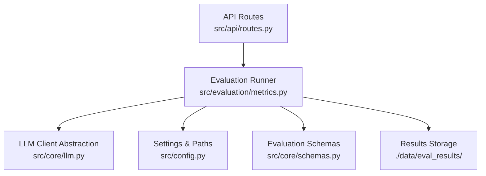
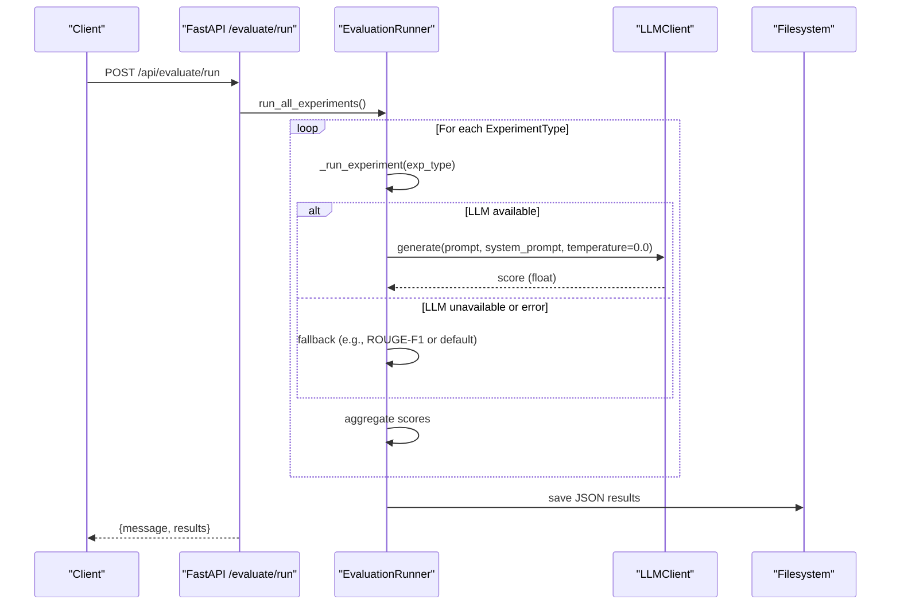
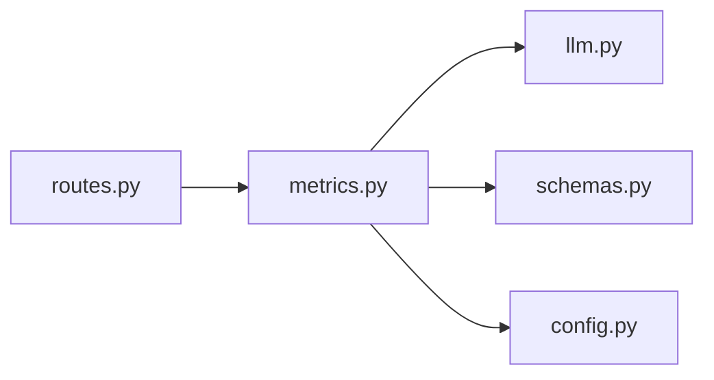

# Evaluation Metrics Framework

<cite>
**Referenced Files in This Document**
- [metrics.py](file://src/evaluation/metrics.py)
- [llm.py](file://src/core/llm.py)
- [schemas.py](file://src/core/schemas.py)
- [config.py](file://src/config.py)
- [routes.py](file://src/api/routes.py)
- [README.md](file://README.md)
</cite>

## Table of Contents
1. [Introduction](#introduction)
2. [Project Structure](#project-structure)
3. [Core Components](#core-components)
4. [Architecture Overview](#architecture-overview)
5. [Detailed Component Analysis](#detailed-component-analysis)
6. [Dependency Analysis](#dependency-analysis)
7. [Performance Considerations](#performance-considerations)
8. [Troubleshooting Guide](#troubleshooting-guide)
9. [Conclusion](#conclusion)
10. [Appendices](#appendices)

## Introduction
This document explains the evaluation metrics framework that measures system performance across multiple dimensions: retrieval quality, answer quality, hallucination detection, and system efficiency. It covers retrieval metrics (Precision@K, Recall@K, Mean Reciprocal Rank, Context Relevance), answer quality metrics (Factual Correctness, Faithfulness to evidence, Hallucination Rate), LLM-based evaluation prompts, fallback mechanisms when LLM services are unavailable, and a ROUGE-F1 approximation for text similarity scoring. It also includes parameter tuning guidance and interpretation notes for each metric.

## Project Structure
The evaluation framework is implemented under src/evaluation with supporting abstractions in src/core and configuration in src/config. The API exposes an endpoint to run benchmarks and persist results.

**Diagram sources**
- [routes.py:341-347](file://src/api/routes.py#L341-L347)
- [metrics.py:139-223](file://src/evaluation/metrics.py#L139-L223)
- [llm.py:15-103](file://src/core/llm.py#L15-L103)
- [config.py:21-82](file://src/config.py#L21-L82)
- [schemas.py:152-168](file://src/core/schemas.py#L152-L168)

**Section sources**
- [README.md:132-141](file://README.md#L132-L141)
- [routes.py:341-347](file://src/api/routes.py#L341-L347)
- [metrics.py:139-223](file://src/evaluation/metrics.py#L139-L223)

## Core Components
- Retrieval metrics: Precision@K, Recall@K, MRR, Context Relevance
- Answer quality metrics: Factual Correctness, Faithfulness, Hallucination Rate
- LLM-based evaluators with robust fallbacks
- Benchmark runner that aggregates metrics per experiment type and persists results

Key implementation locations:
- Retrieval and answer quality functions: [metrics.py:21-135](file://src/evaluation/metrics.py#L21-L135)
- Benchmark runner and result schema: [metrics.py:139-223](file://src/evaluation/metrics.py#L139-L223), [schemas.py:152-168](file://src/core/schemas.py#L152-L168)
- LLM abstraction and providers: [llm.py:15-103](file://src/core/llm.py#L15-L103)
- Configuration for evaluation paths and defaults: [config.py:64-67](file://src/config.py#L64-L67)

**Section sources**
- [metrics.py:21-135](file://src/evaluation/metrics.py#L21-L135)
- [metrics.py:139-223](file://src/evaluation/metrics.py#L139-L223)
- [schemas.py:152-168](file://src/core/schemas.py#L152-L168)
- [llm.py:15-103](file://src/core/llm.py#L15-L103)
- [config.py:64-67](file://src/config.py#L64-L67)

## Architecture Overview
The evaluation pipeline integrates retrieval and answer quality metrics into a unified benchmarking workflow. The API triggers the runner, which iterates over experiment types and benchmark questions, computes metrics, and saves results.

**Diagram sources**
- [routes.py:341-347](file://src/api/routes.py#L341-L347)
- [metrics.py:165-223](file://src/evaluation/metrics.py#L165-L223)
- [llm.py:40-87](file://src/core/llm.py#L40-L87)

## Detailed Component Analysis

### Retrieval Metrics
- Precision@K: Fraction of top-K retrieved documents that are relevant.
  - Formula: |{relevant ∩ top_K}| / K
  - Implementation: [metrics.py:21-27](file://src/evaluation/metrics.py#L21-L27)
  - Parameters: k (default 5)
  - Interpretation: Higher is better; sensitive to ranking order within top-K.

- Recall@K: Fraction of all relevant documents found in top-K.
  - Formula: |{relevant ∩ top_K}| / |relevant|
  - Implementation: [metrics.py:30-36](file://src/evaluation/metrics.py#L30-L36)
  - Parameters: k (default 5)
  - Interpretation: Higher is better; penalizes missing relevant items.

- Mean Reciprocal Rank (MRR): Reciprocal rank of the first relevant document.
  - Formula: 1 / rank_of_first_relevant
  - Implementation: [metrics.py:39-44](file://src/evaluation/metrics.py#L39-L44)
  - Interpretation: Emphasizes early relevance; higher is better.

- Context Relevance: LLM-based rating of how relevant retrieved context is to the question.
  - Prompt structure: Question + truncated context → numeric score 0.0–1.0
  - Implementation: [metrics.py:47-65](file://src/evaluation/metrics.py#L47-L65)
  - Fallback: Returns 0.5 on errors or if no LLM client provided.
  - Parameters: chunks (list of dicts with content), llm_client
  - Interpretation: Closer to 1.0 indicates highly relevant context.

Example usage pattern:
- Provide retrieved doc IDs ordered by relevance and a set of ground-truth relevant IDs to compute P@K, R@K, MRR.
- Provide question and retrieved chunks with an LLM client to compute Context Relevance.

**Section sources**
- [metrics.py:21-65](file://src/evaluation/metrics.py#L21-L65)

### Answer Quality Metrics
- Factual Correctness: Compares generated answer to reference using LLM or falls back to ROUGE-F1.
  - LLM prompt: Reference + Generated answer → numeric score 0.0–1.0
  - Fallback: ROUGE-L F1 approximation via _rouge_f1
  - Implementation: [metrics.py:70-84](file://src/evaluation/metrics.py#L70-L84), [metrics.py:105-123](file://src/evaluation/metrics.py#L105-L123)
  - Interpretation: 1.0 means fully correct relative to reference; 0.0 means incorrect.

- Faithfulness to Evidence: Checks whether the answer is grounded in provided evidence.
  - Prompt: Evidence snippets + answer → numeric score 0.0–1.0
  - Fallback: Returns 0.5 if no evidence or LLM client
  - Implementation: [metrics.py:87-102](file://src/evaluation/metrics.py#L87-L102)
  - Interpretation: 1.0 means fully faithful; lower values indicate potential hallucinations.

- Hallucination Rate: Proportion of unsupported or contradicted claims among all claims.
  - Formula: count({verdict ∈ {"unsupported","contradicted","no_evidence"}}) / total_claims
  - Implementation: [metrics.py:126-134](file://src/evaluation/metrics.py#L126-L134)
  - Input: List of claim dicts with verdict field
  - Interpretation: Lower is better; 0.0 means no hallucinations detected.

ROUGE-F1 Approximation:
- Uses rouge_score.RougeScorer("rougeL") with stemming when available.
- If not installed, falls back to word overlap F1 between prediction and reference.
- Implementation: [metrics.py:105-123](file://src/evaluation/metrics.py#L105-L123)

Parameter tuning options:
- k for P@K/R@K: adjust based on expected number of relevant docs.
- Chunk truncation length for LLM prompts: currently limited to first 200 chars per chunk; tune if longer context improves accuracy.
- Temperature: fixed at 0.0 for deterministic scoring; keep low for stable evaluations.

Interpretation guidelines:
- P@K and R@K complement each other; use both to assess ranking vs coverage.
- MRR highlights early retrieval quality; useful when only the first relevant item matters.
- Context Relevance and Faithfulness should be high together; low faithfulness suggests hallucination even if context seems relevant.
- Factual Correctness aligns with reference quality; ensure references are canonical.

**Section sources**
- [metrics.py:70-134](file://src/evaluation/metrics.py#L70-L134)

### LLM-Based Evaluation Approach
- Specialized prompts:
  - Relevance evaluator: rates context relevance to question.
  - Factual correctness evaluator: compares answer to reference.
  - Faithfulness evaluator: checks grounding against evidence.
- Provider support: Gemini and OpenAI via unified interface.
- Deterministic generation: temperature=0.0 for consistent scoring.
- Error handling: catches ValueError and general exceptions, returning safe defaults.

Implementation details:
- LLM client initialization and provider selection: [llm.py:15-54](file://src/core/llm.py#L15-L54)
- Generation methods for Gemini and OpenAI: [llm.py:56-87](file://src/core/llm.py#L56-L87)
- Token counting utility: [llm.py:89-97](file://src/core/llm.py#L89-L97)

Fallback mechanisms:
- If LLM client is None or call fails:
  - Context Relevance returns 0.5
  - Faithfulness returns 0.5
  - Factual Correctness uses ROUGE-F1 approximation

**Section sources**
- [metrics.py:47-102](file://src/evaluation/metrics.py#L47-L102)
- [llm.py:15-103](file://src/core/llm.py#L15-L103)

### Benchmark Runner and Results
- Runs all five experiment types defined in schemas.
- Aggregates metrics per experiment and persists results to disk.
- Provides comparison table generation for reporting.

Key behaviors:
- Iterates over ExperimentType enum and collects scores.
- Saves results to EVAL_RESULTS_PATH configured in settings.
- Generates formatted comparison table including retrieval, quality, hallucination, latency, and token usage.

Implementation:
- Runner class and methods: [metrics.py:139-223](file://src/evaluation/metrics.py#L139-L223)
- Result schema fields: [schemas.py:152-168](file://src/core/schemas.py#L152-L168)
- Settings for evaluation paths: [config.py:64-67](file://src/config.py#L64-L67)
- API trigger: [routes.py:341-347](file://src/api/routes.py#L341-L347)

**Section sources**
- [metrics.py:139-223](file://src/evaluation/metrics.py#L139-L223)
- [schemas.py:152-168](file://src/core/schemas.py#L152-L168)
- [config.py:64-67](file://src/config.py#L64-L67)
- [routes.py:341-347](file://src/api/routes.py#L341-L347)

## Dependency Analysis
The evaluation module depends on:
- LLM abstraction for scoring prompts
- Configuration for paths and model settings
- Schemas for structured results
- API routes to trigger evaluation

**Diagram sources**
- [metrics.py:139-223](file://src/evaluation/metrics.py#L139-L223)
- [llm.py:15-103](file://src/core/llm.py#L15-L103)
- [schemas.py:152-168](file://src/core/schemas.py#L152-L168)
- [config.py:64-67](file://src/config.py#L64-L67)
- [routes.py:341-347](file://src/api/routes.py#L341-L347)

**Section sources**
- [metrics.py:139-223](file://src/evaluation/metrics.py#L139-L223)
- [llm.py:15-103](file://src/core/llm.py#L15-L103)
- [schemas.py:152-168](file://src/core/schemas.py#L152-L168)
- [config.py:64-67](file://src/config.py#L64-L67)
- [routes.py:341-347](file://src/api/routes.py#L341-L347)

## Performance Considerations
- Deterministic scoring: temperature=0.0 ensures stable outputs during evaluation.
- Context truncation: limiting context to first 200 characters per chunk reduces token usage and latency; consider increasing if relevance suffers.
- ROUGE dependency: optional; if unavailable, falls back to simple word overlap F1, which may be less accurate but faster.
- Batch processing: runner aggregates metrics across benchmark questions; integrate actual pipeline calls to measure real latency and token usage.

[No sources needed since this section provides general guidance]

## Troubleshooting Guide
Common issues and resolutions:
- LLM provider misconfiguration:
  - Ensure LLM_PROVIDER is set to gemini or openai and corresponding API keys are configured.
  - See provider initialization and model names: [llm.py:18-38](file://src/core/llm.py#L18-L38)
- Missing dependencies:
  - ROUGE-F1 requires rouge_score; if ImportError occurs, the code falls back to word overlap F1.
  - See fallback logic: [metrics.py:105-123](file://src/evaluation/metrics.py#L105-L123)
- Empty inputs:
  - Precision@K/Recall@K handle empty lists/sets gracefully; verify input formats.
  - See edge cases: [metrics.py:21-36](file://src/evaluation/metrics.py#L21-L36)
- LLM call failures:
  - Exceptions are caught; metrics return safe defaults (0.5 for LLM-based scores).
  - See error handling: [metrics.py:60-65](file://src/evaluation/metrics.py#L60-L65), [metrics.py:80-84](file://src/evaluation/metrics.py#L80-L84), [metrics.py:98-102](file://src/evaluation/metrics.py#L98-L102)
- Results not saved:
  - Verify EVAL_RESULTS_PATH exists and is writable.
  - See saving logic: [metrics.py:217-223](file://src/evaluation/metrics.py#L217-L223)

**Section sources**
- [llm.py:18-38](file://src/core/llm.py#L18-L38)
- [metrics.py:21-36](file://src/evaluation/metrics.py#L21-L36)
- [metrics.py:60-65](file://src/evaluation/metrics.py#L60-L65)
- [metrics.py:80-84](file://src/evaluation/metrics.py#L80-L84)
- [metrics.py:98-102](file://src/evaluation/metrics.py#L98-L102)
- [metrics.py:105-123](file://src/evaluation/metrics.py#L105-L123)
- [metrics.py:217-223](file://src/evaluation/metrics.py#L217-L223)

## Conclusion
The evaluation metrics framework provides a comprehensive suite for measuring retrieval effectiveness and answer quality, with robust fallbacks and clear interpretability. It supports LLM-based scoring with deterministic settings and integrates seamlessly with the system’s configuration and API. By combining traditional retrieval metrics with LLM-driven quality assessments and hallucination detection, it enables rigorous comparison across different RAG architectures and multi-agent configurations.

[No sources needed since this section summarizes without analyzing specific files]

## Appendices

### Metric Formulas Summary
- Precision@K: |{relevant ∩ top_K}| / K
- Recall@K: |{relevant ∩ top_K}| / |relevant|
- MRR: 1 / rank_of_first_relevant
- Context Relevance: LLM-rated 0.0–1.0
- Factual Correctness: LLM-rated 0.0–1.0 or ROUGE-L F1 fallback
- Faithfulness: LLM-rated 0.0–1.0
- Hallucination Rate: unsupported/total claims

[No sources needed since this section provides conceptual summaries]

### Example Calculation Scenarios
- Retrieval example:
  - Retrieved: ["doc1", "doc2", "doc3"], Relevant: {"doc1", "doc3"}, K=3
  - P@3 = 2/3 ≈ 0.667; R@3 = 2/2 = 1.0; MRR = 1/1 = 1.0
- Answer quality example:
  - Reference: "Climate change increases temperature, causing water stress which reduces crop yield."
  - Generated: "Rising temperatures lead to water stress and lower yields."
  - Use LLM-based factual correctness or ROUGE-L F1 fallback to score similarity.

[No sources needed since this section provides illustrative examples]