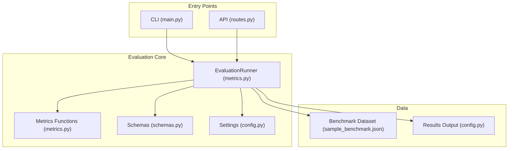
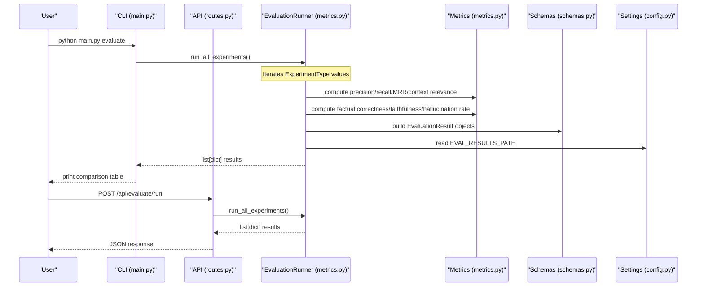
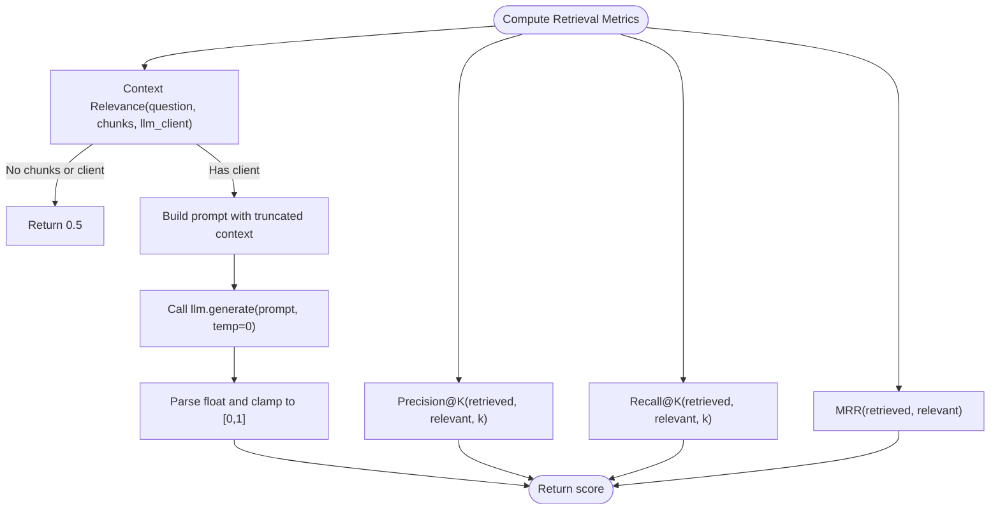
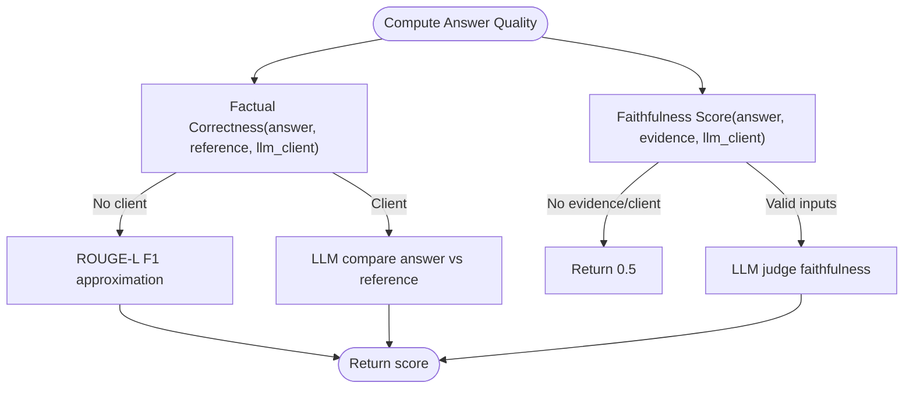
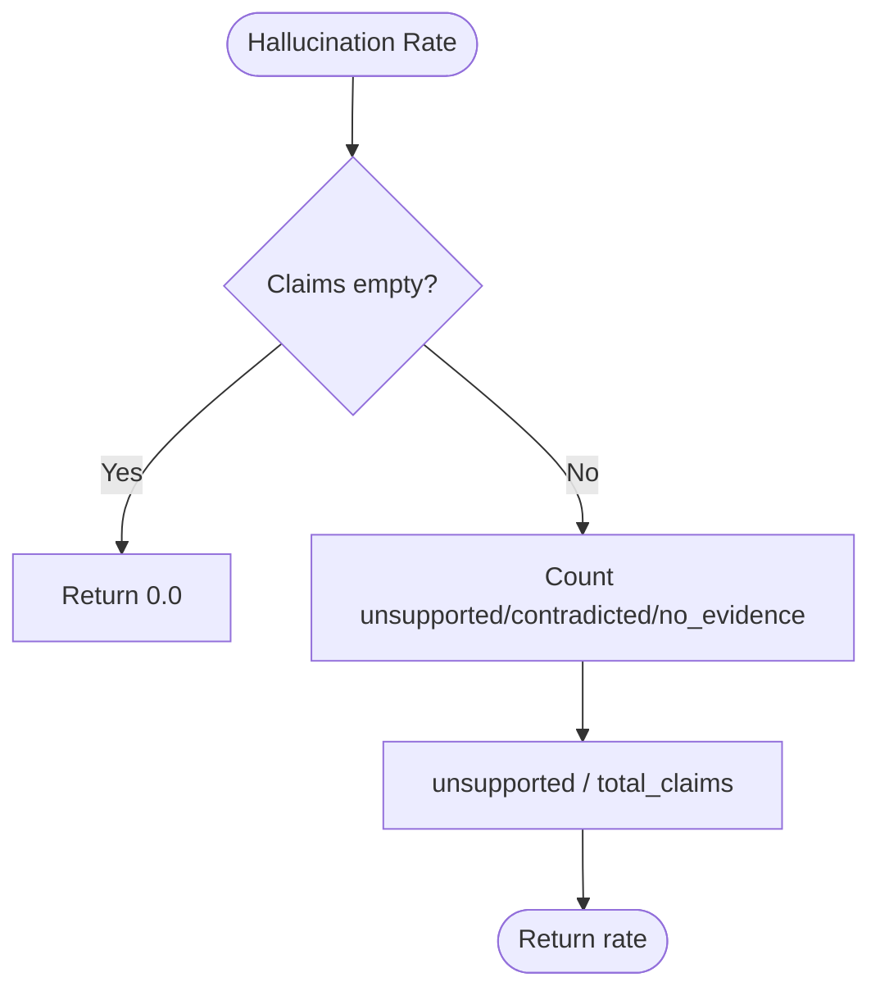
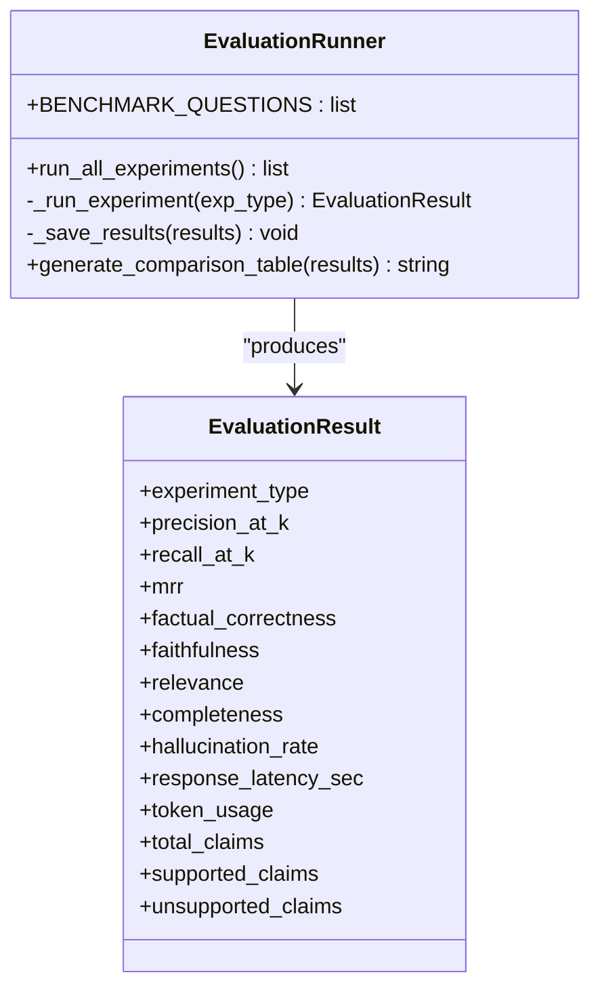
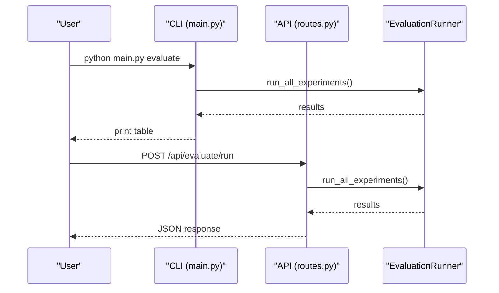
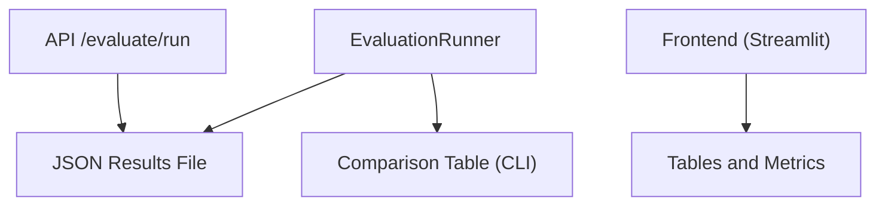
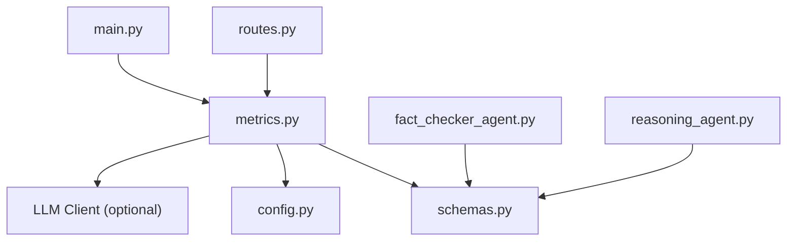

# Evaluation and Benchmarking

<cite>
**Referenced Files in This Document**
- [metrics.py](file://src/evaluation/metrics.py)
- [schemas.py](file://src/core/schemas.py)
- [config.py](file://src/config.py)
- [main.py](file://main.py)
- [routes.py](file://src/api/routes.py)
- [sample_benchmark.json](file://data/benchmarks/sample_benchmark.json)
- [README.md](file://README.md)
- [fact_checker_agent.py](file://src/agents/fact_checker_agent.py)
- [reasoning_agent.py](file://src/agents/reasoning_agent.py)
- [app.py](file://frontend/app.py)
</cite>

## Table of Contents
1. Introduction
2. Project Structure
3. Core Components
4. Architecture Overview
5. Detailed Component Analysis
6. Dependency Analysis
7. Performance Considerations
8. Troubleshooting Guide
9. Conclusion
10. Appendices

## Introduction
This document explains the evaluation and benchmarking system for the Graph RAG + Multi-Agent Research System. It covers retrieval metrics, answer quality metrics, hallucination detection, agent performance metrics, and system performance metrics. It also documents the benchmark suite, evaluation methodology, result interpretation guidelines, example runs, reproducibility requirements, visualization tools, and reporting formats suitable for research publications.

## Project Structure
The evaluation system is centered around a dedicated metrics module that implements retrieval and answer quality metrics, hallucination rate computation, and an experiment runner that orchestrates comparisons across multiple experimental configurations. The CLI and API expose entry points to run evaluations, while configuration defines dataset and results paths. A sample benchmark dataset provides ground-truth questions and reference answers.



**Diagram sources**
- [main.py:59-68](file://main.py#L59-L68)
- [routes.py:341-347](file://src/api/routes.py#L341-L347)
- [metrics.py:139-254](file://src/evaluation/metrics.py#L139-L254)
- [schemas.py:152-168](file://src/core/schemas.py#L152-L168)
- [config.py:64-67](file://src/config.py#L64-L67)
- [sample_benchmark.json:1-43](file://data/benchmarks/sample_benchmark.json#L1-L43)

**Section sources**
- [main.py:59-68](file://main.py#L59-L68)
- [routes.py:341-347](file://src/api/routes.py#L341-L347)
- [metrics.py:139-254](file://src/evaluation/metrics.py#L139-L254)
- [config.py:64-67](file://src/config.py#L64-L67)
- [sample_benchmark.json:1-43](file://data/benchmarks/sample_benchmark.json#L1-L43)

## Core Components
- Retrieval metrics: Precision@K, Recall@K, Mean Reciprocal Rank (MRR), Context Relevance.
- Answer quality metrics: Factual Correctness (LLM-based or ROUGE fallback), Faithfulness (evidence-groundedness).
- Hallucination detection: Unsupported Claims / Total Claims via claim verdicts.
- Agent performance metrics: Task Success Rate, Tool Calls, Self-Correction Rate (conceptual; not yet implemented in code).
- System performance metrics: Latency, Token Usage, API Cost (latency and token usage are tracked; cost is conceptual).

Key implementation details:
- Retrieval metrics are pure functions with deterministic behavior and O(K) complexity per query.
- LLM-based metrics use a provided client with temperature=0 for stable scoring; they fall back to simpler heuristics when unavailable.
- The EvaluationRunner orchestrates experiments across predefined question sets and aggregates metrics into typed results.

**Section sources**
- [metrics.py:21-65](file://src/evaluation/metrics.py#L21-L65)
- [metrics.py:70-134](file://src/evaluation/metrics.py#L70-L134)
- [schemas.py:152-168](file://src/core/schemas.py#L152-L168)

## Architecture Overview
The evaluation architecture integrates CLI/API triggers with a central runner that executes experiments and computes metrics. The runner uses schemas to structure results and settings to locate datasets and outputs.



**Diagram sources**
- [main.py:59-68](file://main.py#L59-L68)
- [routes.py:341-347](file://src/api/routes.py#L341-L347)
- [metrics.py:165-224](file://src/evaluation/metrics.py#L165-L224)
- [schemas.py:152-168](file://src/core/schemas.py#L152-L168)
- [config.py:64-67](file://src/config.py#L64-L67)

## Detailed Component Analysis

### Retrieval Metrics
- Precision@K: Fraction of top-K retrieved documents that are relevant. Complexity O(K).
- Recall@K: Fraction of relevant documents found in top-K. Complexity O(K).
- MRR: Reciprocal rank of the first relevant document. Complexity O(K).
- Context Relevance: LLM-based rating of context relevance to the question; returns a normalized score between 0.0 and 1.0. Falls back to 0.5 if no chunks or client.



**Diagram sources**
- [metrics.py:21-65](file://src/evaluation/metrics.py#L21-L65)

**Section sources**
- [metrics.py:21-65](file://src/evaluation/metrics.py#L21-L65)

### Answer Quality Metrics
- Factual Correctness: LLM-based comparison against reference; falls back to ROUGE-L F1 approximation if no client.
- Faithfulness: Checks whether the answer is faithful to evidence; returns a normalized score.
- ROUGE fallback: Uses rouge_score if available; otherwise word-overlap heuristic.



**Diagram sources**
- [metrics.py:70-123](file://src/evaluation/metrics.py#L70-L123)

**Section sources**
- [metrics.py:70-123](file://src/evaluation/metrics.py#L70-L123)

### Hallucination Detection
- Hallucination Rate: Ratio of unsupported claims among total claims based on verified claim verdicts. Verdicts include supported, partially supported, unsupported, contradicted, no evidence.



**Diagram sources**
- [metrics.py:126-134](file://src/evaluation/metrics.py#L126-L134)

**Section sources**
- [metrics.py:126-134](file://src/evaluation/metrics.py#L126-L134)
- [schemas.py:27-33](file://src/core/schemas.py#L27-L33)

### Agent Performance Metrics
- Conceptual metrics defined in documentation: Task Success Rate, Tool Calls, Self-Correction Rate. These are not currently computed by the runner but can be integrated by extending the pipeline to capture agent-level logs and outcomes.

[No sources needed since this section describes conceptual metrics not implemented in code]

### System Performance Metrics
- Latency: Measured per query during evaluation runs.
- Token Usage: Tracked per query and aggregated.
- API Cost: Conceptual; can be derived from token usage and provider pricing.

**Section sources**
- [metrics.py:179-215](file://src/evaluation/metrics.py#L179-L215)
- [schemas.py:152-168](file://src/core/schemas.py#L152-L168)

### Benchmark Suite
- Built-in benchmark questions: A small set of multi-hop, comparison, and analysis questions used by the runner.
- External dataset: A sample benchmark file with richer metadata (entities, relationships) can be loaded to expand coverage.



**Diagram sources**
- [metrics.py:139-254](file://src/evaluation/metrics.py#L139-L254)
- [schemas.py:152-168](file://src/core/schemas.py#L152-L168)

**Section sources**
- [metrics.py:142-158](file://src/evaluation/metrics.py#L142-L158)
- [sample_benchmark.json:1-43](file://data/benchmarks/sample_benchmark.json#L1-L43)

### Evaluation Methodology
- Experimental configurations: Baseline LLM, Vector RAG, Graph RAG, Hybrid RAG, Multi-Agent.
- Runner iterates all experiment types and computes metrics per question, then averages across questions.
- Results are saved to a configured directory with timestamps.

```mermaid
sequenceDiagram
participant Runner as "EvaluationRunner"
participant Exp as "ExperimentType Enum"
participant Q as "Benchmark Questions"
participant Agg as "Aggregation"
Runner->>Exp : iterate all types
loop For each experiment type
Runner->>Q : for each benchmark question
Runner->>Runner : measure latency, tokens
Runner->>Runner : compute retrieval & answer metrics
end
Runner->>Agg : average metrics across questions
Agg-->>Runner : EvaluationResult
end
Runner-->>Runner : save results to disk
```

**Diagram sources**
- [metrics.py:165-224](file://src/evaluation/metrics.py#L165-L224)
- [schemas.py:35-41](file://src/core/schemas.py#L35-L41)

**Section sources**
- [metrics.py:165-224](file://src/evaluation/metrics.py#L165-L224)
- [schemas.py:35-41](file://src/core/schemas.py#L35-L41)

### Statistical Significance Testing and Result Interpretation
- Current implementation does not include statistical significance testing. To add it, integrate tests such as paired t-tests or bootstrap confidence intervals across repeated runs per experiment type.
- Interpretation guidelines:
  - Compare Precision@K, Recall@K, MRR to assess retrieval effectiveness.
  - Use Factual Correctness and Faithfulness to gauge answer quality and grounding.
  - Monitor Hallucination Rate to detect unsupported claims.
  - Track Latency and Token Usage for efficiency trade-offs.

[No sources needed since this section provides general guidance beyond current code]

### Example Runs
- CLI: Run the full evaluation suite and print a formatted comparison table.
- API: Trigger evaluation via POST /api/evaluate/run and receive JSON results.



**Diagram sources**
- [main.py:59-68](file://main.py#L59-L68)
- [routes.py:341-347](file://src/api/routes.py#L341-L347)
- [metrics.py:165-224](file://src/evaluation/metrics.py#L165-L224)

**Section sources**
- [main.py:59-68](file://main.py#L59-L68)
- [routes.py:341-347](file://src/api/routes.py#L341-L347)

### Creating Custom Evaluation Metrics
- Extend metrics.py with new functions following the existing patterns (pure functions for retrieval metrics, LLM-based scorers with fallbacks).
- Integrate into the runner’s metric aggregation step to include custom scores in EvaluationResult.
- Ensure consistent normalization (e.g., 0–1 scale) and robust error handling.

[No sources needed since this section provides general guidance]

### Experiment Design and A/B Testing Strategies
- Define clear hypotheses (e.g., hybrid RAG outperforms vector-only).
- Use controlled variables: same dataset, prompts, and LLM parameters across configurations.
- Repeat runs to reduce variance; record per-question metrics to enable statistical tests later.
- Track both quality and efficiency metrics to balance accuracy and cost.

[No sources needed since this section provides general guidance]

### Performance Regression Detection
- Maintain baseline metrics for each experiment type.
- On each run, compare new metrics against baselines using thresholds or statistical tests.
- Alert on significant regressions in latency, hallucination rate, or quality metrics.

[No sources needed since this section provides general guidance]

### Reproducibility Requirements
- Fix random seeds where applicable (e.g., embeddings, retrievers).
- Pin LLM model versions and temperatures.
- Store dataset snapshots and environment configurations (.env).
- Save evaluation results with timestamps and metadata.

**Section sources**
- [config.py:64-67](file://src/config.py#L64-L67)
- [metrics.py:217-224](file://src/evaluation/metrics.py#L217-L224)

### Result Visualization Tools and Reporting Formats
- Frontend: Streamlit app displays evaluation results as tables and key metrics.
- CLI: Prints a formatted comparison table.
- Outputs: JSON files saved to the configured results path.



**Diagram sources**
- [metrics.py:217-254](file://src/evaluation/metrics.py#L217-L254)
- [app.py:279-299](file://frontend/app.py#L279-L299)

**Section sources**
- [metrics.py:217-254](file://src/evaluation/metrics.py#L217-L254)
- [app.py:279-299](file://frontend/app.py#L279-L299)

## Dependency Analysis
The evaluation system depends on core schemas for structured results, configuration for paths, and optional LLM clients for advanced metrics. Agents contribute to answer generation and fact-checking, which feed into hallucination detection.



**Diagram sources**
- [metrics.py:139-254](file://src/evaluation/metrics.py#L139-L254)
- [schemas.py:152-168](file://src/core/schemas.py#L152-L168)
- [config.py:64-67](file://src/config.py#L64-L67)
- [routes.py:341-347](file://src/api/routes.py#L341-L347)
- [main.py:59-68](file://main.py#L59-L68)
- [fact_checker_agent.py:1-163](file://src/agents/fact_checker_agent.py#L1-L163)
- [reasoning_agent.py:1-124](file://src/agents/reasoning_agent.py#L1-L124)

**Section sources**
- [metrics.py:139-254](file://src/evaluation/metrics.py#L139-L254)
- [schemas.py:152-168](file://src/core/schemas.py#L152-L168)
- [config.py:64-67](file://src/config.py#L64-L67)
- [routes.py:341-347](file://src/api/routes.py#L341-L347)
- [main.py:59-68](file://main.py#L59-L68)
- [fact_checker_agent.py:1-163](file://src/agents/fact_checker_agent.py#L1-L163)
- [reasoning_agent.py:1-124](file://src/agents/reasoning_agent.py#L1-L124)

## Performance Considerations
- Retrieval metrics are efficient and suitable for large K without major overhead.
- LLM-based metrics introduce latency and token costs; consider caching or batching for repeated evaluations.
- Token usage tracking enables cost estimation; integrate provider-specific pricing for API cost calculations.
- Use deterministic settings (temperature=0) for stable metric computation.

[No sources needed since this section provides general guidance]

## Troubleshooting Guide
- Missing LLM client: LLM-based metrics will fall back to heuristics; ensure client is provided for accurate scoring.
- Empty evidence or chunks: Context relevance defaults to 0.5; verify retrieval pipeline outputs.
- Invalid JSON responses: Agents parse LLM outputs with fallbacks; check logs for parsing warnings.
- Results not saved: Verify EVAL_RESULTS_PATH exists and is writable.

**Section sources**
- [metrics.py:47-65](file://src/evaluation/metrics.py#L47-L65)
- [metrics.py:70-84](file://src/evaluation/metrics.py#L70-L84)
- [fact_checker_agent.py:130-144](file://src/agents/fact_checker_agent.py#L130-L144)
- [config.py:64-67](file://src/config.py#L64-L67)

## Conclusion
The evaluation framework provides a solid foundation for measuring retrieval effectiveness, answer quality, hallucination rates, and system performance across multiple experimental configurations. While some agent-level and statistical features are conceptual, the existing components support extensibility for comprehensive benchmarking and reproducible research.

[No sources needed since this section summarizes without analyzing specific files]

## Appendices

### Appendix A: Metric Definitions and Algorithms
- Precision@K: Count relevant in top-K divided by K.
- Recall@K: Count relevant found in top-K divided by total relevant.
- MRR: 1/(rank of first relevant).
- Context Relevance: LLM-rated relevance score normalized to [0,1].
- Factual Correctness: LLM comparison or ROUGE-L F1 fallback.
- Faithfulness: LLM-based evidence alignment score.
- Hallucination Rate: Ratio of unsupported claims to total claims.

**Section sources**
- [metrics.py:21-134](file://src/evaluation/metrics.py#L21-L134)

### Appendix B: Running Evaluations
- CLI: Execute the evaluation command to run all experiments and print a comparison table.
- API: Call the evaluation endpoint to get JSON results.
- Frontend: Use the Streamlit interface to visualize results.

**Section sources**
- [main.py:59-68](file://main.py#L59-L68)
- [routes.py:341-347](file://src/api/routes.py#L341-L347)
- [app.py:279-299](file://frontend/app.py#L279-L299)

### Appendix C: Benchmark Dataset
- Sample dataset includes questions, reference answers, types, entities, and relationships for richer evaluation scenarios.

**Section sources**
- [sample_benchmark.json:1-43](file://data/benchmarks/sample_benchmark.json#L1-L43)

### Appendix D: Configuration
- Settings define benchmark dataset path and results output path.

**Section sources**
- [config.py:64-67](file://src/config.py#L64-L67)