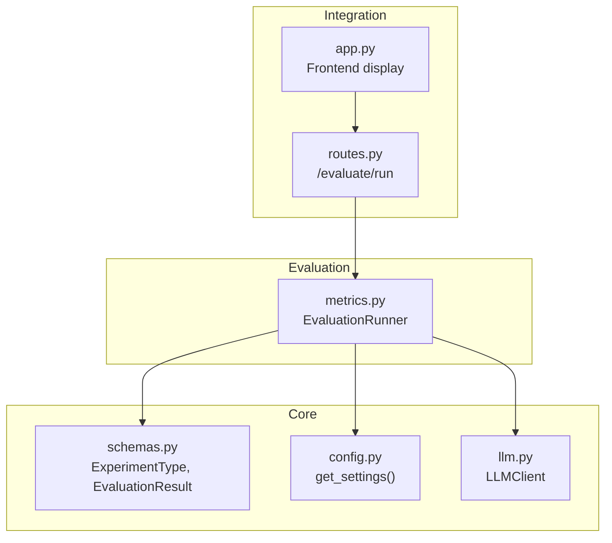
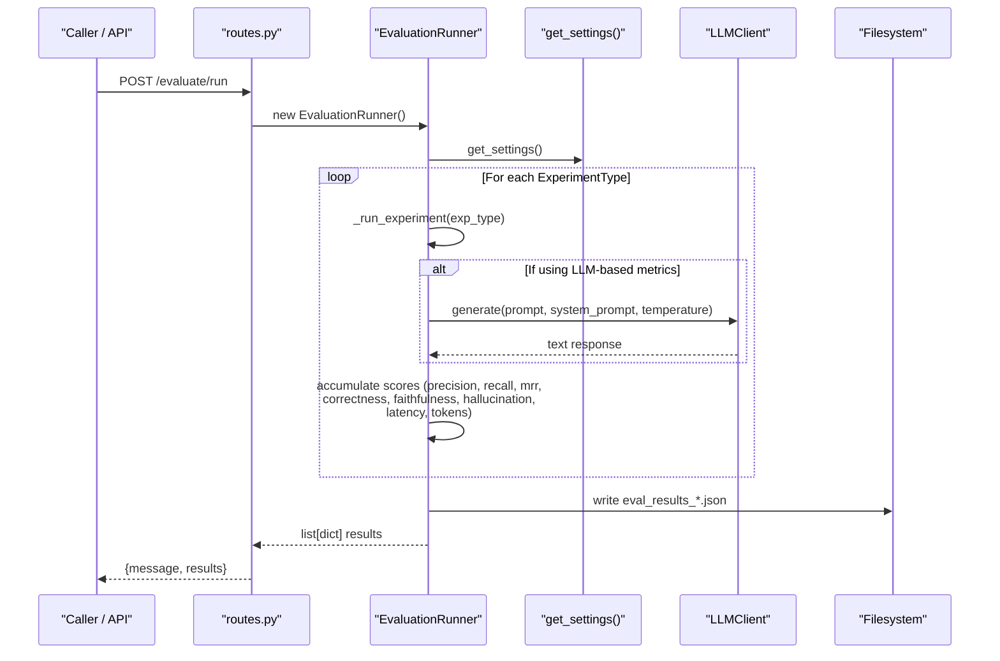
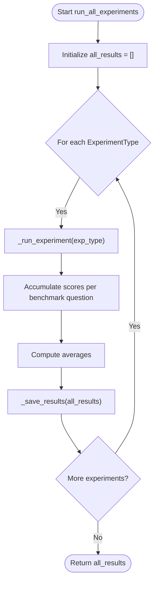
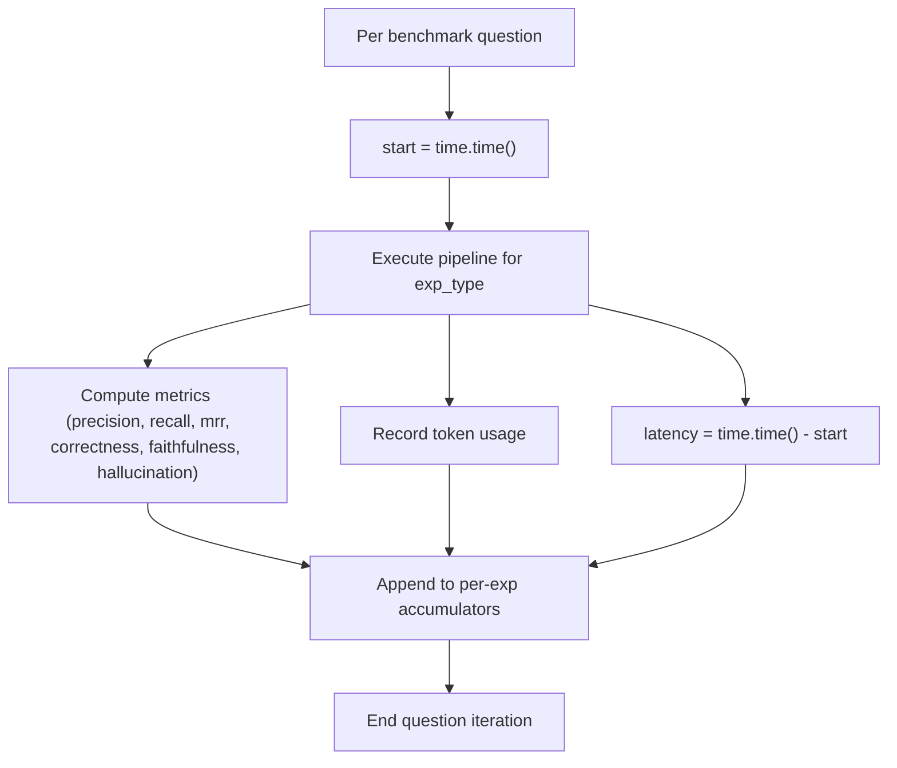
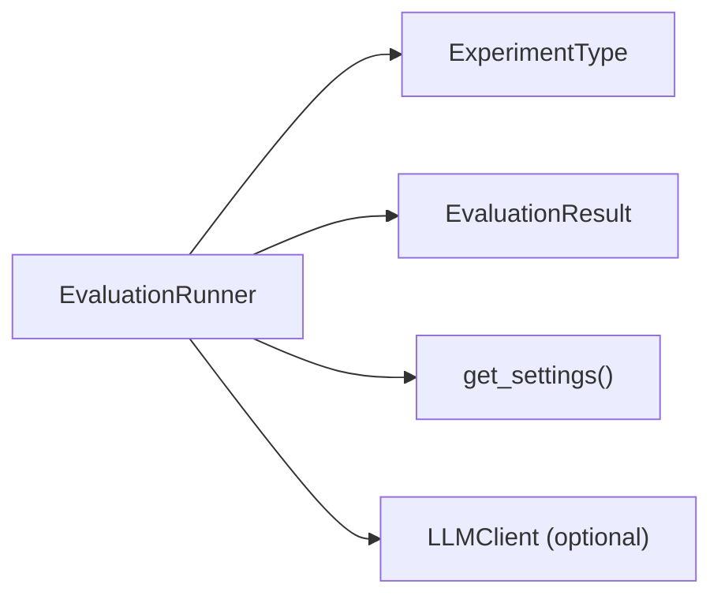

# Experiment Runner and Configuration

<cite>
**Referenced Files in This Document**
- [metrics.py](file://src/evaluation/metrics.py)
- [schemas.py](file://src/core/schemas.py)
- [config.py](file://src/config.py)
- [llm.py](file://src/core/llm.py)
- [routes.py](file://src/api/routes.py)
- [app.py](file://frontend/app.py)
</cite>

## Table of Contents
1. [Introduction](#introduction)
2. [Project Structure](#project-structure)
3. [Core Components](#core-components)
4. [Architecture Overview](#architecture-overview)
5. [Detailed Component Analysis](#detailed-component-analysis)
6. [Dependency Analysis](#dependency-analysis)
7. [Performance Considerations](#performance-considerations)
8. [Troubleshooting Guide](#troubleshooting-guide)
9. [Conclusion](#conclusion)
10. [Appendices](#appendices)

## Introduction
This document explains the EvaluationRunner class and the experiment configuration system used to run, measure, and compare different retrieval and reasoning architectures. It covers initialization, sequential execution across experiment types, metric collection (latency, token usage, correctness, faithfulness, hallucination), result aggregation, and persistence. It also documents configuration via get_settings(), how to integrate custom LLM clients, error handling and logging strategies, debugging techniques, and guidance for parallelizing experiments at scale.

## Project Structure
The evaluation system is implemented primarily under src/evaluation with supporting schemas, configuration, and LLM abstraction layers:
- Evaluation runner and metrics: src/evaluation/metrics.py
- Data models and enums: src/core/schemas.py
- Settings and environment: src/config.py
- LLM client abstraction: src/core/llm.py
- API integration: src/api/routes.py
- Frontend visualization: frontend/app.py

**Diagram sources**
- [metrics.py:139-223](file://src/evaluation/metrics.py#L139-L223)
- [schemas.py:35-41](file://src/core/schemas.py#L35-L41)
- [config.py:78-81](file://src/config.py#L78-L81)
- [llm.py:15-103](file://src/core/llm.py#L15-L103)
- [routes.py:341-347](file://src/api/routes.py#L341-L347)
- [app.py:279-299](file://frontend/app.py#L279-L299)

**Section sources**
- [metrics.py:139-223](file://src/evaluation/metrics.py#L139-L223)
- [schemas.py:35-41](file://src/core/schemas.py#L35-L41)
- [config.py:78-81](file://src/config.py#L78-L81)
- [llm.py:15-103](file://src/core/llm.py#L15-L103)
- [routes.py:341-347](file://src/api/routes.py#L341-L347)
- [app.py:279-299](file://frontend/app.py#L279-L299)

## Core Components
- EvaluationRunner: Orchestrates running all experiment types over a fixed set of benchmark questions, collects metrics per question, aggregates averages, and persists results.
- ExperimentType: Enumerates supported experiment modes (baseline_llm, vector_rag, graph_rag, hybrid_rag, multi_agent).
- EvaluationResult: Pydantic model capturing precision/recall/MRR, correctness, faithfulness, hallucination rate, latency, token usage, and claim counts.
- Settings (get_settings): Centralized configuration loaded from environment variables with defaults; includes evaluation paths and LLM provider settings.
- LLMClient: Unified interface to Gemini or OpenAI, used by metrics functions and can be injected into EvaluationRunner for advanced evaluations.

Key responsibilities:
- Initialization: Load settings, optional LLM client, and prepare internal state.
- Sequential processing: Iterate over each ExperimentType and run _run_experiment.
- Metric accumulation: Track latency, tokens, and quality metrics per benchmark question.
- Aggregation and persistence: Compute averages and save JSON results.

**Section sources**
- [metrics.py:139-223](file://src/evaluation/metrics.py#L139-L223)
- [schemas.py:35-41](file://src/core/schemas.py#L35-L41)
- [schemas.py:152-167](file://src/core/schemas.py#L152-L167)
- [config.py:21-81](file://src/config.py#L21-L81)
- [llm.py:15-103](file://src/core/llm.py#L15-L103)

## Architecture Overview
The evaluation workflow is triggered programmatically or via an HTTP endpoint. The runner iterates through experiment types sequentially, executes each across benchmark questions, aggregates metrics, and saves results.

**Diagram sources**
- [routes.py:341-347](file://src/api/routes.py#L341-L347)
- [metrics.py:165-223](file://src/evaluation/metrics.py#L165-L223)
- [config.py:78-81](file://src/config.py#L78-L81)
- [llm.py:40-87](file://src/core/llm.py#L40-L87)

## Detailed Component Analysis

### EvaluationRunner
Responsibilities:
- Initialize with optional LLM client and settings.
- Run all experiments sequentially across a fixed benchmark dataset.
- Collect per-question metrics including latency and token usage.
- Aggregate metrics into EvaluationResult objects and persist results.

Workflow highlights:
- run_all_experiments: Iterates over ExperimentType, logs progress, calls _run_experiment, accumulates results, and saves them.
- _run_experiment: Initializes score accumulators, loops over BENCHMARK_QUESTIONS, measures latency, records placeholder metrics (currently), computes averages, and returns EvaluationResult.
- _save_results: Creates output directory based on settings and writes timestamped JSON file.

Metrics tracked per experiment:
- Retrieval: precision_at_k, recall_at_k, mrr
- Answer quality: factual_correctness, faithfulness, hallucination_rate
- Performance: response_latency_sec, token_usage

**Diagram sources**
- [metrics.py:165-223](file://src/evaluation/metrics.py#L165-L223)

**Section sources**
- [metrics.py:139-223](file://src/evaluation/metrics.py#L139-L223)

### Experiment Types and Data Models
- ExperimentType defines five modes: baseline_llm, vector_rag, graph_rag, hybrid_rag, multi_agent.
- EvaluationResult captures comprehensive metrics for each experiment run.

These are used throughout the runner to structure outputs and comparisons.

**Section sources**
- [schemas.py:35-41](file://src/core/schemas.py#L35-L41)
- [schemas.py:152-167](file://src/core/schemas.py#L152-L167)

### Configuration via get_settings()
Settings provide centralized control over evaluation behavior:
- Evaluation paths:
  - BENCHMARK_DATASET_PATH: Directory for benchmark datasets.
  - EVAL_RESULTS_PATH: Directory where evaluation results are saved.
- LLM provider and models:
  - LLM_PROVIDER, GEMINI_MODEL, OPENAI_MODEL, TEMPERATURE.
- Embeddings and vector DB settings that indirectly affect retrieval performance.
- Logging level and debug flags.

Usage in EvaluationRunner:
- Loads settings once during initialization.
- Uses EVAL_RESULTS_PATH to create output directory and write JSON files.

**Section sources**
- [config.py:21-81](file://src/config.py#L21-L81)
- [metrics.py:160-163](file://src/evaluation/metrics.py#L160-L163)
- [metrics.py:217-223](file://src/evaluation/metrics.py#L217-L223)

### Result Collection Process
- Latency tracking: Measured per benchmark question using time.time() around pipeline execution.
- Token usage monitoring: Accumulated per question and averaged; currently uses placeholder values but can be integrated with LLMClient.count_tokens or provider-specific usage APIs.
- Metric accumulation: Precision, recall, MRR, correctness, faithfulness, hallucination rates are collected per question and averaged.
- Aggregation: Averages computed and packed into EvaluationResult.
- Persistence: Results serialized to JSON under EVAL_RESULTS_PATH with a timestamped filename.

**Diagram sources**
- [metrics.py:187-200](file://src/evaluation/metrics.py#L187-L200)
- [metrics.py:202-215](file://src/evaluation/metrics.py#L202-L215)

**Section sources**
- [metrics.py:187-215](file://src/evaluation/metrics.py#L187-L215)

### Integrating Custom LLM Clients
EvaluationRunner accepts an optional llm_client in its constructor. You can inject a custom client to:
- Use a different provider or wrapper.
- Add telemetry, retries, or caching.
- Integrate with external evaluation frameworks that require specific prompt formats or response parsing.

Example usage pattern:
- Create your own LLM client implementing a generate method compatible with the metrics module.
- Pass it to EvaluationRunner(llm_client=your_client).
- Metrics functions like context_relevance, factual_correctness, and faithfulness_score will use the provided client when available.

**Section sources**
- [metrics.py:160-163](file://src/evaluation/metrics.py#L160-L163)
- [metrics.py:47-65](file://src/evaluation/metrics.py#L47-L65)
- [metrics.py:70-84](file://src/evaluation/metrics.py#L70-L84)
- [metrics.py:87-102](file://src/evaluation/metrics.py#L87-L102)

### Running Experiments Programmatically
You can run the full suite directly in Python:
- Import EvaluationRunner from src.evaluation.metrics.
- Instantiate it (optionally with a custom llm_client).
- Call run_all_experiments() to execute all experiment types and return results.
- Optionally call generate_comparison_table(results) to print a formatted comparison.

API endpoint integration:
- The API exposes POST /evaluate/run which instantiates EvaluationRunner and returns results.

Frontend integration:
- The frontend displays results as a table and key metrics per experiment type.

**Section sources**
- [routes.py:341-347](file://src/api/routes.py#L341-L347)
- [app.py:279-299](file://frontend/app.py#L279-L299)
- [metrics.py:165-223](file://src/evaluation/metrics.py#L165-L223)

### Error Handling and Logging Strategies
- Logging: Uses loguru logger to record start of benchmark and per-experiment progress. Results saving logs the output path.
- Robustness in metrics: LLM-based metrics catch exceptions and return fallback scores to avoid failing the entire run.
- Provider validation: LLMClient raises ValueError for unsupported providers and RuntimeError if no valid provider is configured.

Recommendations:
- Wrap run_all_experiments in try/except to capture unexpected errors and log them.
- Ensure EVAL_RESULTS_PATH exists or handle permission errors.
- Validate inputs to metrics functions to prevent malformed prompts.

**Section sources**
- [metrics.py:167-177](file://src/evaluation/metrics.py#L167-L177)
- [metrics.py:217-223](file://src/evaluation/metrics.py#L217-L223)
- [metrics.py:60-65](file://src/evaluation/metrics.py#L60-L65)
- [metrics.py:80-84](file://src/evaluation/metrics.py#L80-L84)
- [metrics.py:98-102](file://src/evaluation/metrics.py#L98-L102)
- [llm.py:25-38](file://src/core/llm.py#L25-L38)
- [llm.py:40-54](file://src/core/llm.py#L40-L54)

### Debugging Techniques
- Enable DEBUG mode and adjust LOG_LEVEL in settings to increase verbosity.
- Inspect generated JSON files under EVAL_RESULTS_PATH for detailed per-experiment metrics.
- Use the frontend’s “Key Metrics Comparison” to quickly spot anomalies.
- Temporarily replace LLM calls with deterministic mocks to isolate issues in metric computation.

**Section sources**
- [config.py:21-30](file://src/config.py#L21-L30)
- [metrics.py:217-223](file://src/evaluation/metrics.py#L217-L223)
- [app.py:279-299](file://frontend/app.py#L279-L299)

## Dependency Analysis
EvaluationRunner depends on:
- ExperimentType enum to iterate over supported experiments.
- EvaluationResult schema to aggregate and serialize metrics.
- get_settings for configuration and output paths.
- Optional LLMClient for LLM-based metric scoring.

**Diagram sources**
- [metrics.py:139-223](file://src/evaluation/metrics.py#L139-L223)
- [schemas.py:35-41](file://src/core/schemas.py#L35-L41)
- [schemas.py:152-167](file://src/core/schemas.py#L152-L167)
- [config.py:78-81](file://src/config.py#L78-L81)
- [llm.py:15-103](file://src/core/llm.py#L15-L103)

**Section sources**
- [metrics.py:139-223](file://src/evaluation/metrics.py#L139-L223)
- [schemas.py:35-41](file://src/core/schemas.py#L35-L41)
- [schemas.py:152-167](file://src/core/schemas.py#L152-L167)
- [config.py:78-81](file://src/config.py#L78-L81)
- [llm.py:15-103](file://src/core/llm.py#L15-L103)

## Performance Considerations
Current implementation runs experiments sequentially and uses placeholder metrics for speed. To optimize for large-scale evaluations:
- Parallelize across benchmark questions within an experiment using thread pools or async tasks, ensuring LLM clients are not shared unsafely.
- Batch LLM requests where possible to reduce overhead.
- Cache repeated prompts or reuse embeddings to minimize recomputation.
- Limit concurrency to respect API rate limits and resource constraints.
- Stream or chunk results to disk to avoid memory pressure.
- Monitor token usage and latency to detect bottlenecks.

[No sources needed since this section provides general guidance]

## Troubleshooting Guide
Common issues and resolutions:
- Missing or invalid API keys: Ensure LLM_PROVIDER and corresponding keys/models are set in environment variables.
- Unsupported provider: LLMClient raises ValueError; verify LLM_PROVIDER value.
- No results written: Check EVAL_RESULTS_PATH permissions and disk space.
- Inconsistent metrics: Verify that actual pipeline calls are integrated into _run_experiment; currently placeholders are used.
- Frontend shows errors: Inspect backend logs and ensure /evaluate/run returns valid results.

**Section sources**
- [llm.py:25-38](file://src/core/llm.py#L25-L38)
- [metrics.py:217-223](file://src/evaluation/metrics.py#L217-L223)
- [routes.py:341-347](file://src/api/routes.py#L341-L347)
- [app.py:279-299](file://frontend/app.py#L279-L299)

## Conclusion
EvaluationRunner provides a structured, configurable framework to run and compare multiple retrieval and reasoning architectures across a fixed benchmark. It integrates with centralized settings, supports optional LLM clients for advanced scoring, and persists results for analysis. With careful integration of real pipeline logic, robust error handling, and scalable execution patterns, it can serve as a foundation for rigorous evaluation of GraphRAG-MARS components.

[No sources needed since this section summarizes without analyzing specific files]

## Appendices

### Configuration Options Summary
- Evaluation paths:
  - BENCHMARK_DATASET_PATH: Path to benchmark dataset directory.
  - EVAL_RESULTS_PATH: Path to save evaluation results.
- LLM settings:
  - LLM_PROVIDER: gemini or openai.
  - GEMINI_MODEL, OPENAI_MODEL: Model names.
  - TEMPERATURE: Generation temperature.
- Other relevant settings:
  - EMBEDDING_MODEL, VECTOR_DB_TYPE, CHUNK_SIZE, CHUNK_OVERLAP influence retrieval performance.

**Section sources**
- [config.py:21-81](file://src/config.py#L21-L81)

### Example Workflows
- Programmatic run:
  - Instantiate EvaluationRunner (optionally with a custom llm_client).
  - Call run_all_experiments() and process returned list of dicts.
  - Optionally call generate_comparison_table(results) for a formatted view.
- API-driven run:
  - POST /evaluate/run triggers EvaluationRunner and returns results.
- Frontend visualization:
  - Display results as tables and key metrics per experiment type.

**Section sources**
- [metrics.py:165-223](file://src/evaluation/metrics.py#L165-L223)
- [routes.py:341-347](file://src/api/routes.py#L341-L347)
- [app.py:279-299](file://frontend/app.py#L279-L299)