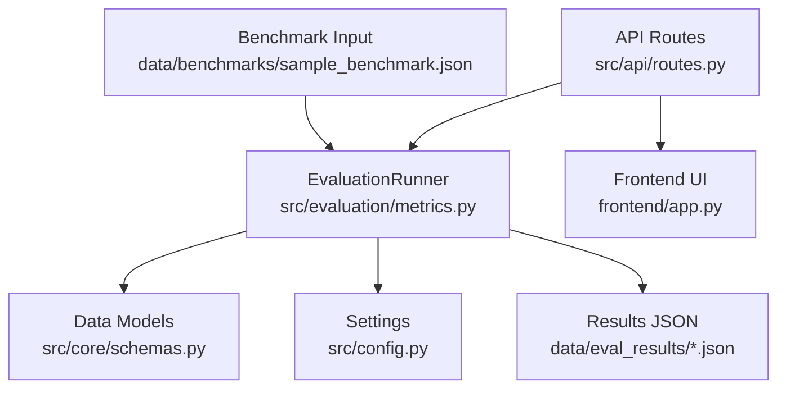
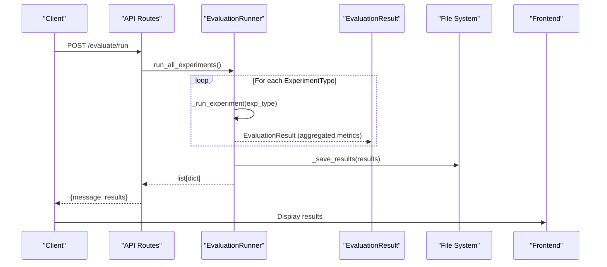
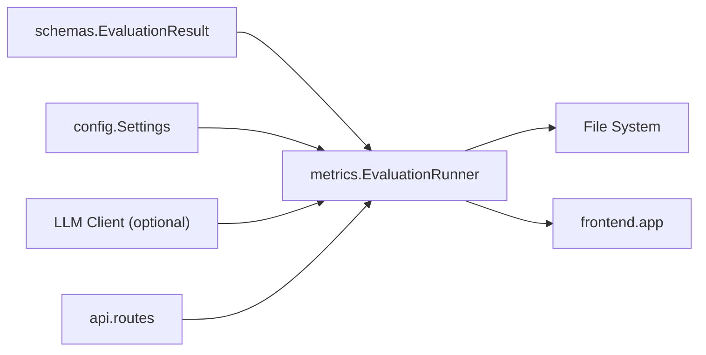

# Results Analysis and Reporting

<cite>
**Referenced Files in This Document**
- [metrics.py](file://src/evaluation/metrics.py)
- [schemas.py](file://src/core/schemas.py)
- [config.py](file://src/config.py)
- [routes.py](file://src/api/routes.py)
- [app.py](file://frontend/app.py)
- [sample_benchmark.json](file://data/benchmarks/sample_benchmark.json)
</cite>

## Table of Contents
1. [Introduction](#introduction)
2. [Project Structure](#project-structure)
3. [Core Components](#core-components)
4. [Architecture Overview](#architecture-overview)
5. [Detailed Component Analysis](#detailed-component-analysis)
6. [Dependency Analysis](#dependency-analysis)
7. [Performance Considerations](#performance-considerations)
8. [Troubleshooting Guide](#troubleshooting-guide)
9. [Conclusion](#conclusion)
10. [Appendices](#appendices)

## Introduction
This document explains the evaluation system’s result analysis and reporting capabilities. It focuses on how results are modeled, computed, saved, and presented for comparison across experimental configurations. It also provides guidance on interpreting results, performing basic statistical analysis, detecting outliers, and formatting outputs for academic publications and internal communication.

## Project Structure
The evaluation pipeline is implemented under src/evaluation with supporting data models in src/core and configuration in src/config. The API exposes endpoints to run evaluations, while the frontend visualizes results. Benchmark inputs are stored under data/benchmarks.

**Diagram sources**
- [routes.py:341-347](file://src/api/routes.py#L341-L347)
- [metrics.py:139-254](file://src/evaluation/metrics.py#L139-L254)
- [schemas.py:152-167](file://src/core/schemas.py#L152-L167)
- [config.py:64-66](file://src/config.py#L64-L66)
- [app.py:272-299](file://frontend/app.py#L272-L299)
- [sample_benchmark.json:1-43](file://data/benchmarks/sample_benchmark.json#L1-L43)

**Section sources**
- [metrics.py:139-254](file://src/evaluation/metrics.py#L139-L254)
- [schemas.py:152-167](file://src/core/schemas.py#L152-L167)
- [config.py:64-66](file://src/config.py#L64-L66)
- [routes.py:341-347](file://src/api/routes.py#L341-L347)
- [app.py:272-299](file://frontend/app.py#L272-L299)
- [sample_benchmark.json:1-43](file://data/benchmarks/sample_benchmark.json#L1-L43)

## Core Components
- EvaluationResult model defines the fields used to capture per-experiment metrics.
- EvaluationRunner orchestrates running experiments, computing metrics, saving results, and generating comparison tables.
- Metrics functions compute retrieval quality (precision_at_k, recall_at_k, MRR), answer quality (factual_correctness, faithfulness_score), and hallucination_rate.
- Configuration centralizes paths for benchmark datasets and evaluation output storage.
- API routes expose an endpoint to trigger the full evaluation suite.
- Frontend displays tabular results and key metrics for quick interpretation.

Key responsibilities:
- Compute and aggregate metrics per experiment type.
- Persist results as timestamped JSON files for versioning and later comparison.
- Produce a formatted comparison table suitable for reports.
- Provide a user interface to visualize results.

**Section sources**
- [schemas.py:152-167](file://src/core/schemas.py#L152-L167)
- [metrics.py:21-134](file://src/evaluation/metrics.py#L21-L134)
- [metrics.py:139-254](file://src/evaluation/metrics.py#L139-L254)
- [config.py:64-66](file://src/config.py#L64-L66)
- [routes.py:341-347](file://src/api/routes.py#L341-L347)
- [app.py:272-299](file://frontend/app.py#L272-L299)

## Architecture Overview
The evaluation flow starts from the API, runs all experiments via EvaluationRunner, aggregates metrics into EvaluationResult objects, saves them as timestamped JSON, and returns results to the caller. The frontend can fetch and display these results.

**Diagram sources**
- [routes.py:341-347](file://src/api/routes.py#L341-L347)
- [metrics.py:165-224](file://src/evaluation/metrics.py#L165-L224)
- [schemas.py:152-167](file://src/core/schemas.py#L152-L167)

## Detailed Component Analysis

### EvaluationResult Data Model
The EvaluationResult model captures the outcome of evaluating a single experimental configuration. Fields include:
- experiment_type: identifies the RAG strategy evaluated.
- precision_at_k: fraction of top-K retrieved documents that are relevant.
- recall_at_k: fraction of relevant documents found in top-K.
- mrr: mean reciprocal rank of the first relevant document.
- factual_correctness: LLM-based or ROUGE-based score comparing generated answer to reference.
- faithfulness: whether the answer is faithful to evidence.
- relevance: context relevance score (computed by context_relevance).
- completeness: completeness of coverage (used in aggregation).
- hallucination_rate: proportion of unsupported claims among verified claims.
- response_latency_sec: average time per query.
- token_usage: average tokens consumed per query.
- total_claims, supported_claims, unsupported_claims: claim-level statistics.

These fields enable comprehensive comparisons across baseline, vector RAG, graph RAG, hybrid RAG, and multi-agent approaches.

**Section sources**
- [schemas.py:152-167](file://src/core/schemas.py#L152-L167)

### Retrieval and Answer Quality Metrics
- precision_at_k: computes precision over the top-K retrieved items.
- recall_at_k: computes recall over the set of relevant items within top-K.
- mean_reciprocal_rank: measures ranking quality by rewarding early correct hits.
- factual_correctness: uses an LLM evaluator when available; otherwise falls back to ROUGE-L F1 approximation.
- faithfulness_score: evaluates if the answer aligns with provided evidence using an LLM evaluator.
- hallucination_rate: calculates the ratio of unsupported or contradicted claims among all verified claims.

These metrics collectively assess retrieval effectiveness and answer reliability.

**Section sources**
- [metrics.py:21-44](file://src/evaluation/metrics.py#L21-L44)
- [metrics.py:47-102](file://src/evaluation/metrics.py#L47-L102)
- [metrics.py:105-134](file://src/evaluation/metrics.py#L105-L134)

### Result Saving Mechanism
EvaluationRunner persists results to disk as JSON files with timestamps for versioning and comparison:
- Directory: configured via EVAL_RESULTS_PATH.
- Filename pattern: eval_results_<unix_timestamp>.json.
- Content: list of serialized EvaluationResult entries (model_dump()).
- Logging: confirms file path after successful write.

This mechanism supports historical tracking and reproducible comparisons across runs.

**Section sources**
- [metrics.py:217-224](file://src/evaluation/metrics.py#L217-L224)
- [config.py:64-66](file://src/config.py#L64-L66)

### generate_comparison_table Method
EvaluationRunner.generate_comparison_table produces a human-readable table summarizing key metrics across experiments:
- Rows: Precision@K, Recall@K, MRR, Factual Correctness, Faithfulness, Hallucination Rate, Latency (sec), Token Usage.
- Columns: one per experiment_type.
- Formatting: floats aligned to four decimal places; integers displayed as-is.
- Output: plain text suitable for embedding in reports or presentations.

This method enables quick side-by-side comparisons for research papers and team discussions.

**Section sources**
- [metrics.py:226-254](file://src/evaluation/metrics.py#L226-L254)

### API Integration and Frontend Visualization
- API endpoint /evaluate/run triggers EvaluationRunner.run_all_experiments and returns results as JSON.
- Frontend app.py calls this endpoint, converts results to a DataFrame, and displays:
  - A tabular view indexed by experiment_type.
  - Key metrics per experiment (Precision@K, Faithfulness, Hallucination Rate, Latency).

This integration streamlines evaluation execution and visualization for non-technical users.

**Section sources**
- [routes.py:341-347](file://src/api/routes.py#L341-L347)
- [app.py:272-299](file://frontend/app.py#L272-L299)

### Benchmark Inputs
Benchmarks define questions, reference answers, types, entities, and relationships to guide evaluation scenarios. The sample dataset includes multi-hop, comparison, and analysis tasks.

**Section sources**
- [sample_benchmark.json:1-43](file://data/benchmarks/sample_benchmark.json#L1-L43)

## Dependency Analysis
The evaluation module depends on:
- Data models (EvaluationResult) for structured results.
- Settings for paths and environment configuration.
- Optional LLM client for advanced evaluators (factual correctness, faithfulness).
- File system for persisting results.
- API layer for triggering evaluations.
- Frontend for displaying results.

**Diagram sources**
- [schemas.py:152-167](file://src/core/schemas.py#L152-L167)
- [metrics.py:139-254](file://src/evaluation/metrics.py#L139-L254)
- [config.py:64-66](file://src/config.py#L64-L66)
- [routes.py:341-347](file://src/api/routes.py#L341-L347)
- [app.py:272-299](file://frontend/app.py#L272-L299)

**Section sources**
- [metrics.py:139-254](file://src/evaluation/metrics.py#L139-L254)
- [schemas.py:152-167](file://src/core/schemas.py#L152-L167)
- [config.py:64-66](file://src/config.py#L64-L66)
- [routes.py:341-347](file://src/api/routes.py#L341-L347)
- [app.py:272-299](file://frontend/app.py#L272-L299)

## Performance Considerations
- Metric computation:
  - Retrieval metrics are O(K) per query; efficient for typical K values.
  - LLM-based evaluators introduce latency and cost; consider caching or batching where possible.
  - ROUGE fallback avoids external dependencies but may be less accurate than LLM-based scoring.
- Aggregation:
  - Averaging across benchmark questions smooths variance; ensure sufficient samples for stable estimates.
- I/O:
  - Timestamped JSON files support versioning; avoid excessive writes by batching results per run.
- Frontend:
  - Pandas DataFrame rendering is efficient for moderate result sizes; large datasets may require pagination or sampling.

[No sources needed since this section provides general guidance]

## Troubleshooting Guide
Common issues and resolutions:
- Missing LLM client:
  - If no LLM client is provided, factual_correctness falls back to ROUGE-L F1; faithfulness_score defaults to neutral value. Ensure proper configuration if LLM-based evaluation is required.
- Empty or invalid benchmark data:
  - Validate input structure against expected schema; empty lists return zero scores for related metrics.
- File system permissions:
  - Ensure EVAL_RESULTS_PATH exists and is writable; the runner creates directories as needed.
- API errors:
  - Check network connectivity and server availability when calling /evaluate/run from the frontend.

**Section sources**
- [metrics.py:70-102](file://src/evaluation/metrics.py#L70-L102)
- [metrics.py:217-224](file://src/evaluation/metrics.py#L217-L224)
- [routes.py:341-347](file://src/api/routes.py#L341-L347)

## Conclusion
The evaluation system provides a robust framework for measuring retrieval quality and answer reliability across multiple RAG strategies. Results are modeled consistently, computed with both deterministic and LLM-based methods, saved with timestamps for reproducibility, and presented in formats suitable for research and team communication. The combination of precise metrics, clear reporting tools, and accessible visualization supports rigorous experimentation and informed decision-making.

[No sources needed since this section summarizes without analyzing specific files]

## Appendices

### Result Interpretation Guidelines
- Precision@K vs Recall@K:
  - High precision indicates fewer irrelevant retrievals; high recall indicates better coverage of relevant items.
- MRR:
  - Emphasizes early retrieval quality; useful when only the first relevant item matters.
- Factual Correctness and Faithfulness:
  - Higher scores indicate more reliable answers grounded in evidence.
- Hallucination Rate:
  - Lower rates suggest stronger fact verification; investigate unsupported claims to improve grounding.
- Latency and Token Usage:
  - Trade-offs between performance and resource consumption; optimize based on deployment constraints.

[No sources needed since this section provides general guidance]

### Statistical Analysis Techniques
- Descriptive statistics:
  - Mean, standard deviation, and confidence intervals for each metric across experiments.
- Comparative tests:
  - Paired t-tests or Wilcoxon signed-rank tests across benchmark questions to assess significance.
- Effect size:
  - Report Cohen’s d or similar measures to quantify practical differences.
- Multiple comparisons:
  - Apply corrections (e.g., Bonferroni) when testing many metrics simultaneously.

[No sources needed since this section provides general guidance]

### Visualization Approaches
- Bar charts:
  - Compare metrics across experiment types for clarity in presentations.
- Box plots:
  - Show distribution and variability of metrics across benchmark questions.
- Heatmaps:
  - Visualize correlation between metrics to identify trade-offs.
- Tables:
  - Use generate_comparison_table output for concise summaries in papers.

[No sources needed since this section provides general guidance]

### Outlier Detection and Validation
- Per-question anomalies:
  - Flag queries with extreme latency or unusually low faithfulness for manual review.
- Claim-level validation:
  - Inspect unsupported or contradicted claims to refine evidence retrieval and verification prompts.
- Robust aggregation:
  - Consider median or trimmed means if distributions are skewed by outliers.

[No sources needed since this section provides general guidance]

### Reporting Formats
- Academic publications:
  - Include tables generated by generate_comparison_table alongside statistical tests and effect sizes.
- Internal team communication:
  - Use frontend dashboards for interactive exploration; export CSV/JSON for deeper analysis.
- Versioning:
  - Reference timestamped JSON files in appendices to ensure reproducibility.

[No sources needed since this section provides general guidance]