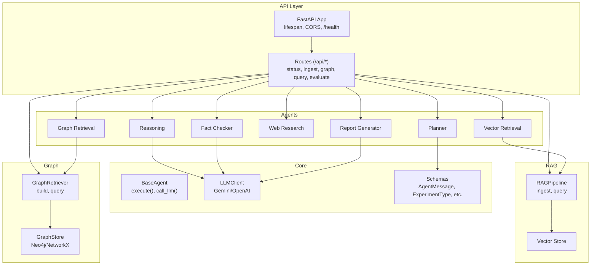
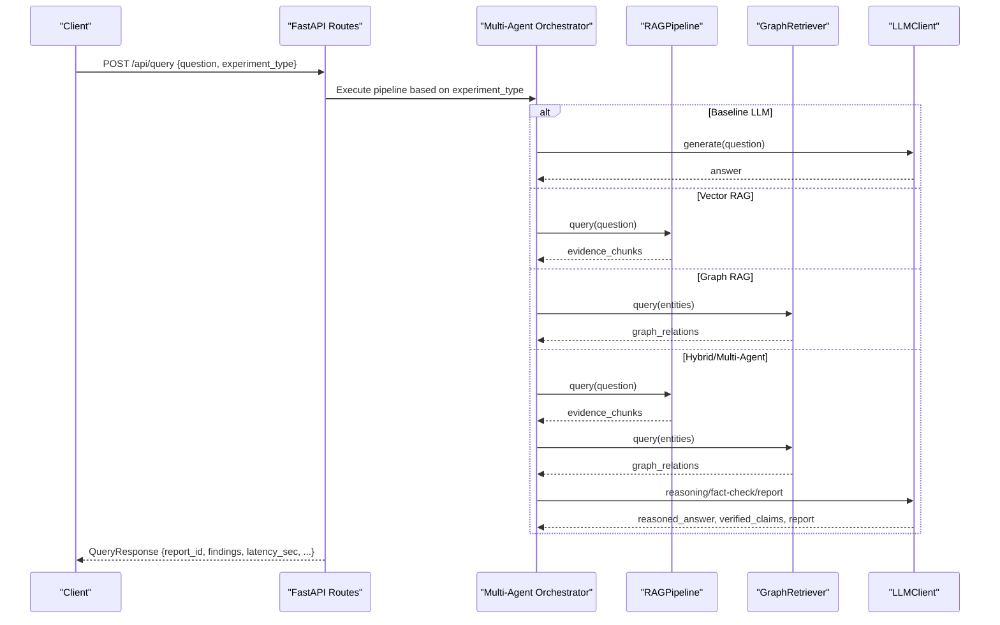
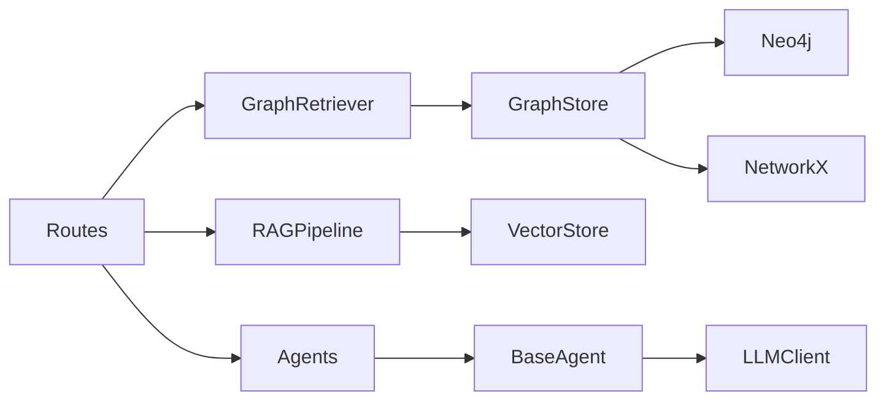

# Advanced Integration Patterns

<cite>
**Referenced Files in This Document**
- [main.py](file://main.py)
- [src/api/app.py](file://src/api/app.py)
- [src/api/routes.py](file://src/api/routes.py)
- [src/core/base_agent.py](file://src/core/base_agent.py)
- [src/core/schemas.py](file://src/core/schemas.py)
- [src/core/llm.py](file://src/core/llm.py)
- [src/config.py](file://src/config.py)
- [src/rag/pipeline.py](file://src/rag/pipeline.py)
- [src/graph/retriever.py](file://src/graph/retriever.py)
- [src/graph/graph_store.py](file://src/graph/graph_store.py)
- [examples/query_example.py](file://examples/query_example.py)
- [README.md](file://README.md)
</cite>

## Table of Contents
1. [Introduction](#introduction)
2. [Project Structure](#project-structure)
3. [Core Components](#core-components)
4. [Architecture Overview](#architecture-overview)
5. [Detailed Component Analysis](#detailed-component-analysis)
6. [Dependency Analysis](#dependency-analysis)
7. [Performance Considerations](#performance-considerations)
8. [Troubleshooting Guide](#troubleshooting-guide)
9. [Conclusion](#conclusion)
10. [Appendices](#appendices)

## Introduction
This document provides advanced integration patterns for the Graph RAG + Multi-Agent Research System with a focus on production-grade usage. It covers:
- Programmatic integration via FastAPI REST endpoints
- Extending agents by subclassing BaseAgent
- Building custom processing pipelines
- Authentication and security considerations
- Error handling strategies
- Performance optimization techniques
- Batch processing workflows, real-time query interfaces, and microservice integration patterns
- Scaling, monitoring, and deployment strategies for high-throughput scenarios

The system exposes a FastAPI application with lifecycle management, CORS middleware, and a set of REST endpoints for ingestion, graph building, querying, and evaluation. The multi-agent pipeline orchestrates planning, retrieval (vector and graph), optional web research, reasoning, fact-checking, and report generation.

**Section sources**
- [src/api/app.py:17-56](file://src/api/app.py#L17-L56)
- [src/api/routes.py:116-354](file://src/api/routes.py#L116-L354)
- [README.md:153-165](file://README.md#L153-L165)

## Project Structure
At a high level:
- Entry point: CLI to serve API, ingest documents, build graphs, run evaluations
- API layer: FastAPI app with lifespan hooks, CORS, health endpoint, and routes under /api
- Core abstractions: Agent base class, LLM client abstraction, Pydantic schemas
- RAG pipeline: Document loading, chunking, embedding, vector store indexing and search
- Graph subsystem: Entity extraction, graph storage (Neo4j or NetworkX), retriever interface
- Agents: Planner, Vector Retrieval, Graph Retrieval, Web Research, Reasoning, Fact Checker, Report Generator
- Configuration: Centralized settings loaded from environment variables

**Diagram sources**
- [src/api/app.py:17-56](file://src/api/app.py#L17-L56)
- [src/api/routes.py:116-354](file://src/api/routes.py#L116-L354)
- [src/core/base_agent.py:19-100](file://src/core/base_agent.py#L19-L100)
- [src/core/llm.py:15-103](file://src/core/llm.py#L15-L103)
- [src/core/schemas.py:17-168](file://src/core/schemas.py#L17-L168)
- [src/rag/pipeline.py:19-102](file://src/rag/pipeline.py#L19-L102)
- [src/graph/retriever.py:19-131](file://src/graph/retriever.py#L19-L131)
- [src/graph/graph_store.py:15-303](file://src/graph/graph_store.py#L15-L303)

**Section sources**
- [main.py:24-104](file://main.py#L24-L104)
- [src/api/app.py:17-56](file://src/api/app.py#L17-L56)
- [src/api/routes.py:116-354](file://src/api/routes.py#L116-L354)
- [README.md:81-126](file://README.md#L81-L126)

## Core Components
- FastAPI Application: Creates the app, configures lifespan, CORS, registers routes, and exposes a health check.
- Routes: Provide endpoints for status, ingestion, graph building, querying, and evaluation. Query endpoint supports multiple experiment types and orchestrates the multi-agent pipeline.
- BaseAgent: Abstract agent with common execution logging, LLM invocation helper, message creation, and stats.
- Schemas: Typed models for queries, evidence, claims, reports, and agent messages.
- LLM Client: Unified interface to Gemini and OpenAI providers with token counting.
- RAG Pipeline: Loads documents, chunks text, generates embeddings, indexes into vector store, and supports query search.
- Graph Retriever: Builds knowledge graph from documents and provides query and summary capabilities.
- Graph Store: Abstraction over Neo4j and an in-memory NetworkX fallback.

Key responsibilities and interactions are orchestrated in the query route, which composes agents based on the selected experiment type.

**Section sources**
- [src/api/app.py:17-56](file://src/api/app.py#L17-L56)
- [src/api/routes.py:116-354](file://src/api/routes.py#L116-L354)
- [src/core/base_agent.py:19-100](file://src/core/base_agent.py#L19-L100)
- [src/core/schemas.py:17-168](file://src/core/schemas.py#L17-L168)
- [src/core/llm.py:15-103](file://src/core/llm.py#L15-L103)
- [src/rag/pipeline.py:19-102](file://src/rag/pipeline.py#L19-L102)
- [src/graph/retriever.py:19-131](file://src/graph/retriever.py#L19-L131)
- [src/graph/graph_store.py:15-303](file://src/graph/graph_store.py#L15-L303)

## Architecture Overview
The system follows a modular architecture where the API layer delegates to specialized components:
- Ingestion flows through the RAG pipeline to index documents into a vector store.
- Graph construction uses entity extraction and persists relationships in a graph store.
- Queries can run baseline LLM, vector-only, graph-only, hybrid, or full multi-agent pipelines.
- The multi-agent pipeline coordinates planner, retrieval agents, reasoning, fact-checking, and report generation.

**Diagram sources**
- [src/api/routes.py:188-338](file://src/api/routes.py#L188-L338)
- [src/rag/pipeline.py:90-102](file://src/rag/pipeline.py#L90-L102)
- [src/graph/retriever.py:99-131](file://src/graph/retriever.py#L99-L131)
- [src/core/llm.py:40-87](file://src/core/llm.py#L40-L87)

## Detailed Component Analysis

### FastAPI REST Endpoints for Programmatic Integration
- Health and Status:
  - GET /health returns application status.
  - GET /api/status returns component health including vector store counts and graph summary.
- Ingestion:
  - POST /api/documents/ingest accepts file uploads, saves to configured docs directory, and ingests into vector store.
  - POST /api/documents/ingest-directory ingests all documents from a given directory path.
- Knowledge Graph:
  - POST /api/graph/build builds the knowledge graph from a directory path.
  - GET /api/graph/summary returns entity and relationship counts plus samples.
- Querying:
  - POST /api/query runs experiments: baseline_llm, vector_rag, graph_rag, hybrid_rag, multi_agent. Returns structured report with findings, verified claims, references, and latency.
- Evaluation:
  - POST /api/evaluate/run executes benchmark suite and returns results.

Integration tips:
- Use the /api/query endpoint with different experiment_type values to toggle pipeline behavior.
- For batch ingestion, call /api/documents/ingest-directory repeatedly or orchestrate via a script that iterates directories.
- Monitor latency and evidence counts in responses for performance tuning.

**Section sources**
- [src/api/app.py:49-52](file://src/api/app.py#L49-L52)
- [src/api/routes.py:116-186](file://src/api/routes.py#L116-L186)
- [src/api/routes.py:188-354](file://src/api/routes.py#L188-L354)
- [README.md:153-165](file://README.md#L153-L165)

### Extending BaseAgent to Implement Custom Behaviors
BaseAgent provides:
- Role-based identity and LLM client initialization
- Abstract execute(message) and get_system_prompt() contracts
- Helper call_llm(prompt, system_prompt, temperature) with execution logging
- Message creation utility create_message(content, receiver, payload)
- Execution statistics aggregation via get_execution_stats()

To implement a custom agent:
- Subclass BaseAgent and define role-specific prompts and logic in execute().
- Use call_llm() to interact with the configured LLM provider.
- Compose messages using create_message() to pass structured payloads between agents.
- Track metrics via execution_log and aggregate stats for observability.

Example pattern:
- Define a new agent class inheriting BaseAgent
- Implement get_system_prompt() to return persona instructions
- Implement execute() to process AgentMessage and return AgentMessage with enriched payload
- Integrate into the routes by adding to the agents registry used by the query flow

**Section sources**
- [src/core/base_agent.py:19-100](file://src/core/base_agent.py#L19-L100)
- [src/core/schemas.py:107-122](file://src/core/schemas.py#L107-L122)

### Creating Custom Processing Pipelines
RAGPipeline encapsulates:
- Document loading via DocumentLoader
- Text chunking via TextChunker
- Embedding generation via EmbeddingModel
- Indexing into VectorStore
- Querying with embedded question vectors

Customization options:
- Inject your own VectorStore implementation for alternative backends
- Swap EmbeddingModel for different models or caching layers
- Adjust chunk sizes and overlap via TextChunker configuration
- Extend ingest_documents() to add preprocessing steps like filtering or enrichment

Batch processing workflow:
- Load multiple documents from a directory
- Chunk each document and collect all chunks
- Generate embeddings in batches for efficiency
- Add documents to vector store with metadata and IDs
- Return counts for documents, chunks, and indexed items

**Section sources**
- [src/rag/pipeline.py:19-102](file://src/rag/pipeline.py#L19-L102)

### Knowledge Graph Construction and Querying
GraphRetriever:
- Builds graph from documents by chunking and extracting entities/relationships
- Deduplicates entities and adds them to GraphStore
- Provides query_entities() for multi-hop traversal and get_graph_summary() for diagnostics

GraphStore:
- Supports Neo4j with automatic fallback to in-memory NetworkX if unavailable
- Adds entities and relationships, queries with hop depth and relationship filters
- Counts nodes and edges, clears data, and retrieves context snippets

Production notes:
- Ensure Neo4j credentials are configured; otherwise, the system falls back gracefully
- Use hop_depth and limit parameters to control query scope and performance
- Monitor entity and relationship counts to validate ingestion quality

**Section sources**
- [src/graph/retriever.py:19-131](file://src/graph/retriever.py#L19-L131)
- [src/graph/graph_store.py:15-303](file://src/graph/graph_store.py#L15-L303)

### Multi-Agent Orchestration Flow
The query route orchestrates:
- Planning: Decompose question into sub-questions and determine required agents
- Retrieval: Parallel or sequential calls to vector and graph retrieval agents
- Optional web research: Fetch additional evidence when enabled
- Reasoning: Synthesize evidence into a reasoned answer
- Fact checking: Verify claims against evidence and assign verdicts
- Report generation: Produce structured report with findings, references, and limitations

Experiment types:
- baseline_llm: Direct LLM response without retrieval
- vector_rag: Vector search only
- graph_rag: Graph retrieval only
- hybrid_rag: Combined vector and graph retrieval
- multi_agent: Full pipeline with planning, reasoning, fact-checking, and reporting

**Section sources**
- [src/api/routes.py:188-338](file://src/api/routes.py#L188-L338)
- [examples/query_example.py:25-176](file://examples/query_example.py#L25-L176)

### Authentication and Security Patterns
Current state:
- CORS is enabled with permissive settings (allow_origins=["*"], allow_credentials=True, allow_methods=["*"], allow_headers=["*"])
- No built-in authentication or authorization middleware is present
- Secrets (API keys, database credentials) are managed via environment variables loaded from .env

Recommendations for production:
- Restrict CORS origins to trusted domains
- Add authentication middleware (e.g., JWT, API keys) to protect sensitive endpoints
- Enforce rate limiting and request size limits (MAX_UPLOAD_SIZE_MB is configurable)
- Validate inputs rigorously using Pydantic models already defined in schemas
- Rotate secrets regularly and avoid committing .env files

**Section sources**
- [src/api/app.py:37-44](file://src/api/app.py#L37-L44)
- [src/config.py:21-75](file://src/config.py#L21-L75)

### Error Handling Strategies
Observed patterns:
- HTTPException raised for unimplemented features (e.g., report retrieval placeholder)
- Logging via loguru at various stages (warnings, info)
- Graceful fallbacks (e.g., GraphStore falling back to NetworkX if Neo4j is unavailable)
- JSON parsing fallbacks in planner agent when LLM response is malformed

Best practices:
- Wrap external calls (LLM, vector store, graph store) with try/except blocks and return meaningful error codes
- Standardize error responses across endpoints
- Log detailed context for debugging while avoiding sensitive data exposure
- Implement retries and timeouts for network-bound operations

**Section sources**
- [src/api/routes.py:350-354](file://src/api/routes.py#L350-L354)
- [src/graph/graph_store.py:24-47](file://src/graph/graph_store.py#L24-L47)
- [src/agents/planner_agent.py:97-128](file://src/agents/planner_agent.py#L97-L128)

### Performance Optimization Techniques
- Batch embedding generation in RAGPipeline to reduce overhead
- Use appropriate chunk sizes and overlaps to balance recall and performance
- Limit max_results in queries to control payload size and latency
- Prefer hybrid or multi-agent modes only when necessary due to higher cost and latency
- Cache frequently used embeddings or results if applicable
- Tune LLM temperature and max_tokens for cost-performance trade-offs

Monitoring and metrics:
- Leverage BaseAgent execution logs to track token usage and latency
- Use /api/status to monitor vector store counts and graph summaries
- Instrument custom metrics around agent calls and external dependencies

**Section sources**
- [src/rag/pipeline.py:65-88](file://src/rag/pipeline.py#L65-L88)
- [src/core/base_agent.py:61-99](file://src/core/base_agent.py#L61-L99)
- [src/api/routes.py:116-131](file://src/api/routes.py#L116-L131)

## Dependency Analysis
Key dependency chains:
- Routes depend on RAGPipeline, GraphRetriever, and agents
- Agents depend on BaseAgent and LLMClient
- RAGPipeline depends on DocumentLoader, TextChunker, EmbeddingModel, VectorStore
- GraphRetriever depends on EntityExtractor, GraphStore, TextChunker, DocumentLoader
- GraphStore abstracts Neo4j and NetworkX implementations

**Diagram sources**
- [src/api/routes.py:116-354](file://src/api/routes.py#L116-L354)
- [src/core/base_agent.py:19-100](file://src/core/base_agent.py#L19-L100)
- [src/core/llm.py:15-103](file://src/core/llm.py#L15-L103)
- [src/rag/pipeline.py:19-102](file://src/rag/pipeline.py#L19-L102)
- [src/graph/retriever.py:19-131](file://src/graph/retriever.py#L19-L131)
- [src/graph/graph_store.py:15-303](file://src/graph/graph_store.py#L15-L303)

**Section sources**
- [src/api/routes.py:116-354](file://src/api/routes.py#L116-L354)
- [src/core/base_agent.py:19-100](file://src/core/base_agent.py#L19-L100)
- [src/core/llm.py:15-103](file://src/core/llm.py#L15-L103)
- [src/rag/pipeline.py:19-102](file://src/rag/pipeline.py#L19-L102)
- [src/graph/retriever.py:19-131](file://src/graph/retriever.py#L19-L131)
- [src/graph/graph_store.py:15-303](file://src/graph/graph_store.py#L15-L303)

## Performance Considerations
- Concurrency: FastAPI’s async model allows concurrent request handling; ensure downstream services (LLM, vector store, graph store) support concurrency and have connection pooling configured.
- Resource limits: Configure MAX_UPLOAD_SIZE_MB appropriately and enforce request size limits at the gateway level.
- Caching: Consider caching embeddings or frequent query results to reduce repeated computation.
- Backpressure: Implement queueing or rate limiting for heavy ingestion or evaluation tasks to prevent overload.
- Observability: Use structured logging and metrics collection to track latency, token usage, and error rates.

[No sources needed since this section provides general guidance]

## Troubleshooting Guide
Common issues and resolutions:
- Neo4j unavailable: GraphStore automatically falls back to NetworkX; verify credentials and connectivity if persistent graph storage is required.
- Invalid LLM response: Planner agent includes JSON parsing fallback; ensure LLM provider is correctly configured and tokens are sufficient.
- Empty ingestion results: Check document formats and chunking configuration; verify that documents contain extractable text.
- High latency: Reduce max_results, disable web search for faster responses, or switch to simpler experiment types.

Operational checks:
- Use /api/status to confirm component health and counts
- Inspect logs for warnings and errors during ingestion and querying
- Validate environment variables for API keys and database connections

**Section sources**
- [src/graph/graph_store.py:24-47](file://src/graph/graph_store.py#L24-L47)
- [src/agents/planner_agent.py:97-128](file://src/agents/planner_agent.py#L97-L128)
- [src/api/routes.py:116-131](file://src/api/routes.py#L116-L131)

## Conclusion
The Graph RAG + Multi-Agent Research System offers a flexible, extensible architecture suitable for advanced integration patterns. By leveraging FastAPI endpoints, extending BaseAgent for custom behaviors, and composing pipelines with RAG and graph components, teams can tailor the system to diverse use cases. Production deployments should prioritize authentication, security hardening, performance tuning, and robust monitoring to ensure reliability and scalability.

[No sources needed since this section summarizes without analyzing specific files]

## Appendices

### Batch Processing Workflows
- Ingest directories programmatically by iterating over paths and calling the ingestion endpoint
- Aggregate results and handle partial failures with retry logic
- Use evaluation endpoints to benchmark performance improvements after pipeline changes

**Section sources**
- [src/api/routes.py:158-178](file://src/api/routes.py#L158-L178)
- [src/api/routes.py:341-347](file://src/api/routes.py#L341-L347)

### Real-Time Query Interfaces
- Use /api/query with experiment_type set to multi_agent for comprehensive answers
- Stream responses at the gateway level if needed, noting that current endpoints return complete responses
- Monitor latency_sec in responses to optimize user experience

**Section sources**
- [src/api/routes.py:188-338](file://src/api/routes.py#L188-L338)

### Microservice Integration Patterns
- Expose ingestion and querying as separate services behind an API gateway
- Use message queues for long-running tasks (e.g., large document ingestion, evaluation runs)
- Secure inter-service communication with mutual TLS and authenticated tokens

[No sources needed since this section provides general guidance]

### Scaling Considerations
- Horizontal scaling: Run multiple instances of the FastAPI service behind a load balancer
- Database scaling: Use managed Neo4j clusters and vector stores with replication
- LLM scaling: Employ rate limiting and caching to manage API costs and throughput

[No sources needed since this section provides general guidance]

### Monitoring Setup
- Collect metrics on latency, token usage, and error rates from BaseAgent logs
- Instrument vector store and graph store operations for performance insights
- Set up alerts for critical failures and resource exhaustion

[No sources needed since this section provides general guidance]

### Deployment Strategies
- Containerize backend and frontend using provided Dockerfiles
- Use docker-compose for local development and staging environments
- Deploy to cloud platforms with autoscaling groups and managed databases

**Section sources**
- [README.md:48-79](file://README.md#L48-L79)