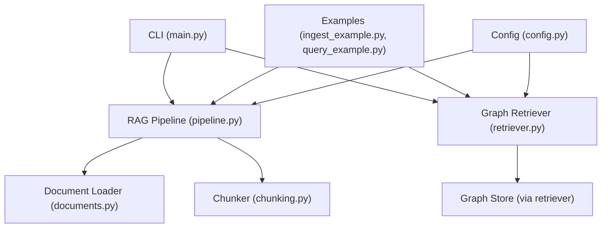
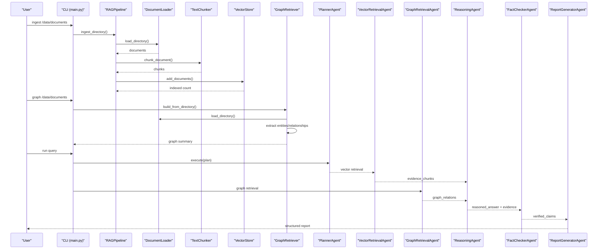
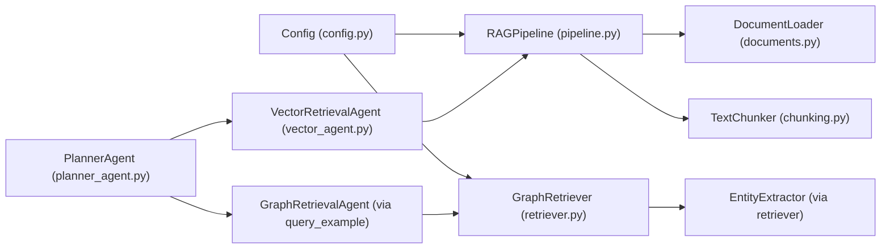

# Basic Usage Examples

<cite>
**Referenced Files in This Document**
- [README.md](file://README.md)
- [requirements.txt](file://requirements.txt)
- [main.py](file://main.py)
- [src/config.py](file://src/config.py)
- [examples/ingest_example.py](file://examples/ingest_example.py)
- [examples/query_example.py](file://examples/query_example.py)
- [src/rag/pipeline.py](file://src/rag/pipeline.py)
- [src/rag/documents.py](file://src/rag/documents.py)
- [src/rag/chunking.py](file://src/rag/chunking.py)
- [src/graph/retriever.py](file://src/graph/retriever.py)
- [src/core/schemas.py](file://src/core/schemas.py)
- [src/agents/planner_agent.py](file://src/agents/planner_agent.py)
- [src/agents/vector_agent.py](file://src/agents/vector_agent.py)
</cite>

## Table of Contents
1. Introduction
2. Project Structure
3. Core Components
4. Architecture Overview
5. Detailed Component Analysis
6. Dependency Analysis
7. Performance Considerations
8. Troubleshooting Guide
9. Conclusion
10. Appendices

## Introduction
This guide provides practical, step-by-step usage examples for the Graph RAG + Multi-Agent Research System. You will learn how to:
- Prepare your environment and configure settings
- Ingest documents (PDF, DOCX, TXT) into a vector store
- Build a knowledge graph from corpora
- Execute research queries using different retrieval strategies
- Use the provided Python SDK via example scripts
- Handle API responses and implement simple processing pipelines

The system combines vector retrieval, knowledge graph retrieval, optional web search, reasoning, fact-checking, and structured report generation.

**Section sources**
- [README.md:1-80](file://README.md#L1-L80)

## Project Structure
At a high level:
- CLI entry point orchestrates server, ingestion, graph building, and evaluation
- RAG pipeline handles document loading, chunking, embedding, and vector indexing
- Graph retriever builds and queries the knowledge graph
- Agents coordinate planning, retrieval, reasoning, verification, and reporting
- Configuration is centralized and loaded from environment variables

**Diagram sources**
- [main.py:24-56](file://main.py#L24-L56)
- [src/rag/pipeline.py:19-102](file://src/rag/pipeline.py#L19-L102)
- [src/graph/retriever.py:19-131](file://src/graph/retriever.py#L19-L131)
- [src/rag/documents.py:15-61](file://src/rag/documents.py#L15-L61)
- [src/rag/chunking.py:17-104](file://src/rag/chunking.py#L17-L104)
- [src/config.py:21-82](file://src/config.py#L21-L82)

**Section sources**
- [README.md:81-126](file://README.md#L81-L126)
- [main.py:71-111](file://main.py#L71-L111)

## Core Components
- RAGPipeline: Loads documents, chunks text, generates embeddings, and indexes into a vector store; supports directory/file ingestion and query.
- GraphRetriever: Builds a knowledge graph by extracting entities/relationships and querying relationships around entities.
- Agents: Planner decomposes questions; Vector and Graph agents retrieve evidence; Reasoning synthesizes; Fact Checker verifies; Report Generator produces structured output.
- Configuration: Centralized settings loaded from environment with defaults for LLMs, embeddings, vector DB, graph DB, and paths.

Key responsibilities:
- Ingestion: Convert diverse documents into indexed vectors
- Graph construction: Extract entities and relationships for multi-hop reasoning
- Query execution: Combine vector, graph, and optional web results into a reasoned answer
- Reporting: Produce verified, structured research reports

**Section sources**
- [src/rag/pipeline.py:19-102](file://src/rag/pipeline.py#L19-L102)
- [src/graph/retriever.py:19-131](file://src/graph/retriever.py#L19-L131)
- [src/agents/planner_agent.py:56-128](file://src/agents/planner_agent.py#L56-L128)
- [src/agents/vector_agent.py:34-92](file://src/agents/vector_agent.py#L34-L92)
- [src/config.py:21-82](file://src/config.py#L21-L82)

## Architecture Overview
The end-to-end flow for ingestion and research queries:

**Diagram sources**
- [main.py:31-56](file://main.py#L31-L56)
- [src/rag/pipeline.py:33-102](file://src/rag/pipeline.py#L33-L102)
- [src/graph/retriever.py:32-131](file://src/graph/retriever.py#L32-L131)
- [examples/query_example.py:25-176](file://examples/query_example.py#L25-L176)
- [src/agents/planner_agent.py:65-82](file://src/agents/planner_agent.py#L65-L82)
- [src/agents/vector_agent.py:44-81](file://src/agents/vector_agent.py#L44-L81)

## Detailed Component Analysis

### Environment Preparation and Configuration
- Install dependencies listed in requirements.txt
- Create a .env file at project root with keys for LLM providers, vector DB, graph DB, and optional web search
- Settings are loaded automatically via config.py with sensible defaults

Typical configuration keys:
- LLM provider and model keys
- Embedding model and dimension
- Vector DB type and connection details
- Neo4j URI, user, password
- Web search keys and toggles
- Chunk size and overlap
- Data directories

Expected behavior:
- If keys are missing, components may fall back or skip features (e.g., web search disabled)
- Ensure services like Neo4j and ChromaDB are running if used

**Section sources**
- [requirements.txt:1-60](file://requirements.txt#L1-L60)
- [src/config.py:21-82](file://src/config.py#L21-L82)
- [README.md:35-73](file://README.md#L35-L73)

### Tutorial 1: Ingest Documents and Build Knowledge Graph
Goal: Load PDF/DOCX/TXT files, index them into a vector store, and build a knowledge graph.

Steps:
1. Place documents in data/documents (supported formats: PDF, DOCX, TXT, Markdown, CSV)
2. Run the ingestion example script
   - It attempts to ingest from data/documents; if empty, it uses inline demo documents
   - It then builds the knowledge graph from the same source
   - Finally, it runs sample queries to demonstrate retrieval
3. Alternatively, use the CLI:
   - python main.py ingest ./data/documents
   - python main.py graph ./data/documents

What happens under the hood:
- DocumentLoader reads supported formats and returns text plus metadata
- TextChunker splits text into overlapping chunks based on sentence boundaries
- RAGPipeline embeds chunks and indexes them into the configured vector store
- GraphRetriever extracts entities and relationships and populates the graph store

Expected outputs:
- Logs indicating number of documents, chunks generated, and indexed entries
- Graph summary showing total entities and relationships
- Sample retrieval results with scores and content previews

Common pitfalls:
- Missing dependencies for PDF/DOCX parsing
- Empty documents directory leading to fallback demo ingestion
- Misconfigured vector/graph stores causing failures

**Section sources**
- [examples/ingest_example.py:16-99](file://examples/ingest_example.py#L16-L99)
- [src/rag/documents.py:15-61](file://src/rag/documents.py#L15-L61)
- [src/rag/chunking.py:29-104](file://src/rag/chunking.py#L29-L104)
- [src/rag/pipeline.py:33-88](file://src/rag/pipeline.py#L33-L88)
- [src/graph/retriever.py:32-97](file://src/graph/retriever.py#L32-L97)
- [main.py:31-56](file://main.py#L31-L56)

### Tutorial 2: Execute Research Queries with Retrieval Strategies
Goal: Run a full multi-agent research query combining vector, graph, and optional web retrieval, followed by reasoning, fact-checking, and report generation.

Steps:
1. Ensure documents are ingested and graph built
2. Run the query example script with an optional question argument
   - Default question is provided if none is given
3. Observe the step-by-step logs for each agent phase
4. Review the final structured report printed to console

Pipeline phases:
- Planning: Decompose the question into sub-questions and decide which agents to use
- Vector Retrieval: Retrieve semantically relevant chunks from the vector store
- Graph Retrieval: Retrieve entity relationships around key entities
- Web Research: Optional web search to augment evidence
- Reasoning: Synthesize evidence into a coherent answer
- Fact Checking: Verify claims against evidence and assign verdicts
- Report Generation: Produce a structured research report with findings and verified conclusions

Expected outputs:
- Number of sub-questions created
- Counts of retrieved chunks and relations
- Length of reasoned answer
- Number of verified claims
- Final report including executive summary, findings, and verified conclusions

Variations:
- Disable web search by passing include_web=False in code or adjusting the example
- Adjust max_results for retrieval to control volume of evidence

**Section sources**
- [examples/query_example.py:25-184](file://examples/query_example.py#L25-L184)
- [src/agents/planner_agent.py:65-82](file://src/agents/planner_agent.py#L65-L82)
- [src/agents/vector_agent.py:44-81](file://src/agents/vector_agent.py#L44-L81)
- [src/core/schemas.py:17-168](file://src/core/schemas.py#L17-L168)

### Tutorial 3: Use the Python SDK Directly
You can also call the SDK directly without the example scripts:

Ingestion:
- Create RAGPipeline and call ingest_directory or ingest_file
- For custom documents, pass a list of dicts with fields: text, source, path, extension
- Query the vector store using pipeline.query(question, n_results)

Graph:
- Create GraphRetriever and call build_from_directory or build_from_file
- Query relationships using query(entities, hop_depth, relationship_types, limit)
- Get a summary using get_graph_summary()

Agents:
- Initialize agents and send AgentMessage objects with appropriate payloads
- Collect evidence_chunks, graph_relations, web_results, and feed into reasoning and verification

Data models:
- Use schemas like EvidenceChunk, GraphRelation, Claim, ResearchReport for type-safe handling

**Section sources**
- [src/rag/pipeline.py:19-102](file://src/rag/pipeline.py#L19-L102)
- [src/graph/retriever.py:19-131](file://src/graph/retriever.py#L19-L131)
- [src/core/schemas.py:45-168](file://src/core/schemas.py#L45-L168)

### Tutorial 4: API Endpoints and Responses
If you start the FastAPI server, you can interact via HTTP:

Endpoints:
- Health check and status endpoints
- Upload and ingest single document or directory
- Build knowledge graph and get summary
- Run research queries
- Run evaluation benchmarks

Response handling:
- Parse JSON responses to access ingestion counts, graph summaries, and query results
- Inspect error messages for troubleshooting connectivity or configuration issues

**Section sources**
- [README.md:153-165](file://README.md#L153-L165)
- [main.py:24-29](file://main.py#L24-L29)

## Dependency Analysis
High-level dependencies among core modules:

**Diagram sources**
- [src/config.py:21-82](file://src/config.py#L21-L82)
- [src/rag/pipeline.py:19-102](file://src/rag/pipeline.py#L19-L102)
- [src/graph/retriever.py:19-131](file://src/graph/retriever.py#L19-L131)
- [src/rag/documents.py:15-61](file://src/rag/documents.py#L15-L61)
- [src/rag/chunking.py:29-104](file://src/rag/chunking.py#L29-L104)
- [src/agents/planner_agent.py:56-128](file://src/agents/planner_agent.py#L56-L128)
- [src/agents/vector_agent.py:34-92](file://src/agents/vector_agent.py#L34-L92)

**Section sources**
- [src/rag/pipeline.py:19-102](file://src/rag/pipeline.py#L19-L102)
- [src/graph/retriever.py:19-131](file://src/graph/retriever.py#L19-L131)
- [src/agents/planner_agent.py:56-128](file://src/agents/planner_agent.py#L56-L128)
- [src/agents/vector_agent.py:34-92](file://src/agents/vector_agent.py#L34-L92)

## Performance Considerations
- Chunk size and overlap affect retrieval quality and memory usage; tune via configuration
- Batch embedding improves throughput when processing large corpora
- Limit max_results to balance relevance and latency
- Use local vector stores (ChromaDB/FAISS) for faster iteration; consider persistence across runs
- Graph hop depth influences retrieval breadth; deeper hops increase context but also cost
- Disable web search when not needed to reduce latency and external dependencies

[No sources needed since this section provides general guidance]

## Troubleshooting Guide
Common issues and resolutions:
- Missing dependencies for PDF/DOCX parsing:
  - Ensure required packages are installed; the loader falls back between libraries where possible
- No documents found:
  - Place files in data/documents or provide a valid path; the ingestion example includes demo fallback
- Vector store errors:
  - Check vector DB service availability and configuration (host, port, collection)
- Graph store errors:
  - Verify Neo4j connection details and that the service is running
- Web search disabled or failing:
  - Provide required API keys or disable web search in the pipeline
- LLM provider misconfiguration:
  - Set correct provider and API keys; ensure model names match provider expectations

Where to look:
- Logging is enabled via loguru; inspect logs for detailed error traces
- Example scripts print intermediate steps and counts to help diagnose issues

**Section sources**
- [src/rag/documents.py:63-103](file://src/rag/documents.py#L63-L103)
- [examples/ingest_example.py:21-71](file://examples/ingest_example.py#L21-L71)
- [src/config.py:21-82](file://src/config.py#L21-L82)
- [README.md:35-73](file://README.md#L35-L73)

## Conclusion
You now have practical workflows to ingest documents, build knowledge graphs, and execute research queries using both example scripts and direct SDK calls. Start with the ingestion example to populate your vector store and graph, then run the query example to see the multi-agent pipeline in action. Adjust configuration and parameters to suit your data and performance needs.

[No sources needed since this section summarizes without analyzing specific files]

## Appendices

### Appendix A: Step-by-Step Scripts Walkthrough

#### Ingest Example Walkthrough
- Initializes logging and constructs RAGPipeline and GraphRetriever
- Attempts to ingest from data/documents; if empty, uses inline demo documents
- Builds knowledge graph from the same source
- Runs sample queries to demonstrate vector and graph retrieval
- Prints summaries and sample results

**Section sources**
- [examples/ingest_example.py:16-99](file://examples/ingest_example.py#L16-L99)

#### Query Example Walkthrough
- Initializes all agents and components
- Executes planning, vector retrieval, graph retrieval, optional web research
- Performs reasoning, fact checking, and report generation
- Prints structured report sections: executive summary, findings, verified conclusions
- Returns the report object for further processing

**Section sources**
- [examples/query_example.py:25-184](file://examples/query_example.py#L25-L184)

### Appendix B: Expected Outputs and Results

When running ingest_example.py:
- Logs show number of documents loaded, chunks generated, and indexed
- Graph build logs show entities and relationships added
- Sample queries display top results with scores and content snippets

When running query_example.py:
- Logs indicate sub-questions created, chunks retrieved, relations retrieved
- Reasoning output length is logged
- Verified claims count is shown
- Final report includes:
  - Research question
  - Executive summary
  - Findings list
  - Verified conclusions with verdicts
  - Report ID

**Section sources**
- [examples/ingest_example.py:21-94](file://examples/ingest_example.py#L21-L94)
- [examples/query_example.py:44-176](file://examples/query_example.py#L44-L176)