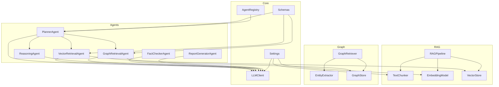
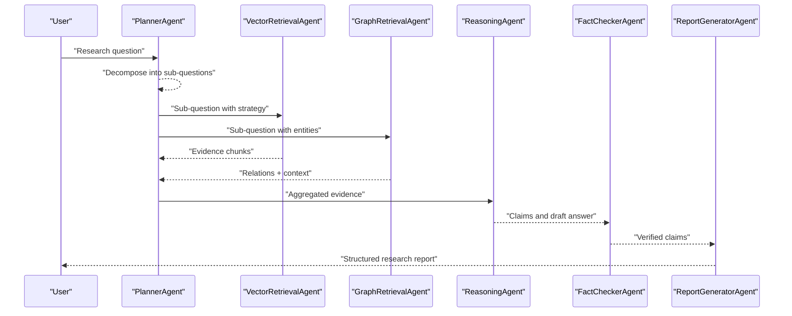
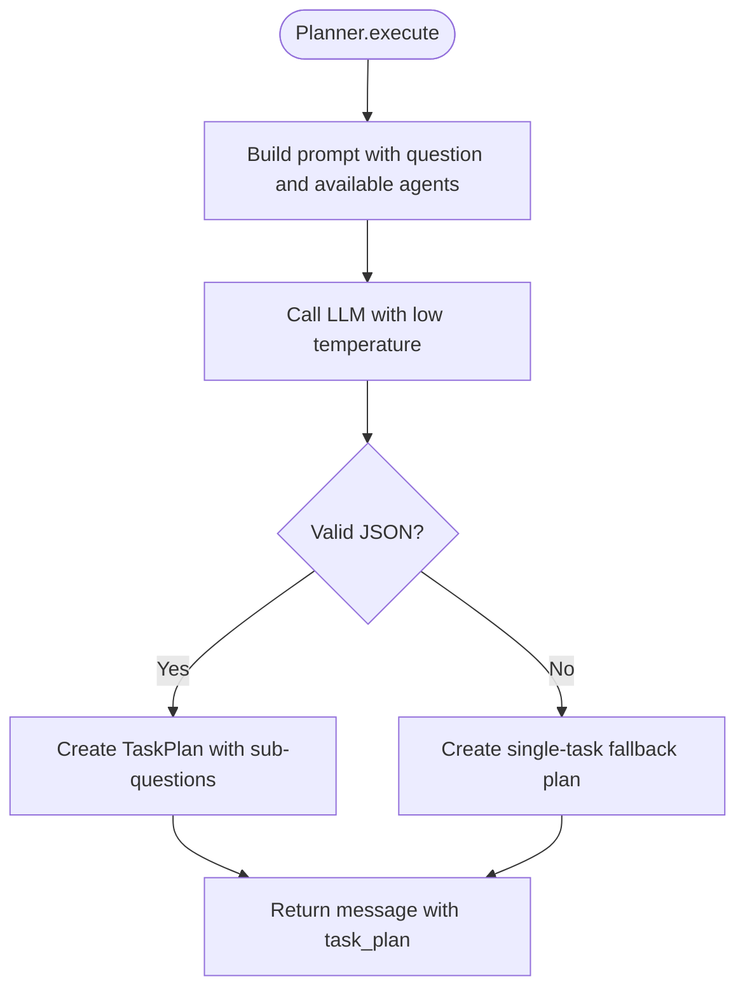
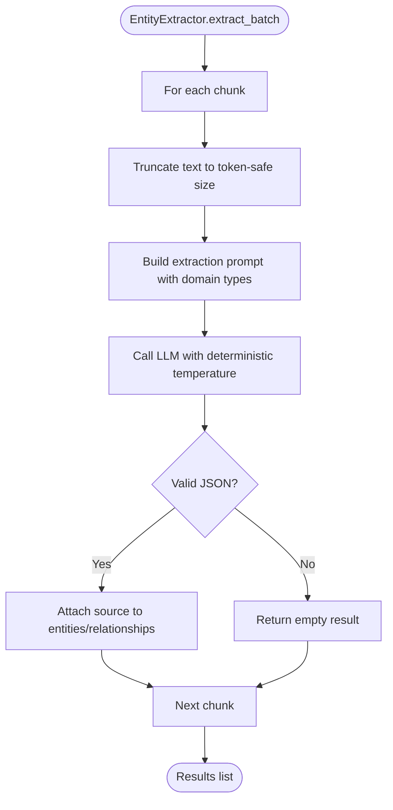
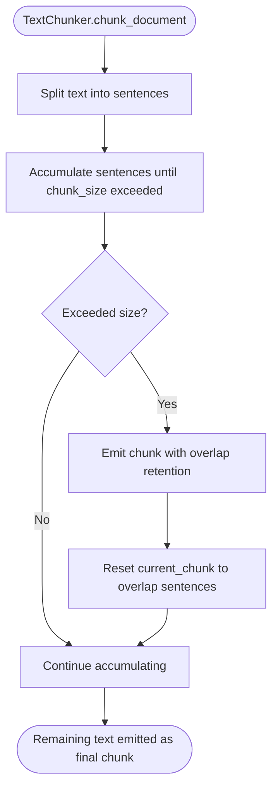
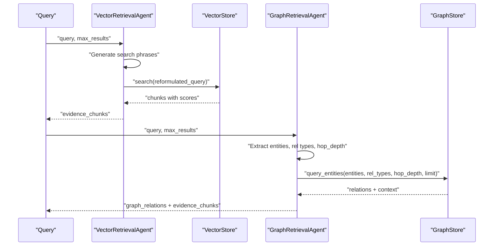
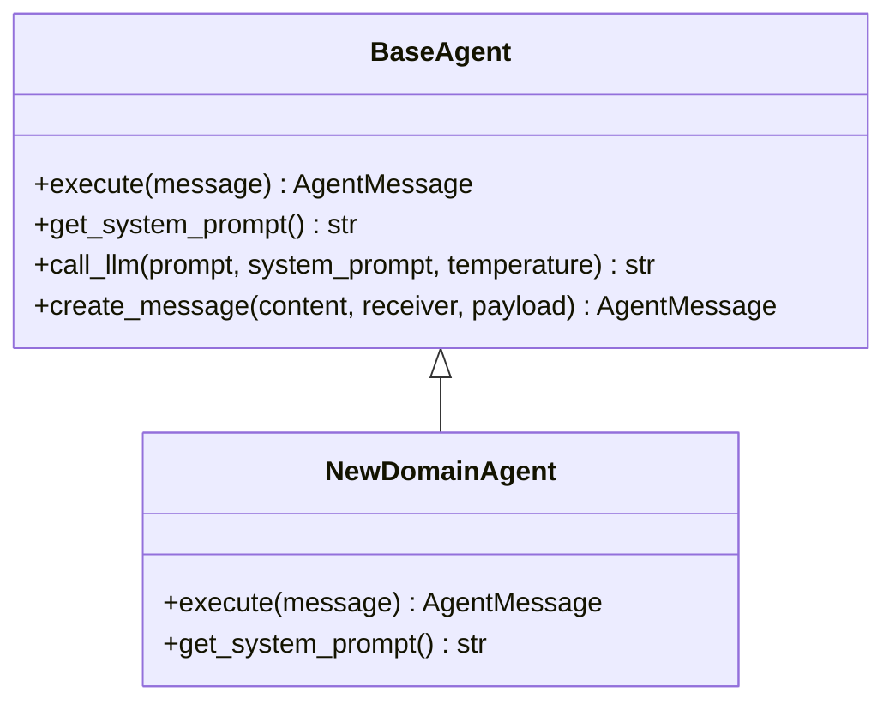
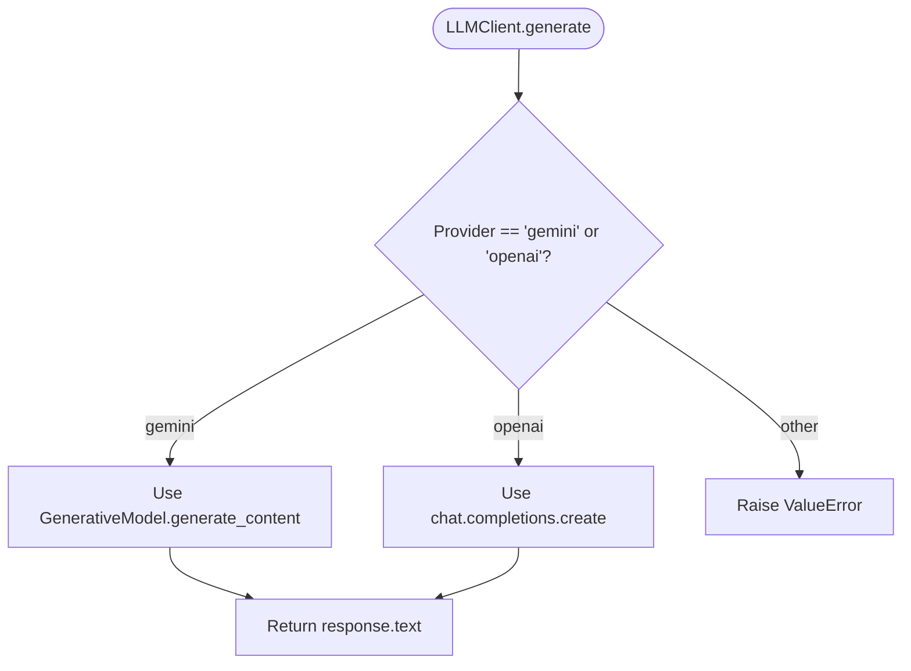
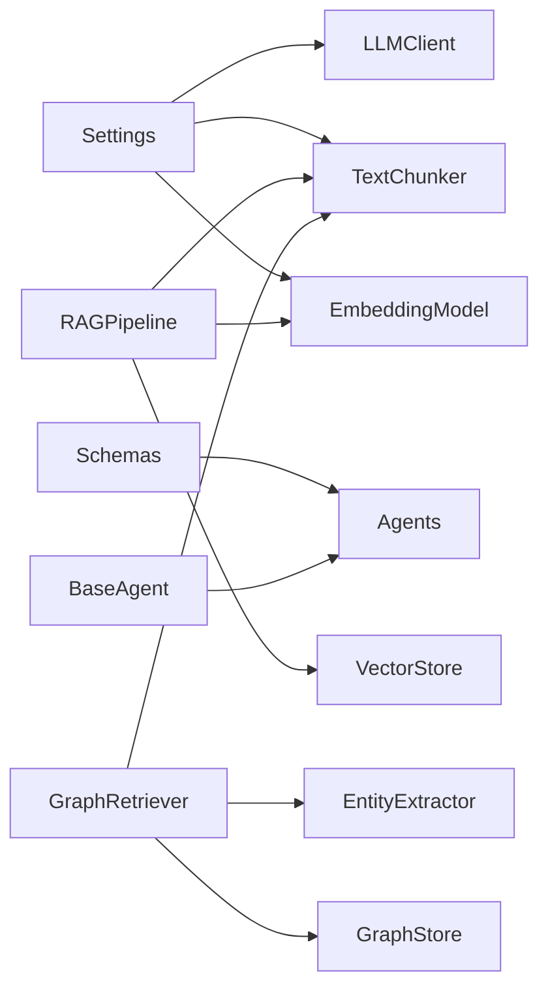

# Customization Tutorials

<cite>
**Referenced Files in This Document**
- [README.md](file://README.md)
- [config.py](file://src/config.py)
- [base_agent.py](file://src/core/base_agent.py)
- [schemas.py](file://src/core/schemas.py)
- [registry.py](file://src/core/registry.py)
- [llm.py](file://src/core/llm.py)
- [planner_agent.py](file://src/agents/planner_agent.py)
- [vector_agent.py](file://src/agents/vector_agent.py)
- [graph_agent.py](file://src/agents/graph_agent.py)
- [chunking.py](file://src/rag/chunking.py)
- [embeddings.py](file://src/rag/embeddings.py)
- [pipeline.py](file://src/rag/pipeline.py)
- [entity_extractor.py](file://src/graph/entity_extractor.py)
- [retriever.py](file://src/graph/retriever.py)
- [ingest_example.py](file://examples/ingest_example.py)
</cite>

## Table of Contents
1. Introduction
2. Project Structure
3. Core Components
4. Architecture Overview
5. Detailed Component Analysis
6. Dependency Analysis
7. Performance Considerations
8. Troubleshooting Guide
9. Conclusion
10. Appendices

## Introduction
This document provides step-by-step customization tutorials for extending the Graph RAG + Multi-Agent Research System. It focuses on:
- Customizing agent behavior by modifying planner logic and adding new agents
- Implementing custom entity extraction strategies
- Configuring text chunking algorithms
- Adjusting retrieval parameters
- Integrating custom LLM providers
- Implementing domain-specific processing rules
- Prompt engineering, embedding model fine-tuning, and graph construction optimization
- Configuration management, environment-specific settings, and testing customized components

The goal is to help you adapt the system to your domain while keeping it maintainable and testable.

## Project Structure
At a high level, the system consists of:
- Agents that decompose queries, retrieve evidence (vector and graph), reason, verify facts, and generate reports
- A RAG pipeline that loads documents, chunks them, embeds them, and indexes into a vector store
- A knowledge graph pipeline that extracts entities and relationships and stores them in a graph database
- An LLM abstraction layer supporting multiple providers
- Centralized configuration loaded from environment variables

**Diagram sources**
- [planner_agent.py:56-128](file://src/agents/planner_agent.py#L56-L128)
- [vector_agent.py:34-92](file://src/agents/vector_agent.py#L34-L92)
- [graph_agent.py:36-121](file://src/agents/graph_agent.py#L36-L121)
- [pipeline.py:19-102](file://src/rag/pipeline.py#L19-L102)
- [chunking.py:29-111](file://src/rag/chunking.py#L29-L111)
- [embeddings.py:16-58](file://src/rag/embeddings.py#L16-L58)
- [entity_extractor.py:42-101](file://src/graph/entity_extractor.py#L42-L101)
- [retriever.py:19-131](file://src/graph/retriever.py#L19-L131)
- [config.py:21-82](file://src/config.py#L21-L82)
- [llm.py:15-103](file://src/core/llm.py#L15-L103)
- [schemas.py:17-168](file://src/core/schemas.py#L17-L168)
- [registry.py:16-50](file://src/core/registry.py#L16-L50)

**Section sources**
- [README.md:5-23](file://README.md#L5-L23)
- [README.md:81-126](file://README.md#L81-L126)

## Core Components
Key building blocks you will customize:
- BaseAgent: abstract interface and shared LLM call logging
- PlannerAgent: query decomposition and execution planning
- VectorRetrievalAgent: search phrase generation and vector DB retrieval
- GraphRetrievalAgent: entity extraction from queries and graph traversal
- TextChunker: sentence-aware chunking with overlap
- EmbeddingModel: sentence-transformers embeddings
- EntityExtractor: LLM-based entity and relationship extraction
- GraphRetriever: orchestrates ingestion and querying of the knowledge graph
- LLMClient: unified provider abstraction (Gemini/OpenAI)
- Settings: centralized configuration via environment variables
- Schemas: typed models for messages, plans, evidence, and reports
- AgentRegistry: central registry for agent lookup by role

**Section sources**
- [base_agent.py:19-100](file://src/core/base_agent.py#L19-L100)
- [planner_agent.py:56-128](file://src/agents/planner_agent.py#L56-L128)
- [vector_agent.py:34-92](file://src/agents/vector_agent.py#L34-L92)
- [graph_agent.py:36-121](file://src/agents/graph_agent.py#L36-L121)
- [chunking.py:29-111](file://src/rag/chunking.py#L29-L111)
- [embeddings.py:16-58](file://src/rag/embeddings.py#L16-L58)
- [entity_extractor.py:42-101](file://src/graph/entity_extractor.py#L42-L101)
- [retriever.py:19-131](file://src/graph/retriever.py#L19-L131)
- [llm.py:15-103](file://src/core/llm.py#L15-L103)
- [config.py:21-82](file://src/config.py#L21-L82)
- [schemas.py:17-168](file://src/core/schemas.py#L17-L168)
- [registry.py:16-50](file://src/core/registry.py#L16-L50)

## Architecture Overview
The multi-agent research flow starts with a user question, which the PlannerAgent decomposes into sub-questions. Retrieval happens in parallel across vector and graph sources, optionally web search, then reasoning synthesizes evidence, fact checking verifies claims, and a report generator produces a structured output.

**Diagram sources**
- [planner_agent.py:56-128](file://src/agents/planner_agent.py#L56-L128)
- [vector_agent.py:34-92](file://src/agents/vector_agent.py#L34-L92)
- [graph_agent.py:36-121](file://src/agents/graph_agent.py#L36-L121)
- [README.md:5-23](file://README.md#L5-L23)

## Detailed Component Analysis

### Customize Planner Logic
Goal: Change how the PlannerAgent decomposes questions and selects agents.

Steps:
1. Modify the system prompt used by the PlannerAgent to reflect your domain or preferred agent set.
2. Adjust the JSON schema enforced in parsing to include new fields if needed.
3. Update available agents list in the prompt builder to enable/disable tools like web search.
4. Optionally override execute() to add custom routing or dependency resolution.

Implementation pointers:
- The planner’s system prompt defines available agents and expected JSON structure.
- The parser extracts JSON from markdown code blocks and falls back to a single-task plan if parsing fails.
- You can extend SubQuestion and TaskPlan schemas to carry additional metadata.

**Diagram sources**
- [planner_agent.py:65-128](file://src/agents/planner_agent.py#L65-L128)

**Section sources**
- [planner_agent.py:23-53](file://src/agents/planner_agent.py#L23-L53)
- [planner_agent.py:84-95](file://src/agents/planner_agent.py#L84-L95)
- [planner_agent.py:97-128](file://src/agents/planner_agent.py#L97-L128)
- [schemas.py:54-122](file://src/core/schemas.py#L54-L122)

### Implement Custom Entity Extraction Strategies
Goal: Adapt entity types and relationships to your domain.

Steps:
1. Edit the extraction prompt to define domain-specific entity and relationship types.
2. Adjust truncation length and temperature to balance precision and coverage.
3. Extend the parser to validate or normalize outputs for your domain.
4. Use batch extraction for large corpora; monitor logs for failures.

Implementation pointers:
- The extractor uses an LLM with a strict JSON schema and attaches source metadata.
- Batch processing includes progress logging every N chunks.
- Errors are caught and logged; empty results are returned safely.

**Diagram sources**
- [entity_extractor.py:42-101](file://src/graph/entity_extractor.py#L42-L101)

**Section sources**
- [entity_extractor.py:17-39](file://src/graph/entity_extractor.py#L17-L39)
- [entity_extractor.py:48-86](file://src/graph/entity_extractor.py#L48-L86)
- [entity_extractor.py:88-101](file://src/graph/entity_extractor.py#L88-L101)

### Configure Text Chunking Algorithms
Goal: Tune chunk size and overlap to improve retrieval quality.

Steps:
1. Set CHUNK_SIZE and CHUNK_OVERLAP in environment variables or pass overrides when constructing TextChunker.
2. Understand that chunking splits by sentences and maintains overlap to preserve context.
3. For specialized domains, consider subclassing TextChunker to implement domain-aware splitting (e.g., paragraph or section boundaries).

Implementation pointers:
- Defaults come from Settings; you can override at runtime.
- Sentence splitting uses a simple regex; adjust if your texts have unusual punctuation.

**Diagram sources**
- [chunking.py:29-111](file://src/rag/chunking.py#L29-L111)

**Section sources**
- [chunking.py:17-40](file://src/rag/chunking.py#L17-L40)
- [chunking.py:41-104](file://src/rag/chunking.py#L41-L104)
- [chunking.py:106-111](file://src/rag/chunking.py#L106-L111)
- [config.py:59-62](file://src/config.py#L59-L62)

### Adjust Retrieval Parameters
Goal: Optimize vector and graph retrieval for your use case.

Vector retrieval:
- Use VectorRetrievalAgent to generate optimized search phrases and reformulated queries before searching the vector store.
- Control max_results per agent call; tune at runtime via message payload.

Graph retrieval:
- Use GraphRetrievalAgent to extract entities and relationship types from queries.
- Adjust hop_depth and relationship_types to control traversal breadth.
- Use GraphRetriever.query to set limit and relationship filters.

Implementation pointers:
- Both agents fall back gracefully if LLM parsing fails.
- GraphRetriever aggregates entities and relationships, deduplicates entities, and persists to GraphStore.

**Diagram sources**
- [vector_agent.py:44-92](file://src/agents/vector_agent.py#L44-L92)
- [graph_agent.py:46-121](file://src/agents/graph_agent.py#L46-L121)
- [retriever.py:99-118](file://src/graph/retriever.py#L99-L118)

**Section sources**
- [vector_agent.py:17-31](file://src/agents/vector_agent.py#L17-L31)
- [vector_agent.py:44-92](file://src/agents/vector_agent.py#L44-L92)
- [graph_agent.py:17-33](file://src/agents/graph_agent.py#L17-L33)
- [graph_agent.py:46-121](file://src/agents/graph_agent.py#L46-L121)
- [retriever.py:42-97](file://src/graph/retriever.py#L42-L97)

### Add New Agent Types
Goal: Introduce a new agent role and integrate it into the planner and registry.

Steps:
1. Define a new AgentRole in schemas.
2. Create a new agent class inheriting from BaseAgent implementing execute() and get_system_prompt().
3. Register the agent using AgentRegistry so the planner can discover it.
4. Update the planner’s available agents list and prompt to include the new role.

Implementation pointers:
- BaseAgent handles LLM calls and execution logging; focus on domain logic in execute().
- Use create_message() to return structured payloads.

**Diagram sources**
- [base_agent.py:19-100](file://src/core/base_agent.py#L19-L100)

**Section sources**
- [schemas.py:17-25](file://src/core/schemas.py#L17-L25)
- [base_agent.py:19-100](file://src/core/base_agent.py#L19-L100)
- [registry.py:16-50](file://src/core/registry.py#L16-L50)
- [planner_agent.py:84-95](file://src/agents/planner_agent.py#L84-L95)

### Integrate Custom LLM Providers
Goal: Support a new LLM backend beyond Gemini and OpenAI.

Steps:
1. Extend LLMClient._init_client() to initialize your provider.
2. Add a branch in generate() to route calls to your provider implementation.
3. Add provider-specific settings in Settings (e.g., API key, model name).
4. Ensure token counting works or provide a fallback approximation.

Implementation pointers:
- Provider selection is driven by LLM_PROVIDER setting.
- Temperature and max_tokens are configurable per call or via settings.

**Diagram sources**
- [llm.py:15-103](file://src/core/llm.py#L15-L103)

**Section sources**
- [llm.py:15-39](file://src/core/llm.py#L15-L39)
- [llm.py:40-87](file://src/core/llm.py#L40-L87)
- [llm.py:89-103](file://src/core/llm.py#L89-L103)
- [config.py:31-37](file://src/config.py#L31-L37)

### Implement Domain-Specific Processing Rules
Goal: Apply domain rules during ingestion, extraction, or retrieval.

Options:
- Ingestion: subclass or wrap TextChunker to split by domain sections (e.g., headings, XML tags).
- Extraction: refine entity/relationship types and constraints in the extraction prompt; add post-processing to normalize terms.
- Retrieval: inject domain filters (e.g., relationship_types) or boost certain entities based on metadata.

Implementation pointers:
- Use metadata attached to chunks to tag domain-specific attributes.
- Leverage GraphStore filters to constrain queries to relevant relationship types.

**Section sources**
- [chunking.py:29-111](file://src/rag/chunking.py#L29-L111)
- [entity_extractor.py:17-39](file://src/graph/entity_extractor.py#L17-L39)
- [retriever.py:99-118](file://src/graph/retriever.py#L99-L118)

### Prompt Engineering for Better Results
Guidelines:
- Provide clear instructions and explicit JSON schemas in system prompts.
- Use low temperature for deterministic outputs (e.g., planner, extraction).
- Include examples or constraints to reduce hallucinations.
- Validate LLM responses and implement robust fallbacks.

Where to apply:
- PlannerAgent system prompt for decomposition and agent selection.
- VectorRetrievalAgent prompt for search phrase generation.
- GraphRetrievalAgent prompt for entity and relationship extraction.
- EntityExtractor prompt for domain-specific knowledge extraction.

**Section sources**
- [planner_agent.py:23-53](file://src/agents/planner_agent.py#L23-L53)
- [vector_agent.py:17-31](file://src/agents/vector_agent.py#L17-L31)
- [graph_agent.py:17-33](file://src/agents/graph_agent.py#L17-L33)
- [entity_extractor.py:17-39](file://src/graph/entity_extractor.py#L17-L39)

### Fine-Tune Embedding Models
Goal: Improve semantic similarity for your domain.

Steps:
1. Choose a base model suitable for your language/domain.
2. Fine-tune using sentence-transformers on domain-specific pairs or contrastive data.
3. Replace EMBEDDING_MODEL in Settings and ensure EMBEDDING_DIMENSION matches the fine-tuned model.
4. Re-index documents after switching models.

Implementation pointers:
- EmbeddingModel wraps sentence-transformers and supports batch encoding.
- Similarity computation uses cosine similarity.

**Section sources**
- [embeddings.py:16-58](file://src/rag/embeddings.py#L16-L58)
- [config.py:39-41](file://src/config.py#L39-L41)

### Optimize Graph Construction for Specific Domains
Goal: Improve entity and relationship quality for domain texts.

Steps:
1. Refine entity and relationship types in the extraction prompt.
2. Increase chunk size for richer context during extraction; keep smaller chunks for vector retrieval.
3. Deduplicate entities by normalized names; enforce consistent casing or synonyms.
4. Filter relationships by relevance or weight during queries.

Implementation pointers:
- GraphRetriever orchestrates chunking, extraction, deduplication, and persistence.
- Query methods allow limiting hops and filtering relationship types.

**Section sources**
- [retriever.py:42-97](file://src/graph/retriever.py#L42-L97)
- [retriever.py:99-118](file://src/graph/retriever.py#L99-L118)
- [entity_extractor.py:48-86](file://src/graph/entity_extractor.py#L48-L86)

### Configuration Management and Environment-Specific Settings
Goal: Manage settings per environment and avoid hardcoding secrets.

Steps:
1. Store secrets and environment-specific values in .env files.
2. Use Settings to load configuration; access via get_settings().
3. Override defaults in tests or CI environments using environment variables.
4. Keep sensitive keys out of version control.

Implementation pointers:
- Settings covers application, LLM, embeddings, vector DB, knowledge graph, web search, document processing, evaluation, and paths.
- get_settings() returns a cached instance.

**Section sources**
- [config.py:21-82](file://src/config.py#L21-L82)

### Testing Customized Components
Goal: Validate changes to agents, chunking, extraction, and retrieval.

Approach:
- Unit tests: mock LLMClient to return controlled responses; assert parsed structures.
- Integration tests: run ingest_example against a small dataset; verify counts and summaries.
- Parameter sweeps: vary chunk_size, chunk_overlap, hop_depth, and relationship_types to measure impact.

Implementation pointers:
- Use ingest_example to exercise both vector and graph pipelines end-to-end.
- Leverage logger output to trace steps and errors.

**Section sources**
- [ingest_example.py:16-99](file://examples/ingest_example.py#L16-L99)

## Dependency Analysis
Key dependencies and coupling:
- Agents depend on BaseAgent and LLMClient; they also rely on Schemas for typed messages and payloads.
- RAGPipeline depends on DocumentLoader, TextChunker, EmbeddingModel, and VectorStore.
- GraphRetriever depends on EntityExtractor, GraphStore, DocumentLoader, and TextChunker.
- Settings centralizes configuration consumed by LLMClient, TextChunker, and EmbeddingModel.

**Diagram sources**
- [config.py:21-82](file://src/config.py#L21-L82)
- [llm.py:15-103](file://src/core/llm.py#L15-L103)
- [chunking.py:29-111](file://src/rag/chunking.py#L29-L111)
- [embeddings.py:16-58](file://src/rag/embeddings.py#L16-L58)
- [pipeline.py:19-102](file://src/rag/pipeline.py#L19-L102)
- [retriever.py:19-131](file://src/graph/retriever.py#L19-L131)
- [schemas.py:17-168](file://src/core/schemas.py#L17-L168)
- [base_agent.py:19-100](file://src/core/base_agent.py#L19-L100)

**Section sources**
- [pipeline.py:19-102](file://src/rag/pipeline.py#L19-L102)
- [retriever.py:19-131](file://src/graph/retriever.py#L19-L131)
- [config.py:21-82](file://src/config.py#L21-L82)

## Performance Considerations
- Chunking: Larger chunks improve context but increase token usage; tune chunk_size and overlap for your corpus.
- Embeddings: Batch encoding reduces overhead; choose models balancing accuracy and speed.
- Retrieval: Limit hop_depth and relationship_types to reduce graph traversal cost; cap n_results for vector search.
- LLM calls: Use low temperature for deterministic tasks; cache repeated prompts where possible.
- Logging: Monitor execution stats via BaseAgent.get_execution_stats() to track latency and token usage.

[No sources needed since this section provides general guidance]

## Troubleshooting Guide
Common issues and remedies:
- Invalid LLM JSON responses: Both planner and extractor parse JSON with fallbacks; check logs for warnings and refine prompts.
- Missing vector store or graph store: Agents log warnings and return empty results; ensure stores are configured and initialized.
- No chunks generated: Verify input text is non-empty and chunking parameters are reasonable.
- Provider misconfiguration: Ensure LLM_PROVIDER and corresponding API keys/models are set correctly.

**Section sources**
- [planner_agent.py:97-128](file://src/agents/planner_agent.py#L97-L128)
- [entity_extractor.py:88-101](file://src/graph/entity_extractor.py#L88-L101)
- [vector_agent.py:73-75](file://src/agents/vector_agent.py#L73-L75)
- [graph_agent.py:95-97](file://src/agents/graph_agent.py#L95-L97)
- [pipeline.py:59-61](file://src/rag/pipeline.py#L59-L61)
- [llm.py:25-39](file://src/core/llm.py#L25-L39)

## Conclusion
By following these tutorials, you can tailor the system to your domain through:
- Custom planner logic and new agent types
- Domain-specific entity extraction and relationship modeling
- Tuned chunking and retrieval parameters
- Integrated custom LLM providers and fine-tuned embeddings
- Robust configuration and testing practices

These changes enable more accurate, efficient, and domain-aligned research workflows.

[No sources needed since this section summarizes without analyzing specific files]

## Appendices

### Quick Reference: Key Configuration Keys
- LLM provider and models: LLM_PROVIDER, GEMINI_API_KEY, GEMINI_MODEL, OPENAI_API_KEY, OPENAI_MODEL, TEMPERATURE
- Embeddings: EMBEDDING_MODEL, EMBEDDING_DIMENSION
- Vector DB: VECTOR_DB_TYPE, CHROMA_HOST, CHROMA_PORT, CHROMA_COLLECTION, FAISS_INDEX_PATH
- Knowledge graph: NEO4J_URI, NEO4J_USER, NEO4J_PASSWORD
- Web search: SERPER_API_KEY, DUCKDUCKGO_ENABLED
- Document processing: CHUNK_SIZE, CHUNK_OVERLAP, MAX_UPLOAD_SIZE_MB
- Paths: DATA_DIR, DOCS_DIR

**Section sources**
- [config.py:21-82](file://src/config.py#L21-L82)