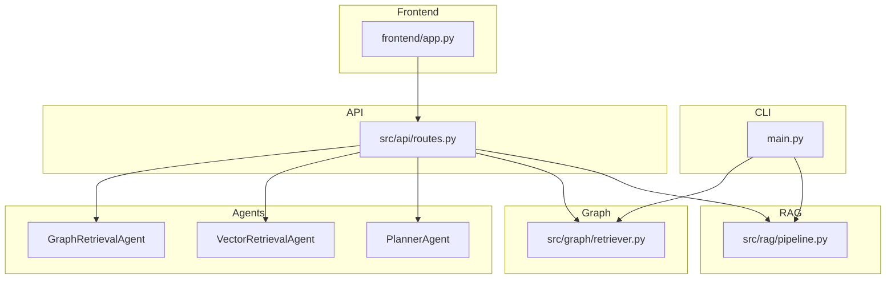
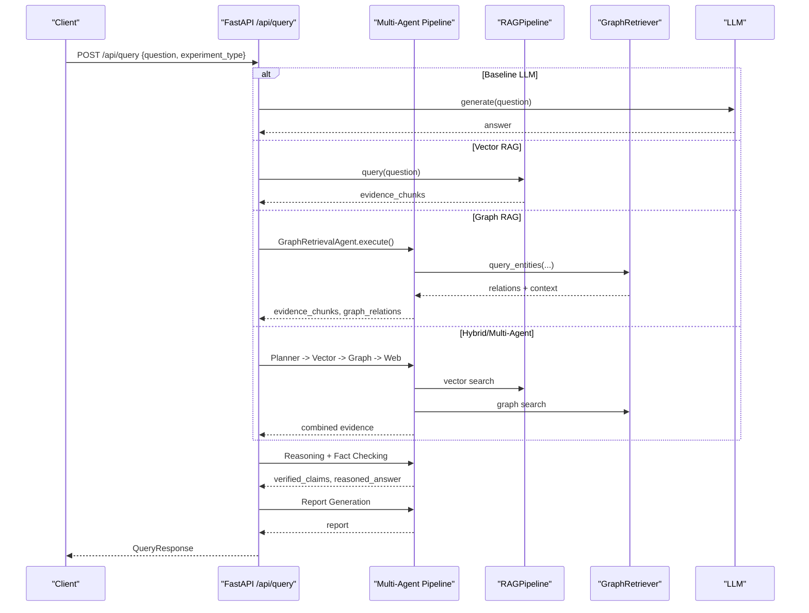
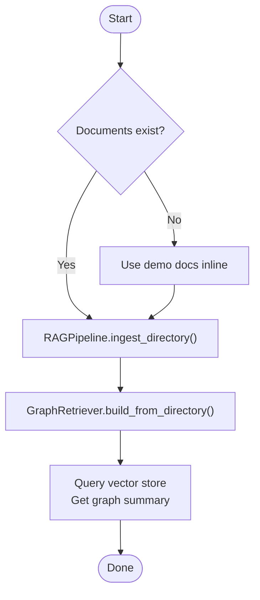
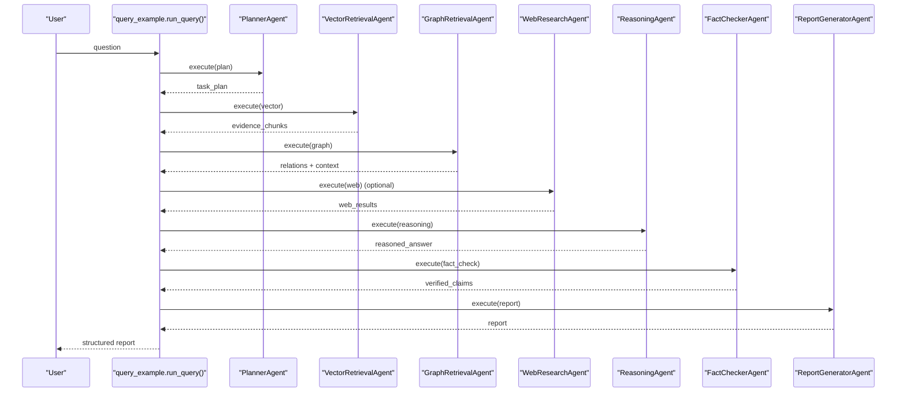
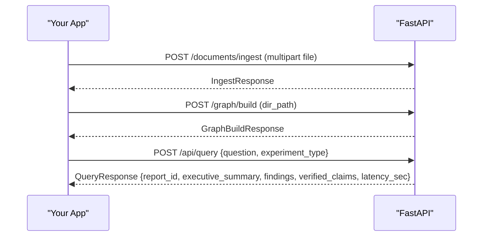
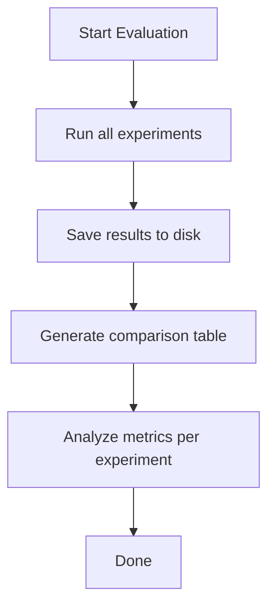
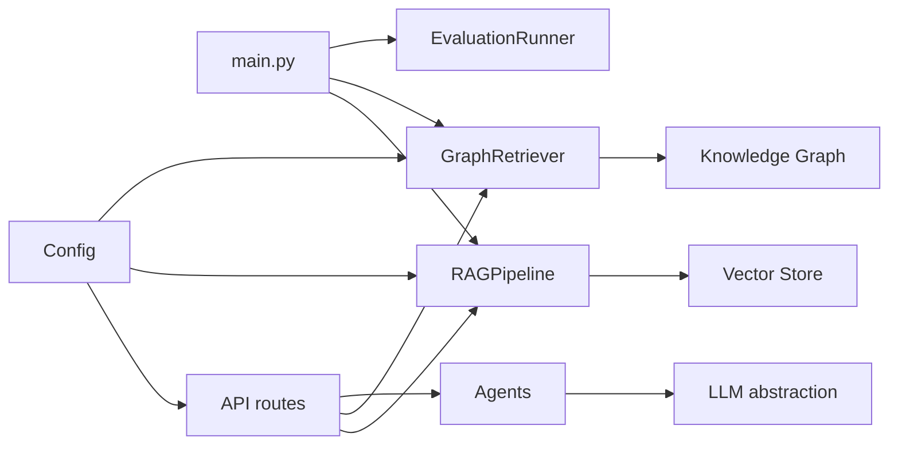

# Examples and Tutorials

<cite>
**Referenced Files in This Document**
- [README.md](file://README.md)
- [main.py](file://main.py)
- [examples/ingest_example.py](file://examples/ingest_example.py)
- [examples/query_example.py](file://examples/query_example.py)
- [src/config.py](file://src/config.py)
- [src/core/schemas.py](file://src/core/schemas.py)
- [src/rag/pipeline.py](file://src/rag/pipeline.py)
- [src/graph/retriever.py](file://src/graph/retriever.py)
- [src/api/routes.py](file://src/api/routes.py)
- [src/agents/planner_agent.py](file://src/agents/planner_agent.py)
- [src/agents/vector_agent.py](file://src/agents/vector_agent.py)
- [src/agents/graph_agent.py](file://src/agents/graph_agent.py)
- [src/evaluation/metrics.py](file://src/evaluation/metrics.py)
- [frontend/app.py](file://frontend/app.py)
</cite>

## Table of Contents
1. Introduction
2. Project Structure
3. Core Components
4. Architecture Overview
5. Detailed Component Analysis
6. Dependency Analysis
7. Performance Considerations
8. Troubleshooting Guide
9. Conclusion
10. Appendices

## Introduction
This document provides practical, step-by-step tutorials for using the Graph RAG + Multi-Agent Research System (GraphRAG-MARS). It covers:
- Ingesting documents from files or directories into a vector store
- Building knowledge graphs from corpora
- Executing research queries with different retrieval strategies (baseline LLM, vector RAG, graph RAG, hybrid RAG, multi-agent)
- Analyzing evaluation results
- Programmatic integration via the Python SDK and REST API
- Customizing agent behavior, retrieval strategies, and performance tuning
- Production deployment best practices and troubleshooting

The system combines knowledge graphs, vector search, web research, planning, reasoning, fact-checking, and report generation to produce evidence-grounded research reports.

**Section sources**
- [README.md:1-169](file://README.md#L1-L169)

## Project Structure
At a high level:
- CLI entry point orchestrates server, ingestion, graph building, and evaluation
- RAG pipeline handles document loading, chunking, embedding, and vector indexing
- Graph retriever builds and queries a knowledge graph
- Agents implement modular retrieval, reasoning, verification, and reporting
- API exposes endpoints for ingestion, querying, and evaluation
- Frontend provides an interactive UI

**Diagram sources**
- [main.py:24-69](file://main.py#L24-L69)
- [src/rag/pipeline.py:19-102](file://src/rag/pipeline.py#L19-L102)
- [src/graph/retriever.py:19-131](file://src/graph/retriever.py#L19-L131)
- [src/api/routes.py:116-354](file://src/api/routes.py#L116-L354)
- [frontend/app.py:50-300](file://frontend/app.py#L50-L300)

**Section sources**
- [README.md:81-126](file://README.md#L81-L126)
- [main.py:71-111](file://main.py#L71-L111)

## Core Components
- RAGPipeline: Loads documents, chunks text, generates embeddings, and indexes into a vector store; supports query by embedding and searching.
- GraphRetriever: Builds a knowledge graph from documents by extracting entities and relationships; supports entity-based queries and summaries.
- Agents: Planner decomposes questions; Vector and Graph agents retrieve evidence; Reasoning synthesizes; Fact Checker verifies; Report Generator produces structured outputs.
- API Routes: Expose ingestion, graph building, querying, and evaluation endpoints.
- Configuration: Centralized settings loaded from environment variables.

Key usage patterns:
- Programmatic ingestion and querying via RAGPipeline and GraphRetriever
- End-to-end multi-agent research via AgentMessage flows
- REST API calls for ingestion, graph build, and query execution

**Section sources**
- [src/rag/pipeline.py:19-102](file://src/rag/pipeline.py#L19-L102)
- [src/graph/retriever.py:19-131](file://src/graph/retriever.py#L19-L131)
- [src/agents/planner_agent.py:56-128](file://src/agents/planner_agent.py#L56-L128)
- [src/agents/vector_agent.py:34-92](file://src/agents/vector_agent.py#L34-L92)
- [src/agents/graph_agent.py:36-121](file://src/agents/graph_agent.py#L36-L121)
- [src/api/routes.py:116-354](file://src/api/routes.py#L116-L354)
- [src/config.py:21-82](file://src/config.py#L21-L82)

## Architecture Overview
The system supports five experiment configurations: baseline LLM, vector RAG, graph RAG, hybrid RAG, and full multi-agent pipeline. The API routes dispatch based on the requested experiment type and assemble evidence from multiple sources before reasoning, fact-checking, and report generation.

**Diagram sources**
- [src/api/routes.py:188-338](file://src/api/routes.py#L188-L338)
- [src/rag/pipeline.py:90-102](file://src/rag/pipeline.py#L90-L102)
- [src/graph/retriever.py:99-131](file://src/graph/retriever.py#L99-L131)
- [src/agents/planner_agent.py:65-82](file://src/agents/planner_agent.py#L65-L82)
- [src/agents/vector_agent.py:44-81](file://src/agents/vector_agent.py#L44-L81)
- [src/agents/graph_agent.py:46-109](file://src/agents/graph_agent.py#L46-L109)

## Detailed Component Analysis

### Tutorial 1: Ingest Documents and Build Knowledge Graph
Goal: Load documents into the vector store and construct a knowledge graph.

Steps:
1. Prepare documents in data/documents or provide inline demo texts.
2. Use RAGPipeline to ingest files or directories.
3. Use GraphRetriever to build the knowledge graph from the same documents.
4. Verify ingestion by querying the vector store and inspecting graph summary.

Programmatic flow:
- Create RAGPipeline and call ingest_directory or ingest_file.
- Create GraphRetriever and call build_from_directory or build_from_documents.
- Optionally run query to validate vector retrieval and get graph summary.

**Diagram sources**
- [examples/ingest_example.py:16-94](file://examples/ingest_example.py#L16-L94)
- [src/rag/pipeline.py:33-88](file://src/rag/pipeline.py#L33-L88)
- [src/graph/retriever.py:32-97](file://src/graph/retriever.py#L32-L97)

**Section sources**
- [examples/ingest_example.py:16-94](file://examples/ingest_example.py#L16-L94)
- [src/rag/pipeline.py:33-88](file://src/rag/pipeline.py#L33-L88)
- [src/graph/retriever.py:32-97](file://src/graph/retriever.py#L32-L97)

### Tutorial 2: Execute Research Queries with Different Strategies
Goal: Run a research question through various pipelines and compare outputs.

Options:
- Baseline LLM: Direct LLM response without retrieval
- Vector RAG: Retrieve semantically similar chunks then synthesize
- Graph RAG: Retrieve entity relationships and context
- Hybrid RAG: Combine vector and graph retrieval
- Multi-Agent: Full pipeline with planning, reasoning, fact-checking, and report generation

Programmatic flow:
- Initialize agents and components
- Plan the task (optional for advanced modes)
- Retrieve evidence from vector store, knowledge graph, and optionally web
- Synthesize reasoning, verify claims, and generate report

**Diagram sources**
- [examples/query_example.py:25-176](file://examples/query_example.py#L25-L176)
- [src/agents/planner_agent.py:65-82](file://src/agents/planner_agent.py#L65-L82)
- [src/agents/vector_agent.py:44-81](file://src/agents/vector_agent.py#L44-L81)
- [src/agents/graph_agent.py:46-109](file://src/agents/graph_agent.py#L46-L109)

**Section sources**
- [examples/query_example.py:25-176](file://examples/query_example.py#L25-L176)
- [src/agents/planner_agent.py:65-82](file://src/agents/planner_agent.py#L65-L82)
- [src/agents/vector_agent.py:44-81](file://src/agents/vector_agent.py#L44-L81)
- [src/agents/graph_agent.py:46-109](file://src/agents/graph_agent.py#L46-L109)

### Tutorial 3: Integrate via REST API
Goal: Embed the system into existing applications using HTTP requests.

Common workflows:
- Health check and status
- Upload and ingest documents
- Build knowledge graph from directory
- Run research queries with different experiment types
- Run evaluation benchmarks

Example endpoints:
- GET /status
- POST /documents/ingest
- POST /documents/ingest-directory
- POST /graph/build
- GET /graph/summary
- POST /api/query
- POST /evaluate/run

Request/response models are defined in the API routes and schemas.

**Diagram sources**
- [src/api/routes.py:116-354](file://src/api/routes.py#L116-L354)
- [src/core/schemas.py:45-168](file://src/core/schemas.py#L45-L168)

**Section sources**
- [src/api/routes.py:116-354](file://src/api/routes.py#L116-L354)
- [src/core/schemas.py:45-168](file://src/core/schemas.py#L45-L168)

### Tutorial 4: Customize Agent Behavior and Retrieval Strategies
- Planner Agent: Adjust system prompt to influence decomposition strategy and agent selection.
- Vector Retrieval Agent: Tune search phrases and reformulated queries via LLM prompts; adjust max_results.
- Graph Retrieval Agent: Control entity extraction, relationship types, and hop depth; tune limit.
- Experiment Type: Choose baseline_llm, vector_rag, graph_rag, hybrid_rag, or multi_agent depending on needs.

Configuration knobs:
- Chunk size and overlap for document processing
- Embedding model and dimension
- Vector DB type and collection/index paths
- Neo4j connection details
- Web search toggles and API keys

**Section sources**
- [src/agents/planner_agent.py:23-53](file://src/agents/planner_agent.py#L23-L53)
- [src/agents/vector_agent.py:17-31](file://src/agents/vector_agent.py#L17-L31)
- [src/agents/graph_agent.py:17-33](file://src/agents/graph_agent.py#L17-L33)
- [src/config.py:21-82](file://src/config.py#L21-L82)

### Tutorial 5: Batch Processing and Real-Time Interfaces
- Batch ingestion: Use ingest_directory or API /documents/ingest-directory to process many files at once.
- Real-time queries: Use /api/query with appropriate experiment_type and include_web_search flags.
- Frontend: Streamlit app provides tabs for query, ingestion, graph management, and evaluation.

Operational tips:
- For large corpora, consider increasing chunk sizes for graph construction and adjusting overlap.
- Use separate processes or queues for long-running tasks like graph building.
- Monitor latency and token usage via evaluation metrics.

**Section sources**
- [src/rag/pipeline.py:33-88](file://src/rag/pipeline.py#L33-L88)
- [src/graph/retriever.py:32-97](file://src/graph/retriever.py#L32-L97)
- [src/api/routes.py:134-185](file://src/api/routes.py#L134-L185)
- [frontend/app.py:50-300](file://frontend/app.py#L50-L300)

### Tutorial 6: Analyze Evaluation Results
Run the benchmark suite to compare architectures across metrics such as precision@k, recall@k, MRR, factual correctness, faithfulness, hallucination rate, latency, and token usage.

Steps:
- Call /evaluate/run or use CLI evaluate command
- Inspect saved JSON results and comparison tables
- Use metrics functions to compute custom scores if needed

**Diagram sources**
- [src/evaluation/metrics.py:139-255](file://src/evaluation/metrics.py#L139-L255)
- [main.py:59-69](file://main.py#L59-L69)

**Section sources**
- [src/evaluation/metrics.py:139-255](file://src/evaluation/metrics.py#L139-L255)
- [main.py:59-69](file://main.py#L59-L69)

## Dependency Analysis
Core dependencies and interactions:
- main.py orchestrates CLI commands that delegate to RAGPipeline, GraphRetriever, and EvaluationRunner.
- API routes lazily initialize services and agents, coordinating retrieval and synthesis.
- Schemas define consistent message and result structures across agents and API responses.
- Config centralizes environment-driven settings for LLMs, embeddings, vector stores, and graphs.

**Diagram sources**
- [main.py:24-69](file://main.py#L24-L69)
- [src/api/routes.py:28-75](file://src/api/routes.py#L28-L75)
- [src/config.py:21-82](file://src/config.py#L21-L82)

**Section sources**
- [main.py:24-69](file://main.py#L24-L69)
- [src/api/routes.py:28-75](file://src/api/routes.py#L28-L75)
- [src/config.py:21-82](file://src/config.py#L21-L82)

## Performance Considerations
- Chunking: Increase chunk size for graph construction to capture richer context; tune overlap to balance redundancy and coverage.
- Embeddings: Select an embedding model appropriate for your domain; ensure dimension matches vector store expectations.
- Vector Store: Choose between ChromaDB and FAISS based on scale and query patterns; configure index paths and collections.
- Graph Store: Configure Neo4j connection parameters; optimize hop depth and relationship filters to reduce query cost.
- Web Search: Toggle web search off for faster responses when not needed; set result limits.
- Latency: Monitor latency in API responses; consider batching and caching strategies for repeated queries.
- Token Usage: Reduce prompt lengths and reuse retrieved evidence to minimize token consumption.

[No sources needed since this section provides general guidance]

## Troubleshooting Guide
Common issues and resolutions:
- No documents found during ingestion: Ensure data/documents contains supported files or use demo docs; verify paths and permissions.
- Empty vector results: Confirm embeddings are generated and stored; check vector store configuration and search parameters.
- Graph build returns zero entities: Verify document content is readable and chunking produces meaningful segments; check entity extractor prompts and LLM availability.
- API errors: Validate request payloads; ensure required environment variables (API keys, database URIs) are set; check service health via /status.
- Evaluation failures: Confirm benchmark dataset path exists; ensure LLM client is configured; review saved results for diagnostics.

Operational checks:
- Use /status to verify vector store document count and knowledge graph summary.
- Inspect logs for warnings about missing components or empty results.
- For production, enable proper logging levels and monitor resource usage.

**Section sources**
- [examples/ingest_example.py:21-31](file://examples/ingest_example.py#L21-L31)
- [src/rag/pipeline.py:59-61](file://src/rag/pipeline.py#L59-L61)
- [src/graph/retriever.py:56-58](file://src/graph/retriever.py#L56-L58)
- [src/api/routes.py:116-131](file://src/api/routes.py#L116-L131)
- [src/evaluation/metrics.py:217-224](file://src/evaluation/metrics.py#L217-L224)

## Conclusion
GraphRAG-MARS provides a flexible, extensible framework for evidence-grounded research. By combining vector search, knowledge graphs, web research, and multi-agent orchestration, it supports diverse use cases from quick answers to deep, verifiable reports. Use the provided examples and API to integrate into applications, customize agent behavior, and optimize performance for your specific needs.

[No sources needed since this section summarizes without analyzing specific files]

## Appendices

### A. Quick Start Commands
- Start server: python main.py serve
- Ingest documents: python main.py ingest ./data/documents
- Build knowledge graph: python main.py graph ./data/documents
- Run evaluation: python main.py evaluate
- Frontend: streamlit run frontend/app.py

**Section sources**
- [README.md:35-79](file://README.md#L35-L79)
- [main.py:71-111](file://main.py#L71-L111)

### B. API Endpoints Reference
- GET /health
- GET /api/status
- POST /api/documents/ingest
- POST /api/documents/ingest-directory
- POST /api/graph/build
- GET /api/graph/summary
- POST /api/query
- POST /api/evaluate/run

**Section sources**
- [README.md:153-165](file://README.md#L153-L165)
- [src/api/routes.py:116-354](file://src/api/routes.py#L116-L354)

### C. Data Models Overview
Key models used across agents and API:
- ResearchQuery, SubQuestion, TaskPlan
- EvidenceChunk, GraphRelation, WebResult
- Claim, ResearchReport
- EvaluationResult

These models ensure consistent messaging and responses throughout the pipeline.

**Section sources**
- [src/core/schemas.py:45-168](file://src/core/schemas.py#L45-L168)