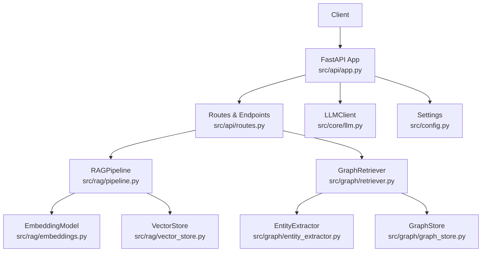
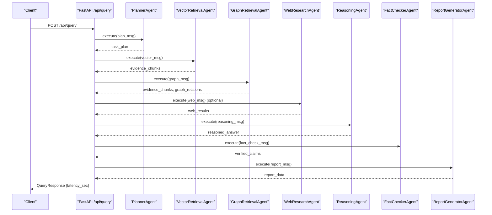
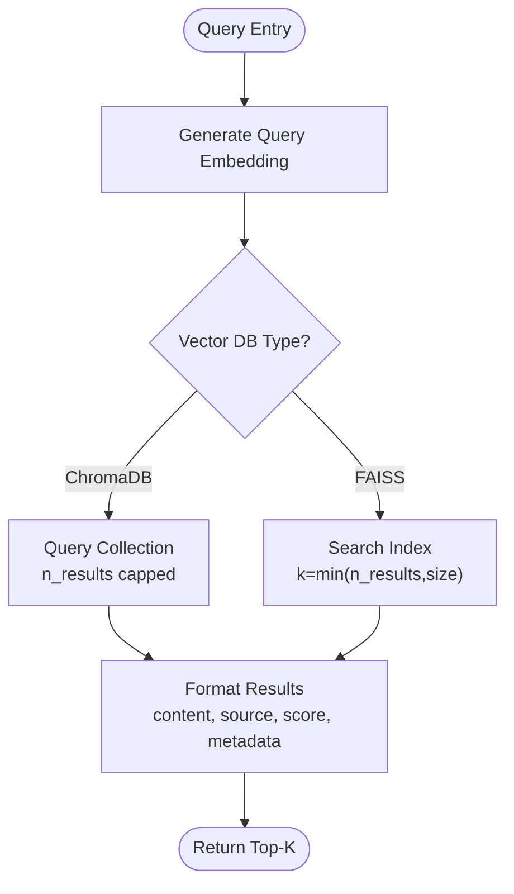
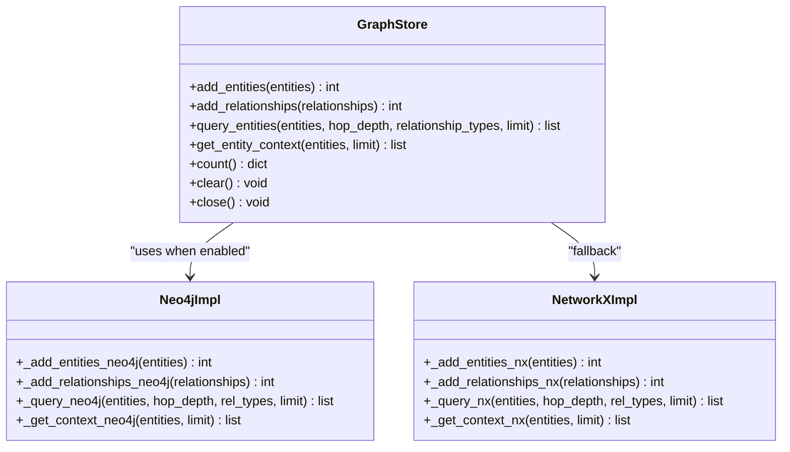
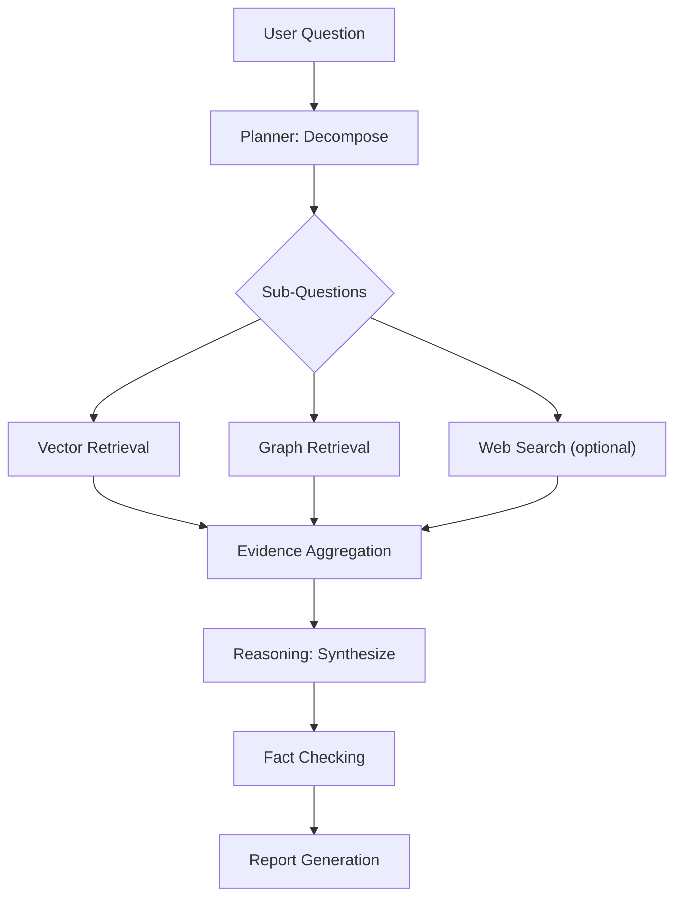
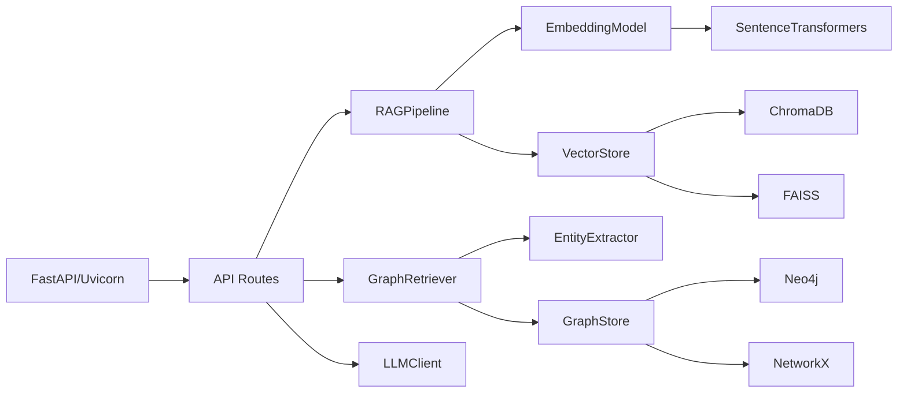

# Performance Optimization Guides

<cite>
**Referenced Files in This Document**
- [main.py](file://main.py)
- [src/config.py](file://src/config.py)
- [src/api/app.py](file://src/api/app.py)
- [src/api/routes.py](file://src/api/routes.py)
- [src/rag/pipeline.py](file://src/rag/pipeline.py)
- [src/rag/vector_store.py](file://src/rag/vector_store.py)
- [src/rag/embeddings.py](file://src/rag/embeddings.py)
- [src/graph/retriever.py](file://src/graph/retriever.py)
- [src/graph/graph_store.py](file://src/graph/graph_store.py)
- [src/graph/entity_extractor.py](file://src/graph/entity_extractor.py)
- [src/core/base_agent.py](file://src/core/base_agent.py)
- [src/core/llm.py](file://src/core/llm.py)
- [requirements.txt](file://requirements.txt)
- [README.md](file://README.md)
</cite>

## Table of Contents
1. Introduction
2. Project Structure
3. Core Components
4. Architecture Overview
5. Detailed Component Analysis
6. Dependency Analysis
7. Performance Considerations
8. Troubleshooting Guide
9. Conclusion
10. Appendices

## Introduction
This document provides performance optimization guidance for the Graph RAG + Multi-Agent Research System. It focuses on:
- Vector search tuning (ChromaDB and FAISS)
- Knowledge graph operations (Neo4j and NetworkX)
- Multi-agent execution efficiency
- Benchmarking, profiling, capacity planning
- Memory optimization, concurrency strategies, indexing improvements
- Load testing, bottleneck identification, scaling strategies
- Monitoring and alerting for production

The recommendations are grounded in the codebase’s architecture and implementation details to ensure practical applicability.

## Project Structure
The system is organized into modular components:
- API layer (FastAPI) orchestrating ingestion, graph building, querying, and evaluation
- RAG pipeline for document loading, chunking, embedding, and vector storage
- Knowledge graph retriever and store for entity/relationship management
- Multi-agent orchestration with specialized agents for retrieval, reasoning, fact-checking, and reporting
- Configuration via environment-driven settings

**Diagram sources**
- [src/api/app.py:17-56](file://src/api/app.py#L17-L56)
- [src/api/routes.py:28-75](file://src/api/routes.py#L28-L75)
- [src/rag/pipeline.py:19-31](file://src/rag/pipeline.py#L19-L31)
- [src/rag/vector_store.py:16-31](file://src/rag/vector_store.py#L16-L31)
- [src/rag/embeddings.py:16-43](file://src/rag/embeddings.py#L16-L43)
- [src/graph/retriever.py:19-31](file://src/graph/retriever.py#L19-L31)
- [src/graph/graph_store.py:15-28](file://src/graph/graph_store.py#L15-L28)
- [src/graph/entity_extractor.py:42-46](file://src/graph/entity_extractor.py#L42-L46)
- [src/core/llm.py:15-23](file://src/core/llm.py#L15-L23)
- [src/config.py:21-81](file://src/config.py#L21-L81)

**Section sources**
- [README.md:81-126](file://README.md#L81-L126)
- [src/api/app.py:17-56](file://src/api/app.py#L17-L56)
- [src/config.py:21-81](file://src/config.py#L21-L81)

## Core Components
Key performance-critical components:
- FastAPI application and routes: request handling, lifecycle, lazy initialization of services
- RAG pipeline: batching embeddings, chunking, vector store writes
- Vector store: ChromaDB or FAISS backends with search paths
- Graph store: Neo4j driver or in-memory NetworkX fallback
- LLM client: provider abstraction with token counting
- Agents: base agent timing and logging; planner-driven orchestration

Optimization levers:
- Batch sizes for embeddings and graph extraction
- Index parameters and query limits
- Connection pooling and session reuse for Neo4j
- Concurrency control for web search and LLM calls
- Caching and lazy initialization to reduce startup overhead

**Section sources**
- [src/api/routes.py:28-75](file://src/api/routes.py#L28-L75)
- [src/rag/pipeline.py:43-88](file://src/rag/pipeline.py#L43-L88)
- [src/rag/vector_store.py:59-112](file://src/rag/vector_store.py#L59-L112)
- [src/graph/graph_store.py:141-222](file://src/graph/graph_store.py#L141-L222)
- [src/core/base_agent.py:42-72](file://src/core/base_agent.py#L42-L72)
- [src/core/llm.py:40-87](file://src/core/llm.py#L40-L87)

## Architecture Overview
End-to-end query flow through multi-agent orchestration:

**Diagram sources**
- [src/api/routes.py:188-338](file://src/api/routes.py#L188-L338)
- [src/agents/planner_agent.py:65-82](file://src/agents/planner_agent.py#L65-L82)

**Section sources**
- [src/api/routes.py:188-338](file://src/api/routes.py#L188-L338)

## Detailed Component Analysis

### Vector Search Optimization (ChromaDB and FAISS)
- Use batched embedding generation to amortize model load time and improve throughput.
- Tune n_results per query to balance recall vs latency; cap at reasonable values for interactive responses.
- For ChromaDB:
  - Ensure collection metadata uses cosine similarity for semantic search.
  - Avoid repeated collection creation; reuse a persistent collection.
  - Monitor collection size and consider partitioning by source or domain if large.
- For FAISS:
  - Prefer index types optimized for your data distribution (e.g., HNSW) when moving beyond in-memory FlatIP.
  - Persist indexes to disk to avoid rebuilds across restarts.
  - Keep vectors contiguous and use float32 for best performance.

**Diagram sources**
- [src/rag/pipeline.py:90-101](file://src/rag/pipeline.py#L90-L101)
- [src/rag/vector_store.py:100-176](file://src/rag/vector_store.py#L100-L176)

**Section sources**
- [src/rag/vector_store.py:25-57](file://src/rag/vector_store.py#L25-L57)
- [src/rag/vector_store.py:59-112](file://src/rag/vector_store.py#L59-L112)
- [src/rag/vector_store.py:114-176](file://src/rag/vector_store.py#L114-L176)
- [src/rag/embeddings.py:31-43](file://src/rag/embeddings.py#L31-L43)

### Knowledge Graph Operations (Neo4j and NetworkX)
- Prefer Neo4j for production-scale graphs; ensure connection pooling and proper indexing on node properties used in queries (e.g., name).
- Limit hop_depth and relationship_types to constrain traversal scope and reduce query cost.
- Deduplicate entities before insertion to minimize redundant nodes and edges.
- For development or small datasets, NetworkX provides fast in-memory operations; be mindful of memory growth.

**Diagram sources**
- [src/graph/graph_store.py:15-137](file://src/graph/graph_store.py#L15-L137)
- [src/graph/graph_store.py:141-222](file://src/graph/graph_store.py#L141-L222)
- [src/graph/graph_store.py:226-302](file://src/graph/graph_store.py#L226-L302)

**Section sources**
- [src/graph/retriever.py:42-97](file://src/graph/retriever.py#L42-L97)
- [src/graph/graph_store.py:141-222](file://src/graph/graph_store.py#L141-L222)
- [src/graph/graph_store.py:226-302](file://src/graph/graph_store.py#L226-L302)

### Multi-Agent Execution Efficiency
- Planner decomposes complex questions into sub-questions with dependencies and priorities to enable targeted retrieval and reduce unnecessary work.
- Evidence aggregation from vector, graph, and optional web search should be bounded by max_results to control payload sizes and downstream processing costs.
- BaseAgent logs latency and token usage per call; leverage these metrics to identify hotspots and optimize prompts or model choices.

**Diagram sources**
- [src/agents/planner_agent.py:65-82](file://src/agents/planner_agent.py#L65-L82)
- [src/api/routes.py:229-321](file://src/api/routes.py#L229-L321)
- [src/core/base_agent.py:42-72](file://src/core/base_agent.py#L42-L72)

**Section sources**
- [src/agents/planner_agent.py:56-128](file://src/agents/planner_agent.py#L56-L128)
- [src/api/routes.py:188-338](file://src/api/routes.py#L188-L338)
- [src/core/base_agent.py:19-100](file://src/core/base_agent.py#L19-L100)

### LLM and Embedding Throughput
- Use batched embeddings to maximize GPU/CPU utilization and reduce per-chunk overhead.
- Set appropriate temperature and max_tokens to balance creativity and cost; lower temperature improves determinism for extraction tasks.
- Token counting enables accurate cost and latency attribution per agent call.

**Section sources**
- [src/rag/embeddings.py:16-43](file://src/rag/embeddings.py#L16-L43)
- [src/core/llm.py:40-87](file://src/core/llm.py#L40-L87)
- [src/core/base_agent.py:42-72](file://src/core/base_agent.py#L42-L72)

## Dependency Analysis
Key runtime dependencies and their roles:
- FastAPI and Uvicorn for HTTP serving and ASGI concurrency
- ChromaDB or FAISS for vector similarity search
- Neo4j driver for graph queries; NetworkX for in-memory fallback
- Sentence Transformers for embeddings
- LLM providers (Gemini/OpenAI) for generation and parsing
- Document loaders and chunkers for ingestion

**Diagram sources**
- [requirements.txt:1-60](file://requirements.txt#L1-L60)
- [src/api/routes.py:28-75](file://src/api/routes.py#L28-L75)
- [src/rag/pipeline.py:19-31](file://src/rag/pipeline.py#L19-L31)
- [src/graph/retriever.py:19-31](file://src/graph/retriever.py#L19-L31)

**Section sources**
- [requirements.txt:1-60](file://requirements.txt#L1-L60)
- [src/config.py:21-81](file://src/config.py#L21-L81)

## Performance Considerations

### Vector Search Tuning
- Batch size: Increase embedding batch size within memory constraints; current default is suitable for moderate loads.
- n_results: Cap at 10–20 for interactive queries; higher values increase latency and memory.
- Index choice: For FAISS, evaluate HNSW over FlatIP for large datasets; persist index to avoid cold starts.
- ChromaDB: Ensure consistent collection configuration; monitor collection count and consider sharding by source.

### Knowledge Graph Tuning
- Hop depth: Restrict to 1–2 hops for most queries to limit fan-out.
- Relationship filters: Provide relationship_types to prune irrelevant edges.
- Indexing: Create indexes on frequently queried node properties (e.g., name) in Neo4j.
- Deduplication: Normalize entity names before insertion to reduce redundancy.

### Multi-Agent Efficiency
- Planning: Use planner to avoid redundant retrievals; enforce dependency ordering where possible.
- Evidence bounds: Enforce max_results per retrieval path to prevent oversized payloads.
- Agent caching: Cache LLM outputs for identical prompts when feasible; consider short-lived caches for frequent queries.
- Concurrency: Parallelize independent retrievals (vector, graph, web) while controlling rate limits and resource usage.

### Memory Optimization
- Chunk sizes: Adjust CHUNK_SIZE and CHUNK_OVERLAP to balance context quality and memory footprint.
- Embeddings: Use normalized embeddings and float32 arrays; avoid retaining full text in memory during batch processing.
- Graph: Prefer streaming inserts and queries; clear temporary structures after processing.

### Database Indexing Improvements
- Neo4j: Add indexes/constraints on key labels and properties used in MATCH clauses (e.g., name).
- ChromaDB: Maintain stable collection metadata and avoid recreating collections per request.
- FAISS: Persist indexes and reload at startup; choose index type based on dataset size and accuracy needs.

### Capacity Planning Guidelines
- Estimate peak QPS and average payload sizes to size CPU/GPU and memory.
- Plan for bursty ingestion workloads; decouple ingestion from query paths using queues or background jobs.
- Size Neo4j cluster and vector store instances based on expected entity counts and vector dimensions.

### Load Testing Procedures
- Baseline: Measure latency and throughput for each experiment type (baseline LLM, vector RAG, graph RAG, hybrid, multi-agent).
- Ramp-up: Gradually increase concurrent users to identify saturation points.
- Mixed workload: Combine ingestion and query traffic to simulate real-world patterns.
- Metrics: Track p50/p95/p99 latency, error rates, token usage, and resource utilization.

### Bottleneck Identification
- Profile endpoints with timing instrumentation; focus on slowest stages (planning, retrieval, reasoning, fact-checking).
- Inspect agent execution logs for high-latency LLM calls or excessive token usage.
- Monitor database query times and index hit rates; adjust hop_depth and filters accordingly.

### Scaling Strategies
- Horizontal scaling: Deploy multiple API workers behind a load balancer; share vector store and graph backends.
- Vertical scaling: Increase CPU/GPU for embedding and LLM inference; tune batch sizes accordingly.
- Service isolation: Separate ingestion, graph building, and query services to isolate heavy workloads.
- Caching: Introduce response caching for repeated queries and entity contexts.

### Monitoring and Alerting
- Health checks: Expose /health and /api/status for readiness and liveness probes.
- Metrics: Emit latency, token counts, retrieval counts, and error rates per endpoint and agent.
- Alerts: Threshold-based alerts for high latency, elevated error rates, and resource exhaustion.
- Logging: Structured logs with correlation IDs to trace requests across agents and services.

## Troubleshooting Guide
Common issues and mitigations:
- Vector store unavailable: Verify backend connectivity; fall back to alternative store if configured.
- Neo4j connection failures: Check credentials and network; system falls back to NetworkX automatically.
- Embedding model load errors: Ensure dependencies are installed; validate model name and hardware availability.
- LLM provider errors: Validate API keys and quotas; implement retries with exponential backoff.
- High memory usage: Reduce chunk sizes, limit n_results, and avoid retaining large payloads in memory.

**Section sources**
- [src/rag/vector_store.py:25-57](file://src/rag/vector_store.py#L25-L57)
- [src/graph/graph_store.py:29-47](file://src/graph/graph_store.py#L29-L47)
- [src/core/llm.py:25-38](file://src/core/llm.py#L25-L38)
- [src/api/app.py:49-52](file://src/api/app.py#L49-L52)

## Conclusion
Optimizing this system requires coordinated tuning across vector search, knowledge graph operations, and multi-agent orchestration. Prioritize batching, bounded retrieval, and careful index design. Use benchmarking and profiling to identify bottlenecks, then apply targeted improvements such as concurrency controls, caching, and scaling strategies. Establish robust monitoring and alerting to maintain performance and reliability in production.

## Appendices

### Benchmarking Methodologies
- Define experiment configurations aligned with the system’s modes (baseline LLM, vector RAG, graph RAG, hybrid, multi-agent).
- Collect metrics: latency, token usage, retrieval precision/recall, answer faithfulness, hallucination rate.
- Use controlled datasets and repeat runs to compute confidence intervals.

**Section sources**
- [README.md:128-141](file://README.md#L128-L141)

### Profiling Techniques
- Endpoint-level timing: Wrap route handlers to capture end-to-end latency.
- Agent-level metrics: Leverage BaseAgent execution logs for per-call latency and token counts.
- Resource profiling: Monitor CPU, GPU, memory, and network I/O during ingestion and queries.

**Section sources**
- [src/core/base_agent.py:42-72](file://src/core/base_agent.py#L42-L72)
- [src/api/routes.py:188-338](file://src/api/routes.py#L188-L338)

### Deployment Scenarios
- Local development: Use in-memory stores and NetworkX for rapid iteration.
- Staging: Introduce Neo4j and ChromaDB with realistic data volumes.
- Production: Scale horizontally, persist indexes, and enforce strict rate limits and timeouts.

**Section sources**
- [src/config.py:21-81](file://src/config.py#L21-L81)
- [requirements.txt:1-60](file://requirements.txt#L1-L60)