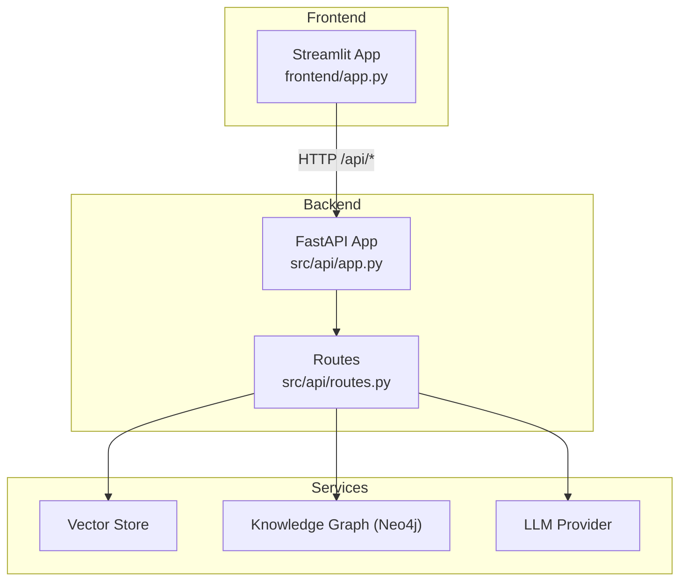
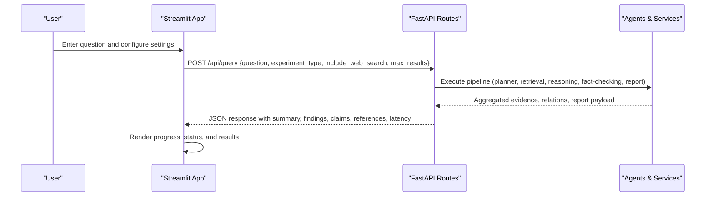
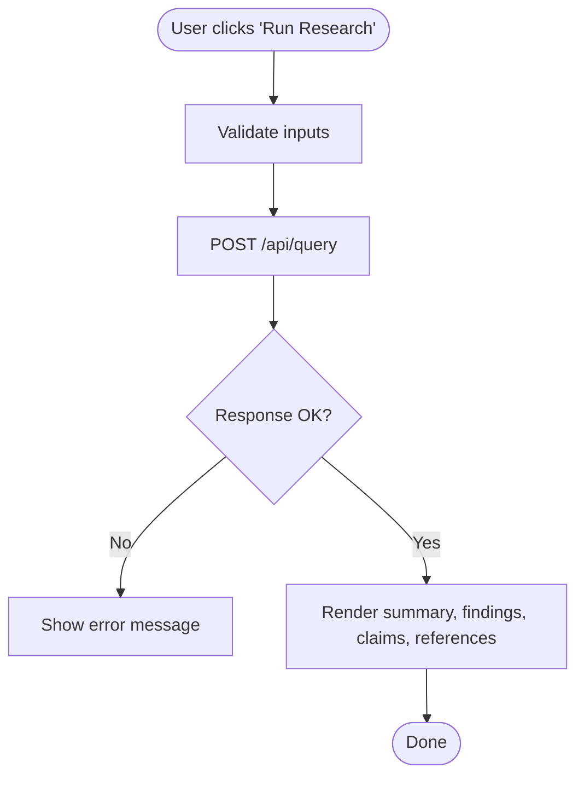
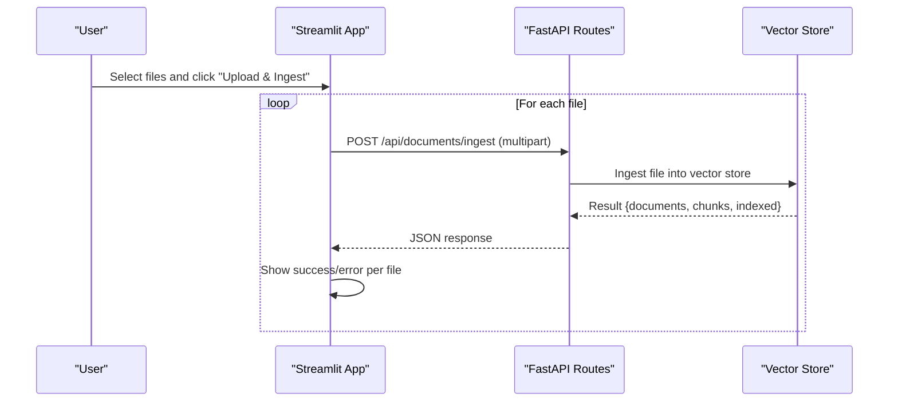
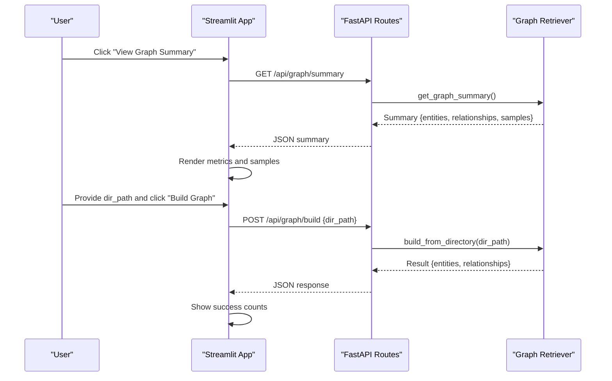
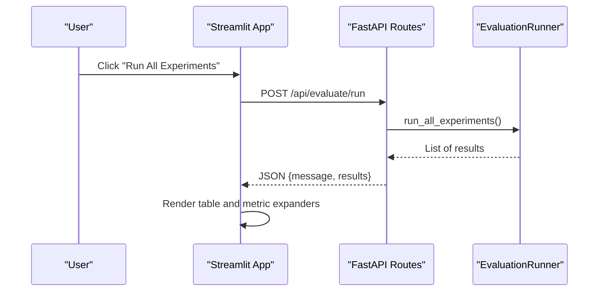
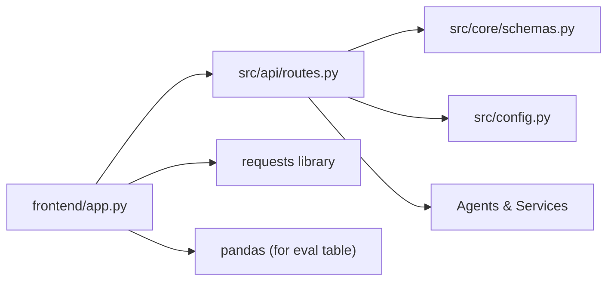

# Frontend Interface

<cite>
**Referenced Files in This Document**
- [frontend/app.py](file://frontend/app.py)
- [src/api/routes.py](file://src/api/routes.py)
- [src/api/app.py](file://src/api/app.py)
- [src/config.py](file://src/config.py)
- [src/core/schemas.py](file://src/core/schemas.py)
- [main.py](file://main.py)
- [docker-compose.yml](file://docker-compose.yml)
- [Dockerfile.frontend](file://Dockerfile.frontend)
- [README.md](file://README.md)
</cite>

## Table of Contents
1. [Introduction](#introduction)
2. [Project Structure](#project-structure)
3. [Core Components](#core-components)
4. [Architecture Overview](#architecture-overview)
5. [Detailed Component Analysis](#detailed-component-analysis)
6. [Dependency Analysis](#dependency-analysis)
7. [Performance Considerations](#performance-considerations)
8. [Troubleshooting Guide](#troubleshooting-guide)
9. [Conclusion](#conclusion)
10. [Appendices](#appendices)

## Introduction
This document describes the Streamlit web interface for the Graph RAG + Multi-Agent Research System. It explains how users interact with the system through a tabbed UI that supports querying, document ingestion, knowledge graph exploration, and evaluation benchmarks. The frontend communicates with a FastAPI backend to run research queries, ingest documents, build graphs, and retrieve status information.

The interface provides:
- A query input form with experiment configuration options
- Document upload and directory ingestion
- Progress indicators during long-running operations
- Result panels showing executive summaries, findings, verified claims, limitations, and references
- Knowledge graph summary and building tools
- Evaluation benchmark execution and results visualization

## Project Structure
The frontend is a single-page Streamlit application that calls REST endpoints exposed by the backend API. The backend is a FastAPI application with routes for status, ingestion, graph operations, querying, and evaluation.

**Diagram sources**
- [frontend/app.py:15-19](file://frontend/app.py#L15-L19)
- [src/api/app.py:26-53](file://src/api/app.py#L26-L53)
- [src/api/routes.py:116-347](file://src/api/routes.py#L116-L347)

**Section sources**
- [frontend/app.py:1-300](file://frontend/app.py#L1-L300)
- [src/api/app.py:1-57](file://src/api/app.py#L1-L57)
- [src/api/routes.py:1-354](file://src/api/routes.py#L1-L354)
- [README.md:35-79](file://README.md#L35-L79)

## Core Components
- Query Input Form: Text area for research questions, sidebar controls for experiment type, web search toggle, and result count.
- Document Ingestion: File uploader supporting multiple formats and directory ingestion via path input.
- Knowledge Graph Tools: Summary view and builder using a directory path.
- Evaluation Benchmarks: Button to run all experiments and display metrics in tables and expanders.
- Status Panel: Displays vector store document count and graph entity/relationship counts.

These components are implemented as Streamlit widgets that call backend endpoints and render responses dynamically.

**Section sources**
- [frontend/app.py:26-55](file://frontend/app.py#L26-L55)
- [frontend/app.py:59-155](file://frontend/app.py#L59-L155)
- [frontend/app.py:158-203](file://frontend/app.py#L158-L203)
- [frontend/app.py:206-258](file://frontend/app.py#L206-L258)
- [frontend/app.py:261-300](file://frontend/app.py#L261-L300)

## Architecture Overview
The frontend uses HTTP requests to communicate with the backend API. The backend orchestrates agents and services to process queries and manage data.

**Diagram sources**
- [frontend/app.py:70-101](file://frontend/app.py#L70-L101)
- [src/api/routes.py:188-338](file://src/api/routes.py#L188-L338)

**Section sources**
- [frontend/app.py:70-155](file://frontend/app.py#L70-L155)
- [src/api/routes.py:188-338](file://src/api/routes.py#L188-L338)

## Detailed Component Analysis

### Query Tab: Research Query
- Inputs:
  - Question text area
  - Sidebar: Experiment Type selector, Include Web Search checkbox, Max Results slider
- Actions:
  - Run Research button triggers a POST to /api/query
  - Spinner and progress bar indicate processing
  - On success, displays:
    - Executive Summary
    - Findings (expandable sections)
    - Evidence and Graph Relations counts
    - Verified Claims with verdicts
    - Limitations list
    - References with optional URLs
    - Metadata including report ID, experiment type, and latency

**Diagram sources**
- [frontend/app.py:66-101](file://frontend/app.py#L66-L101)
- [frontend/app.py:103-155](file://frontend/app.py#L103-L155)

**Section sources**
- [frontend/app.py:59-155](file://frontend/app.py#L59-L155)
- [src/api/routes.py:188-338](file://src/api/routes.py#L188-L338)

### Document Ingestion Tab
- File Upload:
  - Accepts PDF, TXT, MD, DOCX, CSV
  - Sends each file to /api/documents/ingest
  - Shows success with chunk and indexed counts or errors
- Directory Ingestion:
  - Path input field
  - Calls /api/documents/ingest-directory
  - Displays completion message or error

**Diagram sources**
- [frontend/app.py:158-186](file://frontend/app.py#L158-L186)
- [src/api/routes.py:134-166](file://src/api/routes.py#L134-L166)

**Section sources**
- [frontend/app.py:158-203](file://frontend/app.py#L158-L203)
- [src/api/routes.py:134-166](file://src/api/routes.py#L134-L166)

### Knowledge Graph Tab
- View Graph Summary:
  - Calls /api/graph/summary
  - Displays total entities and relationships
  - Lists sample entities and relationships
- Build Knowledge Graph:
  - Input directory path
  - Calls /api/graph/build
  - Shows entities and relationships created

**Diagram sources**
- [frontend/app.py:206-258](file://frontend/app.py#L206-L258)
- [src/api/routes.py:169-185](file://src/api/routes.py#L169-L185)

**Section sources**
- [frontend/app.py:206-258](file://frontend/app.py#L206-L258)
- [src/api/routes.py:169-185](file://src/api/routes.py#L169-L185)

### Evaluation Tab
- Runs all experiments via /api/evaluate/run
- Displays results as a DataFrame indexed by experiment type
- Shows key metrics comparison in expanders per experiment

**Diagram sources**
- [frontend/app.py:272-299](file://frontend/app.py#L272-L299)
- [src/api/routes.py:341-347](file://src/api/routes.py#L341-L347)

**Section sources**
- [frontend/app.py:261-300](file://frontend/app.py#L261-L300)
- [src/api/routes.py:341-347](file://src/api/routes.py#L341-L347)

### Sidebar Configuration and System Status
- Configuration:
  - Experiment Type selector
  - Include Web Search checkbox
  - Max Results slider
- System Status:
  - Calls /api/status
  - Displays vector store document count
  - Displays knowledge graph entity and relationship counts
  - Shows online/offline state

**Section sources**
- [frontend/app.py:26-47](file://frontend/app.py#L26-L47)
- [src/api/routes.py:116-131](file://src/api/routes.py#L116-L131)

## Dependency Analysis
The frontend depends on the backend API for all operations. The backend coordinates agents and services based on request parameters.

**Diagram sources**
- [frontend/app.py:7-9](file://frontend/app.py#L7-L9)
- [src/api/routes.py:17-24](file://src/api/routes.py#L17-L24)
- [src/config.py:21-81](file://src/config.py#L21-L81)
- [src/core/schemas.py:17-41](file://src/core/schemas.py#L17-L41)

**Section sources**
- [frontend/app.py:7-9](file://frontend/app.py#L7-L9)
- [src/api/routes.py:17-24](file://src/api/routes.py#L17-L24)
- [src/config.py:21-81](file://src/config.py#L21-L81)
- [src/core/schemas.py:17-41](file://src/core/schemas.py#L17-L41)

## Performance Considerations
- Timeouts:
  - Query requests use a high timeout to accommodate multi-agent processing.
  - Ingestion and graph build also have generous timeouts to handle large datasets.
- Streaming:
  - The current implementation waits for full responses before rendering; consider server-sent events or polling for real-time updates during long tasks.
- Caching:
  - Backend settings are cached; consider caching frequent read-only data like graph summaries if accessed often.
- Pagination:
  - For large result sets (e.g., findings), implement pagination or virtual scrolling to improve responsiveness.
- Resource Limits:
  - Enforce maximum upload sizes and rate limits at the API layer to prevent overload.
- Concurrency:
  - Use async handlers where possible and avoid blocking operations in request threads.

[No sources needed since this section provides general guidance]

## Troubleshooting Guide
Common issues and resolutions:
- System Offline:
  - If the status endpoint fails, the sidebar shows an error. Verify backend availability and network connectivity.
- Query Errors:
  - Exceptions during POST /api/query are caught and displayed. Check backend logs for agent failures or missing dependencies.
- Ingestion Failures:
  - Ensure the documents directory exists and has write permissions. Verify supported file types and content.
- Graph Build Failures:
  - Confirm the provided directory path contains valid documents and that Neo4j is reachable and configured.
- Evaluation Failures:
  - Ensure required datasets and environment variables are set. Check backend logs for metric computation errors.

**Section sources**
- [frontend/app.py:38-47](file://frontend/app.py#L38-L47)
- [frontend/app.py:85-101](file://frontend/app.py#L85-L101)
- [frontend/app.py:167-186](file://frontend/app.py#L167-L186)
- [frontend/app.py:240-258](file://frontend/app.py#L240-L258)
- [frontend/app.py:272-299](file://frontend/app.py#L272-L299)

## Conclusion
The Streamlit frontend offers a comprehensive interactive experience for the Graph RAG + Multi-Agent Research System. It integrates query execution, document ingestion, knowledge graph management, and evaluation benchmarks through a clean, tabbed interface. While it currently renders results after complete backend responses, enhancements such as streaming updates, pagination, and richer visualizations can further improve usability and performance.

[No sources needed since this section summarizes without analyzing specific files]

## Appendices

### Deployment and Access
- Docker Compose runs Neo4j, the FastAPI backend, and the Streamlit frontend.
- Frontend is accessible at port 8501; backend at port 8080.
- Health check endpoint available at /health.

**Section sources**
- [docker-compose.yml:22-52](file://docker-compose.yml#L22-L52)
- [README.md:48-57](file://README.md#L48-L57)
- [src/api/app.py:49-52](file://src/api/app.py#L49-L52)

### Extending the Interface
- Add new tabs for additional features (e.g., model comparisons, custom dashboards).
- Integrate external tools via new API endpoints and corresponding UI components.
- Implement real-time updates using polling or server-sent events for long-running tasks.
- Customize styling and layout via Streamlit theme settings and CSS injection.

[No sources needed since this section provides general guidance]