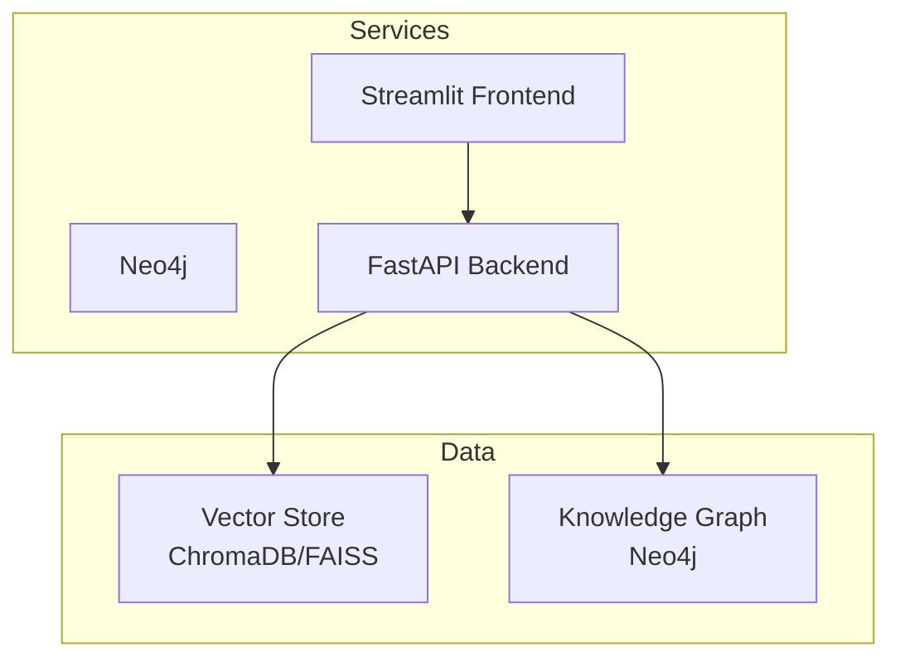
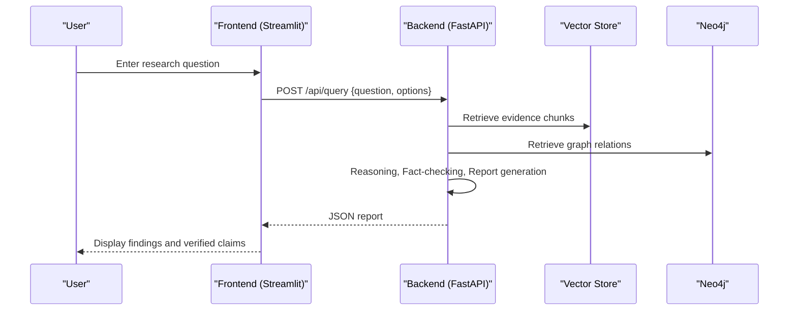
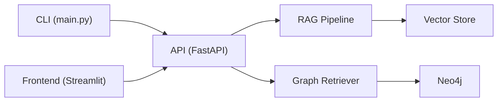

# Getting Started

<cite>
**Referenced Files in This Document**
- [README.md](file://README.md)
- [requirements.txt](file://requirements.txt)
- [docker-compose.yml](file://docker-compose.yml)
- [Dockerfile](file://Dockerfile)
- [Dockerfile.frontend](file://Dockerfile.frontend)
- [main.py](file://main.py)
- [src/config.py](file://src/config.py)
- [src/api/app.py](file://src/api/app.py)
- [src/api/routes.py](file://src/api/routes.py)
- [frontend/app.py](file://frontend/app.py)
</cite>

## Table of Contents
1. [Introduction](#introduction)
2. [Project Structure](#project-structure)
3. [Core Components](#core-components)
4. [Architecture Overview](#architecture-overview)
5. [Detailed Component Analysis](#detailed-component-analysis)
6. [Dependency Analysis](#dependency-analysis)
7. [Performance Considerations](#performance-considerations)
8. [Troubleshooting Guide](#troubleshooting-guide)
9. [Conclusion](#conclusion)
10. [Appendices](#appendices)

## Introduction
This guide helps you install, configure, and run the Graph RAG + Multi-Agent Research System locally or with Docker. You will set up prerequisites, configure API keys, start services via docker-compose, and run individual components from the command line. The system provides:
- A FastAPI backend exposing REST endpoints for ingestion, graph building, querying, and evaluation
- A Streamlit frontend for interactive queries and document management
- A Neo4j knowledge graph service for structured entity/relationship storage
- Vector retrieval via ChromaDB or FAISS
- Multi-agent orchestration for planning, retrieval, reasoning, fact-checking, and report generation

## Project Structure
The repository is organized into clear layers:
- CLI entry point and commands (serve, ingest, graph, evaluate)
- Backend API (FastAPI app and routes)
- Frontend (Streamlit UI)
- Configuration and environment variables
- Docker definitions for quick deployment

**Diagram sources**
- [docker-compose.yml:4-56](file://docker-compose.yml#L4-L56)
- [src/api/app.py:26-53](file://src/api/app.py#L26-L53)
- [src/api/routes.py:116-186](file://src/api/routes.py#L116-L186)

**Section sources**
- [README.md:81-126](file://README.md#L81-L126)
- [docker-compose.yml:1-56](file://docker-compose.yml#L1-L56)

## Core Components
- CLI: main entry point with subcommands to serve, ingest documents, build graphs, and run evaluations
- API: FastAPI application with CORS, health check, and REST endpoints under /api
- Frontend: Streamlit app that calls the backend to run research queries, ingest documents, and view graph summaries
- Configuration: Centralized settings loaded from environment variables and .env file
- Data stores: Vector store (ChromaDB/FAISS) and Knowledge Graph (Neo4j)

Key responsibilities:
- Ingestion: Parse and chunk documents, compute embeddings, index into vector store
- Graph building: Extract entities and relationships, persist to Neo4j
- Querying: Multi-agent pipeline orchestrates retrieval and synthesis
- Evaluation: Benchmark runner to compare experiment configurations

**Section sources**
- [main.py:24-104](file://main.py#L24-L104)
- [src/api/app.py:26-53](file://src/api/app.py#L26-L53)
- [src/api/routes.py:116-354](file://src/api/routes.py#L116-L354)
- [src/config.py:21-82](file://src/config.py#L21-L82)
- [frontend/app.py:11-47](file://frontend/app.py#L11-L47)

## Architecture Overview
The system runs three primary services orchestrated by docker-compose:
- Neo4j for knowledge graph persistence
- FastAPI backend for business logic and APIs
- Streamlit frontend for user interaction

**Diagram sources**
- [src/api/routes.py:188-338](file://src/api/routes.py#L188-L338)
- [frontend/app.py:57-154](file://frontend/app.py#L57-L154)

## Detailed Component Analysis

### Docker-based Quick Start
- Prerequisites: Python 3.8+, Docker, Docker Compose
- Steps:
  - Ensure environment variables are configured (see Environment Setup below)
  - Run: docker-compose up
  - Access:
    - API: http://localhost:8080
    - Frontend: http://localhost:8501
    - Neo4j Browser: http://localhost:7474

Notes:
- The compose file defines Neo4j, backend, and frontend services with appropriate ports and dependencies
- The backend container exposes port 8080 and mounts ./data to persist documents
- The frontend container exposes port 8501 and connects to the backend at localhost:8080

**Section sources**
- [docker-compose.yml:4-56](file://docker-compose.yml#L4-L56)
- [Dockerfile:1-25](file://Dockerfile#L1-L25)
- [Dockerfile.frontend:1-15](file://Dockerfile.frontend#L1-L15)
- [README.md:48-57](file://README.md#L48-L57)

### Local Installation and Running
- Install dependencies: pip install -r requirements.txt
- Configure environment variables (see Environment Setup)
- Start components:
  - Serve API: python main.py serve
  - Ingest documents: python main.py ingest <path-to-file-or-directory>
  - Build knowledge graph: python main.py graph <path-to-file-or-directory>
  - Run evaluation: python main.py evaluate
- Run the frontend: streamlit run frontend/app.py

Notes:
- The CLI parses subcommands and invokes corresponding functions
- The API server binds to 0.0.0.0:8080 by default
- The frontend defaults to calling the backend at http://localhost:8080/api

**Section sources**
- [requirements.txt:1-60](file://requirements.txt#L1-L60)
- [main.py:71-104](file://main.py#L71-L104)
- [frontend/app.py:11-47](file://frontend/app.py#L11-L47)
- [README.md:59-79](file://README.md#L59-L79)

### Environment Setup and API Keys
- Create a .env file in the project root with required keys:
  - LLM provider and model keys:
    - GEMINI_API_KEY (if using Gemini)
    - OPENAI_API_KEY (if using OpenAI)
  - Vector DB type and configuration:
    - VECTOR_DB_TYPE=chroma (or faiss)
    - CHROMA_HOST, CHROMA_PORT, CHROMA_COLLECTION (for ChromaDB)
    - FAISS_INDEX_PATH (for FAISS)
  - Neo4j connection:
    - NEO4J_URI=bolt://localhost:7687
    - NEO4J_USER=neo4j
    - NEO4J_PASSWORD=<your-password>
  - Optional web search:
    - SERPER_API_KEY (optional)
    - DUCKDUCKGO_ENABLED=true/false
- Settings are loaded automatically from .env via pydantic-settings

Notes:
- The application reads settings from .env and environment variables
- Defaults are provided; ensure at least one LLM provider key is set
- For Docker, pass secrets via environment variables in docker-compose or host env

**Section sources**
- [src/config.py:16-82](file://src/config.py#L16-L82)
- [docker-compose.yml:30-36](file://docker-compose.yml#L30-L36)
- [README.md:39-46](file://README.md#L39-L46)

### API Endpoints Reference
- Health: GET /health
- Status: GET /api/status
- Ingest single file: POST /api/documents/ingest
- Ingest directory: POST /api/documents/ingest-directory
- Build graph: POST /api/graph/build
- Graph summary: GET /api/graph/summary
- Query: POST /api/query
- Evaluate: POST /api/evaluate/run

Notes:
- The frontend uses these endpoints to interact with the backend
- Responses include metrics like evidence count, graph relations, latency

**Section sources**
- [src/api/app.py:49-52](file://src/api/app.py#L49-L52)
- [src/api/routes.py:116-354](file://src/api/routes.py#L116-L354)
- [frontend/app.py:37-47](file://frontend/app.py#L37-L47)

### Command-Line Interface
- serve [--host] [--port]: Starts the FastAPI server
- ingest <path>: Ingests a file or directory into the vector store
- graph <path>: Builds knowledge graph from a file or directory
- evaluate: Runs benchmark experiments and prints comparison table

Notes:
- Logging level can be set via --log-level
- Commands use lazy imports to initialize heavy components on demand

**Section sources**
- [main.py:24-104](file://main.py#L24-L104)

## Dependency Analysis
The system depends on:
- FastAPI and Uvicorn for the API server
- Pydantic and pydantic-settings for configuration
- LLM providers (Gemini/OpenAI) and embedding models
- Vector stores (ChromaDB/FAISS)
- Neo4j for knowledge graph
- Streamlit for the frontend
- Document processing libraries (PDF, DOCX, TXT)
- Web search tools (optional)

**Diagram sources**
- [main.py:24-104](file://main.py#L24-L104)
- [src/api/routes.py:35-75](file://src/api/routes.py#L35-L75)
- [requirements.txt:1-60](file://requirements.txt#L1-L60)

**Section sources**
- [requirements.txt:1-60](file://requirements.txt#L1-L60)
- [src/api/routes.py:35-75](file://src/api/routes.py#L35-L75)

## Performance Considerations
- Use FAISS for faster local vector search if memory allows; ChromaDB offers convenience and persistence
- Tune CHUNK_SIZE and CHUNK_OVERLAP to balance retrieval quality and performance
- Limit max_results in queries to reduce payload size and latency
- Enable web search selectively to avoid unnecessary network calls
- Persist Neo4j data volumes to avoid rebuilding graphs frequently

[No sources needed since this section provides general guidance]

## Troubleshooting Guide
Common issues and resolutions:
- Missing or invalid API keys:
  - Ensure GEMINI_API_KEY or OPENAI_API_KEY is set in .env or environment
  - Verify LLM_PROVIDER matches the configured provider
- Neo4j connection failures:
  - Confirm NEO4J_URI, NEO4J_USER, and NEO4J_PASSWORD are correct
  - Check Neo4j service is healthy and accessible on bolt://localhost:7687
- Port conflicts:
  - If ports 8080, 8501, or 7474 are in use, adjust docker-compose ports or stop conflicting services
- Vector store initialization errors:
  - Ensure VECTOR_DB_TYPE is set correctly and required directories exist
  - For FAISS, verify FAISS_INDEX_PATH is writable
- Frontend cannot reach backend:
  - Confirm backend is running and reachable at http://localhost:8080/api
  - Check CORS settings if deploying behind proxies

Steps to diagnose:
- Check API health: GET /health
- Inspect logs from containers or console output
- Validate environment variables with a simple print or status endpoint

**Section sources**
- [src/config.py:21-82](file://src/config.py#L21-L82)
- [docker-compose.yml:4-56](file://docker-compose.yml#L4-L56)
- [src/api/app.py:49-52](file://src/api/app.py#L49-L52)
- [frontend/app.py:37-47](file://frontend/app.py#L37-L47)

## Conclusion
You now have the essentials to install, configure, and run the Graph RAG + Multi-Agent Research System. Use Docker for an all-in-one setup or run components locally for development. Configure your API keys, ingest documents, build the knowledge graph, and explore multi-agent research queries through the frontend or API.

[No sources needed since this section summarizes without analyzing specific files]

## Appendices

### Quick Start Checklist
- Install Docker and Docker Compose
- Clone repository and navigate to project root
- Create .env with required keys
- Run docker-compose up
- Visit:
  - API: http://localhost:8080
  - Frontend: http://localhost:8501
  - Neo4j Browser: http://localhost:7474

**Section sources**
- [README.md:48-57](file://README.md#L48-L57)
- [docker-compose.yml:4-56](file://docker-compose.yml#L4-L56)

### Local Development Commands
- Install dependencies: pip install -r requirements.txt
- Start API: python main.py serve
- Ingest docs: python main.py ingest ./data/documents
- Build graph: python main.py graph ./data/documents
- Run evaluation: python main.py evaluate
- Start frontend: streamlit run frontend/app.py

**Section sources**
- [requirements.txt:1-60](file://requirements.txt#L1-L60)
- [main.py:71-104](file://main.py#L71-L104)
- [README.md:59-79](file://README.md#L59-L79)