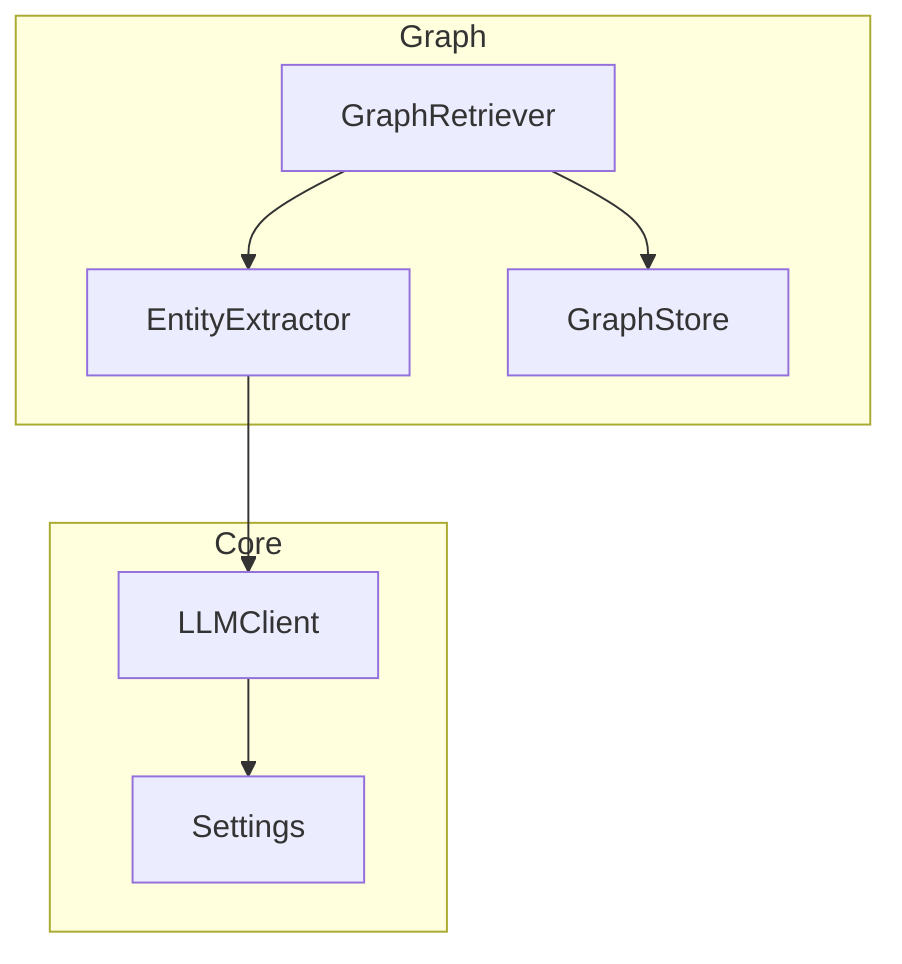
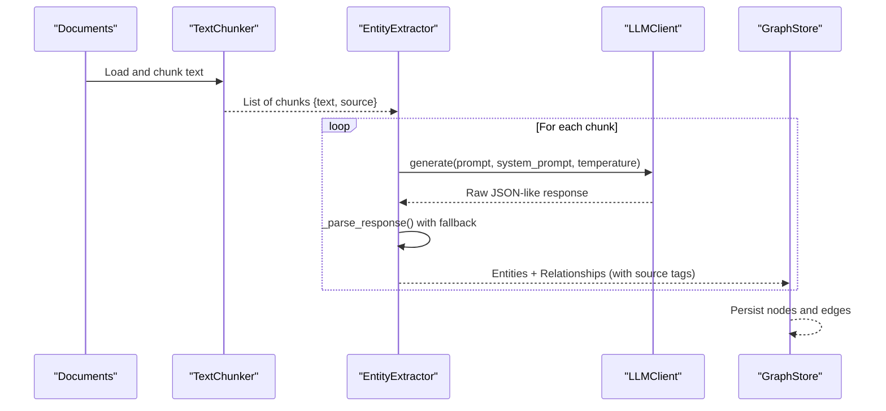
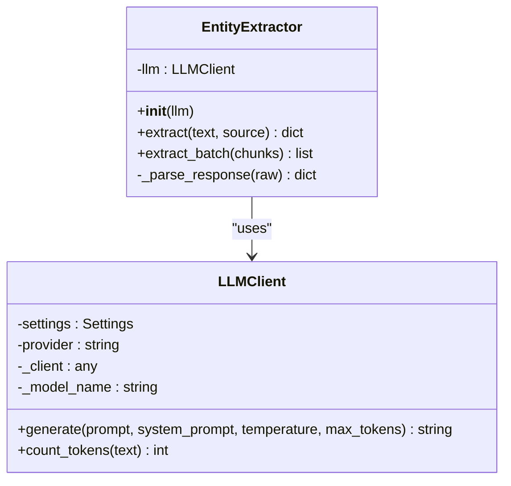
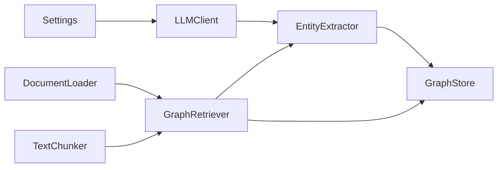

# Entity Extraction

<cite>
**Referenced Files in This Document**
- [entity_extractor.py](file://src/graph/entity_extractor.py)
- [llm.py](file://src/core/llm.py)
- [config.py](file://src/config.py)
- [graph_store.py](file://src/graph/graph_store.py)
- [retriever.py](file://src/graph/retriever.py)
- [ingest_example.py](file://examples/ingest_example.py)
- [README.md](file://README.md)
</cite>

## Table of Contents
1. [Introduction](#introduction)
2. [Project Structure](#project-structure)
3. [Core Components](#core-components)
4. [Architecture Overview](#architecture-overview)
5. [Detailed Component Analysis](#detailed-component-analysis)
6. [Dependency Analysis](#dependency-analysis)
7. [Performance Considerations](#performance-considerations)
8. [Troubleshooting Guide](#troubleshooting-guide)
9. [Conclusion](#conclusion)
10. [Appendices](#appendices)

## Introduction
This document explains the entity extraction component that uses large language models (LLMs) to identify entities and relationships from document text for building a knowledge graph. It focuses on the EntityExtractor class, its integration with LLMClient, the structured extraction process, prompt engineering for predefined entity and relationship types, single and batch processing methods, JSON parsing with fallbacks, error handling strategies, performance optimization techniques for large documents, source tracking capabilities, and integration with the broader knowledge graph pipeline.

## Project Structure
The entity extraction feature is implemented under src/graph/entity_extractor.py and integrates with:
- LLM abstraction layer in src/core/llm.py
- Configuration in src/config.py
- Knowledge graph storage in src/graph/graph_store.py
- Graph orchestration in src/graph/retriever.py
- Example usage in examples/ingest_example.py

**Diagram sources**
- [entity_extractor.py:42-100](file://src/graph/entity_extractor.py#L42-L100)
- [llm.py:15-103](file://src/core/llm.py#L15-L103)
- [config.py:21-82](file://src/config.py#L21-L82)
- [graph_store.py:15-138](file://src/graph/graph_store.py#L15-L138)
- [retriever.py:19-131](file://src/graph/retriever.py#L19-L131)

**Section sources**
- [README.md:81-126](file://README.md#L81-L126)

## Core Components
- EntityExtractor: Orchestrates LLM-based extraction of entities and relationships from text chunks, including prompt construction, response parsing, and source tagging.
- LLMClient: Unified interface to Gemini or OpenAI providers with configurable model parameters and token counting utilities.
- GraphStore: Persists extracted entities and relationships into Neo4j or an in-memory NetworkX graph, with query and context retrieval.
- GraphRetriever: End-to-end pipeline that loads documents, chunks them, runs entity extraction, aggregates results, deduplicates entities, and populates the graph.

Key responsibilities:
- Prompt engineering with strict schema expectations for JSON output.
- Robust JSON parsing with fallback behavior when responses are malformed.
- Source tracking by attaching source metadata to each entity and relationship.
- Batch processing with progress logging for scalability.

**Section sources**
- [entity_extractor.py:17-100](file://src/graph/entity_extractor.py#L17-L100)
- [llm.py:15-103](file://src/core/llm.py#L15-L103)
- [graph_store.py:49-138](file://src/graph/graph_store.py#L49-L138)
- [retriever.py:42-97](file://src/graph/retriever.py#L42-L97)

## Architecture Overview
The entity extraction pipeline integrates LLM calls with graph storage to build a knowledge graph from documents.

**Diagram sources**
- [retriever.py:42-97](file://src/graph/retriever.py#L42-L97)
- [entity_extractor.py:48-86](file://src/graph/entity_extractor.py#L48-L86)
- [llm.py:40-87](file://src/core/llm.py#L40-L87)
- [graph_store.py:49-138](file://src/graph/graph_store.py#L49-L138)

## Detailed Component Analysis

### EntityExtractor Class
Responsibilities:
- Initialize with an LLM client; defaults to configured provider via get_llm().
- extract(text, source): Single-text extraction with truncation to avoid token limits, prompt assembly, LLM call, JSON parsing, and source tagging.
- extract_batch(chunks): Bulk extraction with progress logging every 10 chunks.
- _parse_response(raw): Extract JSON from markdown fences or raw text; returns empty lists on parse failure.

Prompt Engineering:
- Predefined entity types: Person, Organization, Disease, Technology, Method, Dataset, Concept, Variable, Research_Finding, Location, Chemical, Drug.
- Predefined relationship types: causes, affects, improves, associated_with, depends_on, developed_by, compared_with, used_for, treats, part_of, increases, decreases, discovered_by.
- Strict instruction to return valid JSON with entities and relationships arrays.

Error Handling:
- Empty input yields empty results.
- Exceptions during LLM calls are caught and logged; empty results returned to maintain pipeline stability.
- JSON parsing failures log warnings and return empty structures.

Source Tracking:
- Each entity receives a source field.
- Each relationship receives a source_doc field.

Performance Optimizations:
- Text truncation to a fixed length to prevent token limit issues.
- Temperature set to deterministic values for consistent outputs.
- Batch processing with periodic progress logs.

Customization Hooks:
- The extraction prompt is defined as a module-level constant; it can be overridden or extended to support custom entity schemas or domain-specific instructions.
- LLMClient supports provider selection and model configuration via Settings.

**Section sources**
- [entity_extractor.py:17-100](file://src/graph/entity_extractor.py#L17-L100)

#### Class Diagram

**Diagram sources**
- [entity_extractor.py:42-100](file://src/graph/entity_extractor.py#L42-L100)
- [llm.py:15-103](file://src/core/llm.py#L15-L103)

### LLMClient Integration
- Provider abstraction supports Gemini and OpenAI.
- Model initialization reads settings for API keys and model names.
- generate() routes to provider-specific implementations with system prompts and generation config.
- count_tokens() provides approximate token counts using tiktoken with a fallback heuristic.

Configuration:
- Settings include LLM_PROVIDER, GEMINI_API_KEY, GEMINI_MODEL, OPENAI_API_KEY, OPENAI_MODEL, TEMPERATURE.

**Section sources**
- [llm.py:15-103](file://src/core/llm.py#L15-L103)
- [config.py:21-82](file://src/config.py#L21-L82)

### Graph Store Integration
- add_entities(entities): Persists nodes with name, type, description, and source.
- add_relationships(relationships): Persists edges with relationship type and source_doc.
- Query and context retrieval methods support downstream agents.

Deduplication and Aggregation:
- GraphRetriever deduplicates entities by normalized name before insertion.
- All relationships are aggregated and added even if duplicates exist.

**Section sources**
- [graph_store.py:49-138](file://src/graph/graph_store.py#L49-L138)
- [retriever.py:65-97](file://src/graph/retriever.py#L65-L97)

### Pipeline Orchestration (GraphRetriever)
- Loads documents and chunks them using TextChunker with larger chunk sizes suitable for entity extraction.
- Calls EntityExtractor.extract_batch() to process all chunks.
- Aggregates and deduplicates entities, then persists to GraphStore.
- Returns summary counts and totals.

**Section sources**
- [retriever.py:19-131](file://src/graph/retriever.py#L19-L131)

### Usage Example
- ingest_example.py demonstrates loading documents, building vector store, constructing the knowledge graph via GraphRetriever, and querying summaries.

**Section sources**
- [ingest_example.py:16-94](file://examples/ingest_example.py#L16-L94)

## Dependency Analysis
High-level dependencies:
- EntityExtractor depends on LLMClient for generation and Settings for provider configuration.
- GraphRetriever depends on EntityExtractor, GraphStore, DocumentLoader, and TextChunker.
- GraphStore abstracts Neo4j vs NetworkX backends based on availability and settings.

**Diagram sources**
- [config.py:21-82](file://src/config.py#L21-L82)
- [llm.py:15-103](file://src/core/llm.py#L15-L103)
- [entity_extractor.py:42-100](file://src/graph/entity_extractor.py#L42-L100)
- [retriever.py:19-131](file://src/graph/retriever.py#L19-L131)
- [graph_store.py:15-138](file://src/graph/graph_store.py#L15-L138)

**Section sources**
- [retriever.py:19-131](file://src/graph/retriever.py#L19-L131)
- [entity_extractor.py:42-100](file://src/graph/entity_extractor.py#L42-L100)
- [llm.py:15-103](file://src/core/llm.py#L15-L103)
- [graph_store.py:15-138](file://src/graph/graph_store.py#L15-L138)

## Performance Considerations
- Token Limits: Text is truncated to a fixed length before prompting to avoid exceeding model token limits.
- Deterministic Outputs: Temperature is set low to reduce variability and improve consistency across extractions.
- Batch Processing: extract_batch processes chunks sequentially with periodic progress logs; consider parallelization for very large corpora if needed.
- Deduplication: Entities are deduplicated by normalized name to reduce graph size and redundancy.
- Backend Selection: GraphStore falls back to NetworkX if Neo4j is unavailable, ensuring resilience.
- Approximate Token Counting: count_tokens uses tiktoken with a fallback heuristic to estimate tokens without heavy overhead.

[No sources needed since this section provides general guidance]

## Troubleshooting Guide
Common issues and resolutions:
- Invalid JSON Response: If the LLM returns non-JSON or malformed content, _parse_response logs a warning and returns empty lists. Ensure prompt formatting remains intact and consider adjusting model parameters or retrying.
- Missing Entities or Relationships: Verify that the input text contains explicit mentions of entities and relationships aligned with the predefined types. Adjust the prompt or provide more context if necessary.
- Provider Configuration Errors: Check Settings for correct LLM_PROVIDER, API keys, and model names. Unsupported providers raise errors during initialization.
- Neo4j Unavailable: GraphStore automatically falls back to NetworkX; verify connection settings if Neo4j is expected.

Operational tips:
- Use extract_batch for bulk operations and monitor progress logs to detect stalls or failures.
- Inspect GraphStore counts to confirm successful persistence of entities and relationships.
- Validate source fields to trace provenance of extracted knowledge.

**Section sources**
- [entity_extractor.py:57-100](file://src/graph/entity_extractor.py#L57-L100)
- [graph_store.py:24-47](file://src/graph/graph_store.py#L24-L47)
- [llm.py:25-39](file://src/core/llm.py#L25-L39)

## Conclusion
The EntityExtractor component provides a robust, LLM-powered mechanism to extract structured entities and relationships from text, integrating seamlessly with the knowledge graph pipeline. Its design emphasizes deterministic outputs, resilient parsing, clear source tracking, and scalable batch processing. Combined with GraphRetriever and GraphStore, it enables efficient construction and querying of a knowledge graph grounded in document content.

[No sources needed since this section summarizes without analyzing specific files]

## Appendices

### Prompt Engineering Reference
- Entity Types: Person, Organization, Disease, Technology, Method, Dataset, Concept, Variable, Research_Finding, Location, Chemical, Drug.
- Relationship Types: causes, affects, improves, associated_with, depends_on, developed_by, compared_with, used_for, treats, part_of, increases, decreases, discovered_by.
- Output Schema: JSON with arrays of entities and relationships; each entity includes name, type, description; each relationship includes source, relationship, target.

**Section sources**
- [entity_extractor.py:17-39](file://src/graph/entity_extractor.py#L17-L39)

### Customization Examples
- To customize entity types or relationship types, modify the extraction prompt constant in the extractor module to align with domain-specific taxonomies.
- To adjust parsing behavior, extend _parse_response to handle additional formats or implement stricter validation.

**Section sources**
- [entity_extractor.py:17-100](file://src/graph/entity_extractor.py#L17-L100)

### Integration Points
- GraphRetriever orchestrates document ingestion, chunking, extraction, aggregation, deduplication, and graph population.
- GraphStore abstracts backend storage and provides query and context retrieval interfaces for downstream agents.

**Section sources**
- [retriever.py:42-97](file://src/graph/retriever.py#L42-L97)
- [graph_store.py:49-138](file://src/graph/graph_store.py#L49-L138)