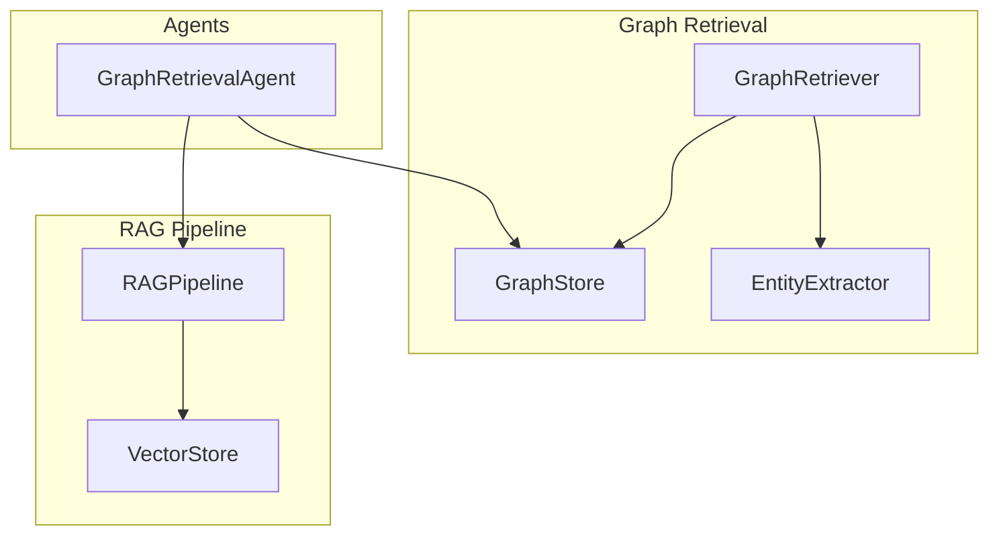
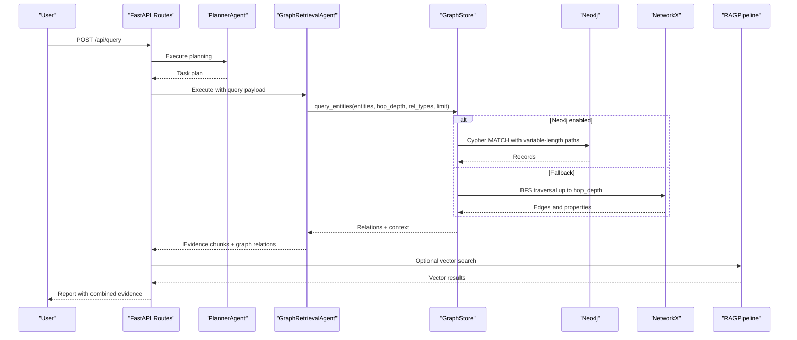
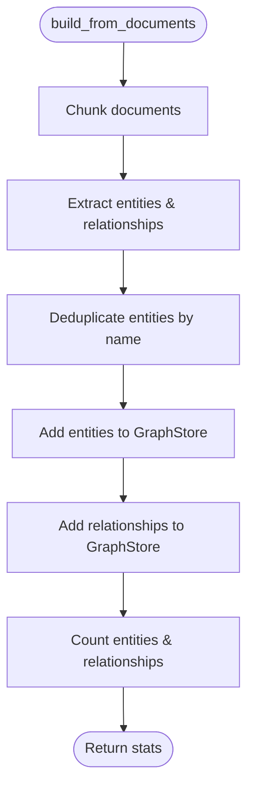
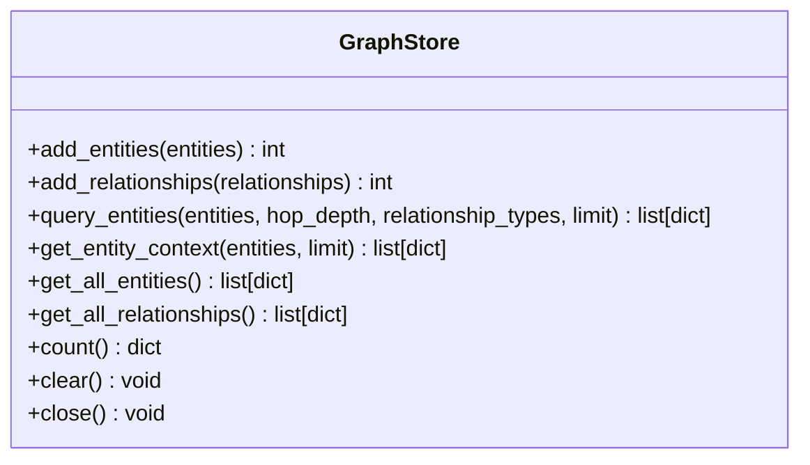
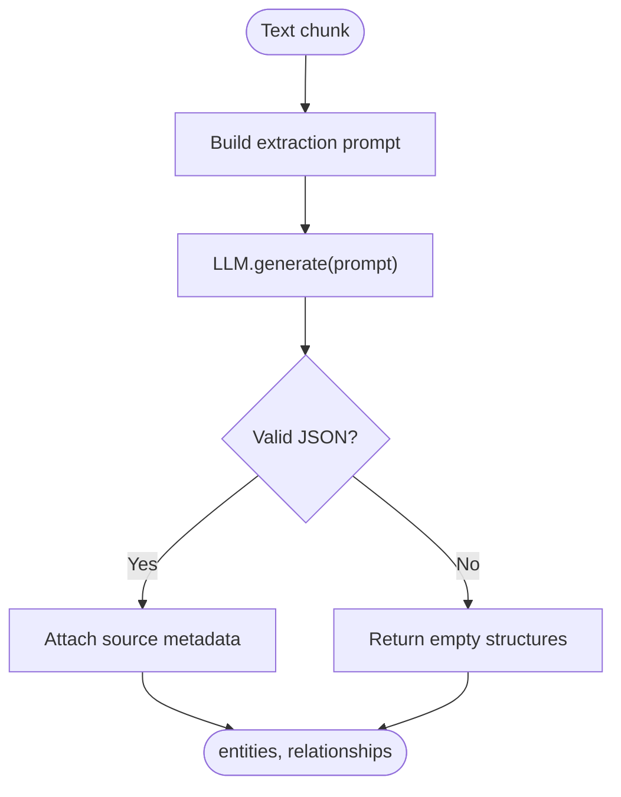
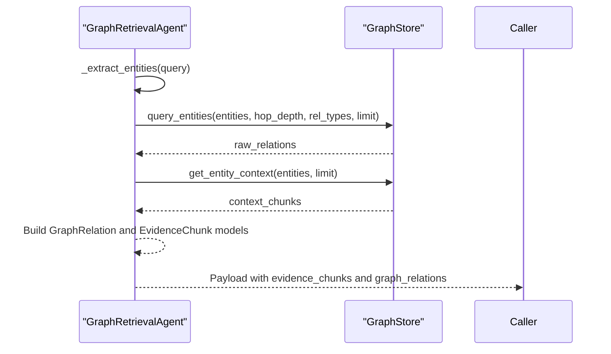
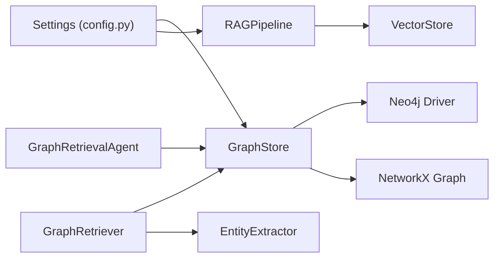

# Graph Query Interface

<cite>
**Referenced Files in This Document**
- [retriever.py](file://src/graph/retriever.py)
- [graph_store.py](file://src/graph/graph_store.py)
- [entity_extractor.py](file://src/graph/entity_extractor.py)
- [graph_agent.py](file://src/agents/graph_agent.py)
- [pipeline.py](file://src/rag/pipeline.py)
- [schemas.py](file://src/core/schemas.py)
- [config.py](file://src/config.py)
- [query_example.py](file://examples/query_example.py)
- [ingest_example.py](file://examples/ingest_example.py)
- [routes.py](file://src/api/routes.py)
- [app.py](file://src/api/app.py)
</cite>

## Table of Contents
1. [Introduction](#introduction)
2. [Project Structure](#project-structure)
3. [Core Components](#core-components)
4. [Architecture Overview](#architecture-overview)
5. [Detailed Component Analysis](#detailed-component-analysis)
6. [Dependency Analysis](#dependency-analysis)
7. [Performance Considerations](#performance-considerations)
8. [Troubleshooting Guide](#troubleshooting-guide)
9. [Security and Access Control](#security-and-access-control)
10. [Conclusion](#conclusion)

## Introduction
This document explains the graph retrieval system that enables entity-based search, relationship traversal, and multi-hop reasoning within a RAG pipeline. It covers the query interface for direct entity lookup, neighbor exploration, and complex path finding; describes how Cypher queries are generated for common graph operations; details integration with vector similarity search; and provides guidance on custom query builders, result filtering/ranking, caching strategies, performance optimization, debugging, monitoring, and security considerations.

## Project Structure
The graph retrieval system is implemented under src/graph and integrates with agents and the RAG pipeline:
- GraphRetriever orchestrates ingestion and querying against a knowledge graph store.
- GraphStore abstracts Neo4j and NetworkX backends with consistent APIs.
- EntityExtractor uses an LLM to extract entities and relationships from text chunks.
- GraphRetrievalAgent translates natural language queries into structured graph searches.
- RAGPipeline provides vector similarity search to complement graph retrieval.

**Diagram sources**
- [retriever.py:19-31](file://src/graph/retriever.py#L19-L31)
- [graph_store.py:15-28](file://src/graph/graph_store.py#L15-L28)
- [entity_extractor.py:42-47](file://src/graph/entity_extractor.py#L42-L47)
- [graph_agent.py:36-42](file://src/agents/graph_agent.py#L36-L42)
- [pipeline.py:19-32](file://src/rag/pipeline.py#L19-L32)

**Section sources**
- [retriever.py:19-31](file://src/graph/retriever.py#L19-L31)
- [graph_store.py:15-28](file://src/graph/graph_store.py#L15-L28)
- [entity_extractor.py:42-47](file://src/graph/entity_extractor.py#L42-L47)
- [graph_agent.py:36-42](file://src/agents/graph_agent.py#L36-L42)
- [pipeline.py:19-32](file://src/rag/pipeline.py#L19-L32)

## Core Components
- GraphRetriever: Builds the knowledge graph from documents and exposes a query interface for entity-centric traversal with configurable hop depth and relationship filters.
- GraphStore: Provides a unified interface over Neo4j (Cypher) and NetworkX (in-memory), handling entity/relationship CRUD and traversal queries.
- EntityExtractor: Extracts entities and relationships using an LLM with a structured prompt and robust JSON parsing fallback.
- GraphRetrievalAgent: Converts user queries into entity lists, relationship types, and hop depths, then retrieves relations and contextual evidence from the graph.
- RAGPipeline: Embeds and indexes documents for vector similarity search; used alongside graph retrieval for hybrid approaches.

Key responsibilities:
- Ingestion: chunking, extraction, deduplication, and persistence.
- Querying: entity lookup, neighbor exploration, and multi-hop traversal.
- Context retrieval: fetching textual context stored on nodes.
- Integration: combining graph results with vector results in the multi-agent pipeline.

**Section sources**
- [retriever.py:32-131](file://src/graph/retriever.py#L32-L131)
- [graph_store.py:49-125](file://src/graph/graph_store.py#L49-L125)
- [entity_extractor.py:48-101](file://src/graph/entity_extractor.py#L48-L101)
- [graph_agent.py:46-121](file://src/agents/graph_agent.py#L46-L121)
- [pipeline.py:33-102](file://src/rag/pipeline.py#L33-L102)

## Architecture Overview
The system supports multiple experiment modes, including Graph RAG and Multi-Agent pipelines. The GraphRetrievalAgent extracts entities and executes graph queries via GraphStore, which can target Neo4j or fall back to NetworkX. Results are combined with vector evidence from RAGPipeline for reasoning and report generation.

**Diagram sources**
- [routes.py:217-239](file://src/api/routes.py#L217-L239)
- [graph_agent.py:54-109](file://src/agents/graph_agent.py#L54-L109)
- [graph_store.py:178-222](file://src/graph/graph_store.py#L178-L222)
- [graph_store.py:256-302](file://src/graph/graph_store.py#L256-L302)
- [pipeline.py:90-102](file://src/rag/pipeline.py#L90-L102)

## Detailed Component Analysis

### GraphRetriever
Responsibilities:
- Load and chunk documents, extract entities/relationships, deduplicate, and persist to GraphStore.
- Provide query methods for entity-based traversal with hop depth and relationship type filters.
- Retrieve entity context and provide graph summaries.

Query interface highlights:
- build_from_directory/file/documents: orchestrate ingestion.
- query: returns relationships around specified entities with configurable hop depth and limits.
- get_entity_context: fetches node properties as textual evidence.
- get_graph_summary: returns counts and sample entities/relationships.

**Diagram sources**
- [retriever.py:42-97](file://src/graph/retriever.py#L42-L97)

**Section sources**
- [retriever.py:32-131](file://src/graph/retriever.py#L32-L131)

### GraphStore (Neo4j and NetworkX)
Responsibilities:
- Unified interface for adding entities and relationships.
- Querying relationships around entities with variable-length paths (Neo4j) or BFS (NetworkX).
- Fetching textual context from node properties.
- Counting and listing entities/relationships.

Cypher patterns used:
- Variable-length path matching for multi-hop traversal with LIMIT.
- Node property reads for context retrieval.

NetworkX traversal:
- Breadth-first search up to hop_depth with optional relationship type filtering and early termination on limit.

**Diagram sources**
- [graph_store.py:15-137](file://src/graph/graph_store.py#L15-L137)

**Section sources**
- [graph_store.py:49-125](file://src/graph/graph_store.py#L49-L125)
- [graph_store.py:178-222](file://src/graph/graph_store.py#L178-L222)
- [graph_store.py:256-302](file://src/graph/graph_store.py#L256-L302)

### EntityExtractor
Responsibilities:
- Use LLM to extract structured entities and relationships from text chunks.
- Parse JSON responses with fallback handling.
- Attach source metadata to entities and relationships.

**Diagram sources**
- [entity_extractor.py:48-101](file://src/graph/entity_extractor.py#L48-L101)

**Section sources**
- [entity_extractor.py:48-101](file://src/graph/entity_extractor.py#L48-L101)

### GraphRetrievalAgent
Responsibilities:
- Convert natural language queries into structured parameters (entities, relationship types, hop depth).
- Execute graph queries and collect relations and contextual evidence.
- Return standardized payloads for downstream reasoning and reporting.

**Diagram sources**
- [graph_agent.py:54-109](file://src/agents/graph_agent.py#L54-L109)
- [graph_store.py:67-85](file://src/graph/graph_store.py#L67-L85)

**Section sources**
- [graph_agent.py:46-121](file://src/agents/graph_agent.py#L46-L121)

### RAGPipeline Integration
Responsibilities:
- Ingest documents, generate embeddings, index into vector store.
- Provide similarity search for questions.
- Combined with graph retrieval in multi-agent workflows.

Integration points:
- Examples demonstrate running both vector and graph retrievals and merging evidence for reasoning.

**Section sources**
- [pipeline.py:33-102](file://src/rag/pipeline.py#L33-L102)
- [query_example.py:55-76](file://examples/query_example.py#L55-L76)

## Dependency Analysis
Key dependencies and interactions:
- GraphRetriever depends on GraphStore and EntityExtractor for ingestion and querying.
- GraphRetrievalAgent depends on GraphStore and schemas for typed outputs.
- RAGPipeline depends on embedding model and vector store for similarity search.
- Configuration centralizes settings for LLM, embeddings, vector DB, and Neo4j.

**Diagram sources**
- [config.py:21-82](file://src/config.py#L21-L82)
- [graph_store.py:18-47](file://src/graph/graph_store.py#L18-L47)
- [pipeline.py:19-32](file://src/rag/pipeline.py#L19-L32)

**Section sources**
- [config.py:21-82](file://src/config.py#L21-L82)
- [graph_store.py:18-47](file://src/graph/graph_store.py#L18-L47)
- [pipeline.py:19-32](file://src/rag/pipeline.py#L19-L32)

## Performance Considerations
Optimization techniques observed and recommended:
- Query planning and indexing:
  - Ensure Neo4j has appropriate indexes on frequently queried node properties (e.g., name) to accelerate MATCH clauses.
  - Use relationship type filters to reduce traversal scope when possible.
- Result set pagination:
  - Apply LIMIT in Cypher queries to cap result sizes and avoid large payloads.
  - For NetworkX, early termination upon reaching limit during BFS reduces computation.
- Caching strategies:
  - Cache frequent entity contexts and graph summaries at the application layer to reduce repeated queries.
  - Consider memoizing LLM-based entity extraction results for identical inputs.
- Batch processing:
  - Use batched ingestion and embedding generation to improve throughput.
- Monitoring:
  - Log query execution times and errors; track Neo4j connection health and fallback behavior.

[No sources needed since this section provides general guidance]

## Troubleshooting Guide
Common issues and diagnostics:
- Neo4j connectivity:
  - If Neo4j is unavailable, the system falls back to NetworkX; verify credentials and URI in settings.
- Query errors:
  - Debug logs capture Neo4j query errors; inspect hop depth and relationship types to refine queries.
- Extraction failures:
  - Invalid JSON from LLM triggers fallback; ensure prompts and truncation are appropriate for input size.
- Empty results:
  - Verify entities exist in the graph; check hop depth and relationship filters; confirm data ingestion completed successfully.

Operational checks:
- Health endpoint and status routes provide system status and component health.
- Example scripts demonstrate ingestion and query flows for validation.

**Section sources**
- [graph_store.py:29-47](file://src/graph/graph_store.py#L29-L47)
- [graph_store.py:178-222](file://src/graph/graph_store.py#L178-L222)
- [entity_extractor.py:88-101](file://src/graph/entity_extractor.py#L88-L101)
- [app.py:49-52](file://src/api/app.py#L49-L52)
- [routes.py:116-127](file://src/api/routes.py#L116-L127)
- [ingest_example.py:16-99](file://examples/ingest_example.py#L16-L99)

## Security and Access Control
Security considerations for graph query execution:
- Authentication and authorization:
  - Neo4j credentials are loaded from environment variables; restrict access to database users and roles.
  - Validate and sanitize inputs before constructing queries to prevent injection risks.
- Least privilege:
  - Use dedicated Neo4j users with minimal permissions for read/write operations required by the application.
- CORS and API exposure:
  - Review CORS configuration in the API app to limit allowed origins and methods in production.
- Secrets management:
  - Avoid hardcoding secrets; use environment variables and secure secret stores.

Access control patterns:
- Enforce role-based access at the API layer to control who can build graphs or run queries.
- Audit logging for sensitive operations such as graph modifications and bulk ingestion.

**Section sources**
- [config.py:50-53](file://src/config.py#L50-L53)
- [app.py:37-44](file://src/api/app.py#L37-L44)

## Conclusion
The graph retrieval system provides a robust foundation for entity-based search, relationship traversal, and multi-hop reasoning integrated with vector similarity search. By leveraging Neo4j’s Cypher capabilities and a NetworkX fallback, it supports flexible query patterns and scalable ingestion. With careful attention to indexing, pagination, caching, and security, the system can deliver high-performance, reliable graph-enhanced RAG experiences.

[No sources needed since this section summarizes without analyzing specific files]