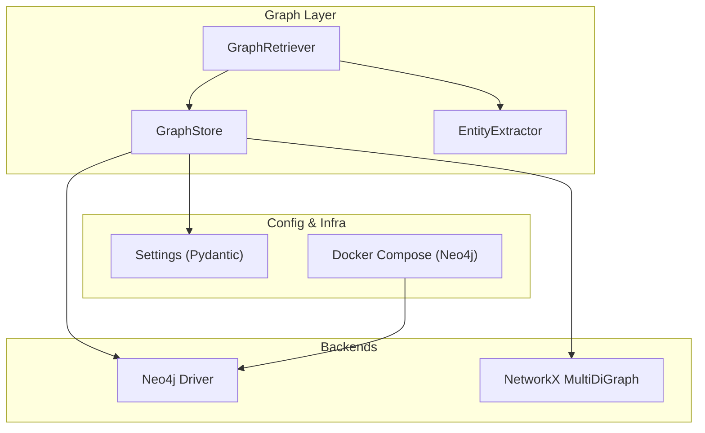
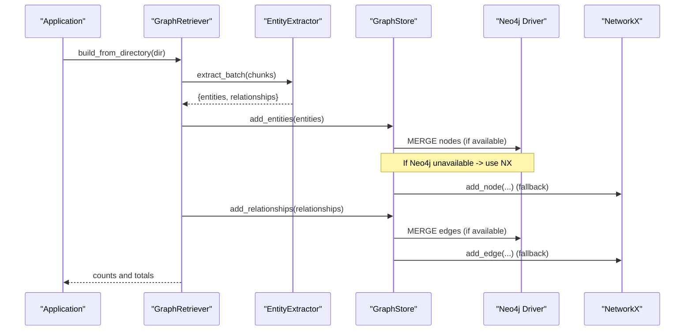
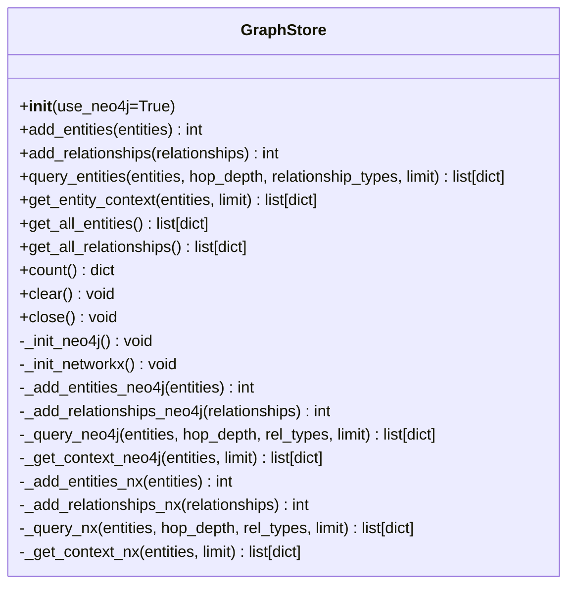
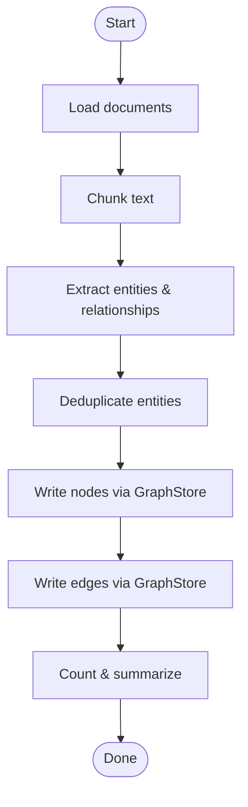
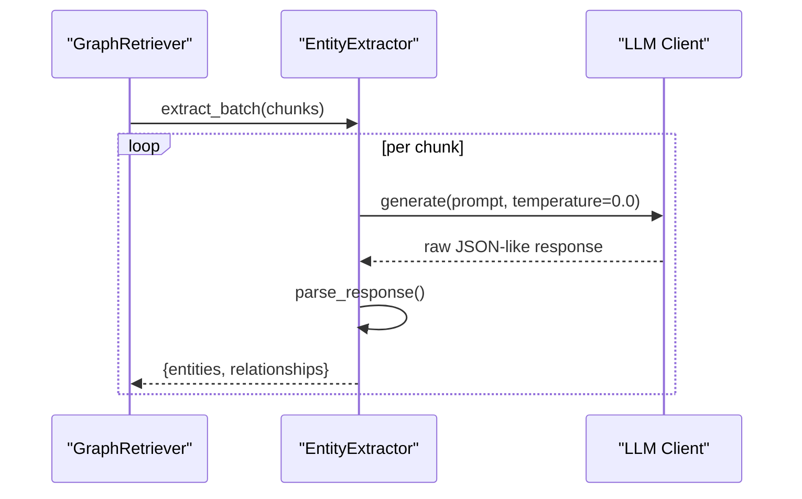
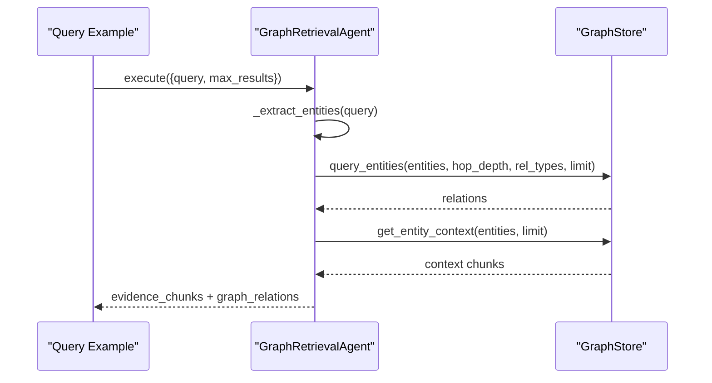
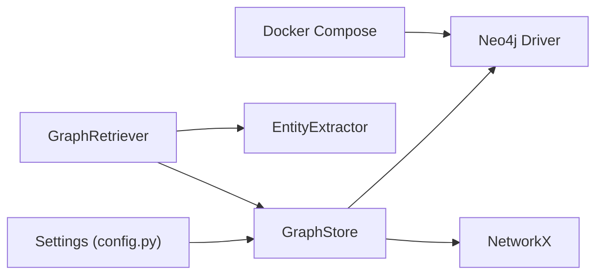

# Graph Storage and Management

<cite>
**Referenced Files in This Document**
- [graph_store.py](file://src/graph/graph_store.py)
- [retriever.py](file://src/graph/retriever.py)
- [entity_extractor.py](file://src/graph/entity_extractor.py)
- [config.py](file://src/config.py)
- [docker-compose.yml](file://docker-compose.yml)
- [ingest_example.py](file://examples/ingest_example.py)
- [query_example.py](file://examples/query_example.py)
- [graph_agent.py](file://src/agents/graph_agent.py)
</cite>

## Table of Contents
1. [Introduction](#introduction)
2. [Project Structure](#project-structure)
3. [Core Components](#core-components)
4. [Architecture Overview](#architecture-overview)
5. [Detailed Component Analysis](#detailed-component-analysis)
6. [Dependency Analysis](#dependency-analysis)
7. [Performance Considerations](#performance-considerations)
8. [Troubleshooting Guide](#troubleshooting-guide)
9. [Conclusion](#conclusion)
10. [Appendices](#appendices)

## Introduction
This document explains the graph storage abstraction layer that supports both Neo4j for production deployments and a NetworkX in-memory fallback for development. It covers the dual-backend architecture, schema design, node and relationship creation patterns, indexing strategies, connection management, transaction handling, data migration considerations, configuration options, workflows for graph construction and batch insertion, validation processes, backup and recovery guidance, performance monitoring, troubleshooting connectivity issues, scalability considerations, and memory management for in-memory storage.

## Project Structure
The graph storage subsystem is centered around a unified interface that abstracts away the underlying storage backend. The key files are:
- GraphStore: Unified API with Neo4j and NetworkX implementations
- GraphRetriever: Orchestrates ingestion and querying via GraphStore
- EntityExtractor: Extracts entities and relationships from text using an LLM
- Configuration: Centralized settings including Neo4j connection parameters
- Docker Compose: Defines Neo4j service and environment variables
- Examples: Demonstrate ingestion and query flows

**Diagram sources**
- [graph_store.py:15-47](file://src/graph/graph_store.py#L15-L47)
- [retriever.py:19-31](file://src/graph/retriever.py#L19-L31)
- [entity_extractor.py:42-46](file://src/graph/entity_extractor.py#L42-L46)
- [config.py:21-53](file://src/config.py#L21-L53)
- [docker-compose.yml:4-20](file://docker-compose.yml#L4-L20)

**Section sources**
- [graph_store.py:15-47](file://src/graph/graph_store.py#L15-L47)
- [retriever.py:19-31](file://src/graph/retriever.py#L19-L31)
- [config.py:21-53](file://src/config.py#L21-L53)
- [docker-compose.yml:4-20](file://docker-compose.yml#L4-L20)

## Core Components
- GraphStore: Provides a consistent API to add entities and relationships, query relationships by hop depth, retrieve entity context, count elements, clear data, and close connections. It auto-initializes either Neo4j or NetworkX based on availability and configuration.
- GraphRetriever: Loads documents, chunks them, extracts entities and relationships, deduplicates entities, and persists them via GraphStore. Also exposes query and summary methods.
- EntityExtractor: Uses an LLM to extract structured entities and relationships from text chunks, attaching source metadata.
- Settings: Centralized configuration loaded from environment variables, including Neo4j URI, user, and password.

Key responsibilities:
- Dual-backend selection and initialization
- Batched writes and queries
- Consistent result shapes across backends
- Graceful fallback when Neo4j is unavailable

**Section sources**
- [graph_store.py:15-137](file://src/graph/graph_store.py#L15-L137)
- [retriever.py:19-131](file://src/graph/retriever.py#L19-L131)
- [entity_extractor.py:42-101](file://src/graph/entity_extractor.py#L42-L101)
- [config.py:21-53](file://src/config.py#L21-L53)

## Architecture Overview
The system uses a strategy pattern to switch between persistent (Neo4j) and in-memory (NetworkX) storage transparently. On startup, GraphStore attempts to connect to Neo4j; if it fails, it falls back to NetworkX. All higher-level components call GraphStore without caring about the backend.

**Diagram sources**
- [retriever.py:32-97](file://src/graph/retriever.py#L32-L97)
- [graph_store.py:18-47](file://src/graph/graph_store.py#L18-L47)
- [graph_store.py:141-176](file://src/graph/graph_store.py#L141-L176)

## Detailed Component Analysis

### GraphStore: Dual-Backend Abstraction
Responsibilities:
- Initialize Neo4j driver with settings; verify connectivity; fall back to NetworkX on failure
- Add entities and relationships to either backend
- Query relationships around given entities with configurable hop depth and limit
- Retrieve textual context stored on entity nodes
- Count entities and relationships
- Clear all data and close connections

Implementation highlights:
- Neo4j path uses parameterized Cypher with MERGE for idempotent upserts
- NetworkX path uses MultiDiGraph with BFS traversal for multi-hop queries
- Consistent return structures enable seamless switching

**Diagram sources**
- [graph_store.py:15-303](file://src/graph/graph_store.py#L15-L303)

**Section sources**
- [graph_store.py:18-47](file://src/graph/graph_store.py#L18-L47)
- [graph_store.py:49-137](file://src/graph/graph_store.py#L49-L137)
- [graph_store.py:141-222](file://src/graph/graph_store.py#L141-L222)
- [graph_store.py:226-303](file://src/graph/graph_store.py#L226-L303)

### GraphRetriever: Orchestration of Ingestion and Queries
Responsibilities:
- Load documents from directory or file
- Chunk text into manageable pieces
- Extract entities and relationships in batches
- Deduplicate entities by name
- Persist via GraphStore
- Provide query and summary capabilities

**Diagram sources**
- [retriever.py:32-97](file://src/graph/retriever.py#L32-L97)

**Section sources**
- [retriever.py:32-97](file://src/graph/retriever.py#L32-L97)
- [retriever.py:99-131](file://src/graph/retriever.py#L99-L131)

### EntityExtractor: LLM-Powered Knowledge Extraction
Responsibilities:
- Accept text chunks and return structured entities and relationships
- Attach source metadata to each extracted item
- Handle JSON parsing robustly with fallbacks

**Diagram sources**
- [entity_extractor.py:48-86](file://src/graph/entity_extractor.py#L48-L86)
- [entity_extractor.py:88-101](file://src/graph/entity_extractor.py#L88-L101)

**Section sources**
- [entity_extractor.py:42-101](file://src/graph/entity_extractor.py#L42-L101)

### Graph Retrieval Agent Integration
The Graph Retrieval Agent orchestrates entity extraction from natural language queries and retrieves related facts from the knowledge graph.

**Diagram sources**
- [graph_agent.py:46-109](file://src/agents/graph_agent.py#L46-L109)
- [graph_store.py:67-85](file://src/graph/graph_store.py#L67-L85)

**Section sources**
- [graph_agent.py:36-121](file://src/agents/graph_agent.py#L36-L121)

## Dependency Analysis
High-level dependencies:
- GraphStore depends on Settings for Neo4j credentials and URL
- GraphRetriever depends on GraphStore and EntityExtractor
- Docker Compose provisions Neo4j and sets environment variables consumed by Settings

**Diagram sources**
- [config.py:21-53](file://src/config.py#L21-L53)
- [graph_store.py:18-47](file://src/graph/graph_store.py#L18-L47)
- [retriever.py:19-31](file://src/graph/retriever.py#L19-L31)
- [docker-compose.yml:4-20](file://docker-compose.yml#L4-L20)

**Section sources**
- [config.py:21-53](file://src/config.py#L21-L53)
- [graph_store.py:18-47](file://src/graph/graph_store.py#L18-L47)
- [retriever.py:19-31](file://src/graph/retriever.py#L19-L31)
- [docker-compose.yml:4-20](file://docker-compose.yml#L4-L20)

## Performance Considerations
- Neo4j write path:
  - Uses MERGE for idempotent upserts per entity and per relationship
  - Each write opens a session; consider batching at the application level for large imports
  - Relationship types are normalized to uppercase with underscores
- Neo4j query path:
  - Multi-hop traversal with variable-length paths up to hop_depth
  - LIMIT applied per entity query to bound results
- NetworkX query path:
  - Breadth-first search limited by hop_depth and early exit on limit
  - Suitable for small-to-medium graphs in development
- Indexing strategy:
  - Node lookup by name relies on exact match; ensure unique names and consider adding indexes on name for Neo4j in production
  - Relationship type normalization reduces duplication and improves query predictability
- Memory management:
  - NetworkX stores the entire graph in process memory; monitor heap usage and avoid unbounded growth in development
  - For large datasets, prefer Neo4j to offload storage and leverage its indexing and query engine

[No sources needed since this section provides general guidance]

## Troubleshooting Guide
Common connectivity issues and resolutions:
- Neo4j unreachable:
  - Symptoms: Initialization logs warning and falls back to NetworkX
  - Checks:
    - Verify NEO4J_URI, NEO4J_USER, NEO4J_PASSWORD in environment
    - Ensure Neo4j container is running and healthy
    - Confirm ports 7474 and 7687 are exposed
- Authentication failures:
  - Validate credentials match those set in docker-compose environment
- Query errors:
  - Inspect debug logs for query exceptions; adjust hop_depth and limits
- Empty results:
  - Confirm entities exist in the graph; check entity names and case sensitivity
  - Validate relationship types used in queries

Operational tips:
- Use GraphStore.count() to quickly verify graph size
- Use GraphStore.clear() to reset state during development
- Close drivers when shutting down long-running services

**Section sources**
- [graph_store.py:29-47](file://src/graph/graph_store.py#L29-L47)
- [graph_store.py:112-137](file://src/graph/graph_store.py#L112-L137)
- [docker-compose.yml:4-20](file://docker-compose.yml#L4-L20)

## Conclusion
The graph storage abstraction provides a robust, dual-backend solution that seamlessly switches between Neo4j for production and NetworkX for development. It offers a consistent API for ingestion, querying, and maintenance while isolating backend-specific details. With careful attention to indexing, batching, and resource management, the system scales effectively for knowledge graph workloads.

[No sources needed since this section summarizes without analyzing specific files]

## Appendices

### Configuration Options
- Neo4j connection:
  - NEO4J_URI: Bolt endpoint (default bolt://localhost:7687)
  - NEO4J_USER: Username (default neo4j)
  - NEO4J_PASSWORD: Password (empty default; must be set for authentication)
- Docker Compose:
  - Sets NEO4J_AUTH and exposes ports for browser and Bolt
  - Passes environment variables to the backend service

**Section sources**
- [config.py:50-53](file://src/config.py#L50-L53)
- [docker-compose.yml:4-20](file://docker-compose.yml#L4-L20)
- [docker-compose.yml:22-41](file://docker-compose.yml#L22-L41)

### Graph Schema Design
- Nodes:
  - Properties: name (unique identifier), type (label), description, source
- Relationships:
  - Types: normalized to uppercase with underscores (e.g., RELATED_TO)
  - Properties: source_doc
- Patterns:
  - Entities are created with MERGE to ensure uniqueness by name
  - Relationships are created with MATCH on source/target and MERGE on edge to avoid duplicates

**Section sources**
- [graph_store.py:141-176](file://src/graph/graph_store.py#L141-L176)

### Connection Management and Transactions
- Connections:
  - Driver created once per GraphStore instance; verify_connectivity called on init
  - Sessions opened per operation; ensure proper closure via close()
- Transactions:
  - Operations run within sessions; for high-throughput ingestion, consider grouping writes into larger batches at the application layer to reduce overhead

**Section sources**
- [graph_store.py:18-47](file://src/graph/graph_store.py#L18-L47)
- [graph_store.py:135-137](file://src/graph/graph_store.py#L135-L137)

### Data Migration Between Backends
- Export from Neo4j:
  - Use Neo4j tools or Cypher to export nodes and relationships to CSV or other formats
- Import into NetworkX:
  - Convert exported data to lists of entities and relationships and call GraphStore.add_entities/add_relationships
- Import into Neo4j:
  - Use Neo4j import tool or Cypher LOAD CSV to populate nodes and relationships

[No sources needed since this section provides general guidance]

### Backup and Recovery Procedures
- Neo4j:
  - Use native backups or snapshot volumes to persist data
  - Restore by mounting backed-up volumes or restoring from snapshots
- NetworkX:
  - Serialize the in-memory graph to disk (e.g., pickle or JSON) for persistence across runs
  - Reload by reconstructing the graph from serialized data

[No sources needed since this section provides general guidance]

### Performance Monitoring Tools
- Neo4j:
  - Monitor query latency and throughput via the browser or metrics endpoints
  - Track index usage and plan queries to optimize performance
- NetworkX:
  - Profile Python process memory and CPU usage during graph operations
  - Limit hop_depth and result limits to control traversal cost

[No sources needed since this section provides general guidance]

### Scalability Considerations
- Prefer Neo4j for large-scale knowledge graphs due to indexing, query optimization, and persistence
- Tune hop_depth and limits to balance recall and performance
- Normalize relationship types and maintain consistent naming to improve query efficiency
- For development, cap graph size to manage memory usage in NetworkX

[No sources needed since this section provides general guidance]

### Example Workflows

#### Ingestion Workflow
- Load documents from a directory
- Chunk text and extract entities and relationships
- Deduplicate entities and persist to the graph store
- Report counts and totals

**Section sources**
- [ingest_example.py:16-94](file://examples/ingest_example.py#L16-L94)
- [retriever.py:32-97](file://src/graph/retriever.py#L32-L97)

#### Query Workflow
- Run a research question through the multi-agent pipeline
- Extract entities from the query and retrieve graph relations and context
- Combine with vector and web evidence for reasoning and reporting

**Section sources**
- [query_example.py:25-176](file://examples/query_example.py#L25-L176)
- [graph_agent.py:46-109](file://src/agents/graph_agent.py#L46-L109)