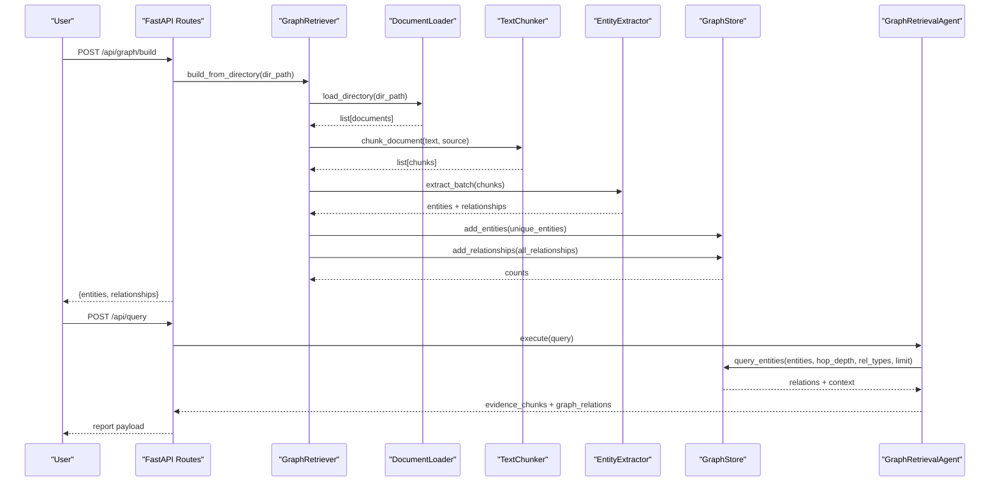
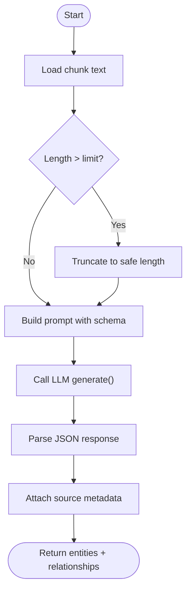
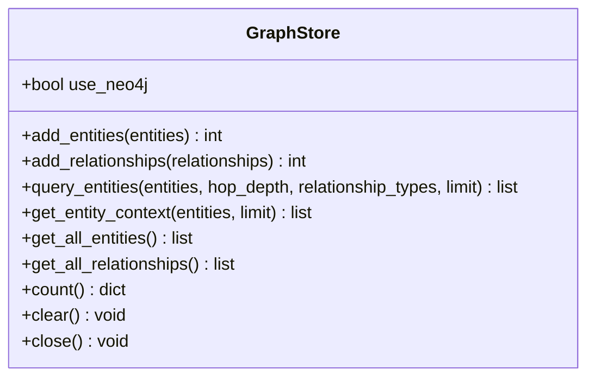
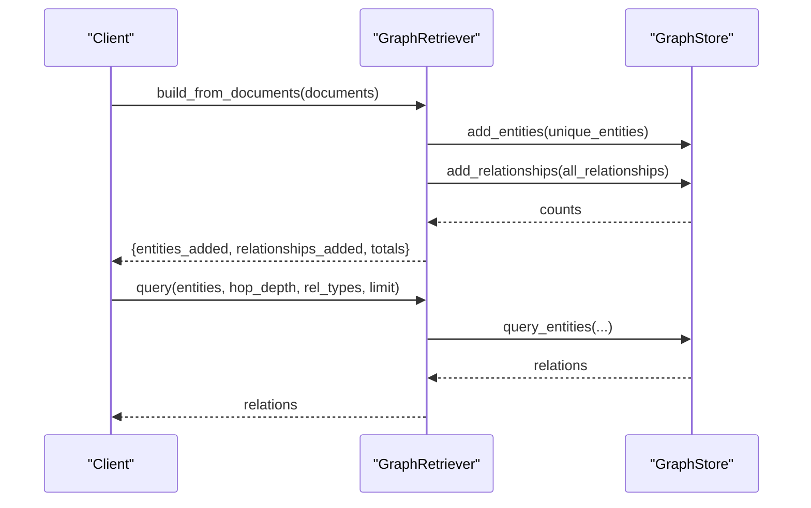
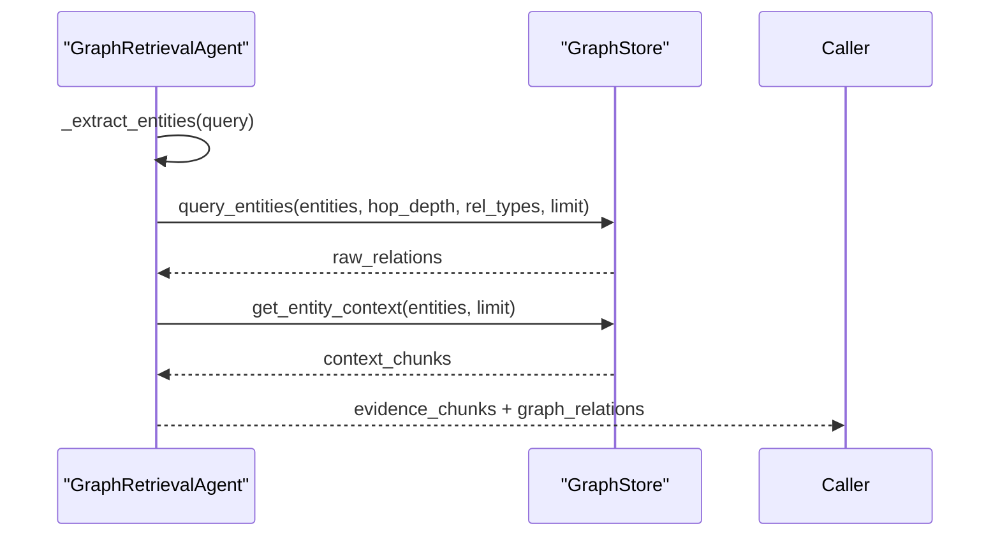
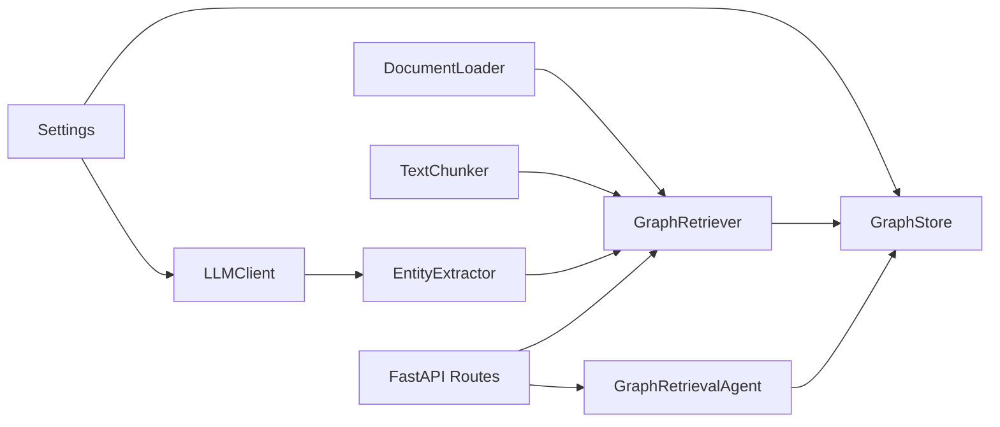

# Knowledge Graph System

<cite>
**Referenced Files in This Document**
- [entity_extractor.py](file://src/graph/entity_extractor.py)
- [graph_store.py](file://src/graph/graph_store.py)
- [retriever.py](file://src/graph/retriever.py)
- [graph_agent.py](file://src/agents/graph_agent.py)
- [llm.py](file://src/core/llm.py)
- [config.py](file://src/config.py)
- [documents.py](file://src/rag/documents.py)
- [chunking.py](file://src/rag/chunking.py)
- [routes.py](file://src/api/routes.py)
- [main.py](file://main.py)
- [README.md](file://README.md)
- [ingest_example.py](file://examples/ingest_example.py)
- [query_example.py](file://examples/query_example.py)
</cite>

## Table of Contents
1. [Introduction](#introduction)
2. [Project Structure](#project-structure)
3. [Core Components](#core-components)
4. [Architecture Overview](#architecture-overview)
5. [Detailed Component Analysis](#detailed-component-analysis)
6. [Dependency Analysis](#dependency-analysis)
7. [Performance Considerations](#performance-considerations)
8. [Troubleshooting Guide](#troubleshooting-guide)
9. [Conclusion](#conclusion)
10. [Appendices](#appendices)

## Introduction
This document explains the knowledge graph system that enables relationship-based reasoning and multi-hop query resolution. It covers how documents are transformed into a structured graph via LLM-powered entity and relationship extraction, how the graph store abstracts Neo4j production deployments with an in-memory NetworkX fallback for development, and how the retriever provides a unified interface for entity-based search, relationship traversal, and multi-hop reasoning. It also includes Cypher patterns used by the system, performance optimization techniques, scalability considerations, visualization and debugging approaches, maintenance procedures, and guidance for customizing prompts and schemas for domain-specific knowledge bases.

## Project Structure
The knowledge graph subsystem lives under src/graph and integrates with document ingestion, chunking, and the multi-agent pipeline exposed via REST endpoints. The main CLI entry points support building graphs from files or directories, while examples demonstrate end-to-end workflows.

```mermaid
graph TB
subgraph "Ingestion"
DL["DocumentLoader"]
TC["TextChunker"]
end
subgraph "Graph Construction"
EE["EntityExtractor"]
GS["GraphStore"]
end
subgraph "Query & Agents"
GR["GraphRetriever"]
GA["GraphRetrievalAgent"]
end
subgraph "API"
API["FastAPI Routes"]
end
DL --> TC
TC --> EE
EE --> GS
GR --> GS
GA --> GR
API --> GR
```

**Diagram sources**
- [documents.py:15-61](file://src/rag/documents.py#L15-L61)
- [chunking.py:29-104](file://src/rag/chunking.py#L29-L104)
- [entity_extractor.py:42-86](file://src/graph/entity_extractor.py#L42-L86)
- [graph_store.py:15-137](file://src/graph/graph_store.py#L15-L137)
- [retriever.py:19-131](file://src/graph/retriever.py#L19-L131)
- [graph_agent.py:36-121](file://src/agents/graph_agent.py#L36-L121)
- [routes.py:169-185](file://src/api/routes.py#L169-L185)

**Section sources**
- [README.md:81-126](file://README.md#L81-L126)
- [main.py:45-56](file://main.py#L45-L56)

## Core Components
- EntityExtractor: Uses an LLM to extract entities and relationships from text chunks and returns structured JSON with source attribution.
- GraphStore: Abstracts storage behind a single interface, supporting Neo4j (production) and NetworkX (development). Provides add, query, context retrieval, counts, and clear operations.
- GraphRetriever: Orchestrates ingestion, chunking, extraction, deduplication, and population of the graph; exposes query and summary APIs.
- GraphRetrievalAgent: Extracts entities and relationship types from user queries using an LLM, then queries the graph and returns evidence and relations to higher-level agents.

**Section sources**
- [entity_extractor.py:17-101](file://src/graph/entity_extractor.py#L17-L101)
- [graph_store.py:15-137](file://src/graph/graph_store.py#L15-L137)
- [retriever.py:19-131](file://src/graph/retriever.py#L19-L131)
- [graph_agent.py:17-121](file://src/agents/graph_agent.py#L17-L121)

## Architecture Overview
The system builds a knowledge graph from documents and supports multi-hop reasoning through graph traversal. Queries can be executed directly via the GraphRetriever or indirectly through the GraphRetrievalAgent as part of the multi-agent pipeline.



**Diagram sources**
- [routes.py:169-185](file://src/api/routes.py#L169-L185)
- [routes.py:188-338](file://src/api/routes.py#L188-L338)
- [retriever.py:32-97](file://src/graph/retriever.py#L32-L97)
- [documents.py:44-61](file://src/rag/documents.py#L44-L61)
- [chunking.py:41-104](file://src/rag/chunking.py#L41-L104)
- [entity_extractor.py:74-86](file://src/graph/entity_extractor.py#L74-L86)
- [graph_store.py:49-125](file://src/graph/graph_store.py#L49-L125)
- [graph_agent.py:46-109](file://src/agents/graph_agent.py#L46-L109)

## Detailed Component Analysis

### Entity Extraction Pipeline
- Input: Text chunks produced by chunking.
- Process: An LLM is prompted with a schema-defined set of entity and relationship types. The extractor truncates input to avoid token limits, calls the LLM, parses JSON responses, and attaches source metadata.
- Output: Structured lists of entities and relationships ready for graph insertion.



**Diagram sources**
- [entity_extractor.py:48-72](file://src/graph/entity_extractor.py#L48-L72)
- [entity_extractor.py:88-101](file://src/graph/entity_extractor.py#L88-L101)
- [llm.py:40-87](file://src/core/llm.py#L40-L87)

**Section sources**
- [entity_extractor.py:17-101](file://src/graph/entity_extractor.py#L17-L101)
- [llm.py:15-103](file://src/core/llm.py#L15-L103)

### Graph Store Abstraction (Neo4j and NetworkX)
- Initialization: Attempts Neo4j connection; on failure, falls back to NetworkX MultiDiGraph.
- Write operations: Adds nodes and edges with properties such as type, description, source, and source_doc.
- Read operations: Supports multi-hop traversal via Cypher path expansion or BFS in NetworkX, with optional relationship type filtering and result limiting.
- Utilities: Counts, clear, and close.



**Diagram sources**
- [graph_store.py:15-137](file://src/graph/graph_store.py#L15-L137)

**Section sources**
- [graph_store.py:15-303](file://src/graph/graph_store.py#L15-L303)

### Graph Retrieval Interface
- Build: Loads documents, chunks them, extracts entities/relationships, deduplicates entities, and populates the graph.
- Query: Delegates to GraphStore.query_entities with hop depth and relationship filters.
- Context: Retrieves textual context stored on entity nodes.
- Summary: Returns counts and sample entities/relationships.



**Diagram sources**
- [retriever.py:42-97](file://src/graph/retriever.py#L42-L97)
- [retriever.py:99-131](file://src/graph/retriever.py#L99-L131)
- [graph_store.py:49-125](file://src/graph/graph_store.py#L49-L125)

**Section sources**
- [retriever.py:19-131](file://src/graph/retriever.py#L19-L131)

### Graph Retrieval Agent Integration
- Extracts key entities and relationship types from natural language queries using an LLM.
- Executes graph queries and collects both relations and contextual evidence chunks.
- Returns standardized payloads to the reasoning agent.



**Diagram sources**
- [graph_agent.py:46-109](file://src/agents/graph_agent.py#L46-L109)

**Section sources**
- [graph_agent.py:17-121](file://src/agents/graph_agent.py#L17-L121)

## Dependency Analysis
Key dependencies and coupling:
- EntityExtractor depends on LLM abstraction and logging.
- GraphStore depends on configuration and either Neo4j driver or NetworkX.
- GraphRetriever composes DocumentLoader, TextChunker, EntityExtractor, and GraphStore.
- GraphRetrievalAgent depends on GraphStore and uses LLM for query parsing.
- API routes lazily initialize RAGPipeline and GraphRetriever and expose endpoints for ingestion, graph building, querying, and evaluation.



**Diagram sources**
- [llm.py:15-103](file://src/core/llm.py#L15-L103)
- [config.py:21-82](file://src/config.py#L21-L82)
- [entity_extractor.py:42-86](file://src/graph/entity_extractor.py#L42-L86)
- [graph_store.py:15-137](file://src/graph/graph_store.py#L15-L137)
- [retriever.py:19-97](file://src/graph/retriever.py#L19-L97)
- [graph_agent.py:36-109](file://src/agents/graph_agent.py#L36-L109)
- [routes.py:28-75](file://src/api/routes.py#L28-L75)

**Section sources**
- [routes.py:28-75](file://src/api/routes.py#L28-L75)
- [retriever.py:19-97](file://src/graph/retriever.py#L19-L97)

## Performance Considerations
- Token budgeting: The extractor truncates input to avoid LLM token limits; tune chunk sizes and overlap to balance context retention and cost.
- Hop depth and limits: Use hop_depth and limit parameters to constrain traversal breadth and result volume.
- Relationship filtering: Provide relationship_types to reduce query scope and improve latency.
- Deduplication: Entities are deduplicated by normalized name before insertion to minimize redundant nodes.
- Backend selection: For large-scale production, prefer Neo4j; for local dev, NetworkX offers fast iteration without external services.
- Connection management: Ensure proper session usage and close drivers when shutting down to free resources.

[No sources needed since this section provides general guidance]

## Troubleshooting Guide
Common issues and resolutions:
- Neo4j connectivity failures: The store automatically falls back to NetworkX if Neo4j is unavailable; verify credentials and URI in settings.
- Invalid LLM responses: The extractor parses JSON with a fallback; ensure prompts produce valid JSON structures.
- Empty results: Confirm entities exist in the graph and hop depth is sufficient; use get_graph_summary to inspect sample data.
- Ingestion errors: DocumentLoader raises exceptions for unsupported formats; ensure supported file types and dependencies are installed.

Operational tips:
- Use /api/status to check vector store and knowledge graph health.
- Use /api/graph/summary to inspect node and edge samples.
- Use /api/graph/build to rebuild the graph after updates.

**Section sources**
- [graph_store.py:29-47](file://src/graph/graph_store.py#L29-L47)
- [entity_extractor.py:88-101](file://src/graph/entity_extractor.py#L88-L101)
- [routes.py:116-131](file://src/api/routes.py#L116-L131)
- [routes.py:169-185](file://src/api/routes.py#L169-L185)
- [documents.py:20-35](file://src/rag/documents.py#L20-L35)

## Conclusion
The knowledge graph system provides a robust foundation for relationship-based reasoning and multi-hop query resolution. It combines LLM-driven extraction with a flexible graph store abstraction, enabling seamless transitions between development and production environments. The retriever and agent layers offer intuitive interfaces for building graphs from documents and executing complex queries, while the API exposes practical endpoints for ingestion, graph construction, and research queries. With careful tuning of chunking, hop depth, and relationship filters, the system scales effectively across domains and datasets.

[No sources needed since this section summarizes without analyzing specific files]

## Appendices

### A. Graph Construction Workflow
- Load documents from directory or file.
- Chunk text with sentence-aware splitting and configurable overlap.
- Extract entities and relationships via LLM with a fixed schema.
- Deduplicate entities and insert into the graph store.
- Verify counts and retrieve summaries.

**Section sources**
- [documents.py:44-61](file://src/rag/documents.py#L44-L61)
- [chunking.py:41-104](file://src/rag/chunking.py#L41-L104)
- [entity_extractor.py:74-86](file://src/graph/entity_extractor.py#L74-L86)
- [retriever.py:42-97](file://src/graph/retriever.py#L42-L97)

### B. Query Interface and Multi-Hop Reasoning
- Direct query: Use GraphRetriever.query with entities, hop_depth, relationship_types, and limit.
- Agent-assisted query: Use GraphRetrievalAgent to parse natural language into entities and relationship types, then traverse the graph.
- Evidence collection: Retrieve both relations and contextual text from entity nodes.

**Section sources**
- [retriever.py:99-131](file://src/graph/retriever.py#L99-L131)
- [graph_agent.py:46-109](file://src/agents/graph_agent.py#L46-L109)

### C. Cypher Query Patterns Used by the System
- Multi-hop traversal around an entity:
  - MATCH (a {name: $entity})-[r*1..N]->(b) RETURN a.name AS source, last(r).type AS relationship, b.name AS target, b.source AS source_doc LIMIT L
- Count nodes and edges:
  - MATCH (n) RETURN count(n) AS c
  - MATCH ()-[r]->() RETURN count(r) AS c
- Get entity context:
  - MATCH (n {name: $entity}) RETURN n.name AS name, n.description AS desc, n.source AS source LIMIT L
- Clear graph:
  - MATCH (n) DETACH DELETE n

These patterns appear in the Neo4j implementations within the graph store.

**Section sources**
- [graph_store.py:178-222](file://src/graph/graph_store.py#L178-L222)
- [graph_store.py:112-133](file://src/graph/graph_store.py#L112-L133)

### D. Configuration and Environment
- Neo4j settings: URI, user, password.
- LLM provider and model selection.
- Chunk size and overlap defaults.
- Paths for documents and evaluation results.

**Section sources**
- [config.py:21-82](file://src/config.py#L21-L82)

### E. Examples and Usage
- Ingest example: Demonstrates loading documents, building the graph, and testing retrieval.
- Query example: Runs the full multi-agent pipeline including graph retrieval and report generation.
- CLI commands: Serve server, ingest documents, build graph, run evaluations.

**Section sources**
- [ingest_example.py:16-94](file://examples/ingest_example.py#L16-L94)
- [query_example.py:25-176](file://examples/query_example.py#L25-L176)
- [main.py:71-106](file://main.py#L71-L106)

### F. Customization Guidance
- Custom entity extraction prompts: Modify the extraction prompt to include domain-specific entity and relationship types; ensure outputs conform to expected JSON structure.
- Graph schema definitions: Define consistent entity types and relationship names; normalize names during deduplication to reduce fragmentation.
- Query optimization strategies: Limit hop depth, filter by relationship types, and cap result limits to control latency and memory usage.

[No sources needed since this section provides general guidance]