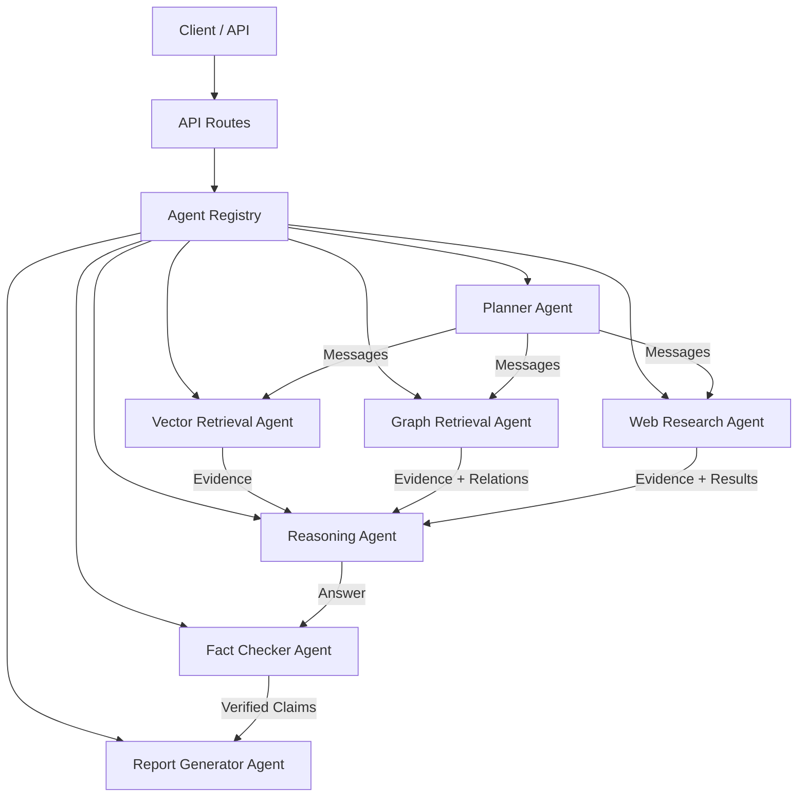
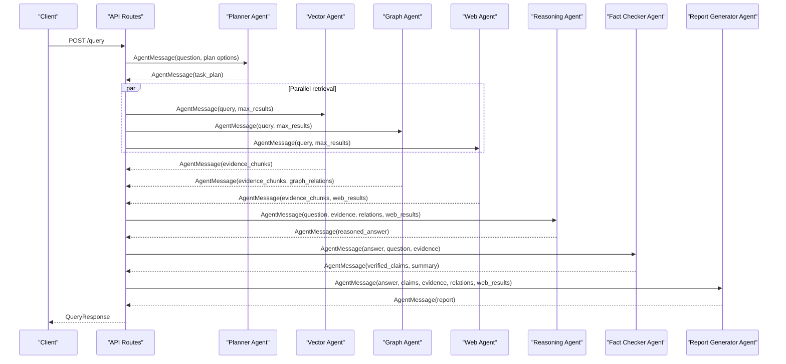
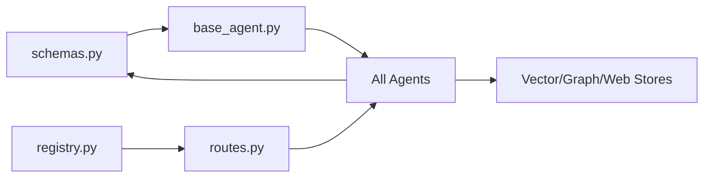
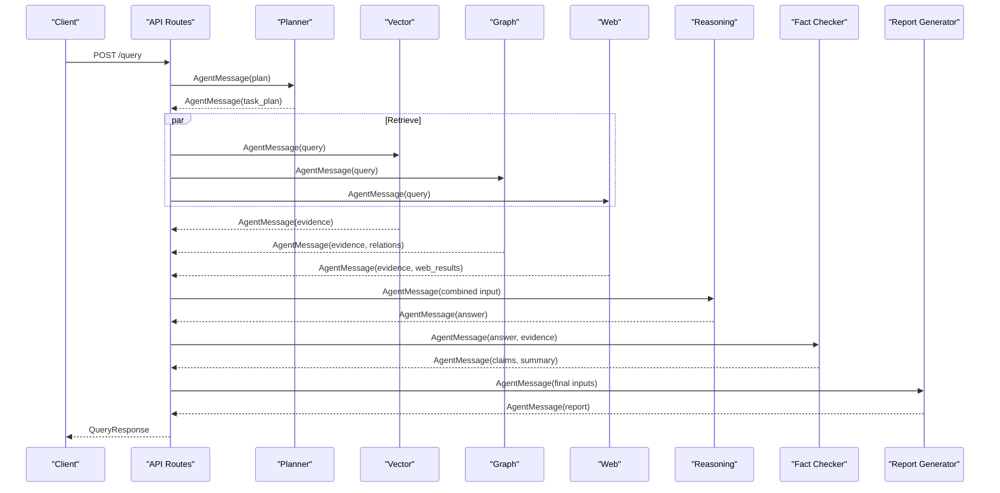
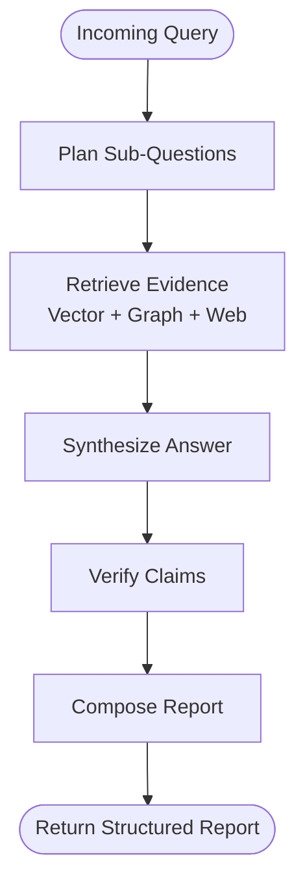

# Agent Communication Protocol

<cite>
**Referenced Files in This Document**
- [schemas.py](file://src/core/schemas.py)
- [base_agent.py](file://src/core/base_agent.py)
- [registry.py](file://src/core/registry.py)
- [routes.py](file://src/api/routes.py)
- [planner_agent.py](file://src/agents/planner_agent.py)
- [vector_agent.py](file://src/agents/vector_agent.py)
- [graph_agent.py](file://src/agents/graph_agent.py)
- [web_agent.py](file://src/agents/web_agent.py)
- [reasoning_agent.py](file://src/agents/reasoning_agent.py)
- [fact_checker_agent.py](file://src/agents/fact_checker_agent.py)
- [report_agent.py](file://src/agents/report_agent.py)
- [query_example.py](file://examples/query_example.py)
</cite>

## Table of Contents
1. Introduction
2. Project Structure
3. Core Components
4. Architecture Overview
5. Detailed Component Analysis
6. Dependency Analysis
7. Performance Considerations
8. Troubleshooting Guide
9. Conclusion
10. Appendices

## Introduction
This document specifies the inter-agent communication protocol that enables seamless collaboration between specialized agents in the system. It defines the AgentMessage schema, message routing mechanisms, priority handling, error propagation patterns, and both synchronous and asynchronous communication patterns used throughout the pipeline. It also provides examples of message formats for query delegation, result sharing, and coordination signals, along with best practices for designing new agent communication patterns while maintaining backward compatibility.

## Project Structure
The multi-agent system is organized around a shared message schema and a base agent abstraction. Agents implement a common execute interface and communicate by passing structured messages. The API layer orchestrates end-to-end research queries by composing agent calls into a deterministic pipeline.

**Diagram sources**
- [routes.py:188-338](file://src/api/routes.py#L188-L338)
- [registry.py:16-51](file://src/core/registry.py#L16-L51)
- [planner_agent.py:56-82](file://src/agents/planner_agent.py#L56-L82)
- [vector_agent.py:34-81](file://src/agents/vector_agent.py#L34-L81)
- [graph_agent.py:36-109](file://src/agents/graph_agent.py#L36-L109)
- [web_agent.py:34-85](file://src/agents/web_agent.py#L34-L85)
- [reasoning_agent.py:38-77](file://src/agents/reasoning_agent.py#L38-L77)
- [fact_checker_agent.py:54-109](file://src/agents/fact_checker_agent.py#L54-L109)
- [report_agent.py:48-142](file://src/agents/report_agent.py#L48-L142)

**Section sources**
- [routes.py:188-338](file://src/api/routes.py#L188-L338)
- [registry.py:16-51](file://src/core/registry.py#L16-L51)

## Core Components
- AgentMessage: The canonical message exchanged between agents. It includes sender, optional receiver, content, payload, and timestamp.
- BaseAgent: Abstract base providing a uniform execute contract, LLM helper, execution logging, and a create_message utility to construct outgoing messages.
- AgentRegistry: Central registry mapping roles to agent instances; supports lookup and lifecycle management.
- API Routes: Orchestrate the end-to-end research workflow by constructing and dispatching AgentMessage instances across agents.

Key responsibilities:
- Schemas define strict data contracts for messages and domain models.
- BaseAgent standardizes how agents produce and consume messages.
- Registry decouples route logic from concrete agent implementations.
- Routes compose agent calls into a coherent pipeline and return structured responses.

**Section sources**
- [schemas.py:107-114](file://src/core/schemas.py#L107-L114)
- [base_agent.py:19-35](file://src/core/base_agent.py#L19-L35)
- [base_agent.py:74-86](file://src/core/base_agent.py#L74-L86)
- [registry.py:16-51](file://src/core/registry.py#L16-L51)
- [routes.py:188-338](file://src/api/routes.py#L188-L338)

## Architecture Overview
The system uses a synchronous, request-driven orchestration model. A client request enters the API routes, which build an AgentMessage and call agent.execute() in sequence or parallel where appropriate. Each agent returns an AgentMessage whose payload carries results consumed by downstream agents.

**Diagram sources**
- [routes.py:188-338](file://src/api/routes.py#L188-L338)
- [planner_agent.py:65-82](file://src/agents/planner_agent.py#L65-L82)
- [vector_agent.py:44-81](file://src/agents/vector_agent.py#L44-L81)
- [graph_agent.py:46-109](file://src/agents/graph_agent.py#L46-L109)
- [web_agent.py:43-85](file://src/agents/web_agent.py#L43-L85)
- [reasoning_agent.py:47-77](file://src/agents/reasoning_agent.py#L47-L77)
- [fact_checker_agent.py:63-109](file://src/agents/fact_checker_agent.py#L63-L109)
- [report_agent.py:57-142](file://src/agents/report_agent.py#L57-L142)

## Detailed Component Analysis

### AgentMessage Schema
- Fields:
  - sender: Enumerated role identifying the originating agent.
  - receiver: Optional target role for point-to-point messaging.
  - content: Human-readable summary or instruction string.
  - payload: Typed dictionary carrying structured data (e.g., task plans, evidence, results).
  - timestamp: When the message was created.
- Usage:
  - Every agent’s execute method receives an AgentMessage and returns one.
  - Payloads are the primary mechanism for passing complex data between agents.
  - Content is useful for logs and human-readable summaries.

Examples of typical payloads:
- Planning: {"task_plan": {...}}
- Retrieval: {"evidence_chunks": [...], "graph_relations": [...]}
- Reasoning: {"reasoned_answer": "...", "question": "..."}
- Fact-checking: {"verified_claims": [...], "fact_check_summary": "..."}
- Reporting: {"report": {...}}

**Section sources**
- [schemas.py:107-114](file://src/core/schemas.py#L107-L114)
- [planner_agent.py:65-82](file://src/agents/planner_agent.py#L65-L82)
- [vector_agent.py:44-81](file://src/agents/vector_agent.py#L44-L81)
- [graph_agent.py:46-109](file://src/agents/graph_agent.py#L46-L109)
- [web_agent.py:43-85](file://src/agents/web_agent.py#L43-L85)
- [reasoning_agent.py:47-77](file://src/agents/reasoning_agent.py#L47-L77)
- [fact_checker_agent.py:63-109](file://src/agents/fact_checker_agent.py#L63-L109)
- [report_agent.py:57-142](file://src/agents/report_agent.py#L57-L142)

### Message Routing Mechanisms
- Direct invocation: The API routes directly instantiate and call agent.execute(), building AgentMessage instances per step.
- Role-based lookup: The AgentRegistry maps roles to agent instances, enabling clean separation between orchestration and implementation.
- Receiver field: While present, most current flows rely on explicit orchestration in routes rather than runtime routing based on receiver. New flows can use receiver for point-to-point signaling when needed.

Best practices:
- Keep orchestration centralized in routes for predictable control flow.
- Use receiver to indicate intended recipient for auditability and future routing extensions.
- Maintain idempotent payloads so retries do not alter outcomes.

**Section sources**
- [routes.py:51-75](file://src/api/routes.py#L51-L75)
- [routes.py:188-338](file://src/api/routes.py#L188-L338)
- [registry.py:16-51](file://src/core/registry.py#L16-L51)

### Priority Handling
- Sub-question priorities: The planner produces sub-questions with a priority field. In the current pipeline, the API executes retrieval steps in a fixed order and does not explicitly sort by priority.
- Recommended approach:
  - Sort sub-questions by priority before dispatching dependent tasks.
  - Respect dependencies to avoid executing tasks before their prerequisites complete.
  - Use priority to schedule long-running retrievals earlier if they block downstream reasoning.

**Section sources**
- [schemas.py:54-61](file://src/core/schemas.py#L54-L61)
- [planner_agent.py:65-82](file://src/agents/planner_agent.py#L65-L82)
- [routes.py:229-272](file://src/api/routes.py#L229-L272)

### Error Propagation Patterns
- Localized fallbacks: Agents parse LLM outputs with robust fallbacks when JSON parsing fails, returning safe defaults or empty results.
- Logging: Agents log warnings/errors for missing configurations or parsing failures.
- Upstream handling: The API aggregates results and continues the pipeline even if some retrieval steps yield empty results.
- Recommendations:
  - Surface actionable errors via payload fields (e.g., error codes, messages).
  - Preserve partial results to allow downstream processing to continue.
  - Add retry logic for transient failures at the orchestration layer.

**Section sources**
- [planner_agent.py:97-127](file://src/agents/planner_agent.py#L97-L127)
- [graph_agent.py:67-97](file://src/agents/graph_agent.py#L67-L97)
- [web_agent.py:96-116](file://src/agents/web_agent.py#L96-L116)
- [fact_checker_agent.py:130-163](file://src/agents/fact_checker_agent.py#L130-L163)
- [report_agent.py:182-195](file://src/agents/report_agent.py#L182-L195)

### Synchronous and Asynchronous Communication Patterns
- Current pattern: Synchronous, sequential or fan-out/fan-in within a single request context. The API composes agent calls deterministically and waits for each response before proceeding.
- Asynchronous potential:
  - Independent retrievals (vector, graph, web) can be executed concurrently to reduce latency.
  - Long-running tasks (e.g., web search) could be offloaded to background jobs with polling or callbacks.
  - Introduce message queues for decoupled workflows and resilience.

Guidelines:
- Keep synchronous paths simple for correctness and observability.
- Introduce async only where it improves throughput without complicating state management.
- Ensure idempotency and consistent ordering guarantees when moving to async.

**Section sources**
- [routes.py:229-272](file://src/api/routes.py#L229-L272)
- [query_example.py:44-143](file://examples/query_example.py#L44-L143)

### Examples of Message Formats for Different Interactions
- Query delegation (planning):
  - Sender: PLANNER
  - Payload: {"question": "...", "include_web_search": true}
  - Response payload: {"task_plan": {...}}
- Result sharing (retrieval):
  - Sender: VECTOR_RETRIEVAL / GRAPH_RETRIEVAL / WEB_RESEARCH
  - Payload: {"evidence_chunks": [...], "graph_relations": [...], "web_results": [...]}
- Coordination signals (pipeline transitions):
  - From REASONING to FACT_CHECKER: {"reasoned_answer": "...", "question": "...", "evidence_chunks": [...], "evidence_used": N}
  - From FACT_CHECKER to REPORT_GENERATOR: {"answer_text": "...", "verified_claims": [...], "evidence_chunks": [...], "graph_relations": [...], "web_results": [...], "fact_check_summary": "...", "experiment_type": "..."}

These patterns are demonstrated in the API routes and example script.

**Section sources**
- [routes.py:219-321](file://src/api/routes.py#L219-L321)
- [query_example.py:44-143](file://examples/query_example.py#L44-L143)

### Best Practices for Designing New Agent Communication Patterns
- Define clear schemas: Extend schemas.py with typed models for new payloads to ensure consistency.
- Use BaseAgent.create_message: Construct messages consistently with sender, optional receiver, content, and payload.
- Keep payloads minimal and versioned: Prefer stable keys and add new fields without breaking existing consumers.
- Handle parsing gracefully: Always provide fallbacks for LLM output parsing and external integrations.
- Log and instrument: Record execution stats and key events for debugging and performance analysis.
- Maintain idempotency: Ensure repeated calls with the same inputs produce the same outputs.
- Centralize orchestration: Keep high-level flow in routes or an orchestrator to preserve determinism and testability.
- Plan for async: Design messages and handlers to support future asynchronous execution and queuing.

**Section sources**
- [base_agent.py:74-86](file://src/core/base_agent.py#L74-L86)
- [schemas.py:107-114](file://src/core/schemas.py#L107-L114)
- [routes.py:188-338](file://src/api/routes.py#L188-L338)

## Dependency Analysis
Agents depend on shared schemas and the base agent abstraction. The API routes depend on the registry to obtain agent instances and coordinate the pipeline. Retrieval agents depend on external stores (vector store, knowledge graph) injected at runtime.

**Diagram sources**
- [schemas.py:107-114](file://src/core/schemas.py#L107-L114)
- [base_agent.py:19-35](file://src/core/base_agent.py#L19-L35)
- [registry.py:16-51](file://src/core/registry.py#L16-L51)
- [routes.py:51-75](file://src/api/routes.py#L51-L75)
- [vector_agent.py:34-81](file://src/agents/vector_agent.py#L34-L81)
- [graph_agent.py:36-109](file://src/agents/graph_agent.py#L36-L109)
- [web_agent.py:34-85](file://src/agents/web_agent.py#L34-L85)

**Section sources**
- [registry.py:16-51](file://src/core/registry.py#L16-L51)
- [routes.py:51-75](file://src/api/routes.py#L51-L75)

## Performance Considerations
- Concurrency: Execute independent retrievals (vector, graph, web) concurrently to reduce end-to-end latency.
- Batching: Limit the number of chunks and relationships passed to reasoning and report generation to control token usage and latency.
- Caching: Cache frequent retrieval results and LLM prompts/responses where appropriate.
- Backpressure: Apply rate limits on external services (e.g., web search) and handle timeouts gracefully.
- Measurement: Use BaseAgent execution stats to monitor latency and token usage across agents.

[No sources needed since this section provides general guidance]

## Troubleshooting Guide
Common issues and resolutions:
- Missing vector/graph store: Agents log warnings and return empty results; verify configuration and injection.
- LLM parsing failures: Agents fall back to safe defaults; inspect logs and refine prompts.
- Web search unavailable: Gracefully skip web results; ensure optional dependencies are installed.
- Pipeline stalls: Check orchestration order and ensure all required payloads are provided.

Operational tips:
- Enable detailed logging levels during development.
- Validate payloads using schemas to catch mismatches early.
- Add unit tests for agent execute methods with mocked stores and LLMs.

**Section sources**
- [graph_agent.py:67-97](file://src/agents/graph_agent.py#L67-L97)
- [vector_agent.py:57-75](file://src/agents/vector_agent.py#L57-L75)
- [web_agent.py:96-116](file://src/agents/web_agent.py#L96-L116)
- [planner_agent.py:97-127](file://src/agents/planner_agent.py#L97-L127)
- [fact_checker_agent.py:130-163](file://src/agents/fact_checker_agent.py#L130-L163)

## Conclusion
The inter-agent communication protocol centers on a well-defined AgentMessage schema and a consistent execute contract implemented by all agents. The API routes orchestrate a deterministic pipeline that composes planning, retrieval, reasoning, fact-checking, and reporting. By following the recommended practices—typed schemas, graceful error handling, centralized orchestration, and careful payload design—the system remains extensible and maintainable. Future enhancements can introduce concurrency and asynchronous patterns while preserving backward compatibility through stable message contracts.

[No sources needed since this section summarizes without analyzing specific files]

## Appendices

### Appendix A: End-to-End Sequence (Multi-Agent Mode)

**Diagram sources**
- [routes.py:188-338](file://src/api/routes.py#L188-L338)
- [query_example.py:44-143](file://examples/query_example.py#L44-L143)

### Appendix B: Data Flow Diagram

**Diagram sources**
- [routes.py:188-338](file://src/api/routes.py#L188-L338)