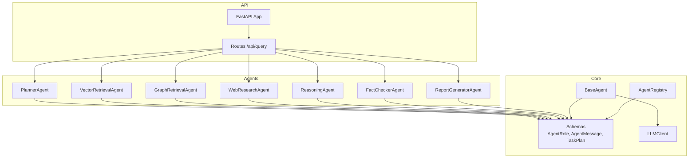
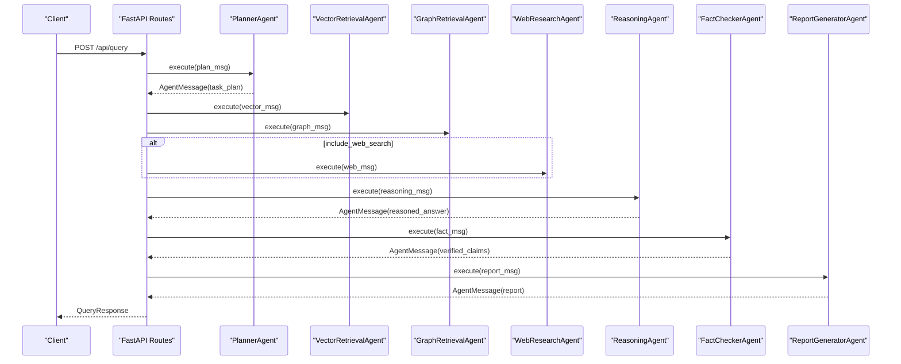
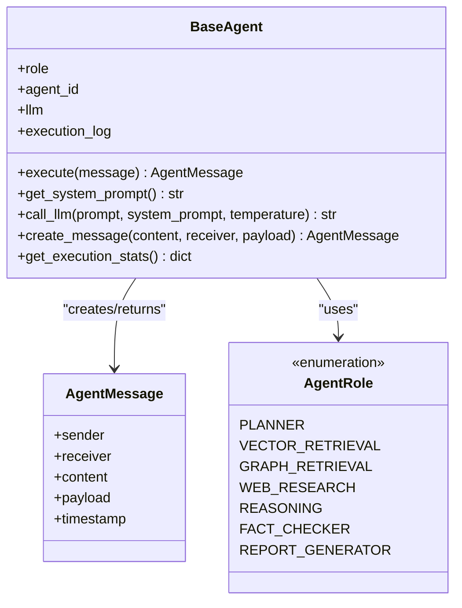
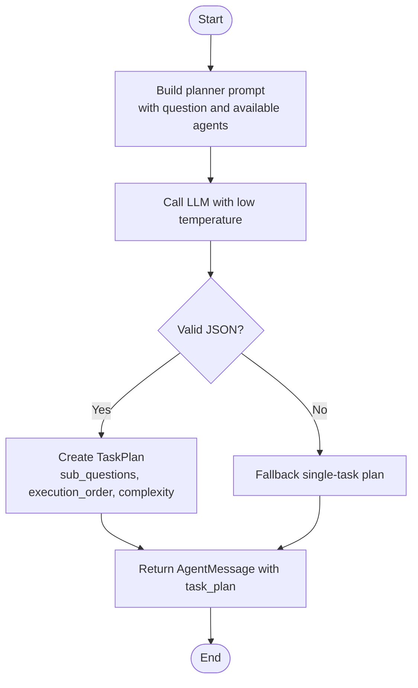
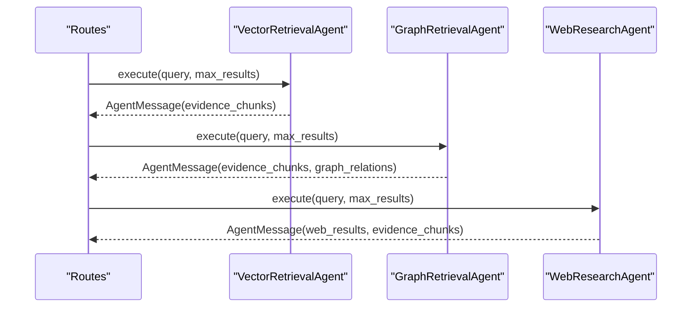
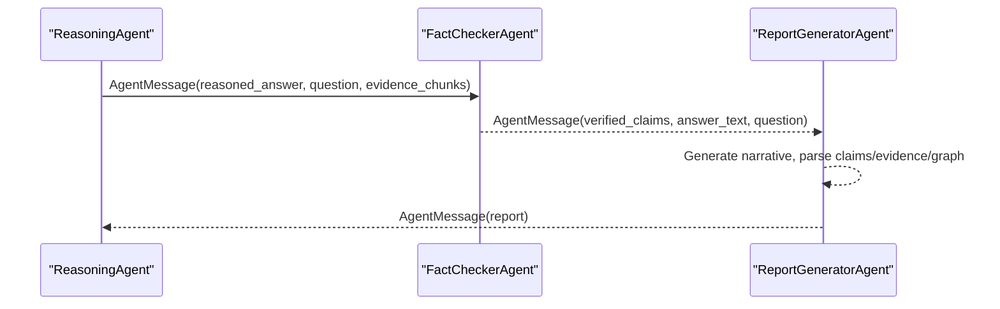
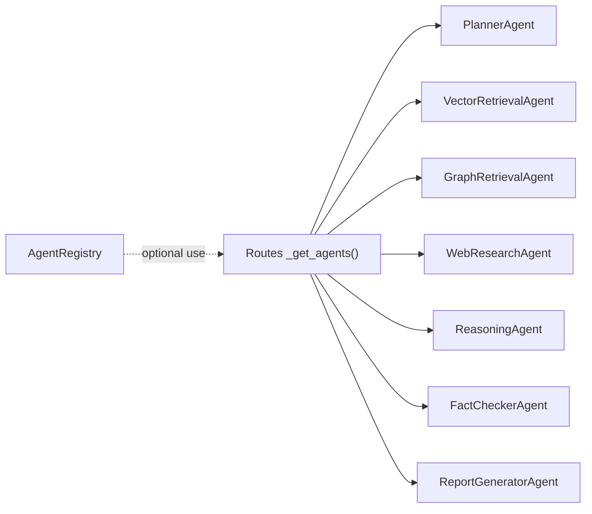
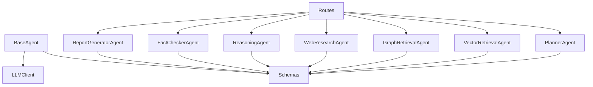

# Agent Orchestration Framework

<cite>
**Referenced Files in This Document**
- [base_agent.py](file://src/core/base_agent.py)
- [schemas.py](file://src/core/schemas.py)
- [planner_agent.py](file://src/agents/planner_agent.py)
- [vector_agent.py](file://src/agents/vector_agent.py)
- [graph_agent.py](file://src/agents/graph_agent.py)
- [web_agent.py](file://src/agents/web_agent.py)
- [reasoning_agent.py](file://src/agents/reasoning_agent.py)
- [fact_checker_agent.py](file://src/agents/fact_checker_agent.py)
- [report_agent.py](file://src/agents/report_agent.py)
- [registry.py](file://src/core/registry.py)
- [routes.py](file://src/api/routes.py)
- [app.py](file://src/api/app.py)
- [llm.py](file://src/core/llm.py)
- [main.py](file://main.py)
- [README.md](file://README.md)
</cite>

## Table of Contents
1. Introduction
2. Project Structure
3. Core Components
4. Architecture Overview
5. Detailed Component Analysis
6. Dependency Analysis
7. Performance Considerations
8. Troubleshooting Guide
9. Conclusion
10. Appendices

## Introduction
This document explains the agent orchestration framework that powers the multi-agent research system. It focuses on:
- The BaseAgent abstract class and its lifecycle, messaging, and execution logging
- The AgentMessage protocol and AgentRole enumeration that standardize inter-agent communication
- PlannerAgent’s query decomposition, task planning, and execution order determination
- How agents are registered, discovered, and coordinated via the API routes (acting as the orchestrator)
- Message passing patterns, error handling strategies, and lifecycle management
- Guidance for implementing custom agents by extending BaseAgent and following the established protocols

The framework combines vector retrieval, knowledge graph retrieval, web search, reasoning, fact-checking, and report generation into a cohesive pipeline with robust fallbacks and clear data contracts.

## Project Structure
The orchestration framework is centered around core abstractions and specialized agents under src/core and src/agents, orchestrated through FastAPI endpoints in src/api. Key responsibilities:
- Core abstractions: BaseAgent, schemas (AgentRole, AgentMessage, TaskPlan), LLMClient
- Agents: Planner, Vector Retrieval, Graph Retrieval, Web Research, Reasoning, Fact Checker, Report Generator
- Orchestration: API routes assemble and execute the pipeline; registry provides role-based lookup
- Entry points: main.py CLI and FastAPI app startup

**Diagram sources**
- [base_agent.py:19-100](file://src/core/base_agent.py#L19-L100)
- [schemas.py:17-122](file://src/core/schemas.py#L17-L122)
- [llm.py:15-103](file://src/core/llm.py#L15-L103)
- [registry.py:16-51](file://src/core/registry.py#L16-L51)
- [planner_agent.py:56-128](file://src/agents/planner_agent.py#L56-L128)
- [vector_agent.py:34-92](file://src/agents/vector_agent.py#L34-L92)
- [graph_agent.py:36-121](file://src/agents/graph_agent.py#L36-L121)
- [web_agent.py:34-117](file://src/agents/web_agent.py#L34-L117)
- [reasoning_agent.py:38-124](file://src/agents/reasoning_agent.py#L38-L124)
- [fact_checker_agent.py:54-163](file://src/agents/fact_checker_agent.py#L54-L163)
- [report_agent.py:48-228](file://src/agents/report_agent.py#L48-L228)
- [routes.py:188-338](file://src/api/routes.py#L188-L338)
- [app.py:26-57](file://src/api/app.py#L26-L57)

**Section sources**
- [README.md:5-23](file://README.md#L5-L23)
- [main.py:71-110](file://main.py#L71-L110)
- [app.py:26-57](file://src/api/app.py#L26-L57)

## Core Components
- BaseAgent: Abstract base defining the agent contract (execute, get_system_prompt), LLM helper call_llm, message factory create_message, and execution stats collection.
- Schemas: Strongly typed models for roles, messages, plans, evidence, claims, and reports.
- LLMClient: Unified interface to Gemini/OpenAI with token counting and temperature control.
- AgentRegistry: Role-to-agent mapping with registration and discovery helpers.

Key behaviors:
- All agents inherit BaseAgent, ensuring consistent lifecycle, logging, and messaging.
- Messages flow via AgentMessage with sender/receiver roles and typed payloads.
- Planning produces TaskPlan with sub-questions and execution_order.

**Section sources**
- [base_agent.py:19-100](file://src/core/base_agent.py#L19-L100)
- [schemas.py:17-122](file://src/core/schemas.py#L17-L122)
- [llm.py:15-103](file://src/core/llm.py#L15-L103)
- [registry.py:16-51](file://src/core/registry.py#L16-L51)

## Architecture Overview
The orchestration follows a staged pipeline:
- Planning decomposes the user question into sub-questions and determines required agents and execution order.
- Parallel retrieval gathers evidence from vector store, knowledge graph, and optionally web search.
- Reasoning synthesizes evidence into an answer draft.
- Fact checking verifies claims against evidence and flags hallucinations.
- Report generator compiles a structured research report.

**Diagram sources**
- [routes.py:188-338](file://src/api/routes.py#L188-L338)
- [planner_agent.py:65-82](file://src/agents/planner_agent.py#L65-L82)
- [vector_agent.py:44-81](file://src/agents/vector_agent.py#L44-L81)
- [graph_agent.py:46-109](file://src/agents/graph_agent.py#L46-L109)
- [web_agent.py:43-85](file://src/agents/web_agent.py#L43-L85)
- [reasoning_agent.py:47-77](file://src/agents/reasoning_agent.py#L47-L77)
- [fact_checker_agent.py:63-109](file://src/agents/fact_checker_agent.py#L63-L109)
- [report_agent.py:57-142](file://src/agents/report_agent.py#L57-L142)

## Detailed Component Analysis

### BaseAgent and AgentMessage Protocol
- BaseAgent enforces a uniform interface:
  - execute(message) returns AgentMessage
  - get_system_prompt() defines agent persona/instructions
  - call_llm(prompt, system_prompt, temperature) logs tokens and latency
  - create_message(content, receiver, payload) builds outgoing messages
  - get_execution_stats() aggregates performance metrics
- AgentMessage carries sender/receiver roles, content, payload, and timestamp.
- AgentRole enumerates all supported agent types used across the system.

**Diagram sources**
- [base_agent.py:19-100](file://src/core/base_agent.py#L19-L100)
- [schemas.py:17-114](file://src/core/schemas.py#L17-L114)

**Section sources**
- [base_agent.py:19-100](file://src/core/base_agent.py#L19-L100)
- [schemas.py:17-114](file://src/core/schemas.py#L17-L114)

### PlannerAgent: Query Decomposition and Execution Order
- Purpose: Understand the research question, decompose into sub-questions, assign required agents, and determine execution order.
- Logic:
  - Builds a prompt describing available agents and constraints
  - Calls LLM with low temperature to produce JSON plan
  - Parses JSON with markdown code block extraction; falls back to single-task plan if parsing fails
  - Returns AgentMessage with TaskPlan payload to downstream agents

**Diagram sources**
- [planner_agent.py:23-53](file://src/agents/planner_agent.py#L23-L53)
- [planner_agent.py:65-128](file://src/agents/planner_agent.py#L65-L128)

**Section sources**
- [planner_agent.py:56-128](file://src/agents/planner_agent.py#L56-L128)
- [schemas.py:54-122](file://src/core/schemas.py#L54-L122)

### Retrieval Agents: Vector, Graph, Web
- VectorRetrievalAgent:
  - Uses LLM to generate optimized search phrases and reformulated query
  - Queries vector store and converts results to EvidenceChunk list
  - Returns AgentMessage with evidence_chunks
- GraphRetrievalAgent:
  - Extracts entities and relationship types via LLM
  - Queries knowledge graph for relations and context chunks
  - Returns AgentMessage with evidence_chunks and graph_relations
- WebResearchAgent:
  - Generates multiple search queries via LLM
  - Executes DuckDuckGo searches and converts results to WebResult and EvidenceChunk
  - Returns AgentMessage with web_results and evidence_chunks

**Diagram sources**
- [vector_agent.py:44-81](file://src/agents/vector_agent.py#L44-L81)
- [graph_agent.py:46-109](file://src/agents/graph_agent.py#L46-L109)
- [web_agent.py:43-85](file://src/agents/web_agent.py#L43-L85)

**Section sources**
- [vector_agent.py:34-92](file://src/agents/vector_agent.py#L34-L92)
- [graph_agent.py:36-121](file://src/agents/graph_agent.py#L36-L121)
- [web_agent.py:34-117](file://src/agents/web_agent.py#L34-L117)

### Reasoning, Fact Checking, and Report Generation
- ReasoningAgent:
  - Builds a structured prompt combining vector evidence, graph relationships, and web results
  - Produces reasoned answer with step-by-step reasoning and citations
  - Returns AgentMessage to FactChecker
- FactCheckerAgent:
  - Extracts factual claims from the answer and verifies against evidence
  - Assigns verdicts (supported/partially supported/unsupported/contradicted/no evidence)
  - Returns AgentMessage with verified_claims and hallucination flag
- ReportGeneratorAgent:
  - Compiles narrative sections, references, comparisons, limitations
  - Produces ResearchReport with metadata and experiment type
  - Returns AgentMessage with final report payload

**Diagram sources**
- [reasoning_agent.py:47-77](file://src/agents/reasoning_agent.py#L47-L77)
- [fact_checker_agent.py:63-109](file://src/agents/fact_checker_agent.py#L63-L109)
- [report_agent.py:57-142](file://src/agents/report_agent.py#L57-L142)

**Section sources**
- [reasoning_agent.py:38-124](file://src/agents/reasoning_agent.py#L38-L124)
- [fact_checker_agent.py:54-163](file://src/agents/fact_checker_agent.py#L54-L163)
- [report_agent.py:48-228](file://src/agents/report_agent.py#L48-L228)

### Registration, Discovery, and Coordination
- Registration:
  - API routes lazily initialize agents and inject dependencies (vector_store, graph_store)
  - Each agent instance is keyed by AgentRole
- Discovery:
  - Routes access agents via dictionary lookup by role
  - Registry module provides a singleton pattern for role-based lookup (available for other orchestrators)
- Coordination:
  - Routes orchestrate the full pipeline, assembling messages and aggregating evidence
  - Execution order is driven by the route logic and optional planner output

**Diagram sources**
- [routes.py:51-75](file://src/api/routes.py#L51-L75)
- [registry.py:16-51](file://src/core/registry.py#L16-L51)

**Section sources**
- [routes.py:51-75](file://src/api/routes.py#L51-L75)
- [registry.py:16-51](file://src/core/registry.py#L16-L51)

## Dependency Analysis
- BaseAgent depends on:
  - AgentRole and AgentMessage from schemas
  - LLMClient for generation and token counting
- Agents depend on:
  - BaseAgent for common behavior
  - Schemas for typed payloads
  - External stores (vector_store, graph_store) injected at runtime
- Routes depend on:
  - All agents and schemas
  - LLMClient indirectly via agents
- LLMClient depends on configuration and provider-specific libraries

**Diagram sources**
- [base_agent.py:19-100](file://src/core/base_agent.py#L19-L100)
- [schemas.py:17-122](file://src/core/schemas.py#L17-L122)
- [llm.py:15-103](file://src/core/llm.py#L15-L103)
- [routes.py:188-338](file://src/api/routes.py#L188-L338)

**Section sources**
- [base_agent.py:19-100](file://src/core/base_agent.py#L19-L100)
- [schemas.py:17-122](file://src/core/schemas.py#L17-L122)
- [llm.py:15-103](file://src/core/llm.py#L15-L103)
- [routes.py:188-338](file://src/api/routes.py#L188-L338)

## Performance Considerations
- Token usage and latency are tracked per LLM call via BaseAgent execution logs; aggregate via get_execution_stats.
- Low temperatures in planning and verification reduce variability and improve deterministic outputs.
- Parallel retrieval (vector, graph, web) can be executed concurrently to reduce total pipeline latency.
- Limit input sizes (e.g., truncating evidence lists) to manage token budgets and response times.
- Use appropriate max_results to balance recall vs. cost.

[No sources needed since this section provides general guidance]

## Troubleshooting Guide
Common issues and strategies:
- Invalid LLM JSON responses:
  - Planner and Fact Checker extract JSON from markdown blocks; fallbacks ensure continuity when parsing fails.
  - Check logs for warnings about invalid JSON and adjust prompts or model settings.
- Missing external dependencies:
  - Web search requires duckduckgo-search; absence triggers a warning and skips web search.
  - Vector/graph stores must be configured; otherwise, agents return empty results with warnings.
- Provider configuration errors:
  - LLMClient raises errors for unsupported providers or missing API keys; verify environment settings.
- No agent registered:
  - If using AgentRegistry directly, ensure agents are registered before lookup; otherwise KeyError is raised.

**Section sources**
- [planner_agent.py:97-128](file://src/agents/planner_agent.py#L97-L128)
- [fact_checker_agent.py:130-163](file://src/agents/fact_checker_agent.py#L130-L163)
- [web_agent.py:96-117](file://src/agents/web_agent.py#L96-L117)
- [llm.py:15-39](file://src/core/llm.py#L15-L39)
- [registry.py:22-30](file://src/core/registry.py#L22-L30)

## Conclusion
The agent orchestration framework standardizes agent behavior and communication through BaseAgent, AgentMessage, and AgentRole. PlannerAgent decomposes complex questions into actionable sub-tasks with explicit execution ordering. The API routes coordinate the pipeline, enabling flexible experimentation across baseline, RAG variants, and full multi-agent workflows. Robust error handling and fallbacks ensure resilience, while execution logging supports performance monitoring and optimization. Extending the framework with custom agents is straightforward by inheriting BaseAgent and adhering to the message protocol.

[No sources needed since this section summarizes without analyzing specific files]

## Appendices

### Implementing Custom Agents
Steps to implement a new agent:
- Inherit BaseAgent and set role via super().__init__(role=AgentRole.YOUR_ROLE).
- Implement get_system_prompt() to define persona and instructions.
- Implement execute(message) to process input and return AgentMessage with typed payload.
- Use call_llm() for LLM interactions; leverage create_message() for outgoing messages.
- Optionally inject external services (e.g., vector_store, graph_store) via constructor parameters.
- Register your agent in the API routes’ _get_agents() or via AgentRegistry if building a custom orchestrator.

Best practices:
- Keep payloads small and well-structured; prefer typed schemas.
- Handle LLM parsing failures gracefully with fallbacks.
- Log key steps and metrics for observability.
- Validate inputs and handle edge cases (empty results, missing dependencies).

**Section sources**
- [base_agent.py:19-100](file://src/core/base_agent.py#L19-L100)
- [schemas.py:17-122](file://src/core/schemas.py#L17-L122)
- [routes.py:51-75](file://src/api/routes.py#L51-L75)