# Multi-Agent System

<cite>
**Referenced Files in This Document**
- [README.md](file://README.md)
- [main.py](file://main.py)
- [src/config.py](file://src/config.py)
- [src/api/app.py](file://src/api/app.py)
- [src/api/routes.py](file://src/api/routes.py)
- [src/core/base_agent.py](file://src/core/base_agent.py)
- [src/core/schemas.py](file://src/core/schemas.py)
- [src/core/registry.py](file://src/core/registry.py)
- [src/agents/planner_agent.py](file://src/agents/planner_agent.py)
- [src/agents/vector_agent.py](file://src/agents/vector_agent.py)
- [src/agents/graph_agent.py](file://src/agents/graph_agent.py)
- [src/agents/web_agent.py](file://src/agents/web_agent.py)
- [src/agents/reasoning_agent.py](file://src/agents/reasoning_agent.py)
- [src/agents/fact_checker_agent.py](file://src/agents/fact_checker_agent.py)
- [src/agents/report_agent.py](file://src/agents/report_agent.py)
</cite>

## Table of Contents
1. Introduction
2. Project Structure
3. Core Components
4. Architecture Overview
5. Detailed Component Analysis
6. Dependency Analysis
7. Performance Considerations
8. Troubleshooting Guide
9. Conclusion
10. Appendices

## Introduction
This document explains the multi-agent system architecture that orchestrates specialized agents to perform complex research tasks. The PlannerAgent decomposes user queries into sub-tasks and coordinates parallel execution of retrieval agents (Vector, Graph, Web). A ReasoningAgent synthesizes evidence across sources, a FactCheckerAgent verifies claims against evidence, and a ReportAgent produces structured research reports. The system exposes a FastAPI interface for ingestion, graph building, querying, and evaluation, with configuration managed centrally.

## Project Structure
The repository is organized by feature layers:
- API layer: FastAPI application and routes handling HTTP requests and orchestrating agent workflows
- Core layer: Base agent abstraction, shared schemas, LLM client, and agent registry
- Agents: Specialized agents for planning, retrieval, reasoning, verification, and reporting
- RAG and Graph: Vector store integration and knowledge graph retrieval interfaces
- Configuration: Centralized settings loaded from environment variables
- CLI entry point: Commands to serve, ingest, build graphs, and run evaluations

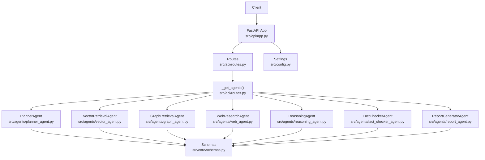

**Diagram sources**
- [src/api/app.py:17-57](file://src/api/app.py#L17-L57)
- [src/api/routes.py:51-75](file://src/api/routes.py#L51-L75)
- [src/agents/planner_agent.py:56-82](file://src/agents/planner_agent.py#L56-L82)
- [src/agents/vector_agent.py:34-81](file://src/agents/vector_agent.py#L34-L81)
- [src/agents/graph_agent.py:36-109](file://src/agents/graph_agent.py#L36-L109)
- [src/agents/web_agent.py:34-85](file://src/agents/web_agent.py#L34-L85)
- [src/agents/reasoning_agent.py:38-77](file://src/agents/reasoning_agent.py#L38-L77)
- [src/agents/fact_checker_agent.py:54-109](file://src/agents/fact_checker_agent.py#L54-L109)
- [src/agents/report_agent.py:48-142](file://src/agents/report_agent.py#L48-L142)
- [src/core/schemas.py:17-148](file://src/core/schemas.py#L17-L148)
- [src/config.py:21-82](file://src/config.py#L21-L82)

**Section sources**
- [README.md:5-23](file://README.md#L5-L23)
- [main.py:71-110](file://main.py#L71-L110)
- [src/api/app.py:17-57](file://src/api/app.py#L17-L57)
- [src/config.py:21-82](file://src/config.py#L21-L82)

## Core Components
- BaseAgent: Abstract base providing lifecycle, LLM invocation, message creation, and execution logging for all agents
- Schemas: Type-safe Pydantic models for roles, messages, plans, evidence, claims, and reports
- Registry: Central catalog mapping AgentRole to agent instances
- Settings: Centralized configuration via environment variables

Key responsibilities:
- BaseAgent standardizes agent behavior and metrics collection
- Schemas define inter-agent communication contracts and data structures
- Registry enables dynamic lookup and extension points
- Settings control providers, models, vector DBs, and graph endpoints

**Section sources**
- [src/core/base_agent.py:19-100](file://src/core/base_agent.py#L19-L100)
- [src/core/schemas.py:17-168](file://src/core/schemas.py#L17-L168)
- [src/core/registry.py:16-51](file://src/core/registry.py#L16-L51)
- [src/config.py:21-82](file://src/config.py#L21-L82)

## Architecture Overview
The system implements an orchestration pattern where the PlannerAgent decomposes queries and the API route coordinates parallel retrieval and sequential synthesis and verification steps.

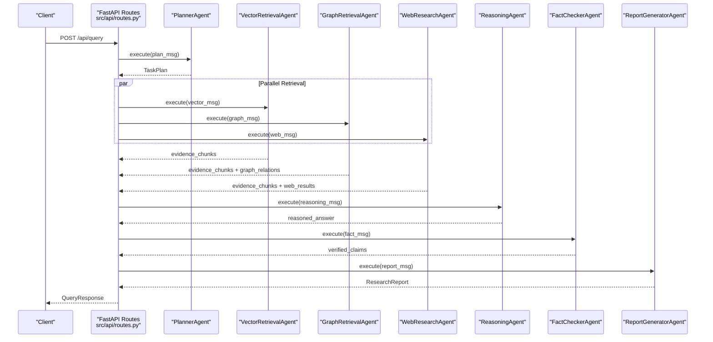

**Diagram sources**
- [src/api/routes.py:188-338](file://src/api/routes.py#L188-L338)
- [src/agents/planner_agent.py:65-82](file://src/agents/planner_agent.py#L65-L82)
- [src/agents/vector_agent.py:44-81](file://src/agents/vector_agent.py#L44-L81)
- [src/agents/graph_agent.py:46-109](file://src/agents/graph_agent.py#L46-L109)
- [src/agents/web_agent.py:43-85](file://src/agents/web_agent.py#L43-L85)
- [src/agents/reasoning_agent.py:47-77](file://src/agents/reasoning_agent.py#L47-L77)
- [src/agents/fact_checker_agent.py:63-109](file://src/agents/fact_checker_agent.py#L63-L109)
- [src/agents/report_agent.py:57-142](file://src/agents/report_agent.py#L57-L142)

## Detailed Component Analysis

### PlannerAgent
Responsibilities:
- Understands the research question and decomposes it into sub-questions
- Determines required agents per sub-question and sets dependencies and priorities
- Produces a TaskPlan used by the orchestrator

Execution flow:
- Builds prompt with available agents and optional web search flag
- Calls LLM with low temperature for deterministic planning
- Parses JSON response with fallback to a single-task plan if parsing fails
- Returns an AgentMessage carrying the TaskPlan payload

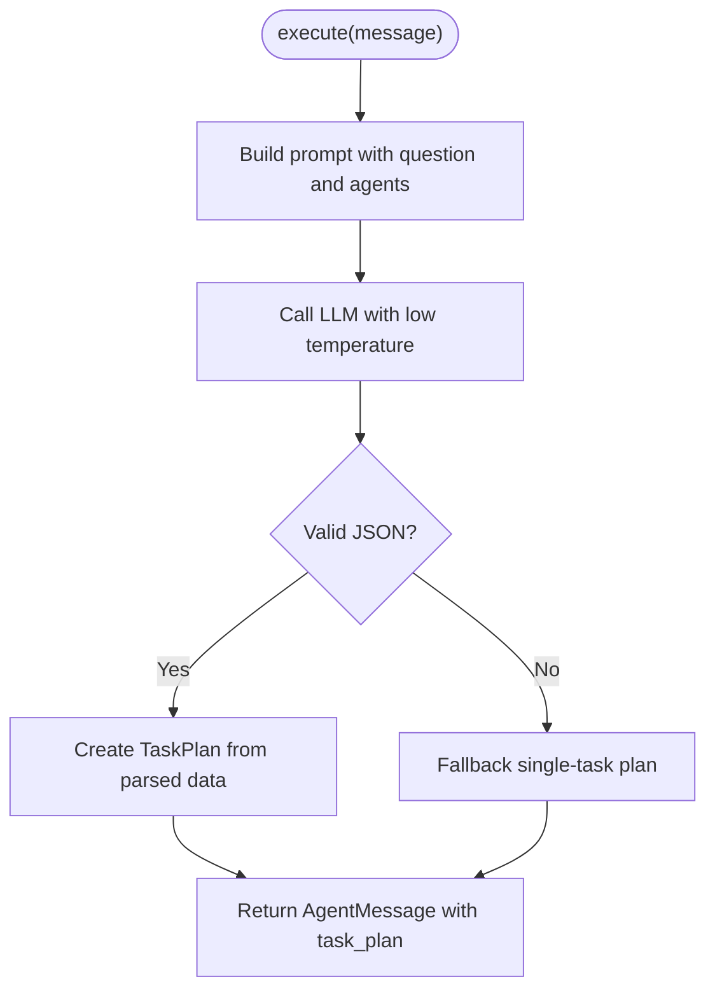

**Diagram sources**
- [src/agents/planner_agent.py:65-128](file://src/agents/planner_agent.py#L65-L128)

**Section sources**
- [src/agents/planner_agent.py:23-53](file://src/agents/planner_agent.py#L23-L53)
- [src/agents/planner_agent.py:65-128](file://src/agents/planner_agent.py#L65-L128)

### VectorRetrievalAgent
Responsibilities:
- Optimizes search phrases using LLM
- Queries vector store and converts results to EvidenceChunk objects
- Handles missing vector store gracefully

Execution flow:
- Extracts query and max_results from message payload
- Uses LLM to generate search strategy (phrases and reformulated query)
- Searches vector store and maps raw results to EvidenceChunk
- Returns AgentMessage with evidence_chunks

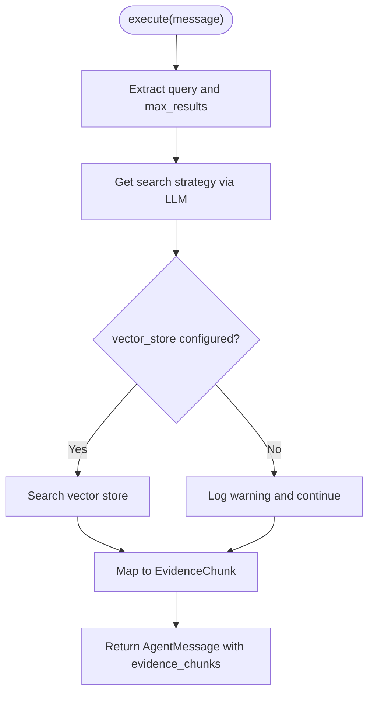

**Diagram sources**
- [src/agents/vector_agent.py:44-92](file://src/agents/vector_agent.py#L44-L92)

**Section sources**
- [src/agents/vector_agent.py:17-31](file://src/agents/vector_agent.py#L17-L31)
- [src/agents/vector_agent.py:44-92](file://src/agents/vector_agent.py#L44-L92)

### GraphRetrievalAgent
Responsibilities:
- Extracts entities and relationship types via LLM
- Queries knowledge graph for relations and context chunks
- Converts results to GraphRelation and EvidenceChunk

Execution flow:
- Parses query and limits
- Uses LLM to extract entities, relationship types, and hop depth
- Queries graph store for relations and entity context
- Maps outputs to typed models and returns AgentMessage

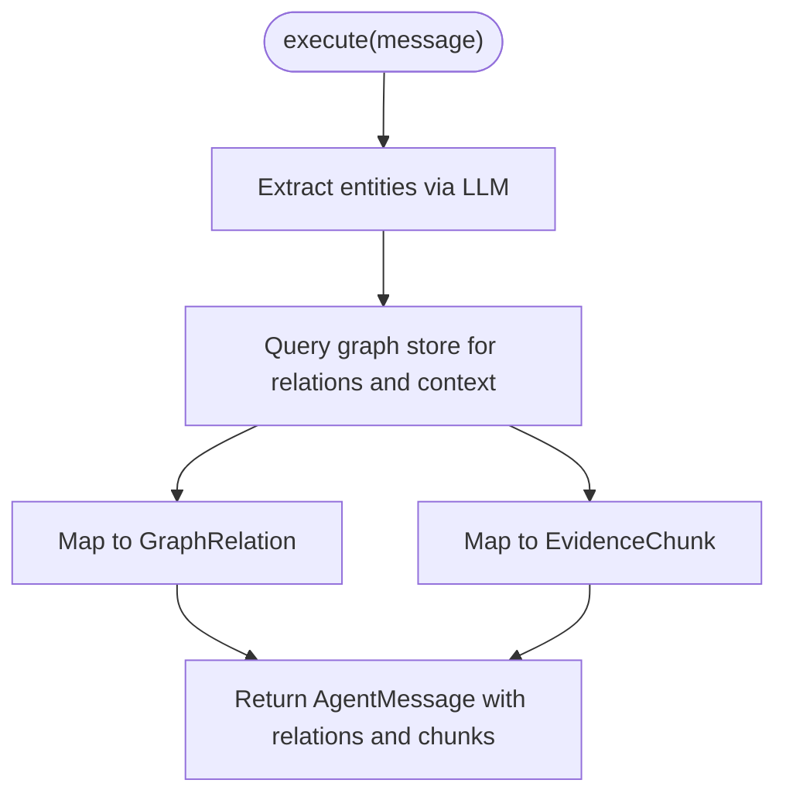

**Diagram sources**
- [src/agents/graph_agent.py:46-121](file://src/agents/graph_agent.py#L46-L121)

**Section sources**
- [src/agents/graph_agent.py:17-33](file://src/agents/graph_agent.py#L17-L33)
- [src/agents/graph_agent.py:46-121](file://src/agents/graph_agent.py#L46-L121)

### WebResearchAgent
Responsibilities:
- Generates optimized web search queries via LLM
- Executes DuckDuckGo searches and converts results to EvidenceChunk and WebResult
- Handles import errors and exceptions gracefully

Execution flow:
- Parses query and max_results
- Generates multiple search queries and executes limited searches
- Converts results to EvidenceChunk and WebResult
- Returns AgentMessage with both payloads

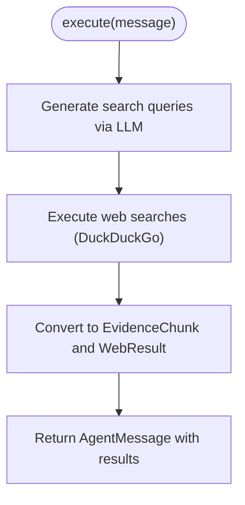

**Diagram sources**
- [src/agents/web_agent.py:43-117](file://src/agents/web_agent.py#L43-L117)

**Section sources**
- [src/agents/web_agent.py:17-31](file://src/agents/web_agent.py#L17-L31)
- [src/agents/web_agent.py:43-117](file://src/agents/web_agent.py#L43-L117)

### ReasoningAgent
Responsibilities:
- Synthesizes evidence from vector, graph, and web sources
- Produces a well-reasoned answer grounded in provided evidence
- Forwards output to FactCheckerAgent

Execution flow:
- Builds a structured prompt including question, evidence chunks, graph relations, and web results
- Calls LLM with moderate temperature to produce reasoning
- Returns AgentMessage with reasoned_answer and metadata

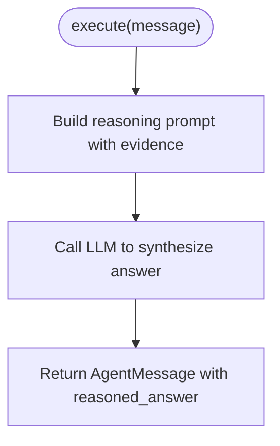

**Diagram sources**
- [src/agents/reasoning_agent.py:47-124](file://src/agents/reasoning_agent.py#L47-L124)

**Section sources**
- [src/agents/reasoning_agent.py:16-35](file://src/agents/reasoning_agent.py#L16-L35)
- [src/agents/reasoning_agent.py:47-124](file://src/agents/reasoning_agent.py#L47-L124)

### FactCheckerAgent
Responsibilities:
- Verifies factual claims in the reasoned answer against evidence
- Assigns verdicts (supported, partially supported, unsupported, contradicted, no evidence)
- Detects hallucinations and forwards verified claims to ReportGeneratorAgent

Execution flow:
- Extracts answer and evidence
- Sends combined prompt to LLM for claim extraction and verification
- Parses JSON response into Claim objects with robust fallback
- Returns AgentMessage with verified_claims and summary

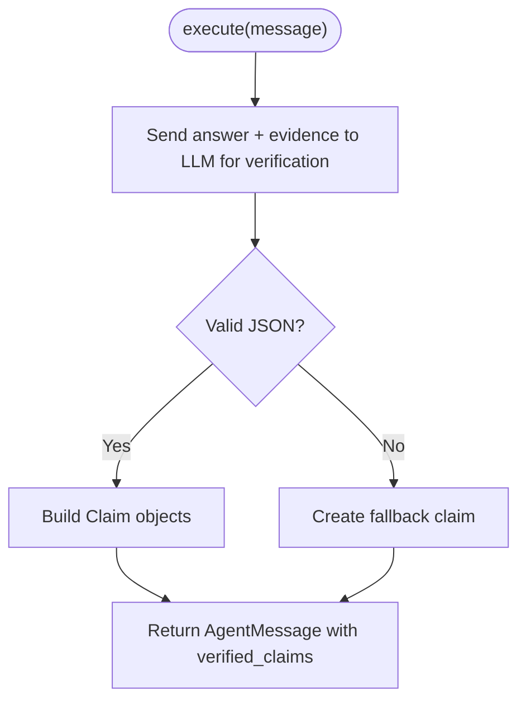

**Diagram sources**
- [src/agents/fact_checker_agent.py:63-163](file://src/agents/fact_checker_agent.py#L63-L163)

**Section sources**
- [src/agents/fact_checker_agent.py:24-51](file://src/agents/fact_checker_agent.py#L24-L51)
- [src/agents/fact_checker_agent.py:63-163](file://src/agents/fact_checker_agent.py#L63-L163)

### ReportGeneratorAgent
Responsibilities:
- Generates a structured research report combining narrative sections, evidence, relationships, and verified claims
- Builds references from web results and evidence sources
- Extracts comparisons and limitations from generated narrative

Execution flow:
- Assembles inputs: answer, claims, evidence, graph relations, web results
- Generates narrative via LLM and parses structured fields
- Constructs ResearchReport with typed models and timestamps
- Returns AgentMessage with report payload

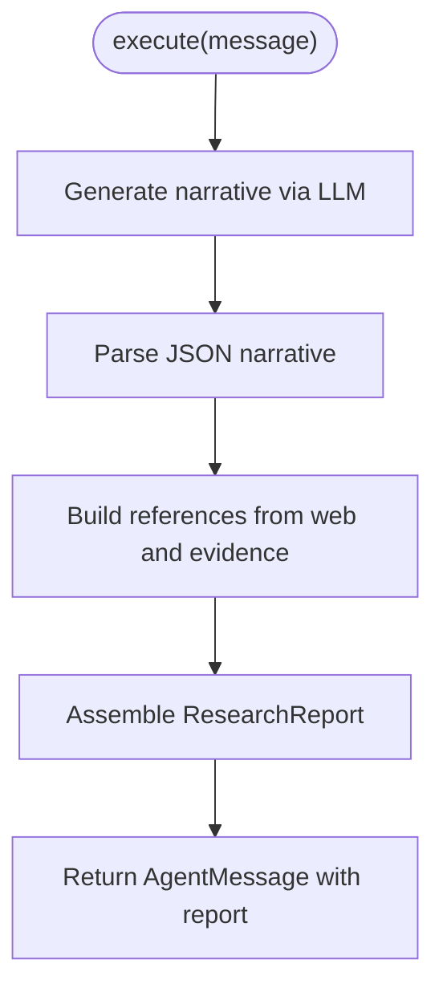

**Diagram sources**
- [src/agents/report_agent.py:57-228](file://src/agents/report_agent.py#L57-L228)

**Section sources**
- [src/agents/report_agent.py:27-45](file://src/agents/report_agent.py#L27-L45)
- [src/agents/report_agent.py:57-228](file://src/agents/report_agent.py#L57-L228)

### Orchestration in API Routes
The API routes implement the full pipeline:
- Baseline LLM: direct LLM call
- Vector RAG: vector retrieval only
- Graph RAG: graph retrieval only
- Hybrid RAG: vector + graph retrieval
- Multi-Agent: planner-driven decomposition with parallel retrieval, reasoning, fact-checking, and report generation

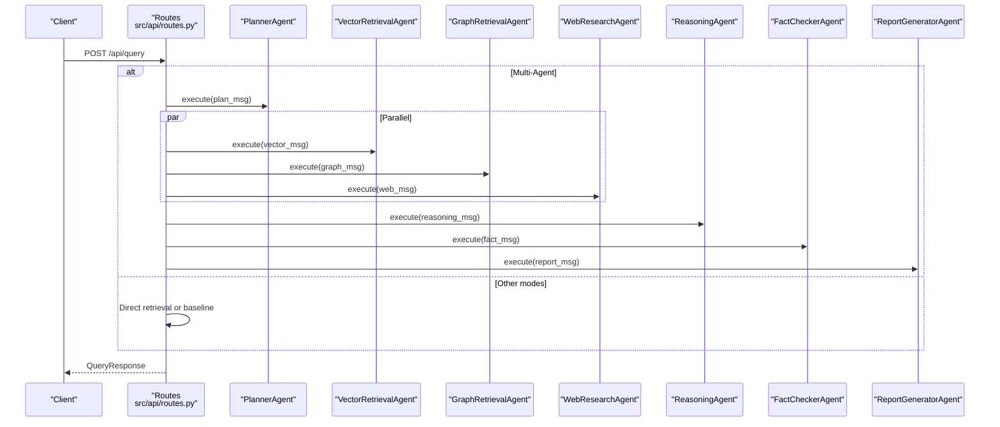

**Diagram sources**
- [src/api/routes.py:188-338](file://src/api/routes.py#L188-L338)

**Section sources**
- [src/api/routes.py:51-75](file://src/api/routes.py#L51-L75)
- [src/api/routes.py:188-338](file://src/api/routes.py#L188-L338)

## Dependency Analysis
Component coupling and cohesion:
- Agents depend on BaseAgent for common functionality and on Schemas for typed messages and payloads
- API routes coordinate agents and inject external services (vector store, graph store) lazily
- PlannerAgent depends on Schemas to model TaskPlan and SubQuestion
- Retrieval agents depend on injected stores; they handle missing configurations gracefully
- Reasoning, FactChecker, and Report agents depend on aggregated evidence and typed models

External dependencies:
- LLM provider via LLMClient (Gemini/OpenAI)
- Vector store (ChromaDB/FAISS)
- Knowledge graph (Neo4j/NetworkX)
- Web search (DuckDuckGo)

Potential circular dependencies:
- None observed; agents are decoupled through message passing and registry

Interface contracts:
- AgentMessage defines sender, receiver, content, payload, timestamp
- Schemas enforce structure for plans, evidence, claims, and reports

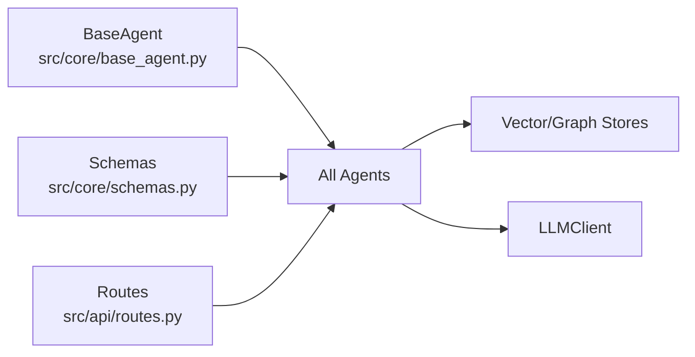

**Diagram sources**
- [src/core/base_agent.py:19-100](file://src/core/base_agent.py#L19-L100)
- [src/core/schemas.py:17-168](file://src/core/schemas.py#L17-L168)
- [src/api/routes.py:51-75](file://src/api/routes.py#L51-L75)

**Section sources**
- [src/core/base_agent.py:19-100](file://src/core/base_agent.py#L19-L100)
- [src/core/schemas.py:17-168](file://src/core/schemas.py#L17-L168)
- [src/api/routes.py:51-75](file://src/api/routes.py#L51-L75)

## Performance Considerations
- Parallel retrieval: Vector, Graph, and Web agents can be executed concurrently to reduce latency
- Temperature tuning: Low temperatures for planning and verification improve determinism; moderate for synthesis balances creativity and grounding
- Token usage tracking: BaseAgent logs token counts and latency for monitoring and cost control
- Result limiting: Agents cap retrieved items (e.g., top-k) to manage context size and processing time
- Graceful degradation: Missing vector/graph stores or web search libraries result in warnings and empty results rather than failures
- Lazy initialization: Services and agents are initialized on first use to minimize startup overhead

[No sources needed since this section provides general guidance]

## Troubleshooting Guide
Common issues and strategies:
- Invalid LLM JSON responses:
  - PlannerAgent and FactCheckerAgent parse JSON with markdown code block extraction and fallbacks to safe defaults
  - ReportGeneratorAgent uses fallback narrative when parsing fails
- Missing external services:
  - Vector and Graph agents log warnings and return empty results when stores are not configured
  - Web agent handles duckduckgo-search import errors and network exceptions
- High latency or token costs:
  - Use get_execution_stats from BaseAgent to monitor calls, tokens, and latency
  - Reduce max_results and limit context sizes in prompts
- Configuration problems:
  - Ensure .env contains required keys and correct endpoints for LLM, vector DB, and graph
  - Validate settings via health/status endpoints

**Section sources**
- [src/agents/planner_agent.py:97-128](file://src/agents/planner_agent.py#L97-L128)
- [src/agents/fact_checker_agent.py:130-163](file://src/agents/fact_checker_agent.py#L130-L163)
- [src/agents/report_agent.py:182-195](file://src/agents/report_agent.py#L182-L195)
- [src/agents/vector_agent.py:73-76](file://src/agents/vector_agent.py#L73-L76)
- [src/agents/graph_agent.py:95-97](file://src/agents/graph_agent.py#L95-L97)
- [src/agents/web_agent.py:111-115](file://src/agents/web_agent.py#L111-L115)
- [src/core/base_agent.py:88-100](file://src/core/base_agent.py#L88-L100)

## Conclusion
The multi-agent system combines planning, parallel retrieval, synthesis, verification, and structured reporting to deliver evidence-grounded research answers. Its modular design, typed message contracts, and centralized configuration enable extensibility and maintainability. The API routes provide flexible experiment modes, while agents incorporate robust error handling and performance monitoring.

[No sources needed since this section summarizes without analyzing specific files]

## Appendices

### Inter-Agent Communication Protocol
- Message format: AgentMessage with sender, receiver, content, payload, timestamp
- Payloads:
  - Planner: TaskPlan with sub-questions, execution order, complexity
  - Retrieval agents: EvidenceChunk lists and domain-specific results (GraphRelation, WebResult)
  - Reasoning: reasoned_answer and metadata
  - Fact checker: verified_claims and summaries
  - Report generator: ResearchReport with sections, evidence, relationships, references

**Section sources**
- [src/core/schemas.py:107-148](file://src/core/schemas.py#L107-L148)
- [src/agents/planner_agent.py:65-82](file://src/agents/planner_agent.py#L65-L82)
- [src/agents/vector_agent.py:44-81](file://src/agents/vector_agent.py#L44-L81)
- [src/agents/graph_agent.py:46-109](file://src/agents/graph_agent.py#L46-L109)
- [src/agents/web_agent.py:43-85](file://src/agents/web_agent.py#L43-L85)
- [src/agents/reasoning_agent.py:47-77](file://src/agents/reasoning_agent.py#L47-L77)
- [src/agents/fact_checker_agent.py:63-109](file://src/agents/fact_checker_agent.py#L63-L109)
- [src/agents/report_agent.py:57-142](file://src/agents/report_agent.py#L57-L142)

### Execution Flow Diagrams
- Planning and parallel retrieval sequence
- Reasoning and verification sequence
- Report generation sequence

**Diagram sources**
- [src/api/routes.py:188-338](file://src/api/routes.py#L188-L338)
- [src/agents/planner_agent.py:65-82](file://src/agents/planner_agent.py#L65-L82)
- [src/agents/reasoning_agent.py:47-77](file://src/agents/reasoning_agent.py#L47-L77)
- [src/agents/fact_checker_agent.py:63-109](file://src/agents/fact_checker_agent.py#L63-L109)
- [src/agents/report_agent.py:57-142](file://src/agents/report_agent.py#L57-L142)

### Agent Lifecycle Management
- Initialization: Agents created via _get_agents() with injected stores
- Execution: Each agent’s execute method processes AgentMessage and returns results
- Logging: BaseAgent records execution stats per call
- Shutdown: Application lifespan logs start/shutdown events

**Section sources**
- [src/api/routes.py:51-75](file://src/api/routes.py#L51-L75)
- [src/core/base_agent.py:22-27](file://src/core/base_agent.py#L22-L27)
- [src/core/base_agent.py:88-100](file://src/core/base_agent.py#L88-L100)
- [src/api/app.py:17-24](file://src/api/app.py#L17-L24)

### Custom Agent Development and Integration Patterns
To add a new capability:
- Define a new AgentRole in Schemas
- Implement a new agent class inheriting from BaseAgent with execute and get_system_prompt
- Register the agent in _get_agents() within API routes
- Update PlannerAgent’s available agents list and prompt to include the new role
- Optionally extend Schemas with new payload models if needed

Integration patterns:
- Inject external services (stores, clients) at runtime via constructor parameters
- Use AgentMessage payloads to pass structured data between agents
- Leverage BaseAgent.call_llm for consistent LLM interactions and logging

**Section sources**
- [src/core/schemas.py:17-25](file://src/core/schemas.py#L17-L25)
- [src/core/base_agent.py:19-100](file://src/core/base_agent.py#L19-L100)
- [src/api/routes.py:51-75](file://src/api/routes.py#L51-L75)
- [src/agents/planner_agent.py:23-53](file://src/agents/planner_agent.py#L23-L53)