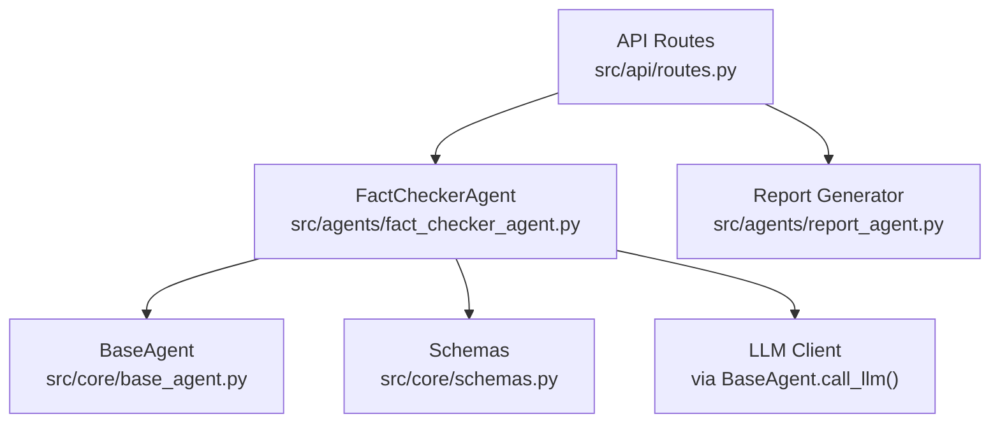
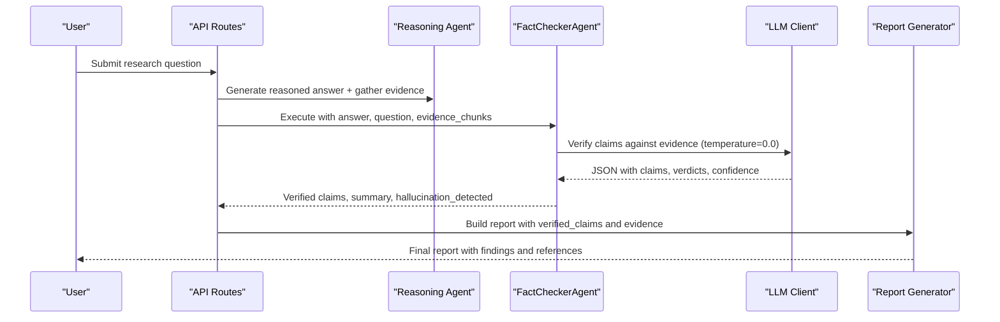
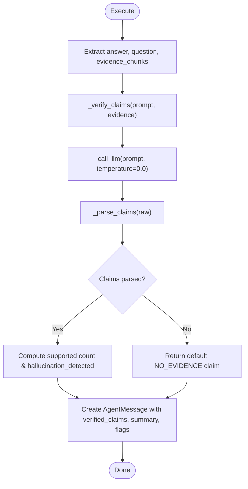
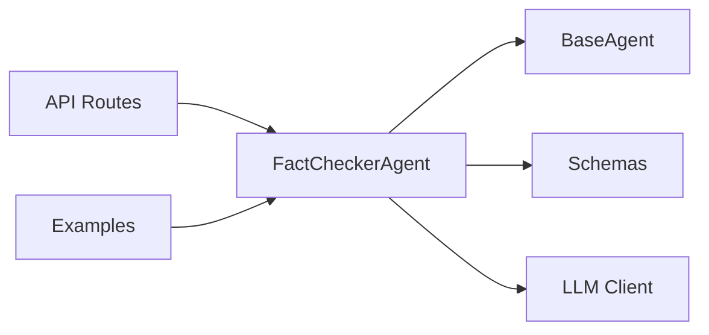

# Fact Checker Agent

<cite>
**Referenced Files in This Document**
- [fact_checker_agent.py](file://src/agents/fact_checker_agent.py)
- [base_agent.py](file://src/core/base_agent.py)
- [schemas.py](file://src/core/schemas.py)
- [metrics.py](file://src/evaluation/metrics.py)
- [routes.py](file://src/api/routes.py)
- [query_example.py](file://examples/query_example.py)
- [config.py](file://src/config.py)
</cite>

## Table of Contents
1. [Introduction](#introduction)
2. [Project Structure](#project-structure)
3. [Core Components](#core-components)
4. [Architecture Overview](#architecture-overview)
5. [Detailed Component Analysis](#detailed-component-analysis)
6. [Dependency Analysis](#dependency-analysis)
7. [Performance Considerations](#performance-considerations)
8. [Troubleshooting Guide](#troubleshooting-guide)
9. [Conclusion](#conclusion)
10. [Appendices](#appendices)

## Introduction
The FactCheckerAgent is a specialized agent that performs claim verification and hallucination detection to ensure response accuracy. It extracts factual claims from a generated answer, cross-references them against multiple evidence sources (vector, graph, web), assigns verdicts, computes confidence scores, detects contradictions, and ensures citations are properly sourced. The agent integrates into the multi-agent research pipeline and hands verified results to the report generator for final output.

## Project Structure
The FactCheckerAgent lives under src/agents and depends on core schemas and base agent infrastructure. It is invoked by the API routes during query processing and used in examples to demonstrate end-to-end workflows.

**Diagram sources**
- [routes.py:301-334](file://src/api/routes.py#L301-L334)
- [fact_checker_agent.py:63-109](file://src/agents/fact_checker_agent.py#L63-L109)
- [base_agent.py:42-59](file://src/core/base_agent.py#L42-L59)
- [schemas.py:17-33](file://src/core/schemas.py#L17-L33)

**Section sources**
- [fact_checker_agent.py:1-163](file://src/agents/fact_checker_agent.py#L1-L163)
- [base_agent.py:1-100](file://src/core/base_agent.py#L1-L100)
- [schemas.py:1-168](file://src/core/schemas.py#L1-L168)
- [routes.py:301-334](file://src/api/routes.py#L301-L334)

## Core Components
- FactCheckerAgent: Orchestrates claim extraction, verification, hallucination detection, and summary generation.
- BaseAgent: Provides LLM invocation, execution logging, and message creation utilities.
- Schemas: Define Claim, EvidenceChunk, ClaimVerdict, and other data structures used across agents.
- Evaluation Metrics: Provide additional metrics like faithfulness and hallucination rate for evaluation.

Key responsibilities:
- Extract claims from the reasoned answer.
- Cross-reference each claim against provided evidence chunks.
- Assign verdicts: supported, partially supported, unsupported, contradicted, no evidence.
- Compute per-claim confidence and overall hallucination flag.
- Return structured results to downstream components.

**Section sources**
- [fact_checker_agent.py:24-51](file://src/agents/fact_checker_agent.py#L24-L51)
- [fact_checker_agent.py:63-109](file://src/agents/fact_checker_agent.py#L63-L109)
- [schemas.py:27-33](file://src/core/schemas.py#L27-L33)
- [schemas.py:65-73](file://src/core/schemas.py#L65-L73)
- [schemas.py:95-103](file://src/core/schemas.py#L95-L103)

## Architecture Overview
The fact-checking workflow integrates with the broader multi-agent pipeline:

**Diagram sources**
- [routes.py:301-334](file://src/api/routes.py#L301-L334)
- [fact_checker_agent.py:111-128](file://src/agents/fact_checker_agent.py#L111-L128)
- [base_agent.py:42-59](file://src/core/base_agent.py#L42-L59)

## Detailed Component Analysis

### FactCheckerAgent
- System prompt defines strict verification behavior and expected JSON structure for claims, verdicts, confidence, reasoning, overall assessment, and hallucination flag.
- execute():
  - Accepts reasoned_answer, question, and evidence_chunks.
  - Calls _verify_claims to extract and verify claims via LLM.
  - Computes supported count and hallucination_detected based on verdicts.
  - Returns structured payload to Report Generator.
- _verify_claims():
  - Builds a prompt including original question, generated answer, and up to 20 truncated evidence chunks.
  - Invokes LLM with temperature=0.0 for deterministic outputs.
  - Parses LLM response into Claim objects.
- _parse_claims():
  - Robustly parses JSON from markdown code blocks or raw text.
  - Maps verdict strings to ClaimVerdict enum; defaults to NO_EVIDENCE on errors.
  - Generates unique claim IDs and preserves confidence and reasoning.

**Diagram sources**
- [fact_checker_agent.py:63-109](file://src/agents/fact_checker_agent.py#L63-L109)
- [fact_checker_agent.py:111-162](file://src/agents/fact_checker_agent.py#L111-L162)

**Section sources**
- [fact_checker_agent.py:24-51](file://src/agents/fact_checker_agent.py#L24-L51)
- [fact_checker_agent.py:63-109](file://src/agents/fact_checker_agent.py#L63-L109)
- [fact_checker_agent.py:111-162](file://src/agents/fact_checker_agent.py#L111-L162)

### Data Models and Verdicts
- Claim: Stores claim_id, text, supporting_evidence, verdict, confidence, reasoning.
- EvidenceChunk: Represents retrieved evidence with chunk_id, content, source, relevance_score, metadata, retrieval_method.
- ClaimVerdict: Enumerates SUPPORTED, PARTIALLY_SUPPORTED, UNSUPPORTED, CONTRADICTED, NO_EVIDENCE.

These models ensure type safety and consistent handling across agents.

**Section sources**
- [schemas.py:27-33](file://src/core/schemas.py#L27-L33)
- [schemas.py:65-73](file://src/core/schemas.py#L65-L73)
- [schemas.py:95-103](file://src/core/schemas.py#L95-L103)

### Integration Points
- API Routes:
  - After reasoning, invokes FactCheckerAgent with answer, question, and evidence_chunks.
  - Passes verified_claims and fact_check_summary to Report Generator.
- Examples:
  - Demonstrates constructing AgentMessage for fact checking and consuming verified_claims in reports.

**Section sources**
- [routes.py:301-334](file://src/api/routes.py#L301-L334)
- [query_example.py:110-143](file://examples/query_example.py#L110-L143)

## Dependency Analysis
FactCheckerAgent depends on:
- BaseAgent for LLM calls and execution logging.
- Schemas for structured data exchange.
- API routes and examples for orchestration.

**Diagram sources**
- [fact_checker_agent.py:14-21](file://src/agents/fact_checker_agent.py#L14-L21)
- [base_agent.py:42-59](file://src/core/base_agent.py#L42-L59)
- [routes.py:301-334](file://src/api/routes.py#L301-L334)

**Section sources**
- [fact_checker_agent.py:14-21](file://src/agents/fact_checker_agent.py#L14-L21)
- [base_agent.py:42-59](file://src/core/base_agent.py#L42-L59)
- [routes.py:301-334](file://src/api/routes.py#L301-L334)

## Performance Considerations
- Deterministic verification: Uses temperature=0.0 for stable outputs.
- Evidence truncation: Limits to top 20 chunks and truncates content to reduce token usage.
- Logging: Execution logs capture latency and token counts for performance analysis.
- Parsing robustness: Gracefully handles malformed LLM responses by falling back to a safe default claim.

[No sources needed since this section provides general guidance]

## Troubleshooting Guide
Common issues and resolutions:
- Invalid JSON from LLM:
  - Symptom: Warning logged about invalid JSON; fallback claim returned.
  - Resolution: Ensure system prompt instructs strict JSON output; validate LLM provider settings.
- No evidence provided:
  - Symptom: All claims marked NO_EVIDENCE; hallucination_detected may be true if unsupported/contradicted present.
  - Resolution: Verify upstream retrieval steps return relevant evidence_chunks.
- High hallucination rate:
  - Symptom: Many unsupported or contradicted claims.
  - Resolution: Improve evidence quality; adjust retrieval thresholds; review reasoning step for overreach.

Evaluation metrics can help quantify issues:
- Faithfulness score: Measures alignment between answer and evidence.
- Hallucination rate: Derived from verified claims’ verdicts.

**Section sources**
- [fact_checker_agent.py:130-144](file://src/agents/fact_checker_agent.py#L130-L144)
- [metrics.py:87-102](file://src/evaluation/metrics.py#L87-L102)
- [metrics.py:126-134](file://src/evaluation/metrics.py#L126-L134)

## Conclusion
The FactCheckerAgent provides a robust mechanism for claim verification and hallucination detection within the multi-agent research system. By leveraging structured prompts, deterministic LLM calls, and comprehensive parsing, it ensures that only well-supported claims propagate to the final report. Its integration points and evaluation metrics enable continuous improvement and monitoring of factual accuracy.

[No sources needed since this section summarizes without analyzing specific files]

## Appendices

### Configuration Options
Current configuration does not expose explicit parameters for strictness levels, source prioritization, or verification thresholds within the FactCheckerAgent itself. Relevant global settings include:
- LLM provider and model selection
- Temperature (used elsewhere; fact checker uses fixed 0.0)
- Chunk size and overlap for document processing
- Vector DB and knowledge graph endpoints

To customize fact-checking behavior, consider:
- Modifying the system prompt to enforce stricter rules.
- Adjusting evidence limits and truncation in _verify_claims.
- Adding configurable thresholds for hallucination detection and verdict mapping.

**Section sources**
- [config.py:21-75](file://src/config.py#L21-L75)
- [fact_checker_agent.py:111-128](file://src/agents/fact_checker_agent.py#L111-L128)

### Example Workflows
End-to-end example demonstrates:
- Generating a reasoned answer.
- Invoking FactCheckerAgent with answer, question, and evidence_chunks.
- Consuming verified_claims in the final report.

**Section sources**
- [query_example.py:110-143](file://examples/query_example.py#L110-L143)