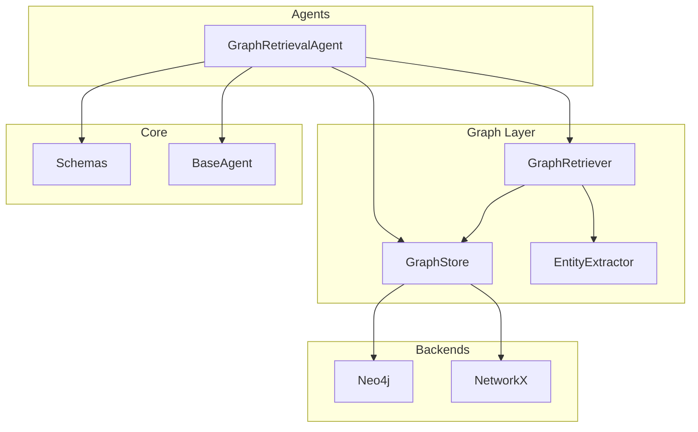
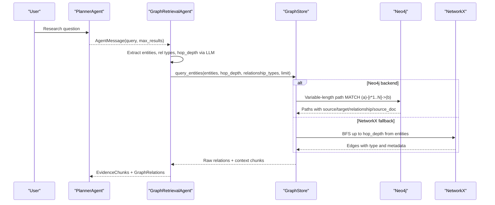
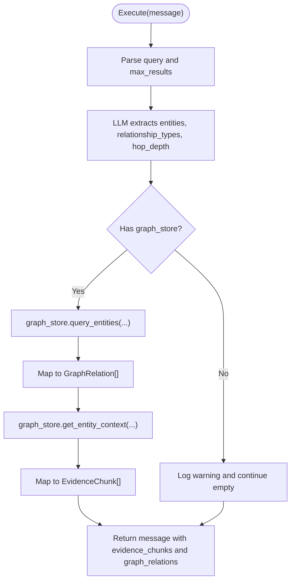
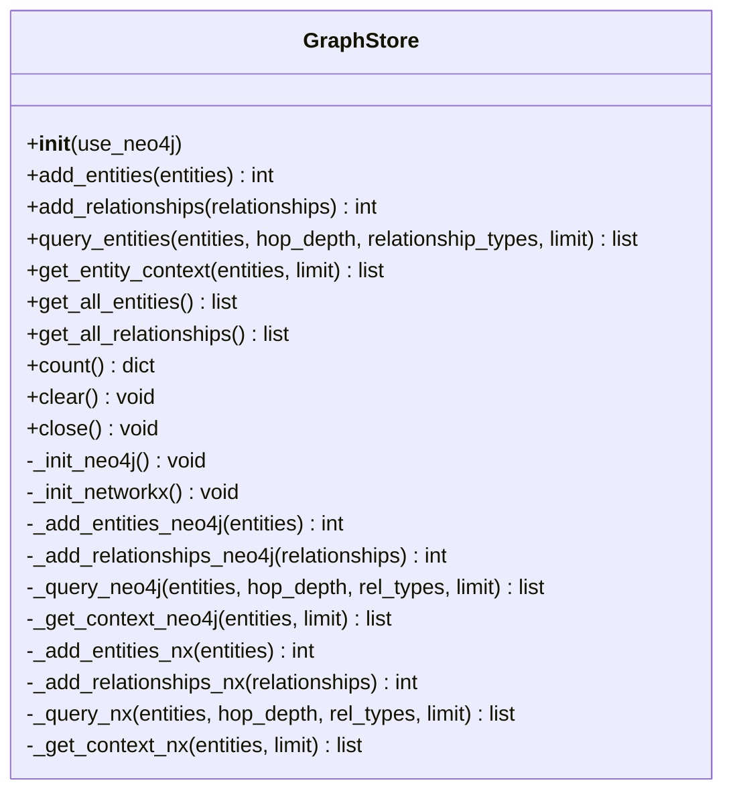
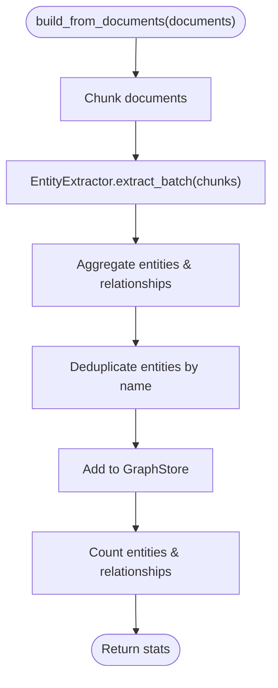
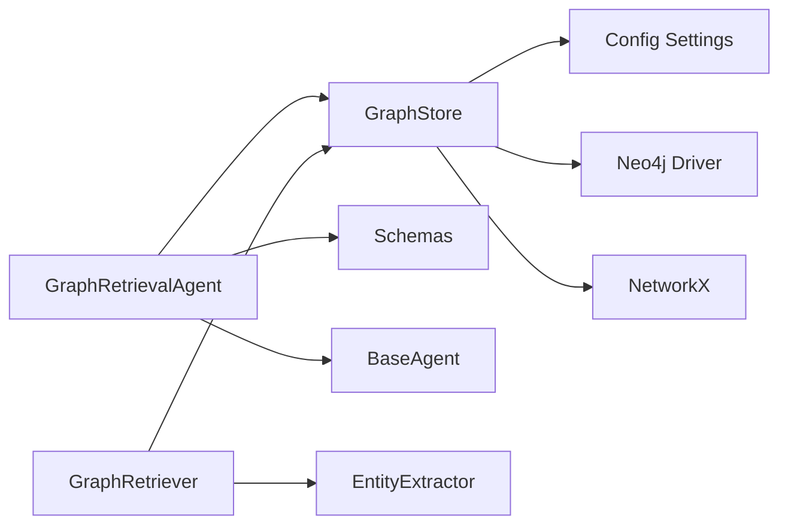

# Graph Retrieval Agent

<cite>
**Referenced Files in This Document**
- [graph_agent.py](file://src/agents/graph_agent.py)
- [retriever.py](file://src/graph/retriever.py)
- [graph_store.py](file://src/graph/graph_store.py)
- [entity_extractor.py](file://src/graph/entity_extractor.py)
- [schemas.py](file://src/core/schemas.py)
- [base_agent.py](file://src/core/base_agent.py)
- [config.py](file://src/config.py)
- [query_example.py](file://examples/query_example.py)
</cite>

## Table of Contents
1. [Introduction](#introduction)
2. [Project Structure](#project-structure)
3. [Core Components](#core-components)
4. [Architecture Overview](#architecture-overview)
5. [Detailed Component Analysis](#detailed-component-analysis)
6. [Dependency Analysis](#dependency-analysis)
7. [Performance Considerations](#performance-considerations)
8. [Troubleshooting Guide](#troubleshooting-guide)
9. [Conclusion](#conclusion)
10. [Appendices](#appendices)

## Introduction
This document explains the GraphRetrievalAgent component and how it traverses knowledge graphs to find entities and relationships relevant to research queries. It covers:
- Multi-hop reasoning via graph traversal algorithms
- Cypher query generation for Neo4j and BFS-based traversal for NetworkX fallback
- Evidence extraction from graph structures and conversion into context for downstream agents
- Configuration options for traversal depth, relationship types, and filtering
- Examples of complex graph queries mapped to natural language inputs

## Project Structure
The Graph Retrieval functionality spans several modules:
- Agent layer: GraphRetrievalAgent orchestrates LLM-driven entity extraction and graph queries
- Graph storage: GraphStore abstracts Neo4j and NetworkX backends
- Graph retriever: GraphRetriever builds the knowledge graph from documents and exposes query methods
- Entity extraction: EntityExtractor uses an LLM to parse text into entities and relationships
- Schemas and base agent: Typed models and shared agent behavior

**Diagram sources**
- [graph_agent.py:36-121](file://src/agents/graph_agent.py#L36-L121)
- [retriever.py:19-131](file://src/graph/retriever.py#L19-L131)
- [graph_store.py:15-303](file://src/graph/graph_store.py#L15-L303)
- [entity_extractor.py:42-101](file://src/graph/entity_extractor.py#L42-L101)
- [schemas.py:65-82](file://src/core/schemas.py#L65-L82)
- [base_agent.py:19-100](file://src/core/base_agent.py#L19-L100)

**Section sources**
- [graph_agent.py:36-121](file://src/agents/graph_agent.py#L36-L121)
- [retriever.py:19-131](file://src/graph/retriever.py#L19-L131)
- [graph_store.py:15-303](file://src/graph/graph_store.py#L15-L303)
- [entity_extractor.py:42-101](file://src/graph/entity_extractor.py#L42-L101)
- [schemas.py:65-82](file://src/core/schemas.py#L65-L82)
- [base_agent.py:19-100](file://src/core/base_agent.py#L19-L100)

## Core Components
- GraphRetrievalAgent: Parses user queries into structured search parameters (entities, relationship types, hop depth), executes graph queries, and returns evidence chunks and relations for downstream processing.
- GraphStore: Provides a unified interface to store and query graph data using either Neo4j or an in-memory NetworkX graph as fallback.
- GraphRetriever: Builds the knowledge graph from documents by chunking text, extracting entities/relationships with an LLM, and populating the graph store; also offers convenience query methods.
- EntityExtractor: Uses an LLM to extract structured entities and relationships from text chunks based on a defined schema.
- Schemas: Define typed models for evidence, graph relations, and agent messages used across components.

Key responsibilities:
- Query parsing and parameterization
- Multi-hop traversal (Neo4j variable-length paths or NetworkX BFS)
- Evidence extraction from node properties and relationships
- Standardized output for downstream agents

**Section sources**
- [graph_agent.py:36-121](file://src/agents/graph_agent.py#L36-L121)
- [graph_store.py:15-303](file://src/graph/graph_store.py#L15-L303)
- [retriever.py:19-131](file://src/graph/retriever.py#L19-L131)
- [entity_extractor.py:42-101](file://src/graph/entity_extractor.py#L42-L101)
- [schemas.py:65-82](file://src/core/schemas.py#L65-L82)

## Architecture Overview
The Graph Retrieval flow integrates LLM-based planning with graph traversal:

**Diagram sources**
- [graph_agent.py:46-109](file://src/agents/graph_agent.py#L46-L109)
- [graph_store.py:67-85](file://src/graph/graph_store.py#L67-L85)
- [graph_store.py:178-222](file://src/graph/graph_store.py#L178-L222)
- [graph_store.py:256-302](file://src/graph/graph_store.py#L256-L302)

## Detailed Component Analysis

### GraphRetrievalAgent
Responsibilities:
- Convert natural language queries into structured graph search parameters using an LLM
- Execute graph queries through GraphStore
- Extract textual context from nodes and convert relationships into standardized models
- Return evidence_chunks and graph_relations for downstream agents

Key behaviors:
- Uses a system prompt to guide LLM extraction of entities, relationship types, and hop depth
- Falls back to simple token splitting if LLM response is invalid
- Maps raw results to EvidenceChunk and GraphRelation schemas

**Diagram sources**
- [graph_agent.py:46-109](file://src/agents/graph_agent.py#L46-L109)
- [graph_agent.py:111-121](file://src/agents/graph_agent.py#L111-L121)

**Section sources**
- [graph_agent.py:36-121](file://src/agents/graph_agent.py#L36-L121)
- [schemas.py:65-82](file://src/core/schemas.py#L65-L82)

### GraphStore (Neo4j and NetworkX)
Responsibilities:
- Provide unified add/query/count operations over two backends
- Initialize Neo4j driver and fall back to NetworkX if unavailable
- Implement multi-hop traversal strategies per backend

Neo4j implementation:
- Adds entities and relationships using MERGE statements
- Executes variable-length path queries for multi-hop retrieval
- Retrieves node descriptions as contextual evidence

NetworkX fallback:
- Stores nodes and edges with attributes
- Implements BFS traversal up to hop_depth with optional relationship type filtering
- Returns edges and node context similarly to Neo4j

**Diagram sources**
- [graph_store.py:15-303](file://src/graph/graph_store.py#L15-L303)

**Section sources**
- [graph_store.py:15-303](file://src/graph/graph_store.py#L15-L303)

### GraphRetriever
Responsibilities:
- Build knowledge graph from documents by chunking, extracting entities/relationships, and populating the graph store
- Expose high-level query methods that delegate to GraphStore
- Provide summary and context utilities

Processing steps:
- Load documents and chunk them
- Extract entities and relationships in batch
- Deduplicate entities by name
- Add to graph store and log counts

**Diagram sources**
- [retriever.py:42-97](file://src/graph/retriever.py#L42-L97)

**Section sources**
- [retriever.py:19-131](file://src/graph/retriever.py#L19-L131)

### EntityExtractor
Responsibilities:
- Use an LLM to extract structured entities and relationships from text
- Attach source metadata to each extracted item
- Parse JSON responses robustly with fallback handling

Key details:
- Defines allowed entity and relationship types in the prompt
- Truncates input to avoid token limits
- Logs errors and returns empty results on failure

**Section sources**
- [entity_extractor.py:42-101](file://src/graph/entity_extractor.py#L42-L101)

### BaseAgent and Schemas
- BaseAgent provides common LLM invocation, execution logging, and message creation utilities
- Schemas define EvidenceChunk and GraphRelation used by GraphRetrievalAgent to standardize outputs

**Section sources**
- [base_agent.py:19-100](file://src/core/base_agent.py#L19-L100)
- [schemas.py:65-82](file://src/core/schemas.py#L65-L82)

## Dependency Analysis
High-level dependencies:
- GraphRetrievalAgent depends on GraphStore and LLMClient (via BaseAgent)
- GraphStore depends on configuration settings and optionally Neo4j driver or NetworkX
- GraphRetriever depends on EntityExtractor, GraphStore, and RAG utilities
- All components use typed schemas for consistent data exchange

**Diagram sources**
- [graph_agent.py:36-121](file://src/agents/graph_agent.py#L36-L121)
- [retriever.py:19-131](file://src/graph/retriever.py#L19-L131)
- [graph_store.py:15-303](file://src/graph/graph_store.py#L15-L303)
- [config.py:21-82](file://src/config.py#L21-L82)

**Section sources**
- [graph_agent.py:36-121](file://src/agents/graph_agent.py#L36-L121)
- [retriever.py:19-131](file://src/graph/retriever.py#L19-L131)
- [graph_store.py:15-303](file://src/graph/graph_store.py#L15-L303)
- [config.py:21-82](file://src/config.py#L21-L82)

## Performance Considerations
- Neo4j vs NetworkX: Neo4j leverages optimized graph traversal for large datasets; NetworkX is suitable for small in-memory graphs but may scale poorly.
- Hop depth: Higher hop_depth increases traversal cost; tune based on dataset size and latency requirements.
- Relationship filtering: Passing relationship_types reduces result set size and improves performance.
- Limits: Use limit to cap results and prevent excessive memory usage.
- Chunk size: Larger chunks reduce LLM calls but increase token usage; balance accuracy and cost.

[No sources needed since this section provides general guidance]

## Troubleshooting Guide
Common issues and resolutions:
- Neo4j connection failures: The system automatically falls back to NetworkX when Neo4j is unavailable; verify credentials and URI in configuration.
- Empty results: Ensure entities exist in the graph and hop_depth is appropriate; check relationship_types filters.
- Invalid LLM responses: If entity extraction fails, the agent falls back to simple token splitting; improve prompts or model selection.
- Large result sets: Reduce limit or hop_depth; apply relationship_type filters.

**Section sources**
- [graph_store.py:24-47](file://src/graph/graph_store.py#L24-L47)
- [graph_agent.py:111-121](file://src/agents/graph_agent.py#L111-L121)

## Conclusion
The GraphRetrievalAgent integrates LLM-driven query planning with robust graph traversal to retrieve entities and relationships from a knowledge graph. It supports both Neo4j and NetworkX backends, enabling flexible deployment and scalability. By converting graph structures into standardized evidence and relations, it provides meaningful context for downstream reasoning and reporting agents. Proper configuration of hop depth, relationship types, and limits ensures efficient and accurate retrieval.

[No sources needed since this section summarizes without analyzing specific files]

## Appendices

### Configuration Options
- Neo4j settings: URI, user, password loaded from environment variables
- LLM provider and model: gemini or openai with corresponding keys and models
- Embedding model and vector database settings
- Document chunking parameters: chunk size and overlap

**Section sources**
- [config.py:21-82](file://src/config.py#L21-L82)

### Example Queries and Natural Language Inputs
- Natural language: "How does climate change affect crop yield through water stress?"
  - Entities: climate change, crop yield, water stress
  - Relationship types: affects, causes
  - Hop depth: 2
  - Expected outcome: Retrieve paths linking climate change to crop yield via water stress-related concepts

- Natural language: "Which treatments are associated with improving outcomes for Alzheimer's disease?"
  - Entities: Alzheimer's disease, treatments
  - Relationship types: treats, improves
  - Hop depth: 2
  - Expected outcome: Find relationships between treatments and improved outcomes for Alzheimer's

- Natural language: "What technologies are developed by organizations working on renewable energy?"
  - Entities: technologies, organizations, renewable energy
  - Relationship types: developed_by, associated_with
  - Hop depth: 2
  - Expected outcome: Discover technologies created by organizations focused on renewable energy

These examples illustrate how the GraphRetrievalAgent translates natural language into structured graph searches and retrieves relevant multi-hop relationships.

**Section sources**
- [query_example.py:179-184](file://examples/query_example.py#L179-L184)
- [graph_agent.py:17-33](file://src/agents/graph_agent.py#L17-L33)