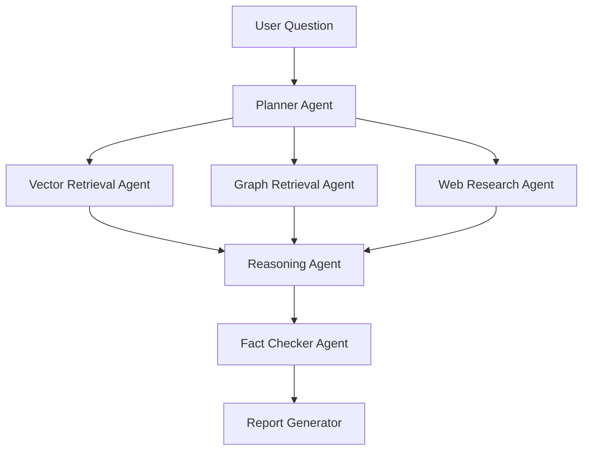
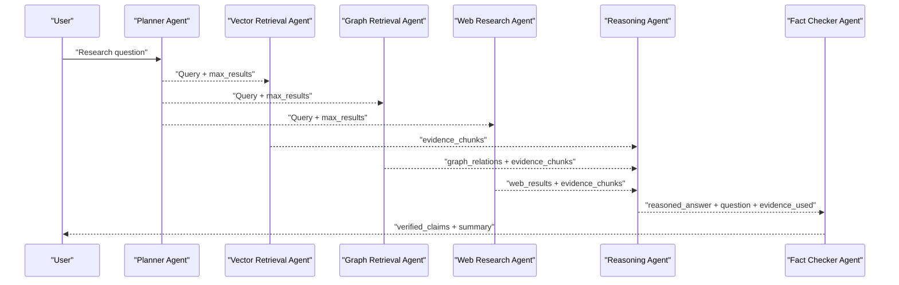
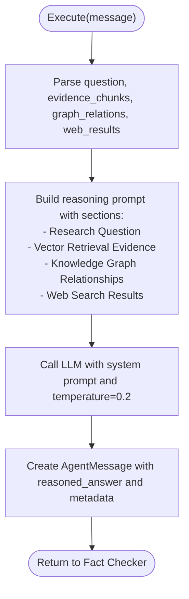
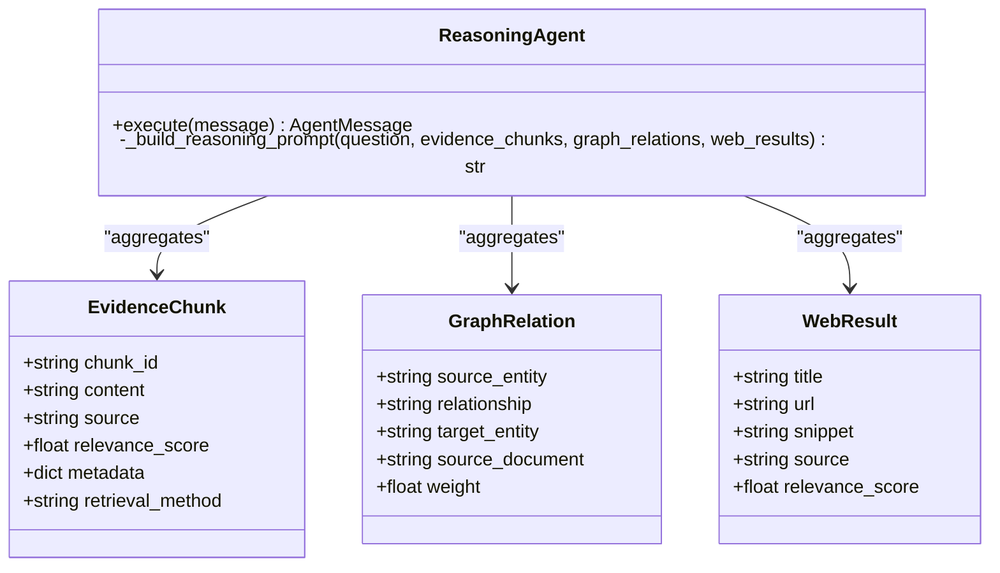
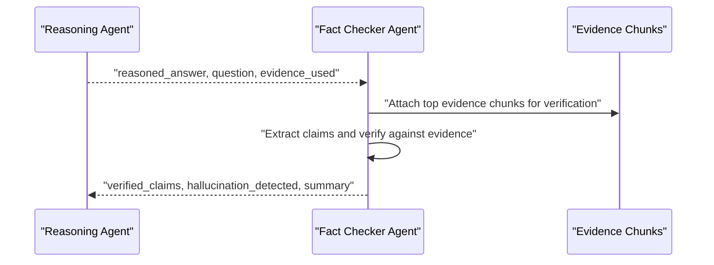
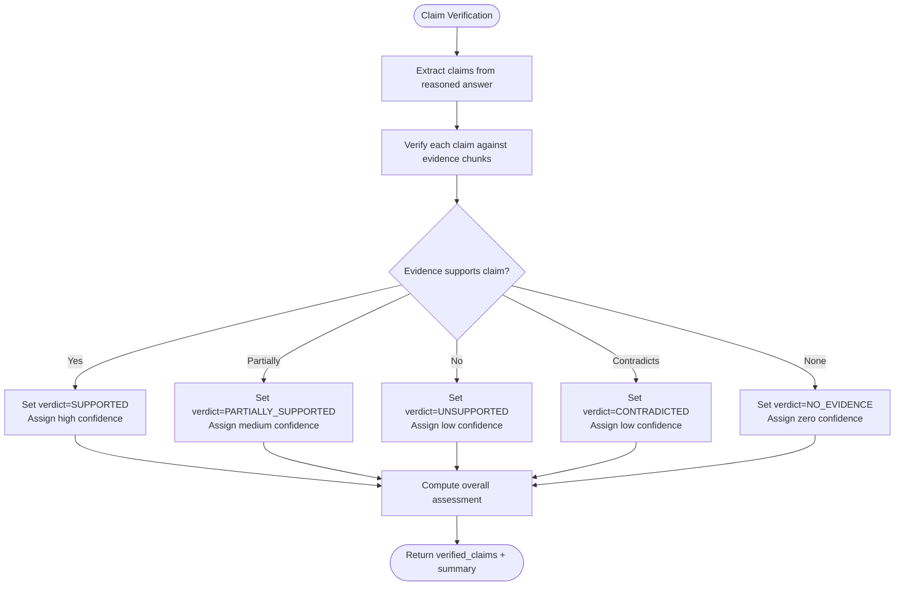
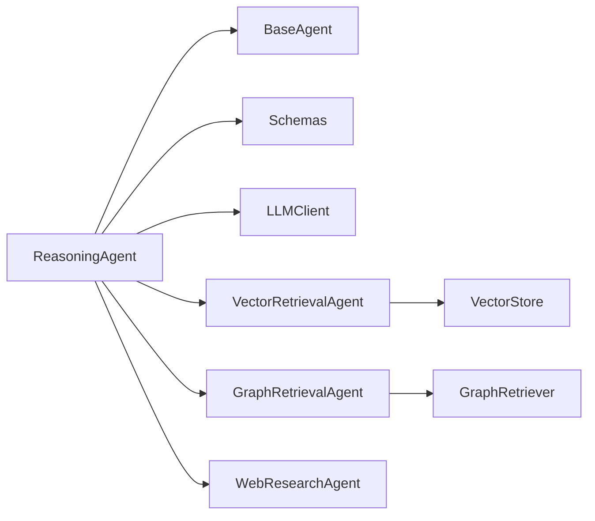

# Reasoning Agent

<cite>
**Referenced Files in This Document**
- [reasoning_agent.py](file://src/agents/reasoning_agent.py)
- [base_agent.py](file://src/core/base_agent.py)
- [schemas.py](file://src/core/schemas.py)
- [vector_agent.py](file://src/agents/vector_agent.py)
- [graph_agent.py](file://src/agents/graph_agent.py)
- [web_agent.py](file://src/agents/web_agent.py)
- [llm.py](file://src/core/llm.py)
- [vector_store.py](file://src/rag/vector_store.py)
- [retriever.py](file://src/graph/retriever.py)
- [fact_checker_agent.py](file://src/agents/fact_checker_agent.py)
- [README.md](file://README.md)
</cite>

## Table of Contents
1. [Introduction](#introduction)
2. [Project Structure](#project-structure)
3. [Core Components](#core-components)
4. [Architecture Overview](#architecture-overview)
5. [Detailed Component Analysis](#detailed-component-analysis)
6. [Dependency Analysis](#dependency-analysis)
7. [Performance Considerations](#performance-considerations)
8. [Troubleshooting Guide](#troubleshooting-guide)
9. [Conclusion](#conclusion)
10. [Appendices](#appendices)

## Introduction
This document provides a comprehensive, code-grounded explanation of the ReasoningAgent component within the GraphRAG-MARS multi-agent research system. It details how the agent synthesizes evidence from vector retrieval, knowledge graph traversal, and web search to perform logical inference and produce structured answers. It also explains the prompt engineering strategies used for reasoning tasks, the handling of conflicting information and uncertainty, and the downstream fact-checking pipeline that evaluates claim strength and confidence.

## Project Structure
The ReasoningAgent is part of a modular multi-agent architecture:
- Retrieval agents gather evidence from three sources: vector store, knowledge graph, and web search.
- The ReasoningAgent aggregates these heterogeneous evidence types into a single prompt and asks an LLM to synthesize a reasoned answer.
- A FactCheckerAgent verifies claims extracted from the reasoned answer against the original evidence.

**Diagram sources**
- [README.md:5-23](file://README.md#L5-L23)
- [reasoning_agent.py:38-77](file://src/agents/reasoning_agent.py#L38-L77)
- [vector_agent.py:34-81](file://src/agents/vector_agent.py#L34-L81)
- [graph_agent.py:36-109](file://src/agents/graph_agent.py#L36-L109)
- [web_agent.py:34-85](file://src/agents/web_agent.py#L34-L85)
- [fact_checker_agent.py:54-109](file://src/agents/fact_checker_agent.py#L54-L109)

**Section sources**
- [README.md:5-23](file://README.md#L5-L23)

## Core Components
- ReasoningAgent: Aggregates evidence chunks (from vector), graph relations (from graph), and web results (from web), then constructs a structured prompt to generate a reasoned answer.
- BaseAgent: Provides shared functionality including LLM calls, execution logging, message creation, and statistics.
- Schemas: Define typed data models for evidence, relationships, web results, claims, and inter-agent messages.
- Retrieval Agents:
  - VectorRetrievalAgent: Uses an LLM to refine queries and retrieves semantically similar chunks from a vector store.
  - GraphRetrievalAgent: Extracts entities and relationship types via LLM, queries the knowledge graph, and returns both relations and contextual text chunks.
  - WebResearchAgent: Generates optimized web search queries and fetches structured results with titles, URLs, and snippets.
- LLMClient: Unified interface to Gemini or OpenAI providers with token counting and generation helpers.
- VectorStore: Abstraction over ChromaDB or FAISS for adding and searching documents.
- GraphRetriever: Orchestrates building and querying the knowledge graph.
- FactCheckerAgent: Verifies claims from the reasoned answer against evidence and produces verdicts and confidence scores.

**Section sources**
- [reasoning_agent.py:38-124](file://src/agents/reasoning_agent.py#L38-L124)
- [base_agent.py:19-100](file://src/core/base_agent.py#L19-L100)
- [schemas.py:15-168](file://src/core/schemas.py#L15-L168)
- [vector_agent.py:34-92](file://src/agents/vector_agent.py#L34-L92)
- [graph_agent.py:36-121](file://src/agents/graph_agent.py#L36-L121)
- [web_agent.py:34-117](file://src/agents/web_agent.py#L34-L117)
- [llm.py:15-103](file://src/core/llm.py#L15-L103)
- [vector_store.py:16-192](file://src/rag/vector_store.py#L16-L192)
- [retriever.py:19-131](file://src/graph/retriever.py#L19-L131)
- [fact_checker_agent.py:54-163](file://src/agents/fact_checker_agent.py#L54-L163)

## Architecture Overview
The ReasoningAgent sits at the center of evidence synthesis. It receives:
- Evidence chunks from vector retrieval (semantic similarity).
- Graph relations and entity context from the knowledge graph.
- Web search results for current information.

It builds a single prompt that includes all evidence sources and instructs the LLM to reason step-by-step, cite sources, and note conflicts or insufficient evidence. The output is passed to the FactCheckerAgent for verification.

**Diagram sources**
- [reasoning_agent.py:47-77](file://src/agents/reasoning_agent.py#L47-L77)
- [vector_agent.py:44-81](file://src/agents/vector_agent.py#L44-L81)
- [graph_agent.py:46-109](file://src/agents/graph_agent.py#L46-L109)
- [web_agent.py:43-85](file://src/agents/web_agent.py#L43-L85)
- [fact_checker_agent.py:63-109](file://src/agents/fact_checker_agent.py#L63-L109)

## Detailed Component Analysis

### ReasoningAgent: Evidence Synthesis and Prompt Engineering
- Input payload: question, evidence_chunks, graph_relations, web_results.
- Prompt construction:
  - Includes the research question.
  - Appends up to 15 vector evidence chunks with source identifiers and truncated content.
  - Appends up to 15 graph relationships formatted as source_entity --relationship--> target_entity.
  - Appends up to 10 web results with title, URL, and snippet.
  - Instructs the LLM to reason step-by-step, cite sources using [Vn] and [Wn], and explicitly state if evidence is insufficient.
- LLM call: Uses BaseAgent.call_llm with low temperature (0.2) for deterministic reasoning.
- Output: Returns an AgentMessage to the FactCheckerAgent containing reasoned_answer, question, and evidence_used count.

**Diagram sources**
- [reasoning_agent.py:47-77](file://src/agents/reasoning_agent.py#L47-L77)
- [reasoning_agent.py:79-124](file://src/agents/reasoning_agent.py#L79-L124)

**Section sources**
- [reasoning_agent.py:16-35](file://src/agents/reasoning_agent.py#L16-L35)
- [reasoning_agent.py:47-77](file://src/agents/reasoning_agent.py#L47-L77)
- [reasoning_agent.py:79-124](file://src/agents/reasoning_agent.py#L79-L124)

### Evidence Aggregation Process
- Vector evidence: Retrieved by VectorRetrievalAgent using LLM-refined search phrases; converted to EvidenceChunk objects with relevance_score and retrieval_method="vector".
- Graph evidence: Retrieved by GraphRetrievalAgent using LLM-extracted entities and relationship types; returns GraphRelation objects and EvidenceChunk objects with retrieval_method="graph".
- Web evidence: Retrieved by WebResearchAgent using LLM-generated search queries; returns WebResult objects and EvidenceChunk objects with retrieval_method="web".
- ReasoningAgent combines these into a unified prompt, limiting each section to avoid exceeding token budgets while preserving key signals.

**Diagram sources**
- [schemas.py:65-91](file://src/core/schemas.py#L65-L91)
- [reasoning_agent.py:79-124](file://src/agents/reasoning_agent.py#L79-L124)

**Section sources**
- [vector_agent.py:44-81](file://src/agents/vector_agent.py#L44-L81)
- [graph_agent.py:46-109](file://src/agents/graph_agent.py#L46-L109)
- [web_agent.py:43-85](file://src/agents/web_agent.py#L43-L85)
- [reasoning_agent.py:79-124](file://src/agents/reasoning_agent.py#L79-L124)

### Reasoning Algorithms: Claim Evaluation, Hypothesis Testing, Logical Deduction
- Claim evaluation: Performed by FactCheckerAgent, which extracts factual claims from the reasoned answer and verifies them against evidence, assigning verdicts (SUPPORTED, PARTIALLY_SUPPORTED, UNSUPPORTED, CONTRADICTED, NO_EVIDENCE) and confidence scores.
- Hypothesis testing: The ReasoningAgent’s prompt instructs step-by-step reasoning and explicit citation, enabling hypothesis validation through evidence alignment. Conflicts are noted when evidence disagrees.
- Logical deduction: The prompt enforces structured reasoning and source citations, guiding the LLM to deduce conclusions grounded in provided evidence rather than inventing facts.

**Diagram sources**
- [reasoning_agent.py:47-77](file://src/agents/reasoning_agent.py#L47-L77)
- [fact_checker_agent.py:63-109](file://src/agents/fact_checker_agent.py#L63-L109)
- [fact_checker_agent.py:111-163](file://src/agents/fact_checker_agent.py#L111-L163)

**Section sources**
- [fact_checker_agent.py:24-51](file://src/agents/fact_checker_agent.py#L24-L51)
- [fact_checker_agent.py:63-109](file://src/agents/fact_checker_agent.py#L63-L109)
- [fact_checker_agent.py:111-163](file://src/agents/fact_checker_agent.py#L111-L163)

### Confidence Scoring Mechanism
- Evidence relevance: Vector and web retrievers attach relevance_score to EvidenceChunk/WebResult.
- Claim confidence: FactCheckerAgent assigns confidence per claim based on verification outcome and reasoning quality.
- Overall assessment: FactCheckerAgent summarizes supported vs unsupported claims and flags hallucinations.

**Diagram sources**
- [fact_checker_agent.py:24-51](file://src/agents/fact_checker_agent.py#L24-L51)
- [fact_checker_agent.py:111-163](file://src/agents/fact_checker_agent.py#L111-L163)

**Section sources**
- [fact_checker_agent.py:24-51](file://src/agents/fact_checker_agent.py#L24-L51)
- [fact_checker_agent.py:63-109](file://src/agents/fact_checker_agent.py#L63-L109)
- [fact_checker_agent.py:111-163](file://src/agents/fact_checker_agent.py#L111-L163)

### Handling Conflicting Information and Uncertainty
- Conflict detection: The ReasoningAgent’s system prompt instructs noting disagreements when evidence conflicts.
- Uncertainty handling: If evidence is insufficient for sub-questions, the agent must explicitly state this limitation.
- Downstream verification: FactCheckerAgent marks unsupported or contradicted claims and flags hallucinations.

**Section sources**
- [reasoning_agent.py:16-35](file://src/agents/reasoning_agent.py#L16-L35)
- [reasoning_agent.py:79-124](file://src/agents/reasoning_agent.py#L79-L124)
- [fact_checker_agent.py:24-51](file://src/agents/fact_checker_agent.py#L24-L51)

### Prompt Engineering Strategies for Reasoning Tasks
- Causal inference: The system prompt emphasizes step-by-step reasoning and citing sources, encouraging causal chains grounded in evidence.
- Comparative analysis: By including multiple evidence sources (vector, graph, web), the prompt enables comparison across sources and highlights discrepancies.
- Predictive reasoning: Low temperature (0.2) reduces randomness, promoting consistent, evidence-based predictions.

**Section sources**
- [reasoning_agent.py:16-35](file://src/agents/reasoning_agent.py#L16-L35)
- [reasoning_agent.py:47-77](file://src/agents/reasoning_agent.py#L47-L77)

### Examples of Complex Reasoning Scenarios
- Multi-hop research question:
  - Step 1: Planner decomposes into sub-questions requiring vector, graph, and web evidence.
  - Step 2: Retrieval agents gather evidence; ReasoningAgent synthesizes into a reasoned answer with citations.
  - Step 3: FactCheckerAgent verifies claims and reports support levels and hallucinations.
- Cross-source conflict:
  - Vector and web results disagree; ReasoningAgent notes disagreement; FactCheckerAgent marks related claims as partially supported or unsupported.

[No sources needed since this section describes conceptual scenarios without analyzing specific files]

## Dependency Analysis
The ReasoningAgent depends on:
- BaseAgent for LLM calls and message creation.
- Schemas for typed payloads and evidence structures.
- Retrieval agents for evidence aggregation.
- LLMClient for provider abstraction.
- VectorStore and GraphRetriever indirectly via retrieval agents.

**Diagram sources**
- [reasoning_agent.py:38-77](file://src/agents/reasoning_agent.py#L38-L77)
- [base_agent.py:19-100](file://src/core/base_agent.py#L19-L100)
- [schemas.py:15-168](file://src/core/schemas.py#L15-L168)
- [vector_agent.py:34-92](file://src/agents/vector_agent.py#L34-L92)
- [graph_agent.py:36-121](file://src/agents/graph_agent.py#L36-L121)
- [web_agent.py:34-117](file://src/agents/web_agent.py#L34-L117)
- [vector_store.py:16-192](file://src/rag/vector_store.py#L16-L192)
- [retriever.py:19-131](file://src/graph/retriever.py#L19-L131)

**Section sources**
- [reasoning_agent.py:38-77](file://src/agents/reasoning_agent.py#L38-L77)
- [base_agent.py:19-100](file://src/core/base_agent.py#L19-L100)
- [schemas.py:15-168](file://src/core/schemas.py#L15-L168)

## Performance Considerations
- Token budgeting: The ReasoningAgent limits evidence sections (up to 15 vector chunks, 15 graph relations, 10 web results) to manage prompt size and cost.
- Deterministic reasoning: Low temperature (0.2) reduces variability and improves reproducibility.
- Execution logging: BaseAgent tracks latency and token usage per call, enabling performance monitoring and optimization.
- Retrieval efficiency: VectorStore and GraphRetriever provide efficient search and query interfaces; ensure proper configuration for optimal performance.

[No sources needed since this section provides general guidance]

## Troubleshooting Guide
- Missing vector store or graph store: Retrieval agents log warnings and return empty results; ensure stores are configured before running queries.
- Web search failures: If duckduckgo-search is not installed or fails, web results will be empty; install dependencies or handle gracefully.
- JSON parsing errors: FactCheckerAgent handles invalid JSON responses by returning a default claim with NO_EVIDENCE; inspect logs for parsing issues.
- LLM provider misconfiguration: LLMClient raises errors for unsupported providers; verify settings and API keys.

**Section sources**
- [vector_agent.py:73-75](file://src/agents/vector_agent.py#L73-L75)
- [graph_agent.py:95-97](file://src/agents/graph_agent.py#L95-L97)
- [web_agent.py:111-115](file://src/agents/web_agent.py#L111-L115)
- [fact_checker_agent.py:131-144](file://src/agents/fact_checker_agent.py#L131-L144)
- [llm.py:37-38](file://src/core/llm.py#L37-L38)

## Conclusion
The ReasoningAgent serves as the synthesis hub in the GraphRAG-MARS system, combining evidence from vector retrieval, knowledge graph traversal, and web search to produce evidence-grounded answers. Its prompt engineering strategies enforce structured reasoning, citation, and conflict handling. The downstream FactCheckerAgent validates claims, assigns confidence, and flags hallucinations, ensuring reliability. Together, these components enable robust multi-hop reasoning and high-quality research outputs.

[No sources needed since this section summarizes without analyzing specific files]

## Appendices

### Data Models Reference
- EvidenceChunk: Represents a piece of retrieved evidence with source, content, relevance score, and retrieval method.
- GraphRelation: Captures entity relationships with weights and source documents.
- WebResult: Encapsulates web search results with title, URL, snippet, and relevance.
- Claim: Stores verified claims with verdicts, confidence, and reasoning.

**Section sources**
- [schemas.py:65-103](file://src/core/schemas.py#L65-L103)

### System Prompts Reference
- ReasoningAgent system prompt defines rules for evidence-only reasoning, conflict notation, citation format, and step-by-step structure.
- FactCheckerAgent system prompt defines claim verification categories and strictness guidelines.

**Section sources**
- [reasoning_agent.py:16-35](file://src/agents/reasoning_agent.py#L16-L35)
- [fact_checker_agent.py:24-51](file://src/agents/fact_checker_agent.py#L24-L51)