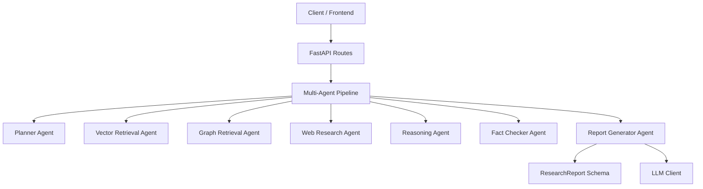
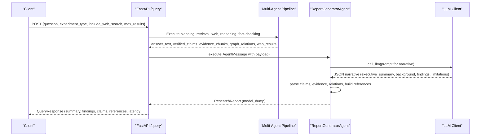
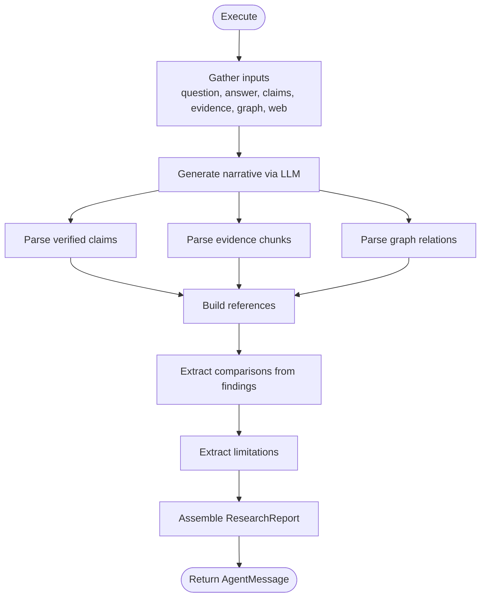
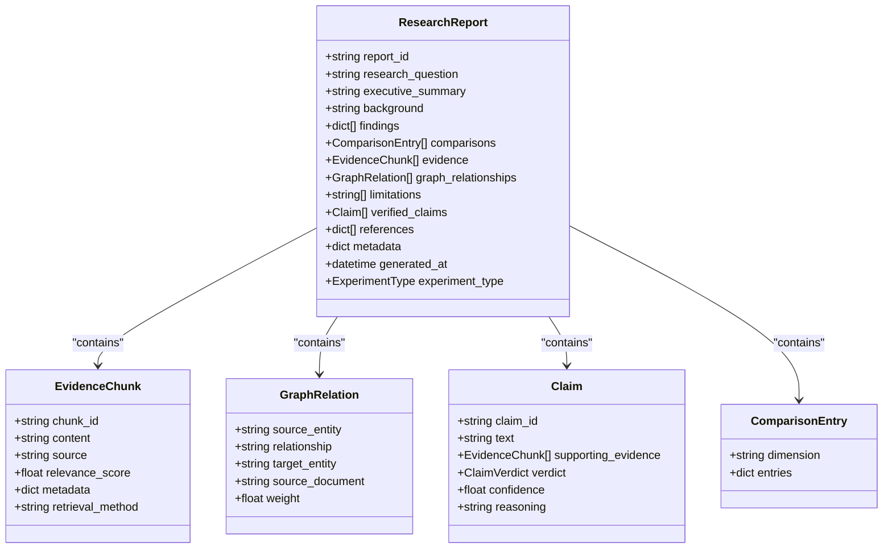
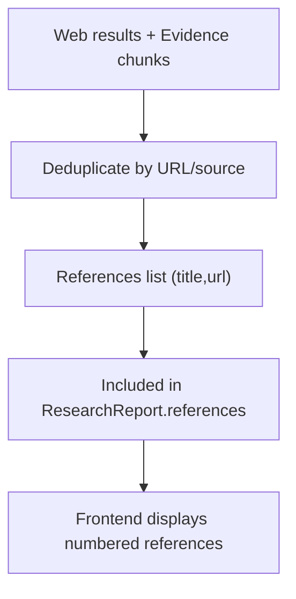
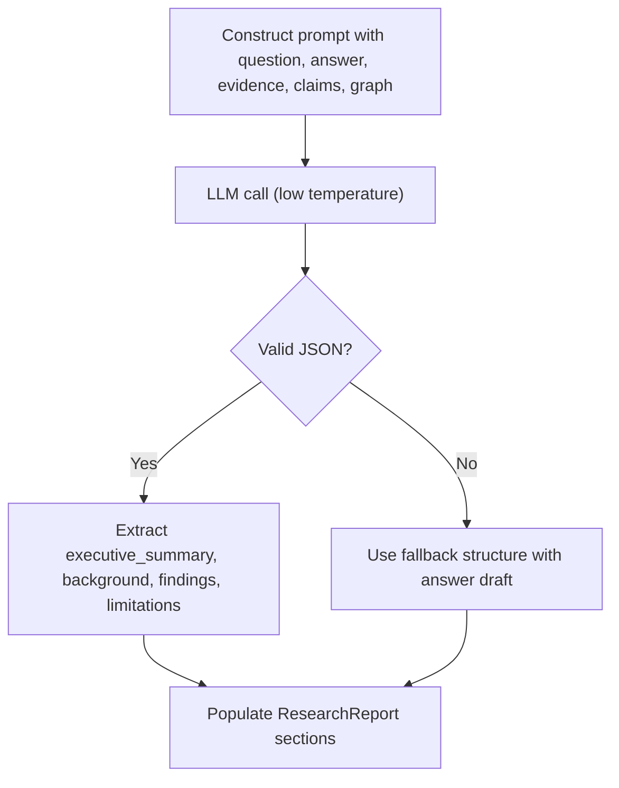
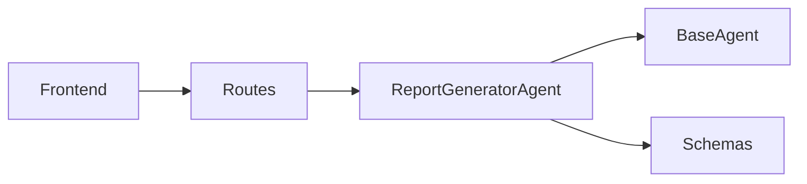

# Report Generator Agent

<cite>
**Referenced Files in This Document**
- [report_agent.py](file://src/agents/report_agent.py)
- [base_agent.py](file://src/core/base_agent.py)
- [schemas.py](file://src/core/schemas.py)
- [config.py](file://src/config.py)
- [routes.py](file://src/api/routes.py)
- [app.py](file://frontend/app.py)
- [query_example.py](file://examples/query_example.py)
</cite>

## Table of Contents
1. [Introduction](#introduction)
2. [Project Structure](#project-structure)
3. [Core Components](#core-components)
4. [Architecture Overview](#architecture-overview)
5. [Detailed Component Analysis](#detailed-component-analysis)
6. [Dependency Analysis](#dependency-analysis)
7. [Performance Considerations](#performance-considerations)
8. [Troubleshooting Guide](#troubleshooting-guide)
9. [Conclusion](#conclusion)
10. [Appendices](#appendices)

## Introduction
This document explains the ReportGeneratorAgent, which produces structured research reports from synthesized evidence and reasoning outputs. It covers how the agent organizes sections (executive summary, background, findings, comparisons, knowledge graph relationships, evidence, limitations, verified conclusions, references), how it manages citations and builds a bibliography, and how it links claims to supporting sources. It also documents configuration options that influence report length, detail level, and formatting preferences, and provides usage patterns for different output styles such as academic papers, business briefs, and technical documentation.

## Project Structure
The ReportGeneratorAgent is part of a multi-agent research system. It receives inputs from earlier agents (planner, retrieval, web research, reasoning, fact-checking) and emits a structured ResearchReport object. The API layer orchestrates the pipeline and exposes endpoints for querying and retrieving results. The frontend renders the final report sections and references.

**Diagram sources**
- [routes.py:188-338](file://src/api/routes.py#L188-L338)
- [report_agent.py:48-142](file://src/agents/report_agent.py#L48-L142)
- [schemas.py:132-148](file://src/core/schemas.py#L132-L148)

**Section sources**
- [routes.py:188-338](file://src/api/routes.py#L188-L338)
- [report_agent.py:48-142](file://src/agents/report_agent.py#L48-L142)
- [schemas.py:132-148](file://src/core/schemas.py#L132-L148)

## Core Components
- ReportGeneratorAgent: Orchestrates narrative generation, claim parsing, evidence and graph relation parsing, reference building, and comparison/limitation extraction. Emits a ResearchReport.
- BaseAgent: Provides LLM invocation, execution logging, and message creation utilities used by the ReportGeneratorAgent.
- Schemas: Define data models for EvidenceChunk, GraphRelation, Claim, ComparisonEntry, and ResearchReport.
- Configuration: Global settings including LLM provider/model and temperature, which indirectly affect report tone and verbosity.
- API Routes: Orchestrate the full pipeline and pass inputs to the ReportGeneratorAgent; expose query endpoint returning a QueryResponse with report fields.
- Frontend: Displays executive summary, findings, verified claims, limitations, and references.

**Section sources**
- [report_agent.py:48-142](file://src/agents/report_agent.py#L48-L142)
- [base_agent.py:19-100](file://src/core/base_agent.py#L19-L100)
- [schemas.py:65-148](file://src/core/schemas.py#L65-L148)
- [config.py:21-82](file://src/config.py#L21-L82)
- [routes.py:188-338](file://src/api/routes.py#L188-L338)
- [app.py:103-154](file://frontend/app.py#L103-L154)

## Architecture Overview
The ReportGeneratorAgent integrates into the multi-agent pipeline. After planning, retrieval, web research, reasoning, and fact-checking, the API routes construct an AgentMessage payload containing the question, answer text, verified claims, evidence chunks, graph relations, web results, and experiment type. The ReportGeneratorAgent then generates narrative sections via an LLM call, parses structured JSON, and assembles a ResearchReport with all required sections.

**Diagram sources**
- [routes.py:188-338](file://src/api/routes.py#L188-L338)
- [report_agent.py:57-142](file://src/agents/report_agent.py#L57-L142)
- [base_agent.py:42-59](file://src/core/base_agent.py#L42-L59)

## Detailed Component Analysis

### ReportGeneratorAgent
Responsibilities:
- Generate narrative sections (executive summary, background, findings, limitations) using an LLM prompt constructed from question, answer draft, evidence summaries, verified claims summaries, and graph relationship summaries.
- Parse verified claims into typed Claim objects with verdicts and confidence.
- Parse evidence chunks and graph relations into typed models, limiting to a fixed number to control size.
- Build references from web results and evidence sources, deduplicating by URL or source name.
- Extract comparisons from narrative findings when titles indicate comparisons.
- Assemble a ResearchReport with all sections and metadata, then return via AgentMessage.

Key implementation highlights:
- System prompt defines required sections and citation expectations.
- Narrative generation uses a low temperature to stabilize structure.
- Robust fallback parsing ensures the report can still be produced if LLM response format deviates.
- Reference builder consolidates unique sources from web results and evidence chunks.

**Diagram sources**
- [report_agent.py:57-142](file://src/agents/report_agent.py#L57-L142)
- [report_agent.py:144-195](file://src/agents/report_agent.py#L144-L195)
- [report_agent.py:197-227](file://src/agents/report_agent.py#L197-L227)

**Section sources**
- [report_agent.py:27-45](file://src/agents/report_agent.py#L27-L45)
- [report_agent.py:57-142](file://src/agents/report_agent.py#L57-L142)
- [report_agent.py:144-195](file://src/agents/report_agent.py#L144-L195)
- [report_agent.py:197-227](file://src/agents/report_agent.py#L197-L227)

### Data Models and Report Structure
The ResearchReport schema defines the canonical structure of generated reports:
- Identifiers and timestamps: report_id, generated_at
- Content sections: research_question, executive_summary, background, findings, comparisons, evidence, graph_relationships, limitations, verified_claims
- References: list of title/url pairs
- Metadata: experiment_type and additional metadata

These fields are populated by the ReportGeneratorAgent during execution.

**Diagram sources**
- [schemas.py:65-148](file://src/core/schemas.py#L65-L148)

**Section sources**
- [schemas.py:65-148](file://src/core/schemas.py#L65-L148)

### Citation Management and Bibliography
Citation management is implemented through:
- Evidence linking: Each EvidenceChunk carries a source field and optional metadata; these are preserved in the report’s evidence list.
- Reference building: The agent compiles a deduplicated list of references from web results (title/url) and evidence sources (source names). Unknown sources are excluded.
- Display: The frontend renders references with numbered entries and clickable URLs where available.

This creates a bibliography section that ties back to the evidence used in the report. While inline citation markers are not embedded in the narrative text by default, the evidence list and references provide traceability.

**Diagram sources**
- [report_agent.py:197-212](file://src/agents/report_agent.py#L197-L212)
- [app.py:139-147](file://frontend/app.py#L139-L147)

**Section sources**
- [report_agent.py:197-212](file://src/agents/report_agent.py#L197-L212)
- [app.py:139-147](file://frontend/app.py#L139-L147)

### Section Organization Logic
The agent enforces a standard set of sections via its system prompt and narrative generation:
- Research Question
- Executive Summary
- Background
- Findings (numbered)
- Comparison Table (extracted if present)
- Knowledge Graph Relationships
- Evidence (with source citations)
- Limitations
- Verified Conclusions (each claim with verification status)
- References

The narrative generator constructs a prompt that includes summarized evidence, verified claims, and graph relationships, then asks the LLM to produce JSON with executive_summary, background, findings, and limitations. The parser extracts this JSON or falls back to a safe default.

**Diagram sources**
- [report_agent.py:144-195](file://src/agents/report_agent.py#L144-L195)

**Section sources**
- [report_agent.py:27-45](file://src/agents/report_agent.py#L27-L45)
- [report_agent.py:144-195](file://src/agents/report_agent.py#L144-L195)

### Evidence Linking Mechanism
Evidence linking connects claims to their supporting sources through:
- EvidenceChunks with source identifiers and content snippets.
- Claims with verdicts and reasoning, optionally linked to supporting evidence.
- Graph relationships that contextualize entities and connections.
- References that aggregate unique sources for bibliographic display.

While the current implementation does not embed explicit inline citation markers in the narrative text, the evidence list and references enable readers to trace claims back to sources.

**Section sources**
- [schemas.py:65-103](file://src/core/schemas.py#L65-L103)
- [report_agent.py:100-113](file://src/agents/report_agent.py#L100-L113)
- [report_agent.py:197-212](file://src/agents/report_agent.py#L197-L212)

### Configuration Options
Configuration affects report generation indirectly via LLM behavior and pipeline parameters:
- LLM provider/model and temperature: Control tone, verbosity, and creativity. Lower temperature yields more deterministic structure.
- Max results: Limits the number of retrieved evidence chunks and web results, influencing report breadth and depth.
- Include web search: Adds web-derived evidence and references, potentially increasing coverage.
- Experiment type: Determines pipeline composition (baseline, vector RAG, graph RAG, hybrid, multi-agent), affecting the richness of evidence and reasoning.

These options are exposed in the API request model and frontend controls.

**Section sources**
- [config.py:21-82](file://src/config.py#L21-L82)
- [routes.py:80-99](file://src/api/routes.py#L80-L99)
- [app.py:26-35](file://frontend/app.py#L26-L35)

### Examples and Customization Patterns
Examples demonstrate how to run the full pipeline and view the resulting report:
- Command-line example prints executive summary, findings, and verified conclusions.
- Frontend displays sections interactively, including references and metadata.

Customization patterns for different use cases:
- Academic papers: Use multi-agent mode with high max_results and include web search enabled; rely on detailed findings and comprehensive references.
- Business briefs: Use lower max_results and concise executive summary; emphasize findings and limitations for quick decision-making.
- Technical documentation: Enable graph RAG or hybrid RAG to capture entity relationships; leverage knowledge graph relationships and evidence details.

Note: These patterns are achieved by adjusting pipeline parameters rather than modifying the ReportGeneratorAgent code.

**Section sources**
- [query_example.py:146-183](file://examples/query_example.py#L146-L183)
- [app.py:103-154](file://frontend/app.py#L103-L154)

## Dependency Analysis
The ReportGeneratorAgent depends on:
- BaseAgent for LLM calls and execution logging.
- Schemas for typed data structures.
- API routes for orchestration and input/output contracts.
- Frontend for rendering report sections and references.

**Diagram sources**
- [report_agent.py:13-24](file://src/agents/report_agent.py#L13-L24)
- [base_agent.py:19-100](file://src/core/base_agent.py#L19-L100)
- [routes.py:188-338](file://src/api/routes.py#L188-L338)
- [app.py:103-154](file://frontend/app.py#L103-L154)

**Section sources**
- [report_agent.py:13-24](file://src/agents/report_agent.py#L13-L24)
- [base_agent.py:19-100](file://src/core/base_agent.py#L19-L100)
- [routes.py:188-338](file://src/api/routes.py#L188-L338)
- [app.py:103-154](file://frontend/app.py#L103-L154)

## Performance Considerations
- LLM temperature: Lower values reduce variability and improve structural consistency at the cost of creativity.
- Evidence limits: The agent caps parsed evidence and graph relations to a fixed number to control processing time and output size.
- Token usage: Execution logs track token counts and latency; optimize prompts and result sizes to reduce costs.
- Web search inclusion: Enabling web search increases evidence volume and potential latency; consider disabling for faster queries.

[No sources needed since this section provides general guidance]

## Troubleshooting Guide
Common issues and resolutions:
- LLM response parsing failures: The agent falls back to a default structure if JSON parsing fails; verify prompt formatting and ensure the LLM returns valid JSON blocks.
- Missing references: Ensure web results contain URLs and evidence chunks have non-empty, non-unknown sources; duplicates are automatically removed.
- Empty findings or limitations: Check upstream agents’ outputs; if reasoning or fact-checking stages do not produce structured content, the narrative may lack details.
- High latency: Reduce max_results, disable web search, or switch to a lighter experiment type.

**Section sources**
- [report_agent.py:182-195](file://src/agents/report_agent.py#L182-L195)
- [report_agent.py:197-212](file://src/agents/report_agent.py#L197-L212)
- [base_agent.py:42-72](file://src/core/base_agent.py#L42-L72)

## Conclusion
The ReportGeneratorAgent synthesizes evidence, reasoning, and graph relationships into a structured research report with standardized sections, robust citation management, and flexible configuration. By tuning pipeline parameters and leveraging the provided examples and frontend, users can generate reports tailored to academic, business, and technical contexts while maintaining traceability to sources and clarity of findings.

[No sources needed since this section summarizes without analyzing specific files]

## Appendices

### API Contract for Report Generation
- Endpoint: POST /query
- Request fields: question, experiment_type, include_web_search, max_results
- Response fields: report_id, research_question, executive_summary, findings, evidence_count, graph_relations_count, verified_claims, limitations, references, experiment_type, latency_sec

**Section sources**
- [routes.py:80-99](file://src/api/routes.py#L80-L99)
- [routes.py:188-338](file://src/api/routes.py#L188-L338)

### Frontend Rendering of Reports
- Displays executive summary, findings (expandable), evidence metrics, verified claims with verdict icons, limitations, and references with numbered entries and clickable URLs.

**Section sources**
- [app.py:103-154](file://frontend/app.py#L103-L154)