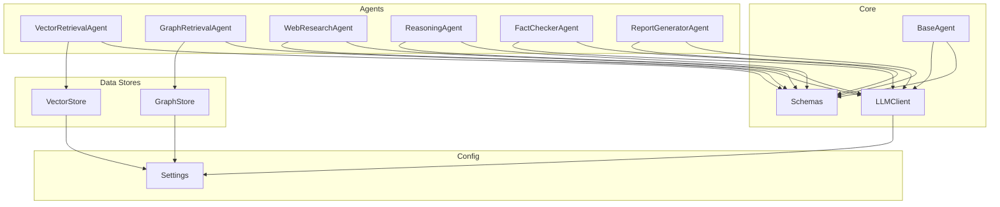
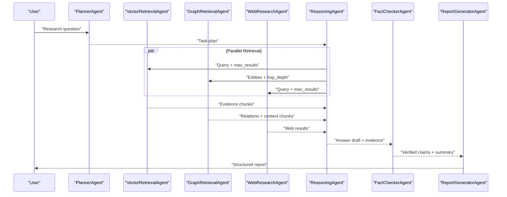
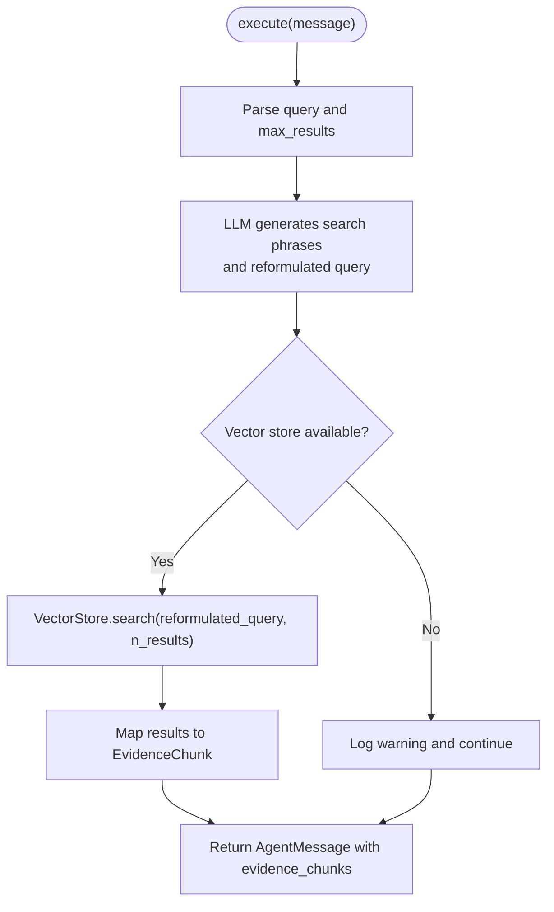
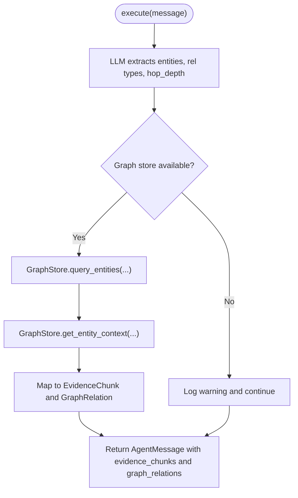
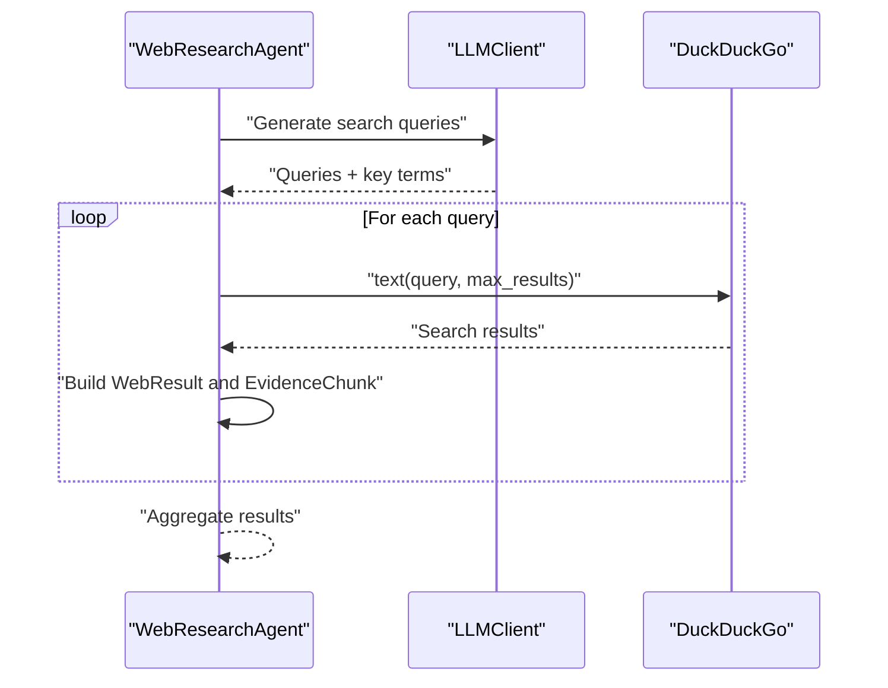
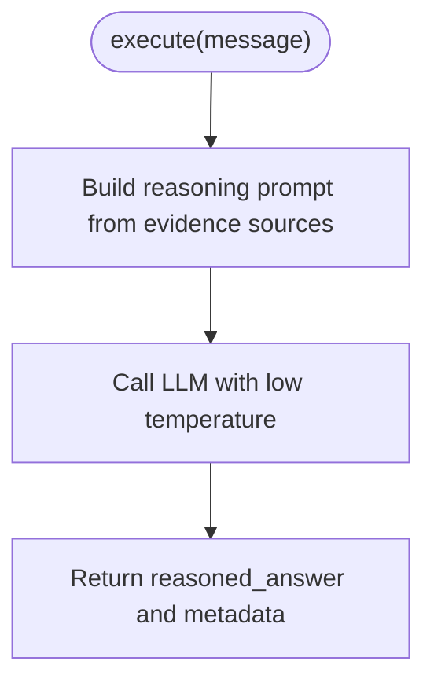
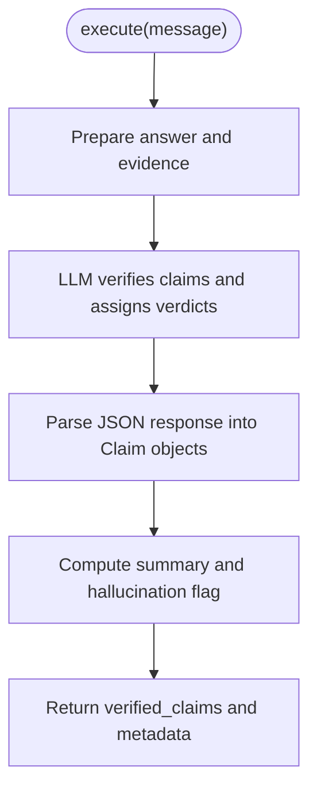
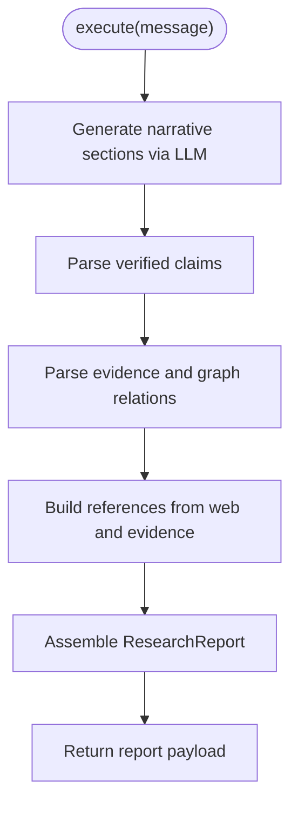
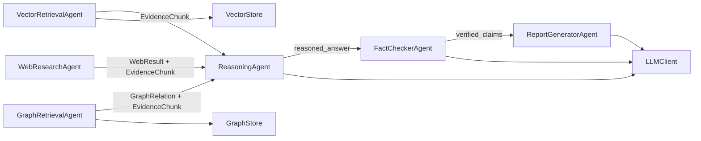

# Specialized Agents

<cite>
**Referenced Files in This Document**
- [vector_agent.py](file://src/agents/vector_agent.py)
- [graph_agent.py](file://src/agents/graph_agent.py)
- [web_agent.py](file://src/agents/web_agent.py)
- [reasoning_agent.py](file://src/agents/reasoning_agent.py)
- [fact_checker_agent.py](file://src/agents/fact_checker_agent.py)
- [report_agent.py](file://src/agents/report_agent.py)
- [base_agent.py](file://src/core/base_agent.py)
- [schemas.py](file://src/core/schemas.py)
- [llm.py](file://src/core/llm.py)
- [vector_store.py](file://src/rag/vector_store.py)
- [graph_store.py](file://src/graph/graph_store.py)
- [config.py](file://src/config.py)
- [README.md](file://README.md)
</cite>

## Table of Contents
1. [Introduction](#introduction)
2. [Project Structure](#project-structure)
3. [Core Components](#core-components)
4. [Architecture Overview](#architecture-overview)
5. [Detailed Component Analysis](#detailed-component-analysis)
6. [Dependency Analysis](#dependency-analysis)
7. [Performance Considerations](#performance-considerations)
8. [Troubleshooting Guide](#troubleshooting-guide)
9. [Conclusion](#conclusion)

## Introduction
This document provides detailed, code-grounded documentation for each specialized agent in the multi-agent research system. It explains how agents retrieve evidence (vector similarity search, knowledge graph traversal, web search), synthesize reasoning, verify claims to detect hallucinations, and generate structured reports with citations. For each agent, we cover implementation details, configuration options, input/output schemas, performance characteristics, and integration patterns with other agents.

## Project Structure
The system is organized into modular layers:
- Agents: specialized roles for retrieval, reasoning, verification, and reporting
- Core: shared base agent, LLM abstraction, and Pydantic schemas
- RAG: vector store abstraction over ChromaDB or FAISS
- Graph: knowledge graph store abstraction over Neo4j or NetworkX
- Config: centralized settings loaded from environment variables

**Diagram sources**
- [vector_agent.py:34-92](file://src/agents/vector_agent.py#L34-L92)
- [graph_agent.py:36-121](file://src/agents/graph_agent.py#L36-L121)
- [web_agent.py:34-117](file://src/agents/web_agent.py#L34-L117)
- [reasoning_agent.py:38-124](file://src/agents/reasoning_agent.py#L38-L124)
- [fact_checker_agent.py:54-163](file://src/agents/fact_checker_agent.py#L54-L163)
- [report_agent.py:48-228](file://src/agents/report_agent.py#L48-L228)
- [base_agent.py:19-100](file://src/core/base_agent.py#L19-L100)
- [schemas.py:15-168](file://src/core/schemas.py#L15-L168)
- [llm.py:15-103](file://src/core/llm.py#L15-L103)
- [vector_store.py:16-192](file://src/rag/vector_store.py#L16-L192)
- [graph_store.py:15-303](file://src/graph/graph_store.py#L15-L303)
- [config.py:21-82](file://src/config.py#L21-L82)

**Section sources**
- [README.md:5-23](file://README.md#L5-L23)
- [README.md:81-126](file://README.md#L81-L126)

## Core Components
- BaseAgent: abstracts LLM calls, execution logging, message creation, and statistics collection. All agents inherit from it and implement execute() and get_system_prompt().
- Schemas: strongly-typed models for queries, evidence, claims, messages, and reports. They define the contract between agents.
- LLMClient: unified interface to Gemini or OpenAI with token counting and configurable temperature.
- VectorStore: stores and searches document embeddings via ChromaDB or FAISS; returns scored chunks with metadata.
- GraphStore: manages entities and relationships using Neo4j or an in-memory NetworkX graph; supports BFS traversal up to a hop depth.

Key responsibilities:
- Retrieval agents produce EvidenceChunk lists and domain-specific payloads (e.g., WebResult).
- Reasoning agent synthesizes evidence into a grounded answer draft.
- Fact-checker validates claims against evidence and flags hallucinations.
- Report generator produces a structured ResearchReport with sections, comparisons, limitations, references, and verified claims.

**Section sources**
- [base_agent.py:19-100](file://src/core/base_agent.py#L19-L100)
- [schemas.py:15-168](file://src/core/schemas.py#L15-L168)
- [llm.py:15-103](file://src/core/llm.py#L15-L103)
- [vector_store.py:16-192](file://src/rag/vector_store.py#L16-L192)
- [graph_store.py:15-303](file://src/graph/graph_store.py#L15-L303)

## Architecture Overview
The pipeline orchestrates specialized agents to answer complex research questions:
- Planner decomposes the question into sub-questions and selects required agents.
- Retrieval agents run in parallel: vector, graph, and web.
- Reasoning synthesizes evidence across sources.
- Fact-checker verifies claims and detects hallucinations.
- Report generator formats the final output with citations and structure.

**Diagram sources**
- [planner_agent.py:56-128](file://src/agents/planner_agent.py#L56-L128)
- [vector_agent.py:44-92](file://src/agents/vector_agent.py#L44-L92)
- [graph_agent.py:46-121](file://src/agents/graph_agent.py#L46-L121)
- [web_agent.py:43-117](file://src/agents/web_agent.py#L43-L117)
- [reasoning_agent.py:47-124](file://src/agents/reasoning_agent.py#L47-L124)
- [fact_checker_agent.py:63-163](file://src/agents/fact_checker_agent.py#L63-L163)
- [report_agent.py:57-228](file://src/agents/report_agent.py#L57-L228)

## Detailed Component Analysis

### VectorRetrievalAgent
Purpose: Retrieve semantically relevant document chunks using vector embeddings and similarity scoring.

Implementation highlights:
- Uses an LLM to generate optimized search phrases and a reformulated query for better retrieval.
- Calls VectorStore.search(query, n_results) and maps results to EvidenceChunk objects with chunk_id, content, source, relevance_score, metadata, and retrieval_method="vector".
- If no vector store is configured, logs a warning and returns empty results.

Configuration options:
- Vector store type and collection/index are set via Settings (VECTOR_DB_TYPE, CHROMA_COLLECTION, FAISS_INDEX_PATH).
- Embedding model and dimension are configured via EMBEDDING_MODEL and EMBEDDING_DIMENSION.

Input schema:
- AgentMessage.payload: { "query": str, "max_results": int }

Output schema:
- AgentMessage.payload: { "evidence_chunks": list[EvidenceChunk] }

Performance characteristics:
- ChromaDB uses cosine similarity; FAISS uses inner product search on precomputed embeddings.
- Search time scales with number of stored vectors and chosen backend; ChromaDB may involve network I/O if remote; FAISS is in-memory and fast for moderate sizes.

Integration patterns:
- Consumed by ReasoningAgent which aggregates evidence from multiple sources.
- Produces EvidenceChunk entries that downstream agents can cite and compare.

**Diagram sources**
- [vector_agent.py:44-92](file://src/agents/vector_agent.py#L44-L92)
- [vector_store.py:100-176](file://src/rag/vector_store.py#L100-L176)

**Section sources**
- [vector_agent.py:17-92](file://src/agents/vector_agent.py#L17-L92)
- [vector_store.py:16-192](file://src/rag/vector_store.py#L16-L192)
- [config.py:39-48](file://src/config.py#L39-L48)

### GraphRetrievalAgent
Purpose: Traverse the knowledge graph to find entity relationships and contextual text for entities.

Implementation highlights:
- Uses an LLM to extract key entities, relationship types, and hop depth from the query.
- Calls GraphStore.query_entities(entities, hop_depth, relationship_types, limit) to retrieve relations.
- Also retrieves textual context via GraphStore.get_entity_context(entities, limit) and converts to EvidenceChunk with retrieval_method="graph".

Configuration options:
- Graph backend selection (Neo4j vs NetworkX) via GraphStore initialization; fallback to NetworkX if Neo4j unavailable.
- Hop depth and relationship filters control traversal breadth and specificity.

Input schema:
- AgentMessage.payload: { "query": str, "max_results": int }

Output schema:
- AgentMessage.payload: { "evidence_chunks": list[EvidenceChunk], "graph_relations": list[GraphRelation] }

Performance characteristics:
- Neo4j queries use variable-length path matching up to hop_depth; performance depends on graph size and indexing.
- NetworkX uses BFS traversal limited by hop_depth and result limit; efficient for in-memory graphs.

Integration patterns:
- Provides GraphRelation structures and EvidenceChunk context to ReasoningAgent for synthesis.

**Diagram sources**
- [graph_agent.py:46-121](file://src/agents/graph_agent.py#L46-L121)
- [graph_store.py:67-85](file://src/graph/graph_store.py#L67-L85)

**Section sources**
- [graph_agent.py:17-121](file://src/agents/graph_agent.py#L17-L121)
- [graph_store.py:15-303](file://src/graph/graph_store.py#L15-L303)

### WebResearchAgent
Purpose: Gather real-time information from web sources and return structured results with source validation.

Implementation highlights:
- Uses an LLM to generate optimized search queries and key terms.
- Executes web searches via DuckDuckGo (DDGS) and constructs WebResult objects with title, url, snippet, source, and relevance_score.
- Converts top results into EvidenceChunk entries with retrieval_method="web" and includes URL metadata.

Configuration options:
- Web search enabled via DUCKDUCKGO_ENABLED; optional SERPER_API_KEY for alternative providers.
- Number of results per query controlled by max_results and split across generated queries.

Input schema:
- AgentMessage.payload: { "query": str, "max_results": int }

Output schema:
- AgentMessage.payload: { "evidence_chunks": list[EvidenceChunk], "web_results": list[WebResult] }

Performance characteristics:
- Depends on external search provider latency and rate limits; DuckDuckGo is used when installed.
- Results are capped to avoid excessive payload sizes.

Integration patterns:
- Supplies current information to ReasoningAgent alongside vector and graph evidence.

**Diagram sources**
- [web_agent.py:43-117](file://src/agents/web_agent.py#L43-L117)

**Section sources**
- [web_agent.py:17-117](file://src/agents/web_agent.py#L17-L117)
- [config.py:55-57](file://src/config.py#L55-L57)

### ReasoningAgent
Purpose: Synthesize evidence from vector, graph, and web sources to produce a well-reasoned, evidence-grounded answer draft.

Implementation highlights:
- Builds a prompt combining the original question, vector evidence snippets, graph relationships, and web results.
- Calls LLM with low temperature to encourage factual grounding and structured reasoning.
- Returns a reasoned_answer along with metadata about evidence usage.

Configuration options:
- Temperature controls creativity vs determinism; default is low to favor faithfulness.

Input schema:
- AgentMessage.payload: { "question": str, "evidence_chunks": list[dict], "graph_relations": list[dict], "web_results": list[dict] }

Output schema:
- AgentMessage.payload: { "reasoned_answer": str, "question": str, "evidence_used": int }

Performance characteristics:
- Prompt length grows with evidence size; truncation is applied to keep prompts manageable.
- Latency dominated by LLM call; token usage tracked by BaseAgent.

Integration patterns:
- Aggregates outputs from VectorRetrievalAgent, GraphRetrievalAgent, and WebResearchAgent.
- Passes answer draft to FactCheckerAgent for verification.

**Diagram sources**
- [reasoning_agent.py:47-124](file://src/agents/reasoning_agent.py#L47-L124)

**Section sources**
- [reasoning_agent.py:16-124](file://src/agents/reasoning_agent.py#L16-L124)

### FactCheckerAgent
Purpose: Verify each claim in the reasoned answer against provided evidence and flag hallucinations or unsupported statements.

Implementation highlights:
- Sends answer and evidence to LLM with a strict fact-checking prompt to extract claims and assign verdicts: SUPPORTED, PARTIALLY_SUPPORTED, UNSUPPORTED, CONTRADICTED, NO_EVIDENCE.
- Parses JSON responses robustly, handling markdown-wrapped JSON blocks.
- Computes overall assessment and sets hallucination_detected if any claim is unsupported or contradicted.

Configuration options:
- Temperature set to 0 for deterministic verification.

Input schema:
- AgentMessage.payload: { "reasoned_answer": str, "question": str, "evidence_chunks": list[dict], "evidence_used": int }

Output schema:
- AgentMessage.payload: { "verified_claims": list[Claim], "fact_check_summary": str, "hallucination_detected": bool, "answer_text": str, "question": str }

Performance characteristics:
- Claim extraction and verification rely on LLM; prompt includes truncated evidence to fit context windows.
- Parsing failures fall back to a minimal Claim indicating parsing issues.

Integration patterns:
- Receives output from ReasoningAgent and forwards verified claims and summary to ReportGeneratorAgent.

**Diagram sources**
- [fact_checker_agent.py:63-163](file://src/agents/fact_checker_agent.py#L63-L163)

**Section sources**
- [fact_checker_agent.py:24-163](file://src/agents/fact_checker_agent.py#L24-L163)

### ReportGeneratorAgent
Purpose: Generate a structured research report from verified answers, claims, evidence, and graph relationships, including citations and references.

Implementation highlights:
- Generates narrative sections (executive summary, background, findings, limitations) via LLM with structured JSON output.
- Parses verified claims, evidence, and graph relations into typed models.
- Builds references from web results and evidence sources, deduplicating URLs.
- Constructs a ResearchReport with all sections, timestamps, and experiment type.

Configuration options:
- Experiment type determines report metadata; defaults to MULTI_AGENT.

Input schema:
- AgentMessage.payload: { "answer_text": str, "question": str, "verified_claims": list[dict], "evidence_chunks": list[dict], "graph_relations": list[dict], "web_results": list[dict], "fact_check_summary": str, "experiment_type": str }

Output schema:
- AgentMessage.payload: { "report": ResearchReport.model_dump() }

Performance characteristics:
- Narrative generation involves LLM calls; truncation applied to evidence summaries to manage prompt size.
- Parsing fallback ensures report generation continues even if LLM output is malformed.

Integration patterns:
- Consumes outputs from FactCheckerAgent and upstream retrieval agents to assemble the final report.

**Diagram sources**
- [report_agent.py:57-228](file://src/agents/report_agent.py#L57-L228)

**Section sources**
- [report_agent.py:27-228](file://src/agents/report_agent.py#L27-L228)

## Dependency Analysis
Agent interdependencies and data flows:
- VectorRetrievalAgent depends on VectorStore and emits EvidenceChunk.
- GraphRetrievalAgent depends on GraphStore and emits EvidenceChunk and GraphRelation.
- WebResearchAgent depends on external web search and emits WebResult and EvidenceChunk.
- ReasoningAgent depends on outputs from the three retrieval agents and emits a reasoned_answer.
- FactCheckerAgent depends on ReasoningAgent’s answer and evidence, emitting verified_claims and hallucination flags.
- ReportGeneratorAgent depends on FactCheckerAgent’s output and upstream evidence to produce ResearchReport.

**Diagram sources**
- [vector_agent.py:44-92](file://src/agents/vector_agent.py#L44-L92)
- [graph_agent.py:46-121](file://src/agents/graph_agent.py#L46-L121)
- [web_agent.py:43-117](file://src/agents/web_agent.py#L43-L117)
- [reasoning_agent.py:47-124](file://src/agents/reasoning_agent.py#L47-L124)
- [fact_checker_agent.py:63-163](file://src/agents/fact_checker_agent.py#L63-L163)
- [report_agent.py:57-228](file://src/agents/report_agent.py#L57-L228)
- [vector_store.py:16-192](file://src/rag/vector_store.py#L16-L192)
- [graph_store.py:15-303](file://src/graph/graph_store.py#L15-L303)
- [llm.py:15-103](file://src/core/llm.py#L15-L103)

**Section sources**
- [schemas.py:15-168](file://src/core/schemas.py#L15-L168)

## Performance Considerations
- LLM calls dominate latency; use low temperatures for deterministic outputs in retrieval planning and verification.
- Vector search performance depends on backend:
  - ChromaDB: cosine similarity; consider collection size and network overhead.
  - FAISS: in-memory index; fast but requires precomputed embeddings and sufficient RAM.
- Graph traversal:
  - Neo4j: scalable for large graphs; ensure proper indexing and limit hop_depth.
  - NetworkX: suitable for small-to-medium in-memory graphs; BFS bounded by hop_depth and limit.
- Web search:
  - External provider latency and rate limits; cap results to reduce payload and processing time.
- Token usage:
  - BaseAgent tracks tokens per call; monitor total usage to optimize prompts and truncate evidence where necessary.

## Troubleshooting Guide
Common issues and resolutions:
- No vector store configured:
  - Symptom: Empty evidence from VectorRetrievalAgent with a warning log.
  - Resolution: Ensure VectorStore is initialized and configured via Settings; check VECTOR_DB_TYPE and collection/index paths.
- No knowledge graph configured:
  - Symptom: Empty relations and context from GraphRetrievalAgent with a warning log.
  - Resolution: Initialize GraphStore; verify Neo4j connection or fall back to NetworkX.
- Web search not installed:
  - Symptom: duckduckgo-search import error; web search skipped.
  - Resolution: Install duckduckgo-search or configure alternative provider via SERPER_API_KEY.
- LLM provider misconfiguration:
  - Symptom: Unsupported provider or missing API keys.
  - Resolution: Set LLM_PROVIDER and corresponding API keys in environment; verify model names.
- JSON parsing failures:
  - Symptom: Fact checker or planner fallback due to invalid JSON.
  - Resolution: Improve prompts or post-processing; ensure LLM returns valid JSON blocks.

**Section sources**
- [vector_agent.py:73-75](file://src/agents/vector_agent.py#L73-L75)
- [graph_agent.py:95-97](file://src/agents/graph_agent.py#L95-L97)
- [web_agent.py:111-115](file://src/agents/web_agent.py#L111-L115)
- [llm.py:25-38](file://src/core/llm.py#L25-L38)
- [fact_checker_agent.py:130-144](file://src/agents/fact_checker_agent.py#L130-L144)

## Conclusion
The specialized agents form a cohesive multi-agent research pipeline:
- VectorRetrievalAgent performs semantic search using vector embeddings and similarity scoring.
- GraphRetrievalAgent traverses knowledge graphs to uncover entity relationships and contextual facts.
- WebResearchAgent gathers real-time information with source validation and structured outputs.
- ReasoningAgent synthesizes cross-source evidence into grounded answers.
- FactCheckerAgent verifies claims, identifies hallucinations, and quantifies confidence.
- ReportGeneratorAgent produces professional, citation-rich research reports with structured sections.

Together, these agents deliver accurate, verifiable, and well-structured research outputs, leveraging both static knowledge bases and live web sources while maintaining traceability through standardized schemas and execution logs.