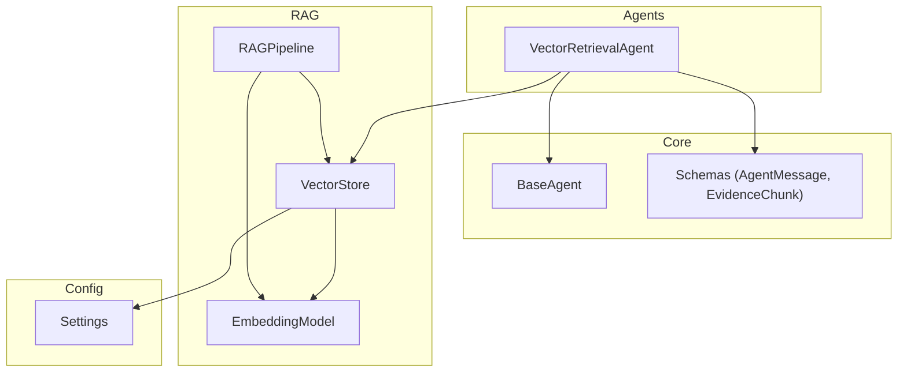
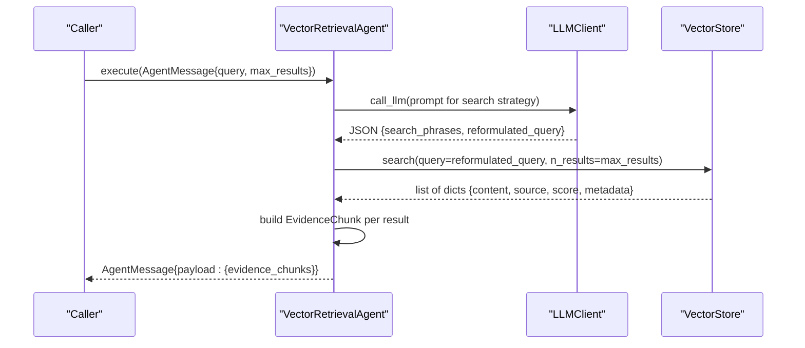
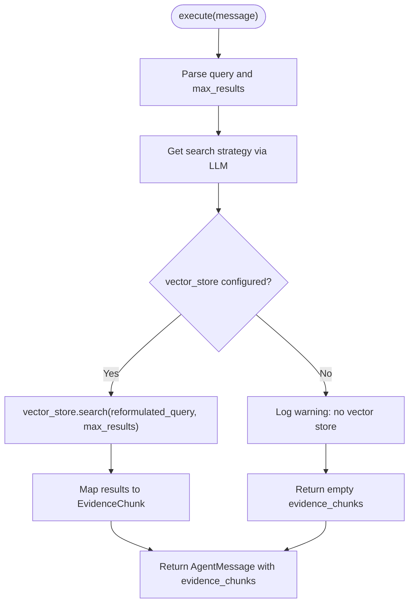
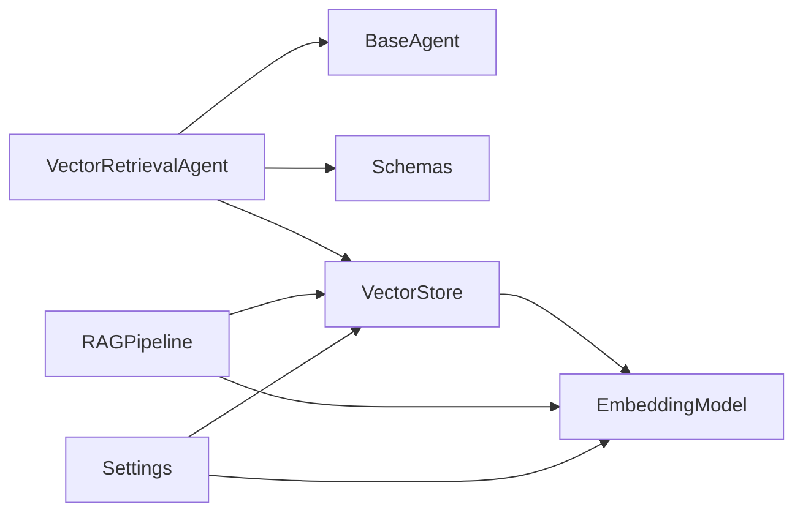

# Vector Retrieval Agent

<cite>
**Referenced Files in This Document**
- [vector_agent.py](file://src/agents/vector_agent.py)
- [base_agent.py](file://src/core/base_agent.py)
- [schemas.py](file://src/core/schemas.py)
- [vector_store.py](file://src/rag/vector_store.py)
- [embeddings.py](file://src/rag/embeddings.py)
- [pipeline.py](file://src/rag/pipeline.py)
- [config.py](file://src/config.py)
- [query_example.py](file://examples/query_example.py)
</cite>

## Table of Contents
1. [Introduction](#introduction)
2. [Project Structure](#project-structure)
3. [Core Components](#core-components)
4. [Architecture Overview](#architecture-overview)
5. [Detailed Component Analysis](#detailed-component-analysis)
6. [Dependency Analysis](#dependency-analysis)
7. [Performance Considerations](#performance-considerations)
8. [Troubleshooting Guide](#troubleshooting-guide)
9. [Conclusion](#conclusion)
10. [Appendices](#appendices)

## Introduction
This document explains the VectorRetrievalAgent component, which performs semantic search over a vector database to retrieve relevant document chunks. It uses an LLM to optimize search phrases and reformulate queries for better retrieval, then leverages a vector store abstraction layer to perform similarity scoring and return structured evidence chunks. The agent integrates into a multi-agent research pipeline and returns results conforming to a well-defined schema.

## Project Structure
The VectorRetrievalAgent is part of the agents module and interacts with core schemas, base agent behavior, and the RAG stack (embeddings and vector store). Examples demonstrate how it is instantiated and used within a full research pipeline.

**Diagram sources**
- [vector_agent.py:34-92](file://src/agents/vector_agent.py#L34-L92)
- [base_agent.py:19-100](file://src/core/base_agent.py#L19-L100)
- [schemas.py:65-113](file://src/core/schemas.py#L65-L113)
- [vector_store.py:16-192](file://src/rag/vector_store.py#L16-L192)
- [embeddings.py:16-58](file://src/rag/embeddings.py#L16-L58)
- [pipeline.py:19-102](file://src/rag/pipeline.py#L19-L102)
- [config.py:21-82](file://src/config.py#L21-L82)

**Section sources**
- [vector_agent.py:1-92](file://src/agents/vector_agent.py#L1-L92)
- [base_agent.py:1-100](file://src/core/base_agent.py#L1-L100)
- [schemas.py:1-168](file://src/core/schemas.py#L1-L168)
- [vector_store.py:1-192](file://src/rag/vector_store.py#L1-L192)
- [embeddings.py:1-58](file://src/rag/embeddings.py#L1-L58)
- [pipeline.py:1-102](file://src/rag/pipeline.py#L1-L102)
- [config.py:1-82](file://src/config.py#L1-L82)
- [query_example.py:25-64](file://examples/query_example.py#L25-L64)

## Core Components
- VectorRetrievalAgent: Orchestrates query optimization via LLM and retrieves chunks from the vector store.
- BaseAgent: Provides common agent lifecycle, LLM invocation, and message creation utilities.
- Schemas: Defines AgentMessage payload structure and EvidenceChunk data model returned by the agent.
- VectorStore: Abstraction over ChromaDB or FAISS for storing and searching embeddings.
- EmbeddingModel: Generates normalized vector embeddings for text using sentence-transformers.
- RAGPipeline: End-to-end ingestion and querying pipeline that wires chunking, embedding, and vector storage.
- Settings: Centralized configuration for providers, models, and vector DB parameters.

Key responsibilities:
- Transform user queries into optimized search phrases and reformulated queries using an LLM.
- Perform vector similarity search and map raw results to EvidenceChunk objects.
- Return standardized AgentMessage responses containing evidence_chunks.

**Section sources**
- [vector_agent.py:34-92](file://src/agents/vector_agent.py#L34-L92)
- [base_agent.py:19-100](file://src/core/base_agent.py#L19-L100)
- [schemas.py:65-113](file://src/core/schemas.py#L65-L113)
- [vector_store.py:16-192](file://src/rag/vector_store.py#L16-L192)
- [embeddings.py:16-58](file://src/rag/embeddings.py#L16-L58)
- [pipeline.py:19-102](file://src/rag/pipeline.py#L19-L102)
- [config.py:21-82](file://src/config.py#L21-L82)

## Architecture Overview
The VectorRetrievalAgent follows a clear flow:
1. Receive an AgentMessage with a query and optional max_results.
2. Use an LLM to generate search phrases and a reformulated query.
3. Call the vector store’s search method with the reformulated query and result limit.
4. Convert raw results into EvidenceChunk instances and return them in an AgentMessage payload.

**Diagram sources**
- [vector_agent.py:44-92](file://src/agents/vector_agent.py#L44-L92)
- [base_agent.py:42-59](file://src/core/base_agent.py#L42-L59)
- [vector_store.py:100-176](file://src/rag/vector_store.py#L100-L176)

## Detailed Component Analysis

### VectorRetrievalAgent
Responsibilities:
- Extracts query and max_results from AgentMessage payload.
- Calls an internal helper to get search strategy from the LLM.
- Performs vector search if a vector store is configured; otherwise logs a warning and returns empty results.
- Maps raw results to EvidenceChunk and returns a standardized AgentMessage.

Input/output:
- Input: AgentMessage.payload contains query (string) and max_results (integer).
- Output: AgentMessage.payload contains evidence_chunks (list of EvidenceChunk serialized).

Error handling:
- If no vector store is provided, logs a warning and returns zero chunks.
- LLM parsing failures fall back to using the original query.

Optimization process:
- Uses an LLM prompt to produce search phrases and a reformulated query to improve retrieval quality.

**Diagram sources**
- [vector_agent.py:44-92](file://src/agents/vector_agent.py#L44-L92)

**Section sources**
- [vector_agent.py:17-92](file://src/agents/vector_agent.py#L17-L92)

### BaseAgent
Provides:
- LLM invocation with system prompts and token accounting.
- Message creation helpers for consistent inter-agent communication.
- Execution logging for latency and token usage.

Relevance:
- VectorRetrievalAgent inherits these capabilities to call the LLM and construct messages.

**Section sources**
- [base_agent.py:19-100](file://src/core/base_agent.py#L19-L100)

### Schemas (AgentMessage and EvidenceChunk)
AgentMessage:
- Fields: sender, receiver, content, payload, timestamp.
- Payload carries query parameters and results between agents.

EvidenceChunk:
- Fields: chunk_id, content, source, relevance_score, metadata, retrieval_method.
- retrieval_method defaults to "vector".

Usage:
- VectorRetrievalAgent populates EvidenceChunk fields from vector store search results.
- Returns a list of EvidenceChunk in AgentMessage.payload.evidence_chunks.

**Section sources**
- [schemas.py:65-113](file://src/core/schemas.py#L65-L113)

### VectorStore
Abstraction:
- Supports ChromaDB and FAISS backends based on configuration.
- add_documents indexes texts with embeddings and metadata.
- search returns lists of dicts with content, source, score, metadata.

Behavior:
- ChromaDB: supports query_texts or query_embeddings; computes cosine-based scores.
- FAISS: requires explicit query_embedding; returns dot-product scores.

Integration:
- RAGPipeline embeds queries and passes embeddings when available.
- VectorRetrievalAgent calls search with reformulated query and result limit.

**Section sources**
- [vector_store.py:16-192](file://src/rag/vector_store.py#L16-L192)
- [pipeline.py:90-102](file://src/rag/pipeline.py#L90-L102)

### EmbeddingModel
Capabilities:
- Loads a sentence-transformers model lazily.
- embed_text and embed_batch produce normalized vectors.
- similarity computes cosine similarity between two vectors.

Configuration:
- Model name and dimension are read from settings.

**Section sources**
- [embeddings.py:16-58](file://src/rag/embeddings.py#L16-L58)
- [config.py:39-48](file://src/config.py#L39-L48)

### RAGPipeline
Functions:
- ingest_directory/file/documents: load, chunk, embed, and index documents.
- query: embed question and search vector store with optional precomputed embedding.

Integration:
- Used in examples to provide a configured VectorStore instance to VectorRetrievalAgent.

**Section sources**
- [pipeline.py:19-102](file://src/rag/pipeline.py#L19-L102)
- [query_example.py:31-64](file://examples/query_example.py#L31-L64)

### Configuration
Settings include:
- LLM provider and model selection.
- Embedding model and dimension.
- Vector DB type and collection/index paths.
- Chunk size and overlap for ingestion.

Impact:
- Determines which vector backend is used and how embeddings are generated.

**Section sources**
- [config.py:21-82](file://src/config.py#L21-L82)

## Dependency Analysis
The VectorRetrievalAgent depends on:
- BaseAgent for LLM calls and message construction.
- Schemas for typed payloads and evidence models.
- VectorStore for similarity search and result mapping.
- EmbeddingModel indirectly via RAGPipeline when embeddings are needed for FAISS or advanced queries.

Coupling and cohesion:
- Loose coupling through the VectorStore abstraction allows swapping backends without changing the agent.
- Cohesive design keeps retrieval logic within the agent while delegating storage/search to dedicated components.

Potential circular dependencies:
- None observed; imports are directional from agents to core and rag modules.

External integrations:
- ChromaDB or FAISS via VectorStore.
- Sentence-transformers via EmbeddingModel.
- LLM provider via BaseAgent’s LLMClient.

**Diagram sources**
- [vector_agent.py:34-92](file://src/agents/vector_agent.py#L34-L92)
- [base_agent.py:19-100](file://src/core/base_agent.py#L19-L100)
- [schemas.py:65-113](file://src/core/schemas.py#L65-L113)
- [vector_store.py:16-192](file://src/rag/vector_store.py#L16-L192)
- [embeddings.py:16-58](file://src/rag/embeddings.py#L16-L58)
- [pipeline.py:19-102](file://src/rag/pipeline.py#L19-L102)
- [config.py:21-82](file://src/config.py#L21-L82)

**Section sources**
- [vector_agent.py:34-92](file://src/agents/vector_agent.py#L34-L92)
- [vector_store.py:16-192](file://src/rag/vector_store.py#L16-L192)
- [embeddings.py:16-58](file://src/rag/embeddings.py#L16-L58)
- [pipeline.py:19-102](file://src/rag/pipeline.py#L19-L102)
- [config.py:21-82](file://src/config.py#L21-L82)

## Performance Considerations
- LLM overhead: Query optimization adds one LLM call per retrieval; consider caching strategies or batching if many queries are issued.
- Vector store choice:
  - ChromaDB: convenient text-based queries; may incur network overhead depending on deployment.
  - FAISS: fast in-memory search but requires precomputed embeddings; ensure embeddings are passed for best performance.
- Batched embeddings: RAGPipeline uses batched embedding generation for efficiency during ingestion.
- Result limits: Adjust max_results to balance recall vs. latency and downstream processing cost.
- Token usage: BaseAgent tracks tokens and latency; monitor execution stats to identify bottlenecks.

[No sources needed since this section provides general guidance]

## Troubleshooting Guide
Common issues and resolutions:
- No vector store configured:
  - Symptom: Empty evidence_chunks returned; warning logged.
  - Resolution: Provide a configured VectorStore instance to VectorRetrievalAgent or ensure RAGPipeline is used to initialize and pass the store.
- Empty results:
  - Causes: No documents indexed, incorrect backend initialization, or insufficient similarity threshold.
  - Resolution: Verify ingestion completed successfully; check vector store count; adjust max_results or reformulated query quality.
- Low relevance scores:
  - Causes: Poor query phrasing, mismatched embedding model, or inadequate indexing.
  - Resolution: Improve query via LLM optimization; verify embedding model dimensions match stored vectors; re-ingest with appropriate chunking.
- FAISS requires embeddings:
  - Symptom: Warning about missing query embedding; empty results.
  - Resolution: Pass query_embedding to search or use RAGPipeline.query which embeds the question automatically.
- ChromaDB init failure:
  - Symptom: Error logs during initialization; _store set to None.
  - Resolution: Ensure ChromaDB service is running and accessible; validate collection name and permissions.

Operational tips:
- Use BaseAgent.get_execution_stats to review latency and token usage across retrievals.
- Inspect logs for warnings about missing vector store or failed backend operations.
- Validate that metadata includes source information for traceability.

**Section sources**
- [vector_agent.py:59-76](file://src/agents/vector_agent.py#L59-L76)
- [vector_store.py:25-58](file://src/rag/vector_store.py#L25-L58)
- [vector_store.py:100-176](file://src/rag/vector_store.py#L100-L176)
- [base_agent.py:88-99](file://src/core/base_agent.py#L88-L99)

## Conclusion
The VectorRetrievalAgent provides a robust, schema-driven mechanism for semantic retrieval using vector embeddings and similarity scoring. Its LLM-assisted query optimization enhances retrieval quality, while the vector store abstraction enables flexible backend selection. By adhering to standardized input/output schemas and integrating cleanly with the RAG pipeline, it supports scalable and maintainable research workflows. Proper configuration and monitoring ensure reliable performance and effective troubleshooting.

[No sources needed since this section summarizes without analyzing specific files]

## Appendices

### Practical Usage Example
- Instantiate VectorRetrievalAgent with a configured VectorStore from RAGPipeline.
- Create an AgentMessage with query and max_results.
- Execute the agent and extract evidence_chunks from the response payload.

Reference:
- [query_example.py:31-64](file://examples/query_example.py#L31-L64)

**Section sources**
- [query_example.py:25-64](file://examples/query_example.py#L25-L64)

### Data Models Reference
- AgentMessage: sender, receiver, content, payload, timestamp.
- EvidenceChunk: chunk_id, content, source, relevance_score, metadata, retrieval_method.

Reference:
- [schemas.py:65-113](file://src/core/schemas.py#L65-L113)

**Section sources**
- [schemas.py:65-113](file://src/core/schemas.py#L65-L113)