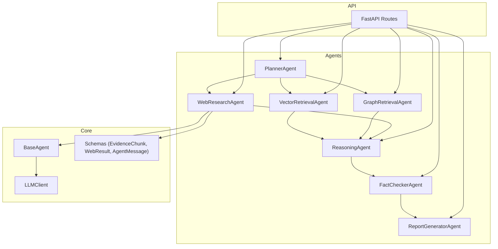
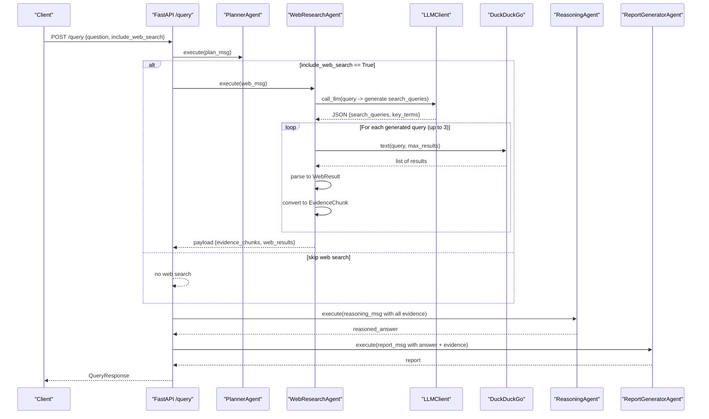
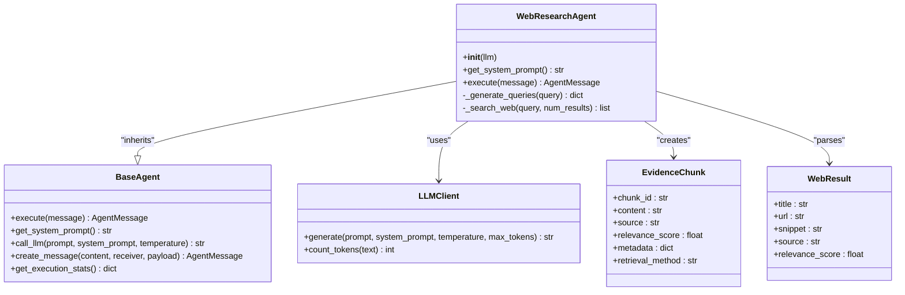
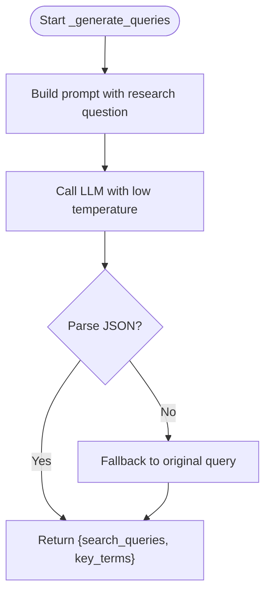
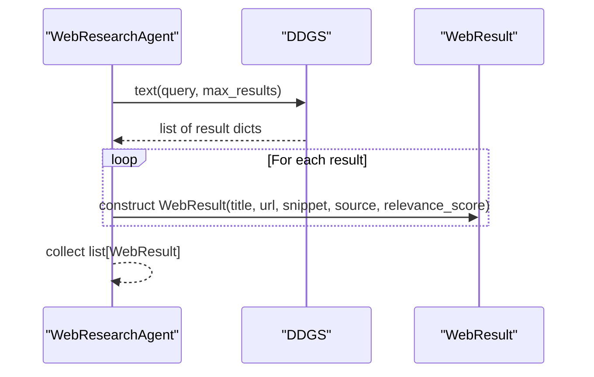
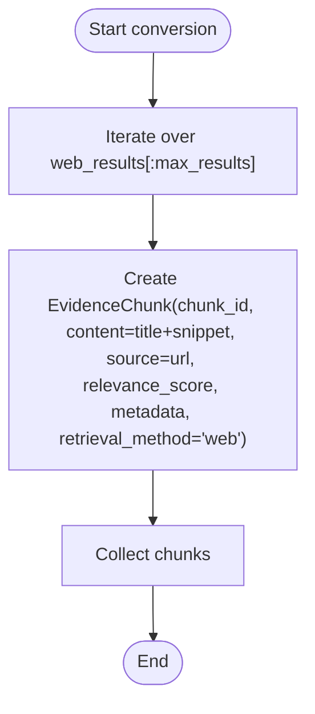
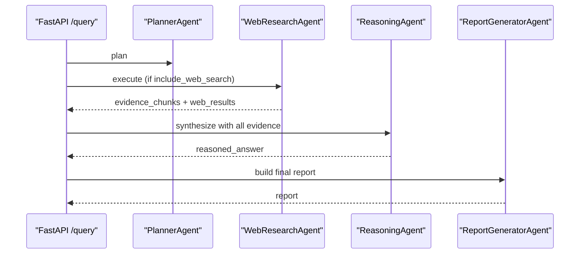
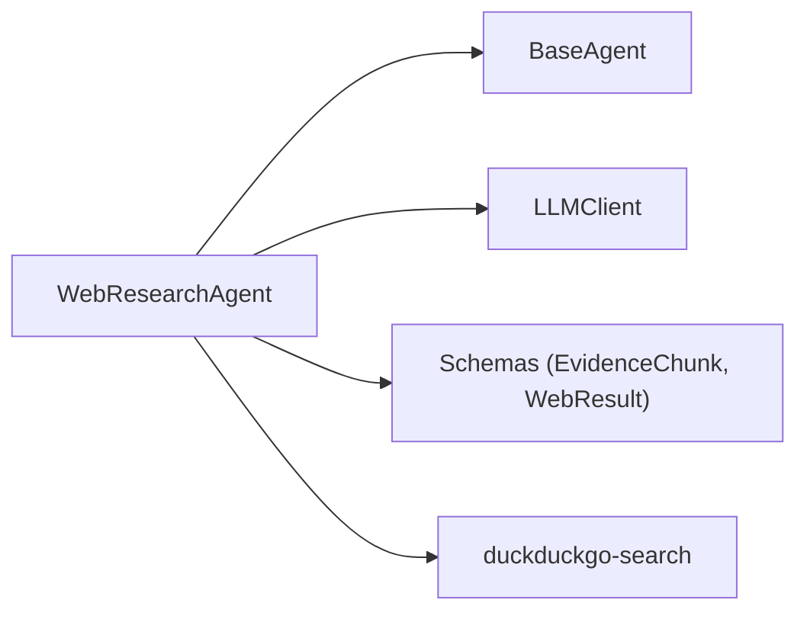

# Web Search Agent

<cite>
**Referenced Files in This Document**
- [web_agent.py](file://src/agents/web_agent.py)
- [base_agent.py](file://src/core/base_agent.py)
- [schemas.py](file://src/core/schemas.py)
- [llm.py](file://src/core/llm.py)
- [config.py](file://src/config.py)
- [routes.py](file://src/api/routes.py)
- [query_example.py](file://examples/query_example.py)
</cite>

## Table of Contents
1. [Introduction](#introduction)
2. [Project Structure](#project-structure)
3. [Core Components](#core-components)
4. [Architecture Overview](#architecture-overview)
5. [Detailed Component Analysis](#detailed-component-analysis)
6. [Dependency Analysis](#dependency-analysis)
7. [Performance Considerations](#performance-considerations)
8. [Troubleshooting Guide](#troubleshooting-guide)
9. [Conclusion](#conclusion)
10. [Appendices](#appendices)

## Introduction
This document explains the WebSearchAgent component (implemented as WebResearchAgent) that performs real-time information gathering from web sources to supplement local knowledge base content. It covers how search queries are formulated, how results are parsed and converted into structured evidence chunks, and how the agent integrates with the broader multi-agent research pipeline. It also documents configuration options, error handling, and integration patterns used by other agents.

## Project Structure
The WebSearchAgent is part of a multi-agent system that orchestrates planning, retrieval, reasoning, fact-checking, and report generation. The web search capability is implemented in a dedicated agent and integrated via the API routes and example scripts.

**Diagram sources**
- [routes.py:51-75](file://src/api/routes.py#L51-L75)
- [routes.py:229-321](file://src/api/routes.py#L229-L321)
- [web_agent.py:34-85](file://src/agents/web_agent.py#L34-L85)
- [base_agent.py:19-100](file://src/core/base_agent.py#L19-L100)
- [schemas.py:65-91](file://src/core/schemas.py#L65-L91)

**Section sources**
- [routes.py:51-75](file://src/api/routes.py#L51-L75)
- [routes.py:229-321](file://src/api/routes.py#L229-L321)
- [web_agent.py:34-85](file://src/agents/web_agent.py#L34-L85)
- [base_agent.py:19-100](file://src/core/base_agent.py#L19-L100)
- [schemas.py:65-91](file://src/core/schemas.py#L65-L91)

## Core Components
- WebResearchAgent: Orchestrates query formulation, web search execution, result parsing, and conversion into EvidenceChunk objects for downstream use.
- BaseAgent: Provides common functionality such as LLM calls, message creation, and execution logging.
- LLMClient: Unified interface to Gemini or OpenAI for generating optimized search queries.
- Schemas: Defines data models including EvidenceChunk, WebResult, and AgentMessage used across the pipeline.
- Configuration: Centralized settings including flags and keys for web search providers.

Key responsibilities:
- Generate multiple search queries using an LLM prompt.
- Execute web searches via DuckDuckGo.
- Parse results into standardized WebResult objects.
- Convert results into EvidenceChunk objects with source metadata and relevance scores.
- Return structured payloads consumed by downstream agents.

**Section sources**
- [web_agent.py:34-117](file://src/agents/web_agent.py#L34-L117)
- [base_agent.py:19-100](file://src/core/base_agent.py#L19-L100)
- [llm.py:15-103](file://src/core/llm.py#L15-L103)
- [schemas.py:65-91](file://src/core/schemas.py#L65-L91)
- [config.py:55-58](file://src/config.py#L55-L58)

## Architecture Overview
The WebSearchAgent participates in the multi-agent research pipeline orchestrated by the API routes. When a query arrives, the planner decides whether to include web search. If enabled, the WebResearchAgent executes, producing evidence chunks and raw web results that are passed to the reasoning agent and ultimately included in the final report.

**Diagram sources**
- [routes.py:188-338](file://src/api/routes.py#L188-L338)
- [web_agent.py:43-85](file://src/agents/web_agent.py#L43-L85)
- [web_agent.py:87-117](file://src/agents/web_agent.py#L87-L117)
- [llm.py:40-87](file://src/core/llm.py#L40-L87)

## Detailed Component Analysis

### WebResearchAgent
Responsibilities:
- Formulate optimized search queries using an LLM-based prompt.
- Execute web searches via DuckDuckGo.
- Parse results into WebResult objects.
- Convert results into EvidenceChunk objects suitable for downstream analysis.
- Log execution details and return structured messages.

Key behaviors:
- Query generation: Uses an LLM with a low temperature to produce a small set of search queries and key terms; falls back to the original query if parsing fails.
- Search execution: Iterates over up to three generated queries, distributing the requested number of results across them.
- Result parsing: Maps DuckDuckGo fields to WebResult attributes; assigns a default relevance score and source tag.
- Evidence conversion: Builds EvidenceChunk entries with chunk IDs, combined title/snippet content, source URL, relevance score, and metadata.

Error handling:
- Gracefully handles missing dependencies (duckduckgo-search not installed).
- Catches and logs exceptions during web search without failing the entire pipeline.

Integration points:
- Consumes BaseAgent’s LLM client and message utilities.
- Produces outputs consumed by the reasoning agent and report generator.

**Diagram sources**
- [web_agent.py:34-117](file://src/agents/web_agent.py#L34-L117)
- [base_agent.py:19-100](file://src/core/base_agent.py#L19-L100)
- [llm.py:15-103](file://src/core/llm.py#L15-L103)
- [schemas.py:65-91](file://src/core/schemas.py#L65-L91)

**Section sources**
- [web_agent.py:34-117](file://src/agents/web_agent.py#L34-L117)
- [base_agent.py:19-100](file://src/core/base_agent.py#L19-L100)
- [schemas.py:65-91](file://src/core/schemas.py#L65-L91)

### Search Query Formulation
- The agent uses an LLM to generate 2–4 optimized search queries and key terms based on the research question.
- A low temperature setting encourages deterministic output suitable for structured JSON.
- Fallback behavior ensures robustness when LLM responses cannot be parsed.

**Diagram sources**
- [web_agent.py:87-95](file://src/agents/web_agent.py#L87-L95)
- [llm.py:40-87](file://src/core/llm.py#L40-L87)

**Section sources**
- [web_agent.py:87-95](file://src/agents/web_agent.py#L87-L95)
- [llm.py:40-87](file://src/core/llm.py#L40-L87)

### Web Search Execution and Result Parsing
- Executes searches via DuckDuckGo using a context manager for resource management.
- Parses returned fields into WebResult objects with consistent attributes.
- Assigns a default relevance score and source tag for downstream processing.

**Diagram sources**
- [web_agent.py:96-117](file://src/agents/web_agent.py#L96-L117)

**Section sources**
- [web_agent.py:96-117](file://src/agents/web_agent.py#L96-L117)

### Content Extraction Pipeline
- Converts each WebResult into an EvidenceChunk combining title and snippet as content.
- Sets source to the URL, includes metadata (title, URL), and marks retrieval method as "web".
- Limits total chunks to the requested maximum to control downstream processing load.

**Diagram sources**
- [web_agent.py:66-75](file://src/agents/web_agent.py#L66-L75)
- [schemas.py:65-73](file://src/core/schemas.py#L65-L73)

**Section sources**
- [web_agent.py:66-75](file://src/agents/web_agent.py#L66-L75)
- [schemas.py:65-73](file://src/core/schemas.py#L65-L73)

### Source Validation and Credibility Assessment
- Current implementation assigns a fixed relevance score and does not perform explicit source validation or credibility scoring.
- Metadata includes the source URL and title for traceability.
- Future enhancements could incorporate domain checks, HTTPS verification, or external reputation signals.

**Section sources**
- [web_agent.py:103-110](file://src/agents/web_agent.py#L103-L110)
- [schemas.py:84-91](file://src/core/schemas.py#L84-L91)

### Rate Limiting, Caching Strategies, and Error Handling
- Rate limiting: Not explicitly implemented; relies on DuckDuckGo client behavior.
- Caching: No caching layer for search results or LLM prompts; repeated queries will re-execute.
- Error handling:
  - Missing dependency (duckduckgo-search) triggers a warning and skips web search.
  - Exceptions during search are caught and logged; the pipeline continues without failing.
  - LLM parsing errors fall back to using the original query.

Recommendations:
- Add request throttling or retry logic with exponential backoff.
- Introduce a simple in-memory cache keyed by query to reduce redundant network calls.
- Implement structured error codes and propagate warnings upstream for observability.

**Section sources**
- [web_agent.py:111-115](file://src/agents/web_agent.py#L111-L115)
- [web_agent.py:87-95](file://src/agents/web_agent.py#L87-L95)

### Configuration Options
- Web search provider toggle: DUCKDUCKGO_ENABLED flag exists in settings but is not enforced in the current agent code.
- API keys: SERPER_API_KEY is present in settings but not used by the current implementation.
- LLM provider/model settings influence query generation quality.

Configuration references:
- Settings include web search flags and LLM provider options.

**Section sources**
- [config.py:31-38](file://src/config.py#L31-L38)
- [config.py:55-58](file://src/config.py#L55-L58)

### Integration Patterns with Other Agents
- API routes orchestrate the full pipeline: planning, vector/graph retrieval, web search (optional), reasoning, fact checking, and report generation.
- Web search results are merged with other evidence sources and passed to the reasoning agent for synthesis.
- Example script demonstrates programmatic invocation of the WebResearchAgent within the pipeline.

**Diagram sources**
- [routes.py:229-321](file://src/api/routes.py#L229-L321)
- [query_example.py:78-107](file://examples/query_example.py#L78-L107)

**Section sources**
- [routes.py:229-321](file://src/api/routes.py#L229-L321)
- [query_example.py:78-107](file://examples/query_example.py#L78-L107)

## Dependency Analysis
The WebSearchAgent depends on:
- BaseAgent for LLM interaction and messaging.
- LLMClient for query generation.
- Schemas for standardized data structures.
- External library duckduckgo-search for web search.

**Diagram sources**
- [web_agent.py:13-15](file://src/agents/web_agent.py#L13-L15)
- [web_agent.py:96-117](file://src/agents/web_agent.py#L96-L117)
- [base_agent.py:19-100](file://src/core/base_agent.py#L19-L100)
- [llm.py:15-103](file://src/core/llm.py#L15-L103)
- [schemas.py:65-91](file://src/core/schemas.py#L65-L91)

**Section sources**
- [web_agent.py:13-15](file://src/agents/web_agent.py#L13-L15)
- [web_agent.py:96-117](file://src/agents/web_agent.py#L96-L117)
- [base_agent.py:19-100](file://src/core/base_agent.py#L19-L100)
- [llm.py:15-103](file://src/core/llm.py#L15-L103)
- [schemas.py:65-91](file://src/core/schemas.py#L65-L91)

## Performance Considerations
- Query generation uses an LLM call per research question; consider batching or caching prompts to reduce latency.
- Web search iterates over up to three queries; ensure max_results distribution avoids excessive network calls.
- Evidence chunk creation is lightweight; however, large numbers of results can increase downstream processing time.
- No caching or rate limiting is implemented; high traffic may incur additional costs or throttling from external services.

[No sources needed since this section provides general guidance]

## Troubleshooting Guide
Common issues and resolutions:
- Missing duckduckgo-search dependency:
  - Symptom: Warning logged and web search skipped.
  - Resolution: Install the required package or disable web search.
- Network failures during search:
  - Symptom: Exception logged; empty results returned.
  - Resolution: Retry later or adjust network settings; add retries/backoff.
- LLM parsing failure:
  - Symptom: Fallback to original query used.
  - Resolution: Ensure LLM provider is configured correctly and model supports structured outputs.

Operational tips:
- Monitor logs for warnings and errors related to web search.
- Validate environment variables for LLM providers.
- Use the API status endpoint to verify system health and agent availability.

**Section sources**
- [web_agent.py:111-115](file://src/agents/web_agent.py#L111-L115)
- [web_agent.py:87-95](file://src/agents/web_agent.py#L87-L95)
- [routes.py:116-131](file://src/api/routes.py#L116-L131)

## Conclusion
The WebSearchAgent provides a straightforward yet effective mechanism for augmenting local knowledge with real-time web information. It leverages an LLM to formulate search queries, executes web searches via DuckDuckGo, and converts results into structured evidence chunks for downstream reasoning and reporting. While it lacks explicit rate limiting, caching, and advanced credibility assessment, its design integrates cleanly with the multi-agent pipeline and offers a foundation for future enhancements.

[No sources needed since this section summarizes without analyzing specific files]

## Appendices

### API Usage Examples
- Programmatic example: See the example script demonstrating how to invoke the WebResearchAgent within the full pipeline.
- REST usage: The /query endpoint accepts include_web_search and max_results to control web search behavior.

**Section sources**
- [query_example.py:78-107](file://examples/query_example.py#L78-L107)
- [routes.py:188-338](file://src/api/routes.py#L188-L338)