# Project Overview

<cite>
**Referenced Files in This Document**
- [README.md](file://README.md)
- [main.py](file://main.py)
- [src/config.py](file://src/config.py)
- [src/core/base_agent.py](file://src/core/base_agent.py)
- [src/core/schemas.py](file://src/core/schemas.py)
- [src/agents/planner_agent.py](file://src/agents/planner_agent.py)
- [src/agents/vector_agent.py](file://src/agents/vector_agent.py)
- [src/agents/graph_agent.py](file://src/agents/graph_agent.py)
- [src/agents/web_agent.py](file://src/agents/web_agent.py)
- [src/agents/reasoning_agent.py](file://src/agents/reasoning_agent.py)
- [src/agents/fact_checker_agent.py](file://src/agents/fact_checker_agent.py)
- [src/agents/report_agent.py](file://src/agents/report_agent.py)
- [src/api/routes.py](file://src/api/routes.py)
- [src/evaluation/metrics.py](file://src/evaluation/metrics.py)
- [examples/query_example.py](file://examples/query_example.py)
</cite>

## Table of Contents
1. [Introduction](#introduction)
2. [Project Structure](#project-structure)
3. [Core Components](#core-components)
4. [Architecture Overview](#architecture-overview)
5. [Detailed Component Analysis](#detailed-component-analysis)
6. [Dependency Analysis](#dependency-analysis)
7. [Performance Considerations](#performance-considerations)
8. [Troubleshooting Guide](#troubleshooting-guide)
9. [Conclusion](#conclusion)
10. [Appendices](#appendices)

## Introduction
GraphRAG-MARS is an advanced AI research assistant that produces evidence-grounded research reports by combining Knowledge Graphs, Vector RAG, Multi-Agent Reasoning, and Fact Verification. It decomposes complex questions into sub-questions, retrieves information in parallel from vector stores, knowledge graphs, and the web, synthesizes a reasoned answer, verifies claims to detect hallucinations, and generates structured reports with citations and limitations. The system supports five experiment configurations to compare baseline LLM, Vector RAG, Graph RAG, Hybrid RAG, and the full Multi-Agent pipeline, enabling rigorous evaluation of accuracy and faithfulness on multi-hop reasoning tasks.

The project’s research hypothesis states that a hybrid Graph RAG + Vector RAG + Multi-Agent architecture yields more accurate and factually grounded answers to complex multi-hop research questions than conventional Vector RAG alone.

**Section sources**
- [README.md:1-34](file://README.md#L1-L34)
- [README.md:128-140](file://README.md#L128-L140)

## Project Structure
At a high level, the system is organized into agents (planning, retrieval, reasoning, verification, reporting), core abstractions (base agent, schemas, LLM client), RAG components (documents, chunking, embeddings, vector store), graph components (entity extraction, graph store, retriever), API routes, evaluation metrics, and examples. The CLI entry point orchestrates serving, ingestion, graph building, and evaluation.

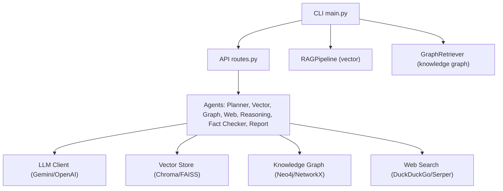

**Diagram sources**
- [main.py:24-69](file://main.py#L24-L69)
- [src/api/routes.py:28-75](file://src/api/routes.py#L28-L75)
- [src/config.py:21-67](file://src/config.py#L21-L67)

**Section sources**
- [main.py:1-111](file://main.py#L1-L111)
- [src/config.py:1-82](file://src/config.py#L1-L82)
- [README.md:81-126](file://README.md#L81-L126)

## Core Components
- BaseAgent: Abstract foundation for all agents providing LLM calls, execution logging, message creation, and stats.
- Schemas: Type-safe models for queries, plans, evidence, claims, reports, and experiments.
- Agents: Specialized modules for planning, retrieval (vector, graph, web), reasoning, fact-checking, and report generation.
- RAG Pipeline: Ingestion and query interface for vector-based retrieval.
- Graph Retriever: Entity extraction and graph querying for relationship-aware retrieval.
- API Routes: REST endpoints to run queries, ingest documents, build graphs, and evaluate benchmarks.
- Evaluation Metrics: Benchmarks and metrics to compare architectures across retrieval quality, answer quality, hallucination rate, latency, and token usage.

Key responsibilities and interactions are defined through AgentMessage payloads and standardized schemas, ensuring consistent data flow between components.

**Section sources**
- [src/core/base_agent.py:19-100](file://src/core/base_agent.py#L19-L100)
- [src/core/schemas.py:15-168](file://src/core/schemas.py#L15-L168)
- [src/agents/planner_agent.py:23-128](file://src/agents/planner_agent.py#L23-L128)
- [src/agents/vector_agent.py:17-92](file://src/agents/vector_agent.py#L17-L92)
- [src/agents/graph_agent.py:17-121](file://src/agents/graph_agent.py#L17-L121)
- [src/agents/web_agent.py:17-117](file://src/agents/web_agent.py#L17-L117)
- [src/agents/reasoning_agent.py:16-124](file://src/agents/reasoning_agent.py#L16-L124)
- [src/agents/fact_checker_agent.py:24-163](file://src/agents/fact_checker_agent.py#L24-L163)
- [src/agents/report_agent.py:27-228](file://src/agents/report_agent.py#L27-L228)

## Architecture Overview
The end-to-end flow starts with a user question routed through the API. The planner decomposes it into sub-questions and determines required tools. Retrieval runs in parallel across vector search, knowledge graph queries, and optional web search. A reasoning agent synthesizes evidence into an answer draft. A fact checker verifies claims against evidence and flags hallucinations. Finally, a report generator produces a structured, evidence-grounded research report with citations and limitations.

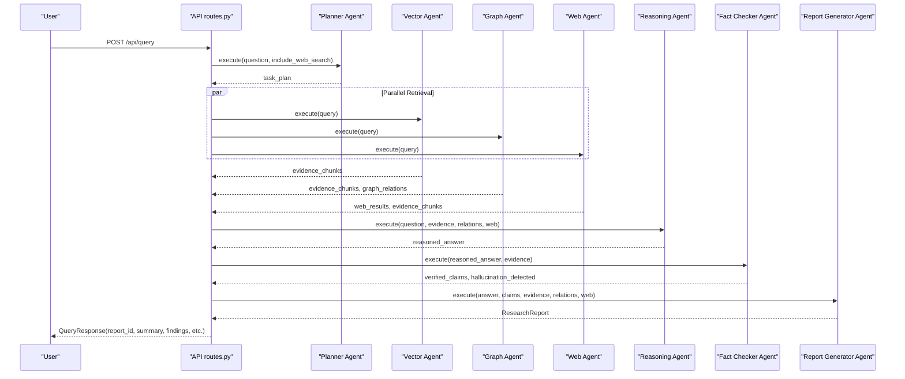

**Diagram sources**
- [src/api/routes.py:188-338](file://src/api/routes.py#L188-L338)
- [src/agents/planner_agent.py:65-82](file://src/agents/planner_agent.py#L65-L82)
- [src/agents/vector_agent.py:44-81](file://src/agents/vector_agent.py#L44-L81)
- [src/agents/graph_agent.py:46-109](file://src/agents/graph_agent.py#L46-L109)
- [src/agents/web_agent.py:43-85](file://src/agents/web_agent.py#L43-L85)
- [src/agents/reasoning_agent.py:47-77](file://src/agents/reasoning_agent.py#L47-L77)
- [src/agents/fact_checker_agent.py:63-109](file://src/agents/fact_checker_agent.py#L63-L109)
- [src/agents/report_agent.py:57-142](file://src/agents/report_agent.py#L57-L142)

## Detailed Component Analysis

### Planner Agent
Decomposes the original question into sub-questions, assigns required agents, and sets execution order and complexity. It uses an LLM to produce a JSON plan with fallback handling if parsing fails.

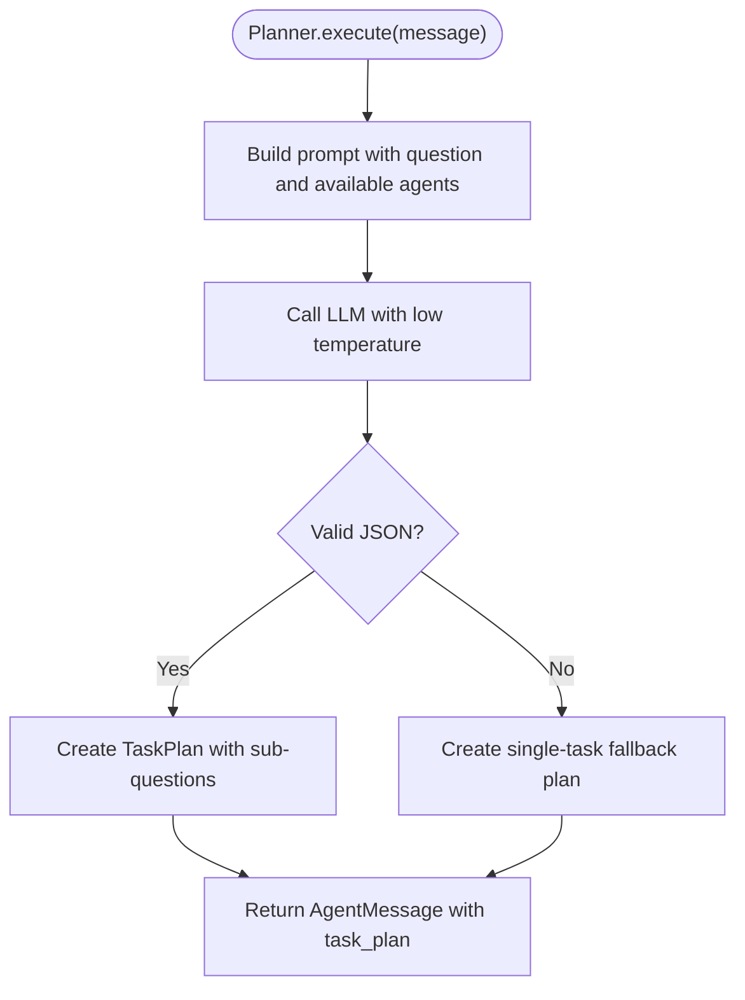

**Diagram sources**
- [src/agents/planner_agent.py:65-128](file://src/agents/planner_agent.py#L65-L128)

**Section sources**
- [src/agents/planner_agent.py:23-128](file://src/agents/planner_agent.py#L23-L128)

### Vector Retrieval Agent
Optimizes search terms via LLM and retrieves semantically similar chunks from the vector store. Converts raw results into EvidenceChunk objects with metadata and relevance scores.

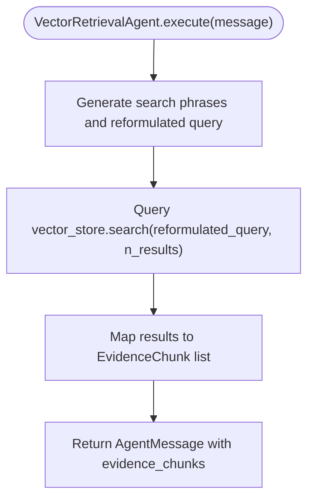

**Diagram sources**
- [src/agents/vector_agent.py:44-92](file://src/agents/vector_agent.py#L44-L92)

**Section sources**
- [src/agents/vector_agent.py:17-92](file://src/agents/vector_agent.py#L17-L92)

### Graph Retrieval Agent
Extracts entities and relationship types using LLM, queries the knowledge graph for relationships and entity context, and returns both GraphRelation and EvidenceChunk outputs.

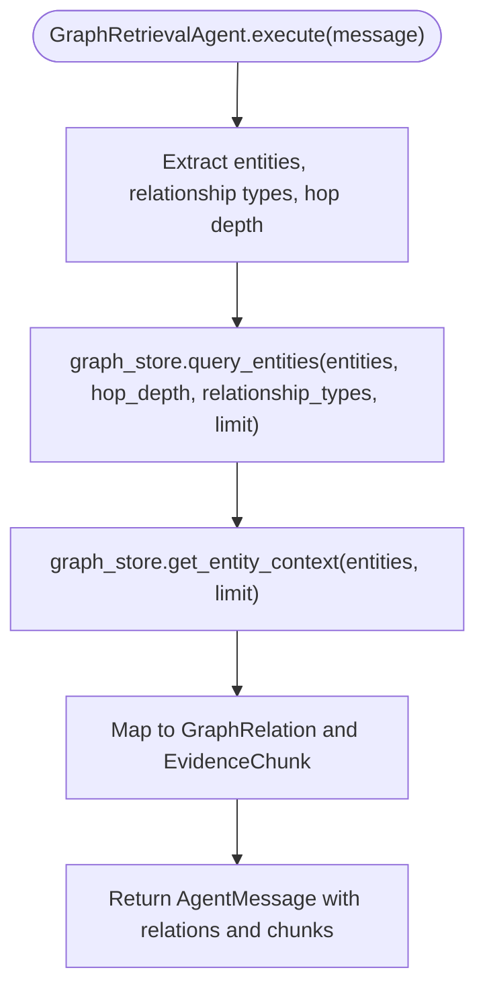

**Diagram sources**
- [src/agents/graph_agent.py:46-121](file://src/agents/graph_agent.py#L46-L121)

**Section sources**
- [src/agents/graph_agent.py:17-121](file://src/agents/graph_agent.py#L17-L121)

### Web Research Agent
Generates optimized search queries and executes web searches (e.g., DuckDuckGo). Converts results into EvidenceChunk and WebResult structures for downstream synthesis.

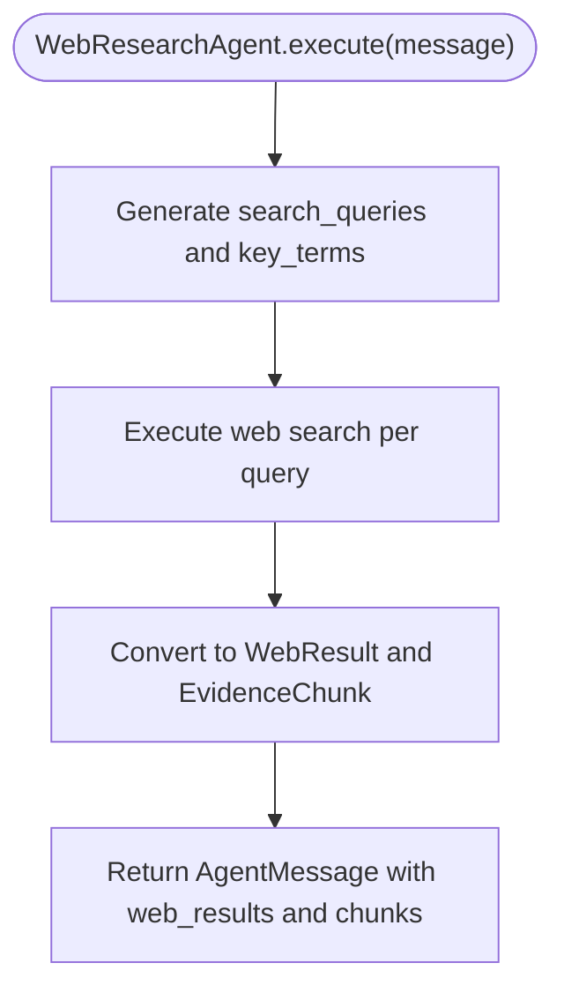

**Diagram sources**
- [src/agents/web_agent.py:43-117](file://src/agents/web_agent.py#L43-L117)

**Section sources**
- [src/agents/web_agent.py:17-117](file://src/agents/web_agent.py#L17-L117)

### Reasoning Agent
Synthesizes evidence from multiple sources into an evidence-grounded answer draft, citing sources and noting conflicts or insufficiencies.

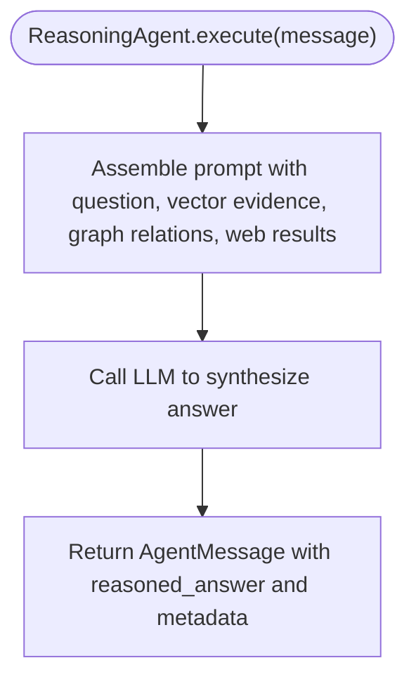

**Diagram sources**
- [src/agents/reasoning_agent.py:47-124](file://src/agents/reasoning_agent.py#L47-L124)

**Section sources**
- [src/agents/reasoning_agent.py:16-124](file://src/agents/reasoning_agent.py#L16-L124)

### Fact Checker Agent
Verifies each factual claim in the reasoned answer against provided evidence, assigning verdicts and detecting hallucinations.

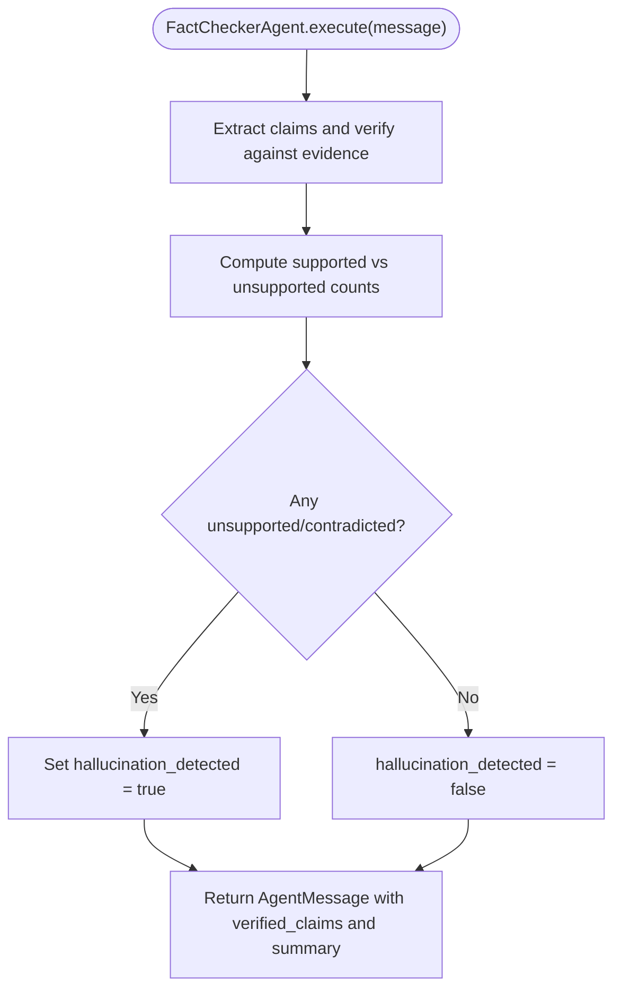

**Diagram sources**
- [src/agents/fact_checker_agent.py:63-163](file://src/agents/fact_checker_agent.py#L63-L163)

**Section sources**
- [src/agents/fact_checker_agent.py:24-163](file://src/agents/fact_checker_agent.py#L24-L163)

### Report Generator Agent
Produces a structured research report including executive summary, background, findings, comparisons, knowledge graph relationships, evidence, limitations, verified conclusions, and references.

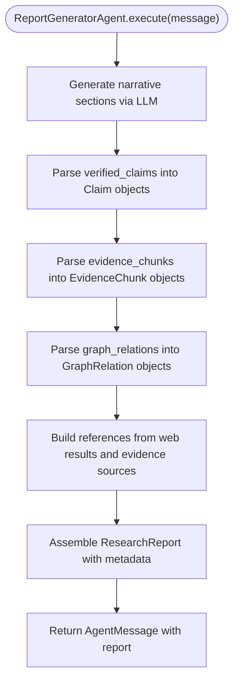

**Diagram sources**
- [src/agents/report_agent.py:57-228](file://src/agents/report_agent.py#L57-L228)

**Section sources**
- [src/agents/report_agent.py:27-228](file://src/agents/report_agent.py#L27-L228)

### API Query Flow and Experiment Configurations
The API route implements the five experiment configurations:
- Baseline LLM: Direct LLM response without retrieval.
- Vector RAG: Retrieve from vector store only.
- Graph RAG: Retrieve from knowledge graph only.
- Hybrid RAG: Combine vector and graph retrieval before reasoning.
- Multi-Agent: Full pipeline with planning, parallel retrieval, reasoning, fact-checking, and report generation.

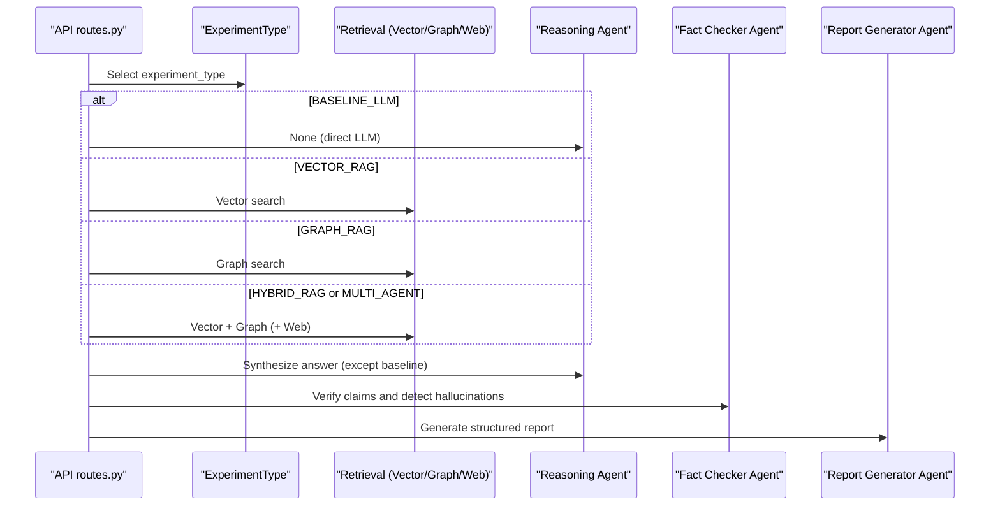

**Diagram sources**
- [src/api/routes.py:188-338](file://src/api/routes.py#L188-L338)
- [src/core/schemas.py:35-41](file://src/core/schemas.py#L35-L41)

**Section sources**
- [src/api/routes.py:188-338](file://src/api/routes.py#L188-L338)
- [src/core/schemas.py:35-41](file://src/core/schemas.py#L35-L41)

## Dependency Analysis
Components interact via well-defined messages and schemas. Agents depend on the base agent for LLM access and logging; retrieval agents depend on external stores (vector, graph, web); reasoning and verification depend on aggregated evidence; the report generator depends on verified claims and evidence.

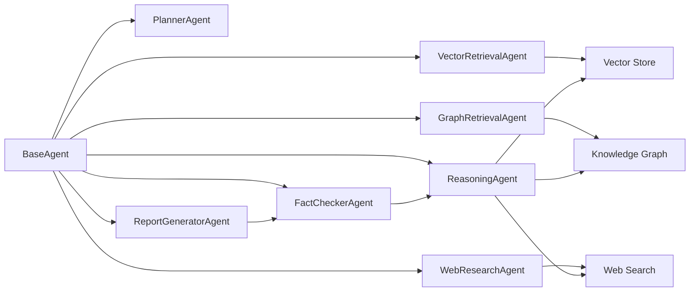

**Diagram sources**
- [src/core/base_agent.py:19-100](file://src/core/base_agent.py#L19-L100)
- [src/agents/vector_agent.py:34-92](file://src/agents/vector_agent.py#L34-L92)
- [src/agents/graph_agent.py:36-121](file://src/agents/graph_agent.py#L36-L121)
- [src/agents/web_agent.py:34-117](file://src/agents/web_agent.py#L34-L117)
- [src/agents/reasoning_agent.py:38-124](file://src/agents/reasoning_agent.py#L38-L124)
- [src/agents/fact_checker_agent.py:54-163](file://src/agents/fact_checker_agent.py#L54-L163)
- [src/agents/report_agent.py:48-228](file://src/agents/report_agent.py#L48-L228)

**Section sources**
- [src/core/base_agent.py:19-100](file://src/core/base_agent.py#L19-L100)
- [src/agents/vector_agent.py:34-92](file://src/agents/vector_agent.py#L34-L92)
- [src/agents/graph_agent.py:36-121](file://src/agents/graph_agent.py#L36-L121)
- [src/agents/web_agent.py:34-117](file://src/agents/web_agent.py#L34-L117)
- [src/agents/reasoning_agent.py:38-124](file://src/agents/reasoning_agent.py#L38-L124)
- [src/agents/fact_checker_agent.py:54-163](file://src/agents/fact_checker_agent.py#L54-L163)
- [src/agents/report_agent.py:48-228](file://src/agents/report_agent.py#L48-L228)

## Performance Considerations
- Latency: Multi-agent pipelines incur additional overhead due to planning, parallel retrieval, reasoning, and verification steps. Use appropriate max_results and limit hops to balance recall and speed.
- Token Usage: Each agent call consumes tokens; minimize prompt size by truncating evidence and limiting retrieved items.
- Retrieval Efficiency: Tune chunk sizes and overlap; choose embedding models and vector stores suitable for your dataset scale.
- Hallucination Detection: Fact checking adds robustness but increases processing time; consider selective verification for large outputs.
- Configuration: Adjust temperature and model selection based on desired creativity vs. determinism.

[No sources needed since this section provides general guidance]

## Troubleshooting Guide
- Missing dependencies: Ensure duckduckgo-search is installed for web search; otherwise, web retrieval will be skipped with warnings.
- Invalid LLM responses: Agents parse JSON with fallbacks; check logs for warnings about non-JSON responses and adjust prompts or model settings.
- No vector store configured: Vector retrieval returns empty results; verify vector store initialization and connection settings.
- No knowledge graph configured: Graph retrieval returns empty results; ensure Neo4j or NetworkX is properly set up and credentials are correct.
- API errors: Check FastAPI logs for HTTP exceptions and validate request payloads.

**Section sources**
- [src/agents/web_agent.py:96-117](file://src/agents/web_agent.py#L96-L117)
- [src/agents/vector_agent.py:73-75](file://src/agents/vector_agent.py#L73-L75)
- [src/agents/graph_agent.py:95-97](file://src/agents/graph_agent.py#L95-L97)
- [src/agents/planner_agent.py:97-128](file://src/agents/planner_agent.py#L97-L128)
- [src/agents/fact_checker_agent.py:130-163](file://src/agents/fact_checker_agent.py#L130-L163)

## Conclusion
GraphRAG-MARS integrates planning, retrieval, reasoning, verification, and reporting into a cohesive multi-agent system designed to produce evidence-grounded research reports. By comparing baseline LLM, Vector RAG, Graph RAG, Hybrid RAG, and Multi-Agent approaches, the system empirically evaluates whether hybrid architectures improve accuracy and reduce hallucinations on multi-hop reasoning tasks. The modular design allows flexible configuration, extensibility, and clear observability through execution logs and structured outputs.

[No sources needed since this section summarizes without analyzing specific files]

## Appendices

### Five Experiment Configurations
- Baseline LLM: Question → LLM → Answer
- Vector RAG: Question → Vector Search → LLM → Answer
- Graph RAG: Question → Knowledge Graph → LLM → Answer
- Hybrid RAG: Question → Vector + Graph → LLM → Answer
- Multi-Agent: Full pipeline with planning, reasoning, fact-checking

**Section sources**
- [README.md:25-34](file://README.md#L25-L34)

### Practical Examples
- Run a full multi-agent query locally using the example script to see planning, retrieval, reasoning, verification, and report generation in action.
- Use the API to submit queries with different experiment types and inspect returned reports, verified claims, and latency.

**Section sources**
- [examples/query_example.py:25-184](file://examples/query_example.py#L25-L184)
- [src/api/routes.py:188-338](file://src/api/routes.py#L188-L338)

### Evaluation Metrics
- Retrieval: Precision@K, Recall@K, MRR, Context Relevance
- Answer Quality: Factual Correctness, Faithfulness, Relevance, Completeness
- Hallucination: Unsupported Claims / Total Claims
- Agent Performance: Task Success Rate, Tool Calls, Self-Correction Rate
- System Performance: Latency, Token Usage, API Cost

**Section sources**
- [README.md:132-140](file://README.md#L132-L140)
- [src/evaluation/metrics.py:21-134](file://src/evaluation/metrics.py#L21-L134)