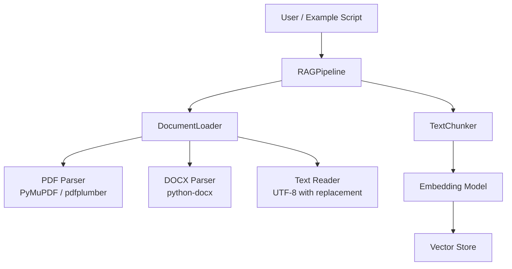
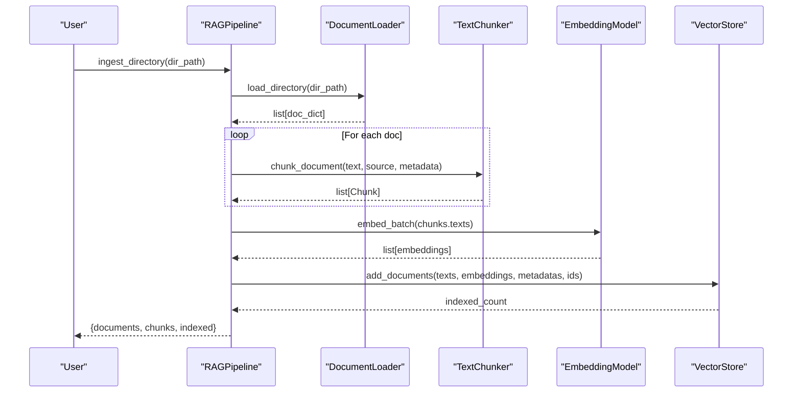
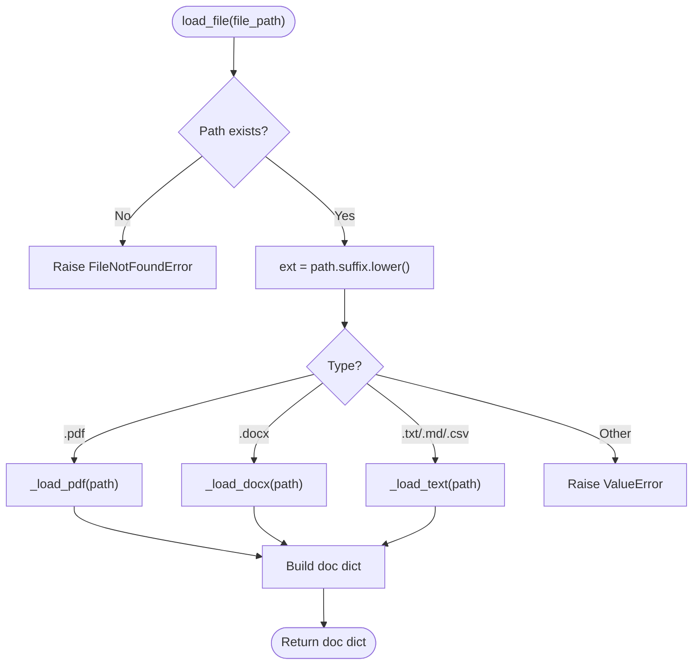
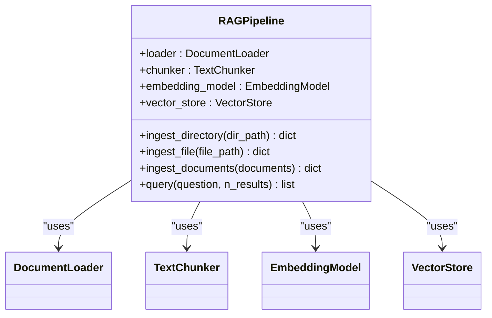
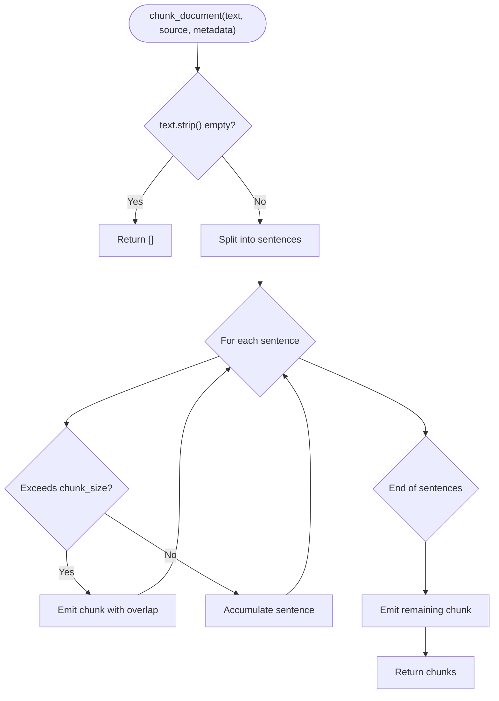
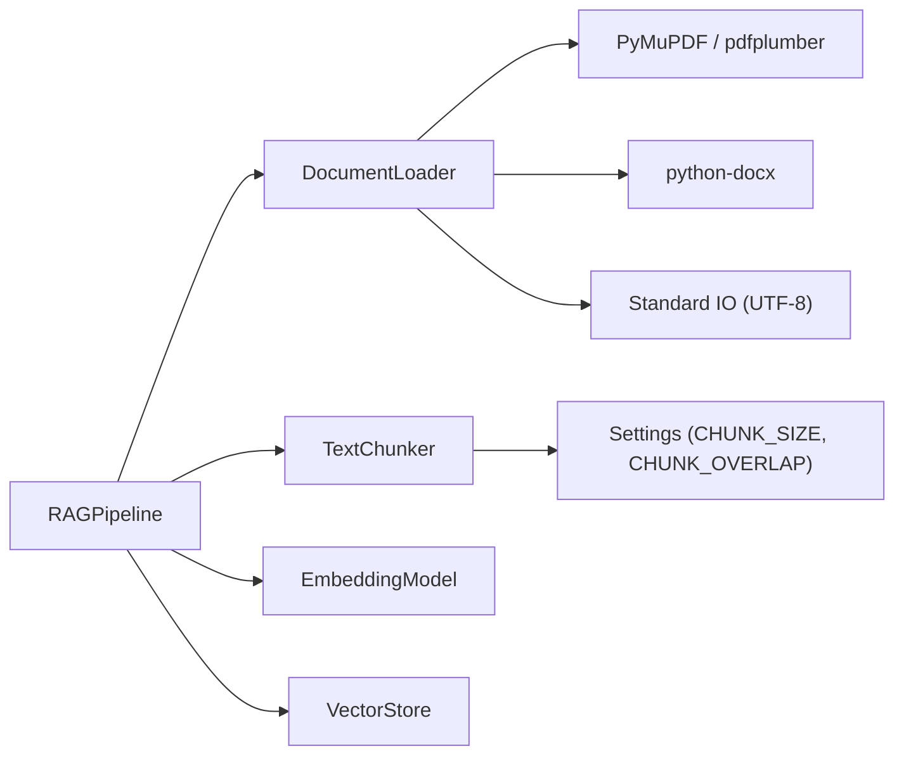

# Document Processing

<cite>
**Referenced Files in This Document**
- [documents.py](file://src/rag/documents.py)
- [pipeline.py](file://src/rag/pipeline.py)
- [chunking.py](file://src/rag/chunking.py)
- [config.py](file://src/config.py)
- [ingest_example.py](file://examples/ingest_example.py)
</cite>

## Table of Contents
1. [Introduction](#introduction)
2. [Project Structure](#project-structure)
3. [Core Components](#core-components)
4. [Architecture Overview](#architecture-overview)
5. [Detailed Component Analysis](#detailed-component-analysis)
6. [Dependency Analysis](#dependency-analysis)
7. [Performance Considerations](#performance-considerations)
8. [Troubleshooting Guide](#troubleshooting-guide)
9. [Conclusion](#conclusion)
10. [Appendices](#appendices)

## Introduction
This document explains the multi-format document ingestion component that powers the system’s Retrieval-Augmented Generation (RAG) pipeline. It focuses on the DocumentLoader class, which ingests PDF, DOCX, TXT, Markdown, and CSV files; the metadata extraction process; error handling for corrupted or unsupported files; and integration with chunking, embedding, and vector storage. It also provides guidance for extending the loader to support custom formats and for designing batch processing workflows for large document sets, including performance considerations for memory management and streaming approaches for very large documents.

## Project Structure
The document processing subsystem is centered around a small set of cohesive modules:
- Document loading and format-specific parsing live in src/rag/documents.py.
- The end-to-end ingestion orchestration lives in src/rag/pipeline.py.
- Text chunking logic resides in src/rag/chunking.py.
- Global configuration (including chunk sizes and upload limits) is defined in src/config.py.
- An example workflow demonstrates ingestion from a directory and from inline documents in examples/ingest_example.py.

**Diagram sources**
- [pipeline.py:19-31](file://src/rag/pipeline.py#L19-L31)
- [documents.py:15-42](file://src/rag/documents.py#L15-L42)
- [chunking.py:29-104](file://src/rag/chunking.py#L29-L104)

**Section sources**
- [documents.py:1-103](file://src/rag/documents.py#L1-L103)
- [pipeline.py:1-102](file://src/rag/pipeline.py#L1-L102)
- [chunking.py:1-111](file://src/rag/chunking.py#L1-L111)
- [config.py:21-75](file://src/config.py#L21-L75)
- [ingest_example.py:16-71](file://examples/ingest_example.py#L16-L71)

## Core Components
- DocumentLoader: Loads single files or entire directories, detects file type by extension, extracts text using appropriate parsers, and returns a standardized dictionary containing text and metadata such as source name, full path, extension, and size in bytes.
- RAGPipeline: Orchestrates ingestion by loading documents, chunking them, generating embeddings in batches, and indexing into a vector store. Provides convenience methods for single-file and directory ingestion.
- TextChunker: Splits text into overlapping chunks while respecting sentence boundaries, producing Chunk objects with identifiers, indices, and optional metadata.
- Configuration: Centralized settings control chunk size, overlap, and maximum upload size, loaded from environment variables with sensible defaults.

Key responsibilities:
- Format routing and parsing strategies for PDF, DOCX, and plain text.
- Metadata collection for provenance and filtering.
- Batch-oriented embedding and indexing to optimize throughput.
- Robust error logging during directory-wide ingestion.

**Section sources**
- [documents.py:15-103](file://src/rag/documents.py#L15-L103)
- [pipeline.py:19-88](file://src/rag/pipeline.py#L19-L88)
- [chunking.py:17-111](file://src/rag/chunking.py#L17-L111)
- [config.py:59-62](file://src/config.py#L59-L62)

## Architecture Overview
The ingestion flow connects document loading, chunking, embedding, and vector indexing into a cohesive pipeline.

**Diagram sources**
- [pipeline.py:33-88](file://src/rag/pipeline.py#L33-L88)
- [documents.py:44-61](file://src/rag/documents.py#L44-L61)
- [chunking.py:41-104](file://src/rag/chunking.py#L41-L104)

## Detailed Component Analysis

### DocumentLoader
Responsibilities:
- Validate input paths and raise clear errors for missing files or invalid directories.
- Detect file type via lowercase suffix and route to the correct parser.
- Extract text using:
  - PyMuPDF (fitz) for PDFs, with fallback to pdfplumber if PyMuPDF is unavailable.
  - python-docx for DOCX files.
  - UTF-8 text reader with replacement for TXT, MD, and CSV.
- Return a consistent document dict with fields:
  - text: extracted content string
  - source: original file name
  - path: absolute or relative path string
  - extension: lowercase file extension
  - size_bytes: file size in bytes

Error handling highlights:
- FileNotFoundError when a file does not exist.
- ValueError for unsupported extensions.
- ImportError when required libraries are missing, with informative messages.
- Directory ingestion logs failures per file but continues processing others.

Extensibility:
- Add new formats by extending SUPPORTED_EXTENSIONS and adding a corresponding private method routed in load_file.
- Maintain the same return structure to integrate seamlessly with downstream components.

**Diagram sources**
- [documents.py:20-42](file://src/rag/documents.py#L20-L42)
- [documents.py:63-102](file://src/rag/documents.py#L63-L102)

**Section sources**
- [documents.py:15-103](file://src/rag/documents.py#L15-L103)

### RAGPipeline
Responsibilities:
- Provide high-level ingestion APIs:
  - ingest_directory: loads all supported files from a directory and processes them.
  - ingest_file: loads a single file and processes it.
  - ingest_documents: processes a list of document dicts through chunking, embedding, and indexing.
- Coordinate chunking with TextChunker, preserving source and metadata.
- Generate embeddings in batches for efficiency.
- Index chunks into VectorStore with unique IDs and metadata.

Batch processing behavior:
- Aggregates all chunks across documents before embedding to maximize batch efficiency.
- Returns summary metrics: number of documents processed, total chunks generated, and number indexed.

Integration points:
- Uses DocumentLoader for parsing.
- Uses TextChunker for splitting.
- Uses EmbeddingModel and VectorStore for semantic indexing.

**Diagram sources**
- [pipeline.py:19-31](file://src/rag/pipeline.py#L19-L31)
- [pipeline.py:33-88](file://src/rag/pipeline.py#L33-L88)

**Section sources**
- [pipeline.py:19-102](file://src/rag/pipeline.py#L19-L102)

### TextChunker
Responsibilities:
- Split text into overlapping chunks based on configured chunk_size and chunk_overlap.
- Preserve sentence boundaries to improve semantic coherence.
- Produce Chunk objects with stable identifiers, indices, and optional metadata.

Algorithm overview:
- Tokenize sentences using a regex-based splitter.
- Accumulate sentences until reaching chunk_size, then emit a chunk.
- Retain overlap by keeping recent sentences to bridge context across chunks.
- Track character offsets for precise localization within the original document.

Configuration:
- Defaults come from global Settings (CHUNK_SIZE, CHUNK_OVERLAP).

**Diagram sources**
- [chunking.py:41-104](file://src/rag/chunking.py#L41-L104)

**Section sources**
- [chunking.py:17-111](file://src/rag/chunking.py#L17-L111)

### Configuration and Settings
- CHUNK_SIZE and CHUNK_OVERLAP define how text is segmented.
- MAX_UPLOAD_SIZE_MB caps uploaded document size at the application level.
- DOCS_DIR provides a default location for document ingestion.

These settings influence chunking behavior and ingestion constraints.

**Section sources**
- [config.py:59-70](file://src/config.py#L59-L70)

### Example Workflow
The example script demonstrates:
- Ingesting documents from a directory into the vector store.
- Building a knowledge graph from the same documents.
- Running sample queries to retrieve relevant content.
- Falling back to inline demo documents when no files are present.

This illustrates typical usage patterns for both directory-based and programmatic ingestion.

**Section sources**
- [ingest_example.py:16-71](file://examples/ingest_example.py#L16-L71)

## Dependency Analysis
High-level dependencies among core modules:
- RAGPipeline depends on DocumentLoader, TextChunker, EmbeddingModel, and VectorStore.
- DocumentLoader conditionally depends on external libraries:
  - PyMuPDF (fitz) for PDF parsing, with pdfplumber as a fallback.
  - python-docx for DOCX parsing.
  - Standard library for reading UTF-8 text.
- TextChunker depends on global Settings for chunk parameters.

**Diagram sources**
- [pipeline.py:19-31](file://src/rag/pipeline.py#L19-L31)
- [documents.py:63-102](file://src/rag/documents.py#L63-L102)
- [chunking.py:32-39](file://src/rag/chunking.py#L32-L39)
- [config.py:59-62](file://src/config.py#L59-L62)

**Section sources**
- [pipeline.py:19-31](file://src/rag/pipeline.py#L19-L31)
- [documents.py:63-102](file://src/rag/documents.py#L63-L102)
- [chunking.py:32-39](file://src/rag/chunking.py#L32-L39)
- [config.py:59-62](file://src/config.py#L59-L62)

## Performance Considerations
- Batch embeddings: The pipeline collects all chunks before calling embed_batch to reduce overhead and improve throughput.
- Sentence-aware chunking: Overlapping chunks preserve context while limiting memory footprint per chunk.
- Directory ingestion: Continues processing despite individual file failures, improving robustness for large batches.
- Configuration-driven sizing: Adjust CHUNK_SIZE and CHUNK_OVERLAP to balance retrieval quality and memory usage.

Recommendations for large document sets:
- Prefer directory ingestion to leverage built-in batching and logging.
- Tune chunk parameters based on domain characteristics and model token limits.
- Monitor memory usage when processing very large PDFs or DOCX files; consider pre-chunking or streaming where possible.

[No sources needed since this section provides general guidance]

## Troubleshooting Guide
Common issues and resolutions:
- Missing file:
  - Symptom: FileNotFoundError raised when loading a single file.
  - Resolution: Verify file path and permissions.
- Unsupported format:
  - Symptom: ValueError raised for unknown extensions.
  - Resolution: Use one of the supported extensions or extend DocumentLoader to add support.
- Missing libraries:
  - Symptom: ImportError when PyMuPDF/pdfplumber or python-docx are not installed.
  - Resolution: Install the required packages; the loader will attempt fallbacks where available.
- Corrupted or unreadable files:
  - Symptom: Exceptions during parsing.
  - Resolution: Directory ingestion logs errors per file and continues; inspect logs to identify problematic files.
- Encoding issues:
  - Symptom: Non-UTF-8 characters in text files.
  - Resolution: The text reader uses replacement mode to avoid crashes; ensure source files are encoded appropriately.

Operational tips:
- Inspect log output for per-file failure details during directory ingestion.
- Validate file types and sizes before ingestion to minimize failures.
- Use the example script to verify end-to-end functionality with sample data.

**Section sources**
- [documents.py:20-42](file://src/rag/documents.py#L20-L42)
- [documents.py:63-102](file://src/rag/documents.py#L63-L102)
- [documents.py:44-61](file://src/rag/documents.py#L44-L61)

## Conclusion
The document processing component provides a robust, extensible foundation for ingesting multi-format documents into a RAG pipeline. DocumentLoader handles format-specific parsing with graceful fallbacks and comprehensive metadata capture. RAGPipeline orchestrates chunking, embedding, and indexing with batch optimization. TextChunker ensures coherent, overlapping segments suitable for retrieval. Configuration controls chunking behavior and upload limits. With clear error handling and logging, the system supports reliable batch processing of large document sets. Extending support for custom formats is straightforward by following the established pattern.

[No sources needed since this section summarizes without analyzing specific files]

## Appendices

### Custom Document Processors
To add support for a specialized file type:
- Extend SUPPORTED_EXTENSIONS with the new extension.
- Implement a private method to parse the format and return a text string.
- Route the new extension in load_file to your parser.
- Ensure the returned document dict includes text, source, path, extension, and size_bytes.

This approach integrates seamlessly with existing chunking and embedding steps.

[No sources needed since this section provides general guidance]

### Batch Processing Workflows for Large Document Sets
Recommended workflow:
- Place documents in a directory under DOCS_DIR or a specified path.
- Use RAGPipeline.ingest_directory to load, chunk, embed, and index all supported files.
- Review logs to confirm successful ingestion and identify any failures.
- Adjust CHUNK_SIZE and CHUNK_OVERLAP to optimize retrieval quality and memory usage.

[No sources needed since this section provides general guidance]

### Streaming Approaches for Very Large Documents
Conceptual guidance:
- For extremely large PDFs or DOCX files, consider streaming page-by-page or paragraph-by-paragraph to reduce peak memory usage.
- Integrate streaming into the loader by yielding chunks incrementally and updating embeddings/indexing in smaller batches.
- Ensure metadata remains consistent across streamed segments to maintain traceability.

[No sources needed since this section provides general guidance]