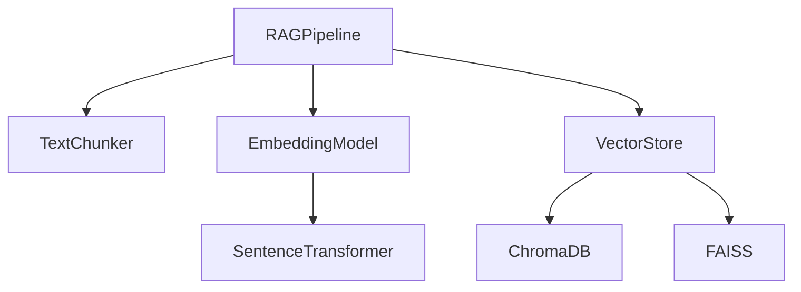
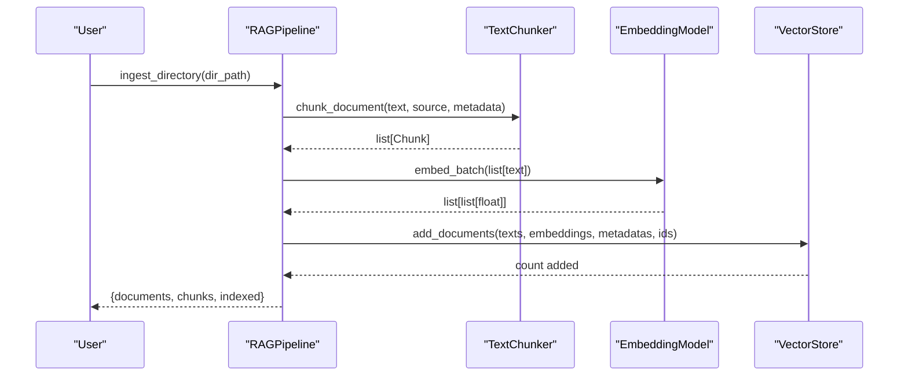
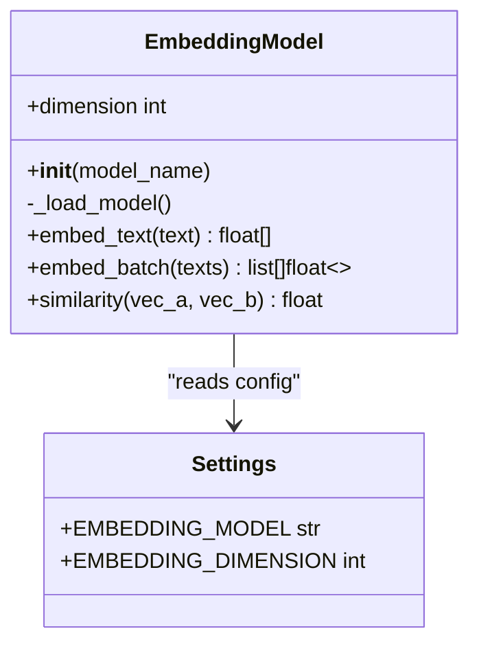
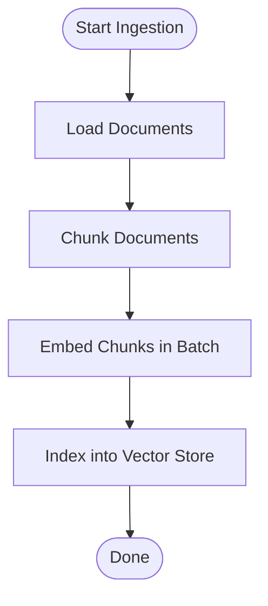
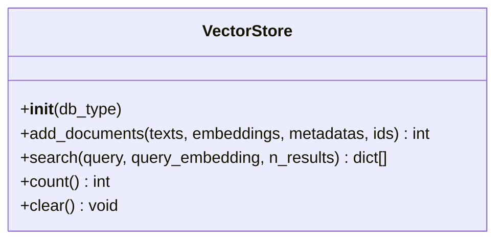
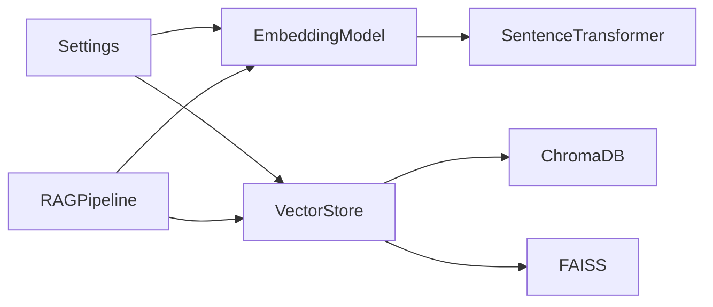

# Embedding Generation

<cite>
**Referenced Files in This Document**
- [embeddings.py](file://src/rag/embeddings.py)
- [config.py](file://src/config.py)
- [pipeline.py](file://src/rag/pipeline.py)
- [vector_store.py](file://src/rag/vector_store.py)
- [chunking.py](file://src/rag/chunking.py)
- [main.py](file://main.py)
- [ingest_example.py](file://examples/ingest_example.py)
- [requirements.txt](file://requirements.txt)
- [README.md](file://README.md)
</cite>

## Table of Contents
1. [Introduction](#introduction)
2. [Project Structure](#project-structure)
3. [Core Components](#core-components)
4. [Architecture Overview](#architecture-overview)
5. [Detailed Component Analysis](#detailed-component-analysis)
6. [Dependency Analysis](#dependency-analysis)
7. [Performance Considerations](#performance-considerations)
8. [Troubleshooting Guide](#troubleshooting-guide)
9. [Conclusion](#conclusion)
10. [Appendices](#appendices)

## Introduction
This document explains the embedding generation system that converts text chunks into semantic vector representations using Sentence Transformers. It covers the EmbeddingModel abstraction, the get_embedding_model factory function, batch processing for efficient embedding generation, supported models and dimensions, configuration options (including GPU acceleration and model caching), integration patterns for custom models, and optimization strategies for large-scale document processing. It also provides troubleshooting guidance for common issues such as model loading failures, memory constraints, and performance tuning across different hardware configurations.

## Project Structure
The embedding system is part of the RAG subsystem and integrates with document chunking, vector storage, and the ingestion pipeline. The key files involved are:
- Embedding abstraction and batch processing: src/rag/embeddings.py
- Configuration for model name and dimension: src/config.py
- Ingestion pipeline orchestrating chunking, embedding, and indexing: src/rag/pipeline.py
- Vector store abstraction for ChromaDB or FAISS: src/rag/vector_store.py
- Text chunker used before embedding: src/rag/chunking.py
- CLI entry points and examples: main.py, examples/ingest_example.py
- Dependencies and technology notes: requirements.txt, README.md

**Diagram sources**
- [pipeline.py:19-31](file://src/rag/pipeline.py#L19-L31)
- [embeddings.py:16-57](file://src/rag/embeddings.py#L16-L57)
- [vector_store.py:16-31](file://src/rag/vector_store.py#L16-L31)

**Section sources**
- [pipeline.py:19-31](file://src/rag/pipeline.py#L19-L31)
- [embeddings.py:16-57](file://src/rag/embeddings.py#L16-L57)
- [vector_store.py:16-31](file://src/rag/vector_store.py#L16-L31)

## Core Components
- EmbeddingModel: Wraps Sentence Transformers to provide single-text and batch embedding methods, cosine similarity computation, and exposes the configured embedding dimension.
- get_embedding_model: Factory function returning an EmbeddingModel instance, optionally overriding the model name.
- RAGPipeline: Orchestrates document loading, chunking, embedding, and indexing; uses EmbeddingModel for both ingestion and query-time embedding.
- VectorStore: Abstraction over ChromaDB and FAISS for storing and searching embeddings.
- Settings: Centralized configuration including EMBEDDING_MODEL and EMBEDDING_DIMENSION.

Key responsibilities:
- Lazy loading of the underlying SentenceTransformer model to avoid unnecessary initialization overhead.
- Batch encoding for throughput efficiency during ingestion.
- Normalized embeddings for consistent cosine similarity.
- Dimension reporting via settings to align downstream components.

**Section sources**
- [embeddings.py:16-57](file://src/rag/embeddings.py#L16-L57)
- [config.py:21-42](file://src/config.py#L21-L42)
- [pipeline.py:19-31](file://src/rag/pipeline.py#L19-L31)
- [vector_store.py:16-31](file://src/rag/vector_store.py#L16-L31)

## Architecture Overview
The embedding system sits between text chunking and vector storage within the RAG pipeline. During ingestion, documents are chunked, then embedded in batches, and finally indexed into the chosen vector store. For queries, the question is embedded and used to search the vector store.

**Diagram sources**
- [pipeline.py:33-88](file://src/rag/pipeline.py#L33-L88)
- [embeddings.py:37-43](file://src/rag/embeddings.py#L37-L43)
- [vector_store.py:59-98](file://src/rag/vector_store.py#L59-L98)

## Detailed Component Analysis

### EmbeddingModel and get_embedding_model
- EmbeddingModel encapsulates a SentenceTransformer instance loaded lazily on first use.
- Methods:
  - embed_text: Encodes a single string with normalized embeddings.
  - embed_batch: Encodes multiple strings efficiently using a fixed batch size.
  - similarity: Computes cosine similarity between two vectors.
  - dimension: Returns configured embedding dimension from settings.
- get_embedding_model: Factory that returns an EmbeddingModel, allowing optional override of model_name.

**Diagram sources**
- [embeddings.py:16-57](file://src/rag/embeddings.py#L16-L57)
- [config.py:21-42](file://src/config.py#L21-L42)

**Section sources**
- [embeddings.py:16-57](file://src/rag/embeddings.py#L16-L57)
- [config.py:21-42](file://src/config.py#L21-L42)

### RAGPipeline Integration
- Uses TextChunker to split documents into overlapping chunks.
- Calls EmbeddingModel.embed_batch to generate embeddings for all chunks.
- Passes texts, embeddings, metadatas, and IDs to VectorStore.add_documents.
- Query method embeds the question and searches the vector store.

**Diagram sources**
- [pipeline.py:43-88](file://src/rag/pipeline.py#L43-L88)
- [embeddings.py:37-43](file://src/rag/embeddings.py#L37-L43)
- [vector_store.py:59-98](file://src/rag/vector_store.py#L59-L98)

**Section sources**
- [pipeline.py:43-88](file://src/rag/pipeline.py#L43-L88)

### VectorStore Abstraction
- Supports ChromaDB and FAISS backends.
- Adds documents with embeddings and metadata; supports counting and clearing.
- Search methods accept either raw query text (Chroma) or precomputed query embeddings (FAISS).

**Diagram sources**
- [vector_store.py:16-31](file://src/rag/vector_store.py#L16-L31)
- [vector_store.py:59-98](file://src/rag/vector_store.py#L59-L98)
- [vector_store.py:100-176](file://src/rag/vector_store.py#L100-L176)

**Section sources**
- [vector_store.py:16-31](file://src/rag/vector_store.py#L16-L31)
- [vector_store.py:59-98](file://src/rag/vector_store.py#L59-L98)
- [vector_store.py:100-176](file://src/rag/vector_store.py#L100-L176)

### Configuration and Model Selection
- Default embedding model: all-MiniLM-L6-v2
- Default embedding dimension: 384
- These values are read from Settings and used by EmbeddingModel.

Configuration keys:
- EMBEDDING_MODEL: Name of the Sentence Transformer model.
- EMBEDDING_DIMENSION: Expected vector dimension for downstream components.

**Section sources**
- [config.py:21-42](file://src/config.py#L21-L42)
- [embeddings.py:19-22](file://src/rag/embeddings.py#L19-L22)
- [embeddings.py:51-53](file://src/rag/embeddings.py#L51-L53)

## Dependency Analysis
- EmbeddingModel depends on sentence-transformers for model loading and encoding.
- RAGPipeline depends on TextChunker, EmbeddingModel, and VectorStore.
- VectorStore depends on chromadb or faiss-cpu based on configuration.
- Settings centralizes configuration and is consumed by EmbeddingModel and VectorStore.

**Diagram sources**
- [embeddings.py:16-57](file://src/rag/embeddings.py#L16-L57)
- [vector_store.py:16-31](file://src/rag/vector_store.py#L16-L31)
- [config.py:21-42](file://src/config.py#L21-L42)

**Section sources**
- [embeddings.py:16-57](file://src/rag/embeddings.py#L16-L57)
- [vector_store.py:16-31](file://src/rag/vector_store.py#L16-L31)
- [config.py:21-42](file://src/config.py#L21-L42)

## Performance Considerations
- Batch size: The current implementation uses a fixed batch size of 64 for batch encoding. Adjusting this can improve throughput depending on available memory and GPU capacity.
- Memory management: Large batches increase memory usage. If encountering out-of-memory errors, reduce batch size or process smaller document sets.
- Model caching: The model is cached per EmbeddingModel instance after first load, avoiding repeated downloads and initialization costs.
- Hardware acceleration: Sentence Transformers can leverage GPUs if available. Ensure appropriate drivers and CUDA setup when using GPU-accelerated models.
- Vector store choice: FAISS operates in-memory and may be faster for small datasets; ChromaDB offers persistence and richer features for larger workloads.

Optimization tips:
- Use batch ingestion for large corpora to maximize throughput.
- Monitor memory usage and adjust batch sizes accordingly.
- Prefer normalized embeddings (as implemented) for stable cosine similarity.
- Choose embedding models balancing quality and speed (e.g., MiniLM variants for speed, larger models for accuracy).

[No sources needed since this section provides general guidance]

## Troubleshooting Guide
Common issues and resolutions:
- Model loading failures:
  - Ensure sentence-transformers is installed and network access is available for downloading models.
  - Verify the model name matches a valid Sentence Transformer model.
- Out-of-memory errors during embedding:
  - Reduce batch size in embed_batch or process fewer documents at once.
  - Use a smaller embedding model or CPU-only mode if GPU memory is constrained.
- Slow ingestion:
  - Increase batch size cautiously to improve throughput.
  - Use a faster embedding model for high-volume scenarios.
- Vector store initialization errors:
  - For ChromaDB, ensure the service is running and accessible.
  - For FAISS, ensure faiss-cpu is installed and dependencies are satisfied.

Operational checks:
- Confirm EMBEDDING_MODEL and EMBEDDING_DIMENSION are set correctly in environment configuration.
- Validate that chunking produces non-empty chunks before embedding.
- Review logs for detailed error messages from model loading and vector store operations.

**Section sources**
- [embeddings.py:24-29](file://src/rag/embeddings.py#L24-L29)
- [embeddings.py:37-43](file://src/rag/embeddings.py#L37-L43)
- [vector_store.py:33-57](file://src/rag/vector_store.py#L33-L57)
- [config.py:21-42](file://src/config.py#L21-L42)

## Conclusion
The embedding generation system provides a clean abstraction over Sentence Transformers, enabling provider-agnostic embedding creation with built-in batching and normalization. Integrated into the RAG pipeline, it supports efficient ingestion and retrieval workflows with flexible vector store backends. By tuning batch sizes, selecting appropriate models, and leveraging hardware acceleration, users can optimize performance for diverse workloads. The configuration-driven design allows easy switching of models and dimensions while maintaining consistency across the system.

[No sources needed since this section summarizes without analyzing specific files]

## Appendices

### Supported Models and Dimensions
- Default model: all-MiniLM-L6-v2
- Default dimension: 384
These are defined in the settings and used by the embedding model.

**Section sources**
- [config.py:39-42](file://src/config.py#L39-L42)
- [embeddings.py:19-22](file://src/rag/embeddings.py#L19-L22)
- [embeddings.py:51-53](file://src/rag/embeddings.py#L51-L53)

### Usage Examples
- Ingest documents via CLI:
  - Command: python main.py ingest <path>
  - Internally constructs RAGPipeline and calls ingest_directory or ingest_file.
- Example script demonstrates end-to-end ingestion and querying.

**Section sources**
- [main.py:31-42](file://main.py#L31-L42)
- [ingest_example.py:16-59](file://examples/ingest_example.py#L16-L59)

### Technology Stack Notes
- Embeddings powered by Sentence Transformers.
- Vector stores: ChromaDB and FAISS.
- Chunking parameters configurable via settings.

**Section sources**
- [requirements.txt:8-20](file://requirements.txt#L8-L20)
- [README.md:142-151](file://README.md#L142-L151)