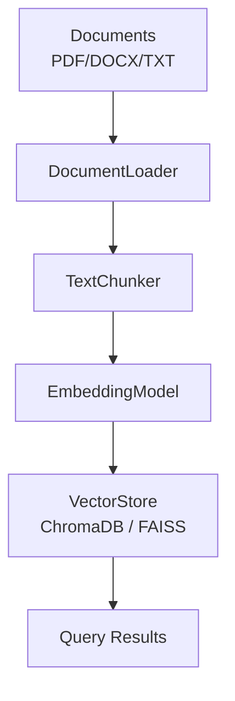
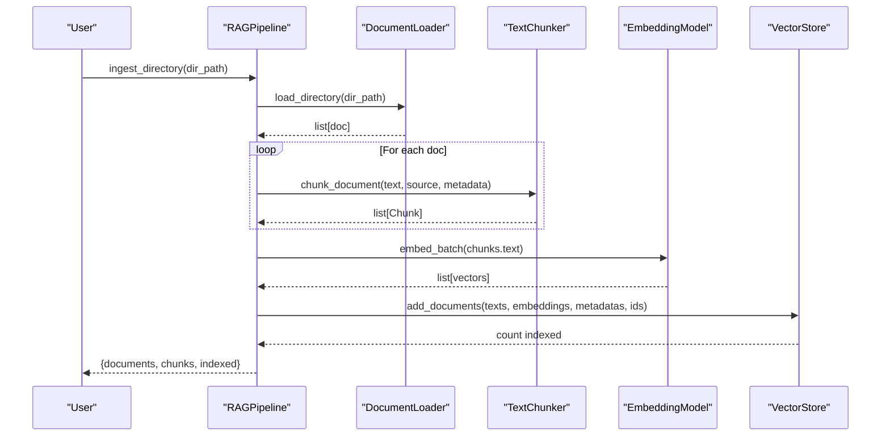
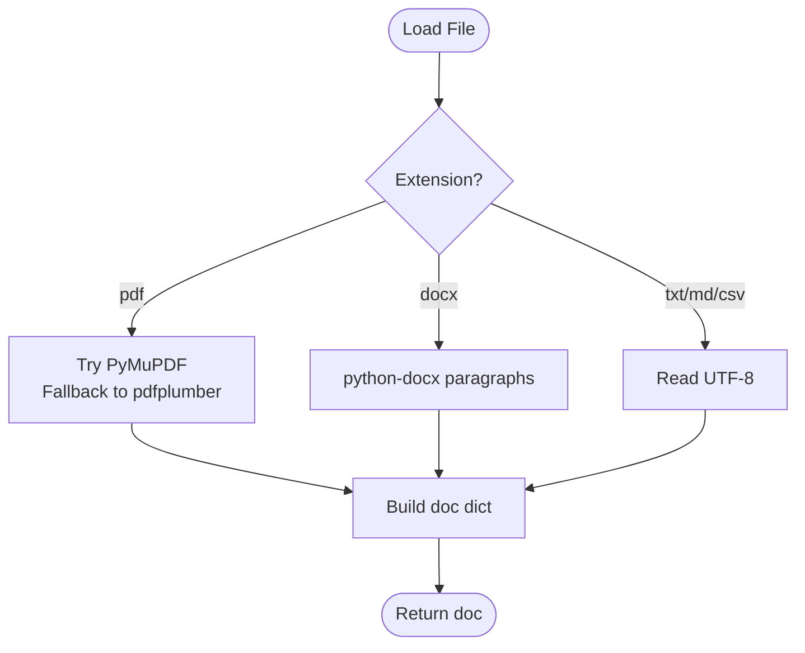
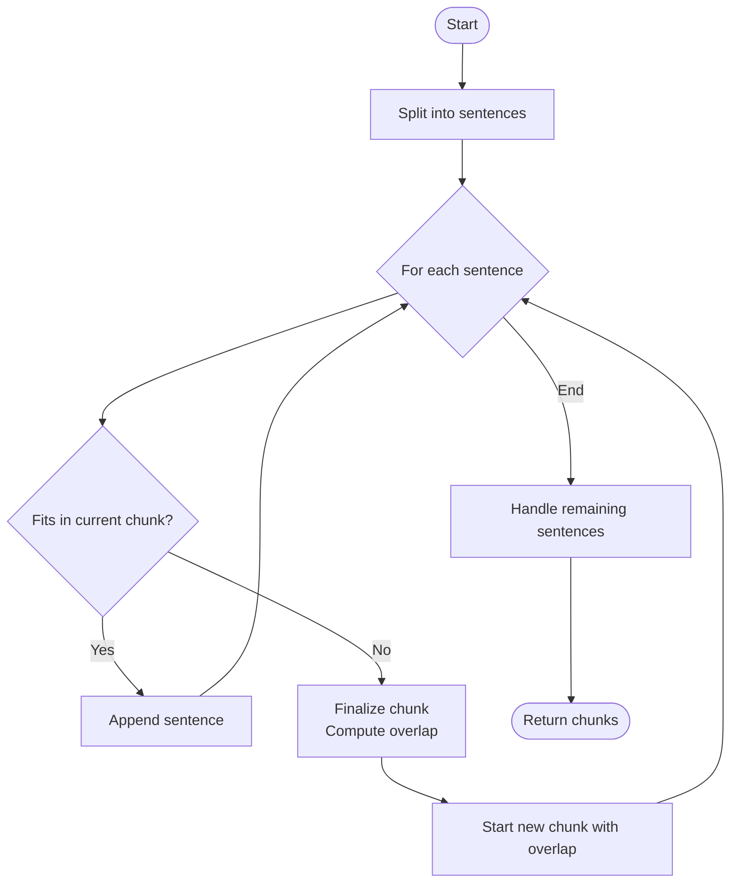
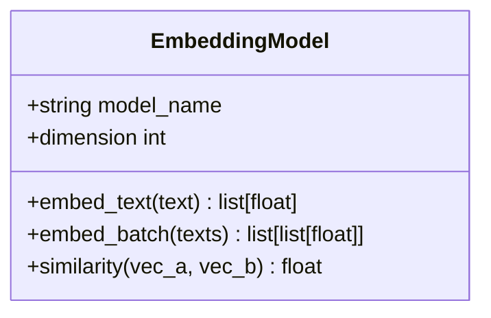
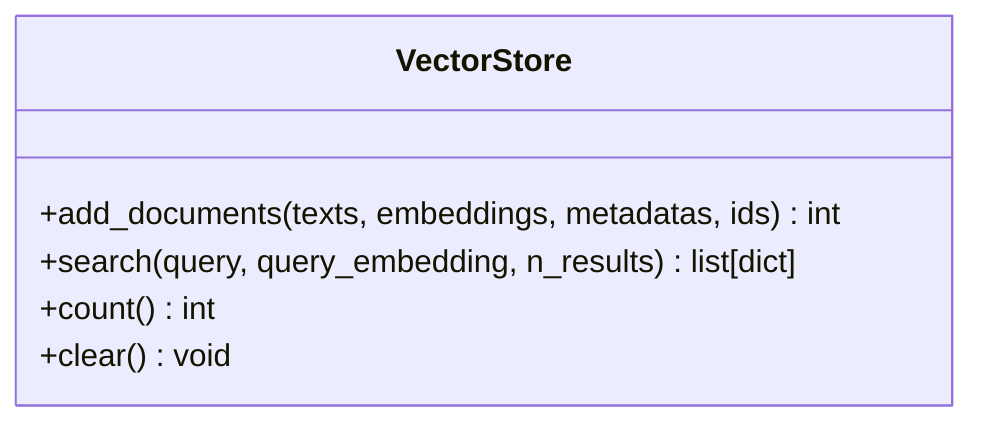
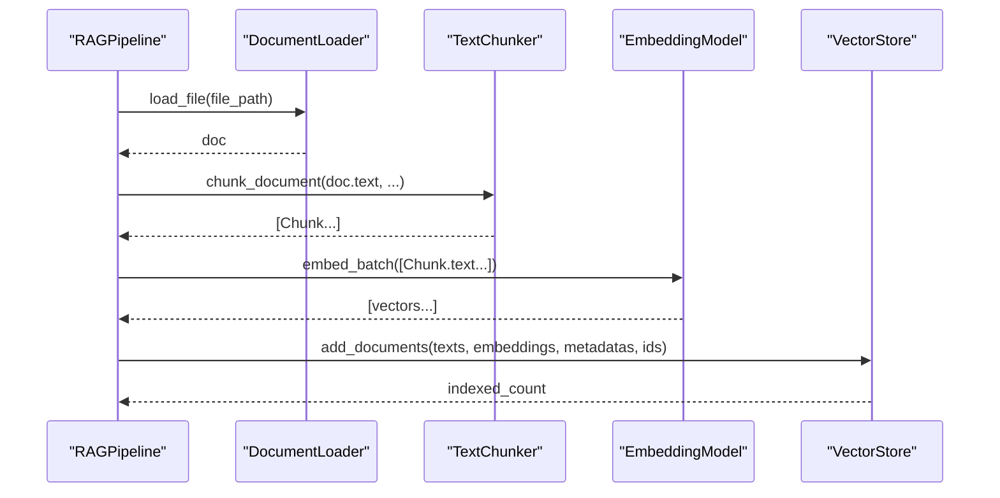
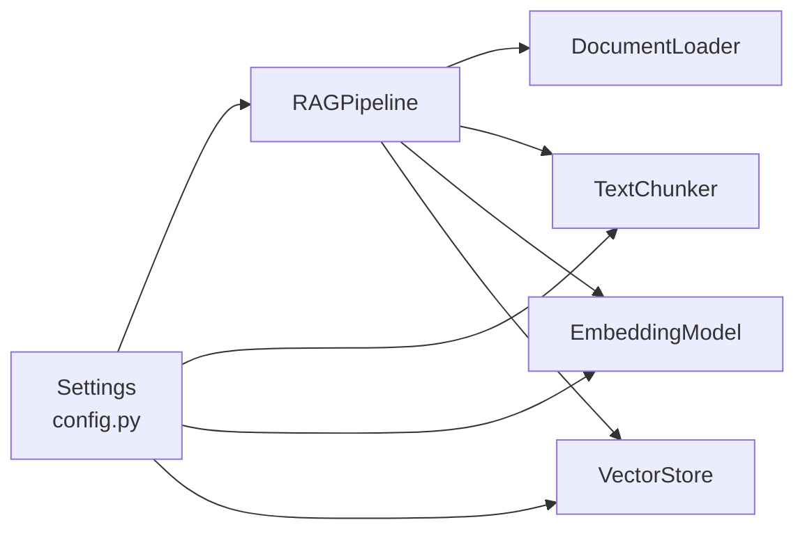

# RAG Pipeline

<cite>
**Referenced Files in This Document**
- [pipeline.py](file://src/rag/pipeline.py)
- [documents.py](file://src/rag/documents.py)
- [chunking.py](file://src/rag/chunking.py)
- [embeddings.py](file://src/rag/embeddings.py)
- [vector_store.py](file://src/rag/vector_store.py)
- [config.py](file://src/config.py)
- [ingest_example.py](file://examples/ingest_example.py)
- [query_example.py](file://examples/query_example.py)
- [README.md](file://README.md)
</cite>

## Table of Contents
1. [Introduction](#introduction)
2. [Project Structure](#project-structure)
3. [Core Components](#core-components)
4. [Architecture Overview](#architecture-overview)
5. [Detailed Component Analysis](#detailed-component-analysis)
6. [Dependency Analysis](#dependency-analysis)
7. [Performance Considerations](#performance-considerations)
8. [Troubleshooting Guide](#troubleshooting-guide)
9. [Conclusion](#conclusion)
10. [Appendices](#appendices)

## Introduction
This document explains the Retrieval-Augmented Generation (RAG) pipeline that ingests documents, converts them into semantic vectors, and indexes them for fast similarity search. It covers the full workflow from ingestion to query, including multi-format document loading, text chunking with overlap and context preservation, embedding generation via Sentence Transformers, and a pluggable vector store abstraction supporting ChromaDB and FAISS. It also provides performance guidance, best practices, and examples for customizing processors and integrations.

## Project Structure
The RAG pipeline is implemented under src/rag with clear separation of concerns:
- Document loading supports multiple formats (PDF, DOCX, TXT/MD/CSV).
- Text chunking splits content into overlapping chunks while preserving sentence boundaries.
- Embedding generation uses Sentence Transformers to produce normalized vectors.
- Vector store abstraction supports ChromaDB and FAISS backends.
- The pipeline orchestrates these components end-to-end.

**Diagram sources**
- [documents.py:15-61](file://src/rag/documents.py#L15-L61)
- [chunking.py:29-104](file://src/rag/chunking.py#L29-L104)
- [embeddings.py:16-43](file://src/rag/embeddings.py#L16-L43)
- [vector_store.py:16-112](file://src/rag/vector_store.py#L16-L112)

**Section sources**
- [README.md:81-126](file://README.md#L81-L126)

## Core Components
- RAGPipeline: Orchestrates ingestion and querying by chaining loader, chunker, embeddings, and vector store.
- DocumentLoader: Loads PDFs, DOCX, and text files; returns standardized document dicts with metadata.
- TextChunker: Splits text into overlapping chunks respecting sentence boundaries; configurable size and overlap.
- EmbeddingModel: Wraps Sentence Transformers for single and batch embedding with normalization.
- VectorStore: Abstraction over ChromaDB and FAISS for adding and searching documents.

Key responsibilities and interactions are defined in the following files:
- Ingestion flow: load → chunk → embed → index
- Query flow: embed question → search vector store → return results

**Section sources**
- [pipeline.py:19-101](file://src/rag/pipeline.py#L19-L101)
- [documents.py:15-103](file://src/rag/documents.py#L15-L103)
- [chunking.py:17-111](file://src/rag/chunking.py#L17-L111)
- [embeddings.py:16-58](file://src/rag/embeddings.py#L16-L58)
- [vector_store.py:16-192](file://src/rag/vector_store.py#L16-L192)

## Architecture Overview
The pipeline composes modular components to support scalable document processing and retrieval. Configuration is centralized and loaded from environment variables.

**Diagram sources**
- [pipeline.py:33-88](file://src/rag/pipeline.py#L33-L88)
- [documents.py:44-61](file://src/rag/documents.py#L44-L61)
- [chunking.py:41-104](file://src/rag/chunking.py#L41-L104)
- [embeddings.py:37-43](file://src/rag/embeddings.py#L37-L43)
- [vector_store.py:59-98](file://src/rag/vector_store.py#L59-L98)

**Section sources**
- [pipeline.py:19-101](file://src/rag/pipeline.py#L19-L101)
- [config.py:21-82](file://src/config.py#L21-L82)

## Detailed Component Analysis

### Document Loading
- Supported formats: PDF, DOCX, TXT/MD/CSV.
- Strategy:
  - PDF: Try PyMuPDF first; fallback to pdfplumber if unavailable.
  - DOCX: Use python-docx to extract paragraph text.
  - Text: Read UTF-8 with error replacement.
- Returns standardized dict with text, source, path, extension, and size_bytes.
- Directory loader recursively finds supported files and logs progress/errors.

**Diagram sources**
- [documents.py:20-42](file://src/rag/documents.py#L20-L42)
- [documents.py:63-103](file://src/rag/documents.py#L63-L103)

**Section sources**
- [documents.py:15-103](file://src/rag/documents.py#L15-L103)

### Text Chunking Engine
- Splits by sentences using regex on punctuation followed by whitespace.
- Builds chunks up to a configured chunk_size; when exceeded, finalizes current chunk and starts a new one.
- Overlap handling retains last few sentences whose total length fits within chunk_overlap to preserve context across boundaries.
- Tracks start_char and end_char offsets for precise location mapping.
- Emits Chunk objects with unique IDs, source, index, and optional metadata.

**Diagram sources**
- [chunking.py:41-104](file://src/rag/chunking.py#L41-L104)
- [chunking.py:106-111](file://src/rag/chunking.py#L106-L111)

Configuration defaults:
- CHUNK_SIZE and CHUNK_OVERLAP are read from settings.

**Section sources**
- [chunking.py:17-111](file://src/rag/chunking.py#L17-L111)
- [config.py:59-62](file://src/config.py#L59-L62)

### Embedding Model Integration
- Uses Sentence Transformers with a configurable model name and dimension.
- Normalizes embeddings for cosine similarity.
- Supports single text embedding and efficient batch encoding with a default batch size.
- Provides cosine similarity utility between two vectors.

**Diagram sources**
- [embeddings.py:16-58](file://src/rag/embeddings.py#L16-L58)

**Section sources**
- [embeddings.py:16-58](file://src/rag/embeddings.py#L16-L58)
- [config.py:39-42](file://src/config.py#L39-L42)

### Vector Store Abstraction
- Pluggable backends:
  - ChromaDB: Creates or retrieves a collection with cosine space; supports query by text or embedding.
  - FAISS: In-memory IndexFlatIP; requires explicit query embeddings; stores docs alongside metadata.
- Methods:
  - add_documents: Adds texts, embeddings, metadatas, and ids; returns count added.
  - search: Returns top-k similar documents with content, source, score, and metadata.
  - count: Returns number of stored items.
  - clear: Resets the store depending on backend.

**Diagram sources**
- [vector_store.py:16-192](file://src/rag/vector_store.py#L16-L192)

**Section sources**
- [vector_store.py:16-192](file://src/rag/vector_store.py#L16-L192)
- [config.py:43-49](file://src/config.py#L43-L49)

### Pipeline Orchestration
- RAGPipeline wires together DocumentLoader, TextChunker, EmbeddingModel, and VectorStore.
- Ingestion methods:
  - ingest_file: Single file ingestion.
  - ingest_directory: Batch ingestion from directory.
  - ingest_documents: Full pipeline for a list of document dicts.
- Query method:
  - query: Embeds the question and searches the vector store.

**Diagram sources**
- [pipeline.py:38-88](file://src/rag/pipeline.py#L38-L88)
- [documents.py:20-42](file://src/rag/documents.py#L20-L42)
- [chunking.py:41-104](file://src/rag/chunking.py#L41-L104)
- [embeddings.py:37-43](file://src/rag/embeddings.py#L37-L43)
- [vector_store.py:59-98](file://src/rag/vector_store.py#L59-L98)

**Section sources**
- [pipeline.py:19-101](file://src/rag/pipeline.py#L19-L101)

## Dependency Analysis
- RAGPipeline depends on:
  - DocumentLoader for format-specific parsing.
  - TextChunker for segmentation and overlap.
  - EmbeddingModel for vectorization.
  - VectorStore for persistence and retrieval.
- Configuration is centralized in Settings and accessed via get_settings().
- External libraries are imported lazily where needed to reduce startup overhead.

**Diagram sources**
- [config.py:21-82](file://src/config.py#L21-L82)
- [pipeline.py:19-31](file://src/rag/pipeline.py#L19-L31)

**Section sources**
- [config.py:21-82](file://src/config.py#L21-L82)
- [pipeline.py:19-31](file://src/rag/pipeline.py#L19-L31)

## Performance Considerations
- Batch embeddings: Use embed_batch to leverage GPU/CPU batching for throughput.
- Chunk sizing: Tune CHUNK_SIZE and CHUNK_OVERLAP to balance recall and storage cost. Larger chunks improve context but increase memory and may dilute relevance.
- Vector store selection:
  - ChromaDB: Suitable for persistent collections with built-in indexing; good for production workloads.
  - FAISS: Fast in-memory ANN; ideal for prototyping or when you manage index persistence externally.
- Indexing best practices:
  - Normalize embeddings (already done) to ensure consistent cosine similarity.
  - Assign stable IDs per chunk to enable updates and deduplication.
  - Keep metadata minimal but informative (source, chunk_id, indices).
- Caching mechanisms:
  - EmbeddingModel caches the underlying model instance to avoid reloads.
  - Settings are cached via lru_cache to avoid repeated env parsing.
- Large document sets:
  - Process directories in batches; consider streaming loaders for very large corpora.
  - Monitor memory usage with FAISS; consider sharding or external index storage.
  - Use appropriate chunk sizes to fit within embedding model constraints and optimize retrieval quality.

[No sources needed since this section provides general guidance]

## Troubleshooting Guide
- Missing dependencies:
  - PDF parsing: Ensure PyMuPDF or pdfplumber is installed; otherwise, PDF loading will fail.
  - DOCX parsing: Install python-docx.
  - FAISS: Install faiss-cpu for FAISS backend; otherwise, initialization fails.
- Initialization errors:
  - ChromaDB init failures are logged; verify collection name and availability.
  - FAISS requires query embeddings for search; ensure embeddings are provided.
- Empty results:
  - No chunks generated: Check input text and chunk configuration.
  - Zero indexed: Confirm add_documents received non-empty inputs.
- Logging:
  - Loguru is used throughout; inspect logs for warnings and errors during ingestion and search.

**Section sources**
- [documents.py:63-103](file://src/rag/documents.py#L63-L103)
- [vector_store.py:33-57](file://src/rag/vector_store.py#L33-L57)
- [vector_store.py:151-176](file://src/rag/vector_store.py#L151-L176)

## Conclusion
The RAG pipeline provides a modular, configurable, and extensible framework for document ingestion, semantic chunking, embedding generation, and vector-based retrieval. With pluggable backends and centralized configuration, it supports both development and production scenarios. By tuning chunking parameters, selecting appropriate vector stores, and leveraging batched embeddings, teams can build robust semantic search systems tailored to domain-specific needs.

[No sources needed since this section summarizes without analyzing specific files]

## Appendices

### Examples and Usage
- Ingest example demonstrates loading a directory of documents and running queries against the vector store.
- Query example shows integration with the broader multi-agent research pipeline, combining vector and graph retrieval.

**Section sources**
- [ingest_example.py:16-99](file://examples/ingest_example.py#L16-L99)
- [query_example.py:25-184](file://examples/query_example.py#L25-L184)

### Customization Recipes
- Custom document processor:
  - Extend DocumentLoader to add new parsers by implementing a method for your format and routing based on extension.
  - Return standardized dicts with text, source, path, extension, and size_bytes.
- Custom chunking strategy:
  - Subclass TextChunker and override chunk_document to implement alternative splitting logic (e.g., token-based or semantic-aware chunking).
  - Preserve overlap semantics to maintain context continuity.
- Custom vector store integration:
  - Implement a new backend by extending VectorStore and adding initialization, add_documents, and search methods.
  - Configure db_type in settings to select your implementation.

[No sources needed since this section provides conceptual guidance]