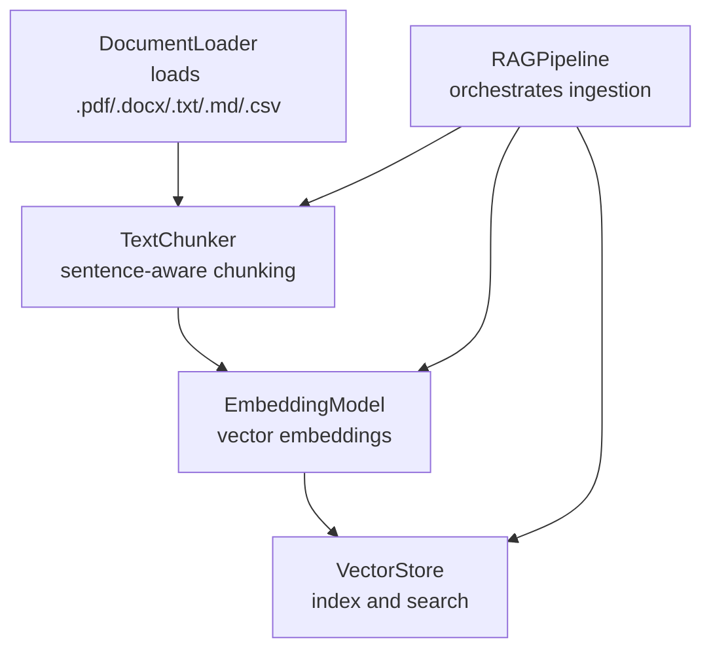
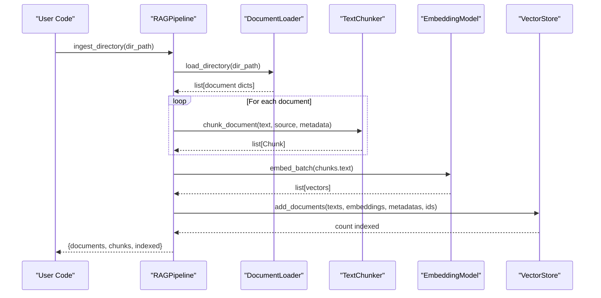
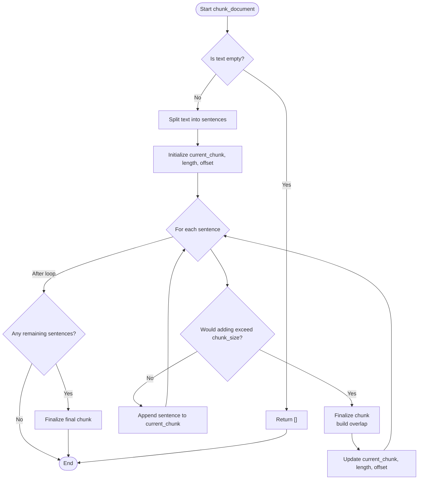
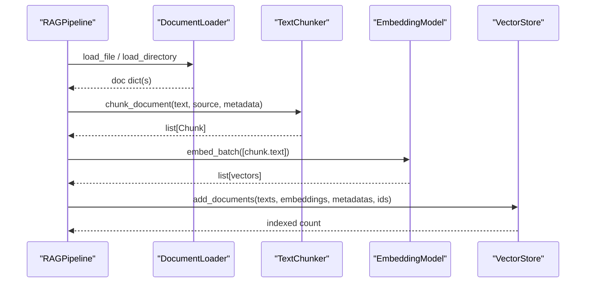
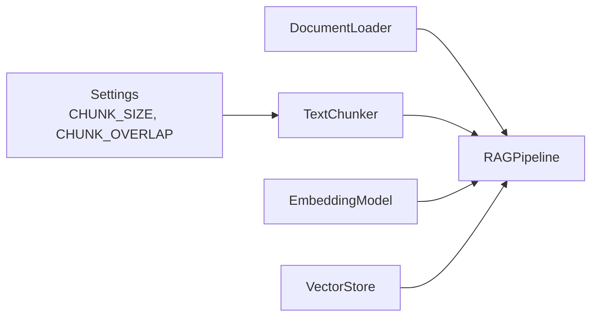

# Text Chunking Strategies

<cite>
**Referenced Files in This Document**
- [chunking.py](file://src/rag/chunking.py)
- [documents.py](file://src/rag/documents.py)
- [embeddings.py](file://src/rag/embeddings.py)
- [pipeline.py](file://src/rag/pipeline.py)
- [config.py](file://src/config.py)
- [schemas.py](file://src/core/schemas.py)
- [ingest_example.py](file://examples/ingest_example.py)
</cite>

## Table of Contents
1. [Introduction](#introduction)
2. [Project Structure](#project-structure)
3. [Core Components](#core-components)
4. [Architecture Overview](#architecture-overview)
5. [Detailed Component Analysis](#detailed-component-analysis)
6. [Dependency Analysis](#dependency-analysis)
7. [Performance Considerations](#performance-considerations)
8. [Troubleshooting Guide](#troubleshooting-guide)
9. [Conclusion](#conclusion)
10. [Appendices](#appendices)

## Introduction
This document explains the text chunking engine that segments documents into manageable chunks for embedding and retrieval. It focuses on the TextChunker class, the Chunk data structure, configuration options, and how chunking integrates with the RAG pipeline. It also provides guidance for extending chunking strategies to domain-specific content such as code, mathematical formulas, or structured documents, and addresses performance considerations for large documents.

## Project Structure
The chunking engine is part of the Retrieval-Augmented Generation (RAG) subsystem:
- Documents are loaded from various formats.
- Text is split into overlapping chunks using sentence-aware logic.
- Chunks are embedded and indexed into a vector store for retrieval.

**Diagram sources**
- [documents.py:15-103](file://src/rag/documents.py#L15-L103)
- [chunking.py:17-110](file://src/rag/chunking.py#L17-L110)
- [embeddings.py:16-58](file://src/rag/embeddings.py#L16-L58)
- [pipeline.py:19-102](file://src/rag/pipeline.py#L19-L102)

**Section sources**
- [documents.py:15-103](file://src/rag/documents.py#L15-L103)
- [chunking.py:17-110](file://src/rag/chunking.py#L17-L110)
- [embeddings.py:16-58](file://src/rag/embeddings.py#L16-L58)
- [pipeline.py:19-102](file://src/rag/pipeline.py#L19-L102)

## Core Components
- Chunk: A lightweight dataclass representing a single chunk with identity, source tracking, character offsets, and metadata.
- TextChunker: Splits text into overlapping chunks while respecting sentence boundaries.
- RAGPipeline: Orchestrates loading, chunking, embedding, and indexing.
- EmbeddingModel: Generates vectors for chunks; used downstream for similarity search.
- Settings: Centralized configuration including chunk size and overlap.

Key responsibilities:
- Preserve context across chunk boundaries via configurable overlap.
- Track provenance through source and chunk_index fields.
- Maintain metadata for traceability and filtering.

**Section sources**
- [chunking.py:17-110](file://src/rag/chunking.py#L17-L110)
- [pipeline.py:19-102](file://src/rag/pipeline.py#L19-L102)
- [embeddings.py:16-58](file://src/rag/embeddings.py#L16-L58)
- [config.py:21-82](file://src/config.py#L21-L82)

## Architecture Overview
The ingestion flow uses the RAGPipeline to coordinate components:

**Diagram sources**
- [pipeline.py:33-88](file://src/rag/pipeline.py#L33-L88)
- [documents.py:44-61](file://src/rag/documents.py#L44-L61)
- [chunking.py:41-104](file://src/rag/chunking.py#L41-L104)
- [embeddings.py:37-43](file://src/rag/embeddings.py#L37-L43)

## Detailed Component Analysis

### Chunk Data Structure
- Fields:
  - chunk_id: Unique identifier derived from a UUID prefix.
  - text: The chunked text content.
  - source: Original document name or path reference.
  - chunk_index: Sequential index within the document.
  - start_char/end_char: Character offsets for precise location tracking.
  - metadata: Arbitrary key-value pairs preserved from ingestion.

- Usage:
  - Used by the pipeline to build vector store entries with consistent IDs and rich metadata.
  - Supports downstream retrieval and citation back to original documents.

**Section sources**
- [chunking.py:17-26](file://src/rag/chunking.py#L17-L26)
- [pipeline.py:65-81](file://src/rag/pipeline.py#L65-L81)

### TextChunker Class
- Purpose: Split text into overlapping chunks while preserving sentence boundaries.
- Configuration:
  - chunk_size: Maximum characters per chunk (from settings if not provided).
  - chunk_overlap: Characters retained from previous chunk to preserve context.
- Algorithm highlights:
  - Sentence splitting via regex-based delimiter detection.
  - Accumulates sentences until adding the next would exceed chunk_size.
  - Finalizes current chunk, then selects last few sentences to form overlap for the next chunk.
  - Tracks character offsets to maintain source position information.
  - Emits a Chunk for any remaining sentences after the loop.

**Diagram sources**
- [chunking.py:41-104](file://src/rag/chunking.py#L41-L104)

**Section sources**
- [chunking.py:29-110](file://src/rag/chunking.py#L29-L110)

### RAGPipeline Integration
- Ingestion steps:
  - Load documents from directory or file.
  - Chunk each document with source and metadata.
  - Batch-embed all chunk texts.
  - Index into vector store with chunk IDs and metadata.
- Query step:
  - Embed query text and search vector store.

**Diagram sources**
- [pipeline.py:33-88](file://src/rag/pipeline.py#L33-L88)
- [documents.py:20-61](file://src/rag/documents.py#L20-L61)
- [chunking.py:41-104](file://src/rag/chunking.py#L41-L104)
- [embeddings.py:37-43](file://src/rag/embeddings.py#L37-L43)

**Section sources**
- [pipeline.py:19-102](file://src/rag/pipeline.py#L19-L102)

### Configuration Options
- Chunk sizing:
  - CHUNK_SIZE: Default maximum chunk length in characters.
  - CHUNK_OVERLAP: Default number of characters to overlap between adjacent chunks.
- Embedding model:
  - EMBEDDING_MODEL and EMBEDDING_DIMENSION influence optimal chunk sizing to fit token limits and semantic coherence.
- Practical guidance:
  - Larger CHUNK_SIZE increases context but may dilute relevance; smaller sizes improve precision at the cost of more chunks.
  - CHUNK_OVERLAP helps preserve cross-boundary context; too much overlap increases storage and compute costs.

**Section sources**
- [config.py:59-62](file://src/config.py#L59-L62)
- [config.py:39-42](file://src/config.py#L39-L42)
- [chunking.py:32-39](file://src/rag/chunking.py#L32-L39)

### Chunking Strategies and Extensions
Current strategy:
- Sentence-based chunking with configurable overlap.

Extensibility ideas for domain-specific content:
- Code:
  - Split by function/class boundaries or logical blocks while enforcing max chunk size.
  - Preserve imports and context headers in overlapping regions.
- Mathematical formulas:
  - Keep formula blocks intact; avoid breaking inline math mid-sequence.
  - Use delimiters or markers to detect formula boundaries.
- Structured documents:
  - Respect section headers, bullet lists, and table rows to keep related content together.
  - Use paragraph-level grouping before applying size constraints.

Note: These strategies can be implemented by subclassing or composing with the existing TextChunker interface and overriding the sentence-splitting and boundary-detection logic.

[No sources needed since this section proposes conceptual extensions without analyzing specific files]

## Dependency Analysis
- TextChunker depends on:
  - Settings for default chunk_size and chunk_overlap.
  - Standard library modules for regex and UUID generation.
- RAGPipeline depends on:
  - DocumentLoader for input extraction.
  - TextChunker for segmentation.
  - EmbeddingModel for vectorization.
  - VectorStore for persistence and retrieval.

**Diagram sources**
- [config.py:59-62](file://src/config.py#L59-L62)
- [chunking.py:32-39](file://src/rag/chunking.py#L32-L39)
- [pipeline.py:19-31](file://src/rag/pipeline.py#L19-L31)

**Section sources**
- [config.py:59-62](file://src/config.py#L59-L62)
- [chunking.py:32-39](file://src/rag/chunking.py#L32-L39)
- [pipeline.py:19-31](file://src/rag/pipeline.py#L19-L31)

## Performance Considerations
- Memory efficiency:
  - Process documents in batches; avoid loading entire directories into memory at once when possible.
  - Reuse the same TextChunker instance to minimize overhead.
- Throughput:
  - Use batch embedding to reduce model calls.
  - Tune CHUNK_SIZE and CHUNK_OVERLAP to balance retrieval quality and storage/compute costs.
- Large documents:
  - Ensure sentence splitting does not create excessively long sentences; consider pre-processing to normalize punctuation.
  - Monitor char_offset updates to ensure accurate source mapping without excessive string concatenation.

[No sources needed since this section provides general guidance]

## Troubleshooting Guide
Common issues and resolutions:
- Empty output:
  - If input text is empty or whitespace-only, chunking returns no chunks. Validate inputs before chunking.
- Unsupported file types:
  - DocumentLoader raises errors for unsupported extensions; ensure files use supported formats.
- Missing dependencies:
  - PDF loaders require optional libraries; install required packages for full functionality.
- Excessive chunks or low recall:
  - Adjust CHUNK_SIZE and CHUNK_OVERLAP to better match document characteristics and embedding model requirements.

**Section sources**
- [chunking.py:47-49](file://src/rag/chunking.py#L47-L49)
- [documents.py:20-35](file://src/rag/documents.py#L20-L35)
- [documents.py:63-103](file://src/rag/documents.py#L63-L103)

## Conclusion
The chunking engine provides a robust, configurable approach to segmenting documents into meaningful, overlapping chunks suitable for embedding and retrieval. By leveraging sentence-aware splitting, configurable overlap, and comprehensive metadata, it supports high-quality retrieval while maintaining traceability to source documents. Extending the engine with domain-specific strategies enables tailored processing for code, formulas, and structured content. Proper tuning of chunk size and overlap, combined with efficient batching and streaming where applicable, ensures scalable performance for large corpora.

## Appendices

### Example Usage
- Ingest example demonstrates loading documents, ingesting them via the RAGPipeline, and querying results.

**Section sources**
- [ingest_example.py:16-99](file://examples/ingest_example.py#L16-L99)

### Related Models
- EvidenceChunk schema aligns with chunk metadata and retrieval results for downstream agents.

**Section sources**
- [schemas.py:65-73](file://src/core/schemas.py#L65-L73)