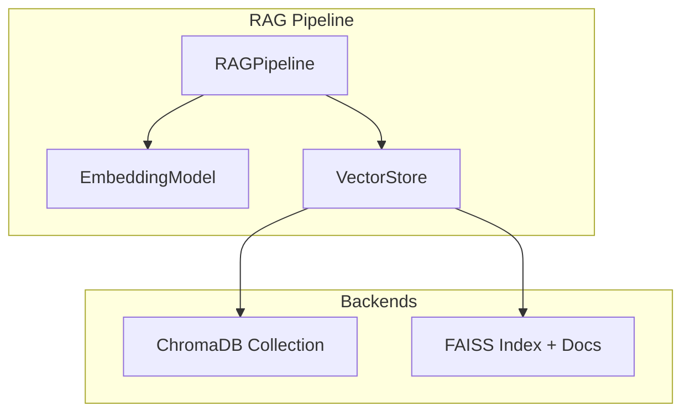
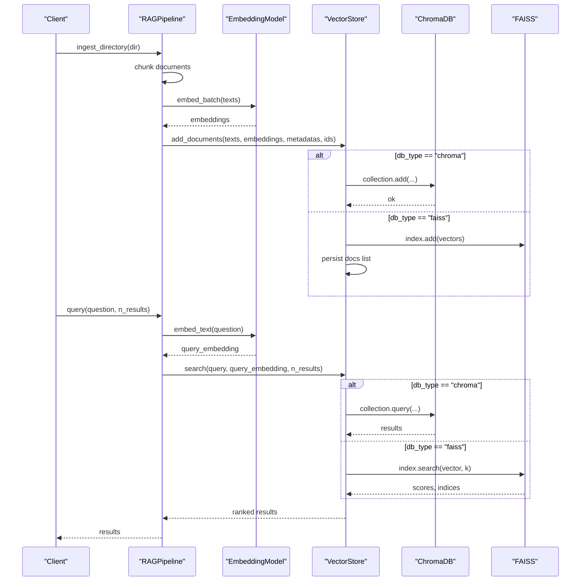
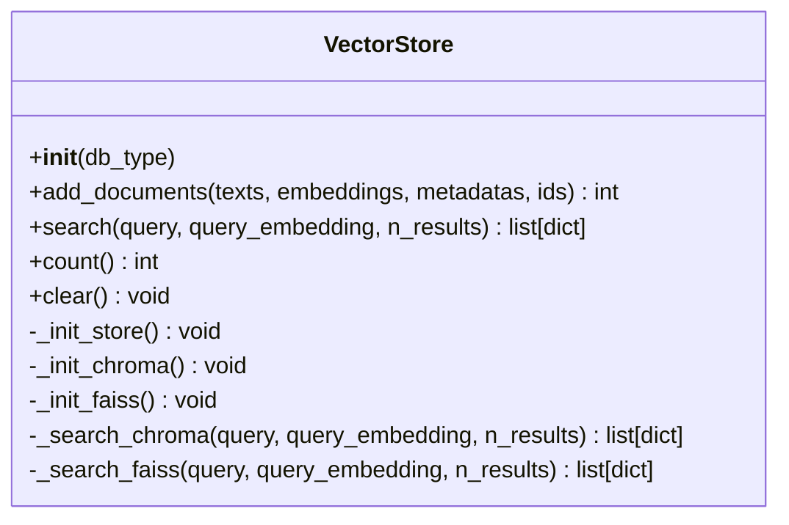
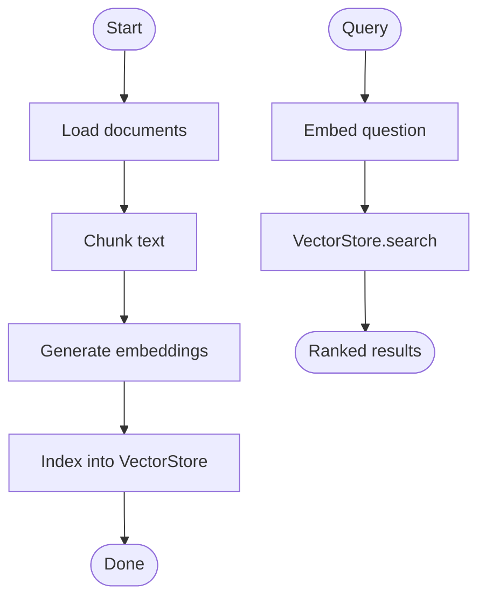
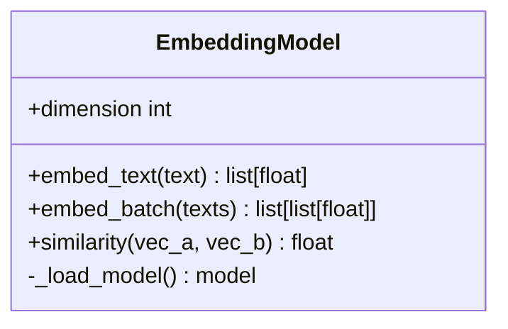
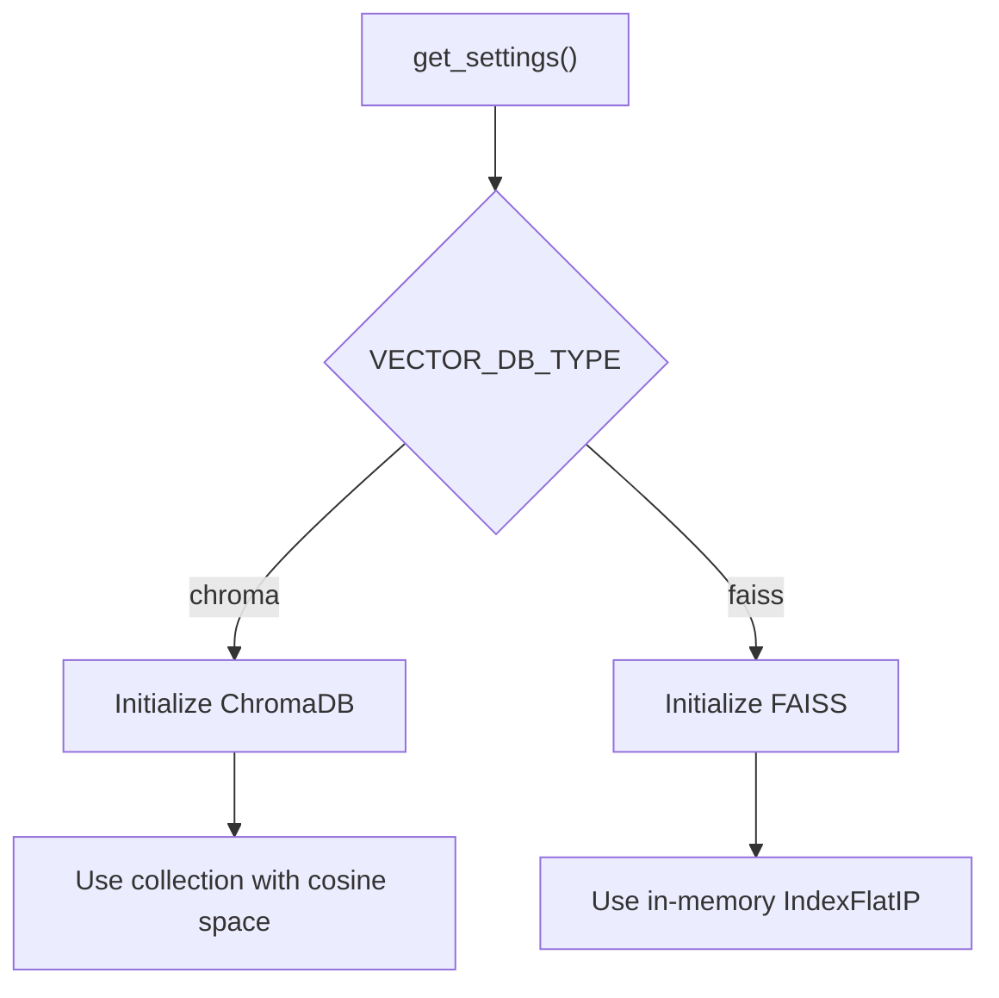
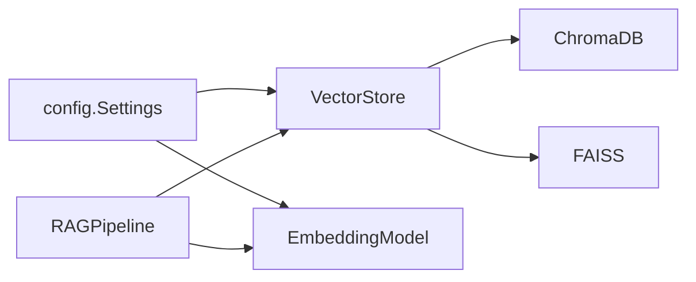

# Vector Store Integration

<cite>
**Referenced Files in This Document**
- [vector_store.py](file://src/rag/vector_store.py)
- [pipeline.py](file://src/rag/pipeline.py)
- [embeddings.py](file://src/rag/embeddings.py)
- [config.py](file://src/config.py)
- [ingest_example.py](file://examples/ingest_example.py)
- [query_example.py](file://examples/query_example.py)
</cite>

## Table of Contents
1. [Introduction](#introduction)
2. [Project Structure](#project-structure)
3. [Core Components](#core-components)
4. [Architecture Overview](#architecture-overview)
5. [Detailed Component Analysis](#detailed-component-analysis)
6. [Dependency Analysis](#dependency-analysis)
7. [Performance Considerations](#performance-considerations)
8. [Troubleshooting Guide](#troubleshooting-guide)
9. [Conclusion](#conclusion)
10. [Appendices](#appendices)

## Introduction
This document explains the vector store abstraction layer that provides pluggable storage backends for semantic search. It covers the VectorStore base interface, its ChromaDB and FAISS implementations, bulk indexing with metadata via add_documents, similarity queries via search, backend-specific configuration and persistence, migration strategies between backends, performance optimization techniques, error handling, backup strategies, and maintenance procedures for production environments.

## Project Structure
The vector store integration is centered around a unified interface that abstracts over two backends:
- ChromaDB: a persistent, embedded vector database with collection management and HNSW cosine similarity.
- FAISS: an in-memory index for fast similarity search using inner product.

The RAG pipeline orchestrates document ingestion (chunking, embedding, indexing) and querying by composing these components.

**Diagram sources**
- [pipeline.py:19-101](file://src/rag/pipeline.py#L19-L101)
- [vector_store.py:16-191](file://src/rag/vector_store.py#L16-L191)
- [embeddings.py:16-57](file://src/rag/embeddings.py#L16-L57)

**Section sources**
- [pipeline.py:19-101](file://src/rag/pipeline.py#L19-L101)
- [vector_store.py:16-191](file://src/rag/vector_store.py#L16-L191)
- [embeddings.py:16-57](file://src/rag/embeddings.py#L16-L57)

## Core Components
- VectorStore: Unified interface for adding documents and performing similarity searches across backends.
- ChromaDB backend: Persistent collection-based storage with cosine similarity and metadata support.
- FAISS backend: In-memory index for fast inner-product similarity; requires query embeddings.
- RAGPipeline: Orchestrates chunking, embedding, and indexing into the selected vector store.
- EmbeddingModel: Generates normalized embeddings used by both backends.
- Settings: Centralized configuration for vector DB type, collection name, and embedding parameters.

Key responsibilities:
- Backend selection and initialization based on configuration.
- Bulk indexing with optional IDs and metadata.
- Similarity search with configurable result limits.
- Count and clear operations per backend.

**Section sources**
- [vector_store.py:16-191](file://src/rag/vector_store.py#L16-L191)
- [pipeline.py:19-101](file://src/rag/pipeline.py#L19-L101)
- [embeddings.py:16-57](file://src/rag/embeddings.py#L16-L57)
- [config.py:21-82](file://src/config.py#L21-L82)

## Architecture Overview
The system uses a strategy pattern to switch between ChromaDB and FAISS at runtime through configuration. The RAGPipeline handles data flow from raw text to indexed vectors, while VectorStore encapsulates backend-specific logic.

**Diagram sources**
- [pipeline.py:33-101](file://src/rag/pipeline.py#L33-L101)
- [vector_store.py:19-191](file://src/rag/vector_store.py#L19-L191)
- [embeddings.py:31-43](file://src/rag/embeddings.py#L31-L43)

## Detailed Component Analysis

### VectorStore Interface and Implementations
The VectorStore class provides a consistent API for both ChromaDB and FAISS:
- Initialization selects the backend based on settings or constructor argument.
- add_documents supports bulk indexing with optional IDs and metadata.
- search supports similarity queries with configurable result limits.
- count and clear provide basic lifecycle utilities.

Backend specifics:
- ChromaDB:
  - Uses get_or_create_collection with cosine similarity metadata.
  - Supports query by text or precomputed embedding.
  - Persists collections automatically via ChromaDB client.
- FAISS:
  - Uses an in-memory IndexFlatIP (inner product).
  - Requires query embeddings for search.
  - Stores documents and metadata in memory alongside the index.

**Diagram sources**
- [vector_store.py:16-191](file://src/rag/vector_store.py#L16-L191)

**Section sources**
- [vector_store.py:16-191](file://src/rag/vector_store.py#L16-L191)

### RAGPipeline Integration
The RAGPipeline coordinates ingestion and querying:
- Loads documents, chunks them, generates embeddings, and indexes into the configured vector store.
- For queries, it embeds the question and delegates search to VectorStore.

**Diagram sources**
- [pipeline.py:33-101](file://src/rag/pipeline.py#L33-L101)

**Section sources**
- [pipeline.py:33-101](file://src/rag/pipeline.py#L33-L101)

### Embedding Model
The EmbeddingModel wraps sentence-transformers to produce normalized embeddings:
- Single-text embedding and batched embedding methods.
- Cosine similarity utility.
- Dimension derived from settings.

**Diagram sources**
- [embeddings.py:16-57](file://src/rag/embeddings.py#L16-L57)

**Section sources**
- [embeddings.py:16-57](file://src/rag/embeddings.py#L16-L57)

### Configuration and Backend Selection
Settings define:
- VECTOR_DB_TYPE: chooses between chroma and faiss.
- CHROMA_COLLECTION: collection name for ChromaDB.
- EMBEDDING_MODEL and EMBEDDING_DIMENSION: embedding configuration.
- FAISS_INDEX_PATH: reserved path for potential FAISS persistence.

**Diagram sources**
- [config.py:21-82](file://src/config.py#L21-L82)
- [vector_store.py:19-31](file://src/rag/vector_store.py#L19-L31)

**Section sources**
- [config.py:21-82](file://src/config.py#L21-L82)
- [vector_store.py:19-31](file://src/rag/vector_store.py#L19-L31)

### Usage Examples
- Ingestion example demonstrates loading documents, building vector store and knowledge graph, and testing retrieval.
- Query example shows running a full multi-agent pipeline including vector retrieval.

These examples illustrate how to:
- Ingest documents into the vector store.
- Run queries and retrieve relevant chunks.
- Integrate vector retrieval within broader workflows.

**Section sources**
- [ingest_example.py:16-99](file://examples/ingest_example.py#L16-L99)
- [query_example.py:25-184](file://examples/query_example.py#L25-L184)

## Dependency Analysis
The following diagram shows key dependencies among components involved in vector storage and retrieval.

**Diagram sources**
- [config.py:21-82](file://src/config.py#L21-L82)
- [vector_store.py:16-191](file://src/rag/vector_store.py#L16-L191)
- [pipeline.py:19-101](file://src/rag/pipeline.py#L19-L101)
- [embeddings.py:16-57](file://src/rag/embeddings.py#L16-L57)

**Section sources**
- [config.py:21-82](file://src/config.py#L21-L82)
- [vector_store.py:16-191](file://src/rag/vector_store.py#L16-L191)
- [pipeline.py:19-101](file://src/rag/pipeline.py#L19-L101)
- [embeddings.py:16-57](file://src/rag/embeddings.py#L16-L57)

## Performance Considerations
- Index building:
  - ChromaDB: Uses HNSW with cosine similarity; ensure appropriate collection metadata and consider batch sizes during ingestion for throughput.
  - FAISS: IndexFlatIP is simple but can be slow for large datasets; consider more advanced FAISS indexes for scale.
- Query optimization:
  - ChromaDB: Provide precomputed query embeddings when possible to avoid re-embedding overhead.
  - FAISS: Always supply query embeddings; tune k (n_results) to balance latency and recall.
- Scaling considerations:
  - ChromaDB: Suitable for persistent, medium-to-large datasets; monitor disk usage and collection size.
  - FAISS: In-memory only; best for smaller datasets or prototyping; consider sharding or switching to ChromaDB for larger workloads.
- Embedding efficiency:
  - Use batch embedding where possible to reduce model load calls.
  - Normalize embeddings (as implemented) to align with cosine/inner product semantics.

[No sources needed since this section provides general guidance]

## Troubleshooting Guide
Common issues and resolutions:
- Unsupported vector DB type:
  - Ensure VECTOR_DB_TYPE is set to chroma or faiss.
- ChromaDB initialization failure:
  - Check logs for errors during client or collection creation; verify environment and permissions.
- FAISS import error:
  - Install required dependencies (e.g., faiss-cpu) before use.
- No vector store available:
  - Verify backend initialization succeeded; check logs for warnings about missing stores.
- FAISS search without embedding:
  - Provide query_embedding; FAISS requires numeric vectors for similarity search.
- Empty results:
  - Confirm documents were added successfully; check counts and logs.

Operational notes:
- Logging: All major operations log info/warning/error messages for diagnostics.
- Clearing data:
  - ChromaDB: Deletes and recreates the collection.
  - FAISS: Resets in-memory index and document list.

**Section sources**
- [vector_store.py:19-57](file://src/rag/vector_store.py#L19-L57)
- [vector_store.py:100-112](file://src/rag/vector_store.py#L100-L112)
- [vector_store.py:147-149](file://src/rag/vector_store.py#L147-L149)
- [vector_store.py:157-162](file://src/rag/vector_store.py#L157-L162)
- [vector_store.py:185-191](file://src/rag/vector_store.py#L185-L191)

## Conclusion
The VectorStore abstraction provides a clean, consistent interface for semantic search across ChromaDB and FAISS backends. The RAGPipeline integrates seamlessly with this abstraction to deliver end-to-end ingestion and querying. With proper configuration, error handling, and performance tuning, the system supports both prototyping and production deployments. Migration between backends is straightforward via configuration changes, enabling flexibility as requirements evolve.

[No sources needed since this section summarizes without analyzing specific files]

## Appendices

### Backend-Specific Configuration and Persistence
- ChromaDB:
  - Collection name configured via CHROMA_COLLECTION.
  - Cosine similarity enabled via collection metadata.
  - Persistence handled by ChromaDB client; no explicit save/load in code.
- FAISS:
  - In-memory index; no built-in persistence in current implementation.
  - FAISS_INDEX_PATH is defined in settings but not used for serialization in code.

**Section sources**
- [config.py:43-48](file://src/config.py#L43-L48)
- [vector_store.py:33-57](file://src/rag/vector_store.py#L33-L57)
- [vector_store.py:185-191](file://src/rag/vector_store.py#L185-L191)

### Adding Custom Vector Store Backends
To implement a custom backend:
- Extend or subclass VectorStore to add a new backend branch in _init_store and corresponding search methods.
- Implement add_documents, search, count, and clear to match existing behavior.
- Ensure compatibility with embeddings dimension and normalization.
- Update settings if necessary to expose new backend options.

Guidance references:
- Backend branching and initialization patterns.
- Consistent return formats for search results.

**Section sources**
- [vector_store.py:19-31](file://src/rag/vector_store.py#L19-L31)
- [vector_store.py:59-98](file://src/rag/vector_store.py#L59-L98)
- [vector_store.py:100-176](file://src/rag/vector_store.py#L100-L176)

### Migrating Between Storage Solutions
- Switching backends:
  - Change VECTOR_DB_TYPE in settings to chroma or faiss.
  - Re-run ingestion to populate the new backend.
- Data migration:
  - Export from ChromaDB collection and import into FAISS or vice versa by extracting texts, embeddings, and metadata, then calling add_documents on the target backend.
  - Validate counts and sample queries post-migration.

**Section sources**
- [config.py:43-48](file://src/config.py#L43-L48)
- [vector_store.py:59-98](file://src/rag/vector_store.py#L59-L98)

### Production Maintenance Procedures
- Monitoring:
  - Watch logs for initialization and search errors.
  - Track counts to detect unexpected data loss or growth.
- Backup strategies:
  - ChromaDB: Rely on underlying storage backups for collection persistence.
  - FAISS: Implement periodic snapshots of in-memory state if needed (serialize index and doc list externally).
- Health checks:
  - Periodically run a small test query to validate availability.
  - Alert on repeated failures or empty result sets.

[No sources needed since this section provides general guidance]