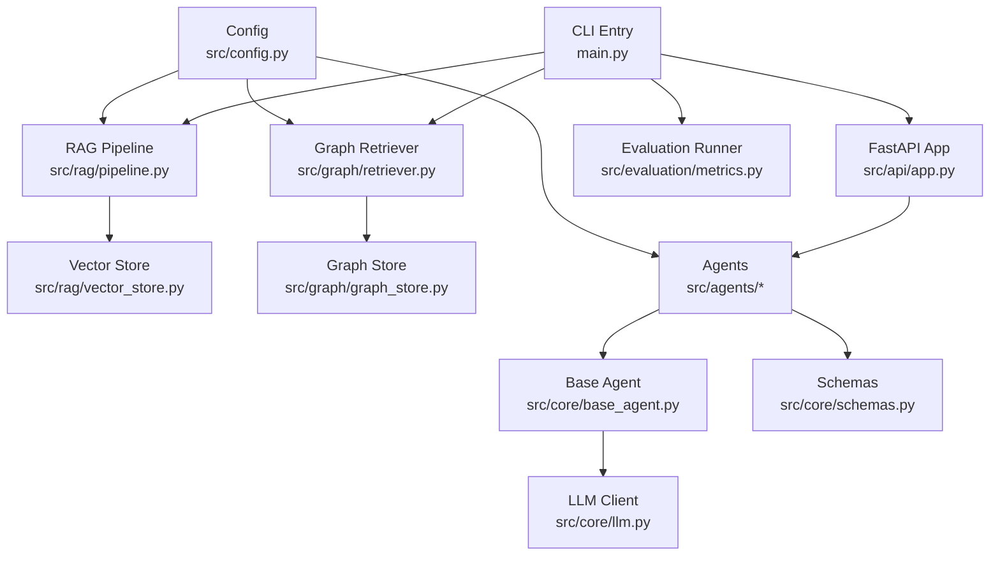
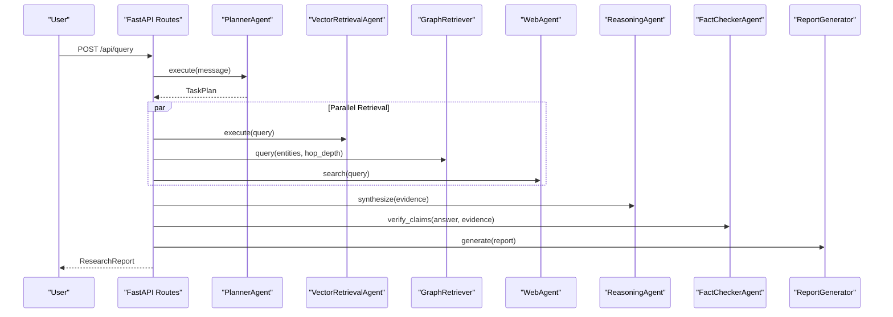
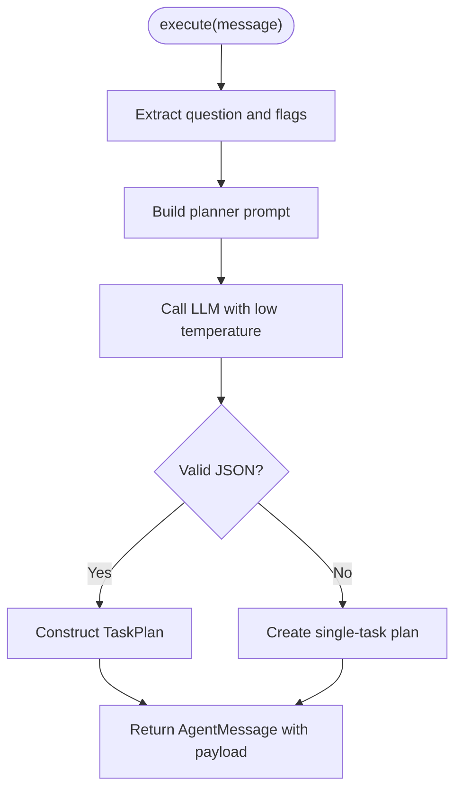
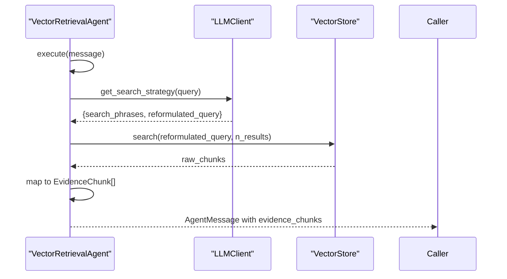
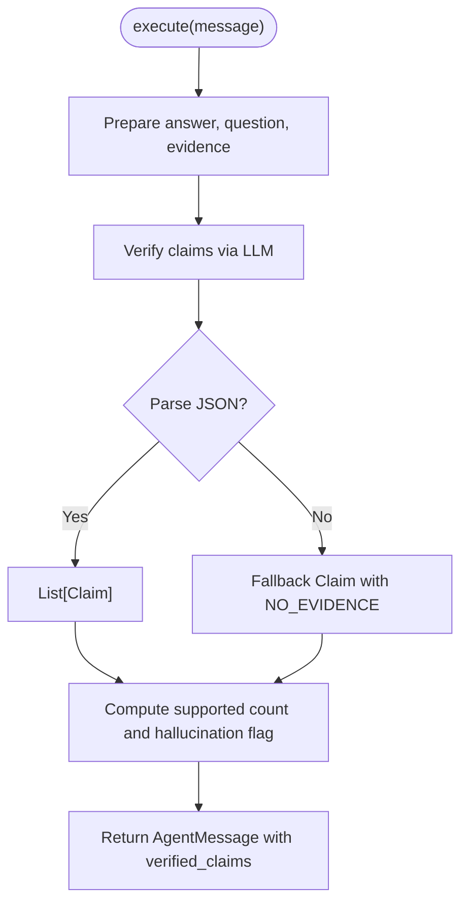
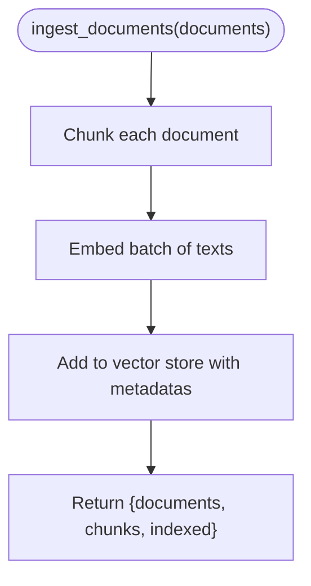
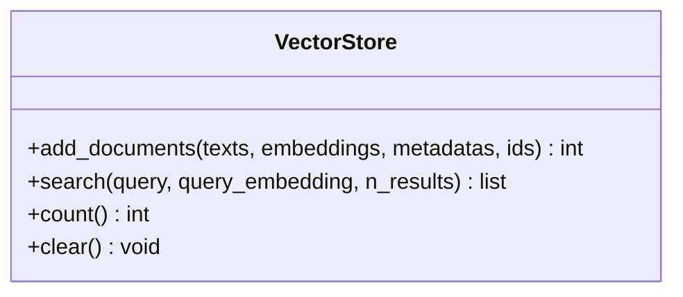
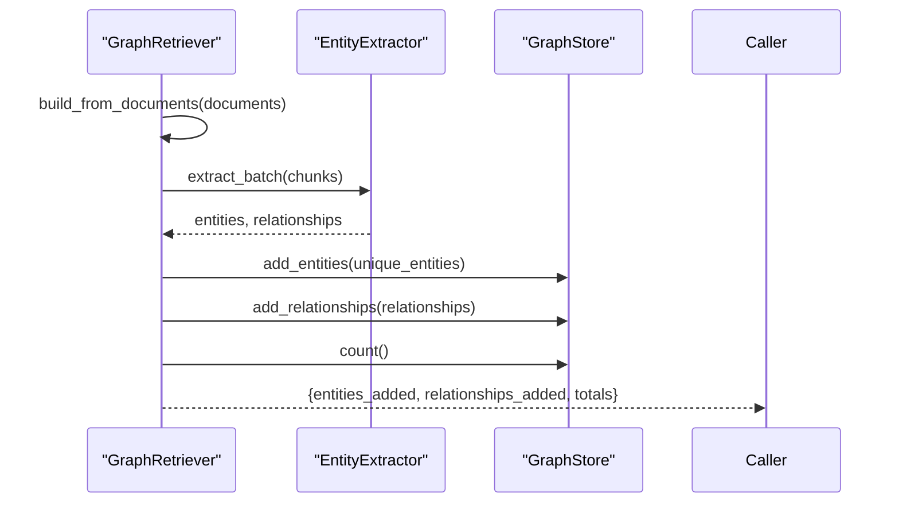
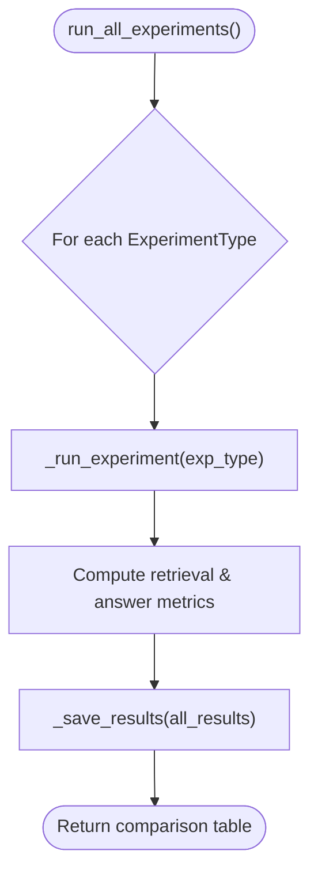
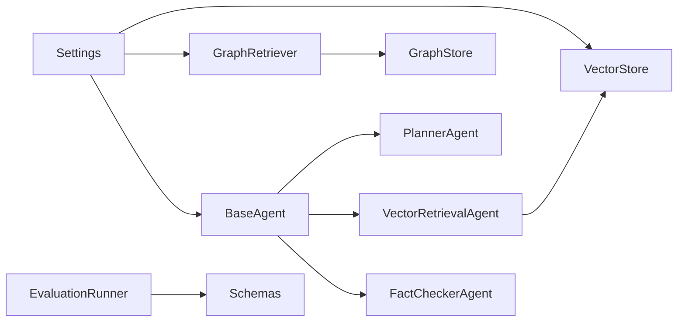

# AI Component Testing

<cite>
**Referenced Files in This Document**
- [README.md](file://README.md)
- [main.py](file://main.py)
- [src/config.py](file://src/config.py)
- [src/core/schemas.py](file://src/core/schemas.py)
- [src/core/base_agent.py](file://src/core/base_agent.py)
- [src/core/registry.py](file://src/core/registry.py)
- [src/agents/planner_agent.py](file://src/agents/planner_agent.py)
- [src/agents/vector_agent.py](file://src/agents/vector_agent.py)
- [src/agents/fact_checker_agent.py](file://src/agents/fact_checker_agent.py)
- [src/graph/retriever.py](file://src/graph/retriever.py)
- [src/rag/pipeline.py](file://src/rag/pipeline.py)
- [src/rag/vector_store.py](file://src/rag/vector_store.py)
- [src/evaluation/metrics.py](file://src/evaluation/metrics.py)
- [tests/test_core.py](file://tests/test_core.py)
</cite>

## Table of Contents
1. [Introduction](#introduction)
2. [Project Structure](#project-structure)
3. [Core Components](#core-components)
4. [Architecture Overview](#architecture-overview)
5. [Detailed Component Analysis](#detailed-component-analysis)
6. [Dependency Analysis](#dependency-analysis)
7. [Performance Considerations](#performance-considerations)
8. [Troubleshooting Guide](#troubleshooting-guide)
9. [Conclusion](#conclusion)
10. [Appendices](#appendices)

## Introduction
This document provides specialized testing guidance for the Graph RAG + Multi-Agent Research System with a focus on:
- Prompt engineering effectiveness
- Model output validation and hallucination detection
- Multi-agent coordination and message passing
- Task decomposition logic
- Retrieval system accuracy (vector similarity, knowledge graph traversal, web search)
- Non-deterministic output evaluation using fuzzy matching, semantic similarity, and confidence thresholds
- Benchmarking across model versions and retrieval strategies
- Extensibility for custom agents, new retrieval strategies, and evaluation metrics

The system orchestrates planning, parallel retrieval (vector, graph, web), reasoning, fact-checking, and report generation, with built-in evaluation metrics and a CLI/API entry point to run benchmarks.

**Section sources**
- [README.md:5-23](file://README.md#L5-L23)
- [README.md:132-140](file://README.md#L132-L140)

## Project Structure
The repository is organized into core abstractions, agent implementations, retrieval subsystems (RAG and Graph), evaluation utilities, API endpoints, and tests. The main entry point exposes commands to serve the API, ingest documents, build graphs, and run evaluations. Configuration is centralized and loaded from environment variables.

**Diagram sources**
- [main.py:24-68](file://main.py#L24-L68)
- [src/rag/pipeline.py:19-102](file://src/rag/pipeline.py#L19-L102)
- [src/graph/retriever.py:19-131](file://src/graph/retriever.py#L19-L131)
- [src/rag/vector_store.py:16-192](file://src/rag/vector_store.py#L16-L192)
- [src/core/base_agent.py:19-100](file://src/core/base_agent.py#L19-L100)
- [src/core/schemas.py:17-168](file://src/core/schemas.py#L17-L168)
- [src/config.py:21-82](file://src/config.py#L21-L82)

**Section sources**
- [main.py:71-106](file://main.py#L71-L106)
- [src/config.py:21-82](file://src/config.py#L21-L82)

## Core Components
- BaseAgent: Abstract interface for all agents; standardizes execution logging, token accounting, latency tracking, and message creation.
- Schemas: Strongly-typed models for queries, evidence, claims, reports, and evaluation results that ensure consistent data contracts across components.
- EvaluationRunner: Orchestrates experiments across baseline, vector RAG, graph RAG, hybrid RAG, and multi-agent modes; computes retrieval and answer quality metrics; persists results.
- RAGPipeline: End-to-end ingestion pipeline (load → chunk → embed → index) and query path for vector store.
- VectorStore: Abstraction over ChromaDB/FAISS for adding and searching embeddings.
- GraphRetriever: Builds knowledge graph from documents and provides entity/relationship queries.

Testing implications:
- Validate schemas for correctness and defaults.
- Assert agent execution logs capture tokens and latency.
- Verify retrieval metrics functions behave as expected.
- Ensure pipeline returns correct counts and indexed items.
- Confirm vector store search returns structured results with scores and metadata.

**Section sources**
- [src/core/base_agent.py:19-100](file://src/core/base_agent.py#L19-L100)
- [src/core/schemas.py:17-168](file://src/core/schemas.py#L17-L168)
- [src/evaluation/metrics.py:139-255](file://src/evaluation/metrics.py#L139-L255)
- [src/rag/pipeline.py:19-102](file://src/rag/pipeline.py#L19-L102)
- [src/rag/vector_store.py:16-192](file://src/rag/vector_store.py#L16-L192)
- [src/graph/retriever.py:19-131](file://src/graph/retriever.py#L19-L131)

## Architecture Overview
The system decomposes research questions via a Planner Agent, executes parallel retrieval through Vector, Graph, and Web agents, synthesizes evidence with a Reasoning Agent, verifies claims with a Fact Checker, and generates a structured report.

**Diagram sources**
- [src/agents/planner_agent.py:56-128](file://src/agents/planner_agent.py#L56-L128)
- [src/agents/vector_agent.py:34-92](file://src/agents/vector_agent.py#L34-L92)
- [src/graph/retriever.py:99-118](file://src/graph/retriever.py#L99-L118)
- [src/agents/fact_checker_agent.py:54-163](file://src/agents/fact_checker_agent.py#L54-L163)
- [README.md:5-23](file://README.md#L5-L23)

## Detailed Component Analysis

### Planner Agent: Task Decomposition Logic
- Purpose: Understands complex questions, decomposes them into sub-questions, assigns required agents, and defines execution order and dependencies.
- Prompt strategy: Uses a strict JSON schema to enforce structured plans; includes fallback parsing when LLM responses are malformed.
- Testing focus:
  - Validate JSON structure and field presence for sub-questions, execution_order, estimated_complexity.
  - Test fallback behavior when LLM returns non-JSON or invalid fields.
  - Verify dependencies and priority ordering make sense for sample questions.
  - Measure prompt sensitivity by varying available agents and include_web_search flags.

**Diagram sources**
- [src/agents/planner_agent.py:65-128](file://src/agents/planner_agent.py#L65-L128)

**Section sources**
- [src/agents/planner_agent.py:23-53](file://src/agents/planner_agent.py#L23-L53)
- [src/agents/planner_agent.py:65-128](file://src/agents/planner_agent.py#L65-L128)

### Vector Retrieval Agent: Search Strategy and Chunk Validation
- Purpose: Optimizes search terms via LLM, then retrieves top-k chunks from the vector store.
- Testing focus:
  - Validate that search phrases are generated and reformulated queries improve retrieval.
  - Check EvidenceChunk construction: IDs, content, source, relevance_score, retrieval_method.
  - Assert empty results when no vector store is configured.
  - Evaluate robustness to malformed LLM JSON outputs.

**Diagram sources**
- [src/agents/vector_agent.py:44-92](file://src/agents/vector_agent.py#L44-L92)
- [src/rag/vector_store.py:100-176](file://src/rag/vector_store.py#L100-L176)

**Section sources**
- [src/agents/vector_agent.py:17-31](file://src/agents/vector_agent.py#L17-L31)
- [src/agents/vector_agent.py:44-92](file://src/agents/vector_agent.py#L44-L92)

### Fact Checker Agent: Hallucination Detection Verification
- Purpose: Extracts factual claims from the reasoned answer and verifies each against evidence, producing verdicts and confidence scores.
- Testing focus:
  - Validate claim extraction and classification into supported/partially_supported/unsupported/contradicted/no_evidence.
  - Ensure hallucination_detected flag is set correctly based on unsupported/contradicted claims.
  - Test resilience to malformed LLM JSON responses.
  - Use evaluation metrics to compute hallucination_rate from verified claims.

**Diagram sources**
- [src/agents/fact_checker_agent.py:63-163](file://src/agents/fact_checker_agent.py#L63-L163)

**Section sources**
- [src/agents/fact_checker_agent.py:24-51](file://src/agents/fact_checker_agent.py#L24-L51)
- [src/agents/fact_checker_agent.py:63-163](file://src/agents/fact_checker_agent.py#L63-L163)

### RAG Pipeline: Ingestion and Query Flow
- Purpose: Loads documents, chunks text, generates embeddings, indexes into vector store, and supports querying.
- Testing focus:
  - Validate chunking produces expected number of chunks and preserves source metadata.
  - Ensure embeddings are generated and passed to vector store.
  - Confirm indexed counts match input chunks.
  - Query method should return structured results with scores and metadata.

**Diagram sources**
- [src/rag/pipeline.py:43-88](file://src/rag/pipeline.py#L43-L88)

**Section sources**
- [src/rag/pipeline.py:19-102](file://src/rag/pipeline.py#L19-L102)

### Vector Store: Similarity Search Accuracy
- Purpose: Provides add/search operations over ChromaDB or FAISS with consistent result shapes.
- Testing focus:
  - For ChromaDB: assert returned docs have content, source, score, and metadata; validate distance-to-score conversion.
  - For FAISS: ensure query embedding is provided; check k selection and bounds handling.
  - Edge cases: empty collections, missing embeddings, exceptions during search.

**Diagram sources**
- [src/rag/vector_store.py:16-192](file://src/rag/vector_store.py#L16-L192)

**Section sources**
- [src/rag/vector_store.py:16-192](file://src/rag/vector_store.py#L16-L192)

### Graph Retriever: Knowledge Graph Traversal Correctness
- Purpose: Builds knowledge graph from documents and queries entities/relationships with configurable hop depth and relationship types.
- Testing focus:
  - Validate entity deduplication and relationship aggregation.
  - Ensure query returns relationships around specified entities within hop limits.
  - Confirm summary methods return accurate counts and samples.

**Diagram sources**
- [src/graph/retriever.py:42-97](file://src/graph/retriever.py#L42-L97)
- [src/graph/retriever.py:99-131](file://src/graph/retriever.py#L99-L131)

**Section sources**
- [src/graph/retriever.py:19-131](file://src/graph/retriever.py#L19-L131)

### Evaluation Metrics: Retrieval and Answer Quality
- Purpose: Implements precision@k, recall@k, MRR, context relevance, factual correctness, faithfulness, hallucination rate, and benchmark runner.
- Testing focus:
  - Unit-test metric functions with known inputs and expected outputs.
  - Validate benchmark runner aggregates metrics per experiment type and saves results.
  - Ensure graceful fallbacks when LLM-based evaluators fail.

**Diagram sources**
- [src/evaluation/metrics.py:165-223](file://src/evaluation/metrics.py#L165-L223)

**Section sources**
- [src/evaluation/metrics.py:19-135](file://src/evaluation/metrics.py#L19-L135)
- [src/evaluation/metrics.py:139-255](file://src/evaluation/metrics.py#L139-L255)

### Existing Tests: Baseline Coverage
- Schema validation, chunking behavior, metric calculations, and document loading are covered in the test suite.
- Extend these patterns to cover agent interactions, retrieval accuracy, and hallucination detection.

**Section sources**
- [tests/test_core.py:12-123](file://tests/test_core.py#L12-L123)

## Dependency Analysis
Key coupling and cohesion:
- Agents depend on BaseAgent for standardized execution logging and LLM calls.
- Vector and Graph agents rely on their respective stores for retrieval.
- Evaluation depends on schemas and LLM client for scoring.
- Configuration centralizes provider and storage settings used across components.

**Diagram sources**
- [src/core/base_agent.py:19-100](file://src/core/base_agent.py#L19-L100)
- [src/agents/vector_agent.py:34-92](file://src/agents/vector_agent.py#L34-L92)
- [src/graph/retriever.py:19-131](file://src/graph/retriever.py#L19-L131)
- [src/evaluation/metrics.py:139-255](file://src/evaluation/metrics.py#L139-L255)
- [src/config.py:21-82](file://src/config.py#L21-L82)

**Section sources**
- [src/core/base_agent.py:19-100](file://src/core/base_agent.py#L19-L100)
- [src/config.py:21-82](file://src/config.py#L21-L82)

## Performance Considerations
- Token usage and latency are tracked per agent call; aggregate stats can be used to compare model versions and retrieval strategies.
- Batched embedding and indexing reduce overhead in ingestion pipelines.
- Vector store choice (ChromaDB vs FAISS) impacts memory and speed; ensure appropriate configuration for dataset size.
- Use deterministic temperatures (e.g., 0.0–0.2) for stable evaluation runs.

[No sources needed since this section provides general guidance]

## Troubleshooting Guide
Common issues and mitigations:
- Malformed LLM JSON responses: Agents implement fallback parsing to produce safe defaults; tests should assert fallback paths.
- Missing vector store: Vector agent logs warnings and returns empty results; ensure store initialization and collection existence.
- FAISS requires query embeddings: Provide embeddings explicitly or use pipeline’s query method.
- Graph store connectivity: Validate Neo4j URI and credentials; handle connection errors gracefully.
- Evaluation failures: LLM-based metrics fall back to ROUGE or word overlap; ensure optional dependencies are installed.

**Section sources**
- [src/agents/planner_agent.py:97-128](file://src/agents/planner_agent.py#L97-L128)
- [src/agents/vector_agent.py:73-75](file://src/agents/vector_agent.py#L73-L75)
- [src/rag/vector_store.py:151-163](file://src/rag/vector_store.py#L151-L163)
- [src/evaluation/metrics.py:105-124](file://src/evaluation/metrics.py#L105-L124)

## Conclusion
This testing guide aligns with the system’s architecture and existing code to ensure robust validation of prompt engineering, retrieval accuracy, multi-agent coordination, and hallucination detection. By leveraging the base agent logging, schema contracts, and evaluation metrics, teams can systematically benchmark model versions, assess retrieval quality, and measure performance under varied conditions while maintaining extensibility for custom agents and strategies.

[No sources needed since this section summarizes without analyzing specific files]

## Appendices

### Testing Strategies and Examples

- Prompt Engineering Effectiveness
  - Compare planner prompts with and without web search availability; measure changes in sub-question count, dependency complexity, and downstream retrieval success.
  - Validate vector retrieval prompts by checking if reformulated queries yield higher relevance scores.

- Model Output Validation
  - Use schemas to assert response structures; parse and validate JSON outputs from LLM-driven agents.
  - Apply confidence thresholds on claims and evidence to filter low-quality results.

- Hallucination Detection Verification
  - Compute hallucination_rate from verified claims; assert thresholds for acceptable rates.
  - Validate fact checker fallback behavior when parsing fails.

- Multi-Agent Coordination and Message Passing
  - Assert AgentMessage payloads contain expected keys (sender, receiver, content, payload).
  - Verify execution logs record tokens, latency, and timestamps per agent call.

- Task Decomposition Logic
  - Test planner’s ability to create valid TaskPlan with correct execution_order and dependencies.
  - Simulate edge cases: single-sentence questions, ambiguous queries, and conflicting constraints.

- Retrieval Systems
  - Vector similarity search accuracy: Compare top-K results against ground-truth relevant sets; compute precision@k, recall@k, MRR.
  - Knowledge graph traversal: Validate hop_depth and relationship_types filters; ensure entity context retrieval returns meaningful snippets.
  - Web search result validation: If integrated, assert titles/snippets relate to query and include source attribution.

- Non-Deterministic Outputs
  - Use semantic similarity checks (e.g., sentence embeddings) to compare answers across runs.
  - Apply fuzzy matching for textual overlap; combine with confidence scores to accept/reject outputs.

- Benchmarking Approaches
  - Use EvaluationRunner to run all five experiment configurations; compare metrics across model versions and retrieval strategies.
  - Persist and diff results over time to track improvements.

- Custom Agents and New Retrieval Strategies
  - Implement BaseAgent subclass with execute and get_system_prompt; register via AgentRegistry for orchestration.
  - Integrate new retrievers into VectorStore or GraphRetriever interfaces; update tests to validate new result shapes.

- Evaluation Metrics Extensions
  - Add domain-specific metrics to metrics module; integrate into EvaluationRunner to compute and persist extended scores.

**Section sources**
- [src/core/base_agent.py:42-100](file://src/core/base_agent.py#L42-L100)
- [src/core/schemas.py:107-168](file://src/core/schemas.py#L107-L168)
- [src/agents/planner_agent.py:65-128](file://src/agents/planner_agent.py#L65-L128)
- [src/agents/vector_agent.py:44-92](file://src/agents/vector_agent.py#L44-L92)
- [src/agents/fact_checker_agent.py:63-163](file://src/agents/fact_checker_agent.py#L63-L163)
- [src/graph/retriever.py:99-131](file://src/graph/retriever.py#L99-L131)
- [src/rag/vector_store.py:100-176](file://src/rag/vector_store.py#L100-L176)
- [src/evaluation/metrics.py:19-135](file://src/evaluation/metrics.py#L19-L135)
- [src/evaluation/metrics.py:165-223](file://src/evaluation/metrics.py#L165-L223)
- [tests/test_core.py:72-102](file://tests/test_core.py#L72-L102)