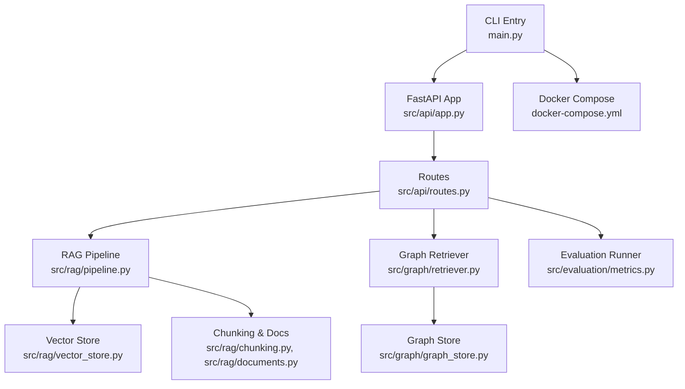
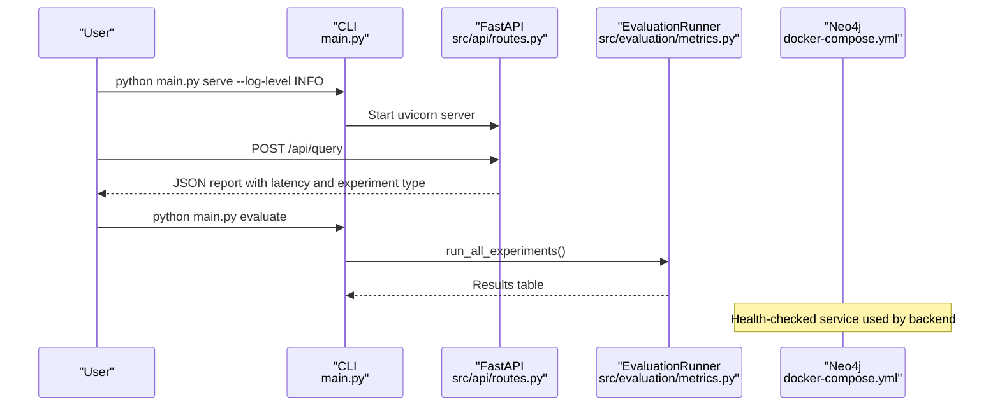
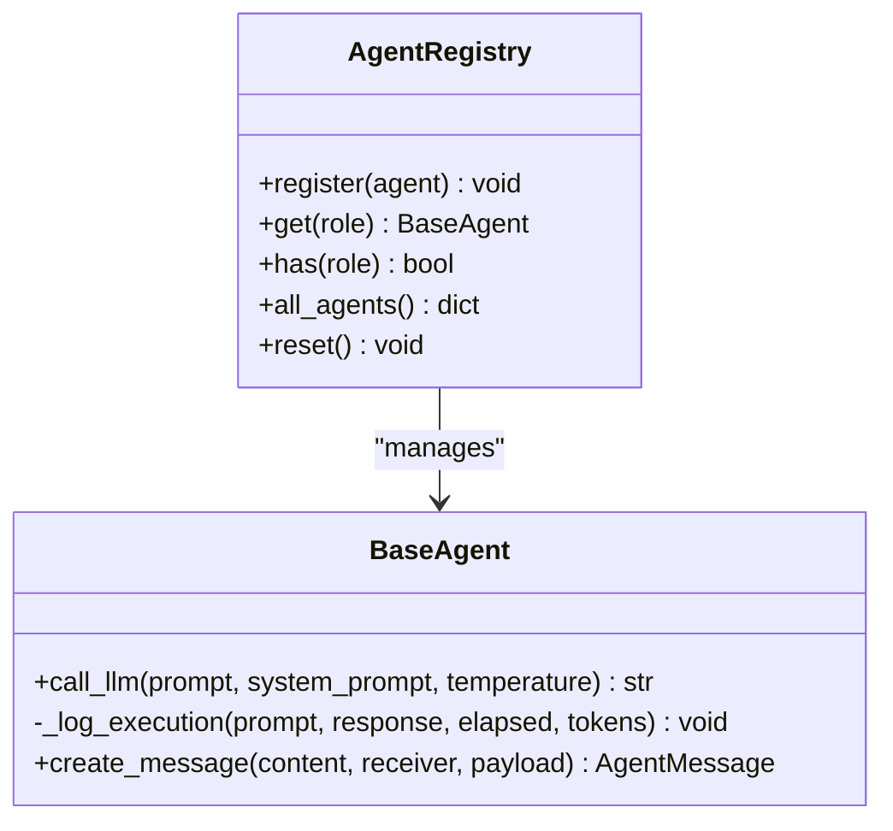
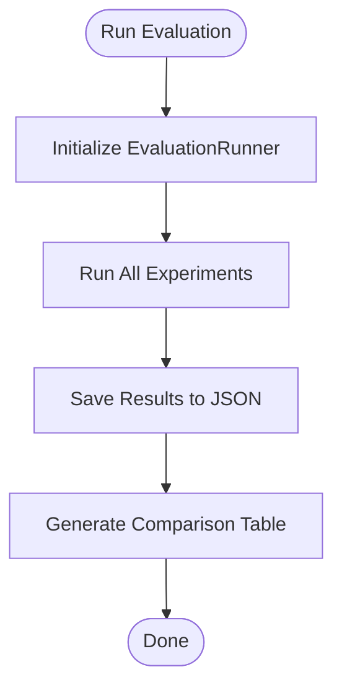
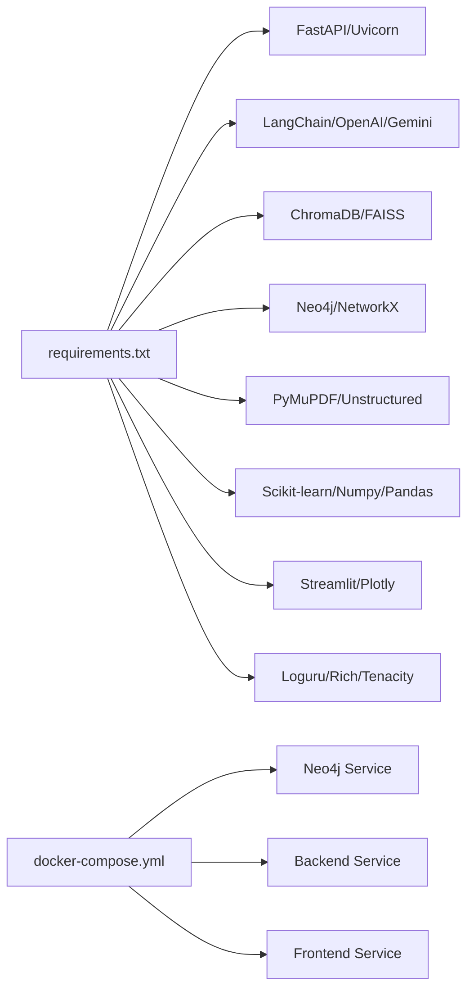

# Code Quality Practices

<cite>
**Referenced Files in This Document**
- [main.py](file://main.py)
- [requirements.txt](file://requirements.txt)
- [README.md](file://README.md)
- [docker-compose.yml](file://docker-compose.yml)
- [src/config.py](file://src/config.py)
- [src/core/base_agent.py](file://src/core/base_agent.py)
- [src/core/registry.py](file://src/core/registry.py)
- [src/evaluation/metrics.py](file://src/evaluation/metrics.py)
- [src/api/routes.py](file://src/api/routes.py)
- [tests/test_core.py](file://tests/test_core.py)
</cite>

## Table of Contents
1. Introduction
2. Project Structure
3. Core Components
4. Architecture Overview
5. Detailed Component Analysis
6. Dependency Analysis
7. Performance Considerations
8. Troubleshooting Guide
9. Conclusion
10. Appendices

## Introduction
This document establishes code quality practices and standards for the Graph RAG + Multi-Agent Research System. It covers static analysis, linting, formatting, code review processes, contribution guidelines, debugging and logging strategies, observability, security scanning, dependency vulnerability checks, and code quality metrics. It also provides examples of common issues and resolutions, along with guidance for automated quality checks and pre-commit hooks setup.

## Project Structure
The project is organized into modular Python packages:
- CLI entry point and server orchestration
- Agent-based research pipeline (planning, retrieval, reasoning, fact-checking, reporting)
- RAG components (documents, chunking, embeddings, vector store, pipeline)
- Knowledge graph components (entity extraction, graph store, retriever)
- API layer (FastAPI app and routes)
- Evaluation and metrics
- Frontend (Streamlit)
- Docker configuration for local development and deployment

**Diagram sources**
- [main.py:24-28](file://main.py#L24-L28)
- [src/api/routes.py:333-353](file://src/api/routes.py#L333-L353)
- [src/evaluation/metrics.py:139-224](file://src/evaluation/metrics.py#L139-L224)
- [docker-compose.yml:22-42](file://docker-compose.yml#L22-L42)

**Section sources**
- [README.md:81-126](file://README.md#L81-L126)
- [docker-compose.yml:1-56](file://docker-compose.yml#L1-L56)

## Core Components
Key components that influence code quality and reliability:
- Centralized settings via Pydantic Settings with environment variable loading and caching
- Logging setup using Loguru across CLI and services
- Agent base class with execution logging and token accounting
- Evaluation runner producing structured results and comparison tables
- API routes exposing health, ingestion, graph building, query, and evaluation endpoints

Practical implications:
- Use centralized configuration to avoid magic strings and ensure consistent behavior across environments
- Leverage structured logging for traceability and debugging
- Capture agent execution metadata to support performance and cost monitoring
- Standardize evaluation outputs for reproducible experiments

**Section sources**
- [src/config.py:21-82](file://src/config.py#L21-L82)
- [main.py:14-28](file://main.py#L14-L28)
- [src/core/base_agent.py:43-80](file://src/core/base_agent.py#L43-L80)
- [src/evaluation/metrics.py:139-224](file://src/evaluation/metrics.py#L139-L224)
- [src/api/routes.py:333-353](file://src/api/routes.py#L333-L353)

## Architecture Overview
The system composes multiple agents and data stores behind a FastAPI interface. The CLI orchestrates serving, ingestion, graph building, and evaluation. Docker Compose provisions Neo4j and application containers with health checks and environment variables.

**Diagram sources**
- [main.py:24-28](file://main.py#L24-L28)
- [src/api/routes.py:333-353](file://src/api/routes.py#L333-L353)
- [src/evaluation/metrics.py:139-224](file://src/evaluation/metrics.py#L139-L224)
- [docker-compose.yml:4-21](file://docker-compose.yml#L4-L21)

## Detailed Component Analysis

### Configuration Management
- Centralized settings loaded from environment variables with sensible defaults
- Cached singleton access to avoid repeated initialization
- Strict typing and validation via Pydantic models

Quality impact:
- Reduces configuration drift between environments
- Improves error detection at startup time
- Simplifies testing by overriding environment variables

**Section sources**
- [src/config.py:21-82](file://src/config.py#L21-L82)

### Logging and Observability
- Loguru configured at CLI entry point with level control
- Agent execution logs include timestamps, tokens, and latency
- Evaluation runner persists results and prints formatted tables

Quality impact:
- Enables fast triage of issues in development and production
- Supports performance profiling and cost tracking
- Facilitates reproducibility through saved results

**Section sources**
- [main.py:14-28](file://main.py#L14-L28)
- [src/core/base_agent.py:43-80](file://src/core/base_agent.py#L43-L80)
- [src/evaluation/metrics.py:222-224](file://src/evaluation/metrics.py#L222-L224)

### Agent Registry and Base Agent
- Registry maps agent roles to instances with lookup and reset capabilities
- Base agent standardizes LLM calls, timing, token counting, and execution logging

Quality impact:
- Enforces consistent agent behavior and instrumentation
- Provides a clear extension point for new agents
- Ensures uniform telemetry across agents

**Diagram sources**
- [src/core/registry.py:16-50](file://src/core/registry.py#L16-L50)
- [src/core/base_agent.py:43-80](file://src/core/base_agent.py#L43-L80)

**Section sources**
- [src/core/registry.py:16-50](file://src/core/registry.py#L16-L50)
- [src/core/base_agent.py:43-80](file://src/core/base_agent.py#L43-L80)

### Evaluation Metrics and Benchmarking
- Functions compute precision@k, recall@k, MRR, hallucination rate, factual correctness, and faithfulness
- EvaluationRunner runs experiments, saves JSON results, and generates comparison tables

Quality impact:
- Quantifies retrieval and generation quality
- Supports continuous improvement via measurable targets
- Encourages testable, deterministic evaluation pipelines

**Diagram sources**
- [src/evaluation/metrics.py:139-224](file://src/evaluation/metrics.py#L139-L224)

**Section sources**
- [src/evaluation/metrics.py:69-134](file://src/evaluation/metrics.py#L69-L134)
- [src/evaluation/metrics.py:139-224](file://src/evaluation/metrics.py#L139-L224)

### API Endpoints and Error Handling
- Routes expose ingestion, graph building, querying, and evaluation
- Placeholder endpoints raise HTTP exceptions for unimplemented features

Quality impact:
- Clear separation of concerns between API and business logic
- Consistent error signaling for clients
- Extensible design for adding storage or persistence layers

**Section sources**
- [src/api/routes.py:333-353](file://src/api/routes.py#L333-L353)

### Testing Strategy
- Pytest-based tests validate schemas, chunking, evaluation metrics, and document loading
- Tests use temporary paths and isolated imports to reduce coupling

Quality impact:
- Prevents regressions in core functionality
- Encourages small, focused unit tests
- Validates assumptions about data shapes and behaviors

**Section sources**
- [tests/test_core.py:12-52](file://tests/test_core.py#L12-L52)
- [tests/test_core.py:54-102](file://tests/test_core.py#L54-L102)
- [tests/test_core.py:104-123](file://tests/test_core.py#L104-L123)

## Dependency Analysis
External dependencies are declared in requirements.txt and orchestrated via Docker Compose. Key categories:
- Web framework and ASGI server
- LLM integrations and embeddings
- Vector databases and knowledge graphs
- Document processing and web search
- Evaluation and visualization
- Utilities and deployment tools

**Diagram sources**
- [requirements.txt:1-60](file://requirements.txt#L1-L60)
- [docker-compose.yml:4-56](file://docker-compose.yml#L4-L56)

**Section sources**
- [requirements.txt:1-60](file://requirements.txt#L1-L60)
- [docker-compose.yml:1-56](file://docker-compose.yml#L1-L56)

## Performance Considerations
- Use cached settings to avoid redundant configuration loads
- Instrument agent calls with latency and token counts to identify bottlenecks
- Persist evaluation results to track performance trends over time
- Tune chunk size and overlap to balance retrieval quality and throughput
- Prefer asynchronous operations where possible for I/O-bound tasks (e.g., network requests)

[No sources needed since this section provides general guidance]

## Troubleshooting Guide
Common issues and resolutions:
- Missing environment variables: Validate .env presence and required keys; settings will fail fast if invalid
- LLM provider misconfiguration: Ensure correct provider selection and model names
- Database connectivity: Verify Neo4j container health and credentials in docker-compose
- Ingestion failures: Check file formats and sizes against configured limits
- Evaluation errors: Inspect saved JSON results and printed tables for metric anomalies

Debugging techniques:
- Increase log verbosity via CLI flag to capture detailed traces
- Use agent execution logs to correlate prompts, responses, and costs
- Isolate failing components by running subcommands (serve, ingest, graph, evaluate) independently

**Section sources**
- [main.py:71-106](file://main.py#L71-L106)
- [src/config.py:21-82](file://src/config.py#L21-L82)
- [docker-compose.yml:4-21](file://docker-compose.yml#L4-L21)
- [src/evaluation/metrics.py:222-224](file://src/evaluation/metrics.py#L222-L224)

## Conclusion
Adopting centralized configuration, structured logging, standardized agent instrumentation, and robust evaluation practices significantly improves code quality and maintainability. Coupled with disciplined testing and clear API contracts, these practices enable reliable development and smooth operations in both development and production environments.

[No sources needed since this section summarizes without analyzing specific files]

## Appendices

### Static Analysis, Linting, and Formatting Standards
Recommended tools and configurations:
- Linting: ruff or flake8 with strict rules; enforce import ordering and unused imports
- Type checking: mypy with strict mode; annotate function signatures and return types
- Formatting: black for consistent style; isort for import organization
- Pre-commit hooks: configure ruff, black, isort, mypy, and pytest on commit

Implementation steps:
- Add tool dependencies to requirements.txt under a dev section
- Create configuration files (e.g., pyproject.toml or .ruff.toml)
- Install pre-commit and define hooks to run checks automatically

[No sources needed since this section provides general guidance]

### Code Review Processes and Pull Request Guidelines
- Require passing tests and linting before merging
- Mandate descriptive PR titles and change summaries
- Encourage small, focused PRs with clear scope
- Use reviewers familiar with the affected modules
- Validate configuration changes and environment impacts

[No sources needed since this section provides general guidance]

### Contribution Standards and Python Best Practices
- Follow PEP 8 conventions and project-specific style enforced by formatters
- Write concise docstrings and keep functions focused
- Prefer explicit error handling and meaningful exception messages
- Keep dependencies minimal and well-documented
- Add tests for new features and edge cases

[No sources needed since this section provides general guidance]

### Security Scanning and Dependency Vulnerability Checking
- Use safety or pip-audit to scan for known vulnerabilities in dependencies
- Pin versions in requirements.txt to ensure reproducibility
- Regularly update dependencies and review changelogs
- Avoid committing secrets; use environment variables and secret managers

[No sources needed since this section provides general guidance]

### Code Quality Metrics Collection
- Track evaluation metrics (precision@k, recall@k, MRR, hallucination rate, factual correctness, faithfulness)
- Record latency and token usage per agent call
- Persist results to JSON for trend analysis and reporting
- Integrate metrics into CI to prevent regressions

**Section sources**
- [src/evaluation/metrics.py:69-134](file://src/evaluation/metrics.py#L69-L134)
- [src/evaluation/metrics.py:222-224](file://src/evaluation/metrics.py#L222-L224)

### Examples of Common Issues and Resolutions
- Issue: Inconsistent logging levels across commands
  Resolution: Centralize logging setup in CLI and propagate log level to all components
- Issue: Missing agent telemetry
  Resolution: Use base agent execution logging to capture latency and tokens uniformly
- Issue: Unvalidated inputs in API
  Resolution: Add request/response validation with Pydantic schemas and return appropriate HTTP status codes
- Issue: Non-deterministic evaluations
  Resolution: Fix random seeds and persist results for reproducibility

[No sources needed since this section provides general guidance]

### Automated Quality Checks and Pre-commit Hooks Setup
Suggested hook sequence:
- ruff (lint)
- black (format)
- isort (imports)
- mypy (type check)
- pytest (unit tests)

Configuration tips:
- Fail fast on first error during pre-commit
- Cache dependencies to speed up checks
- Exclude generated files and large datasets from scans

[No sources needed since this section provides general guidance]